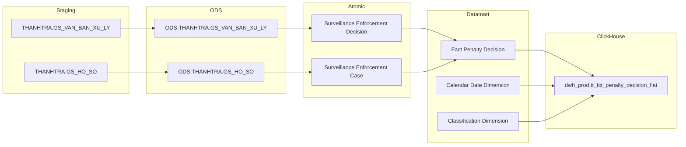
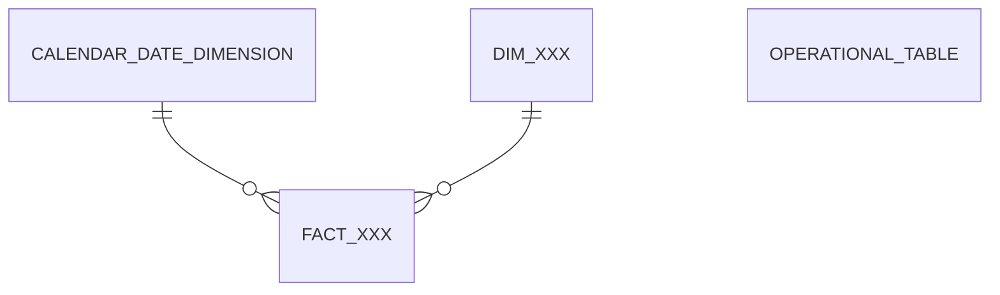

# Skill: Sinh tài liệu PTTK & TKCSLD — Gold/Datamart Layer

Đọc file này TRƯỚC KHI bắt đầu gen tài liệu cho bất kỳ module nào.

## Mô hình luồng dữ liệu 5 tầng (Data Modeler chốt 2026-11-17)

```
Staging ──1:1──▶ ODS ──▶ Atomic ──▶ Datamart (Dimension, Fact) ──▶ ClickHouse (bảng phẳng)
 bảng nguồn      bản sao     Core 3NF     schema dtm trên Lakehouse        schema dwh_prod
 SRC.TABLE      ODS.SRC.TABLE                                            {phân hệ}_*_flat
```

| Tầng | Quy tắc cứng khi viết tài liệu |
|---|---|
| Staging | Mỗi bảng nguồn 1 node, nhãn `SRC.TABLE`. |
| **ODS** | **1:1 với Staging**: mỗi bảng Staging có ĐÚNG 1 bảng ODS cùng cấu trúc (nhãn `ODS.SRC.TABLE`), không gộp/tách/thêm/bớt. ODS chỉ làm sạch kỹ thuật (khử trùng lặp cùng ngày, chuẩn hóa kiểu, kiểm tra toàn vẹn). **Atomic KHÔNG đọc trực tiếp Staging** — mọi cạnh vào Atomic xuất phát từ node ODS. |
| Atomic | Core 3NF, SCD4A; nhận dữ liệu từ ODS. |
| Datamart | Dimension + Fact (+ Operational) trên Lakehouse, schema `dtm`. |
| ClickHouse | Bảng phẳng = Fact JOIN các Dimension, schema `dwh_prod`, tên `dwh_prod.{phân hệ}_*_flat`. Tên bảng/ENGINE/PARTITION/ORDER BY lấy từ **DDL thật** `Datamart/flat-table/{M}/01_create_*_flat_tables.sql` qua `pttk_facts.py flat` — KHÔNG tự đặt. |

> Mọi diagram và mọi đoạn "Mô tả luồng" phải nhất quán với 5 tầng này. Markdown PTTK cũ 3 tầng (Staging → Atomic) vẫn ghép được
> nhưng bị cảnh báo; sinh lại theo Bước 2 bên dưới. Kiểm bằng `pttk_facts.py lint` (xem Phase 1).

## Tài nguyên đi kèm

- **Scripts:**
  - `scripts/doc_registry.py` — **nguồn sự thật duy nhất**: bản mẫu hiện hành, 11 phân hệ (số mục 3.1.X + tên PTTK/TKCSLD + tiền tố bảng phẳng), 5 tầng, schema `dtm`/`dwh_prod`. Chạy không tham số để xem trạng thái bản mẫu
  - `scripts/render_datamart_md.py` — **Phase 1 TKCSLD: sinh toàn bộ ERD + bảng 8/12 cột bằng code** (2026-10-15)
  - `scripts/pttk_facts.py` — **Phase 1 PTTK: dữ kiện máy sinh** (0 token LLM): `job-info` (khối 3.1.X.1 từ `reference/etl_job_info.yaml`), `flat` (bảng phẳng ClickHouse từ DDL), `lint` (kiểm Markdown PTTK 5 tầng + ODS 1:1)
  - `scripts/merge_md.py` — Phase 2.5: gộp Markdown nhiều module (chỉ dùng cho đường pandoc/`build_docx.py --module ALL`)
  - `scripts/build_docx.py` — Phase 3 (đường pandoc): MD → DOCX từng module hoặc quyển tổng, theo bản mẫu hiện hành
  - `scripts/update_q5_with_datamart_modules.py` — **Phase 3 (đường khuyến nghị cho PTTK quyển tổng)**: ghép Mục 3.1 của 11 phân hệ vào đúng bản mẫu PTTK, giữ nguyên phần còn lại của bản mẫu
  - `scripts/build_q5_master.py` — DEPRECATED (quyển pandoc cũ 10 phân hệ; chỉ chạy với `--legacy`)
  - `scripts/clean_description.py` — C.5: `clean()` + `find_leaks()` (dùng chung với Gate 8 luật D8 `L2-DESC-DOC-LEAK`)
- **Reference:**
  - `reference/etl_job_info.yaml` — giá trị mục "Thông tin chung luồng đồng bộ" của 11 phân hệ + cờ `confirmed`
  - `reference/data_domain_mapping.md` — C.2: Data Domain → kiểu dữ liệu
  - `reference/column_rules.md` — C.4: quy tắc P/F Key, Nullable, Unique, ETL Rules
  - `reference/module_names_vi.md` — A.1: tên module tiếng Việt (đồng bộ với registry)
- **Bản mẫu (không commit — `*.docx` bị .gitignore, mỗi máy tự chép vào `docs/templates/sample/`):**
  - PTTK: `Viettel_Review_UBCKNN_Tai_lieu_phan_tich_thiet_ke_v1.2_202611114.docx`
  - TKCSLD: `Viettel_Review_UBCKNN_Thiet_ke_co_so_du_lieu_v1.2_20261112_final.docx`

## Điều kiện tiên quyết

- [ ] `python .claude/skills/datamart-gen-docs/scripts/doc_registry.py` báo cả 2 bản mẫu `[CÓ]` (thiếu → lùi về bản cũ kèm cảnh báo, tài liệu lệch cấu trúc v1.2)
- [ ] `Datamart/hld/DTM_{MODULE}_HLD.md` tồn tại và có Section 1 — Data Lineage
- [ ] `Datamart/hld/DTM_{MODULE}_Entities.csv` tồn tại
- [ ] `Datamart/lld/{MODULE}/DTM_{MODULE}_*.csv` (LLD per-table) tồn tại — file LLD per-table `Datamart/lld/{MODULE}/DTM_*.csv` cũ KHÔNG còn dùng
- [ ] `python .claude/skills/datamart-gen-docs/scripts/render_datamart_md.py -m {MODULE} --report-only` → 0 lỗi chặn (thực thể thiếu LLD / mô tả rò rỉ)
- [ ] `DataModel/working/Atomic/aggregate/atomic_attributes.yaml` tồn tại — dùng để lookup `source_system` cho cột Hệ thống nguồn trong bảng Physical
- [ ] Python deps: `python -c "import docx"` OK — cài: `pip install python-docx`
- [ ] mmdc (chỉ cần cho Phase 3 DOCX): `npm install -g @mermaid-js/mermaid-cli`

---

## QUY TRÌNH (BẮT BUỘC)

```
[Per module]
Phase 1:   Claude gen 2 file Markdown cho từng module
Phase 2:   Người dùng review + phê duyệt (KHÔNG tự động)

[Sau khi tất cả module đã duyệt]
Phase 2.5: Merge Markdown các module → 2 file tổng
Phase 3:   Claude chạy build_docx.py → gen DOCX tổng
```

> **KHÔNG bỏ qua Phase nào. KHÔNG gen DOCX khi chưa có phê duyệt Markdown.**
>
> Phase 2.5 + Phase 3 chạy sau khi TẤT CẢ module cần ghép đã phê duyệt.
> Nếu chỉ cần DOCX riêng lẻ (không ghép), bỏ qua Phase 2.5 và chạy Phase 3 trực tiếp.

---

## PHASE 1 — GEN MARKDOWN

### Bước 1: Đọc input (CHỈ cho PTTK)

TKCSLD không cần đọc gì — script tự đọc (Bước 3). Cho PTTK, đọc HLD theo lát cắt (KHÔNG Read nguyên file —
hook `dm_guard` sẽ chặn):

```bash
python .claude/skills/datamart-review/scripts/ctx_slice.py -m {MODULE} --sections 1 --print   # Data Lineage + Cụm
```

- Từ Section 1 HLD: danh sách Cụm, Staging sources, flowchart từng cụm
- Từ `Entities.csv` (nhỏ, Read được): tên logical/physical của bảng Gold cho node Datamart
- Dữ kiện do MÁY sinh (không tự viết — Bước 2):
  ```bash
  python .claude/skills/datamart-gen-docs/scripts/pttk_facts.py job-info -m {MODULE}   # khối 3.1.X.1 (chỉ dòng confirmed)
  python .claude/skills/datamart-gen-docs/scripts/pttk_facts.py flat -m {MODULE}       # bảng phẳng ClickHouse + node mermaid + câu mô tả mẫu
  python .claude/skills/datamart-gen-docs/scripts/pttk_facts.py flat -m {MODULE} --table {bảng Datamart}   # chỉ bảng phẳng của 1 bảng Gold
  ```

### Bước 2: Gen `DTM_{MODULE}_PTTK.md`

Tuân thủ **PHẦN B** của instruction bên dưới. Thứ tự output:

```
## 3.1.X LUỒNG ĐỒNG BỘ DỮ LIỆU CHO NHÓM BÁO CÁO [Tên module]      ← X theo scripts/doc_registry.py; script ghép quyển tự đổi
                                                                      thành "3.1.X  Luồng đồng bộ dữ liệu cho nhóm báo cáo {tên}" (bản mẫu v1.2)
### 3.1.X.1 Thông tin chung luồng đồng bộ
(7 dòng bullet — dán NGUYÊN khối do `pttk_facts.py job-info` in ra; không tự điền)

### 3.1.X.2 Luồng nghiệp vụ

#### 3.1.X.2.1 Nhóm thông tin [Tên nhóm 1]
(diagram mermaid 5 tầng + Mục đích + Mô tả luồng gồm 4 đoạn: Staging → ODS, ODS → Atomic, Atomic → Datamart, Datamart → ClickHouse)

#### 3.1.X.2.2 Nhóm thông tin [Tên nhóm 2]
...
```

**Số mục X** và tên module: `python .claude/skills/datamart-gen-docs/scripts/doc_registry.py` (11 phân hệ, TT=1 … VP=11). Module chưa có trong registry → hỏi người dùng, thêm vào registry (+ `reference/module_names_vi.md`) rồi mới sinh.

**Kiểm sau khi viết (bắt buộc, trước khi báo Phase 1 xong):**

```bash
python .claude/skills/datamart-gen-docs/scripts/pttk_facts.py lint -m {MODULE}     # 0 cảnh báo mới được báo "xong"
python .claude/skills/datamart-gen-docs/scripts/pttk_facts.py job-info -m {MODULE} --check   # khối 3.1.X.1 khớp cấu hình
```

`lint` kiểm từng nhóm thông tin: đủ 4 đoạn mô tả theo thứ tự; diagram đủ 5 subgraph; **ODS 1:1 Staging** (mỗi node Staging có node ODS `ODS.SRC.TABLE` + cạnh nối, không có ODS thừa);
không có cạnh nhảy cóc Staging → Atomic; node ClickHouse ở schema `dwh_prod` và chỉ nhận cạnh từ tầng Datamart; không có cạnh Dim → Fact trong tầng Datamart.

### Bước 3: Sinh `DTM_{MODULE}_TKCSLD.md` bằng script (KHÔNG tự gõ bảng)

```bash
# 1) báo cáo chất lượng trước — lỗi chặn phải xử lý (thực thể thiếu LLD, mô tả rò rỉ)
python .claude/skills/datamart-gen-docs/scripts/render_datamart_md.py -m {MODULE} --report-only
# 2) sinh — nếu DTM_{MODULE}_TKCSLD.md đã có, script ghi DTM_{MODULE}_TKCSLD.rendered.md để so sánh;
#    chỉ thêm --overwrite khi Data Modeler đồng ý thay bản cũ (bản cũ được sao lưu .bak-<ts>)
python .claude/skills/datamart-gen-docs/scripts/render_datamart_md.py -m {MODULE} [--overwrite] [--with-tech-cols]
```

Script code hóa toàn bộ PHẦN C (C.4 P/F Key/Nullable/Unique, C.5 clean mô tả, C.6 ERD 3 tầng, C.7–C.9 bảng).
Tên bảng/cột lấy đúng từ LLD per-table (nguồn sự thật) — tài liệu cũ còn tên viết tắt kiểu `fnd_mgt_co_dim`
sẽ được thay bằng tên LLD hiện hành. Lineage mart→mart ghi `DTM.{bảng}` / Hệ thống nguồn `Datamart`.

**LLM KHÔNG sửa tay bảng/ERD trong file sinh ra.** Sai ở đâu → sửa LLD/Entities (qua apply_patch.py / per-table CSV)
rồi sinh lại. Cảnh báo `MÔ TẢ RỖNG SAU CLEAN` = mô tả LLD toàn ghi chú kỹ thuật → Data Modeler viết lại mô tả
nghiệp vụ trong LLD; cảnh báo `LINEAGE` = bảng nguồn không có trong `atomic_attributes.yaml` (VD Atomic đã xóa LLD
`securities_trade`) → báo Atomic team, không tự điền.

### Bước 4: Lưu file

```
docs/output/datamart/{MODULE}/DTM_{MODULE}_PTTK.md
docs/output/datamart/{MODULE}/DTM_{MODULE}_TKCSLD.md
```

Tạo thư mục nếu chưa có. Thông báo cho người dùng đường dẫn file và yêu cầu review.

---

## PHASE 2 — REVIEW (CHỜ NGƯỜI DÙNG)

Sau khi gen xong Phase 1:
1. Thông báo người dùng mở 2 file MD trong VS Code để review
2. **DỪNG** — không làm gì thêm cho đến khi người dùng phản hồi
3. Nếu có chỉnh sửa → cập nhật file MD → thông báo xong, tiếp tục chờ
4. Khi người dùng nói "phê duyệt", "approved", "OK rồi", "đồng ý" → chuyển Phase 3

**CHECKPOINT bắt buộc trước Phase 3:**
- [ ] Tên module tiếng Việt đúng
- [ ] `pttk_facts.py lint -m {MODULE}` = 0 cảnh báo (5 tầng, ODS 1:1 Staging, không cạnh nhảy cóc Staging → Atomic, bảng phẳng ở schema `dwh_prod`)
- [ ] `pttk_facts.py job-info -m {MODULE} --check` khớp; dòng chưa `confirmed` đã được báo người dùng (6/7 dòng hiện chưa xác nhận)
- [ ] Diagram PTTK: 5 subgraph Staging/ODS/Atomic/Datamart/ClickHouse đúng; **tất cả node** dùng `ID["label"]` syntax — Staging: node ID không dấu chấm; ODS: `ODS_` + ID Staging; Atomic: ID có `_`, label bỏ `_`; Datamart: ID = tên physical, label = tên logical từ Entities.csv; ClickHouse: label `dwh_prod.{bảng phẳng}`
- [ ] TKCSLD: 3 ERD đúng tầng (Conceptual/Logic/Physical)
- [ ] TKCSLD sinh bằng `render_datamart_md.py` (không sửa tay); `--report-only` 0 lỗi chặn; cảnh báo MÔ TẢ RỖNG / LINEAGE đã báo Data Modeler

---

## PHASE 2.5 — MERGE MARKDOWN (khi cần file tổng)

Sau khi tất cả module đã phê duyệt, chạy `merge_md.py` để gộp thành file tổng:

```bash
# Gộp PTTK tổng (thứ tự module = thứ tự xuất hiện trong tài liệu)
python .claude/skills/datamart-gen-docs/scripts/merge_md.py \
  --modules TT FMS GSTT --type pttk

# Gộp TKCSLD tổng
python .claude/skills/datamart-gen-docs/scripts/merge_md.py \
  --modules TT FMS GSTT --type tkcsld

# Gộp cả 2 cùng lúc
python .claude/skills/datamart-gen-docs/scripts/merge_md.py \
  --modules TT FMS GSTT --type both
```

Output:
```
docs/output/datamart/DTM_ALL_PTTK.md
docs/output/datamart/DTM_ALL_TKCSLD.md
```

Tùy chỉnh tên output:
```bash
python merge_md.py --modules TT FMS --type both --output-name Datamart_v1
# → DTM_DATAMART_V1_PTTK.md, DTM_DATAMART_V1_TKCSLD.md
```

Script tự động:
- **PTTK**: renumber `3.1.X` liên tục (module 1 → 3.1.1, module 2 → 3.1.2, ...)
- **TKCSLD**: giữ nguyên cấu trúc từng module, chèn `\newpage` giữa các module

---

## PHASE 3 — GEN DOCX

**Trường hợp A — DOCX từng module riêng lẻ** (không cần ghép):

```bash
python .claude/skills/datamart-gen-docs/scripts/build_docx.py \
  --module {MODULE} --type pttk

python .claude/skills/datamart-gen-docs/scripts/build_docx.py \
  --module {MODULE} --type tkcsld
```

Input: `docs/output/datamart/{MODULE}/DTM_{MODULE}_{TYPE}.md`
Output: `docs/output/datamart/{MODULE}/DTM_{MODULE}_{TYPE}.docx`

**Trường hợp B — DOCX tổng** (sau Phase 2.5):

```bash
python .claude/skills/datamart-gen-docs/scripts/build_docx.py \
  --module ALL --type pttk

python .claude/skills/datamart-gen-docs/scripts/build_docx.py \
  --module ALL --type tkcsld
```

Input: `docs/output/datamart/DTM_ALL_{TYPE}.md`
Output: `docs/output/datamart/DTM_ALL_{TYPE}.docx`

Script sẽ:
1. Đọc file MD đã approved
2. Render mermaid block → PNG (dùng mmdc)
3. Build DOCX với python-docx (landscape A4, Times New Roman, bảng theo spec A.2)

**Trường hợp C — Quyển PTTK tổng theo bản mẫu hiện hành (đường khuyến nghị)** — ghép Mục 3.1 của cả 11 phân hệ vào đúng bản mẫu,
giữ nguyên bìa, kiến trúc, API, Web App, style và comment review của phần ngoài Mục 3.1:

```bash
# 1) lint cả 11 module — còn cảnh báo thì sinh lại Markdown PTTK của module đó (Bước 2)
python .claude/skills/datamart-gen-docs/scripts/pttk_facts.py lint -m ALL --summary
# 2) ghép; --strict dừng (không ghi file) nếu còn Markdown chưa đạt 5 tầng + ODS 1:1; tên file phát hành do người dùng đặt
python .claude/skills/datamart-gen-docs/scripts/update_q5_with_datamart_modules.py --strict \
  --output-docx "docs/output/UBCKNN_Tai_lieu_phan_tich_thiet_ke_v{X.Y}_{yyyymmdd}.docx"
```

Script không bao giờ ghi đè bản mẫu (so SHA-256 trước/sau), tìm ranh giới Mục 3.1 theo `doc_registry.PTTK_SECTION_ANCHORS`
(`Nhóm chức năng ETL` … `Nhóm chức năng tích hợp dữ liệu`; còn nhận bản Q5 cũ `Phân hệ ETL`), và in danh sách id comment review neo trong Mục 3.1 cũ
(bị loại cùng nội dung cũ). Comment neo ngoài Mục 3.1 giữ nguyên. Comment mồ côi còn lại trong `comments.xml` vô hại (Word không hiển thị).

**Bản mẫu (`--reference-doc` / ghép quyển) — chọn tự động theo `doc_registry.TEMPLATE_CANDIDATES`:**

| Loại | Bản hiện hành (ưu tiên 1) | Fallback (cảnh báo khi dùng) |
|---|---|---|
| PTTK | `docs/templates/sample/Viettel_Review_UBCKNN_Tai_lieu_phan_tich_thiet_ke_v1.2_202611114.docx` | `UBCKNN_Q5_…_v1.1_20260828.docx` → Q5 v1.0 → `UBCKNN_Q5_Tai lieu phan tich thiet ke_Template.docx` |
| TKCSLD | `docs/templates/sample/Viettel_Review_UBCKNN_Thiet_ke_co_so_du_lieu_v1.2_20261112_final.docx` | `reference/UBCKNN_Thiet ke co so du lieu_Template.docx` → `docs/templates/sample/…_Template.docx` |

Khi thay bản mẫu mới: chép `.docx` vào `docs/templates/sample/` rồi sửa `PTTK_TEMPLATE_NAME` / `TKCSLD_TEMPLATE_NAME` + `TEMPLATE_CANDIDATES` trong **`doc_registry.py`** (một nơi duy nhất — KHÔNG sửa tên template ở script khác).
Thân bản mẫu v1.2 chứa comment review (LaMT, Viettel Solution Review): đọc bảng "Comment review v1.2" ở cuối file này trước khi sửa quy tắc.

**Nếu mmdc chưa cài:**
```bash
npm install -g @mermaid-js/mermaid-cli
# Kiểm tra: mmdc --version
```

---

## INSTRUCTION ĐẦY ĐỦ (PHẦN A–D)

*(Copy nguyên văn từ instruction gốc — Claude đọc và áp dụng khi gen Markdown)*

---

### PHẦN A — QUY ĐỊNH CHUNG

#### A.1 Input cần thiết

| File | Vai trò |
|---|---|
| `DTM_{MODULE}_HLD.md` | Nguồn chính cho PTTK — cấu trúc cụm, diagram, mô tả nghiệp vụ |
| `DTM_{MODULE}_Entities.csv` | Danh sách bảng — loại bảng, mô tả, quan hệ FK |
| LLD per-table `Datamart/lld/{MODULE}/DTM_*.csv` | Chi tiết từng trường — tên logical, tên physical, kiểu dữ liệu, key, mô tả, nguồn |
| `rule_transform_logical_name_v<version>.csv` | Dictionary transform tên — luôn dùng file có version mới nhất |

**Tên module tiếng Việt:** xem `reference/module_names_vi.md`

#### A.2 Quy định định dạng tài liệu DOCX

*(Áp dụng bởi `build_docx.py` — Claude không cần xử lý phần này khi gen Markdown)*

| Thuộc tính | Giá trị PTTK (Quyển 1) | Giá trị TKCSLD (Quyển 6) |
|---|---|---|
| Khổ giấy | **A4 đứng (Portrait)** — w=11909, h=16834 DXA | **A4 ngang (Landscape)** — w=16834, h=11909 DXA |
| Font | Times New Roman | Times New Roman |
| Cỡ chữ thân | 24 half-pt (12pt) | 24 half-pt (12pt) |
| Heading 1/2 | 26 half-pt (13pt), đậm | 26 half-pt (13pt), đậm |
| Heading 3/4/5 | 24 half-pt (12pt), đậm | 24 half-pt (12pt), đậm |
| Cỡ chữ bảng | 20 half-pt (10pt) | 20 half-pt (10pt) |
| Border | SINGLE, size=1, color=#999999 | SINGLE, size=1, color=#999999 |
| Header row | Shading #BDD7EE, đậm, căn giữa | Shading #BDD7EE, đậm, căn giữa |
| Hàng chẵn | Shading #EEF4FB | Shading #EEF4FB |
| Cell margin | top=60, bottom=60, left=100, right=100 DXA | top=60, bottom=60, left=100, right=100 DXA |

**Độ rộng cột Landscape (DXA, tổng = 13999):**

| Loại bảng | Phân bổ |
|---|---|
| 4 cột (danh sách thực thể) | 400 / 3500 / 2700 / 7399 |
| 8 cột (thuộc tính Logic) | 360 / 2000 / 1500 / 560 / 560 / 560 / 680 / 7779 |
| 11 cột (thuộc tính Physical rút gọn) | 360 / 1500 / 1200 / 480 / 480 / 480 / 680 / 2519 / 1700 / 1700 / 2900 |
| 12 cột (thuộc tính Physical đầy đủ) | 360 / 1300 / 1100 / 480 / 480 / 480 / 480 / 2200 / 900 / 1400 / 1200 / 3619 |

---

### PHẦN B — TÀI LIỆU PTTK: Mục 3.1 Nhóm chức năng ETL (bản mẫu v1.2)

#### B.1 Cấu trúc output

```
3.1 Nhóm chức năng ETL
  └─ 3.1.X  Luồng đồng bộ dữ liệu cho nhóm báo cáo [tên module — chữ thường]        (Heading 3; X, tên: doc_registry.py)
       └─ 3.1.X.1 Thông tin chung luồng đồng bộ                                      (Heading 4)
       └─ 3.1.X.2 Luồng nghiệp vụ                                                    (Heading 4)
            └─ 3.1.X.2.1 Nhóm thông tin [Tên nhóm]                                   (Heading 5: diagram + Mục đích + Mô tả luồng)
            └─ 3.1.X.2.2 Nhóm thông tin [Tên nhóm]
            └─ ...
```

**Quy tắc đánh số:** khớp bản mẫu PTTK v1.2 — 11 module, TT=3.1.1 … VP=3.1.11 (thứ tự trong `doc_registry.MODULES`). Mỗi nhóm thông tin = 1 Heading 5 gồm đúng: 1 hình diagram, 1 dòng `Mục đích:`, 1 khối `Mô tả luồng:` với 4 đoạn con (B.3.4).

#### B.2 Mục 3.1.X.1 — Thông tin chung luồng đồng bộ

Dùng **danh sách gạch đầu dòng**, KHÔNG dùng bảng. 7 dòng cố định (nhãn đúng `doc_registry.JOB_INFO_FIELDS`):

```
- Tên job:
- Nguồn dữ liệu (Hệ thống nguồn): [tên hệ thống]
- Cách thức truy xuất đồng bộ dữ liệu:
- Tần suất đồng bộ dữ liệu:
- Dung lượng dữ liệu sẽ thực hiện đồng bộ:
- Thời gian lưu trữ dữ liệu:
- Thư mục lưu trữ dữ liệu trên kho dữ liệu:
```

**Khối này do máy sinh, LLM KHÔNG tự điền giá trị:**

```bash
python .claude/skills/datamart-gen-docs/scripts/pttk_facts.py job-info -m {MODULE}            # in khối 3.1.X.1 để dán
python .claude/skills/datamart-gen-docs/scripts/pttk_facts.py job-info -m {MODULE} --apply    # hoặc ghi thẳng vào DTM_{M}_PTTK.md (sao lưu .bak-<ts>)
python .claude/skills/datamart-gen-docs/scripts/pttk_facts.py job-info -m ALL --status        # bảng trạng thái xác nhận 11 module
```

- Nguồn giá trị: `reference/etl_job_info.yaml`. **Chỉ dòng `confirmed: true` được in giá trị**; dòng chưa xác nhận in nhãn và để trống.
- Dòng `Nguồn dữ liệu`: tên hệ thống nguồn (không tới mức bảng), suy từ prefix bảng Staging trong diagram của module — đã xác nhận sẵn.
- 6 dòng còn lại (Tên job, Cách thức, Tần suất, Dung lượng, Thời gian lưu trữ, Thư mục): file cấu hình đã nạp sẵn **đề xuất** từ comment review #513–#523 (VD `job_etl_tt_daily_sync`, "Hàng ngày lúc 02:00 AM UTC+7", "50–100 MB/ngày") với `confirmed: false` — chưa đối chiếu với scheduler/job thật.
  Khi dev ETL hoặc Data Modeler xác nhận: sửa `value` cho đúng thực tế, đổi `confirmed: true`, ghi `source` (người/tài liệu + ngày). **AI không tự đổi `confirmed` và không tự bịa giá trị.**
- Lý do (comment #305 của LaMT, Critical): để trống cả 6 dòng ở 11 luồng bị đánh là thiếu nội dung bắt buộc; nhưng giá trị chưa kiểm chứng in vào tài liệu gửi khách hàng cũng là rủi ro — nên quy trình là xác nhận rồi mới in.

#### B.3 Mục 3.1.X.2 — Luồng nghiệp vụ

**B.3.1 Xác định Nhóm thông tin**

- Lấy từ **Section 1 — Data Lineage** trong HLD. Mỗi Cụm = một Nhóm thông tin
- **Bỏ nhóm** nếu: chỉ reuse Gold từ cụm khác không có Staging/ODS/Atomic riêng
- **Tên nhóm:** Lấy tiêu đề cụm trong HLD, bỏ phần tên bảng trong ngoặc đơn

Ví dụ:
- HLD: `Cụm 1: Thống kê & Cơ cấu vụ việc Thanh tra/Kiểm tra (Fact Inspection Case Activity)`
- Tài liệu: `3.1.1.2.1 Nhóm thông tin Thống kê & Cơ cấu vụ việc Thanh tra/Kiểm tra`

**B.3.2 Diagram (flowchart) — 5 tầng**

```
Staging ──1:1──▶ ODS ──▶ Atomic ──▶ Datamart (Dimension, Fact) ──▶ ClickHouse (bảng phẳng)
```

- **Tầng Staging (Bronze - Nguồn 1:1):** tiếp nhận dữ liệu thô nguyên bản từ hệ thống nguồn (MDDS, ORDERTRADE, SCMS, IDS, FIMS, VSDC, THANHTRA…), giữ nguyên cấu trúc/kiểu dữ liệu.
- **Tầng ODS (Operational Data Store):** **bản 1:1 của Staging** — mỗi bảng Staging có đúng 1 bảng ODS cùng cấu trúc; làm sạch kỹ thuật (khử trùng lặp cùng ngày, chuẩn hóa kiểu dữ liệu, loại giá trị rác, kiểm tra toàn vẹn) trước khi tích hợp. Không gộp, không tách, không thêm, không bớt bảng ODS so với Staging.
- **Tầng Atomic (Silver - Core 3NF):** chuẩn hóa thực thể 3NF, khử trùng lặp, lịch sử SCD Type 2 / SCD4A. **Nhận dữ liệu từ ODS, không đọc thẳng Staging.**
- **Tầng Datamart (Gold):** Dimension + Fact (+ Operational) đa chiều trên Lakehouse, schema `dtm`.
- **Tầng ClickHouse (Serving):** bảng phẳng phục vụ Web App/Dashboard/Data Explorer — Fact trải phẳng cùng các Dimension nó dùng; schema `dwh_prod`, tên `dwh_prod.{phân hệ}_*_flat`.

Quy tắc đặt tên node (luôn dùng cú pháp `ID["label"]`, mũi tên nét liền `-->`, không label):

| Tầng (tên subgraph) | Node ID | Label hiển thị | Ví dụ |
|---|---|---|---|
| `Staging` | `SRC_TABLE` (không dấu chấm — dấu chấm trong ID bị mermaid parse như CSS class) | `SRC.TABLE` | `THANHTRA_TT_HO_SO["THANHTRA.TT_HO_SO"]` |
| `ODS` | `ODS_` + ID Staging | `ODS.` + label Staging | `ODS_THANHTRA_TT_HO_SO["ODS.THANHTRA.TT_HO_SO"]` |
| `Atomic` | tên entity dùng `_` thay dấu cách | tên entity bỏ `_` | `Inspection_Case["Inspection Case"]` |
| `Datamart` | tên physical bảng Datamart (không có tiền tố phân hệ) | tên logical từ `Entities.csv` cột `datamart_entity` | `fct_penalty_decision["Fact Penalty Decision"]` |
| `ClickHouse` | tên bảng phẳng (không schema) | `dwh_prod.` + tên bảng phẳng | `tt_fct_penalty_decision_flat["dwh_prod.tt_fct_penalty_decision_flat"]` |

Tên subgraph luôn đúng 5 chữ: `Staging`, `ODS`, `Atomic`, `Datamart`, `ClickHouse` — KHÔNG ghi tên hệ thống hay `Datamart Mart`. Tên physical viết tắt kiểu `fct_fnd_mgt_co_snpst` không được dùng làm label.

Cạnh (edges):

| Cạnh | Ý nghĩa |
|---|---|
| `Staging_X --> ODS_X` | 1:1 — mỗi node Staging có đúng 1 cạnh sang node ODS của nó |
| `ODS_X --> Atomic_Y` | ODS đã làm sạch nạp vào entity Atomic tương ứng. **Cấm cạnh `Staging --> Atomic`** |
| `Atomic_Y --> Datamart_Z` | Atomic tổng hợp vào bảng Fact / Dimension / Operational |
| `Datamart_Fact --> flat` và `Datamart_Dim --> flat` | bảng phẳng = Fact JOIN Dimension: Fact và **mọi Dimension được JOIN** cùng nối sang bảng phẳng. **Không vẽ `Dim --> Fact` trong tầng Datamart** (kéo Dim sang cột Atomic làm vỡ bố cục 5 cột) |

- **1 diagram / 1 bảng Gold (Fact hoặc Operational)**: Dimension KHÔNG tách diagram riêng — gộp vào subgraph Datamart của diagram Fact/Operational mà nó phục vụ.
  - Nếu 1 Cụm HLD có N Fact và M Operational → N+M diagram riêng
  - Mỗi diagram chỉ giữ node Staging, ODS, Atomic có đường đi tới bảng Gold đó (trace ngược: bảng phẳng → Fact/Dim → Atomic → ODS → Staging)
- **Tên bảng phẳng và Dimension được JOIN lấy từ máy**, không đoán:
  `python .claude/skills/datamart-gen-docs/scripts/pttk_facts.py flat -m {MODULE} --table {bảng Datamart}` (in bảng, node mermaid, câu mô tả mẫu).
  Bảng Gold chưa có DDL flat → KHÔNG tự đặt tên bảng phẳng: bỏ subgraph `ClickHouse` của diagram đó và ghi rõ trong báo cáo Phase 1 để Data Modeler quyết định (lint sẽ báo thiếu subgraph — chấp nhận có giải trình).
- Schema: DDL trong repo hiện khai database `datamart`, tài liệu in `dwh_prod` theo quyết định chuẩn hóa schema (comment review #501). `pttk_facts.py flat` in cảnh báo lệch này — báo Data Modeler, không tự sửa DDL.



**B.3.3 Mục đích**

1–2 câu tiếng Việt: bảng Gold nào / phục vụ Tab nào / loại thông tin gì.

Format: `**Mục đích:** [Nội dung]`

**B.3.4 Mô tả luồng**

> **Quy tắc nhất quán với diagram:** mỗi đoạn mô tả **chỉ liệt kê các bảng có trong diagram của nhóm này** và liệt kê đủ — diagram và mô tả khớp 1-1.
> Đoạn con viết đúng thứ tự, nhãn đúng 4 dòng sau (lint nhận cả dạng in nghiêng `*…:*` lẫn dòng thường `…:`):

*Staging → ODS:*
- **ODS.[SRC.TABLE]:** Bảng ODS tiếp nhận 1:1 từ bảng nguồn [SRC.TABLE], giữ nguyên cấu trúc, thực hiện làm sạch kỹ thuật, chuẩn hóa kiểu dữ liệu và kiểm tra tính hợp lệ.
  (Mỗi bảng Staging một dòng — số dòng bằng số node Staging của diagram.)

*ODS → Atomic:*
- **[Tên Atomic]:** Bảng lưu [ý nghĩa nghiệp vụ] lấy thông tin đã chuẩn hóa và làm sạch từ bảng ODS.[SRC.TABLE] (tương ứng nguồn [SRC.TABLE])

Trường hợp nhiều source:
- **[Tên Atomic]:** Bảng lưu [ý nghĩa] lấy thông tin từ bảng ODS [source 1], kết hợp [mô tả] từ các bảng ODS [source 2], [source 3]

Bảng CV: `Classification Value (tên_scheme)` — mô tả: "Bảng code value lưu danh mục [ý nghĩa] lấy thông tin từ bảng ODS [source]"

*Atomic → Datamart:*

| Loại bảng | Mở đầu mô tả |
|---|---|
| Fact | Bảng sự kiện tổng hợp thông tin... |
| Operational | Bảng tác nghiệp lưu danh sách... ở trạng thái mới nhất... |
| Classification Dimension | Bảng lưu danh mục thông tin phân loại (ví dụ: ...) |
| Calendar Date Dimension | Bảng lưu thông tin thời gian |
| Dimension khác | Bảng lưu thông tin [tên đối tượng]... |

*Datamart → ClickHouse:*
- **dwh_prod.[tên bảng phẳng]:** Bảng phẳng phục vụ khai thác báo cáo/dashboard, trải phẳng từ [Fact/Operational] [tên logical] kết hợp [các Dimension được JOIN]; engine/phân vùng/khóa sắp xếp theo DDL.
  (Dán dòng mẫu từ `pttk_facts.py flat`, chỉ viết thêm ý nghĩa nghiệp vụ — KHÔNG sửa tên bảng/engine/PARTITION BY/ORDER BY.)

---

### PHẦN C — TÀI LIỆU TKCSLD

#### C.1 Cấu trúc output

```
3. KHO DỮ LIỆU (OLAP) — [Tên module tiếng Việt]
  └─ 3.1 Mô hình dữ liệu mức High Level / Conceptual
       └─ 3.1.1 Sơ đồ ERD
       └─ 3.1.2 Danh sách thực thể
  └─ 3.2 Mô hình dữ liệu mức Logic
       └─ 3.2.1 Sơ đồ ERD
       └─ 3.2.2 Danh sách các bảng và thuộc tính
  └─ 3.3 Mô hình dữ liệu mức vật lý
       └─ 3.3.1 Sơ đồ ERD
       └─ 3.3.2 Danh sách bảng Dimension
       └─ 3.3.3 Danh sách bảng Detail Fact
       └─ 3.3.4 Danh sách bảng tác nghiệp (Operational)
```

#### C.2 Mapping Data Domain → Kiểu dữ liệu

Xem `reference/data_domain_mapping.md`. Lấy thẳng từ cột `data_type` trong LLD per-table; chỉ fallback sang bảng mapping nếu `data_type` trống.

#### C.3 Cấu trúc cột file Attributes

| Cột | Dùng cho |
|---|---|
| `gold_entity` | Tên bảng logical (= `datamart_entity`) |
| `gold_table` | Tên bảng physical (= `datamart_table`) |
| `gold_attribute` | Tên trường logical (dùng cho bảng Logic) |
| `gold_column` | Tên trường physical (= `datamart_column`, dùng cho bảng Physical) |
| `data_type` | Kiểu dữ liệu |
| `nullable` | `true` → X, `false` → rỗng |
| `key` | Xác định P/F Key — xem C.4 |
| `description` | Mô tả trường (cần clean theo C.5) |
| `atomic_table` | Tên bảng Atomic nguồn — dùng để lookup `source_system` từ `atomic_attributes.csv` và xây `ATM.{atomic_table}` |
| `atomic_column` | Tên cột Atomic nguồn — dùng làm Source Field Name và lookup key |
| `source_entity` | `Generated` hoặc rỗng → ETL sinh tự động |
| `etl_logic` | ETL Rules (SQL logic đầy đủ) |

#### C.4 Quy tắc các cột bảng thuộc tính

Xem `reference/column_rules.md` để biết chi tiết. Tóm tắt:

| Cột | Quy tắc |
|---|---|
| P/F Key | PK→P, FK→F, BK/DD/rỗng→rỗng |
| Nullable | PK hoặc FK → rỗng; còn lại theo `nullable` (true=X, false=rỗng) |
| Unique | PK→X; còn lại→rỗng |
| Giá trị mặc định | Luôn để trống |
| Hệ thống nguồn | Lookup `(atomic_table, atomic_column)` → `source_system` từ `DataModel/working/Atomic/aggregate/atomic_attributes.yaml`; các trường kỹ thuật SCD4A / audit hoặc `source_entity=Generated`/rỗng → trống |
| Schema.Table | `ATM.{atomic_table}` (schema cố định `ATM` = Atomic); các trường kỹ thuật SCD4A / audit hoặc `atomic_table` trống → trống |
| Source Field Name | `atomic_column` từ LLD per-table `Datamart/lld/{MODULE}/DTM_*.csv`; các trường kỹ thuật SCD4A / audit hoặc `atomic_column` trống → trống |
| ETL Rules | `etl_logic` từ LLD per-table `Datamart/lld/{MODULE}/DTM_*.csv`; các trường kỹ thuật SCD4A / audit hoặc `source_entity=Generated`/rỗng → `ETL sinh tự động` |

**Bộ 5 trường kỹ thuật SCD4A:** `ds_rcrd_st`, `ds_rcrd_isrt_dt`, `ds_rcrd_udt_dt`, `ds_etl_pcs_tms`, `ds_snpst_dt` (và các trường audit legacy: `eff_dt`, `expr_dt`, `ppl_dt`)

#### C.5 Quy tắc mô tả trường (cột Mô tả)

Mô tả phải **thuần tiếng Việt, ngắn gọn, chỉ giữ ý nghĩa nghiệp vụ**. Bắt buộc loại bỏ:

| Loại nội dung cần bỏ | Pattern ví dụ |
|---|---|
| Tham chiếu nguồn | `— IDS.company_profiles.id`, `— FIMS.INVESTOR.name`, `THANHTRA.TT_HO_SO.NGAY_NHAN_HO_SO` |
| Open issue | `Xem O_QLCB_1`, `(Closed)`, `Xem O_NDTNN_3`, `xem O_TT_4` |
| Ghi chú kỹ thuật | `(PK Silver)`, `(BK nguồn)`, `(PK bảng tác nghiệp)` |
| PENDING | `PENDING (nguồn TTHC chưa có Silver)` → giữ tên trường, bỏ chú thích |
| Scheme reference | `Scheme: QLCB_OFFERING_TYPE_CATEGORY` |
| ETL note | `ETL lookup từ ...`, `ETL extract từ ...`, `ETL pick theo ...`, `ETL-derived từ ...`, `ETL join ...` |
| FK label | `FK lịch — `, `FK phân loại đối tượng — ` |

Ví dụ clean:
```
Trước: "FK lịch — ETL lookup từ Inspection Case.Received Date. THANHTRA.TT_HO_SO.NGAY_NHAN_HO_SO"
Sau:   "FK lịch ngày nhận hồ sơ"

Trước: "FK phân loại đối tượng — ETL-derived từ Inspection Decision Subject. 6 giá trị tạm thời — xem O_TT_4"
Sau:   "FK phân loại đối tượng"

Trước: "PK nguồn dùng làm degenerate key hồ sơ trên Fact. COUNT(DISTINCT) để đếm hồ sơ. THANHTRA.TT_HO_SO.ID"
Sau:   "Mã hồ sơ (degenerate key)"
```

#### C.6 Sơ đồ ERD theo từng tầng

**Tầng Conceptual (3.1.1)**
- Chỉ tên thực thể + quan hệ, không có trường
- Tên thực thể: UPPERCASE có `_` (VD: `CALENDAR_DATE_DIMENSION`)
- Bảng Operational: hiển thị độc lập, không có quan hệ với Fact



**Tầng Logic (3.2.1)**
- Tên thực thể: alias logical (VD: `CALENDAR_DATE_DIMENSION["Calendar Date Dimension"]`)
- Tên trường: `gold_attribute` với `_` thay space (VD: `Date_Dimension_Id`)
- Kiểu dữ liệu trong ERD: rút gọn (`string`, `int`, `float`, `date`, `timestamp`)
- Annotation: chỉ `PK` và `FK`
- Thứ tự field: `tên_trường kiểu [PK/FK]`

**Tầng Physical (3.3.1)**
- Tên thực thể: alias physical (VD: `CALENDAR_DATE_DIMENSION["cdr_dt_dim"]`)
- Tên trường: `gold_column`
- Thứ tự bảng: Dimension → Fact → Operational

**Quy tắc chung ERD:**
- Label quan hệ: `" "` (space)
- `boolean` → `string`, `decimal(...)` → `float` trong ERD
- BK không ghi annotation trong ERD

#### C.7 Bảng danh sách thực thể (3.1.2)

| STT | Thực thể | Tên bảng | Mô tả |
|---|---|---|---|

Lấy từ `gold_entity`, `gold_table`, `description` trong Entities.csv.

#### C.8 Bảng thuộc tính tầng Logic (3.2.2.X)

Heading: `#### 3.2.2.X Bảng [gold_entity]`

| STT | Tên trường | Kiểu dữ liệu và độ dài | Nullable | Unique | P/F Key | Mặc định | Mô tả |
|---|---|---|---|---|---|---|---|

Dùng `gold_attribute` cho tên trường.

#### C.9 Bảng thuộc tính tầng Physical (3.3.X.Y)

Heading: `#### 3.3.X.Y Bảng [gold_entity] ([gold_table])`

Theo sau heading là metadata bảng:
```
*Mô tả bảng:* [description từ Entities.csv]
*Đường dẫn trên kho dữ liệu:*
*Các trường Partition:*
*Thời gian lưu trữ:*
*Định dạng lưu trữ:*
```

| STT | Tên trường | Kiểu dữ liệu và độ dài | Nullable | Unique | P/F Key | Giá trị mặc định | Mô tả | Hệ thống nguồn | Schema.Table | Source Field Name | ETL Rules |
|---|---|---|---|---|---|---|---|---|---|---|---|

- Dùng `gold_column` (= `datamart_column`) cho tên trường
- **Hệ thống nguồn**: lookup `source_system` từ `atomic_attributes.csv` qua key `(atomic_table, atomic_column)`
- **Schema.Table**: `ATM.{atomic_table}` (bảng Atomic) hoặc `DTM.{bảng}` (lineage mart→mart) — `atomic_table` từ LLD per-table `Datamart/lld/{MODULE}/DTM_*.csv`
- **Source Field Name**: `atomic_column` từ LLD per-table `Datamart/lld/{MODULE}/DTM_*.csv`
- **ETL Rules**: `etl_logic` từ LLD per-table `Datamart/lld/{MODULE}/DTM_*.csv`
- Thứ tự bảng: Dimension → Fact → Operational

---

### PHẦN D — CHECKLIST KIỂM TRA

#### D.1 PTTK — Checklist

- [ ] Tên module dùng tiếng Việt đầy đủ
- [ ] Mục 3.1.X.1: sinh bằng `pttk_facts.py job-info` (không tự điền); chỉ dòng `confirmed: true` có giá trị; Nguồn dữ liệu chỉ ghi tên hệ thống
- [ ] Diagram flowchart: đủ 5 subgraph `Staging`/`ODS`/`Atomic`/`Datamart`/`ClickHouse`; tên bảng Staging dùng `ID["label"]` syntax (node ID không dấu chấm, VD: `FMS_SECURITIES["FMS.SECURITIES"]`)
- [ ] **ODS 1:1 Staging**: node ODS `ODS_{ID Staging}["ODS.{SRC.TABLE}"]` cho MỌI node Staging, mỗi cặp 1 cạnh `Staging --> ODS`; không có node ODS thừa
- [ ] Atomic chỉ nhận cạnh từ ODS (không có `Staging --> Atomic`)
- [ ] Node Atomic dùng `ID["label"]` (ID dùng `_`, label bỏ `_`, VD: `Fund_Management_Company["Fund Management Company"]`); node Datamart: ID = tên physical, label = tên logical từ Entities.csv
- [ ] Tầng Datamart: Fact/Dim đứng cạnh nhau, **không có cạnh Dim → Fact**; Fact và mọi Dimension được JOIN cùng nối sang bảng phẳng (`pttk_facts.py flat` cột "Dimension được JOIN")
- [ ] Tầng ClickHouse: tên bảng phẳng lấy từ DDL thật (`pttk_facts.py flat`), label `dwh_prod.{bảng}`; bảng Gold chưa có DDL flat → bỏ subgraph + ghi giải trình, không tự đặt tên
- [ ] Mũi tên nét liền: `Staging --> ODS --> Atomic --> Datamart --> ClickHouse`, không label, không layer Báo cáo
- [ ] Mỗi diagram chỉ có **1 bảng Gold** (Fact hoặc Operational) — nhóm N bảng Gold → N diagram riêng
- [ ] Node Staging/ODS/Atomic trong mỗi diagram **chỉ gồm node thực sự feed bảng Gold đó** — không copy toàn bộ node từ HLD khi cụm có nhiều bảng Gold (trace mũi tên: bảng phẳng → Fact/Dim → Atomic → ODS → Staging)
- [ ] Mô tả luồng đủ 4 đoạn `Staging → ODS`, `ODS → Atomic`, `Atomic → Datamart`, `Datamart → ClickHouse`, khớp 1-1 với node trong diagram (không mô tả node đã bị loại)
- [ ] Đã bỏ nhóm chỉ reuse Datamart không có Staging/ODS/Atomic riêng
- [ ] Mô tả Staging→ODS: mỗi bảng Staging một dòng, ODS tiếp nhận 1:1 từ nguồn, chuẩn hóa làm sạch
- [ ] Mô tả ODS→Atomic: tên Atomic in đậm đứng đầu, nguồn ODS ở cuối câu
- [ ] Bảng CV ghi đầy đủ `Classification Value (tên_scheme)`
- [ ] Mô tả Atomic→Datamart: chỉ mô tả ý nghĩa bảng Datamart
- [ ] Mô tả Datamart→ClickHouse: giữ nguyên tên bảng/engine/PARTITION BY/ORDER BY từ DDL, chỉ thêm ý nghĩa nghiệp vụ
- [ ] Toàn bộ mô tả bằng tiếng Việt

#### D.2 TKCSLD — Checklist

- [ ] Đánh số đầu mục bắt đầu từ mục 3
- [ ] Conceptual ERD: chỉ tên thực thể + quan hệ, Operational độc lập
- [ ] Logic ERD: alias logical, tên trường dùng `_`, thứ tự `tên kiểu [ann]`
- [ ] Physical ERD: alias physical, thứ tự Dim→Fact→Operational
- [ ] Bảng Logic: dùng `gold_attribute`, 8 cột
- [ ] Bảng Physical: dùng `gold_column`, 12 cột (thêm Hệ thống nguồn, Schema.Table, Source Field Name, ETL Rules)
- [ ] Cột Mô tả: thuần tiếng Việt, đã loại bỏ tham chiếu nguồn, open issue, ghi chú kỹ thuật
- [ ] Schema.Table = `ATM.{atomic_table}` (prefix `ATM` cố định)
- [ ] ETL Rules = `etl_logic` từ LLD per-table; Generated/rỗng → `ETL sinh tự động`
- [ ] Cột Giá trị mặc định: để trống hoàn toàn
- [ ] DD key → cột P/F Key để trống
- [ ] Các trường kỹ thuật SCD4A / audit: Hệ thống nguồn/Schema.Table/Source Field Name trống, ETL Rules = `ETL sinh tự động`

#### D.3 Quy trình — Checklist

- [ ] Phase 1: Đã xuất 2 file Markdown đầy đủ
- [ ] Phase 2: Người dùng đã review và phê duyệt cả 2 file
- [ ] Phase 3: Chỉ gen DOCX sau khi có phê duyệt

---

## XỬ LÝ LỖI THƯỜNG GẶP

| Lỗi | Nguyên nhân | Fix |
|---|---|---|
| `FileNotFoundError: DTM_{MODULE}_HLD.md` | File chưa tạo | Báo người dùng — phải hoàn thành HLD trước. STOP. |
| `THIẾU LLD thực thể '…'` (render_datamart_md.py) | Entities.csv có thực thể nhưng không có file LLD per-table | Thiết kế LLD Phase 1 cho bảng đó, hoặc bỏ thực thể khỏi Entities (hỏi Data Modeler) |
| Mô tả tiếng Việt bị vỡ encoding | CSV không UTF-8 BOM | Mở CSV và re-save với UTF-8 BOM |
| mmdc không tìm thấy | Chưa cài | `npm install -g @mermaid-js/mermaid-cli` |
| ERD quá phức tạp, mermaid báo lỗi | Quá nhiều bảng/trường | Tách ERD thành 2 diagram hoặc giảm bớt trường hiển thị |
| Diagram không render trong DOCX | mmdc lỗi | Xem stderr của build_docx.py; thử `mmdc -i test.mmd -o test.png` trực tiếp |
| `pttk_facts.py lint` báo "ODS không 1:1 với Staging" | Diagram thiếu/thừa node ODS so với Staging, hoặc nhãn ODS không phải `ODS.` + nhãn Staging | Thêm node `ODS_{ID Staging}["ODS.{SRC.TABLE}"]` cho từng bảng Staging + cạnh nối; xóa node ODS không có Staging |
| `lint` báo "cạnh nhảy cóc Staging --> Atomic" | Markdown còn 3 tầng kiểu cũ | Chèn node ODS giữa 2 tầng; tách đoạn "Staging → Atomic" thành "Staging → ODS" + "ODS → Atomic" |
| `lint` báo "cạnh nội tầng Datamart" | Vẽ `Dim --> Fact` | Đổi thành `Dim --> bảng phẳng ClickHouse` (cùng Fact) |
| `update_q5_with_datamart_modules.py --strict` dừng | Còn Markdown PTTK chưa đạt chuẩn 5 tầng | `pttk_facts.py lint -m ALL --summary` → sinh lại Phase 1 cho module báo cảnh báo (hiện 291 cảnh báo ở cả 11 module: Markdown đang là 3 tầng) |
| `[WARN] Chưa có bản mẫu hiện hành …` | Máy chưa chép bản mẫu v1.2 vào `docs/templates/sample/` | Chép 2 file `Viettel_Review_…v1.2…docx` (xem Tài nguyên đi kèm); không commit (`*.docx` bị .gitignore) |
| `Không xác định được ranh giới Section 3.1` | Bản mẫu mới đổi tên heading mở/đóng mục ETL | Sửa `PTTK_SECTION_ANCHORS` trong `doc_registry.py` |
| `KeyError: Module 'X' chưa có trong doc_registry.MODULES` | Module mới | Hỏi Data Modeler số mục 3.1.X + tên tiếng Việt, thêm vào registry và `reference/module_names_vi.md` |

---

## COMMENT REVIEW v1.2 — ĐỐI CHIẾU VỚI SKILL (cập nhật 2026-11-17)

Hai bản mẫu v1.2 mang theo comment review do khách hàng/đơn vị rà soát (đọc bằng `word/comments.xml`). Bảng dưới liệt kê comment **thuộc phạm vi skill này** (Mục 3.1 PTTK, phần OLAP của TKCSLD) và trạng thái xử lý.
Comment ngoài phạm vi (bìa, mục 2, 3.2 API, 3.3 Web App, 4, 5, phụ lục; phần OLTP/Atomic của TKCSLD) thuộc tài liệu/skill khác — không xử lý ở đây.

| Comment (tác giả, id) | Nội dung tóm tắt | Xử lý trong skill |
|---|---|---|
| LaMT #305 (Critical) | 6/7 dòng "Thông tin chung luồng đồng bộ" của 11 luồng còn trống | `etl_job_info.yaml` + `pttk_facts.py job-info`; **chỉ in dòng đã xác nhận** — còn 6×11 dòng đề xuất chờ dev ETL xác nhận (giá trị đề xuất lấy từ #513–#523, chưa kiểm chứng) |
| VSR #513–#523 (R1) | Đề xuất giá trị 6 dòng cho từng phân hệ (tên job `job_etl_{m}_daily_sync`, giờ chạy, dung lượng, lưu trữ, thư mục MinIO/ClickHouse) | Nạp vào `etl_job_info.yaml` với `confirmed: false` |
| LaMT #320 | Luồng ETL chưa nêu dedup/idempotency khi chạy lại, xử lý lỗi giữa chừng, điều kiện kích hoạt job | **Chưa xử lý** — cần quyết định kỹ thuật của dev ETL; sau khi có, bổ sung vào mô tả tầng ODS (B.3.2) và/hoặc `etl_job_info.yaml` |
| VSR #535/#536 | Mục 3.1 nhảy cóc Staging → Atomic, bỏ ODS; yêu cầu chuẩn 5 phân lớp | Luồng 5 tầng (đầu SKILL.md, B.3.2, B.3.4); `lint` + `--strict` cưỡng chế. **ODS 1:1 Staging** (Data Modeler chốt 2026-11-17) |
| VSR #524–#534 (R1) | Bổ sung bước "Datamart (dtm) → ClickHouse Flat Table (dwh_prod)": bảng Datamart nguồn, bảng phẳng đích, engine, PARTITION BY, ORDER BY | Tầng ClickHouse + đoạn "Datamart → ClickHouse"; dữ kiện lấy từ DDL thật bằng `pttk_facts.py flat` (không dùng ví dụ trong comment — tên cột/khóa trong comment lệch DDL, VD `activity_cdr_dt`) |
| VSR #537–#539 | Bổ sung ODS cho TT, NHNCK, GSDC (bảng `ods_*`, ví dụ `ods_tms_report`) | ODS tổng quát 1:1 Staging cho mọi module; không đặt tên vật lý `ods_*` riêng trong tài liệu (nhãn `ODS.SRC.TABLE`) |
| VSR #501, #503–#506 | Chuẩn hóa schema: Lakehouse `dtm`, ClickHouse `dwh_prod` | `doc_registry.SCHEMA_DATAMART/SCHEMA_CLICKHOUSE`. **Lệch cần Data Modeler quyết định:** DDL flat trong repo đang khai database `datamart` (và các bảng dev ở `default`/`dwh_prod`) — tài liệu in `dwh_prod`, DDL chưa đổi |
| LaMT #3 (TKCSLD) | Mục lục/phụ lục chưa đúng | Ngoài phạm vi (mục lục do Word cập nhật) |
| LaMT #130, #132, #133, #138, #151 (TKCSLD, phần OLTP) | Thêm mô hình quan hệ cho FIMS; bỏ dòng "Tên vật lý/Đường dẫn trên kho dữ liệu/Các trường partition/Thời gian lưu trữ/Định dạng lưu trữ" ở bảng OLTP; liệt kê giá trị trạng thái | Thuộc phần OLTP/Atomic do skill `atomic-gen-docs` sinh — **chưa xử lý**. Phần OLAP do `render_datamart_md.py` sinh vẫn in 5 dòng metadata (`*Mô tả bảng:*`, `*Đường dẫn trên kho dữ liệu:*`, …) giống bản mẫu v1.2; nếu khách hàng muốn bỏ như comment #132/#138 cho OLTP thì báo để sửa `render_datamart_md.py` đồng bộ |

### Điểm lệch còn lại giữa skill và bản mẫu (cần Data Modeler/khách hàng quyết định)

1. Markdown PTTK của cả 11 module hiện là 3 tầng → phải sinh lại Phase 1 theo 5 tầng (291 điểm lệch theo `pttk_facts.py lint -m ALL`). Phần mô tả `Staging → ODS` là câu mẫu cố định; phần `ODS → Atomic` cần sửa nguồn từ `bảng X` sang `ODS.X`.
2. Thân bản mẫu PTTK v1.2 (chưa qua skill) vẫn viết 3 tầng ở Mục 3.1 — bản ghép bằng `update_q5_with_datamart_modules.py` thay toàn bộ nội dung Mục 3.1 nên hết lệch với Mục 2 (Kiến trúc logic đã nêu 5 tầng).
3. Tiêu đề TKCSLD của VP: bản mẫu ghi "VP", registry ghi "Văn phòng".
4. Các comment #320, #305 (6/7 dòng) và lệch tên database ở trên là việc của người, không phải của script.
