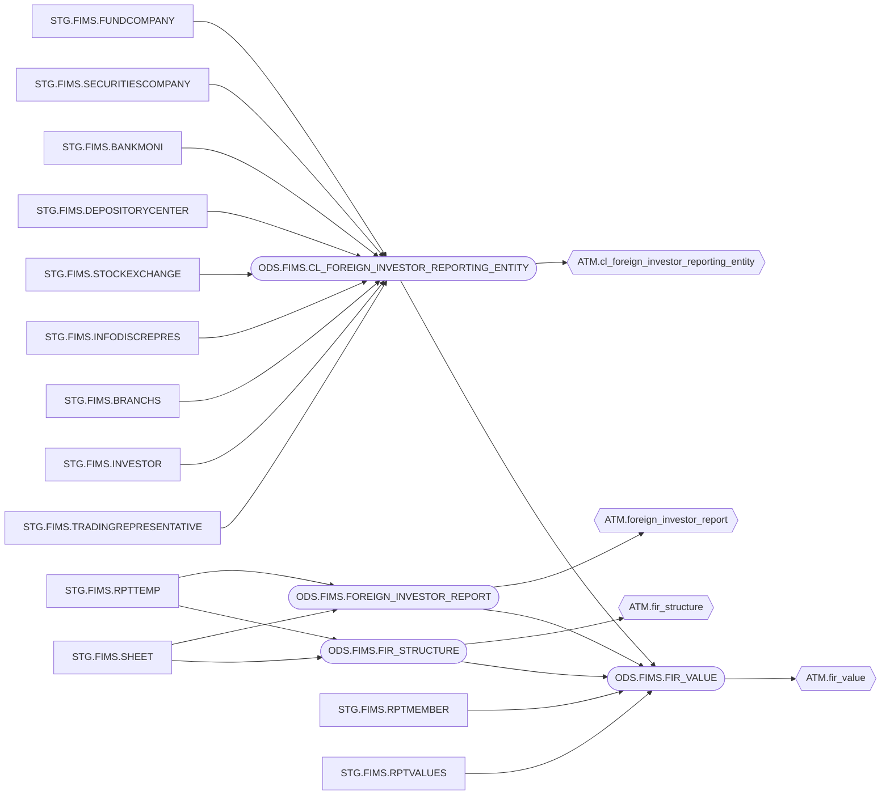
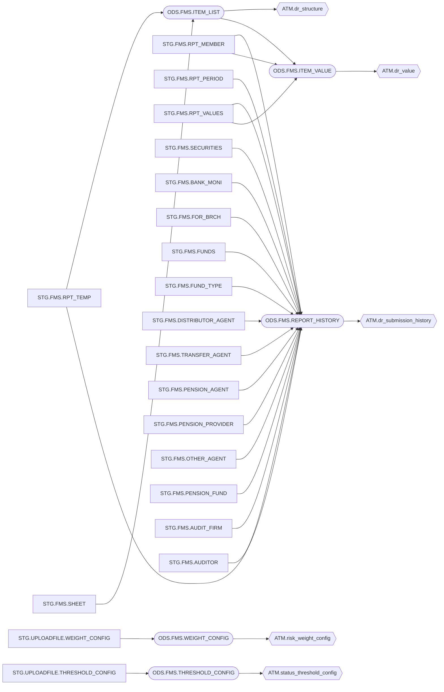
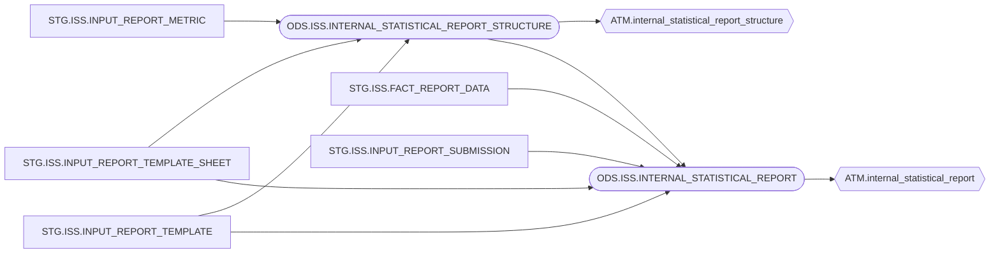
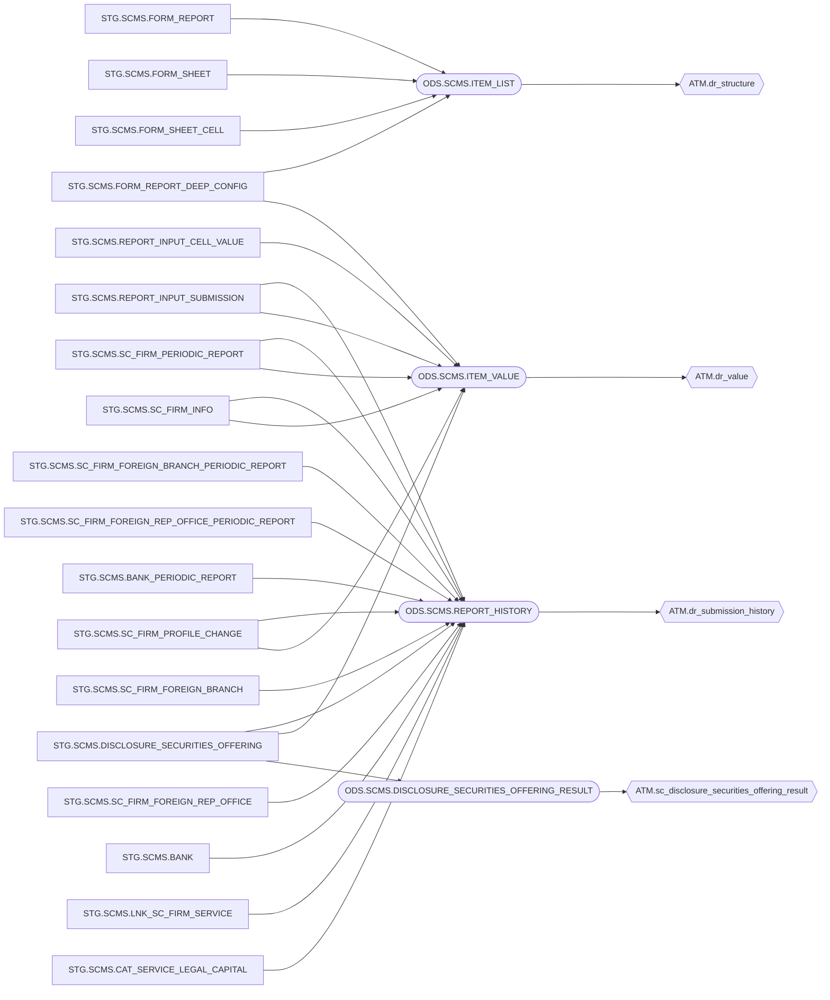
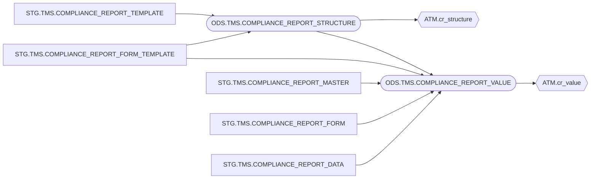
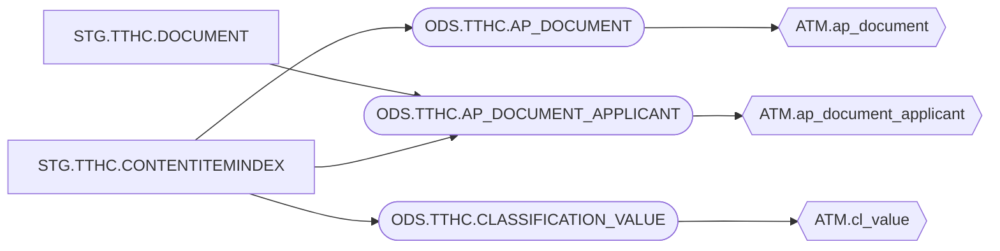

# Mapping STG → ODS — UBCK Lakehouse

> Tài liệu mô tả tầng **ODS** (Operational Data Store) nằm giữa **STG** (Staging, bản sao thô của nguồn) và **Atomic**. Sinh từ `BRD/Source/brd_*.yaml` và `ODS.xlsx` ngày 2026-11-17 — **draft, cần Data Modeler review**.

## 1. Quy ước

| Mục | Quy tắc |
|---|---|
| Tên bảng | `STG.{SOURCE}.{TABLE}` → `ODS.{SOURCE}.{TABLE}` (giữ nguyên `{SOURCE}` và `{TABLE}`) |
| **Nhóm A — ODS 1:1** | Mỗi bảng STG có `scope_status: in_scope` trong `BRD/Source/brd_{SOURCE}.yaml` map **1:1** sang đúng 1 bảng ODS cùng tên, cùng grain, không biến đổi nghiệp vụ |
| **Nhóm B — ODS tổng hợp** | Bảng ODS lấy từ `ODS.xlsx` (JOIN/parse JSON/UNION nhiều STG, hoặc đọc từ ODS khác) — **không** phải 1:1; Atomic đọc từ các bảng này |

## 2. Tổng hợp theo phân hệ

| Phân hệ | Nhóm A: STG→ODS 1:1 (`in_scope`) | Nhóm B: ODS tổng hợp (`ODS.xlsx`) |
|---|---:|---:|
| AUDIT | 13 | 0 |
| ECAT | 9 | 0 |
| FIMS | 21 | 4 |
| FMS | 47 | 5 |
| HNX | 20 | 0 |
| HOSE | 6 | 0 |
| IAM | 1 | 0 |
| IDS | 54 | 0 |
| ISS | 6 | 2 |
| KNT | 5 | 0 |
| MDDS | 7 | 0 |
| MRMS | 3 | 0 |
| NHNCK | 45 | 0 |
| SCMS | 50 | 4 |
| THANHTRA | 32 | 0 |
| TMS | 5 | 2 |
| TTHC | 2 | 3 |
| VSDC | 9 | 0 |
| **Tổng** | **335** | **20** |

## 3. Nhóm A — STG map 1:1 ODS (bảng `in_scope`)

### 3.AUDIT. AUDIT (13 bảng)

| # | STG | ODS | Nhóm chức năng | Ý nghĩa bảng |
|---:|---|---|---|---|
| 1 | `STG.AUDIT.AF_APPROVAL` | `ODS.AUDIT.AF_APPROVAL` | CHƯA PHÂN NHÓM | Bảng lưu thông tin quyết định chấp thuận |
| 2 | `STG.AUDIT.AF_AUDITOR_PRACTICE_HISTORY` | `ODS.AUDIT.AF_AUDITOR_PRACTICE_HISTORY` | CHƯA PHÂN NHÓM | Quản lý thông tin lịch sử hành nghề của kiểm toán viên |
| 3 | `STG.AUDIT.AF_AUDITOR_PROFILES` | `ODS.AUDIT.AF_AUDITOR_PROFILES` | CHƯA PHÂN NHÓM | Lưu thông tin chung kiểm toán viên |
| 4 | `STG.AUDIT.AF_AUDITOR_STATUS_HISTORY` | `ODS.AUDIT.AF_AUDITOR_STATUS_HISTORY` | CHƯA PHÂN NHÓM |  |
| 5 | `STG.AUDIT.AF_INSPECTION` | `ODS.AUDIT.AF_INSPECTION` | CHƯA PHÂN NHÓM | Bảng lưu thông tin kiểm tra công ty kiểm toán |
| 6 | `STG.AUDIT.AF_LEGAL_REPRESENTATIVE` | `ODS.AUDIT.AF_LEGAL_REPRESENTATIVE` | CHƯA PHÂN NHÓM | Bảng Người đại diện theo pháp luật |
| 7 | `STG.AUDIT.AF_PROFILES` | `ODS.AUDIT.AF_PROFILES` | CHƯA PHÂN NHÓM | Bảng lưu thông tin công ty kiểm toán |
| 8 | `STG.AUDIT.AF_SANCTIONS` | `ODS.AUDIT.AF_SANCTIONS` | CHƯA PHÂN NHÓM | Bảng lưu thông tin xử phạt |
| 9 | `STG.AUDIT.AF_STATUS_HISTORY` | `ODS.AUDIT.AF_STATUS_HISTORY` | CHƯA PHÂN NHÓM | Bảng lưu lịch sử trạng thái |
| 10 | `STG.AUDIT.AF_SUSPENSION` | `ODS.AUDIT.AF_SUSPENSION` | CHƯA PHÂN NHÓM | Bảng lưu thông tin đình chỉ |
| 11 | `STG.AUDIT.AF_TECHNICAL_AUDIT` | `ODS.AUDIT.AF_TECHNICAL_AUDIT` | CHƯA PHÂN NHÓM | Bảng lưu thông tin kiểm tra hồ sơ kiểm toán |
| 12 | `STG.AUDIT.AF_WARNING` | `ODS.AUDIT.AF_WARNING` | CHƯA PHÂN NHÓM | Bảng lưu thông tin nhắc nhở |
| 13 | `STG.AUDIT.LOOKUP_VALUES` | `ODS.AUDIT.LOOKUP_VALUES` | CHƯA PHÂN NHÓM |  |

### 3.ECAT. ECAT (9 bảng)

| # | STG | ODS | Nhóm chức năng | Ý nghĩa bảng |
|---:|---|---|---|---|
| 1 | `STG.ECAT.ADMINISTRATIVE_PROCEDURE` | `ODS.ECAT.ADMINISTRATIVE_PROCEDURE` | UID-09 Danh mục thủ tục hành chính | Danh mục Thủ tục hành chính |
| 2 | `STG.ECAT.COUNTRY` | `ODS.ECAT.COUNTRY` | UID-01 Danh mục địa lý hành chính | Danh mục Quốc gia |
| 3 | `STG.ECAT.DEPARTMENT` | `ODS.ECAT.DEPARTMENT` | UID-02 Danh mục tổ chức & nhân sự | Danh mục Phòng ban |
| 4 | `STG.ECAT.DISTRICT_OLD` | `ODS.ECAT.DISTRICT_OLD` | UID-01 Danh mục địa lý hành chính | Danh mục Quận/Huyện (cũ) |
| 5 | `STG.ECAT.PROVINCE_NEW` | `ODS.ECAT.PROVINCE_NEW` | UID-01 Danh mục địa lý hành chính | Danh mục Tỉnh/Thành phố (mới) |
| 6 | `STG.ECAT.PROVINCE_OLD` | `ODS.ECAT.PROVINCE_OLD` | UID-01 Danh mục địa lý hành chính | Danh mục Tỉnh/Thành phố (cũ) |
| 7 | `STG.ECAT.REGION` | `ODS.ECAT.REGION` | UID-01 Danh mục địa lý hành chính | Danh mục Vùng/miền |
| 8 | `STG.ECAT.WARD_NEW` | `ODS.ECAT.WARD_NEW` | UID-01 Danh mục địa lý hành chính | Danh mục Phường/Xã/Thị trấn (mới) |
| 9 | `STG.ECAT.WARD_OLD` | `ODS.ECAT.WARD_OLD` | UID-01 Danh mục địa lý hành chính | Danh mục Phường/Xã/Thị trấn (cũ) |

### 3.FIMS. FIMS (21 bảng)

| # | STG | ODS | Nhóm chức năng | Ý nghĩa bảng |
|---:|---|---|---|---|
| 1 | `STG.FIMS.BANKMONI` | `ODS.FIMS.BANKMONI` | FIMS.7 Thành viên thị trường | Lưu danh sách đối tượng gửi báo cáo là Ngân hàng lưu ký |
| 2 | `STG.FIMS.BRANCHS` | `ODS.FIMS.BRANCHS` | FIMS.7 Thành viên thị trường | Lưu danh sách đối tượng gửi báo cáo là CN công ty QLQ nước ngoài |
| 3 | `STG.FIMS.CATEGORIESSTOCK` | `ODS.FIMS.CATEGORIESSTOCK` | FIMS.6 Nhà đầu tư nước ngoài | Lưu danh sách danh mục chứng khoán của NĐT NN |
| 4 | `STG.FIMS.COMPANYTYPE` | `ODS.FIMS.COMPANYTYPE` | FIMS.5 Danh mục dùng chung | Lưu danh sách danh mục loại hình doanh nghiệp |
| 5 | `STG.FIMS.DEPOSITORYCENTER` | `ODS.FIMS.DEPOSITORYCENTER` | FIMS.7 Thành viên thị trường | Lưu danh sách đối tượng gửi báo cáo là Trung tâm lưu ký |
| 6 | `STG.FIMS.FUNDCOMPANY` | `ODS.FIMS.FUNDCOMPANY` | FIMS.7 Thành viên thị trường | Lưu danh sách đối tượng gửi báo cáo là Công ty quản lý quỹ |
| 7 | `STG.FIMS.INFODISCREPRES` | `ODS.FIMS.INFODISCREPRES` | FIMS.7 Thành viên thị trường | Lưu danh sách đối tượng gửi báo cáo là người hành nghề chứng khoán |
| 8 | `STG.FIMS.INVESTOR` | `ODS.FIMS.INVESTOR` | FIMS.6 Nhà đầu tư nước ngoài | lưu danh sách danh mục nhà đầu tư |
| 9 | `STG.FIMS.INVESTORTYPE` | `ODS.FIMS.INVESTORTYPE` | FIMS.5 Danh mục dùng chung | lưu danh sách danh mục loại nhà đầu tư |
| 10 | `STG.FIMS.NATIONAL` | `ODS.FIMS.NATIONAL` | FIMS.5 Danh mục dùng chung | lưu danh sách quốc tịch / quốc gia |
| 11 | `STG.FIMS.PROVINCE_NEW` | `ODS.FIMS.PROVINCE_NEW` | FIMS.5 Danh mục dùng chung | Danh mục tỉnh/thành phố (bản mới) |
| 12 | `STG.FIMS.RPTMEMBER` | `ODS.FIMS.RPTMEMBER` | FIMS.8 Báo cáo thành viên | lưu danh sách báo cáo của các thành viên thị trường |
| 13 | `STG.FIMS.RPTTEMP` | `ODS.FIMS.RPTTEMP` | FIMS.2 Biểu mẫu báo cáo đầu vào | lưu danh sách biểu mẫu báo cáo đầu vào |
| 14 | `STG.FIMS.RPTVALUES` | `ODS.FIMS.RPTVALUES` | FIMS.8 Báo cáo thành viên | bảng lưu giá trị của báo cáo. Mỗi năm, tự động sinh bảng mới |
| 15 | `STG.FIMS.SECURITIESCOMPANY` | `ODS.FIMS.SECURITIESCOMPANY` | FIMS.7 Thành viên thị trường | Lưu danh sách đối tượng gửi báo cáo là Công ty chứng khoán |
| 16 | `STG.FIMS.SHEET` | `ODS.FIMS.SHEET` | FIMS.2 Biểu mẫu báo cáo đầu vào | lưu danh sách các sheet trong biểu mẫu báo cáo đầu vào |
| 17 | `STG.FIMS.STATUS` | `ODS.FIMS.STATUS` | FIMS.5 Danh mục dùng chung | lưu danh sách danh mục tình trạng hoạt động |
| 18 | `STG.FIMS.STOCKEXCHANGE` | `ODS.FIMS.STOCKEXCHANGE` | FIMS.7 Thành viên thị trường | Lưu danh sách đối tượng gửi báo cáo là Sở giao dịch |
| 19 | `STG.FIMS.TRADINGAUTHORIZATION` | `ODS.FIMS.TRADINGAUTHORIZATION` | FIMS.10 Ủy quyền CBTT và giao dịch | Lưu danh sách ủy quyền giao dịch |
| 20 | `STG.FIMS.TRADINGREPRESENTATIVE` | `ODS.FIMS.TRADINGREPRESENTATIVE` | FIMS.6 Nhà đầu tư nước ngoài | Lưu danh sách đại diện giao dịch |
| 21 | `STG.FIMS.WARD_NEW` | `ODS.FIMS.WARD_NEW` | FIMS.5 Danh mục dùng chung | Danh mục phường/xã (bản mới) |

### 3.FMS. FMS (47 bảng)

| # | STG | ODS | Nhóm chức năng | Ý nghĩa bảng |
|---:|---|---|---|---|
| 1 | `STG.FMS.AGENCIES` | `ODS.FMS.AGENCIES` | FMS.4 Quỹ đầu tư chứng khoán | Đại lý phân phối chứng chỉ quỹ (CCQ): thông tin tổ chức, số GCN đăng ký hoạt động phân phối, trạng thái hoạt động |
| 2 | `STG.FMS.AGENCY_TYPE` | `ODS.FMS.AGENCY_TYPE` | FMS.4 Quỹ đầu tư chứng khoán | Danh mục loại đại lý: phân phối, chuyển nhượng, hưu trí, đại lý khác |
| 3 | `STG.FMS.AGEN_FUNDS` | `ODS.FMS.AGEN_FUNDS` | FMS.4 Quỹ đầu tư chứng khoán | Liên kết đại lý phân phối với quỹ đầu tư được phân phối (cờ migration) |
| 4 | `STG.FMS.BANK_EMPLOY` | `ODS.FMS.BANK_EMPLOY` | FMS.4 Quỹ đầu tư chứng khoán | Nhân sự nghiệp vụ của ngân hàng lưu ký/giám sát: thông tin cá nhân, chứng chỉ hành nghề, chức vụ |
| 5 | `STG.FMS.BANK_MONI` | `ODS.FMS.BANK_MONI` | FMS.4 Quỹ đầu tư chứng khoán | Ngân hàng lưu ký và giám sát (custodian/supervisor bank): thông tin đăng ký, số GCN, loại ngân hàng, trạng thái |
| 6 | `STG.FMS.BUSINESS` | `ODS.FMS.BUSINESS` | FMS.2 Danh mục dùng riêng | Danh mục lĩnh vực hoạt động kinh doanh của công ty QLQ và các đối tượng liên quan |
| 7 | `STG.FMS.COMPANY_TYPE` | `ODS.FMS.COMPANY_TYPE` | FMS.2 Danh mục dùng riêng | Danh mục loại hình doanh nghiệp: cổ phần, TNHH; liên kết loại với dữ liệu migration |
| 8 | `STG.FMS.DISTRIBUTOR_AGENT` | `ODS.FMS.DISTRIBUTOR_AGENT` | FMS.9 Đại lý và quỹ hưu trí | Đại lý phân phối CCQ (danh sách chi tiết mới): thông tin giấy phép, số GCN phân phối, trạng thái |
| 9 | `STG.FMS.EVENT_TYPE` | `ODS.FMS.EVENT_TYPE` | FMS.1 Quản trị phân hệ | Danh mục loại sự vụ FMS: mã sự vụ, phân loại (định kỳ/bất thường/theo yêu cầu), nghĩa vụ báo cáo/CBTT, cách tính thời hạn, cấu hình nghiệp vụ JSON |
| 10 | `STG.FMS.FOR_BRCH` | `ODS.FMS.FOR_BRCH` | FMS.3 Thông tin thành viên — Công ty QLQ | Hồ sơ chi nhánh (branch_flag=1) và văn phòng đại diện (branch_flag=0) của công ty QLQ nước ngoài tại Việt Nam |
| 11 | `STG.FMS.FUD_AG_AGT` | `ODS.FMS.FUD_AG_AGT` | FMS.4 Quỹ đầu tư chứng khoán | Liên kết quỹ đầu tư với loại đại lý và đại lý cụ thể: xác định đại lý phân phối/chuyển nhượng nào phục vụ quỹ nào |
| 12 | `STG.FMS.FUNDS` | `ODS.FMS.FUNDS` | FMS.4 Quỹ đầu tư chứng khoán | Hồ sơ quỹ đầu tư chứng khoán: tên, mã CCQ, loại quỹ, vốn điều lệ, NAV, NAV/CCQ, ngân hàng lưu ký, ngày niêm yết |
| 13 | `STG.FMS.FUND_TL_PRO` | `ODS.FMS.FUND_TL_PRO` | FMS.4 Quỹ đầu tư chứng khoán | Liên kết quỹ đầu tư với người hành nghề quản lý quỹ (TL_PROFILES) |
| 14 | `STG.FMS.FUND_TYPE` | `ODS.FMS.FUND_TYPE` | FMS.4 Quỹ đầu tư chứng khoán | Danh mục loại quỹ đầu tư: quỹ mở, quỹ đóng, quỹ ETF, quỹ thành viên, quỹ bất động sản... |
| 15 | `STG.FMS.INSDER_RELA` | `ODS.FMS.INSDER_RELA` | FMS.3 Thông tin thành viên — Công ty QLQ | Người liên quan của cổ đông nội bộ (gia đình, người có quan hệ kinh tế): thông tin cá nhân, loại quan hệ |
| 16 | `STG.FMS.INSIDER` | `ODS.FMS.INSIDER` | FMS.3 Thông tin thành viên — Công ty QLQ | Cổ đông nội bộ và người liên quan của công ty QLQ: thông tin cá nhân, loại insider, tỷ lệ sở hữu, trạng thái |
| 17 | `STG.FMS.INSPECTION_ROUND` | `ODS.FMS.INSPECTION_ROUND` | FMS.8 Kiểm toán | Đợt thanh tra/kiểm tra: năm, loại (định kỳ/đột xuất), đối tượng, thời gian, số quyết định |
| 18 | `STG.FMS.INVES` | `ODS.FMS.INVES` | FMS.4 Quỹ đầu tư chứng khoán | Nhà đầu tư (investor) của quỹ đầu tư cá nhân: thông tin cá nhân, quốc tịch, loại NĐT, quy mô uỷ thác |
| 19 | `STG.FMS.INVES_ACC` | `ODS.FMS.INVES_ACC` | FMS.4 Quỹ đầu tư chứng khoán | Tài khoản đầu tư của nhà đầu tư: số tài khoản, nơi mở, hợp đồng, quy mô uỷ thác thực tế/cam kết |
| 20 | `STG.FMS.JOBS` | `ODS.FMS.JOBS` | FMS.1 Quản trị phân hệ | Chức danh/vị trí công việc trong tổ chức thành viên thị trường: tên chức danh, loại, trạng thái |
| 21 | `STG.FMS.JOB_TYPE` | `ODS.FMS.JOB_TYPE` | FMS.2 Danh mục dùng riêng | Danh mục loại chức danh hành nghề: có hiển thị trên hồ sơ thành viên, có công bố hay không |
| 22 | `STG.FMS.MB_CHANGE` | `ODS.FMS.MB_CHANGE` | FMS.4 Quỹ đầu tư chứng khoán | Giao dịch thay đổi CCQ của thành viên quỹ: số lượng/tỷ lệ trước-sau, ngày giao dịch, ngày thanh toán |
| 23 | `STG.FMS.MB_FUND` | `ODS.FMS.MB_FUND` | FMS.4 Quỹ đầu tư chứng khoán | Thành viên (nhà đầu tư) của quỹ đầu tư: tên, quốc tịch, loại thành viên, số lượng và tỷ lệ CCQ nắm giữ |
| 24 | `STG.FMS.NATIONAL` | `ODS.FMS.NATIONAL` | FMS.2 Danh mục dùng riêng | Danh mục quốc gia/quốc tịch: tên ngắn, tên đầy đủ, trạng thái |
| 25 | `STG.FMS.OFFERING` | `ODS.FMS.OFFERING` | FMS.4 Quỹ đầu tư chứng khoán | Thông tin chào bán chứng khoán (cổ phần/trái phiếu) của công ty QLQ: loại CK, số lượng, giá, kết quả chào bán |
| 26 | `STG.FMS.OFFERING_PLAN` | `ODS.FMS.OFFERING_PLAN` | FMS.4 Quỹ đầu tư chứng khoán | Chi tiết kế hoạch/kết quả chào bán theo từng nhóm đối tượng: số lượng, giá, giá trị, số người tham gia |
| 27 | `STG.FMS.PENSION_AGENT` | `ODS.FMS.PENSION_AGENT` | FMS.9 Đại lý và quỹ hưu trí | Đại lý hưu trí: tổ chức cung cấp dịch vụ phân phối quỹ hưu trí, thông tin giấy phép, trạng thái |
| 28 | `STG.FMS.PENSION_FUND` | `ODS.FMS.PENSION_FUND` | FMS.9 Đại lý và quỹ hưu trí | Hồ sơ quỹ hưu trí: tên, số GCN thành lập, ngân hàng lưu ký/giám sát, trạng thái |
| 29 | `STG.FMS.PENSION_PROVIDER` | `ODS.FMS.PENSION_PROVIDER` | FMS.9 Đại lý và quỹ hưu trí | Tổ chức cung cấp dịch vụ quản trị tài khoản hưu trí cá nhân: thông tin giấy phép, loại tổ chức, trạng thái |
| 30 | `STG.FMS.PROVINCE` | `ODS.FMS.PROVINCE` | FMS.2 Danh mục dùng riêng | Tinh/thanh pho moi — dong bo tu eCAT DMDC province-news |
| 31 | `STG.FMS.RANK` | `ODS.FMS.RANK` | FMS.6 Đánh giá xếp loại và cảnh báo | Kết quả xếp hạng công ty QLQ trong kỳ đánh giá: tổng điểm, thứ hạng, loại xếp hạng |
| 32 | `STG.FMS.RATING_PD` | `ODS.FMS.RATING_PD` | FMS.6 Đánh giá xếp loại và cảnh báo | Kỳ đánh giá xếp loại công ty QLQ: năm, kỳ (giữa năm/cuối năm), trạng thái, ngày cập nhật dữ liệu |
| 33 | `STG.FMS.RELATION` | `ODS.FMS.RELATION` | FMS.2 Danh mục dùng riêng | Danh mục loại quan hệ của người liên quan: quan hệ cá nhân/gia đình hay quan hệ kinh tế/tổ chức |
| 34 | `STG.FMS.REPRESENT` | `ODS.FMS.REPRESENT` | FMS.4 Quỹ đầu tư chứng khoán | Người đại diện theo ủy quyền của thành viên quỹ: thông tin cá nhân, chức vụ, thời gian đại diện |
| 35 | `STG.FMS.RPT_MEMBER` | `ODS.FMS.RPT_MEMBER` | FMS.5 Quản lý báo cáo | Báo cáo của thành viên thị trường (QLQ, QĐT, đại lý...): trạng thái, dữ liệu nhập, file đính kèm, eForm |
| 36 | `STG.FMS.RPT_PERIOD` | `ODS.FMS.RPT_PERIOD` | FMS.5 Quản lý báo cáo | Cấu hình kỳ báo cáo của biểu mẫu: loại kỳ, hạn nộp, ngày làm việc, hạn CBTT tương ứng |
| 37 | `STG.FMS.RPT_TEMP` | `ODS.FMS.RPT_TEMP` | FMS.5 Quản lý báo cáo | Biểu mẫu báo cáo FMS: tên, cơ sở pháp lý, loại báo cáo, cấu hình import/eForm, phiên bản, mã biểu mẫu |
| 38 | `STG.FMS.RPT_VALUES` | `ODS.FMS.RPT_VALUES` | FMS.5 Quản lý báo cáo | Giá trị từng ô dữ liệu trong báo cáo tổng hợp đầu ra: liên kết với sheet, kỳ, loại dữ liệu, giá trị động |
| 39 | `STG.FMS.SECURITIES` | `ODS.FMS.SECURITIES` | FMS.3 Thông tin thành viên — Công ty QLQ | Hồ sơ công ty QLQ đang hoạt động: thông tin đăng ký, giấy phép, địa chỉ, vốn điều lệ, trạng thái hoạt động |
| 40 | `STG.FMS.SHEET` | `ODS.FMS.SHEET` | FMS.5 Quản lý báo cáo | Sheet dữ liệu trong biểu mẫu báo cáo đầu vào: tên, chỉ số, cấu hình ô, danh mục dữ liệu |
| 41 | `STG.FMS.STAKE` | `ODS.FMS.STAKE` | FMS.3 Thông tin thành viên — Công ty QLQ | Cổ đông/nhà đầu tư chiến lược của công ty QLQ: tên tổ chức, quan hệ sở hữu, vốn góp, mô tả |
| 42 | `STG.FMS.STATUS` | `ODS.FMS.STATUS` | FMS.2 Danh mục dùng riêng | Danh mục trạng thái hoạt động của thành viên thị trường: tên, loại đối tượng, icon, màu sắc, cờ phải nộp báo cáo |
| 43 | `STG.FMS.STF_FG_BRCH` | `ODS.FMS.STF_FG_BRCH` | FMS.3 Thông tin thành viên — Công ty QLQ | Nhân sự (cán bộ chủ chốt) của chi nhánh/VPĐD công ty QLQ nước ngoài tại VN: CMND, chứng chỉ, chức vụ |
| 44 | `STG.FMS.STOCKHOLDER_TYPE` | `ODS.FMS.STOCKHOLDER_TYPE` | FMS.2 Danh mục dùng riêng | Danh mục loại cổ đông: cá nhân/tổ chức trong nước và nước ngoài |
| 45 | `STG.FMS.TL_PROFILES` | `ODS.FMS.TL_PROFILES` | FMS.3 Thông tin thành viên — Công ty QLQ | Hồ sơ người hành nghề quản lý quỹ và phân tích đầu tư: thông tin cá nhân, chứng chỉ, loại hành nghề, trạng thái |
| 46 | `STG.FMS.TRANSFER_AGENT` | `ODS.FMS.TRANSFER_AGENT` | FMS.9 Đại lý và quỹ hưu trí | Đại lý chuyển nhượng CCQ (VSDC hoặc tổ chức khác): thông tin giấy phép, loại tổ chức, trạng thái |
| 47 | `STG.FMS.WARD` | `ODS.FMS.WARD` | FMS.2 Danh mục dùng riêng | Xa/phuong moi — dong bo tu eCAT DMDC ward-news |

### 3.HNX. HNX (20 bảng)

| # | STG | ODS | Nhóm chức năng | Ý nghĩa bảng |
|---:|---|---|---|---|
| 1 | `STG.HNX.BROKERAGE_MARKET_SHARE` | `ODS.HNX.BROKERAGE_MARKET_SHARE` | Thị phần môi giới | BM 38 (HNX) - Thị phần môi giới |
| 2 | `STG.HNX.GOV_BOND_ADDITIONAL_LISTING` | `ODS.HNX.GOV_BOND_ADDITIONAL_LISTING` | Trái phiếu Chính phủ | BM 27 (HNX) - Niêm yết bổ sung TPCP |
| 3 | `STG.HNX.GOV_BOND_LISTED_LIST` | `ODS.HNX.GOV_BOND_LISTED_LIST` | Trái phiếu Chính phủ | BM 26 (HNX) - Danh sách TPCP niêm yết |
| 4 | `STG.HNX.GOV_BOND_OFFERING` | `ODS.HNX.GOV_BOND_OFFERING` | Trái phiếu Chính phủ | BM 25 (HNX) - Dữ liệu các đợt chào bán TPCP |
| 5 | `STG.HNX.LISTED_SECURITIES_LIST` | `ODS.HNX.LISTED_SECURITIES_LIST` | Đăng ký & niêm yết | BM 37 (HNX) - Danh sách CK niêm yết/ĐKGD |
| 6 | `STG.HNX.LISTING_STATUS_CHANGE` | `ODS.HNX.LISTING_STATUS_CHANGE` | Đăng ký & niêm yết | BM 35 (HNX) - Thay đổi niêm yết |
| 7 | `STG.HNX.MARKET_CAPITALIZATION_STX` | `ODS.HNX.MARKET_CAPITALIZATION_STX` | CHƯA PHÂN NHÓM | BM 42 (HNX) - Vốn hoá thị trường HNX (STX) |
| 8 | `STG.HNX.MARKET_CAPITALIZATION_UPX` | `ODS.HNX.MARKET_CAPITALIZATION_UPX` | CHƯA PHÂN NHÓM | BM 42 (HNX) - Vốn hoá thị trường HNX (UPX) |
| 9 | `STG.HNX.ORDER_BOOK` | `ODS.HNX.ORDER_BOOK` | CHƯA PHÂN NHÓM | Sổ lệnh HNX — tương đương ORDER_BOOK_HOSE nhưng cho sàn HNX (cổ phiếu niêm yết / UPCOM / TPCP / TP DN / phái sinh). Có thêm tính năng Iceberg order và Stop order theo chuẩn KRX. |
| 10 | `STG.HNX.OUTRIGHT_ORDER_BOOK` | `ODS.HNX.OUTRIGHT_ORDER_BOOK` | Sổ lệnh giao dịch | Sổ lệnh Outright |
| 11 | `STG.HNX.PRIVATE_CORP_BOND_OFFERING_INTERNATIONAL` | `ODS.HNX.PRIVATE_CORP_BOND_OFFERING_INTERNATIONAL` | Trái phiếu doanh nghiệp | BM 29 & BM 30 (HNX) - Tình hình chào bán TPDNRL (quốc tế) |
| 12 | `STG.HNX.PRIVATE_CORP_BOND_OFFERING_DOMESTIC` | `ODS.HNX.PRIVATE_CORP_BOND_OFFERING_DOMESTIC` | Trái phiếu doanh nghiệp | BM 29 & BM 30 (HNX) - Tình hình chào bán TPDNRL (trong nước) |
| 13 | `STG.HNX.PRIVATE_CORP_BOND_REGISTRATION` | `ODS.HNX.PRIVATE_CORP_BOND_REGISTRATION` | Trái phiếu doanh nghiệp | BM 31 (HNX) - Quy mô Đăng ký giao dịch TPDNRL |
| 14 | `STG.HNX.PRIVATE_CORP_BOND_SERVICE_ORGS` | `ODS.HNX.PRIVATE_CORP_BOND_SERVICE_ORGS` | CHƯA PHÂN NHÓM | BM 34 (HNX) - Danh sách CTCK là tổ chức tư vấn, đại lý phát hành, đại lý lưu ký, đại diện NSH TPDNRL và thông tin TPDNRL tương ứng |
| 15 | `STG.HNX.PRIVATE_CORP_BOND_TRADING` | `ODS.HNX.PRIVATE_CORP_BOND_TRADING` | Trái phiếu doanh nghiệp | BM 11 (HNX) - Giao dịch TPDNRL |
| 16 | `STG.HNX.REGISTRATION_STATUS_CHANGE` | `ODS.HNX.REGISTRATION_STATUS_CHANGE` | Đăng ký & niêm yết | BM 32 (HNX) - Thống kê thay đổi trạng thái đăng ký giao dịch |
| 17 | `STG.HNX.REPO2_ORDER_BOOK` | `ODS.HNX.REPO2_ORDER_BOOK` | Sổ lệnh giao dịch | Sổ lệnh Repo 2 |
| 18 | `STG.HNX.REPO_ORDER_BOOK` | `ODS.HNX.REPO_ORDER_BOOK` | Sổ lệnh giao dịch | Sổ lệnh Repo |
| 19 | `STG.HNX.SHARE_AUCTION` | `ODS.HNX.SHARE_AUCTION` | Đấu giá cổ phần | BM 7 (HNX) - Đấu giá cổ phần |
| 20 | `STG.HNX.TRADE_BOOK` | `ODS.HNX.TRADE_BOOK` | CHƯA PHÂN NHÓM | Sổ khớp HNX — tương đương TRADE_BOOK_HOSE nhưng cho sàn HNX. Bổ sung trường Spread trade legs (Execution Price of Spread First/Second) cho giao dịch phái sinh/repo có 2 vế. |

### 3.HOSE. HOSE (6 bảng)

| # | STG | ODS | Nhóm chức năng | Ý nghĩa bảng |
|---:|---|---|---|---|
| 1 | `STG.HOSE.BROKERAGE_MARKET_SHARE` | `ODS.HOSE.BROKERAGE_MARKET_SHARE` | Thị phần môi giới | BM 9 (HOSE) |
| 2 | `STG.HOSE.LISTED_SECURITIES_LIST` | `ODS.HOSE.LISTED_SECURITIES_LIST` | Đăng ký & niêm yết | BM 12 (HOSE) |
| 3 | `STG.HOSE.LISTING_STATUS_CHANGE` | `ODS.HOSE.LISTING_STATUS_CHANGE` | Đăng ký & niêm yết | BM 13 (HOSE) |
| 4 | `STG.HOSE.ORDER_BOOK` | `ODS.HOSE.ORDER_BOOK` | CHƯA PHÂN NHÓM | Sổ lệnh HOSE — ghi nhận toàn bộ lifecycle của từng lệnh giao dịch trên sàn HOSE (cổ phiếu / trái phiếu / repo). Mỗi bản ghi là một event: lệnh mới / sửa / hủy. Đối tượng trung tâm của phân hệ ORDERTRADE. |
| 5 | `STG.HOSE.SHARE_AUCTION` | `ODS.HOSE.SHARE_AUCTION` | Đấu giá cổ phần | BM 5 (HOSE) |
| 6 | `STG.HOSE.TRADE_BOOK` | `ODS.HOSE.TRADE_BOOK` | CHƯA PHÂN NHÓM | Sổ khớp HOSE — ghi nhận từng giao dịch khớp thành công trên HOSE. Mỗi bản ghi chứa đồng thời thông tin bên mua và bên bán. 1 Order có thể tạo ra nhiều Trade (khớp dần). |

### 3.IAM. IAM (1 bảng)

| # | STG | ODS | Nhóm chức năng | Ý nghĩa bảng |
|---:|---|---|---|---|
| 1 | `STG.IAM.USERS` | `ODS.IAM.USERS` | Quản lý người dùng | Người dùng hệ thống |

### 3.IDS. IDS (54 bảng)

| # | STG | ODS | Nhóm chức năng | Ý nghĩa bảng |
|---:|---|---|---|---|
| 1 | `STG.IDS.ACCOUNT_NUMBERS` | `ODS.IDS.ACCOUNT_NUMBERS` | shareholder |  |
| 2 | `STG.IDS.CAPITAL_MOBILIZATION` | `ODS.IDS.CAPITAL_MOBILIZATION` | capital_activity |  |
| 3 | `STG.IDS.CATEGORIES` | `ODS.IDS.CATEGORIES` | public_company |  |
| 4 | `STG.IDS.COMPANY_ADD_CAPITAL` | `ODS.IDS.COMPANY_ADD_CAPITAL` | capital_activity |  |
| 5 | `STG.IDS.COMPANY_DATA` | `ODS.IDS.COMPANY_DATA` | reporting | Lưu FORMS dữ liệu thuộc COMPANY_PROFILES |
| 6 | `STG.IDS.COMPANY_ENTITY_ROLE` | `ODS.IDS.COMPANY_ENTITY_ROLE` | shareholder |  |
| 7 | `STG.IDS.COMPANY_INSPECTION` | `ODS.IDS.COMPANY_INSPECTION` | inspection_penalty |  |
| 8 | `STG.IDS.COMPANY_PENALTIES` | `ODS.IDS.COMPANY_PENALTIES` | inspection_penalty |  |
| 9 | `STG.IDS.COMPANY_PROFILES` | `ODS.IDS.COMPANY_PROFILES` | public_company | Bảng lưu trữ thông tin hồ sơ và chi tiết công ty |
| 10 | `STG.IDS.COMPANY_RELATIONSHIP` | `ODS.IDS.COMPANY_RELATIONSHIP` | public_company | Thông tin quan hệ công ty |
| 11 | `STG.IDS.COMPANY_SHAREHOLDING` | `ODS.IDS.COMPANY_SHAREHOLDING` | shareholder |  |
| 12 | `STG.IDS.COMPANY_SHARE_STATISTICS` | `ODS.IDS.COMPANY_SHARE_STATISTICS` | capital_activity | Lưu thông tin về số CP sau mỗi đợt mua/ bán |
| 13 | `STG.IDS.COMPANY_TENDER_OFFER` | `ODS.IDS.COMPANY_TENDER_OFFER` | capital_activity |  |
| 14 | `STG.IDS.COMPANY_TENDER_OFFER_RESULT` | `ODS.IDS.COMPANY_TENDER_OFFER_RESULT` | capital_activity |  |
| 15 | `STG.IDS.COMPANY_TREASURY_SHARES` | `ODS.IDS.COMPANY_TREASURY_SHARES` | capital_activity | Lưu thông tin đợt mua/bán cổ phiếu quỹ (Treasury Share Transaction) |
| 16 | `STG.IDS.COMPANY_TREASURY_STOCKS` | `ODS.IDS.COMPANY_TREASURY_STOCKS` | capital_activity | Lưu thông tin về cổ phiếu quỹ |
| 17 | `STG.IDS.DATA` | `ODS.IDS.DATA` | reporting | Lưu trữ dữ liệu của hàng và cột của báo cáo tài chính |
| 18 | `STG.IDS.DATA_VALUES` | `ODS.IDS.DATA_VALUES` | reporting | Lưu dữ liệu khi nhập vào tương ứng với các Form, Fields |
| 19 | `STG.IDS.EVALUATIONS` | `ODS.IDS.EVALUATIONS` | evaluation |  |
| 20 | `STG.IDS.EVALUATION_CBONDS` | `ODS.IDS.EVALUATION_CBONDS` | evaluation |  |
| 21 | `STG.IDS.EVALUATION_CRITERIA` | `ODS.IDS.EVALUATION_CRITERIA` | evaluation |  |
| 22 | `STG.IDS.EVALUATION_DETAILS` | `ODS.IDS.EVALUATION_DETAILS` | evaluation |  |
| 23 | `STG.IDS.EVALUATION_GROUPS` | `ODS.IDS.EVALUATION_GROUPS` | evaluation |  |
| 24 | `STG.IDS.EVALUATION_PERIODS` | `ODS.IDS.EVALUATION_PERIODS` | evaluation |  |
| 25 | `STG.IDS.FIELDS` | `ODS.IDS.FIELDS` | reporting |  |
| 26 | `STG.IDS.FOREIGN_OWNER_LIMIT` | `ODS.IDS.FOREIGN_OWNER_LIMIT` | public_company | Bảng giới hạn tỷ lệ sở hữu nước ngoài |
| 27 | `STG.IDS.FORMS` | `ODS.IDS.FORMS` | reporting |  |
| 28 | `STG.IDS.FORM_FIELDS` | `ODS.IDS.FORM_FIELDS` | reporting |  |
| 29 | `STG.IDS.HOLDER_RELATIONSHIP` | `ODS.IDS.HOLDER_RELATIONSHIP` | shareholder |  |
| 30 | `STG.IDS.IDENTITY` | `ODS.IDS.IDENTITY` | shareholder |  |
| 31 | `STG.IDS.LEGAL_ENTITIES` | `ODS.IDS.LEGAL_ENTITIES` | shareholder |  |
| 32 | `STG.IDS.LEGAL_REPRESENTATIVE` | `ODS.IDS.LEGAL_REPRESENTATIVE` | public_company | Bảng người đại diện pháp luật |
| 33 | `STG.IDS.LOOKUP_VALUES` | `ODS.IDS.LOOKUP_VALUES` | master_data |  |
| 34 | `STG.IDS.POSITIONS` | `ODS.IDS.POSITIONS` | shareholder |  |
| 35 | `STG.IDS.PROVINCES` | `ODS.IDS.PROVINCES` | master_data |  |
| 36 | `STG.IDS.PUB_COMPANY_CANCELLATION` | `ODS.IDS.PUB_COMPANY_CANCELLATION` | public_company |  |
| 37 | `STG.IDS.PUB_COMPANY_REGISTRATION` | `ODS.IDS.PUB_COMPANY_REGISTRATION` | public_company |  |
| 38 | `STG.IDS.RCOL` | `ODS.IDS.RCOL` | reporting |  |
| 39 | `STG.IDS.REPORT_CATALOG` | `ODS.IDS.REPORT_CATALOG` | reporting |  |
| 40 | `STG.IDS.REPORT_EXTENSIONS` | `ODS.IDS.REPORT_EXTENSIONS` | reporting |  |
| 41 | `STG.IDS.REP_COLUMN` | `ODS.IDS.REP_COLUMN` | reporting |  |
| 42 | `STG.IDS.REP_DATA` | `ODS.IDS.REP_DATA` | public_company | Lưu trữ dữ liệu của hàng và cột của báo cáo có cấu trúc |
| 43 | `STG.IDS.REP_FORMS` | `ODS.IDS.REP_FORMS` | reporting |  |
| 44 | `STG.IDS.REP_ROW` | `ODS.IDS.REP_ROW` | reporting |  |
| 45 | `STG.IDS.RROW` | `ODS.IDS.RROW` | reporting |  |
| 46 | `STG.IDS.SECURITIES_OFFERING` | `ODS.IDS.SECURITIES_OFFERING` | capital_activity | Lưu thông tin về Hoạt động chào bán, phát hành chứng khoán |
| 47 | `STG.IDS.SECURITIES_OFFERING_PLAN` | `ODS.IDS.SECURITIES_OFFERING_PLAN` | capital_activity | Lưu thông tin về Hoạt động chào bán, phát hành chứng khoán |
| 48 | `STG.IDS.SECURITIES_OFFERING_RESULT` | `ODS.IDS.SECURITIES_OFFERING_RESULT` | capital_activity | Lưu thông tin về Hoạt động chào bán, phát hành chứng khoán |
| 49 | `STG.IDS.STATE_CAPITAL` | `ODS.IDS.STATE_CAPITAL` | public_company | Bảng thông tin vốn nhà nước |
| 50 | `STG.IDS.STOCK_CONTROLS` | `ODS.IDS.STOCK_CONTROLS` | shareholder |  |
| 51 | `STG.IDS.STOCK_LISTING_HISTORY` | `ODS.IDS.STOCK_LISTING_HISTORY` | capital_activity |  |
| 52 | `STG.IDS.TREASURY_SHARE_TRANS_RESULT` | `ODS.IDS.TREASURY_SHARE_TRANS_RESULT` | capital_activity | Lưu thông tin kết quả giao dịch cổ phiếu quỹ (Treasury Share Transaction Result) |
| 53 | `STG.IDS.VIOLATION_REPORT` | `ODS.IDS.VIOLATION_REPORT` | inspection_penalty |  |
| 54 | `STG.IDS.VIOLATION_TEMPLATES` | `ODS.IDS.VIOLATION_TEMPLATES` | inspection_penalty | Bảng lưu trữ thông tin cấu hình mẫu vi phạm |

### 3.ISS. ISS (6 bảng)

| # | STG | ODS | Nhóm chức năng | Ý nghĩa bảng |
|---:|---|---|---|---|
| 1 | `STG.ISS.FACT_REPORT_DATA` | `ODS.ISS.FACT_REPORT_DATA` | Quản lý báo cáo đầu vào (Input Report) | Dữ liệu chi tiết (fact) trích xuất từ báo cáo đầu vào đã nộp, theo từng sheet và kỳ báo cáo |
| 2 | `STG.ISS.INPUT_REPORT` | `ODS.ISS.INPUT_REPORT` | Quản lý báo cáo đầu vào (Input Report) | Yêu cầu nộp báo cáo đầu vào theo tổ chức và kỳ báo cáo, sinh từ mẫu báo cáo |
| 3 | `STG.ISS.INPUT_REPORT_METRIC` | `ODS.ISS.INPUT_REPORT_METRIC` | Quản lý báo cáo đầu vào (Input Report) | Cây chỉ tiêu (metric) trong sheet của mẫu báo cáo đầu vào |
| 4 | `STG.ISS.INPUT_REPORT_SUBMISSION` | `ODS.ISS.INPUT_REPORT_SUBMISSION` | Quản lý báo cáo đầu vào (Input Report) | Bản ghi nộp báo cáo đầu vào thực tế — file nộp, trạng thái nộp, kết quả so khớp |
| 5 | `STG.ISS.INPUT_REPORT_TEMPLATE` | `ODS.ISS.INPUT_REPORT_TEMPLATE` | Quản lý báo cáo đầu vào (Input Report) | Mẫu báo cáo đầu vào — mã báo cáo, căn cứ pháp lý, cấu hình layout |
| 6 | `STG.ISS.INPUT_REPORT_TEMPLATE_SHEET` | `ODS.ISS.INPUT_REPORT_TEMPLATE_SHEET` | Quản lý báo cáo đầu vào (Input Report) | Sheet (trang tính) trong mẫu báo cáo đầu vào |

### 3.KNT. KNT (5 bảng)

| # | STG | ODS | Nhóm chức năng | Ý nghĩa bảng |
|---:|---|---|---|---|
| 1 | `STG.KNT.TAX_ENFORCEMENT_DEBT` | `ODS.KNT.TAX_ENFORCEMENT_DEBT` | KNT-03 Cưỡng chế nợ thuế / hóa đơn | Thông tin quyết định cưỡng chế nợ thuế do Cục Thuế ban hành: phương thức cưỡng chế, số tiền, tài sản kê biên |
| 2 | `STG.KNT.TAX_REGISTRATION_INFO` | `ODS.KNT.TAX_REGISTRATION_INFO` | KNT-01 Quản lý thông tin đăng ký thuế | Thông tin đăng ký thuế do Cục Thuế cung cấp: địa chỉ, vốn điều lệ, người đại diện, trạng thái hoạt động, tạm ngừng kinh doanh |
| 3 | `STG.KNT.TAX_REPORT` | `ODS.KNT.TAX_REPORT` | KNT-02 Báo cáo tài chính từ Tổng cục Thuế | Báo cáo tài chính do Cục Thuế cung cấp cho UBCKNN: thông tin tờ khai, kỳ kê khai, MST, thông tin kiểm toán |
| 4 | `STG.KNT.TAX_REPORT_DETAIL` | `ODS.KNT.TAX_REPORT_DETAIL` | KNT-02 Báo cáo tài chính từ Tổng cục Thuế | Chi tiết chỉ tiêu trong báo cáo tài chính từ Cục Thuế: giá trị đầu năm, cuối năm, năm nay, năm trước theo từng sheet |
| 5 | `STG.KNT.TAX_VIOLATION_HANDLING` | `ODS.KNT.TAX_VIOLATION_HANDLING` | KNT-04 Xử lý vi phạm & xử phạt | Thông tin xử lý vi phạm pháp luật về thuế do Cục Thuế cung cấp: số QĐ xử lý, tên đối tượng, kỳ thanh tra, tiền phạt |

### 3.MDDS. MDDS (7 bảng)

| # | STG | ODS | Nhóm chức năng | Ý nghĩa bảng |
|---:|---|---|---|---|
| 1 | `STG.MDDS.JAD_CORPBONDINFOR` | `ODS.MDDS.JAD_CORPBONDINFOR` | UID-03 Trái phiếu doanh nghiệp | Snapshot bảng giá TPDN: giá, order book thỏa thuận Outright (PT_*), đặc thù bond (kỳ hạn, lãi suất, coupon, mệnh giá, ngày phát hành/đáo hạn) |
| 2 | `STG.MDDS.JAD_CSIDXINFOR` | `ODS.MDDS.JAD_CSIDXINFOR` | UID-01 Thị trường và chỉ số tổng hợp | Thành phần rổ chỉ số: cặp (IndexCode × Symbol) với tỷ trọng và ngày vào rổ |
| 3 | `STG.MDDS.JAD_MARKETINFOR` | `ODS.MDDS.JAD_MARKETINFOR` | UID-01 Thị trường và chỉ số tổng hợp | Snapshot tổng hợp trạng thái sàn/chỉ số — điểm chỉ số, tổng KL/GT, số mã tăng/giảm/trần/sàn, trạng thái phiên, giao dịch thỏa thuận |
| 4 | `STG.MDDS.JAD_STOCKINFOR` | `ODS.MDDS.JAD_STOCKINFOR` | UID-02 Bảng giá chứng khoán và khớp lệnh | Snapshot bảng giá đa loại instrument tại một thời điểm — giá, sổ lệnh, tổng tích lũy, NĐTNN, đặc thù derivative/warrant |
| 5 | `STG.MDDS.JAD_TRANSLOG` | `ODS.MDDS.JAD_TRANSLOG` | UID-02 Bảng giá chứng khoán và khớp lệnh | Log tick-by-tick từng lần khớp lệnh cổ phiếu: giá khớp, KL khớp, chiều chủ động, tích lũy KL/GT |
| 6 | `STG.MDDS.JAD_TVHISTORY1D` | `ODS.MDDS.JAD_TVHISTORY1D` | UID-04 Thống kê lịch sử TradingView | Thống kê OHLCV theo resolution ngày cho từng mã (chứng khoán hoặc chỉ số), phục vụ biểu đồ TradingView. Mỗi bản tin là một cây nến 1 ngày. |
| 7 | `STG.MDDS.JAD_TVHISTORY1M` | `ODS.MDDS.JAD_TVHISTORY1M` | UID-04 Thống kê lịch sử TradingView | Thống kê OHLCV theo resolution phút cho từng mã (chứng khoán hoặc chỉ số), phục vụ biểu đồ TradingView. Mỗi bản tin là một cây nến 1 phút. |

### 3.MRMS. MRMS (3 bảng)

| # | STG | ODS | Nhóm chức năng | Ý nghĩa bảng |
|---:|---|---|---|---|
| 1 | `STG.MRMS.RISK_INDICATOR` | `ODS.MRMS.RISK_INDICATOR` | MRMS001/003/004 Khai thác Dashboard và Chỉ tiêu tài chính | Danh mục chỉ tiêu tài chính (trong nước & quốc tế) |
| 2 | `STG.MRMS.RISK_INDICATOR_CATEGORY` | `ODS.MRMS.RISK_INDICATOR_CATEGORY` | MRMS001/003/004 Khai thác Dashboard và Chỉ tiêu tài chính | Nhóm chỉ tiêu trong 1 bộ (Yếu tố vĩ mô, Yếu tố tiền tệ, Thị trường cổ phiếu, …) |
| 3 | `STG.MRMS.RISK_INDICATOR_VALUE` | `ODS.MRMS.RISK_INDICATOR_VALUE` | MRMS001/003/004 Khai thác Dashboard và Chỉ tiêu tài chính | Số liệu hiện tại của chỉ tiêu theo từng kỳ (ngày/tháng/quý/năm) |

### 3.NHNCK. NHNCK (45 bảng)

| # | STG | ODS | Nhóm chức năng | Ý nghĩa bảng |
|---:|---|---|---|---|
| 1 | `STG.NHNCK.APPLICATIONS` | `ODS.NHNCK.APPLICATIONS` | UID03 Quản lý hồ sơ | Hồ sơ đăng ký chứng chỉ hành nghề |
| 2 | `STG.NHNCK.APPLICATION_FEES` | `ODS.NHNCK.APPLICATION_FEES` | UID03 Quản lý hồ sơ | Phí thanh toán liên quan đến hồ sơ |
| 3 | `STG.NHNCK.APPLICATION_GROUPS` | `ODS.NHNCK.APPLICATION_GROUPS` | UID03 Quản lý hồ sơ | Nhóm hồ sơ CCHN xử lý tập thể (batch) |
| 4 | `STG.NHNCK.APPLICATION_GROUP_MEMBERS` | `ODS.NHNCK.APPLICATION_GROUP_MEMBERS` | UID03 Quản lý hồ sơ | Thành viên (hồ sơ) trong nhóm xử lý tập thể |
| 5 | `STG.NHNCK.APPLICATION_RE_EXAMS` | `ODS.NHNCK.APPLICATION_RE_EXAMS` | UID03 Quản lý hồ sơ | Hồ sơ đăng ký thi lại |
| 6 | `STG.NHNCK.APPLICATION_SOURCES` | `ODS.NHNCK.APPLICATION_SOURCES` | UID02 Quản lý danh mục dùng riêng | Hình thức nộp hồ sơ |
| 7 | `STG.NHNCK.APPLICATION_SPECIALIZATIONS` | `ODS.NHNCK.APPLICATION_SPECIALIZATIONS` | UID03 Quản lý hồ sơ | Chuyên môn liên quan đến hồ sơ |
| 8 | `STG.NHNCK.APPLICATION_STATUSES` | `ODS.NHNCK.APPLICATION_STATUSES` | UID02 Quản lý danh mục dùng riêng | Định nghĩa các trạng thái của hồ sơ |
| 9 | `STG.NHNCK.BANKS` | `ODS.NHNCK.BANKS` | UID02 Quản lý danh mục dùng riêng | Danh mục ngân hàng (dùng cho nộp phí thi) |
| 10 | `STG.NHNCK.CERTIFICATES` | `ODS.NHNCK.CERTIFICATES` | UID02 Quản lý danh mục dùng riêng | Danh mục các loại chứng chỉ hành nghề |
| 11 | `STG.NHNCK.CERTIFICATE_DEPARTMENTS` | `ODS.NHNCK.CERTIFICATE_DEPARTMENTS` | UID02 Quản lý danh mục dùng riêng | Liên kết phòng ban với loại chứng chỉ |
| 12 | `STG.NHNCK.CERTIFICATE_RECORDS` | `ODS.NHNCK.CERTIFICATE_RECORDS` | UID05 Quản lý chứng chỉ hành nghề | Chứng chỉ hành nghề được cấp |
| 13 | `STG.NHNCK.CERTIFICATE_RECORD_GROUPS` | `ODS.NHNCK.CERTIFICATE_RECORD_GROUPS` | UID05 Quản lý chứng chỉ hành nghề | Nhóm chứng chỉ hành nghề |
| 14 | `STG.NHNCK.CERTIFICATE_RECORD_GROUP_MEMBERS` | `ODS.NHNCK.CERTIFICATE_RECORD_GROUP_MEMBERS` | UID05 Quản lý chứng chỉ hành nghề | Thành viên trong nhóm chứng chỉ hành nghề |
| 15 | `STG.NHNCK.CERTIFICATE_RECORD_STATUS_HISTORIES` | `ODS.NHNCK.CERTIFICATE_RECORD_STATUS_HISTORIES` | UID05 Quản lý chứng chỉ hành nghề | Lịch sử trạng thái chứng chỉ hành nghề |
| 16 | `STG.NHNCK.CERTIFICATE_SPECIALIZATIONS` | `ODS.NHNCK.CERTIFICATE_SPECIALIZATIONS` | UID02 Quản lý danh mục dùng riêng | Chuyên môn liên quan loại chứng chỉ |
| 17 | `STG.NHNCK.COUNTRIES` | `ODS.NHNCK.COUNTRIES` | UID02 Quản lý danh mục dùng riêng | Danh mục quốc gia/quốc tịch |
| 18 | `STG.NHNCK.DECISIONS` | `ODS.NHNCK.DECISIONS` | UID02 Quản lý danh mục dùng riêng | Danh mục các quyết định hành chính |
| 19 | `STG.NHNCK.DECISION_DOCUMENTS` | `ODS.NHNCK.DECISION_DOCUMENTS` | UID02 Quản lý danh mục dùng riêng | Tài liệu đính kèm của quyết định |
| 20 | `STG.NHNCK.DEPARTMENTS` | `ODS.NHNCK.DEPARTMENTS` | UID01 Quản trị phân hệ | Phòng ban UBCKNN |
| 21 | `STG.NHNCK.DISTRICTS` | `ODS.NHNCK.DISTRICTS` | UID02 Quản lý danh mục dùng riêng | Danh mục quận/huyện |
| 22 | `STG.NHNCK.DOCUMENTS` | `ODS.NHNCK.DOCUMENTS` | UID02 Quản lý danh mục dùng riêng | Danh mục tài liệu liên quan đến hồ sơ hoặc chứng chỉ |
| 23 | `STG.NHNCK.EDUCATION_LEVELS` | `ODS.NHNCK.EDUCATION_LEVELS` | UID02 Quản lý danh mục dùng riêng | Danh mục trình độ học vấn |
| 24 | `STG.NHNCK.EXAM_DETAILS` | `ODS.NHNCK.EXAM_DETAILS` | UID04 Quản lý thi sát hạch | Kết quả các kỳ thi sát hạch |
| 25 | `STG.NHNCK.EXAM_SESSIONS` | `ODS.NHNCK.EXAM_SESSIONS` | UID04 Quản lý thi sát hạch | Danh mục các đợt thi sát hạch |
| 26 | `STG.NHNCK.EXAM_SESSION_FEES` | `ODS.NHNCK.EXAM_SESSION_FEES` | UID04 Quản lý thi sát hạch | Phí thi sát hạch |
| 27 | `STG.NHNCK.MCDT_RESULT_OUTBOX` | `ODS.NHNCK.MCDT_RESULT_OUTBOX` | UID03 Quản lý hồ sơ | Outbox đẩy kết quả xử lý hồ sơ CCHN ra Cổng Dịch vụ công quốc gia (MCĐT) |
| 28 | `STG.NHNCK.ORGANIZATIONS` | `ODS.NHNCK.ORGANIZATIONS` | UID02 Quản lý danh mục dùng riêng | Thông tin các tổ chức (CTCK, QLQ, Ngân hàng, ...) |
| 29 | `STG.NHNCK.ORGANIZATION_REPORTS` | `ODS.NHNCK.ORGANIZATION_REPORTS` | UID06 Quản lý người hành nghề chứng khoán | Báo cáo về người hành nghề từ tổ chức |
| 30 | `STG.NHNCK.ORGANIZATION_REPORT_YEARLYS` | `ODS.NHNCK.ORGANIZATION_REPORT_YEARLYS` | UID06 Quản lý người hành nghề chứng khoán | Báo cáo hàng năm của tổ chức về người hành nghề |
| 31 | `STG.NHNCK.POSITIONS` | `ODS.NHNCK.POSITIONS` | UID01 Quản trị phân hệ | Chức vụ trong tổ chức |
| 32 | `STG.NHNCK.POST_CERT_TRAINING_COURSES` | `ODS.NHNCK.POST_CERT_TRAINING_COURSES` | UID10 Đào tạo sau chứng chỉ hành nghề | Khóa đào tạo sau cấp CCHN (bồi dưỡng kiến thức định kỳ) |
| 33 | `STG.NHNCK.POST_CERT_TRAINING_RESULTS` | `ODS.NHNCK.POST_CERT_TRAINING_RESULTS` | UID10 Đào tạo sau chứng chỉ hành nghề | Kết quả tham gia khóa đào tạo sau cấp CCHN của người hành nghề (số giờ đào tạo, kết quả phân loại) |
| 34 | `STG.NHNCK.PROFESSIONALS` | `ODS.NHNCK.PROFESSIONALS` | UID06 Quản lý người hành nghề chứng khoán | Thông tin người hành nghề chứng khoán |
| 35 | `STG.NHNCK.PROFESSIONAL_HISTORIES` | `ODS.NHNCK.PROFESSIONAL_HISTORIES` | UID06 Quản lý người hành nghề chứng khoán | Lịch sử thay đổi định danh cá nhân của người hành nghề |
| 36 | `STG.NHNCK.PROFESSIONAL_RELATIONSHIPS` | `ODS.NHNCK.PROFESSIONAL_RELATIONSHIPS` | UID06 Quản lý người hành nghề chứng khoán | Thông tin quan hệ gia đình/xã hội của người hành nghề |
| 37 | `STG.NHNCK.PROFESSIONAL_WORK_HISTORIES` | `ODS.NHNCK.PROFESSIONAL_WORK_HISTORIES` | UID06 Quản lý người hành nghề chứng khoán | Lịch sử làm việc của người hành nghề |
| 38 | `STG.NHNCK.PROVINCES` | `ODS.NHNCK.PROVINCES` | UID02 Quản lý danh mục dùng riêng | Danh mục tỉnh/thành phố |
| 39 | `STG.NHNCK.SPECIALIZATIONS` | `ODS.NHNCK.SPECIALIZATIONS` | UID02 Quản lý danh mục dùng riêng | Danh mục chuyên môn/chứng chỉ chuyên môn |
| 40 | `STG.NHNCK.SPECIALIZATION_COURSES` | `ODS.NHNCK.SPECIALIZATION_COURSES` | UID04/UID10 Quản lý thi sát hạch và đào tạo tập huấn | Danh mục khóa học chuyên môn |
| 41 | `STG.NHNCK.SPECIALIZATION_COURSE_DETAILS` | `ODS.NHNCK.SPECIALIZATION_COURSE_DETAILS` | UID04/UID10 Quản lý thi sát hạch và đào tạo tập huấn | Chi tiết người tham gia khóa học chuyên môn |
| 42 | `STG.NHNCK.UNITS` | `ODS.NHNCK.UNITS` | UID01 Quản trị phân hệ | Danh mục đơn vị |
| 43 | `STG.NHNCK.USERS` | `ODS.NHNCK.USERS` | UID01 Quản trị phân hệ | Thông tin người dùng hệ thống (cán bộ UBCKNN) |
| 44 | `STG.NHNCK.VERIFY_APPLICATION_STATUSES` | `ODS.NHNCK.VERIFY_APPLICATION_STATUSES` | UID03 Quản lý hồ sơ | Yêu cầu phê duyệt lãnh đạo cho hồ sơ |
| 45 | `STG.NHNCK.VIOLATIONS` | `ODS.NHNCK.VIOLATIONS` | UID06 Quản lý người hành nghề chứng khoán | Thông tin vi phạm của người hành nghề |

### 3.SCMS. SCMS (50 bảng)

| # | STG | ODS | Nhóm chức năng | Ý nghĩa bảng |
|---:|---|---|---|---|
| 1 | `STG.SCMS.ALERT_INDICATOR` | `ODS.SCMS.ALERT_INDICATOR` | Cảnh báo vi phạm | Chỉ tiêu cảnh báo |
| 2 | `STG.SCMS.BANK` | `ODS.SCMS.BANK` | Ngân hàng lưu ký | Ngân hàng |
| 3 | `STG.SCMS.BANK_PERIODIC_REPORT` | `ODS.SCMS.BANK_PERIODIC_REPORT` | Ngân hàng lưu ký | Báo cáo định kỳ ngân hàng |
| 4 | `STG.SCMS.CAT_COMPANY_TYPE` | `ODS.SCMS.CAT_COMPANY_TYPE` | Danh mục dùng chung | Danh mục loại công ty |
| 5 | `STG.SCMS.CAT_DISTRICT` | `ODS.SCMS.CAT_DISTRICT` | Danh mục dùng chung | Danh mục quận/huyện |
| 6 | `STG.SCMS.CAT_EVENT_TYPE` | `ODS.SCMS.CAT_EVENT_TYPE` | Danh mục dùng chung | Danh mục loại sự kiện |
| 7 | `STG.SCMS.CAT_FILTER` | `ODS.SCMS.CAT_FILTER` |  |  |
| 8 | `STG.SCMS.CAT_NATIONALITY` | `ODS.SCMS.CAT_NATIONALITY` | Danh mục dùng chung | Danh mục quốc tịch |
| 9 | `STG.SCMS.CAT_POSITION` | `ODS.SCMS.CAT_POSITION` | Danh mục dùng chung | Danh mục chức vụ |
| 10 | `STG.SCMS.CAT_PROVINCE` | `ODS.SCMS.CAT_PROVINCE` | Danh mục dùng chung | Danh mục tỉnh/thành phố |
| 11 | `STG.SCMS.CAT_SC_FIRM_STATUS` | `ODS.SCMS.CAT_SC_FIRM_STATUS` | Danh mục dùng chung | Danh mục trạng thái công ty chứng khoán |
| 12 | `STG.SCMS.CAT_SERVICE_LEGAL_CAPITAL` | `ODS.SCMS.CAT_SERVICE_LEGAL_CAPITAL` | Danh mục dùng chung | Danh mục dịch vụ + nghiệp vụ kinh doanh chứng khoán kèm vốn pháp định |
| 13 | `STG.SCMS.CAT_WARD` | `ODS.SCMS.CAT_WARD` | Danh mục dùng chung | Danh mục phường/xã |
| 14 | `STG.SCMS.DISCLOSURE_SECURITIES_OFFERING` | `ODS.SCMS.DISCLOSURE_SECURITIES_OFFERING` | Công bố thông tin | Thông tin chào bán chứng khoán |
| 15 | `STG.SCMS.FORM_INDICATOR_INPUT` | `ODS.SCMS.FORM_INDICATOR_INPUT` | Biểu mẫu báo cáo | Định nghĩa chỉ tiêu (trường dữ liệu) có thể gắn vào ô biểu mẫu báo cáo |
| 16 | `STG.SCMS.FORM_REPORT` | `ODS.SCMS.FORM_REPORT` | Biểu mẫu báo cáo | Biểu mẫu báo cáo |
| 17 | `STG.SCMS.FORM_REPORT_DEEP_CONFIG` | `ODS.SCMS.FORM_REPORT_DEEP_CONFIG` | Biểu mẫu báo cáo | Cấu hình chi tiết biểu mẫu báo cáo |
| 18 | `STG.SCMS.FORM_SHEET` | `ODS.SCMS.FORM_SHEET` | Biểu mẫu báo cáo | Sheet của biểu mẫu báo cáo |
| 19 | `STG.SCMS.FORM_SHEET_CELL` | `ODS.SCMS.FORM_SHEET_CELL` | Biểu mẫu báo cáo | Ô dữ liệu trong sheet biểu mẫu — gắn chỉ tiêu (indicator) vào đúng vị trí hàng/cột |
| 20 | `STG.SCMS.FORM_SHEET_COLUMN` | `ODS.SCMS.FORM_SHEET_COLUMN` | Biểu mẫu báo cáo | Cột dữ liệu trong sheet biểu mẫu |
| 21 | `STG.SCMS.FORM_SHEET_ROW` | `ODS.SCMS.FORM_SHEET_ROW` | Biểu mẫu báo cáo | Hàng dữ liệu trong sheet biểu mẫu |
| 22 | `STG.SCMS.LNK_EVENT_TYPE_FORM` | `ODS.SCMS.LNK_EVENT_TYPE_FORM` | Liên kết | Liên kết loại sự kiện và biểu mẫu — quy định form nào bắt buộc nộp cho loại sự kiện nào, trong khoảng thời gian nào |
| 23 | `STG.SCMS.LNK_SC_FIRM_FOREIGN_BRANCH_SERVICE` | `ODS.SCMS.LNK_SC_FIRM_FOREIGN_BRANCH_SERVICE` | Liên kết | Liên kết chi nhánh nước ngoài và dịch vụ |
| 24 | `STG.SCMS.LNK_SC_FIRM_SERVICE` | `ODS.SCMS.LNK_SC_FIRM_SERVICE` | Liên kết | Liên kết công ty chứng khoán và dịch vụ |
| 25 | `STG.SCMS.LNK_TRANSACTION_OFFICE_SERVICE` | `ODS.SCMS.LNK_TRANSACTION_OFFICE_SERVICE` | Liên kết | Liên kết phòng giao dịch và dịch vụ |
| 26 | `STG.SCMS.REPORT_INPUT_CELL_VALUE` | `ODS.SCMS.REPORT_INPUT_CELL_VALUE` | Báo cáo đầu vào | Giá trị ô nhập liệu báo cáo |
| 27 | `STG.SCMS.REPORT_INPUT_SUBMISSION` | `ODS.SCMS.REPORT_INPUT_SUBMISSION` | Báo cáo đầu vào | Lần nộp báo cáo nhập liệu |
| 28 | `STG.SCMS.SC_FIRM_ADHOC_REPORT` | `ODS.SCMS.SC_FIRM_ADHOC_REPORT` | Quản lý CTCK | Báo cáo đột xuất công ty chứng khoán |
| 29 | `STG.SCMS.SC_FIRM_ADMIN_SANCTION` | `ODS.SCMS.SC_FIRM_ADMIN_SANCTION` | Quản lý CTCK | Xử lý hành chính công ty chứng khoán |
| 30 | `STG.SCMS.SC_FIRM_ALERT_VIOLATION` | `ODS.SCMS.SC_FIRM_ALERT_VIOLATION` | Quản lý CTCK | Cảnh báo vi phạm công ty chứng khoán |
| 31 | `STG.SCMS.SC_FIRM_BRANCH` | `ODS.SCMS.SC_FIRM_BRANCH` | Quản lý CTCK | Chi nhánh của công ty chứng khoán |
| 32 | `STG.SCMS.SC_FIRM_FOREIGN_BRANCH` | `ODS.SCMS.SC_FIRM_FOREIGN_BRANCH` | Quản lý CTCK | Chi nhánh nước ngoài |
| 33 | `STG.SCMS.SC_FIRM_FOREIGN_BRANCH_PERIODIC_REPORT` | `ODS.SCMS.SC_FIRM_FOREIGN_BRANCH_PERIODIC_REPORT` | Quản lý CTCK | Báo cáo định kỳ chi nhánh nước ngoài |
| 34 | `STG.SCMS.SC_FIRM_FOREIGN_BRANCH_PERSONNEL` | `ODS.SCMS.SC_FIRM_FOREIGN_BRANCH_PERSONNEL` | Quản lý CTCK | Nhân sự chi nhánh nước ngoài |
| 35 | `STG.SCMS.SC_FIRM_FOREIGN_REP_OFFICE` | `ODS.SCMS.SC_FIRM_FOREIGN_REP_OFFICE` | Quản lý CTCK | Văn phòng đại diện nước ngoài |
| 36 | `STG.SCMS.SC_FIRM_FOREIGN_REP_OFFICE_PERIODIC_REPORT` | `ODS.SCMS.SC_FIRM_FOREIGN_REP_OFFICE_PERIODIC_REPORT` | Quản lý CTCK | Báo cáo định kỳ văn phòng đại diện nước ngoài |
| 37 | `STG.SCMS.SC_FIRM_FOREIGN_REP_OFFICE_PERSONNEL` | `ODS.SCMS.SC_FIRM_FOREIGN_REP_OFFICE_PERSONNEL` | Quản lý CTCK | Nhân sự văn phòng đại diện nước ngoài |
| 38 | `STG.SCMS.SC_FIRM_INFO` | `ODS.SCMS.SC_FIRM_INFO` | Quản lý CTCK | Thông tin công ty chứng khoán |
| 39 | `STG.SCMS.SC_FIRM_INSIDER_RELATION` | `ODS.SCMS.SC_FIRM_INSIDER_RELATION` | Quản lý CTCK | Quan hệ người nội bộ công ty chứng khoán |
| 40 | `STG.SCMS.SC_FIRM_LICENSED_PRACTITIONER` | `ODS.SCMS.SC_FIRM_LICENSED_PRACTITIONER` | Quản lý CTCK | Người hành nghề chứng khoán |
| 41 | `STG.SCMS.SC_FIRM_MAJOR_SHAREHOLDER_RELATION` | `ODS.SCMS.SC_FIRM_MAJOR_SHAREHOLDER_RELATION` | Quản lý CTCK | Quan hệ cổ đông lớn |
| 42 | `STG.SCMS.SC_FIRM_OWNERSHIP_RELATION` | `ODS.SCMS.SC_FIRM_OWNERSHIP_RELATION` | Quản lý CTCK | Quan hệ sở hữu công ty chứng khoán |
| 43 | `STG.SCMS.SC_FIRM_PERIODIC_REPORT` | `ODS.SCMS.SC_FIRM_PERIODIC_REPORT` | Quản lý CTCK | Báo cáo định kỳ công ty chứng khoán |
| 44 | `STG.SCMS.SC_FIRM_PROFILE_CHANGE` | `ODS.SCMS.SC_FIRM_PROFILE_CHANGE` | Quản lý CTCK | Thay đổi hồ sơ công ty chứng khoán |
| 45 | `STG.SCMS.SC_FIRM_RELATED_PERSON` | `ODS.SCMS.SC_FIRM_RELATED_PERSON` | Quản lý CTCK | Người liên quan công ty chứng khoán |
| 46 | `STG.SCMS.SC_FIRM_REP_OFFICE` | `ODS.SCMS.SC_FIRM_REP_OFFICE` | Quản lý CTCK | Văn phòng đại diện trong nước |
| 47 | `STG.SCMS.SC_FIRM_SENIOR_PERSONNEL` | `ODS.SCMS.SC_FIRM_SENIOR_PERSONNEL` | Quản lý CTCK | Nhân sự cao cấp công ty chứng khoán |
| 48 | `STG.SCMS.SC_FIRM_SHAREHOLDER` | `ODS.SCMS.SC_FIRM_SHAREHOLDER` | Quản lý CTCK | Cổ đông của công ty chứng khoán |
| 49 | `STG.SCMS.SC_FIRM_SHAREHOLDER_OWNERSHIP_CHANGE` | `ODS.SCMS.SC_FIRM_SHAREHOLDER_OWNERSHIP_CHANGE` | Quản lý CTCK | Thay đổi sở hữu cổ đông |
| 50 | `STG.SCMS.SC_FIRM_TRANSACTION_OFFICE` | `ODS.SCMS.SC_FIRM_TRANSACTION_OFFICE` | Quản lý CTCK | Phòng giao dịch của công ty chứng khoán |

### 3.THANHTRA. THANHTRA (32 bảng)

| # | STG | ODS | Nhóm chức năng | Ý nghĩa bảng |
|---:|---|---|---|---|
| 1 | `STG.THANHTRA.ANTI_CORRUPTION_DOCUMENT` | `ODS.THANHTRA.ANTI_CORRUPTION_DOCUMENT` | B.4 Phòng chống tham nhũng, tiêu cực | Văn bản phòng chống tham nhũng |
| 2 | `STG.THANHTRA.ANTI_MONEY_LAUNDERING_DOCUMENT` | `ODS.THANHTRA.ANTI_MONEY_LAUNDERING_DOCUMENT` | B.5 Phòng chống rửa tiền, tài trợ khủng bố | Văn bản phòng chống rửa tiền |
| 3 | `STG.THANHTRA.EXAMINATION_ANNUAL_PLAN` | `ODS.THANHTRA.EXAMINATION_ANNUAL_PLAN` | B.1 Hoạt động thanh tra - kiểm tra | Kế hoạch kiểm tra hàng năm |
| 4 | `STG.THANHTRA.EXAMINATION_ANNUAL_PLAN_TARGET` | `ODS.THANHTRA.EXAMINATION_ANNUAL_PLAN_TARGET` | B.1 Hoạt động thanh tra - kiểm tra | Đối tượng trong kế hoạch kiểm tra hàng năm |
| 5 | `STG.THANHTRA.EXAMINATION_RESULT_NOTICE` | `ODS.THANHTRA.EXAMINATION_RESULT_NOTICE` | B.1 Hoạt động thanh tra - kiểm tra | Thông báo kết quả kiểm tra |
| 6 | `STG.THANHTRA.EXAMINATION_RESULT_NOTICE_REMEDIAL` | `ODS.THANHTRA.EXAMINATION_RESULT_NOTICE_REMEDIAL` | B.1 Hoạt động thanh tra - kiểm tra | Kiến nghị, biện pháp khắc phục trong thông báo kết quả kiểm tra |
| 7 | `STG.THANHTRA.EXAMINATION_TEAM` | `ODS.THANHTRA.EXAMINATION_TEAM` | B.1 Hoạt động thanh tra - kiểm tra | Hồ sơ đoàn kiểm tra |
| 8 | `STG.THANHTRA.EXAMINATION_TEAM_MEMBER` | `ODS.THANHTRA.EXAMINATION_TEAM_MEMBER` | B.1 Hoạt động thanh tra - kiểm tra | Thành viên đoàn kiểm tra |
| 9 | `STG.THANHTRA.EXAMINATION_TEAM_TARGET` | `ODS.THANHTRA.EXAMINATION_TEAM_TARGET` | B.1 Hoạt động thanh tra - kiểm tra | Đối tượng kiểm tra của đoàn |
| 10 | `STG.THANHTRA.INSPECTION_ANNUAL_PLAN` | `ODS.THANHTRA.INSPECTION_ANNUAL_PLAN` | B.1 Hoạt động thanh tra - kiểm tra | Kế hoạch thanh tra hàng năm |
| 11 | `STG.THANHTRA.INSPECTION_ANNUAL_PLAN_TARGET` | `ODS.THANHTRA.INSPECTION_ANNUAL_PLAN_TARGET` | B.1 Hoạt động thanh tra - kiểm tra | Đối tượng trong kế hoạch thanh tra hàng năm |
| 12 | `STG.THANHTRA.INSPECTION_CONCLUSION` | `ODS.THANHTRA.INSPECTION_CONCLUSION` | B.1 Hoạt động thanh tra - kiểm tra | Kết luận thanh tra |
| 13 | `STG.THANHTRA.INSPECTION_TEAM` | `ODS.THANHTRA.INSPECTION_TEAM` | B.1 Hoạt động thanh tra - kiểm tra | Hồ sơ đoàn thanh tra (quyết định và thông tin đoàn) |
| 14 | `STG.THANHTRA.INSPECTION_TEAM_MEMBER` | `ODS.THANHTRA.INSPECTION_TEAM_MEMBER` | B.1 Hoạt động thanh tra - kiểm tra | Thành viên đoàn thanh tra |
| 15 | `STG.THANHTRA.INSPECTION_TEAM_TARGET` | `ODS.THANHTRA.INSPECTION_TEAM_TARGET` | B.1 Hoạt động thanh tra - kiểm tra | Đối tượng thanh tra của đoàn |
| 16 | `STG.THANHTRA.LEGAL_DOCUMENT` | `ODS.THANHTRA.LEGAL_DOCUMENT` | Phụ lục — Danh mục dùng chung | Văn bản pháp luật tham chiếu |
| 17 | `STG.THANHTRA.PENALTY_DECISION` | `ODS.THANHTRA.PENALTY_DECISION` | B.2 Xử lý vi phạm hành chính | Quyết định xử phạt vi phạm hành chính |
| 18 | `STG.THANHTRA.PENALTY_DECISION_CIRCUMSTANCE` | `ODS.THANHTRA.PENALTY_DECISION_CIRCUMSTANCE` | B.2 Xử lý vi phạm hành chính | Tình tiết tăng nặng/giảm nhẹ trong quyết định xử phạt |
| 19 | `STG.THANHTRA.PENALTY_DECISION_SUBJECT` | `ODS.THANHTRA.PENALTY_DECISION_SUBJECT` | B.2 Xử lý vi phạm hành chính | Đối tượng bị xử phạt trong quyết định |
| 20 | `STG.THANHTRA.PENALTY_DECISION_SUBJECT_BEHAVIOR` | `ODS.THANHTRA.PENALTY_DECISION_SUBJECT_BEHAVIOR` | B.2 Xử lý vi phạm hành chính | Hành vi vi phạm của đối tượng trong quyết định xử phạt |
| 21 | `STG.THANHTRA.PENALTY_DECISION_SUBJECT_BEHAVIOR_SUPPLEMENTARY` | `ODS.THANHTRA.PENALTY_DECISION_SUBJECT_BEHAVIOR_SUPPLEMENTARY` | B.2 Xử lý vi phạm hành chính | Hình thức xử phạt bổ sung theo hành vi trên QĐ xử phạt VPHC |
| 22 | `STG.THANHTRA.PENALTY_DECISION_VIOLATION_RECORD` | `ODS.THANHTRA.PENALTY_DECISION_VIOLATION_RECORD` | B.2 Xử lý vi phạm hành chính | Liên kết giữa quyết định xử phạt và biên bản vi phạm |
| 23 | `STG.THANHTRA.PENALTY_TYPE` | `ODS.THANHTRA.PENALTY_TYPE` | B.2 Xử lý vi phạm hành chính | Danh mục hình thức xử phạt |
| 24 | `STG.THANHTRA.PENALTY_TYPE_VIOLATION_BEHAVIOR` | `ODS.THANHTRA.PENALTY_TYPE_VIOLATION_BEHAVIOR` | B.2 Xử lý vi phạm hành chính | Ánh xạ hình thức xử phạt theo hành vi vi phạm |
| 25 | `STG.THANHTRA.PETITION` | `ODS.THANHTRA.PETITION` | B.3 Tiếp công dân, xử lý đơn thư | Đơn thư khiếu nại, tố cáo, phản ánh kiến nghị |
| 26 | `STG.THANHTRA.POST_INSPECTION_PROCESSING` | `ODS.THANHTRA.POST_INSPECTION_PROCESSING` | B.1 Hoạt động thanh tra - kiểm tra | Theo dõi xử lý sau thanh tra |
| 27 | `STG.THANHTRA.VIOLATION_BEHAVIOR` | `ODS.THANHTRA.VIOLATION_BEHAVIOR` | B.2 Xử lý vi phạm hành chính | Danh mục hành vi vi phạm hành chính |
| 28 | `STG.THANHTRA.VIOLATION_CASE` | `ODS.THANHTRA.VIOLATION_CASE` | B.2 Xử lý vi phạm hành chính | Hồ sơ vụ việc vi phạm hành chính |
| 29 | `STG.THANHTRA.VIOLATION_CASE_OUTPUT_DOCUMENT` | `ODS.THANHTRA.VIOLATION_CASE_OUTPUT_DOCUMENT` | B.2 Xử lý vi phạm hành chính | Văn bản đầu ra của hồ sơ vi phạm |
| 30 | `STG.THANHTRA.VIOLATION_CASE_RECEIVED_DOCUMENT` | `ODS.THANHTRA.VIOLATION_CASE_RECEIVED_DOCUMENT` | B.2 Xử lý vi phạm hành chính | Văn bản đầu vào của hồ sơ vi phạm |
| 31 | `STG.THANHTRA.VIOLATION_RECORD` | `ODS.THANHTRA.VIOLATION_RECORD` | B.2 Xử lý vi phạm hành chính | Biên bản vi phạm hành chính |
| 32 | `STG.THANHTRA.VIOLATION_RECORD_BEHAVIOR` | `ODS.THANHTRA.VIOLATION_RECORD_BEHAVIOR` | B.2 Xử lý vi phạm hành chính | Hành vi vi phạm ghi nhận trong biên bản |

### 3.TMS. TMS (5 bảng)

| # | STG | ODS | Nhóm chức năng | Ý nghĩa bảng |
|---:|---|---|---|---|
| 1 | `STG.TMS.COMPLIANCE_REPORT_DATA` | `ODS.TMS.COMPLIANCE_REPORT_DATA` | CHƯA PHÂN NHÓM | Du lieu dong bao cao tuan thu |
| 2 | `STG.TMS.COMPLIANCE_REPORT_FORM` | `ODS.TMS.COMPLIANCE_REPORT_FORM` | CHƯA PHÂN NHÓM | File bieu mau da upload trong bao cao tuan thu |
| 3 | `STG.TMS.COMPLIANCE_REPORT_FORM_TEMPLATE` | `ODS.TMS.COMPLIANCE_REPORT_FORM_TEMPLATE` | CHƯA PHÂN NHÓM | Bieu mau trong phu luc bao cao tuan thu |
| 4 | `STG.TMS.COMPLIANCE_REPORT_MASTER` | `ODS.TMS.COMPLIANCE_REPORT_MASTER` | CHƯA PHÂN NHÓM | Bao cao tuan thu da nop |
| 5 | `STG.TMS.COMPLIANCE_REPORT_TEMPLATE` | `ODS.TMS.COMPLIANCE_REPORT_TEMPLATE` | CHƯA PHÂN NHÓM | Mau phu luc bao cao tuan thu |

### 3.TTHC. TTHC (2 bảng)

| # | STG | ODS | Nhóm chức năng | Ý nghĩa bảng |
|---:|---|---|---|---|
| 1 | `STG.TTHC.CONTENTITEMINDEX` | `ODS.TTHC.CONTENTITEMINDEX` | UID-01 Hồ sơ chào bán chứng khoán | Hồ sơ đăng ký chào bán / phát hành chứng khoán và kết quả xét duyệt (GCN / văn bản từ chối) — toàn bộ lưu trong cùng bảng ContentItemIndex, phân biệt bởi ContentType (Latest=1, Published=1) |
| 2 | `STG.TTHC.DOCUMENT` | `ODS.TTHC.DOCUMENT` | UID-01 Hồ sơ chào bán chứng khoán | Raw JSON gốc của toàn bộ ContentItem — cột Content chứa JSON serialize toàn bộ nội dung chi tiết |

### 3.VSDC. VSDC (9 bảng)

| # | STG | ODS | Nhóm chức năng | Ý nghĩa bảng |
|---:|---|---|---|---|
| 1 | `STG.VSDC.CLOSED_INVESTORS` | `ODS.VSDC.CLOSED_INVESTORS` | Tài khoản nhà đầu tư | BM 6 (VSDC) - Thông tin và danh tính NĐT đóng tài khoản |
| 2 | `STG.VSDC.END_OF_DAY_OPEN_INTEREST` | `ODS.VSDC.END_OF_DAY_OPEN_INTEREST` | Phái sinh | BM 2 (VSDC) - Báo cáo về khối lượng mở cuối ngày (Phái sinh) |
| 3 | `STG.VSDC.FOREIGN_INVESTOR_BOND_PORTFOLIO` | `ODS.VSDC.FOREIGN_INVESTOR_BOND_PORTFOLIO` | Nhà đầu tư nước ngoài | BM 64 (VSDC) - Dữ liệu danh mục NĐTNN đối với trái phiếu |
| 4 | `STG.VSDC.FOREIGN_INVESTOR_INFO` | `ODS.VSDC.FOREIGN_INVESTOR_INFO` | Nhà đầu tư nước ngoài | BM 70 (VSDC) - Quản lý thông tin nhà đầu tư nước ngoài |
| 5 | `STG.VSDC.MAJOR_SHAREHOLDER` | `ODS.VSDC.MAJOR_SHAREHOLDER` | Cổ đông lớn | BM 8 (VSDC) - Danh sách cổ đông lớn |
| 6 | `STG.VSDC.NATIONALITY` | `ODS.VSDC.NATIONALITY` | Danh mục dùng chung |  |
| 7 | `STG.VSDC.OPEN_INVESTORS` | `ODS.VSDC.OPEN_INVESTORS` | Tài khoản nhà đầu tư | BM 5 (VSDC) - Thông tin và danh tính NĐT mở tài khoản |
| 8 | `STG.VSDC.OUTSTANDING_SHARES` | `ODS.VSDC.OUTSTANDING_SHARES` | Cổ phiếu lưu hành | BM 1 (VSDC) - Báo cáo về khối lượng chứng khoán đang lưu hành |
| 9 | `STG.VSDC.UPDATED_INVESTORS` | `ODS.VSDC.UPDATED_INVESTORS` | Tài khoản nhà đầu tư | BM 7 (VSDC) - Thông tin NĐT thay đổi thông tin tài khoản |

## 4. Nhóm B — ODS tổng hợp từ `ODS.xlsx`

Cột **Nguồn** là danh sách STG/ODS dùng để dựng bảng ODS (quan hệ n:1, không phải 1:1). Trạng thái từng nguồn được đối chiếu với `BRD/Source`.

### 4.TTHC

**1. `ODS.TTHC.AP_DOCUMENT`** → Atomic entity **Administrative Procedure Document** (`ap_document`), table_type: Fundamental

| Nguồn | Trạng thái |
|---|---|
| `STG.TTHC.CONTENTITEMINDEX` | ✅ in_scope |

**2. `ODS.TTHC.AP_DOCUMENT_APPLICANT`** → Atomic entity **Administrative Procedure Document Applicant** (`ap_document_applicant`), table_type: Fundamental

| Nguồn | Trạng thái |
|---|---|
| `STG.TTHC.DOCUMENT` | ✅ in_scope |
| `STG.TTHC.CONTENTITEMINDEX` | ✅ in_scope |

**3. `ODS.TTHC.CLASSIFICATION_VALUE`** → Atomic entity **Classification Value** (`cl_value`), table_type: Relative

| Nguồn | Trạng thái |
|---|---|
| `STG.TTHC.CONTENTITEMINDEX` | ✅ in_scope |

### 4.FIMS

**4. `ODS.FIMS.CL_FOREIGN_INVESTOR_REPORTING_ENTITY`** → Atomic entity **Classification Foreign Investor Reporting Entity** (`cl_foreign_investor_reporting_entity`), table_type: Relative

| Nguồn | Trạng thái |
|---|---|
| `STG.FIMS.FUNDCOMPANY` | ✅ in_scope |
| `STG.FIMS.SECURITIESCOMPANY` | ✅ in_scope |
| `STG.FIMS.BANKMONI` | ✅ in_scope |
| `STG.FIMS.DEPOSITORYCENTER` | ✅ in_scope |
| `STG.FIMS.STOCKEXCHANGE` | ✅ in_scope |
| `STG.FIMS.INFODISCREPRES` | ✅ in_scope |
| `STG.FIMS.BRANCHS` | ✅ in_scope |
| `STG.FIMS.INVESTOR` | ✅ in_scope |
| `STG.FIMS.TRADINGREPRESENTATIVE` | ✅ in_scope |

**5. `ODS.FIMS.FOREIGN_INVESTOR_REPORT`** → Atomic entity **Foreign Investor Report** (`foreign_investor_report`), table_type: Relative

| Nguồn | Trạng thái |
|---|---|
| `STG.FIMS.RPTTEMP` | ✅ in_scope |
| `STG.FIMS.SHEET` | ✅ in_scope |

**6. `ODS.FIMS.FIR_STRUCTURE`** → Atomic entity **Foreign Investor Report Structure** (`fir_structure`), table_type: Relative

| Nguồn | Trạng thái |
|---|---|
| `STG.FIMS.RPTTEMP` | ✅ in_scope |
| `STG.FIMS.SHEET` | ✅ in_scope |

**7. `ODS.FIMS.FIR_VALUE`** → Atomic entity **Foreign Investor Report Value** (`fir_value`), table_type: Classification

| Nguồn | Trạng thái |
|---|---|
| `STG.FIMS.RPTMEMBER` | ✅ in_scope |
| `STG.FIMS.RPTVALUES` | ✅ in_scope |
| `ODS.FIMS.CL_FOREIGN_INVESTOR_REPORTING_ENTITY` | 🔗 ODS nội bộ (bảng B khác) |
| `ODS.FIMS.FOREIGN_INVESTOR_REPORT` | 🔗 ODS nội bộ (bảng B khác) |
| `ODS.FIMS.FIR_STRUCTURE` | 🔗 ODS nội bộ (bảng B khác) |

### 4.ISS

**8. `ODS.ISS.INTERNAL_STATISTICAL_REPORT_STRUCTURE`** → Atomic entity **Internal Statistical Report Structure** (`internal_statistical_report_structure`), table_type: —

| Nguồn | Trạng thái |
|---|---|
| `STG.ISS.INPUT_REPORT_METRIC` | ✅ in_scope |
| `STG.ISS.INPUT_REPORT_TEMPLATE_SHEET` | ✅ in_scope |
| `STG.ISS.INPUT_REPORT_TEMPLATE` | ✅ in_scope |

**9. `ODS.ISS.INTERNAL_STATISTICAL_REPORT`** → Atomic entity **Internal Statistical Report** (`internal_statistical_report`), table_type: Classification

| Nguồn | Trạng thái |
|---|---|
| `STG.ISS.FACT_REPORT_DATA` | ✅ in_scope |
| `STG.ISS.INPUT_REPORT_SUBMISSION` | ✅ in_scope |
| `STG.ISS.INPUT_REPORT_TEMPLATE_SHEET` | ✅ in_scope |
| `STG.ISS.INPUT_REPORT_TEMPLATE` | ✅ in_scope |
| `ODS.ISS.INTERNAL_STATISTICAL_REPORT_STRUCTURE` | 🔗 ODS nội bộ (bảng B khác) |

### 4.TMS

**10. `ODS.TMS.COMPLIANCE_REPORT_STRUCTURE`** → Atomic entity **Compliance Report Structure** (`cr_structure`), table_type: Relative

| Nguồn | Trạng thái |
|---|---|
| `STG.TMS.COMPLIANCE_REPORT_FORM_TEMPLATE` | ✅ in_scope |
| `STG.TMS.COMPLIANCE_REPORT_TEMPLATE` | ✅ in_scope |

**11. `ODS.TMS.COMPLIANCE_REPORT_VALUE`** → Atomic entity **Compliance Report Value** (`cr_value`), table_type: Classification

| Nguồn | Trạng thái |
|---|---|
| `STG.TMS.COMPLIANCE_REPORT_DATA` | ✅ in_scope |
| `STG.TMS.COMPLIANCE_REPORT_FORM` | ✅ in_scope |
| `STG.TMS.COMPLIANCE_REPORT_MASTER` | ✅ in_scope |
| `STG.TMS.COMPLIANCE_REPORT_FORM_TEMPLATE` | ✅ in_scope |
| `ODS.TMS.COMPLIANCE_REPORT_STRUCTURE` | 🔗 ODS nội bộ (bảng B khác) |

### 4.FMS

**12. `ODS.FMS.ITEM_LIST`** → Atomic entity **Dynamic Report Structure** (`dr_structure`), table_type: Relative

| Nguồn | Trạng thái |
|---|---|
| `STG.FMS.RPT_TEMP` | ✅ in_scope |
| `STG.FMS.SHEET` | ✅ in_scope |

**13. `ODS.FMS.REPORT_HISTORY`** → Atomic entity **Dynamic Report Submission History** (`dr_submission_history`), table_type: Fact Append

| Nguồn | Trạng thái |
|---|---|
| `STG.FMS.RPT_MEMBER` | ✅ in_scope |
| `STG.FMS.RPT_PERIOD` | ✅ in_scope |
| `STG.FMS.RPT_TEMP` | ✅ in_scope |
| `STG.FMS.RPT_VALUES` | ✅ in_scope |
| `STG.FMS.SECURITIES` | ✅ in_scope |
| `STG.FMS.BANK_MONI` | ✅ in_scope |
| `STG.FMS.FOR_BRCH` | ✅ in_scope |
| `STG.FMS.FUNDS` | ✅ in_scope |
| `STG.FMS.FUND_TYPE` | ✅ in_scope |
| `STG.FMS.DISTRIBUTOR_AGENT` | ✅ in_scope |
| `STG.FMS.TRANSFER_AGENT` | ✅ in_scope |
| `STG.FMS.PENSION_AGENT` | ✅ in_scope |
| `STG.FMS.PENSION_PROVIDER` | ✅ in_scope |
| `STG.FMS.OTHER_AGENT` | ⚠️ BRD: out_of_scope |
| `STG.FMS.PENSION_FUND` | ✅ in_scope |
| `STG.FMS.AUDIT_FIRM` | ⚠️ BRD: out_of_scope |
| `STG.FMS.AUDITOR` | ⚠️ BRD: out_of_scope |

**14. `ODS.FMS.ITEM_VALUE`** → Atomic entity **Dynamic Report Value** (`dr_value`), table_type: Classification

| Nguồn | Trạng thái |
|---|---|
| `STG.FMS.RPT_VALUES` | ✅ in_scope |
| `STG.FMS.RPT_MEMBER` | ✅ in_scope |
| `ODS.FMS.ITEM_LIST` | 🔗 ODS nội bộ (bảng B khác) |

**15. `ODS.FMS.WEIGHT_CONFIG`** → Atomic entity **Risk Weight Config** (`risk_weight_config`), table_type: Relative

| Nguồn | Trạng thái |
|---|---|
| `STG.UPLOADFILE.WEIGHT_CONFIG` | 📎 ngoài BRD (file upload) |

**16. `ODS.FMS.THRESHOLD_CONFIG`** → Atomic entity **Status Threshold Config** (`status_threshold_config`), table_type: Relative

| Nguồn | Trạng thái |
|---|---|
| `STG.UPLOADFILE.THRESHOLD_CONFIG` | 📎 ngoài BRD (file upload) |

### 4.SCMS

**17. `ODS.SCMS.ITEM_LIST`** → Atomic entity **Dynamic Report Structure** (`dr_structure`), table_type: Relative

| Nguồn | Trạng thái |
|---|---|
| `STG.SCMS.FORM_REPORT` | ✅ in_scope |
| `STG.SCMS.FORM_REPORT_DEEP_CONFIG` | ✅ in_scope |
| `STG.SCMS.FORM_SHEET` | ✅ in_scope |
| `STG.SCMS.FORM_SHEET_CELL` | ✅ in_scope |

**18. `ODS.SCMS.REPORT_HISTORY`** → Atomic entity **Dynamic Report Submission History** (`dr_submission_history`), table_type: Fact Append

| Nguồn | Trạng thái |
|---|---|
| `STG.SCMS.REPORT_INPUT_SUBMISSION` | ✅ in_scope |
| `STG.SCMS.SC_FIRM_PERIODIC_REPORT` | ✅ in_scope |
| `STG.SCMS.SC_FIRM_FOREIGN_BRANCH_PERIODIC_REPORT` | ✅ in_scope |
| `STG.SCMS.SC_FIRM_FOREIGN_REP_OFFICE_PERIODIC_REPORT` | ✅ in_scope |
| `STG.SCMS.BANK_PERIODIC_REPORT` | ✅ in_scope |
| `STG.SCMS.SC_FIRM_INFO` | ✅ in_scope |
| `STG.SCMS.SC_FIRM_FOREIGN_BRANCH` | ✅ in_scope |
| `STG.SCMS.SC_FIRM_FOREIGN_REP_OFFICE` | ✅ in_scope |
| `STG.SCMS.BANK` | ✅ in_scope |
| `STG.SCMS.LNK_SC_FIRM_SERVICE` | ✅ in_scope |
| `STG.SCMS.CAT_SERVICE_LEGAL_CAPITAL` | ✅ in_scope |
| `STG.SCMS.DISCLOSURE_SECURITIES_OFFERING` | ✅ in_scope |
| `STG.SCMS.SC_FIRM_PROFILE_CHANGE` | ✅ in_scope |

**19. `ODS.SCMS.ITEM_VALUE`** → Atomic entity **Dynamic Report Value** (`dr_value`), table_type: Classification

| Nguồn | Trạng thái |
|---|---|
| `STG.SCMS.REPORT_INPUT_CELL_VALUE` | ✅ in_scope |
| `STG.SCMS.REPORT_INPUT_SUBMISSION` | ✅ in_scope |
| `STG.SCMS.FORM_REPORT_DEEP_CONFIG` | ✅ in_scope |
| `STG.SCMS.DISCLOSURE_SECURITIES_OFFERING` | ✅ in_scope |
| `STG.SCMS.SC_FIRM_INFO` | ✅ in_scope |
| `STG.SCMS.SC_FIRM_PROFILE_CHANGE` | ✅ in_scope |
| `STG.SCMS.SC_FIRM_PERIODIC_REPORT` | ✅ in_scope |

**20. `ODS.SCMS.DISCLOSURE_SECURITIES_OFFERING_RESULT`** → Atomic entity **Securities Company Disclosure Securities Offering Result** (`sc_disclosure_securities_offering_result`), table_type: Relative

> Bảng ODS parsing mảng JSON `RESULT_JSON` (fallback `PLAN_JSON` cho `duKienTuNgay`/`duKienDenNgay`) của `DISCLOSURE_SECURITIES_OFFERING`. Grain: 1 dòng / phần tử mảng, khóa `id` ‖ `offering_target` ‖ `offering_method`. Mọi trường JSON giữ STRING raw, ép kiểu ở lớp Atomic. Không có BRD riêng — nguồn là bảng STG của bảng cha.

| Nguồn | Trạng thái |
|---|---|
| `STG.SCMS.DISCLOSURE_SECURITIES_OFFERING` | ✅ in_scope |

## 5. Sơ đồ luồng nhóm B

### FIMS

### FMS

### ISS

### SCMS

### TMS

### TTHC

## 6. Điểm cần xác nhận

| # | Vấn đề | Chi tiết |
|---:|---|---|
| 1 | Trùng tên ODS giữa nhóm A và nhóm B | Không có |
| 2 | Nguồn nhóm B 📎 ngoài BRD (file upload) | `STG.UPLOADFILE.THRESHOLD_CONFIG` — dùng bởi FMS.THRESHOLD_CONFIG |
| 3 | Nguồn nhóm B 📎 ngoài BRD (file upload) | `STG.UPLOADFILE.WEIGHT_CONFIG` — dùng bởi FMS.WEIGHT_CONFIG |
| 4 | Nguồn nhóm B ⚠️ BRD: out_of_scope | `STG.FMS.AUDITOR` — dùng bởi FMS.REPORT_HISTORY |
| 5 | Nguồn nhóm B ⚠️ BRD: out_of_scope | `STG.FMS.AUDIT_FIRM` — dùng bởi FMS.REPORT_HISTORY |
| 6 | Nguồn nhóm B ⚠️ BRD: out_of_scope | `STG.FMS.OTHER_AGENT` — dùng bởi FMS.REPORT_HISTORY |
| 7 | `ODS.ISS.INTERNAL_STATISTICAL_REPORT_STRUCTURE` chưa có LLD | Có trong `ODS.xlsx` nhưng chưa có entry trong `manifest.yaml`; `table_type` để trống |
