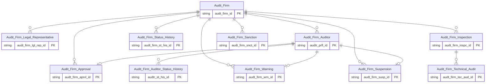

# AUDIT HLD — Overview

**Source system:** AUDIT (GMS Audit — schema Oracle `GMS_AUDIT_UAT`, tách từ IDS)
**Mô tả:** Phân hệ quản lý tổ chức kiểm toán được chấp thuận và kiểm toán viên (công ty kiểm toán, kiểm toán viên, quyết định chấp thuận, kiểm tra/kiểm tra hồ sơ kiểm toán, nhắc nhở/xử phạt/đình chỉ). Các bảng `AF_*` trước đây nằm trong source IDS, tách thành source riêng từ 2026-10-16. Schema AUDIT gồm 50 bảng (12 bảng `AF_*` + 38 bảng khác chưa đánh phạm vi).

**File chi tiết theo tầng:**
- [AUDIT_HLD_Tier1.md](AUDIT_HLD_Tier1.md) — Audit Firm
- [AUDIT_HLD_Tier2.md](AUDIT_HLD_Tier2.md) — Con của Audit Firm (Approval, Legal Representative, Auditor, Status History, Inspection); Shared Entities (IP Postal/Electronic Address, IP Alt Identification — phần nguồn AUDIT)
- [AUDIT_HLD_Tier3.md](AUDIT_HLD_Tier3.md) — Audit Firm enforcement (Warning, Sanction, Suspension, Technical Audit), Auditor Status History

---

**Tổng: 12 Atomic entities** (1 Tier 1, 5 Tier 2, 6 Tier 3)
*(Ngoài ra 3 shared entities — Involved Party Postal Address, Involved Party Electronic Address, Involved Party Alternative Identification — extend source_table AUDIT, không tạo mới.)*

---

#### 7a. Bảng tổng quan Atomic entities

| Tier | BCV Core Object | BCV Concept | Category | Source Table | Source Table Change Mode | Mô tả bảng nguồn | Atomic Entity | Table Type | BCV Term |
|---|---|---|---|---|---|---|---|---|---|
| T1 | Involved Party | [Involved Party] Organization | Organization | `AF_PROFILES` | Update | Hồ sơ công ty kiểm toán được BTC/UBCKNN chấp thuận: tên VI/EN, vốn thực góp, thành viên hãng kiểm toán quốc tế. | Audit Firm | Fundamental | (1) [Involved Party] Organization — tổ chức kiểm toán có pháp nhân, được quản lý bởi UBCKNN. (2) Cấu trúc trường: AF_NAME_VN/EN, CHARTER_CAPITAL_PAID, INTERNATIONAL_AFFILIATE_ID, STATUS_CD. (3) Chọn [Involved Party] Organization. |
| T2 | Documentation | [Documentation] Gov. Registration Document | Documentation | `AF_APPROVAL` | Update | Quyết định chấp thuận/đình chỉ cho công ty KT hoặc KTV (TARGET_TYPE_CD phân biệt loại, SOURCE_TYPE_CD phân biệt cơ quan ban hành). | Audit Firm Approval | Relative | (1) [Documentation] Gov. Registration Document — quyết định chấp thuận từ cơ quan nhà nước. (2) FK → AF_PROFILES (bắt buộc) + AF_AUDITOR_PROFILES (nullable). Cấu trúc: TARGET_TYPE_CD, APPROVAL_DOC_NO, APPROVAL_ISSUE/START/END_DATE. (3) Chọn [Documentation] Gov. Registration Document. |
| T2 | Involved Party | [Involved Party] Individual Employment Status | Involved Party | `AF_LEGAL_REPRESENTATIVE` | Update | Người đại diện pháp luật của công ty kiểm toán. | Audit Firm Legal Representative | Relative | (1) [Involved Party] Individual Employment Status — vai trò người đại diện pháp luật. (2) FK → AF_PROFILES. (3) Chọn [Involved Party] Individual Employment Status. |
| T2 | Involved Party | [Involved Party] Individual | Involved Party | `AF_AUDITOR_PROFILES` | Update | Hồ sơ kiểm toán viên thuộc công ty kiểm toán: CCCD, chứng chỉ hành nghề, chứng chỉ kiểm toán. | Audit Firm Auditor | Fundamental | (1) [Involved Party] Individual — cá nhân kiểm toán viên. (2) FK → AF_PROFILES. Cấu trúc: FULL_NAME, IDENTITY_NO, PRACTICE_CERT_NO/ISSUE_DATE, AUDIT_CERT_NO. (3) Chọn [Involved Party] Individual. |
| T2 | Business Activity | [Business Activity] Status History | Business Activity | `AF_STATUS_HISTORY` | Append | Lịch sử thay đổi trạng thái hoạt động của công ty kiểm toán: loại trạng thái, quyết định, thời gian hiệu lực. | Audit Firm Status History | Fact Append | (1) [Business Activity] Status History — chuỗi sự kiện thay đổi trạng thái. (2) FK → AF_PROFILES. Cấu trúc: STATUS_TYPE, SUSPENSION_STATUS_TYPE, DECISION_NO/DATE, EFFECTIVE_FROM/TO_DATE. (3) Chọn [Business Activity] Status History. |
| T2 | Business Activity | [Business Activity] Inspection | Business Activity | `AF_INSPECTION` | Append | Đợt kiểm tra công ty kiểm toán: số quyết định, ngày, kết quả kiểm tra hệ thống kiểm toán, hành động xử lý. | Audit Firm Inspection | Fact Append | (1) [Business Activity] Inspection — đợt kiểm tra là sự kiện nghiệp vụ. (2) FK → AF_PROFILES (T1). Cấu trúc: INSPECTION_DECISION_NO, INSPECTION_START/END_DATE, AUDIT_SYSTEM_RESULT_CD, OVERALL_RESULT_CD. (3) Chọn [Business Activity] Inspection. |
| T2 | Involved Party | Shared Entity | Shared Entity | `AF_PROFILES` | Update | Địa chỉ bưu chính của công ty kiểm toán. | Involved Party Postal Address | Fundamental | Shared Entity — extend source_table AUDIT. |
| T2 | Involved Party | Shared Entity | Shared Entity | `AF_PROFILES`, `AF_LEGAL_REPRESENTATIVE` | Update | Địa chỉ điện tử (điện thoại/email/fax/website) của công ty kiểm toán và người đại diện pháp luật. | Involved Party Electronic Address | Fundamental | Shared Entity — extend source_table AUDIT. |
| T2 | Involved Party | Shared Entity | Shared Entity | `AF_PROFILES`, `AF_AUDITOR_PROFILES` | Update | Giấy tờ định danh của kiểm toán viên (CMND/CCCD/Hộ chiếu) và giấy chứng nhận ĐKKD/đủ điều kiện kinh doanh của công ty kiểm toán. | Involved Party Alternative Identification | Fundamental | Shared Entity — extend source_table AUDIT. |
| T3 | Business Activity | [Business Activity] Warning Notice | Business Activity | `AF_WARNING` | Append | Văn bản nhắc nhở đối với công ty kiểm toán hoặc kiểm toán viên (TARGET_TYPE_CD phân biệt). | Audit Firm Warning | Fact Append | (1) [Business Activity] Warning Notice — hoạt động cảnh báo/nhắc nhở nghiệp vụ. (2) FK → AF_PROFILES + AF_AUDITOR_PROFILES (nullable) + AF_INSPECTION (nullable). (3) Chọn [Business Activity] Warning Notice. |
| T3 | Business Activity | [Business Activity] Enforcement Action | Business Activity | `AF_SANCTIONS` | Append | Quyết định xử phạt hành chính đối với công ty kiểm toán. | Audit Firm Sanction | Fact Append | (1) [Business Activity] Enforcement Action — hành động chế tài/xử phạt. (2) FK → AF_PROFILES. Cấu trúc: SANCTION_AUTHORITY_CD, DECISION_NO/DATE, SANCTION_CONTENT. (3) Chọn [Business Activity] Enforcement Action. |
| T3 | Business Activity | [Business Activity] Enforcement Action | Business Activity | `AF_SUSPENSION` | Append | Đình chỉ hoạt động của công ty kiểm toán hoặc kiểm toán viên (TARGET_TYPE_CD phân biệt). | Audit Firm Suspension | Fact Append | (1) [Business Activity] Enforcement Action — đình chỉ là hành động chế tài. (2) FK → AF_PROFILES + AF_AUDITOR_PROFILES (nullable) + AF_INSPECTION (nullable). (3) Chọn [Business Activity] Enforcement Action. |
| T3 | Business Activity | [Business Activity] Inspection | Business Activity | `AF_TECHNICAL_AUDIT` | Append | Kết quả kiểm tra hồ sơ kiểm toán trong một đợt kiểm tra: kết quả, hành động xử lý, nội dung vi phạm. | Audit Firm Technical Audit | Fact Append | (1) [Business Activity] Inspection — kiểm tra hồ sơ kiểm toán là sub-activity của đợt kiểm tra. (2) FK → AF_PROFILES + AF_INSPECTION. (3) Chọn [Business Activity] Inspection. |
| T3 | Involved Party | [Involved Party] Employer | Involved Party | `AF_AUDITOR_PRACTICE_HISTORY` | Update | Lịch sử hành nghề của kiểm toán viên: công ty kiểm toán nơi hành nghề, hành nghề từ ngày / đến ngày. | Audit Firm Auditor Practice History | Relative | (1) [Involved Party] Employer — Organization là bên cung cấp công việc cho Individual. (2) FK → AF_AUDITOR_PROFILES + AF_PROFILES. Cấu trúc: PRACTICE_FROM/TO_DATE theo từng giai đoạn. (3) Chọn [Involved Party] Employer; Relative vì nguồn Update. |
| T3 | Business Activity | [Business Activity] Status History | Business Activity | `AF_AUDITOR_STATUS_HISTORY` | Append | Lịch sử thay đổi trạng thái của kiểm toán viên: loại sự kiện, ngày hiệu lực, lý do. | Audit Firm Auditor Status History | Fact Append | (1) [Business Activity] Status History — chuỗi sự kiện thay đổi trạng thái. (2) FK → AF_AUDITOR_PROFILES. (3) Chọn [Business Activity] Status History. |

#### 7b. Diagram Atomic tổng (Mermaid)

#### 7c. Bảng Classification Value

| Source Table | Mô tả | BCV Term | Xử lý Atomic |
|---|---|---|---|
| `LOOKUP_VALUES` | Master bảng reference data của schema AUDIT: mọi Classification Value của `AF_*` load từ đây theo LOOKUP_GROUP (bảng riêng của AUDIT, độc lập `IDS.LOOKUP_VALUES`) | [Classification] Reference Data | Master source cho các Classification Value scheme `AUDIT_*`. Không tạo Atomic entity — mỗi LOOKUP_GROUP đăng ký thành 1 scheme riêng trong `classification_schemes.yaml` (`SCHEMA_CODE=AUDIT.*`). |

#### 7d. Junction Tables

| Source Table | Mô tả | Entity chính | Xử lý trên Atomic |
|---|---|---|---|

#### 7e. Điểm cần xác nhận

| # | Tier | Câu hỏi | Ảnh hưởng |
|---|---|---|---|
| 1 | T2 | `AF_INSPECTION` đã điều chỉnh từ T3 → T2 (FK trực tiếp → AF_PROFILES T1). ✅ Đã cập nhật Tier3.md (TC-04). | Đã xử lý. |
| 2 | T1/T2/T3 | **Tách 11 bảng `AF_*` từ IDS sang AUDIT (2026-10-16)** theo yêu cầu Data Modeler. 16 file LLD chuyển `lld/IDS/lld_IDS_AF_*` → `lld/AUDIT/lld_AUDIT_AF_*` (hạ `design_status` approved → draft); `manifest.yaml`, `classification_schemes.yaml` (21 scheme `IDS_*` → `AUDIT_*`, thêm `AUDIT_POSITION`), `atomic_entities.yaml`, `atomic_attributes.yaml`, `entity_ip_*.yaml`, `pending_design.yaml` cập nhật theo. Mã nguồn đổi: `hash_id('IDS_AF_…')` → `hash_id('AUDIT_AF_…')`, `SOURCE_SYSTEM=IDS_AF_…` → `AUDIT_AF_…`, `SCHEMA_CODE=IDS.` → `SCHEMA_CODE=AUDIT.` (khoá thay thế/mã Source System của 11 bảng đổi giá trị — nếu đã nạp dữ liệu theo mã cũ cần nạp lại/chuyển đổi). | Đã xử lý. |
| 3 | T3 | Bảng mới `AF_AUDITOR_PRACTICE_HISTORY` (có trong schema AUDIT, không có ở IDS cũ) đã có LLD + entity `Audit Firm Auditor Practice History` (T3, `[Involved Party] Employer`, `Relative`) — xem Tier3 T3-03/T3-04. | Đã thiết kế (draft) — chờ Data Modeler xác nhận Concept/Table Type/FK. |
| 4 | T2/T3 | Cột có trong schema AUDIT nhưng chưa map ở LLD hiện tại: `AF_APPROVAL.AFFILIATION_CHANGE_REASON`; `AF_AUDITOR_PROFILES.REC_CHANGED_FLG`; `AF_INSPECTION.AUDIT_TECHNICAL_RESULT_CD`; `AF_TECHNICAL_AUDIT` (INSPECTION_UNIT, INSPECTION_TYPE, INSPECTION_OTHER_UNIT, CONSIDER_NEXT_YEAR_PROCESSING, OTHER_PROCESSING, LD_CONSIDER_NEXT_YEAR_PROCESSING, LD_OTHER_PROCESSING); `AF_PROFILES.ID`; cột kỹ thuật `UPDATED_DATE`/`DELETE_FLG` ở các bảng AF. | Đã bổ sung vào LLD (draft): `AF_APPROVAL.AFFILIATION_CHANGE_REASON`, `AF_INSPECTION.AUDIT_TECHNICAL_RESULT_CD`, 7 cột `AF_TECHNICAL_AUDIT` (mô tả suy từ tên cột — xem Tier3 T3-05/T3-06). Còn chờ quyết định: `AF_AUDITOR_PROFILES.REC_CHANGED_FLG`, `AF_PROFILES.ID`, cột kỹ thuật `UPDATED_DATE`/`DELETE_FLG`. |
| 5 | T2/T3 | Lookup trong LLD `AF_*` dùng `SCHEMA_CODE=AUDIT.*` (bảng `AUDIT.LOOKUP_VALUES` riêng). `IDS.POSITION` → `AUDIT.POSITION` (đã thêm scheme `AUDIT_POSITION`); `IDS.SO_APPROVAL_STATUS` không còn dùng ở AUDIT — `AF_PROFILES`/`AF_AUDITOR_PROFILES` dùng `AUDIT.PROFILE_APPROVAL_STATUS` (chưa có scheme tương ứng trong `classification_schemes.yaml`). | Cần đăng ký scheme `AUDIT_PROFILE_APPROVAL_STATUS` khi rà lookup. |
| 6 | T2 | HLD cũ mục 7a/Tier2.md ghi `Involved Party Postal Address` có nguồn `AF_LEGAL_REPRESENTATIVE`, nhưng LLD thực tế chỉ có `AF_PROFILES` (xem T2-07). Bảng 7a ở trên đã theo LLD: Postal ← `AF_PROFILES`; Electronic ← `AF_PROFILES` + `AF_LEGAL_REPRESENTATIVE`; Alt Identification ← `AF_PROFILES` + `AF_AUDITOR_PROFILES`. | Đã xử lý. |
| 7 | T2/T3 | `Tier2.md` (bản gốc IDS) vẫn liệt kê `AF_SANCTIONS` ở 6a/6b/6c (T2) và `AUDIT_HLD_Tier3.md` không có — lệch với Overview/LLD (`group: T3`, xem IDS 7e #9). Tách nguyên trạng từ IDS, chưa đồng bộ lại. | Cần dọn khi rà HLD AUDIT. |

#### 7f. Bảng ngoài scope

Chưa đánh phạm vi — Data Modeler sẽ quyết định `in_scope`/`out_of_scope` theo số lượng LLD và FK (BRD hiện để `pending`). Các bảng AUDIT còn lại ngoài nhóm `AF_*`:

| Source Table | Ghi chú |
|---|---|
| `ALERT_TEMPLATE_AUDIT_DTL` | `scope_status: pending` — chưa đánh phạm vi |
| `ALERT_TEMPLATE_AUDIT_HDR` | `scope_status: pending` — chưa đánh phạm vi |
| `COMPANY_CHANGE_ROLE_HIS` | `scope_status: pending` — chưa đánh phạm vi |
| `COMPANY_DATA` | `scope_status: pending` — chưa đánh phạm vi |
| `COMPANY_DIGITAL_CERTIFICATES` | `scope_status: pending` — chưa đánh phạm vi |
| `COUNTRIES` | `scope_status: pending` — chưa đánh phạm vi |
| `DATA` | `scope_status: pending` — chưa đánh phạm vi |
| `DATABASECHANGELOG` | `scope_status: pending` — chưa đánh phạm vi |
| `DATABASECHANGELOGLOCK` | `scope_status: pending` — chưa đánh phạm vi |
| `DATA_TYPES` | `scope_status: pending` — chưa đánh phạm vi |
| `DATA_VALUES` | `scope_status: pending` — chưa đánh phạm vi |
| `DEPARTMENTS` | `scope_status: pending` — chưa đánh phạm vi |
| `FIELDS` | `scope_status: pending` — chưa đánh phạm vi |
| `FILES` | `scope_status: pending` — chưa đánh phạm vi |
| `FORMS` | `scope_status: pending` — chưa đánh phạm vi |
| `FORM_FIELDS` | `scope_status: pending` — chưa đánh phạm vi |
| `FORM_FIELD_HISTORY` | `scope_status: pending` — chưa đánh phạm vi |
| `HISTORY_CHANGE_LOG` | `scope_status: pending` — chưa đánh phạm vi |
| `HOLIDAY_CALENDAR` | `scope_status: pending` — chưa đánh phạm vi |
| `HTE_NOTIFICATIONS_DTL` | `scope_status: pending` — chưa đánh phạm vi |
| `HTE_NOTIFICATIONS_RESULT` | `scope_status: pending` — chưa đánh phạm vi |
| `HTE_VIOLATION_REPORT` | `scope_status: pending` — chưa đánh phạm vi |
| `LOGINS` | `scope_status: pending` — chưa đánh phạm vi |
| `LOGIN_PERMISSION_BY_CODE` | `scope_status: pending` — chưa đánh phạm vi |
| `LOOKUP_VALUES` | `scope_status: pending` — chưa đánh phạm vi |
| `NOTIFICATIONS` | `scope_status: pending` — chưa đánh phạm vi |
| `NOTIFICATIONS_DTL` | `scope_status: pending` — chưa đánh phạm vi |
| `NOTIFICATIONS_RESULT` | `scope_status: pending` — chưa đánh phạm vi |
| `RCOL` | `scope_status: pending` — chưa đánh phạm vi |
| `REPORT_CATALOG` | `scope_status: pending` — chưa đánh phạm vi |
| `REP_COLUMN` | `scope_status: pending` — chưa đánh phạm vi |
| `REP_DATA` | `scope_status: pending` — chưa đánh phạm vi |
| `REP_FORMS` | `scope_status: pending` — chưa đánh phạm vi |
| `REP_ROW` | `scope_status: pending` — chưa đánh phạm vi |
| `RROW` | `scope_status: pending` — chưa đánh phạm vi |
| `SMS_LOG` | `scope_status: pending` — chưa đánh phạm vi |
| `VIOLATION_REPORT` | `scope_status: pending` — chưa đánh phạm vi |
| `VIOLATION_TEMPLATES` | `scope_status: pending` — chưa đánh phạm vi |

---

## Entities

### 1. Audit Firm
**Tier:** 1 | **Source:** `AF_PROFILES` | **BCV Concept:** [Involved Party] Organization | **BCO:** Involved Party | **Table Type:** Fundamental
**Domain Prefix:** Audit Firm
**Description:** Công ty kiểm toán được BTC hoặc UBCKNN chấp thuận kiểm toán báo cáo tài chính của CTĐC và tổ chức phát hành.

### 2. Audit Firm Approval
**Tier:** 2 | **Source:** `AF_APPROVAL` | **BCV Concept:** [Documentation] Gov. Registration Document | **BCO:** Documentation | **Table Type:** Relative
**Domain Prefix:** Audit Firm
**Description:** Quyết định chấp thuận hoặc đình chỉ của BTC/UBCKNN đối với công ty kiểm toán hoặc kiểm toán viên (TARGET_TYPE_CD phân biệt đối tượng, SOURCE_TYPE_CD phân biệt cơ quan ban hành).

### 3. Audit Firm Auditor
**Tier:** 2 | **Source:** `AF_AUDITOR_PROFILES` | **BCV Concept:** [Involved Party] Individual | **BCO:** Involved Party | **Table Type:** Fundamental
**Domain Prefix:** Audit Firm
**Description:** Hồ sơ kiểm toán viên thuộc công ty kiểm toán: giấy tờ định danh, chứng chỉ hành nghề kiểm toán, chứng chỉ kiểm toán viên hành nghề.

### 4. Audit Firm Inspection
**Tier:** 2 | **Source:** `AF_INSPECTION` | **BCV Concept:** [Business Activity] Inspection | **BCO:** Business Activity | **Table Type:** Fact Append
**Domain Prefix:** Audit Firm
**Description:** Đợt kiểm tra tổng thể công ty kiểm toán: số quyết định kiểm tra, thời gian, kết quả kiểm tra hệ thống kiểm toán, kết quả tổng thể, hành động xử lý.

### 5. Audit Firm Legal Representative
**Tier:** 2 | **Source:** `AF_LEGAL_REPRESENTATIVE` | **BCV Concept:** [Involved Party] Individual Employment Status | **BCO:** Involved Party | **Table Type:** Relative
**Domain Prefix:** Audit Firm
**Description:** Người đại diện pháp luật của công ty kiểm toán được đăng ký với UBCKNN.

### 6. Audit Firm Status History
**Tier:** 2 | **Source:** `AF_STATUS_HISTORY` | **BCV Concept:** [Business Activity] Status History | **BCO:** Business Activity | **Table Type:** Fact Append
**Domain Prefix:** Audit Firm
**Description:** Lịch sử thay đổi trạng thái hoạt động của công ty kiểm toán: đình chỉ, tạm ngừng, chấm dứt, thu hồi chứng nhận.

### 7. Audit Firm Auditor Practice History
**Tier:** 3 | **Source:** `AF_AUDITOR_PRACTICE_HISTORY` | **BCV Concept:** [Involved Party] Employer | **BCO:** Involved Party | **Table Type:** Relative
**Domain Prefix:** Audit Firm Auditor
**Description:** Lịch sử hành nghề của kiểm toán viên: công ty kiểm toán là nơi hành nghề và khoảng thời gian hành nghề (từ ngày – đến ngày).

### 8. Audit Firm Auditor Status History
**Tier:** 3 | **Source:** `AF_AUDITOR_STATUS_HISTORY` | **BCV Concept:** [Business Activity] Status History | **BCO:** Business Activity | **Table Type:** Fact Append
**Domain Prefix:** Audit Firm Auditor
**Description:** Lịch sử thay đổi trạng thái hành nghề của kiểm toán viên: loại sự kiện (cấp/thu hồi/đình chỉ chứng chỉ), ngày hiệu lực, lý do.

### 9. Audit Firm Sanction
**Tier:** 3 | **Source:** `AF_SANCTIONS` | **BCV Concept:** [Business Activity] Enforcement Action | **BCO:** Business Activity | **Table Type:** Fact Append
**Domain Prefix:** Audit Firm
**Description:** Quyết định xử phạt hành chính của UBCKNN đối với công ty kiểm toán: số quyết định, ngày ban hành, nội dung xử phạt.

### 10. Audit Firm Suspension
**Tier:** 3 | **Source:** `AF_SUSPENSION` | **BCV Concept:** [Business Activity] Enforcement Action | **BCO:** Business Activity | **Table Type:** Fact Append
**Domain Prefix:** Audit Firm
**Description:** Quyết định đình chỉ hoạt động của UBCKNN đối với công ty kiểm toán hoặc kiểm toán viên (TARGET_TYPE_CD phân biệt đối tượng).

### 11. Audit Firm Technical Audit
**Tier:** 3 | **Source:** `AF_TECHNICAL_AUDIT` | **BCV Concept:** [Business Activity] Inspection | **BCO:** Business Activity | **Table Type:** Fact Append
**Domain Prefix:** Audit Firm
**Description:** Kết quả kiểm tra hồ sơ kiểm toán cụ thể trong một đợt kiểm tra tổng thể: hồ sơ được kiểm tra, kết quả, hành động xử lý, nội dung vi phạm.

### 12. Audit Firm Warning
**Tier:** 3 | **Source:** `AF_WARNING` | **BCV Concept:** [Business Activity] Warning Notice | **BCO:** Business Activity | **Table Type:** Fact Append
**Domain Prefix:** Audit Firm
**Description:** Văn bản nhắc nhở của BTC/UBCKNN đối với công ty kiểm toán hoặc kiểm toán viên (TARGET_TYPE_CD phân biệt đối tượng).
