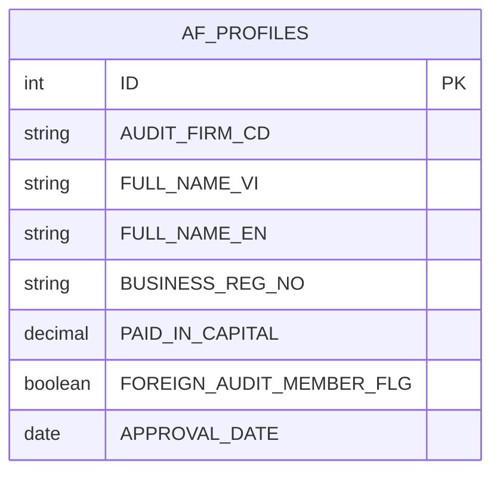
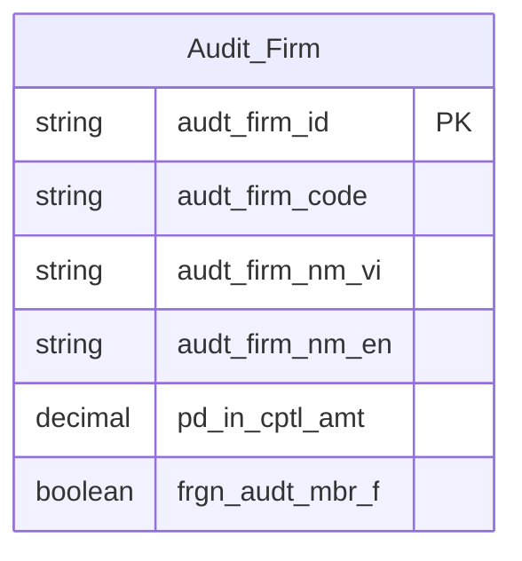

# AUDIT HLD — Tier 1

**Source system:** AUDIT (GMS Audit — schema `GMS_AUDIT_UAT`, tách từ IDS)
**Tier 1:** Entity độc lập của AUDIT — Công ty kiểm toán (`AF_PROFILES`).

*Nội dung tách từ `IDS_HLD_Tier1.md` ngày 2026-10-16; mã điểm xác nhận (T1-xx) giữ nguyên số gốc.*

---

## 6a. Bảng tổng quan BCV Concept

| BCV Core Object | BCV Concept | Category | Source Table | Source Table Change Mode | Mô tả bảng nguồn | Atomic Entity | Table Type | BCV Term |
|---|---|---|---|---|---|---|---|---|
| Involved Party | [Involved Party] Organization | Organization | `AF_PROFILES` | Update | Hồ sơ công ty kiểm toán được BTC/UBCKNN chấp thuận: tên VI/EN, vốn điều lệ thực góp, thành viên hãng kiểm toán quốc tế. | Audit Firm | Fundamental | (1) Term candidate: `[Involved Party] Organization` — BCV mô tả pháp nhân tổ chức. (2) Cấu trúc trường: tên VI/EN/viết tắt, số ĐKKD, vốn điều lệ, trạng thái, ngày chấp thuận, thành viên hãng nước ngoài — đây là profile của một tổ chức kiểm toán độc lập. (3) Chọn `[Involved Party] Organization` — công ty kiểm toán là pháp nhân tổ chức; shared entity với SCMS.CT_KIEM_TOAN. |

---

## 6b. Diagram Source (Mermaid)

---

## 6c. Diagram Atomic (Mermaid)

---

## 6d. Mục Danh mục & Tham chiếu (Reference Data)

*(Không có nội dung AF cho mục này)*

---

## 6e. Bảng chờ thiết kế

*(Để trống)*

---

## 6f. Điểm cần xác nhận

| # | Câu hỏi | Kết quả |
|---|---|---|
| T1-05 | `Audit Firm` là shared entity với SCMS.CT_KIEM_TOAN. Chưa có trong `atomic_entities.yaml` — thiết kế mới từ AUDIT, SCMS sẽ bổ sung source_table sau. | Chưa approved — thiết kế mới, cần coordinate với SCMS HLD. |
| T1-12 | `AF_PROFILES.BUSINESS_REG_NO` (Giấy chứng nhận ĐKKD) và `ELIGIBILITY_CERT_NO` (Giấy chứng nhận đủ điều kiện kinh doanh) — theo yêu cầu Data Modeler (2026-07-14), tách ra shared entity `Involved Party Alternative Identification` thay vì giữ denormalized Text tại `Audit Firm`. Hardcode type `BUSINESS_LICENSE` (BUSINESS_REG_NO) và `BUSINESS_ELIGIBILITY_LICENSE` (ELIGIBILITY_CERT_NO — giá trị mới, bổ sung vào scheme `IP_ALT_ID_TYPE`). | Đã xử lý — tạo `lld_AUDIT_AF_PROFILES_IP_Alt_Identification.yaml` (2 block theo type), xóa 2 attribute denormalized khỏi `lld_AUDIT_AF_PROFILES.yaml`, cập nhật `manifest.yaml` + `classification_schemes.yaml` + `pending_design.yaml`. |

---
