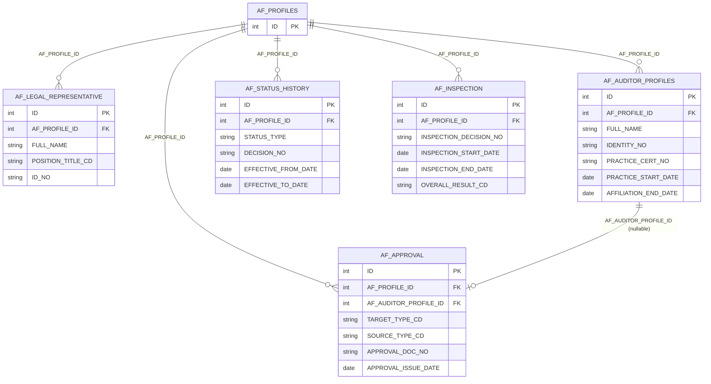
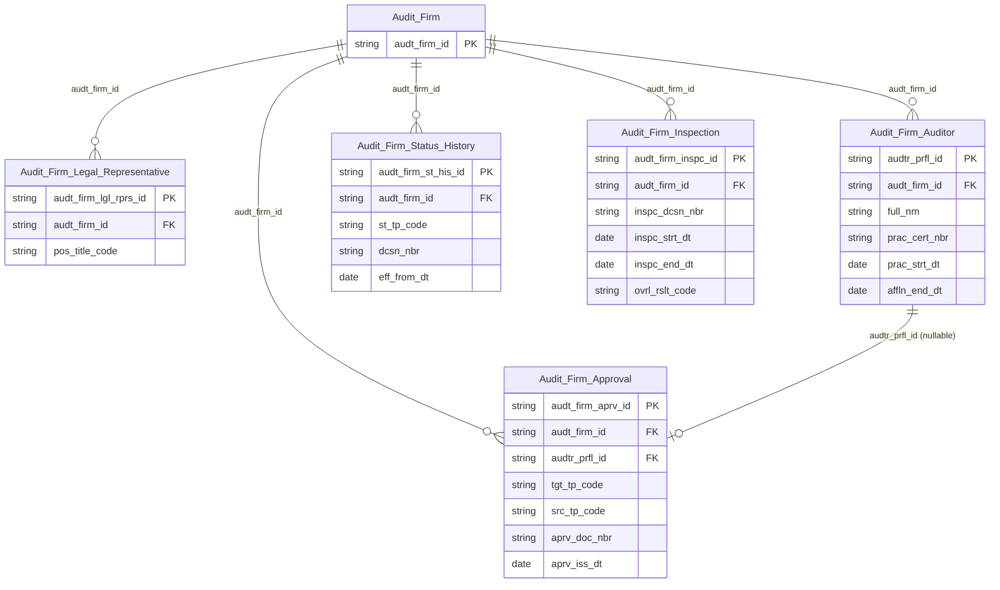

# AUDIT HLD — Tier 2

**Source system:** AUDIT (GMS Audit — schema `GMS_AUDIT_UAT`, tách từ IDS)
**Tier 2:** Các entity FK đến Entity Tier 1 (Audit Firm). Gồm:
- Con của **Audit Firm** (T1): Audit Firm Approval, Audit Firm Auditor, Audit Firm Inspection, Audit Firm Legal Representative, Audit Firm Status History
- Shared entities của host Tier 2: IP Electronic Address (← `AF_LEGAL_REPRESENTATIVE`), IP Alternative Identification (← `AF_AUDITOR_PROFILES`). Shared entity của host `AF_PROFILES` (T1) xem Tier1.

*Nội dung tách từ `IDS_HLD_Tier2.md` ngày 2026-10-16; mã điểm xác nhận (T2-xx) giữ nguyên số gốc.*

---

## 6a. Bảng tổng quan BCV Concept

| BCV Core Object | BCV Concept | Category | Source Table | Source Table Change Mode | Mô tả bảng nguồn | Atomic Entity | Table Type | BCV Term |
|---|---|---|---|---|---|---|---|---|
| Documentation | [Documentation] Gov. Registration Document | Documentation | `AF_APPROVAL` | Update | Quyết định chấp thuận/đình chỉ cho công ty kiểm toán hoặc kiểm toán viên — TARGET_TYPE_CD phân biệt đối tượng; SOURCE_TYPE_CD phân biệt cơ quan (BTC/UBCKNN). | Audit Firm Approval | Relative | (1) Term candidate: `[Documentation] Gov. Registration Document` — văn bản pháp lý/hành chính cấp cho tổ chức/cá nhân. (2) Cấu trúc trường: AF_PROFILE_ID, AF_AUDITOR_PROFILE_ID (nullable — nếu cho KTV), TARGET_TYPE_CD (COMPANY/AUDITOR), SOURCE_TYPE_CD (BTC/UBCKNN), APPROVAL_DOC_NO, APPROVAL_ISSUE_DATE, APPROVAL_START/END_DATE, APPROVAL_CONTENT — 1 bảng xử lý cả 2 loại đối tượng qua TARGET_TYPE_CD. (3) Chọn `[Documentation] Gov. Registration Document`. Relative (FK → Audit Firm; nullable FK → Audit Firm Auditor). |
| Involved Party | [Involved Party] Individual Employment Status | Involved Party | `AF_LEGAL_REPRESENTATIVE` | Update | Người đại diện pháp luật của công ty kiểm toán: chức vụ, số CMND/hộ chiếu, email, SĐT. | Audit Firm Legal Representative | Relative | (1) Term candidate: `[Involved Party] Individual Employment Status` — quan hệ vai trò của cá nhân tại tổ chức. (2) Cấu trúc trường: FULL_NAME, POSITION_TITLE_CD, ID_NO, EMAIL, PHONE, start/end date. (3) Chọn `[Involved Party] Individual Employment Status`. Relative (FK → Audit Firm). |
| Involved Party | [Involved Party] Individual | Involved Party | `AF_AUDITOR_PROFILES` | Update | Hồ sơ kiểm toán viên thuộc công ty kiểm toán: số CCCD, chứng chỉ KTV, GCN đăng ký hành nghề, ngày bắt đầu/kết thúc hành nghề. | Audit Firm Auditor | Fundamental | (1) Term candidate: `[Involved Party] Individual` — kiểm toán viên là cá nhân có profile riêng và lifecycle trong ngành KT. (2) Cấu trúc trường: FULL_NAME, IDENTITY_NO, POSITION_TITLE_CD, PRACTICE_CERT_NO/ISSUE_DATE, PRACTICE_START/END_DATE, AUDIT_CERT_NO/ISSUE_DATE, STATUS_CD, AFFILIATION_END_DATE — đây là profile đầy đủ của kiểm toán viên, không chỉ là vai trò tại công ty. (3) Chọn `[Involved Party] Individual` — KTV là Involved Party Individual với lifecycle hành nghề riêng. Fundamental (FK → Audit Firm). |
| Business Activity | [Business Activity] Status History | Business Activity | `AF_STATUS_HISTORY` | Append | Lịch sử trạng thái hoạt động của công ty kiểm toán: loại trạng thái (đình chỉ/tạm ngừng/thu hồi), số/ngày quyết định, thời gian hiệu lực. | Audit Firm Status History | Fact Append | (1) Term candidate: `[Business Activity] Status History` — BCV mô tả lịch sử trạng thái là chuỗi sự kiện thay đổi trạng thái. (2) Cấu trúc trường: STATUS_TYPE, SUSPENSION_STATUS_TYPE, DECISION_NO/DATE, EFFECTIVE_FROM/TO_DATE, TERMINATED_DECISION_DATE, REASON — đây là chuỗi sự kiện thay đổi trạng thái của công ty KT, mỗi bản ghi là 1 lần thay đổi. (3) Chọn `[Business Activity] Status History`. Fact Append — mỗi lần thay đổi trạng thái là occurrence. |
| Business Activity | [Business Activity] Inspection | Business Activity | `AF_INSPECTION` | Append | Đợt kiểm tra công ty kiểm toán: số quyết định, ngày kiểm tra, kết quả kiểm tra hệ thống kiểm toán, hành động xử lý. | Audit Firm Inspection | Fact Append | (1) Term candidate: `[Business Activity] Inspection` — đợt kiểm tra là sự kiện nghiệp vụ. (2) Cấu trúc trường: INSPECTION_DECISION_NO, INSPECTION_START/END_DATE, AUDIT_SYSTEM_RESULT_CD, OVERALL_RESULT_CD. (3) Chọn `[Business Activity] Inspection`. Fact Append. FK → AF_PROFILES (T1) → Tier 2. |
| Involved Party | Shared Entity | Shared Entity | `AF_LEGAL_REPRESENTATIVE` | Update | Địa chỉ điện tử (điện thoại/email) của người đại diện pháp luật công ty kiểm toán. | Involved Party Electronic Address | Fundamental | Shared Entity — extend source_table AUDIT; Tier 2 = Tier của host entity `AF_LEGAL_REPRESENTATIVE`. |
| Involved Party | Shared Entity | Shared Entity | `AF_AUDITOR_PROFILES` | Update | Giấy tờ định danh/chứng chỉ của kiểm toán viên (CCCD, chứng chỉ hành nghề, chứng chỉ kiểm toán). | Involved Party Alternative Identification | Fundamental | Shared Entity — extend source_table AUDIT; Tier 2 = Tier của host entity `AF_AUDITOR_PROFILES`. |

---

## 6b. Diagram Source (Mermaid)

---

## 6c. Diagram Atomic (Mermaid)

---

## 6d. Mục Danh mục & Tham chiếu (Reference Data)

| Source Field / Bảng | Mô tả | Scheme Code | source_type | Ghi chú |
|---|---|---|---|---|
| `AF_APPROVAL.TARGET_TYPE_CD` | Đối tượng chấp thuận (công ty KT / KTV) | `AUDIT_APPROVAL_TARGET_TYPE` | source_table | Values load từ `LOOKUP_VALUES` |
| `AF_APPROVAL.SOURCE_TYPE_CD` | Cơ quan chấp thuận (BTC / UBCKNN) | `AUDIT_APPROVAL_SOURCE_TYPE` | source_table | Values load từ `LOOKUP_VALUES` |
| `AF_AUDITOR_PROFILES.POSITION_TITLE_CD` | Chức vụ KTV | `AUDIT_AF_POSITION_TITLE` | source_table | Values load từ `LOOKUP_VALUES` |
| `AF_STATUS_HISTORY.STATUS_TYPE` | Loại trạng thái công ty KT | `AUDIT_AF_STATUS_TYPE` | etl_derived | Values lấy trực tiếp từ cột nguồn |

---

## 6e. Bảng chờ thiết kế

*(Để trống)*

---

## 6f. Điểm cần xác nhận

| # | Câu hỏi | Kết quả |
|---|---|---|
| T2-01 | `AF_APPROVAL` trong BRD thực tế có cả 2 FK: AF_PROFILE_ID và AF_AUDITOR_PROFILE_ID (nullable) + TARGET_TYPE_CD — 1 bảng xử lý cả chấp thuận công ty KT và KTV. Khác với HLD cũ tách thành 2 entity riêng. Xác nhận gộp vào 1 entity `Audit Firm Approval` với TARGET_TYPE_CD phân biệt. | Xác nhận — BRD thực tế là 1 bảng duy nhất với TARGET_TYPE_CD. Gộp vào 1 entity đơn giản hơn, ETL dùng TARGET_TYPE_CD để populate FK đúng. |
| T2-02 | `AF_AUDITOR_PROFILES` trong BRD là bảng profile riêng của KTV (FULL_NAME, IDENTITY_NO, PRACTICE_CERT_NO, v.v.) — khác với HLD cũ dùng bảng không tồn tại `af_auditor_approval`. Đây là Tier 2 vì FK → AF_PROFILES. Xác nhận. | Xác nhận — `AF_AUDITOR_PROFILES` là Tier 2 Fundamental với tên entity = `Audit Firm Auditor` (theo LLD). |
| T2-07 | Mục 6a dòng Involved Party Postal Address liệt kê `AF_LEGAL_REPRESENTATIVE` là nguồn — nhưng BRD thực tế (`brd_AUDIT_AF_LEGAL_REPRESENTATIVE.yaml`) không có cột địa chỉ nào (chỉ có FULL_NAME/IDENTITY_NO/PHONE_NO/POSITION_TITLE_CD/APPOINTMENT dates). Không tạo file Postal Address cho nguồn này ở LLD. | Cần Data Modeler xác nhận — có thể mục 6a liệt kê nhầm, hoặc cột địa chỉ đã bị loại khỏi BRD survey. Giữ nguyên hiện trạng cho đến khi xác nhận. |
| T2-18 | Data Modeler phát hiện (2026-09-05) 2 lỗi thiết kế trong nhóm entity FK → `AF_PROFILES`: (a) mọi FK "Audit Firm Id" hash trực tiếp theo `AF_PROFILE_ID` (ID kỹ thuật của `AF_PROFILES`) thay vì crosswalk sang `AUDIT_FIRM_CD` (BK thật, dùng để hash Id của `Audit Firm`) — sai lệch hash giữa entity con và entity main; (b) `AF_AUDITOR_PROFILES` là bảng Involved Party (Individual) nhưng thiết kế trước đó giữ `IDENTITY_NO`/`PRACTICE_CERT_NO`/`AUDIT_CERT_NO` denormalized, không tách shared entity `Involved Party Alternative Identification` như quy định Bước 4. | Đã xử lý — (a) sửa crosswalk `hash_id('AUDIT_AF_PROFILES', AUDIT_FIRM_CD)` cho **cả 9 entity** có FK `AF_PROFILE_ID`: `AF_APPROVAL`, `AF_AUDITOR_PROFILES`, `AF_LEGAL_REPRESENTATIVE`, `AF_INSPECTION`, `AF_STATUS_HISTORY`, `AF_SANCTIONS`, `AF_TECHNICAL_AUDIT`, `AF_SUSPENSION`, `AF_WARNING` (không chỉ 2 bảng người dùng chỉ ra ban đầu — cùng 1 bug lặp lại, tất cả đang `draft` nên sửa đồng loạt an toàn). (b) Tạo `lld_AUDIT_AF_AUDITOR_PROFILES_IP_Alt_Identification.yaml` (3 block: `CITIZEN_ID` từ `IDENTITY_NO`; `PRACTITIONER_LICENSE` từ `PRACTICE_CERT_NO`/`PRACTICE_CERT_ISSUE_DATE`; `AUDITOR_CERTIFICATE` từ `AUDIT_CERT_NO`/`AUDIT_CERT_ISSUE_DATE` — value mới bổ sung `classification_schemes.yaml`), xóa 5 attribute denormalized tương ứng khỏi `lld_AUDIT_AF_AUDITOR_PROFILES.yaml`, cập nhật `manifest.yaml`/`pending_design.yaml`. |
| T2-05 | `Shared entities` (IP Postal Address, IP Electronic Address, IP Alt Identification) đã approved từ NHNCK — chỉ bổ sung source_table AUDIT, không tạo mới. Source cho IP Postal Address từ AUDIT: `AF_PROFILES` (địa chỉ trụ sở). | Xác nhận — bổ sung source khi chạy aggregate_atomic.py sau khi xuất Overview. |
| T2-08 | `AF_LEGAL_REPRESENTATIVE.IDENTITY_NO` không có cột phân biệt loại giấy tờ (CMND/CCCD/Hộ chiếu). | **Đã xử lý (2026-09-05, nguyên gốc ở IDS)** — theo yêu cầu tường minh Data Modeler, bỏ default `NATIONAL_ID` tạm thời (không đủ thông tin xác định type thật), map `IDENTITY_NO` denormalized trực tiếp trên `Audit Firm Legal Representative` (`lld_AUDIT_AF_LEGAL_REPRESENTATIVE.yaml`, attribute `Identification Number`); file `…_IP_Alt_Identification.yaml` của bảng này đã xóa, entry `manifest.yaml` đã gỡ. |

---
