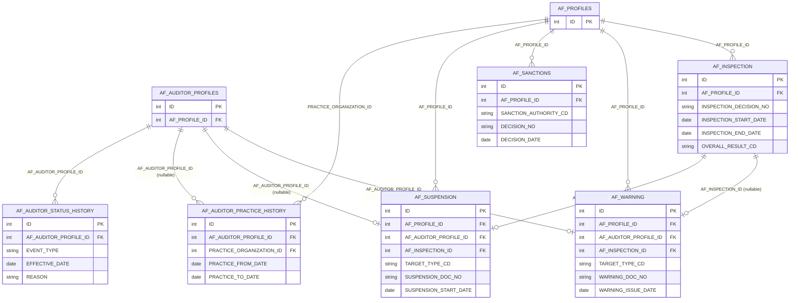
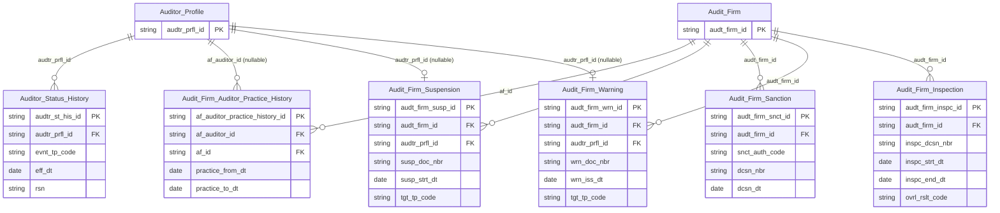

# AUDIT HLD — Tier 3

**Source system:** AUDIT (GMS Audit — schema `GMS_AUDIT_UAT`, tách từ IDS)
**Tier 3:** Các entity FK đến entity Tier 2. Gồm:
- Con của **Audit Firm Approval** (T2): AF Warning, AF Suspension, AF Technical Audit
- Con của **Auditor Profile** (T2): Auditor Status History

*Nội dung tách từ `IDS_HLD_Tier3.md` ngày 2026-10-16; mã điểm xác nhận (T3-xx) giữ nguyên số gốc.*

---

## 6a. Bảng tổng quan BCV Concept

| BCV Core Object | BCV Concept | Category | Source Table | Source Table Change Mode | Mô tả bảng nguồn | Atomic Entity | Table Type | BCV Term |
|---|---|---|---|---|---|---|---|---|
| Business Activity | [Business Activity] Warning Notice | Business Activity | `AF_WARNING` | Update | Văn bản nhắc nhở đối với công ty kiểm toán hoặc kiểm toán viên: FK → AF_PROFILES (công ty KT) hoặc AF_AUDITOR_PROFILES (KTV), thêm FK tùy chọn → AF_INSPECTION. | Audit Firm Warning | Fact Append | (1) Term candidate: `[Business Activity] Warning Notice` — BCV mô tả hoạt động cảnh báo/nhắc nhở nghiệp vụ. (2) Cấu trúc trường: AF_PROFILE_ID, AF_AUDITOR_PROFILE_ID (nullable), AF_INSPECTION_ID (nullable), TARGET_TYPE_CD, SOURCE_TYPE_CD, WARNING_DOC_NO, WARNING_ISSUE_DATE, WARNING_TYPE_CD. (3) Chọn `[Business Activity] Warning Notice`. Fact Append (sự kiện cảnh báo insert-only về nghiệp vụ). Phụ thuộc AF_PROFILES (T1) + AF_AUDITOR_PROFILES (T2) → Tier 3. |
| Business Activity | [Business Activity] Enforcement Action | Business Activity | `AF_SUSPENSION` | Update | Đình chỉ hoạt động của công ty kiểm toán hoặc kiểm toán viên: TARGET_TYPE_CD phân biệt, FK → AF_INSPECTION tùy chọn. | Audit Firm Suspension | Fact Append | (1) Term candidate: `[Business Activity] Enforcement Action` — đình chỉ là hành động chế tài. (2) Cấu trúc trường: AF_PROFILE_ID, AF_AUDITOR_PROFILE_ID (nullable), AF_INSPECTION_ID (nullable), TARGET_TYPE_CD, SOURCE_TYPE_CD, SUSPENSION_DOC_NO, SUSPENSION_ISSUE_DATE, SUSPENSION_START/END_DATE. (3) Chọn `[Business Activity] Enforcement Action`. Fact Append. |
| Business Activity | [Business Activity] Inspection | Business Activity | `AF_TECHNICAL_AUDIT` | Update | Kiểm tra hồ sơ kiểm toán (technical audit) trong một đợt kiểm tra: kết quả kiểm tra, số văn bản xử lý, nội dung vi phạm. | Audit Firm Technical Audit | Fact Append | (1) Term candidate: `[Business Activity] Inspection` — kiểm tra hồ sơ là sub-activity của đợt kiểm tra. (2) Cấu trúc trường: AF_PROFILE_ID, AF_INSPECTION_ID, INSPECTION_ENTITY_FILES, INSPECTION_YEAR, SIGNING_AUDITOR_NAME, INSPECTION_RESULT_CD, AUDIT_ACTION_CD, VIOLATION_CONTENT. (3) Chọn `[Business Activity] Inspection`. Fact Append. FK → AF_PROFILES (T1) + AF_INSPECTION (T3) → Tier 4. **Ghi vào điểm cần xác nhận.** |
| Involved Party | [Involved Party] Employer | Involved Party | `AF_AUDITOR_PRACTICE_HISTORY` | Update | Lịch sử hành nghề của kiểm toán viên: công ty kiểm toán nơi hành nghề, hành nghề từ ngày / đến ngày. | Audit Firm Auditor Practice History | Relative | (1) Term candidate: `[Involved Party] Employer` — Organization là bên cung cấp công việc cho Individual; kèm `Employer Effective Date` (ngày Individual bắt đầu làm việc với Employer). (2) Cấu trúc trường: AF_AUDITOR_PROFILE_ID (FK KTV), PRACTICE_ORGANIZATION_ID (FK → AF_PROFILES), PRACTICE_FROM_DATE, PRACTICE_TO_DATE — mỗi dòng là 1 giai đoạn KTV hành nghề tại 1 công ty KT, có ngày kết thúc cập nhật được. (3) Chọn `[Involved Party] Employer`; không chọn `Status History` vì dòng không ghi thay đổi trạng thái mà ghi quan hệ KTV–công ty theo thời gian. Relative (SCD2; FK → Audit Firm Auditor T2 + Audit Firm T1). |
| Business Activity | [Business Activity] Status History | Business Activity | `AF_AUDITOR_STATUS_HISTORY` | Update | Lịch sử thay đổi trạng thái của kiểm toán viên: loại sự kiện, ngày hiệu lực, lý do. | Auditor Status History | Fact Append | (1) Term candidate: `[Business Activity] Status History` — chuỗi sự kiện thay đổi trạng thái. (2) Cấu trúc trường: AF_AUDITOR_PROFILE_ID, EVENT_TYPE, EFFECTIVE_DATE, REASON, ADDITIONAL_DESC. (3) Chọn `[Business Activity] Status History`. Fact Append. FK → AF_AUDITOR_PROFILES (T2) → Tier 3. |

---

## 6b. Diagram Source (Mermaid)

---

## 6c. Diagram Atomic (Mermaid)

---

## 6d. Mục Danh mục & Tham chiếu (Reference Data)

| Source Field / Bảng | Mô tả | Scheme Code | source_type | Ghi chú |
|---|---|---|---|---|
| `AF_WARNING.TARGET_TYPE_CD` | Đối tượng nhắc nhở (công ty KT / KTV) | `AUDIT_WARNING_TARGET_TYPE` | source_table | Values load từ `LOOKUP_VALUES` |
| `AF_WARNING.SOURCE_TYPE_CD` | Cơ quan nhắc nhở (BTC / UBCKNN) | `AUDIT_WARNING_SOURCE_TYPE` | source_table | Values load từ `LOOKUP_VALUES` |
| `AF_SANCTIONS.SANCTION_AUTHORITY_CD` | Cơ quan xử phạt | `AUDIT_SANCTION_AUTHORITY` | source_table | Values load từ `LOOKUP_VALUES` |
| `AF_TECHNICAL_AUDIT.INSPECTION_UNIT` | Đơn vị thực hiện kiểm tra (suy từ tên cột) | `AUDIT_AF_TECHNICAL_AUDIT_INSPECTION_UNIT` | modeler_defined | Chưa biết LOOKUP_GROUP nguồn; `values: []` |
| `AF_TECHNICAL_AUDIT.INSPECTION_TYPE` | Hình thức kiểm tra (suy từ tên cột) | `AUDIT_AF_TECHNICAL_AUDIT_INSPECTION_TYPE` | modeler_defined | Chưa biết LOOKUP_GROUP nguồn; `values: []` |
| `AF_TECHNICAL_AUDIT.CONSIDER_NEXT_YEAR_PROCESSING`, `LD_CONSIDER_NEXT_YEAR_PROCESSING` | Hình thức xử lý xem xét ở năm kiểm tra tiếp theo (KTV / Lãnh đạo) | `AUDIT_AF_TECHNICAL_AUDIT_CONSIDER_NEXT_YEAR_PROCESSING` | modeler_defined | Dùng chung 1 scheme cho 2 cột; chưa biết LOOKUP_GROUP nguồn; `values: []` |

---

## 6e. Bảng chờ thiết kế

*(Để trống)*

---

## 6f. Điểm cần xác nhận

| # | Câu hỏi | Kết quả |
|---|---|---|
| T3-01 | `AF_INSPECTION` FK → AF_PROFILES (T1), không FK đến AF_APPROVAL (T2) → thực ra nên xếp Tier 2 cùng với các entity con của AF_PROFILES. Hiện để Tier 3 để nhóm về chủ đề AF enforcement. Cần điều chỉnh? | Cần xác nhận — nếu không có entity nào ở Tier 3 phụ thuộc AF_INSPECTION thì có thể nâng lên Tier 2. AF_WARNING và AF_SUSPENSION có FK → AF_INSPECTION → AF_INSPECTION ở Tier 2, AF_WARNING/SUSPENSION ở Tier 3 là hợp lý. Điều chỉnh: **AF_INSPECTION → Tier 2**. |
| T3-02 | `AF_TECHNICAL_AUDIT` FK → AF_PROFILES (T1) + AF_INSPECTION (sẽ là T2 sau điều chỉnh T3-01) → AF_TECHNICAL_AUDIT sẽ là Tier 3. Giữ nguyên. | Xác nhận sau khi điều chỉnh T3-01. |
| T3-03 | `AF_AUDITOR_PRACTICE_HISTORY` (bảng mới trong schema AUDIT): BCV Concept chọn `[Involved Party] Employer` và Table Type `Relative` (nguồn Update — `PRACTICE_TO_DATE` được cập nhật khi KTV rời công ty), không dùng `Fact Append` dù tên có "History". Tier 3 vì FK → `AF_AUDITOR_PROFILES` (T2) + `AF_PROFILES` (T1). Phương án thay thế: `[Involved Party] Individual Employment Status` (đồng bộ với `AF_LEGAL_REPRESENTATIVE`) hoặc `Fact Append`. | Cần Data Modeler xác nhận Concept + Table Type. |
| T3-04 | `AF_AUDITOR_PRACTICE_HISTORY.PRACTICE_ORGANIZATION_ID`: schema không khai FK; mô tả cột ghi "link tới bảng AF_PROFILES, lưu ID" → đã bổ sung `key: FK`, `fk_note: FK → AF_PROFILES.ID` vào BRD YAML (curated, không `fk_src`). | Đã xác nhận (Data Modeler): FK → `AF_PROFILES`. |
| T3-05 | `AF_TECHNICAL_AUDIT`: 7 cột (`INSPECTION_UNIT`, `INSPECTION_TYPE`, `INSPECTION_OTHER_UNIT`, `CONSIDER_NEXT_YEAR_PROCESSING`, `OTHER_PROCESSING`, `LD_CONSIDER_NEXT_YEAR_PROCESSING`, `LD_OTHER_PROCESSING`) không có mô tả ở nguồn — mô tả/domain suy từ tên cột và độ dài (VARCHAR2 400 + cột `*_OTHER_*` nhập tay → Classification Value + Text). Đã đăng ký 3 scheme `modeler_defined` (`AUDIT_AF_TECHNICAL_AUDIT_INSPECTION_UNIT`, `_INSPECTION_TYPE`, `_CONSIDER_NEXT_YEAR_PROCESSING`) với `values: []`; chưa biết `LOOKUP_GROUP` nguồn. | Data Modeler đã review LLD `AF_TECHNICAL_AUDIT` (approved). Còn mở: LOOKUP_GROUP nguồn của 3 scheme, profile `AUDIT.LOOKUP_VALUES`. |
| T3-06 | `AF_INSPECTION.AUDIT_TECHNICAL_RESULT_CD` (kết quả kiểm tra kỹ thuật, `LOOKUP_GROUP='AF_SYSTEM_RESULT'`) bổ sung thành `Audit Technical Result Code`. Cột kế bên `AUDIT_SYSTEM_RESULT_CD` đang map `Inspection Result Code` (SCHEMA_CODE=`AF_INSPECTION_RESULT`) — tên không phân biệt "hệ thống"/"kỹ thuật" và lookup group khác mô tả nguồn (`AF_SYSTEM_RESULT`). | Cần xác nhận có đổi tên `Inspection Result Code` → `Audit System Result Code` và đồng bộ LOOKUP_GROUP không. |

---
