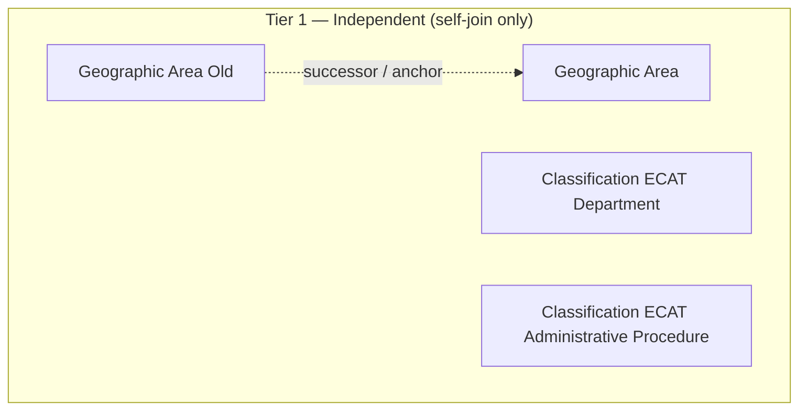
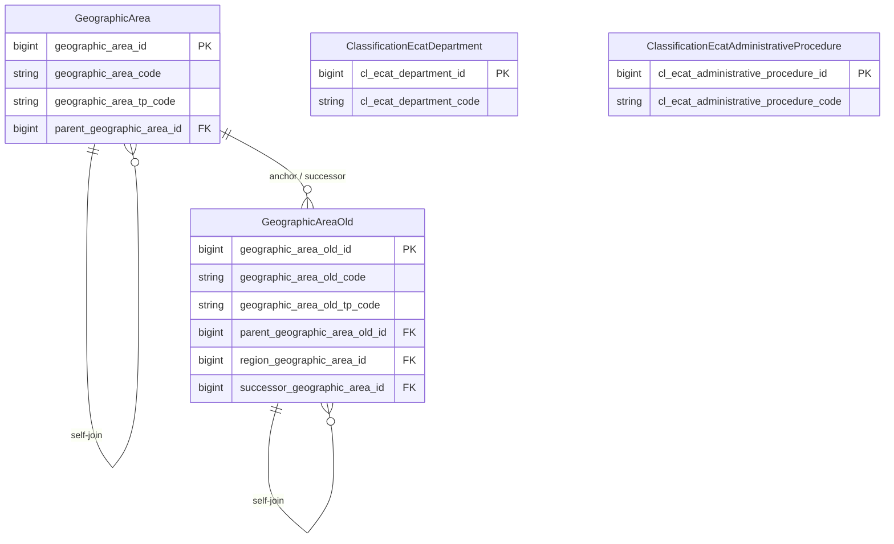

# ECAT HLD — Overview

**Source system:** ECAT (Dịch vụ đồng bộ danh mục dùng chung từ HTTT)
**Mô tả:** Hệ thống danh mục điện tử dùng chung (Electronic Catalogue) của Ủy ban Chứng khoán Nhà nước (UBCKNN) — quản lý các danh mục nền tảng dùng xuyên suốt các hệ thống nghiệp vụ khác của UBCKNN: danh mục địa lý hành chính, tổ chức & nhân sự nội bộ, tiền tệ, chứng khoán & thị trường, loại hình doanh nghiệp/nghiệp vụ, đối tượng tham gia thị trường, hành nghề & trình độ, thủ tục hành chính, vi phạm & xử phạt, thanh tra, văn bản pháp lý.

> **Phạm vi tài liệu này:** Theo quyết định Data Modeler 2026-10-21, **LLD là chuẩn** — chỉ giữ trong HLD các bảng ECAT đã có LLD: 7 bảng Geographic Area (COUNTRY, REGION, PROVINCE_NEW, WARD_NEW, PROVINCE_OLD, DISTRICT_OLD, WARD_OLD → 2 entity Geographic Area / Geographic Area Old), bảng DEPARTMENT (→ Classification ECAT Department, bổ sung 2026-10-22) và bảng ADMINISTRATIVE_PROCEDURE (→ Classification ECAT Administrative Procedure, bổ sung 2026-10-29). Các bảng từng có thiết kế HLD nhưng chưa có LLD đã gỡ khỏi HLD và đưa vào mục 7f (nhóm `Chưa có LLD`). Các bảng danh mục xử lý Classification Value xem 7c. ECAT còn nhiều bảng khác (Currency Company info, Security Company, Investment Fund, Violation Behavior, Inspection Content, đồng bộ dữ liệu liên thông, bảng kỹ thuật hệ thống...) chưa thuộc phạm vi thiết kế.

---

## Tổng quan Atomic Entities

| Tier | Atomic Entity | BCV Core Object | BCV Concept | table_type | Source Table(s) | Ghi chú |
|---|---|---|---|---|---|---|
| T1 | Geographic Area | Location | [Location] Geographic Area | Fundamental | ECAT.COUNTRY, ECAT.REGION, ECAT.PROVINCE_NEW, ECAT.WARD_NEW | ECAT là nguồn duy nhất của entity theo LLD. |
| T1 | Geographic Area Old | Location | [Location] Geographic Area | Fundamental | ECAT.PROVINCE_OLD, ECAT.DISTRICT_OLD, ECAT.WARD_OLD | Dữ liệu lịch sử pre-2025 (3 cấp), tách riêng khỏi Geographic Area hiện hành. |
| T1 | Classification ECAT Department | Common | [Common] Classification | Relative | ECAT.DEPARTMENT | Danh mục phòng ban (CODE, NAME, DESCRIPTION, PHONE, EMAIL); không map quan hệ phòng ban cha. |
| T1 | Classification ECAT Administrative Procedure | Common | [Common] Classification | Relative | ECAT.ADMINISTRATIVE_PROCEDURE | Danh mục thủ tục hành chính (TTHC); BK = CODE; không map bảng con COMPONENT/MAPPING. |

**Tổng: 4 Atomic entities** (4 Tier 1, 0 Tier 2, 0 Tier 3)

---

## Diagram Phân tầng Dependencies (Mermaid)

---

## Quyết định thiết kế chính

| # | Quyết định | Lý do |
|---|---|---|
| D-01 | Audit FK `CREATED_BY_ID`/`UPDATED_BY_ID` (→ UBCK_STAFF.ID) trên mọi bảng ECAT không tính là business dependency khi phân Tier. | Đây là audit trail chuẩn (INPUTTER/AUTHORISER pattern, CLAUDE.md), không phải quan hệ nghiệp vụ. |
| D-02 | Đa số bảng "Danh mục X" (Code + Name + cờ trạng thái, không instance data thực) → Classification Value, không tạo Atomic entity riêng. | Theo rule mặc định CLAUDE.md #11 (reference data set vs entity concept) và tiền lệ dự án (xem `classification_schemes.yaml`). |
| D-03 | CURRENCY xử lý như Classification Value (1 field Code, không cặp Id+Code), không tạo Atomic entity `Currency`. | CLAUDE.md rule #4 "Tương tự cho Currency". |
| D-04 | Chỉ giữ trong HLD các bảng ECAT đã có LLD (7 bảng Geographic Area); các bảng khác gỡ khỏi HLD, đưa vào 7f nhóm `Chưa có LLD`. | Quyết định Data Modeler 2026-10-21: LLD đã đủ cho dự án, HLD có mà LLD chưa làm là sai → lấy LLD làm chuẩn. |

---

#### 7a. Bảng tổng quan Atomic entities

| Tier | BCV Core Object | BCV Concept | Category | Source Table | Source Table Change Mode | Mô tả bảng nguồn | Atomic Entity | Table Type | BCV Term |
|---|---|---|---|---|---|---|---|---|---|
| T1 | Location | [Location] Geographic Area | Location | COUNTRY | Update | Danh mục Quốc gia | Geographic Area | Fundamental | Xem ECAT_HLD_Tier1.md mục 6a. |
| T1 | Location | [Location] Geographic Area | Location | REGION | Update | Danh mục Vùng/miền | Geographic Area | Fundamental | Xem ECAT_HLD_Tier1.md mục 6a. |
| T1 | Location | [Location] Geographic Area | Location | PROVINCE_NEW | Update | Danh mục Tỉnh/Thành phố (mới) | Geographic Area | Fundamental | Xem ECAT_HLD_Tier1.md mục 6a. |
| T1 | Location | [Location] Geographic Area | Location | WARD_NEW | Update | Danh mục Phường/Xã/Thị trấn (mới) | Geographic Area | Fundamental | Xem ECAT_HLD_Tier1.md mục 6a. |
| T1 | Location | [Location] Geographic Area | Location | PROVINCE_OLD | Update | Danh mục Tỉnh/Thành phố (cũ) | Geographic Area Old | Fundamental | Xem ECAT_HLD_Tier1.md mục 6a. |
| T1 | Location | [Location] Geographic Area | Location | DISTRICT_OLD | Update | Danh mục Quận/Huyện (cũ) | Geographic Area Old | Fundamental | Xem ECAT_HLD_Tier1.md mục 6a. |
| T1 | Location | [Location] Geographic Area | Location | WARD_OLD | Update | Danh mục Phường/Xã/Thị trấn (cũ) | Geographic Area Old | Fundamental | Xem ECAT_HLD_Tier1.md mục 6a. |
| T1 | Common | [Common] Classification | Common | DEPARTMENT | Update | Danh mục Phòng ban | Classification ECAT Department | Relative | Xem ECAT_HLD_Tier1.md mục 6a. |
| T1 | Common | [Common] Classification | Common | ADMINISTRATIVE_PROCEDURE | Update | Danh mục Thủ tục hành chính (TTHC) | Classification ECAT Administrative Procedure | Relative | Xem ECAT_HLD_Tier1.md mục 6a. |

#### 7b. Diagram Atomic tổng (Mermaid)

#### 7c. Bảng Classification Value

| Source Table | Mô tả | BCV Term | Xử lý Atomic |
|---|---|---|---|
| CURRENCY | Danh mục Tiền tệ | [Common] Currency | Scheme `ECAT_CURRENCY`. Xử lý như data domain 1-field theo CLAUDE.md rule #4, không tạo entity. |
| MARKET | Danh mục Thị trường | Classification Value | Scheme `ECAT_MARKET`. |
| FINANCIAL_INDICATOR | Danh mục Chỉ tiêu tài chính | Classification Value | Scheme `ECAT_FINANCIAL_INDICATOR`. |
| FINANCIAL_REPORT_TYPE | Danh mục Loại báo cáo tài chính | Classification Value | Scheme `ECAT_FINANCIAL_REPORT_TYPE`. |
| INVESTOR_CATEGORY | Danh mục loại nhà đầu tư/cổ đông | Classification Value | Scheme `ECAT_INVESTOR_CATEGORY`. |
| INVESTOR_TYPE | Loại hình nhà đầu tư/cổ đông | Classification Value | Scheme `ECAT_INVESTOR_TYPE`. |
| FUND_TYPE | Danh mục loại hình quỹ | Classification Value | Scheme `ECAT_FUND_TYPE`. |
| APPLIED_SUBJECT | Danh mục Đối tượng áp dụng | Classification Value | Scheme `ECAT_APPLIED_SUBJECT`. |
| FREQUENCY_REPORT | Danh mục Kỳ báo cáo | Classification Value | Scheme `ECAT_FREQUENCY_REPORT`. |
| RELATIONSHIP_CATEGORY | Danh mục Quan hệ | Classification Value | Scheme `ECAT_RELATIONSHIP_CATEGORY`. |
| QUALIFICATION_CATEGORY | Danh mục Trình độ | Classification Value | Scheme `ECAT_QUALIFICATION_CATEGORY`. |
| PRACTICE_CERTIFICATE_TYPE | Danh mục Loại chứng chỉ hành nghề | Classification Value | Scheme `ECAT_PRACTICE_CERTIFICATE_TYPE`. |
| PRACTICE_CERTIFICATE | Danh mục Chứng chỉ hành nghề | Classification Value | Scheme `ECAT_PRACTICE_CERTIFICATE`. |
| ORGANIZATION_TYPE | Danh mục loại tổ chức | [Involved Party] Organization Type | Scheme `ECAT_ORGANIZATION_TYPE`. |
| FOREIGN_INVESTOR_TYPE | Danh mục loại nhà đầu tư nước ngoài | Classification Value | Scheme `ECAT_FOREIGN_INVESTOR_TYPE`. |
| ACTIVITY_STATUS | Danh mục tình trạng hoạt động | Classification Value | Scheme `ECAT_ACTIVITY_STATUS`. |
| ACTIVE_STATUS | Bảng trạng thái hoạt động | Classification Value | Scheme `ECAT_ACTIVE_STATUS`. Chỉ ID+NAME. |
| PENALTY_FORM | Danh mục Hình thức xử phạt | Classification Value | Scheme `ECAT_PENALTY_FORM`. |
| INSPECTION_TARGET | Danh mục Đối tượng thanh tra | Classification Value | Scheme `ECAT_INSPECTION_TARGET`. |
| ENTERPRISE_POSITION_TYPE | Danh mục Loại chức vụ doanh nghiệp | Classification Value | Scheme `ECAT_ENTERPRISE_POSITION_TYPE`. |
| ENTERPRISE_POSITION | Danh mục Chức vụ doanh nghiệp | Classification Value | Scheme `ECAT_ENTERPRISE_POSITION`. |
| POSITION_TYPE | Danh mục Loại chức danh | Classification Value | Scheme `ECAT_POSITION_TYPE`. |
| POSITION | Danh mục Chức danh | Classification Value | Scheme `ECAT_POSITION`. |
| AGENT_TYPE | Danh mục loại đại lý | Classification Value | Scheme `ECAT_AGENT_TYPE`. |
| BUSINESS_SERVICE | Danh mục Dịch vụ kinh doanh | Classification Value | Scheme `ECAT_BUSINESS_SERVICE`. |
| BUSINESS_EVENT | Danh mục Sự vụ | Classification Value | Scheme `ECAT_BUSINESS_EVENT`. |
| OPERATIONAL_STATUS_TYPE | Danh mục Loại trạng thái hoạt động | Classification Value | Scheme `ECAT_OPERATIONAL_STATUS_TYPE`. |

#### 7d. Junction Tables

Không có junction table.

#### 7e. Điểm cần xác nhận

| # | Tier | Câu hỏi | Ảnh hưởng |
|---|---|---|---|
| 1 | T2 | `INSPECTION_TARGET` — `table_meaning` trong `brd_ECAT.yaml` ("Danh mục Tổ chức kiểm toán được chấp thuận") không khớp nội dung cột thực tế (danh mục đối tượng thanh tra) — nghi copy-paste error từ APPROVED_AUDIT_FIRM. | Không ảnh hưởng thiết kế Atomic (đã xử lý theo nội dung cột thực tế) — chỉ cần sửa tài liệu nguồn. |
| 2 | T1 | (Kế thừa từ Tier 1) Các vấn đề T1-01 đến T1-07 — xem `ECAT_HLD_Tier1.md` mục 6f (T1-06: FK suy luận `FEE_UNIT_CURRENCY_ID`; T1-07: bộ cột technical/trạng thái của ADMINISTRATIVE_PROCEDURE chưa map). | Không ảnh hưởng Tier khác. |

#### 7f. Bảng ngoài scope

| Nhóm | Source Table | Mô tả bảng nguồn | Lý do ngoài scope |
|---|---|---|---|
| Chưa có LLD | BUSINESS_LINE_LEVEL_1 | Danh mục ngành nghề cấp 1 | Không có LLD trong dự án — HLD gỡ theo quyết định Data Modeler 2026-10-21 |
| Chưa có LLD | BUSINESS_LINE_LEVEL_2 | Danh mục ngành nghề cấp 2 (cha-con qua PARENT_LINE_ID) | Không có LLD trong dự án — HLD gỡ theo quyết định Data Modeler 2026-10-21 |
| Chưa có LLD | ENTERPRISE_TYPE | Danh mục Loại hình doanh nghiệp (self-referencing) | Không có LLD trong dự án — HLD gỡ theo quyết định Data Modeler 2026-10-21 |
| Chưa có LLD | SECURITY_TYPE | Danh mục Loại chứng khoán (self-referencing) | Không có LLD trong dự án — HLD gỡ theo quyết định Data Modeler 2026-10-21 |
| Chưa có LLD | PAR_VALUE | Danh mục Mệnh giá chứng khoán | Không có LLD trong dự án — HLD gỡ theo quyết định Data Modeler 2026-10-21 |
| Chưa có LLD | ADMINISTRATIVE_PROCEDURE_COMPONENT | Thành phần hồ sơ của Thủ tục hành chính | Không có LLD trong dự án — HLD gỡ theo quyết định Data Modeler 2026-10-21 |
| Chưa có LLD | LEGAL_DOCUMENT | Bảng thông tin văn bản pháp lý | Không có LLD trong dự án — HLD gỡ theo quyết định Data Modeler 2026-10-21 |
| Chưa có LLD | WORKING_SCHEDULE | Danh mục Lịch làm việc | Không có LLD trong dự án — HLD gỡ theo quyết định Data Modeler 2026-10-21 |
| Chưa có LLD | VIOLATION_TYPE | Danh mục loại vi phạm (kèm mức tiền phạt) | Không có LLD trong dự án — HLD gỡ theo quyết định Data Modeler 2026-10-21 |
| Chưa có LLD | SECURITY | Danh mục Chứng khoán | Không có LLD trong dự án — HLD gỡ theo quyết định Data Modeler 2026-10-21 |
| Chưa có LLD | UBCK_STAFF | Danh mục nhân sự UBCKNN | Không có LLD trong dự án — HLD gỡ theo quyết định Data Modeler 2026-10-21 |
| Chưa có LLD | BUSINESS_EVENT_ENTERPRISE_TYPE | N-N: Sự vụ - Loại hình doanh nghiệp | Không có LLD trong dự án — HLD gỡ theo quyết định Data Modeler 2026-10-21 |
| Chưa có LLD | OPERATIONAL_STATUS_TYPE_ENTERPRISE_TYPE | N-N: Loại trạng thái hoạt động - Loại hình doanh nghiệp | Không có LLD trong dự án — HLD gỡ theo quyết định Data Modeler 2026-10-21 |
| Chưa có LLD | ADMINISTRATIVE_PROCEDURE_COMPONENT_MAPPING | N-N: TTHC - Thành phần TTHC | Không có LLD trong dự án — HLD gỡ theo quyết định Data Modeler 2026-10-21 |
| Chưa có LLD | ORGANIZATION_TYPE_USER_TYPE | N-N: Loại tổ chức - Loại đối tượng (USER_TYPE) | Không có LLD trong dự án — HLD gỡ theo quyết định Data Modeler 2026-10-21 |
| Chưa có LLD | PENALTY_FORM_VIOLATION_TYPE | N-N: Hình thức xử phạt - Loại vi phạm | Không có LLD trong dự án — HLD gỡ theo quyết định Data Modeler 2026-10-21 |

*(Các bảng ECAT khác ngoài danh sách 53 bảng "ECAT in scope.txt" — VD: FUND_MANAGEMENT_COMPANY, SECURITY_COMPANY, INVESTMENT_FUND, VIOLATION_BEHAVIOR, DISCLOSURE_REPORT, bảng đồng bộ BTC/DVCQG, bảng kỹ thuật QRTZ_*/DATABASECHANGELOG* — chưa được đánh giá scope trong tài liệu này.)*

---

## Entities

> Single source of truth cho metadata entity. `aggregate_atomic.py` parse section này để sinh `atomic_entities.yaml`.
> Format bắt buộc: heading `### N.` + dòng `**Description:**` trong 500 ký tự đầu tiên sau heading.

### 1. Geographic Area
**Tier:** 1 | **Source:** `ECAT.COUNTRY, ECAT.REGION, ECAT.PROVINCE_NEW, ECAT.WARD_NEW` | **BCV Concept:** [Location] Geographic Area | **BCO:** Location | **Table Type:** Fundamental
**Domain Prefix:** (none)
**Description:** Khu vực địa lý hành chính hiện hành (Quốc gia/Vùng/Tỉnh/Phường-Xã), self-referencing qua Geographic Area Type Code. ECAT là nguồn duy nhất theo LLD — 4 cấp Quốc gia/Vùng/Tỉnh/Phường hiện hành.

### 2. Geographic Area Old
**Tier:** 1 | **Source:** `ECAT.PROVINCE_OLD, ECAT.DISTRICT_OLD, ECAT.WARD_OLD` | **BCV Concept:** [Location] Geographic Area | **BCO:** Location | **Table Type:** Fundamental
**Domain Prefix:** (none)
**Description:** Khu vực địa lý hành chính lịch sử (pre-2025, 3 cấp Tỉnh/Quận-Huyện/Phường-Xã cũ), self-referencing riêng biệt với Geographic Area hiện hành, có liên kết successor sang tỉnh/phường mới tương ứng.

### 3. Classification ECAT Department
**Tier:** 1 | **Source:** `ECAT.DEPARTMENT` | **BCV Concept:** [Common] Classification | **BCO:** Common | **Table Type:** Relative
**Domain Prefix:** Classification
**Description:** Danh mục phòng ban của hệ thống danh mục dùng chung ECAT, gồm mã, tên, mô tả, số điện thoại và email; BK = CODE nguồn.

### 4. Classification ECAT Administrative Procedure
**Tier:** 1 | **Source:** `ECAT.ADMINISTRATIVE_PROCEDURE` | **BCV Concept:** [Common] Classification | **BCO:** Common | **Table Type:** Relative
**Domain Prefix:** Classification
**Description:** Danh mục thủ tục hành chính (TTHC) của hệ thống danh mục dùng chung ECAT, gồm mã, tên, lĩnh vực, nhóm, mức độ, cách thức thực hiện, thời gian giải quyết, lệ phí và cơ quan phối hợp; BK = CODE nguồn.
