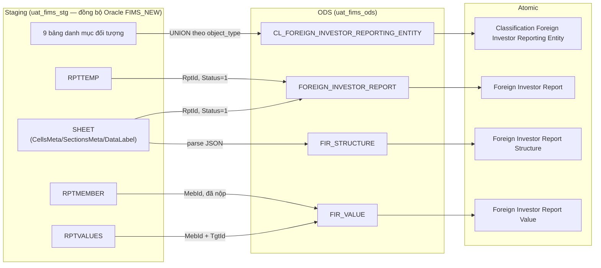
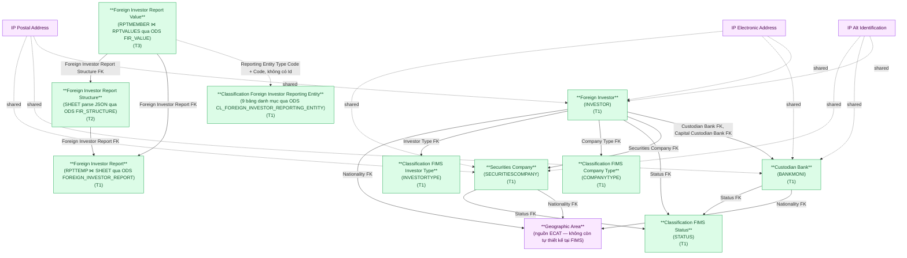

# FIMS — HLD Overview: Toàn cảnh thiết kế Atomic Layer

> **Nguồn:** Hệ thống FIMS — Quản lý giám sát và công bố thông tin thành viên thị trường (Oracle)
>
> **Phạm vi:** Đăng ký và theo dõi thành viên thị trường chứng khoán (Công ty QLQ, Công ty CK, Ngân hàng lưu ký, VSDC, Sở GD, CN QLQ NN), nhà đầu tư nước ngoài, người hành nghề chứng khoán, báo cáo định kỳ và sự vụ CBTT, cảnh báo giám sát và vi phạm, ủy quyền CBTT/giao dịch. HLD hiện chỉ giữ các entity đã có LLD (đồng bộ theo LLD, 2026-10-21); các bảng nguồn còn lại xem mục 7f nhóm `Chưa có LLD`.
>
> **File chi tiết theo tầng:**
> - [FIMS_HLD_Tier1.md](FIMS_HLD_Tier1.md) — Independent Entities: Classification FIMS Company Type, Classification FIMS Investor Type, Classification FIMS Status, Classification Foreign Investor Reporting Entity, Custodian Bank, Foreign Investor, Foreign Investor Report, Securities Company (+ 3 shared entity IP Postal Address / IP Electronic Address / IP Alt Identification). Geographic Area đã chuyển sang nguồn ECAT — xem mục 7f.
> - [FIMS_HLD_Tier2.md](FIMS_HLD_Tier2.md) — FK đến Tier 1: Foreign Investor Report Structure
> - [FIMS_HLD_Tier3.md](FIMS_HLD_Tier3.md) — FK đến Tier 2: Foreign Investor Report Value
>
> **Cập nhật 2026-09-30 — nhóm Báo cáo động:** `Reporting Template` (RPTTEMP) và `Report Import Value` (RPTVALUES) được thay bằng 4 entity `Foreign Investor Report`, `Foreign Investor Report Structure`, `Foreign Investor Report Value`, `Classification Foreign Investor Reporting Entity`. Nhóm này đi qua luồng đặc biệt STG → parse → ODS → ATM (xem ghi chú cuối mục 7a), không map 1:1 từ staging.
>
> **Cập nhật 2026-10-21 — đồng bộ theo LLD:** `Market Participant Organization` được thay bằng `Securities Company` (SECURITIESCOMPANY) và `Custodian Bank` (BANKMONI); STATUS/INVESTORTYPE/COMPANYTYPE đã nâng thành entity `Classification FIMS ...`. Các entity chưa có LLD (Reporting Period, Reporting Obligation Type, Warning Parameter/Condition, Trading Representative, Securities Closing Price, Foreign FM Branch Organization, Info Disclosure Representative/Authorization/Announcement, Market Participant Key Person, Member Periodic Report, Foreign Investor Securities Account, Report Processing Activity Log, Market Participant Conduct Violation, Trading Authorization) đã gỡ khỏi HLD; bảng nguồn chuyển vào 7f nhóm `Chưa có LLD`. Không còn junction table.

---

#### 7a. Bảng tổng quan Atomic entities

| Tier | BCV Core Object | BCV Concept | Category | Source Table | Source Table Change Mode | Mô tả bảng nguồn | Atomic Entity | Table Type | BCV Term |
|---|---|---|---|---|---|---|---|---|---|
| 1 | Common | [Common] Organization Legal Structure | Classification | COMPANYTYPE | Update | Danh mục loại hình doanh nghiệp | Classification FIMS Company Type | Relative | Organization Legal Structure — promote từ Classification Value (scheme `FIMS_COMPANY_TYPE`, deprecated) lên entity riêng; FK từ Foreign Investor. |
| 1 | Common | [Common] Involved Party Type | Classification | INVESTORTYPE | Update | Danh mục loại nhà đầu tư nước ngoài | Classification FIMS Investor Type | Relative | Involved Party Type — promote từ Classification Value (scheme `FIMS_INVESTOR_TYPE`, deprecated) lên entity riêng; BK = SNAME; FK từ Foreign Investor. |
| 1 | Common | [Common] Involved Party Life Cycle Status | Classification | STATUS | Update | Danh mục tình trạng hoạt động của đối tượng (thành viên/NĐT) | Classification FIMS Status | Relative | Involved Party Life Cycle Status — promote từ Classification Value (scheme `FIMS_ACTIVITY_STATUS`, deprecated) lên entity riêng; BK = Code; FK từ Foreign Investor, Securities Company, Custodian Bank. |
| 1 | Common | [Common] Classification | Classification | 9 bảng danh mục FUNDCOMPANY, SECURITIESCOMPANY, BANKMONI, DEPOSITORYCENTER, STOCKEXCHANGE, INFODISCREPRES, BRANCHS, INVESTOR, TRADINGREPRESENTATIVE (qua ODS `CL_FOREIGN_INVESTOR_REPORTING_ENTITY`) | Update (ODS ghi đè toàn bộ mỗi lần chạy) | Danh mục tổ chức/cá nhân từng là bên nộp báo cáo | Classification Foreign Investor Reporting Entity | Relative | Classification — bảng danh mục tra cứu đối tượng nộp báo cáo (quyết định Data Modeler 2026-09-30: BCO Common, không phải Involved Party); ODS UNION 9 bảng danh mục (không JOIN), gắn `object_type` theo bảng. BK = `object_id ‖ object_type` (object_id không duy nhất giữa các loại). Các bảng nguồn không có LLD riêng chỉ đóng vai trò đầu vào UNION của ODS. |
| 1 | Involved Party | [Involved Party] Organization | Organization | BANKMONI | Update | Danh sách ngân hàng lưu ký giám sát | Custodian Bank | Fundamental | Organization — cùng entity với `FMS.BANK_MONI` (thay quyết định gộp Market Participant Organization cũ, 2026-10-05). Tách IP Postal Address + IP Electronic Address + IP Alt Identification. FK đến Classification FIMS Status. |
| 1 | Involved Party | [Involved Party] Individual | Individual | INVESTOR | Update | Danh sách nhà đầu tư nước ngoài (cá nhân và tổ chức) tại Việt Nam | Foreign Investor | Fundamental | Individual — NĐT nước ngoài cá nhân (ObjectType=1) và tổ chức (ObjectType=2) đăng ký hoạt động tại VN theo quy định UBCKNN. Tách IP Postal Address (Address) + IP Electronic Address (Telephone/Fax/Email/Website) + IP Alt Identification (IdNo/IdDate/IdAdd). FK đến Securities Company, Custodian Bank, Classification FIMS Investor Type / Company Type / Status. |
| 1 | Documentation | [Documentation] Form Document | Form Document | RPTTEMP (qua ODS `FOREIGN_INVESTOR_REPORT`) | Update (ODS ghi đè toàn bộ mỗi lần chạy) | Danh sách biểu mẫu báo cáo đầu vào do UBCKNN ban hành | Foreign Investor Report | Relative | Form Document — "Documentation Item presented in a standard template layout which requires additional information to be supplied". Grain = 1 sheet × 1 mẫu báo cáo. ODS dựng từ `RPTTEMP ⋈ SHEET` (`SHEET.RPTID = RPTTEMP.ID`, chỉ `Status = 1`). Thay entity cũ `Reporting Template`. |
| 1 | Documentation | [Documentation] Form Document | Form Document | SHEET (qua ODS `FOREIGN_INVESTOR_REPORT`) | Update (ODS ghi đè toàn bộ mỗi lần chạy) | Danh sách các sheet trong biểu mẫu báo cáo đầu vào | Foreign Investor Report | Relative | Form Document — SHEET cung cấp grain (sheet_id = BK) + sheet_code/sheet_name/sheet_index; RPTTEMP cung cấp report_code/report_name/legal_basis/status. |
| 1 | Involved Party | Shared Entity | Shared Entity | BANKMONI, INVESTOR, SECURITIESCOMPANY | Update | Địa chỉ/liên lạc/giấy tờ định danh của Involved Party (shared entity) | Involved Party Alternative Identification | Fundamental | Shared entity — tách từ IdNo/IdDate/IdAdd của Foreign Investor, Securities Company, Custodian Bank (Tier = tier của host entity). |
| 1 | Involved Party | Shared Entity | Shared Entity | BANKMONI, INVESTOR, SECURITIESCOMPANY | Update | Địa chỉ/liên lạc/giấy tờ định danh của Involved Party (shared entity) | Involved Party Electronic Address | Fundamental | Shared entity — tách từ Telephone/Fax/Email/Website của Foreign Investor, Securities Company, Custodian Bank (Tier = tier của host entity). |
| 1 | Involved Party | Shared Entity | Shared Entity | BANKMONI, INVESTOR, SECURITIESCOMPANY | Update | Địa chỉ/liên lạc/giấy tờ định danh của Involved Party (shared entity) | Involved Party Postal Address | Fundamental | Shared entity — tách từ Address của Foreign Investor, Securities Company, Custodian Bank (Tier = tier của host entity). |
| 1 | Involved Party | [Involved Party] Broker Dealer | Organization | SECURITIESCOMPANY | Update | Danh sách công ty chứng khoán — đối tượng thành viên thị trường | Securities Company | Fundamental | Broker Dealer — cùng entity với `SCMS.SC_FIRM_INFO` (thay quyết định gộp Market Participant Organization cũ, 2026-10-05). BK `sc_code` = Id nguồn. Tách IP Postal Address + IP Electronic Address + IP Alt Identification. FK đến Classification FIMS Status. |
| 2 | Documentation | [Documentation] Form Document | Form Document | SHEET (qua ODS `FIR_STRUCTURE`) | Update (ODS ghi đè toàn bộ mỗi lần chạy) | Cấu hình ô chỉ tiêu của sheet (JSON CellsMeta/SectionsMeta/DataLabel) | Foreign Investor Report Structure | Relative | Form Document — cây chỉ tiêu (1 ô template trong 1 sheet). ODS sinh bằng **parse JSON** `CellsMeta`/`SectionsMeta`/`DataLabel` của SHEET (+ cấu hình đè `fims_row_overrides/`), không phải JOIN. BK = `sheet_id ‖ indicator_uid`. FK đến Foreign Investor Report. |
| 3 | Documentation | [Documentation] Regulatory Information | Regulatory Information | RPTVALUES (qua ODS `FIR_VALUE`) | Update (ODS tích lũy theo `ngay_nop`) | Dữ liệu giá trị từng ô trong báo cáo thành viên (bảng phân vùng theo năm) | Foreign Investor Report Value | Classification | Regulatory Information — "Reported Information that is required to be filed with regulatory bodies". Grain = 1 ô × 1 lần nộp × 1 dòng động. ODS dựng từ `RPTMEMBER ⋈ RPTVALUES` (`RPTVALUES.MEBID = RPTMEMBER.ID`, trạng thái đã nộp 2/3/5), tra `TgtId` → `indicator_uid` và FK đối tượng → `object_type/object_id`. BK = `report_log_id ‖ sheet_id ‖ indicator_uid ‖ row_order`; cơ chế Upsert theo BK. Thay entity cũ `Report Import Value`. |
| 3 | Documentation | [Documentation] Regulatory Information | Regulatory Information | RPTMEMBER (qua ODS `FIR_VALUE`) | Update | Lần nộp báo cáo của thành viên | Foreign Investor Report Value | Classification | RPTMEMBER cung cấp thông tin lần nộp denormalize trên từng ô: report_log_id (= RPTMEMBER.ID), kỳ, hạn nộp, trạng thái trễ hạn, đối tượng nộp. |

**Ghi chú 7a — Luồng đặc biệt nhóm Báo cáo động (STG → parse → ODS → ATM)**

Khác các bảng FIMS thông thường (staging map 1:1 lên Atomic), 4 entity Báo cáo động **bắt buộc đi qua lớp ODS trung gian** do `spark/spark_job/fims_staging_to_ods.py` dựng (nguồn: `FIMS_ODS_4BANG_HUONG_DAN_BA.md` mục 9). LLD map `source_columns` từ bảng ODS (namespace `ods.uat_fims_ods`); cột "Source Table" trong 7a ghi bảng staging gốc để truy vết và đánh scope.

| Bảng ODS (tên mới = physical Atomic) | Tên ODS cũ (DDL/tài liệu BA) | Dựng từ staging | Cách dựng | Atomic Entity |
|---|---|---|---|---|
| `CL_FOREIGN_INVESTOR_REPORTING_ENTITY` | `dim_object` | 9 bảng danh mục đối tượng | UNION, không JOIN; gắn `object_type` theo bảng | Classification Foreign Investor Reporting Entity |
| `FOREIGN_INVESTOR_REPORT` | `dim_report_template` | RPTTEMP ⋈ SHEET | `SHEET.RPTID = RPTTEMP.ID`, lọc `Status = 1` | Foreign Investor Report |
| `FIR_STRUCTURE` | `dim_indicator` | SHEET | **Parse JSON** `CellsMeta`/`SectionsMeta`/`DataLabel` + cấu hình đè `fims_row_overrides/` | Foreign Investor Report Structure |
| `FIR_VALUE` | `fact_report_cell` | RPTMEMBER ⋈ RPTVALUES | `RPTVALUES.MEBID = RPTMEMBER.ID`, trạng thái đã nộp 2/3/5, khoảng `DateSubmitted`; tra `TgtId`→`indicator_uid` (cùng `sheet_id`), FK đối tượng (secid→fundid→bankid→depid→stockid→inid→branid→investorid→tradingrepresentativeid, lấy cột đầu tiên có giá trị)→`object_type/object_id` | Foreign Investor Report Value |

- 3 bảng dim ODS **ghi đè toàn bộ mỗi lần chạy** (chỉ phản ánh cấu trúc hiện tại) → Atomic giữ lịch sử bằng SCD2 (`Relative`). `fir_value` tích lũy theo `ngay_nop` → Atomic Upsert theo BK (table type `Classification`, quyết định Data Modeler 2026-09-30).
- Technical fields (`ds_*`) và cột kỹ thuật ODS (`_source_system`, `_loaded_at`) **không thiết kế vào LLD** nhóm này (quyết định Data Modeler 2026-09-30).

---

#### 7b. Diagram Atomic tổng (Mermaid)

---

#### 7c. Bảng Classification Value

| Source Table | Mô tả | BCV Term | Xử lý Atomic |
|---|---|---|---|
| STOCKHOLDERTYPE | Danh mục loại cổ đông | Classification Value | Scheme: `FIMS_STOCKHOLDER_TYPE`. |
| SECURITIESTYPE | Danh mục loại chứng khoán | Classification Value | Scheme: `FIMS_SECURITIES_TYPE`. |
| SECURITIES | Danh mục chứng khoán (mã + tên) | Classification Value | Scheme: `FIMS_SECURITIES_CODE`. FK đến SECURITIESTYPE → denormalize. |
| BUSINESS | Danh mục nghiệp vụ kinh doanh | Classification Value | Scheme: `FIMS_BUSINESS_TYPE`. |
| CURRENCY | Danh mục tiền tệ | Classification Value | Scheme: `FIMS_CURRENCY`. |
| DEGREE | Danh mục trình độ học vấn | Classification Value | Scheme: `FIMS_DEGREE`. |
| VIOLATIONTYPE | Danh mục loại vi phạm | Classification Value | Scheme: `FIMS_VIOLATION_TYPE`. |
| REPORTTYPE | Danh mục loại báo cáo | Classification Value | Scheme: `FIMS_REPORT_TYPE`. |
| ANNOUNCETYPE | Danh mục loại CBTT | Classification Value | Scheme: `FIMS_ANNOUNCEMENT_TYPE`. |
| RELATEDPROPERTIES | Danh mục hình thức liên quan (quan hệ ủy quyền) | Classification Value | Scheme: `FIMS_RELATED_PROPERTY`. |
| RELATIONSHIP | Danh mục loại quan hệ | Classification Value | Scheme: `FIMS_RELATIONSHIP_TYPE`. |
| JOBTYPE | Danh mục chức vụ/loại công việc của nhân sự | Classification Value | Scheme: `FIMS_JOB_TYPE`. |
| UNIT | Danh mục đơn vị nội bộ FIMS (phân quyền người dùng) | Classification Value | Scheme: `FIMS_ORG_UNIT`. Chỉ phục vụ phân quyền hệ thống — không có giá trị nghiệp vụ ra ngoài. |
| *(ETL-derived, ODS `object_type`)* | Loại đối tượng nộp báo cáo (9 loại theo cột FK trên RPTMEMBER) | Classification Value | Scheme: `FIMS_REPORTING_ENTITY_TYPE`. Dùng trên Classification Foreign Investor Reporting Entity + Foreign Investor Report Value. |
| *(RPTTEMP.STATUS, ODS `template_status`)* | Trạng thái mẫu báo cáo | Classification Value | Scheme: `FIMS_REPORT_TEMPLATE_STATUS`. ODS chỉ nạp mẫu `Status = 1`. |
| *(SHEET SectionsMeta, ODS `section_type`)* | Loại vùng dữ liệu của ô chỉ tiêu (DYNAMIC/FIXED) | Classification Value | Scheme: `FIMS_REPORT_SECTION_TYPE`. |
| *(SHEET CellsMeta, ODS `format_data_type`)* | Kiểu dữ liệu ô chỉ tiêu (numberic/percentage/string...) | Classification Value | Scheme: `FIMS_REPORT_DATA_TYPE`. |
| *(RPTMEMBER, ODS `period_type`)* | Loại kỳ báo cáo (THANG/QUY/NAM...) | Classification Value | Scheme: `FIMS_REPORT_PERIOD_TYPE`. |
| *(RPTMEMBER, ODS `late_status_code`)* | Trạng thái nộp đúng hạn/trễ hạn | Classification Value | Scheme: `FIMS_REPORT_LATE_STATUS`. |

> STATUS, INVESTORTYPE, COMPANYTYPE đã promote thành entity `Classification FIMS ...` (xem 7a) — không còn là Classification Value.

---

#### 7d. Junction Tables

Không có junction table.

---

#### 7e. Điểm cần xác nhận

| # | Tier | Câu hỏi | Ảnh hưởng |
|---|---|---|---|
| 1 | T1 | ~~`FUNDCOMPANY`, `SECURITIESCOMPANY`, `BANKMONI`, `DEPOSITORYCENTER`, `STOCKEXCHANGE` gộp thành `Market Participant Organization`.~~ **Đã cập nhật theo LLD (2026-10-21):** SECURITIESCOMPANY → `Securities Company`, BANKMONI → `Custodian Bank`; FUNDCOMPANY/DEPOSITORYCENTER/STOCKEXCHANGE là bảng đầu vào của ODS `CL_FOREIGN_INVESTOR_REPORTING_ENTITY` (7f nhóm `Xử lý luồng khác`). | Entity `Market Participant Organization` đã gỡ khỏi HLD. |
| 2 | T1 | ~~`RPTTEMP` + `RPTPERIOD` + `SHEET`.~~ **Đã chốt 2026-09-30:** RPTTEMP + SHEET gộp thành `Foreign Investor Report` (grain = sheet) qua ODS `FOREIGN_INVESTOR_REPORT`; SHEET đồng thời là nguồn parse JSON của `Foreign Investor Report Structure`. RPTPERIOD chưa có LLD (7f). | — |
| 3 | T3 | ~~`RPTVALUES` — khi thành viên gửi lại → row được update hay insert new?~~ **Đã chốt 2026-09-30:** entity `Foreign Investor Report Value` (qua ODS `FIR_VALUE`) dùng cơ chế Upsert theo BK `report_log_id ‖ sheet_id ‖ indicator_uid ‖ row_order` — Table Type `Classification`. | Mỗi lần nộp lại sinh `report_log_id` mới (RPTMEMBER.ID) nên không ghi đè giá trị của lần nộp trước. |
| 4 | T3 | `Foreign Investor Report Value` chứa thông tin lần nộp (`rpt_log_id` = RPTMEMBER.ID, kỳ, hạn nộp, trạng thái trễ). RPTMEMBER chưa có LLD riêng nên không có FK Id sang entity lần nộp. | Nếu sau này thiết kế LLD cho RPTMEMBER → cân nhắc bổ sung cặp FK Id/Code trên `fir_value`. |
| 5 | T1/T3 | `fir_value` tham chiếu đối tượng nộp chỉ bằng `fi_reporting_entity_tp_code` + `fi_reporting_entity_code` (theo bản map, không có cặp Id). Join sang `Classification Foreign Investor Reporting Entity` phải dùng **đủ 2 cột** (object_id không duy nhất giữa các loại). | Datamart cần join 2 cột; nếu muốn surrogate FK chuẩn → bổ sung `Classification Foreign Investor Reporting Entity Id` hash từ `object_id ‖ object_type`. |
| 6 | T2 | `data_explorer_id` (ODS `item_id`) là MD5 của `report_code + legal_basis + sheet_name + row_path + column_path` → đổi khi `row_path` bị sửa qua `fims_row_overrides/`. Không dùng làm BK; BK là `sheet_id ‖ indicator_uid`. `mirror_of_uid` lọc tại bước ODS → ATM (không map). | SCD2 sẽ ghi nhận version mới khi `data_explorer_id`/`row_path` đổi. |
| 7 | Tất cả | Nhóm Báo cáo động **không thiết kế technical fields `ds_*`** trong LLD (quyết định Data Modeler 2026-09-30) — khác quy định chung `atomic-lld-design/reference/technical_fields.md` (2026-09-07). `value_nbr`/`late_duration` (DOUBLE nguồn) tạm dùng domain `Currency Amount` — `[PROPOSE NEW DOMAIN]` Numeric Value `decimal(38,10)`. | Cần reviewer xác nhận ngoại lệ technical fields + domain đề xuất. |
| 8 | T1 | `Custodian Bank` / `Securities Company` (2026-10-05): BK dùng `Id` nguồn (không có mã nghiệp vụ); FIMS và FMS/SCMS cùng có ngân hàng lưu ký / CTCK nhưng hash khác nhau (`FIMS_BANKMONI` vs `FMS_BANK_MONI`; `FIMS_SECURITIESCOMPANY` vs `SCMS_SC_FIRM_INFO`) nên không tự dedupe. Xem Tier1.md T1-10, T1-11. | Cần crosswalk theo ShortName/RegNo nếu muốn hợp nhất. |

---

#### 7f. Bảng ngoài scope

| Nhóm | Source Table | Mô tả bảng nguồn | Lý do ngoài scope |
|---|---|---|---|
| Isolated | NATIONAL | Danh sách quốc gia/quốc tịch | Dữ liệu địa giới chuẩn hóa tại ECAT — không tự thiết kế Atomic entity, chỉ tra cứu qua mã tham chiếu (2026-07-10). |
| Isolated | LOCATION | Danh sách tỉnh/thành phố Việt Nam | Dữ liệu địa giới chuẩn hóa tại ECAT — không tự thiết kế Atomic entity, chỉ tra cứu qua mã tham chiếu (2026-07-10). |
| Operational / System | USERS | Tài khoản người dùng đăng nhập hệ thống FIMS | Operational/system data — không có giá trị nghiệp vụ. |
| Operational / System | USERSMENUS | Phân quyền menu cho từng người dùng | Operational/system data — không có giá trị nghiệp vụ. |
| Operational / System | USERSMENUS_CLONE | Bản sao phân quyền menu người dùng | Operational/system data — không có giá trị nghiệp vụ. |
| Operational / System | USERRPTI | Phân quyền sử dụng biểu mẫu báo cáo đầu vào | Operational/system data — không có giá trị nghiệp vụ. |
| Operational / System | USERRPTO | Phân quyền sử dụng biểu mẫu báo cáo đầu ra | Operational/system data — không có giá trị nghiệp vụ. |
| Operational / System | REFRESHTOKEN | Phiên làm việc (session) của người dùng | Operational/system data — không có giá trị nghiệp vụ. |
| Operational / System | GROUPS | Nhóm người dùng trong hệ thống | Operational/system data — không có giá trị nghiệp vụ. |
| Operational / System | GROUPUSERS | Liên kết người dùng vào nhóm | Operational/system data — không có giá trị nghiệp vụ. |
| Operational / System | GROUPROLES | Phân quyền nhóm theo vai trò | Operational/system data — không có giá trị nghiệp vụ. |
| Operational / System | ROLES | Danh mục vai trò trong hệ thống | Operational/system data — không có giá trị nghiệp vụ. |
| Operational / System | ROLESMENUS | Liên kết vai trò với menu quyền | Operational/system data — không có giá trị nghiệp vụ. |
| Operational / System | MENUS | Danh sách menu/quyền trong hệ thống | Operational/system data — không có giá trị nghiệp vụ. |
| Operational / System | MENUS_BU | Danh sách menu theo đơn vị | Operational/system data — không có giá trị nghiệp vụ. |
| Operational / System | MENU_CLONE | Bản sao danh sách menu | Operational/system data — không có giá trị nghiệp vụ. |
| Operational / System | MODULES | Danh sách module hệ thống | Operational/system data — không có giá trị nghiệp vụ. |
| Operational / System | PERMISSIONS | Danh sách phân quyền chi tiết | Operational/system data — không có giá trị nghiệp vụ. |
| Operational / System | CERTFCATE | Chứng thư số PKI của người dùng | Operational/system data — chứng thư số xác thực, không phải CCHN. |
| Operational / System | USERSESSIONS | Theo dõi tài khoản đang truy cập | Operational/system data — không có giá trị nghiệp vụ. |
| Operational / System | USER_DATA_PERMISSION | Phân quyền dữ liệu của người dùng | Operational/system data — không có giá trị nghiệp vụ. |
| Operational / System | API_MAPPINGS | Cấu hình ánh xạ API | Operational/system data — không có giá trị nghiệp vụ. |
| Operational / System | SHEDLOCK | Bảng khóa lịch tác vụ phân tán | Operational/system data — không có giá trị nghiệp vụ. |
| Audit Log nguồn | AUDIT_LOGS | Nhật ký kiểm toán hệ thống | Audit Log nguồn — cơ chế ghi lịch sử đặc thù source system, không phải sự kiện nghiệp vụ. |
| Audit Log nguồn | ERRORLOG | Lịch sử lỗi hệ thống | Audit Log nguồn — log kỹ thuật, không phải sự kiện nghiệp vụ. |
| Operational / System | DYNAMICCOLUMNS | Cấu hình cột động | Operational/system data — hạ tầng cấu hình biểu mẫu động. |
| Operational / System | DYNAMICCONNECTIONS | Cấu hình kết nối động | Operational/system data — hạ tầng cấu hình biểu mẫu động. |
| Operational / System | DYNAMICTABLES | Cấu hình bảng động | Operational/system data — hạ tầng cấu hình biểu mẫu động. |
| Chưa có LLD | RPTPDSHT | Bảng trung gian SHEET ↔ RPTPERIOD | Không có LLD trong dự án — HLD gỡ theo quyết định Data Modeler 2026-10-21 |
| Form Metadata | RPTHTORY | Lịch sử thay đổi biểu mẫu báo cáo đầu vào | Audit Log nguồn — lịch sử phiên bản biểu mẫu. Chưa xác định entity Atomic tương ứng. |
| Form Metadata | REPORT_TEMPLATES | Mẫu báo cáo (template file) | Form Metadata — template xuất file báo cáo, không phải entity nghiệp vụ. |
| Form Metadata | FORM_SCHEMAS | Schema biểu mẫu động | Form Metadata — cấu hình biểu mẫu eform, không phải instance data. |
| Form Metadata | FORM_SCHEMA_VERSIONS | Lịch sử phiên bản schema biểu mẫu động | Form Metadata — version control biểu mẫu. |
| Form Metadata | RPT_FIELD_CATALOG | Danh mục trường báo cáo | Form Metadata — cấu hình field biểu mẫu. |
| Form Metadata | RPT_FIELD_CATALOG_USAGE | Thông tin sử dụng trường báo cáo | Form Metadata — usage log của field catalog. |
| Form Metadata | RPT_VALUE_CATALOG | Danh mục giá trị báo cáo | Form Metadata — danh mục giá trị cho dropdown trong biểu mẫu. |
| Form Metadata | SELFSETPD | Cấu hình kỳ báo cáo do cán bộ UB tự thiết lập | Form Metadata — cấu hình kỳ đặc biệt gắn với biểu mẫu. |
| Form Metadata | RPTTPOUT | Danh sách biểu mẫu báo cáo đầu ra | Form Metadata — template báo cáo đầu ra UBCK tự xuất. |
| Form Metadata | SHEETOUT | Danh sách sheet của báo cáo đầu ra | Form Metadata — cấu hình sheet output. |
| Form Metadata | TPOUTHTORY | Lịch sử thay đổi biểu mẫu báo cáo đầu ra | Form Metadata — version control biểu mẫu output. |
| Operational / System | RPTOUTMANAGEMENT | Cấu hình gen file thống kê tự động | Operational/system data — config tác vụ sinh file tự động. |
| Operational / System | RPTOUTFILESAVE | Danh sách file thống kê đã gen tự động | Operational/system data — danh sách file output. |
| Operational / System | RPTVALUESMANAGERMENT | Quản lý bảng phân vùng lưu giá trị báo cáo | Operational/system data — metadata quản lý partition. |
| Reference Data | SYSVAR | Tham số cấu hình hệ thống | Operational/system data — config hệ thống. |
| Reference Data | CALENDAR | Lịch hệ thống | Operational/system data — lịch ngày làm việc phục vụ tính hạn nộp. |
| Reference Data | CALENDARMANAGERMENT | Thay đổi lịch hệ thống | Operational/system data — log thay đổi lịch. |
| Audit Log nguồn | INVESTORHIS | Lịch sử thông tin nhà đầu tư nước ngoài | Audit Log nguồn — bảng snapshot lịch sử thông tin NĐT; thông tin hiện tại lấy từ INVESTOR. Nếu cần lịch sử → ETL parsing từ INVESTORHIS vào cột tường minh của entity. |
| Audit Log nguồn | SECURITIESACCOUNTHIS | Lịch sử tài khoản chứng khoán NĐT NN | Audit Log nguồn — snapshot lịch sử tài khoản. |
| Audit Log nguồn | CATEGORIESSTOCKHIS | Lịch sử sở hữu chứng khoán NĐT NN | Audit Log nguồn — snapshot lịch sử danh mục. |
| Audit Log nguồn | AUTHOANNOUNCEHIS | Lịch sử ủy quyền CBTT | Audit Log nguồn — snapshot lịch sử ủy quyền CBTT. |
| Audit Log nguồn | ANNOUNCEINVESHIS | Lịch sử NĐT NN trong ủy quyền CBTT | Audit Log nguồn — snapshot lịch sử thành viên ủy quyền. |
| Audit Log nguồn | TRADINGAUTHORIZATIONHIS | Lịch sử ủy quyền giao dịch | Audit Log nguồn — snapshot lịch sử ủy quyền giao dịch. |
| Audit Log nguồn | TRADINGAUTHORIZATIONINVESHIS | Lịch sử NĐT NN trong ủy quyền giao dịch | Audit Log nguồn — snapshot lịch sử thành viên ủy quyền giao dịch. |
| Chưa có LLD | ANNOUNCEINVES | Danh sách NĐT NN trong ủy quyền CBTT | Không có LLD trong dự án — HLD gỡ theo quyết định Data Modeler 2026-10-21 |
| Operational / System | NOTIFICATION | Thông báo trong hệ thống FIMS | Operational/system data — thông báo UI, không phải nghiệp vụ. |
| Operational / System | DOCUMENT | Tài liệu hệ thống | Operational/system data — lưu trữ tài liệu hạ tầng. |
| Operational / System | EMAILSENTSYSTEM | Danh sách email trao đổi thông tin | Operational/system data — log giao tiếp email. |
| Operational / System | SYSEMAIL | Danh sách trao đổi thông tin qua mail | Operational/system data — log email nội bộ. |
| Operational / System | SYSTEMINTEGRATIONCONFIG | Cấu hình kết nối tích hợp hệ thống | Operational/system data — config kết nối MSS/ngoài. |
| Operational / System | SYSTEMINTEGRATIONDATA | Dữ liệu kết nối MSS | Operational/system data — log giao tiếp tích hợp. |
| Chưa có cột | RPT_EVENT_TYPE_LEGAL_BASIS | Danh sách căn cứ pháp lý của loại sự vụ | Chưa có thông tin cột đầy đủ. |
| Chưa có cột | RPT_EVENT_TYPE_SCHEDULE | Lịch nộp báo cáo theo loại sự vụ | Chưa có thông tin cột đầy đủ. |
| Chưa có cột | RPT_EVENT_TYPE_STATUS_LINK | Liên kết trạng thái loại sự vụ | Chưa có thông tin cột đầy đủ. |
| Reference Data | DEPARTMENT | Danh mục phòng ban nội bộ FIMS (phân quyền) | Không có quan hệ FK đến bảng nghiệp vụ nào — phục vụ phân quyền người dùng hệ thống FIMS, không phải thành viên thị trường. |
| Xử lý luồng khác | FUNDCOMPANY | Danh sách công ty quản lý quỹ — đối tượng thành viên thị trường gửi báo cáo | Bảng đầu vào (1 trong 9 bảng danh mục UNION) của ODS `CL_FOREIGN_INVESTOR_REPORTING_ENTITY` — được tổng hợp vào entity Classification Foreign Investor Reporting Entity (7a), không thiết kế entity riêng. |
| Xử lý luồng khác | DEPOSITORYCENTER | Danh sách Trung tâm lưu ký chứng khoán (VSDC) | Bảng đầu vào (1 trong 9 bảng danh mục UNION) của ODS `CL_FOREIGN_INVESTOR_REPORTING_ENTITY` — được tổng hợp vào entity Classification Foreign Investor Reporting Entity (7a), không thiết kế entity riêng. |
| Xử lý luồng khác | STOCKEXCHANGE | Danh sách sở giao dịch chứng khoán | Bảng đầu vào (1 trong 9 bảng danh mục UNION) của ODS `CL_FOREIGN_INVESTOR_REPORTING_ENTITY` — được tổng hợp vào entity Classification Foreign Investor Reporting Entity (7a), không thiết kế entity riêng. |
| Xử lý luồng khác | BRANCHS | Danh sách chi nhánh/VPĐD của công ty QLQ nước ngoài tại Việt Nam | Bảng đầu vào (1 trong 9 bảng danh mục UNION) của ODS `CL_FOREIGN_INVESTOR_REPORTING_ENTITY` — được tổng hợp vào entity Classification Foreign Investor Reporting Entity (7a), không thiết kế entity riêng. |
| Xử lý luồng khác | INFODISCREPRES | Danh sách đối tượng ủy quyền CBTT/giao dịch (cá nhân và tổ chức) | Bảng đầu vào (1 trong 9 bảng danh mục UNION) của ODS `CL_FOREIGN_INVESTOR_REPORTING_ENTITY` — được tổng hợp vào entity Classification Foreign Investor Reporting Entity (7a), không thiết kế entity riêng. |
| Chưa có LLD | TLPROFILES | Danh sách nhân sự chủ chốt tại các tổ chức thành viên thị trường | Không có LLD trong dự án — HLD gỡ theo quyết định Data Modeler 2026-10-21 |
| Xử lý luồng khác | TRADINGREPRESENTATIVE | Danh sách đại diện giao dịch cho NĐT nước ngoài tại công ty chứng khoán | Bảng đầu vào (1 trong 9 bảng danh mục UNION) của ODS `CL_FOREIGN_INVESTOR_REPORTING_ENTITY` — được tổng hợp vào entity Classification Foreign Investor Reporting Entity (7a), không thiết kế entity riêng. |
| Chưa có LLD | RPTPERIOD | Danh sách kỳ của báo cáo đầu vào (kỳ tháng/quý/năm) | Không có LLD trong dự án — HLD gỡ theo quyết định Data Modeler 2026-10-21 |
| Chưa có LLD | RPT_EVENT_TYPE | Danh sách loại sự vụ/nghĩa vụ báo cáo (CBTT, hồ sơ, báo cáo định kỳ) | Không có LLD trong dự án — HLD gỡ theo quyết định Data Modeler 2026-10-21 |
| Chưa có LLD | PARAWARN | Danh sách tham số cảnh báo giám sát thành viên thị trường | Không có LLD trong dự án — HLD gỡ theo quyết định Data Modeler 2026-10-21 |
| Chưa có LLD | CDTWARN | Danh sách điều kiện cảnh báo giám sát (ngưỡng min/max cho từng tham số) | Không có LLD trong dự án — HLD gỡ theo quyết định Data Modeler 2026-10-21 |
| Chưa có LLD | CLOSING_PRICE_SECURITIES | Giá đóng cửa chứng khoán theo phiên, nhận từ HOSE/HNX/UPCOM hoặc nhập tay | Không có LLD trong dự án — HLD gỡ theo quyết định Data Modeler 2026-10-21 |
| Chưa có LLD | SECURITIESACCOUNT | Danh sách tài khoản giao dịch chứng khoán của NĐT nước ngoài | Không có LLD trong dự án — HLD gỡ theo quyết định Data Modeler 2026-10-21 |
| Chưa có LLD | CATEGORIESSTOCK | Số lượng và tỷ lệ sở hữu chứng khoán hiện tại của NĐT NN tại 1 CTCK | Không có LLD trong dự án — HLD gỡ theo quyết định Data Modeler 2026-10-21 |
| Chưa có LLD | RPTPROCESS | Lịch sử xử lý báo cáo của chuyên viên UBCKNN (duyệt/từ chối/yêu cầu gửi lại) | Không có LLD trong dự án — HLD gỡ theo quyết định Data Modeler 2026-10-21 |
| Chưa có LLD | VIOLT | Danh sách vi phạm điều kiện cảnh báo của thành viên thị trường | Không có LLD trong dự án — HLD gỡ theo quyết định Data Modeler 2026-10-21 |
| Chưa có LLD | AUTHOANNOUNCE | Danh sách ủy quyền CBTT — thành viên thị trường ủy quyền cho đại diện CBTT | Không có LLD trong dự án — HLD gỡ theo quyết định Data Modeler 2026-10-21 |
| Chưa có LLD | TRADINGAUTHORIZATION | Danh sách ủy quyền giao dịch cho đại diện giao dịch | Không có LLD trong dự án — HLD gỡ theo quyết định Data Modeler 2026-10-21 |
| Chưa có LLD | ANNOUNCE | Tin công bố thông tin (CBTT) của thành viên thị trường | Không có LLD trong dự án — HLD gỡ theo quyết định Data Modeler 2026-10-21 |
| Chưa có LLD | FUNDCOMBUSINES | Liên kết FUNDCOMPANY ↔ BUSINESS (nghiệp vụ KD của QLQ) | Không có LLD trong dự án — HLD gỡ theo quyết định Data Modeler 2026-10-21 |
| Chưa có LLD | SECCOMBUSINES | Liên kết SECURITIESCOMPANY ↔ BUSINESS (nghiệp vụ KD của CTCK) | Không có LLD trong dự án — HLD gỡ theo quyết định Data Modeler 2026-10-21 |
| Chưa có LLD | BRANCHSBUSINES | Liên kết BRANCHS ↔ BUSINESS (nghiệp vụ KD của CN QLQ NN) | Không có LLD trong dự án — HLD gỡ theo quyết định Data Modeler 2026-10-21 |
| Chưa có LLD | INDIREBUSINESS | Liên kết INFODISCREPRES ↔ BUSINESS (nghiệp vụ KD của người hành nghề) | Không có LLD trong dự án — HLD gỡ theo quyết định Data Modeler 2026-10-21 |
| Chưa có LLD | FUNDCOMTYPE | Liên kết FUNDCOMPANY ↔ loại hình công ty | Không có LLD trong dự án — HLD gỡ theo quyết định Data Modeler 2026-10-21 |
| Chưa có LLD | SECCOMTYPE | Liên kết SECURITIESCOMPANY ↔ loại hình công ty | Không có LLD trong dự án — HLD gỡ theo quyết định Data Modeler 2026-10-21 |
| Chưa có LLD | TRADINGAUTHORIZATIONINVES | Quan hệ 1:1 với TRADINGAUTHORIZATION (người được ủy quyền) | Không có LLD trong dự án — HLD gỡ theo quyết định Data Modeler 2026-10-21 |

<!--
GRAIN: 1 dòng = 1 bảng nguồn. KHÔNG gộp `table1, table2`.
GROUP: dùng từ danh sách chuẩn (xem reference/group_classification.md).
-->

---

## Entities

> Single source of truth cho metadata entity. `aggregate_atomic.py` parse section này để sinh `atomic_entities.yaml`.
> Format bắt buộc: heading `### N.` + dòng `**Description:**` trong 500 ký tự đầu tiên sau heading.

### 1. Classification FIMS Company Type
**Tier:** 1 | **Source:** `COMPANYTYPE` | **BCV Concept:** [Common] Organization Legal Structure | **BCO:** Common | **Table Type:** Relative
**Domain Prefix:** Classification
**Description:** Danh mục loại hình doanh nghiệp của tổ chức thành viên thị trường / nhà đầu tư nước ngoài. Promote từ Classification Value (scheme `FIMS_COMPANY_TYPE`, deprecated) lên entity riêng; BK = CODE. FK từ Foreign Investor.

### 2. Classification FIMS Investor Type
**Tier:** 1 | **Source:** `INVESTORTYPE` | **BCV Concept:** [Common] Involved Party Type | **BCO:** Common | **Table Type:** Relative
**Domain Prefix:** Classification
**Description:** Danh mục loại nhà đầu tư nước ngoài. Promote từ Classification Value (scheme `FIMS_INVESTOR_TYPE`, deprecated) lên entity riêng; BK = SNAME. FK từ Foreign Investor.

### 3. Classification FIMS Status
**Tier:** 1 | **Source:** `STATUS` | **BCV Concept:** [Common] Involved Party Life Cycle Status | **BCO:** Common | **Table Type:** Relative
**Domain Prefix:** Classification
**Description:** Danh mục tình trạng hoạt động của đối tượng thành viên thị trường / nhà đầu tư nước ngoài. Promote từ Classification Value (scheme `FIMS_ACTIVITY_STATUS`, deprecated) lên entity riêng; BK = Code. FK từ Foreign Investor, Securities Company, Custodian Bank.

### 4. Classification Foreign Investor Reporting Entity
**Tier:** 1 | **Source:** 9 bảng danh mục đối tượng (qua ODS `CL_FOREIGN_INVESTOR_REPORTING_ENTITY`) | **BCV Concept:** [Common] Classification | **BCO:** Common | **Table Type:** Relative
**Domain Prefix:** Classification
**Description:** Danh mục tổ chức/cá nhân từng xuất hiện là bên nộp báo cáo động FIMS (quỹ, CTCK, ngân hàng lưu ký, VSDC, Sở GDCK, đại diện CBTT, CN QLQ nước ngoài, NĐT nước ngoài, đại diện giao dịch). BK = object_id ‖ object_type.
**Luồng dữ liệu:** STG 9 bảng danh mục (FUNDCOMPANY, SECURITIESCOMPANY, BANKMONI, DEPOSITORYCENTER, STOCKEXCHANGE, INFODISCREPRES, BRANCHS, INVESTOR, TRADINGREPRESENTATIVE) → UNION gắn object_type → ODS `CL_FOREIGN_INVESTOR_REPORTING_ENTITY` → ATM SCD2.

### 5. Custodian Bank
**Tier:** 1 | **Source:** `BANKMONI` | **BCV Concept:** [Involved Party] Organization | **BCO:** Involved Party | **Table Type:** Fundamental
**Description:** Ngân hàng lưu ký giám sát tài sản quỹ đầu tư và hoạt động công ty QLQ, nhà đầu tư nước ngoài mở tài khoản lưu ký. Cùng entity với `FMS.BANK_MONI` (2026-10-05). Tách IP Postal Address + IP Electronic Address + IP Alt Identification. FK đến Classification FIMS Status.

### 6. Foreign Investor
**Tier:** 1 | **Source:** `INVESTOR` | **BCV Concept:** [Involved Party] Individual | **BCO:** Involved Party | **Table Type:** Fundamental
**Description:** Nhà đầu tư nước ngoài (cá nhân và tổ chức) được UBCKNN quản lý tại Việt Nam. Ghi nhận loại đối tượng (cá nhân/tổ chức), mã giao dịch VSDC, thông tin nhân thân/doanh nghiệp, tài khoản lưu ký và trạng thái hoạt động. Tách IP Postal Address + IP Electronic Address + IP Alt Identification. FK đến Securities Company, Custodian Bank, Classification FIMS Investor Type / Company Type / Status.

### 7. Foreign Investor Report
**Tier:** 1 | **Source:** `RPTTEMP, SHEET` (qua ODS `FOREIGN_INVESTOR_REPORT`) | **BCV Concept:** [Documentation] Form Document | **BCO:** Documentation | **Table Type:** Relative
**Domain Prefix:** Foreign Investor Report
**Description:** Mẫu báo cáo đầu vào do UBCKNN ban hành, ở mức từng sheet (Phụ lục) — 1 dòng = 1 sheet của 1 mẫu báo cáo. Ghi nhận mã/tên mẫu, căn cứ pháp lý, trạng thái mẫu, mã/tên/thứ tự sheet. BK = sheet_id. Thay entity cũ Reporting Template (2026-09-30).
**Luồng dữ liệu:** STG `RPTTEMP ⋈ SHEET` (`SHEET.RPTID = RPTTEMP.ID`, `Status = 1`) → ODS `FOREIGN_INVESTOR_REPORT` (ghi đè toàn bộ mỗi lần chạy) → ATM SCD2.

### 8. Securities Company
**Tier:** 1 | **Source:** `SECURITIESCOMPANY` | **BCV Concept:** [Involved Party] Broker Dealer | **BCO:** Involved Party | **Table Type:** Fundamental
**Description:** Công ty chứng khoán được UBCKNN cấp phép, là đối tượng thành viên thị trường FIMS giám sát. Cùng entity với `SCMS.SC_FIRM_INFO` (2026-10-05); BK `sc_code` = Id nguồn. Tách IP Postal Address + IP Electronic Address + IP Alt Identification. FK đến Classification FIMS Status.

### 9. Foreign Investor Report Structure
**Tier:** 2 | **Source:** `SHEET` (qua ODS `FIR_STRUCTURE`) | **BCV Concept:** [Documentation] Form Document | **BCO:** Documentation | **Table Type:** Relative
**Domain Prefix:** Foreign Investor Report
**Description:** Cây chỉ tiêu của mẫu báo cáo — 1 dòng = 1 ô chỉ tiêu template trong 1 sheet. Ghi nhận vị trí dòng/cột, đường dẫn row_path/column_path, vùng động/cố định, cờ dòng tổng/cột STT, kiểu dữ liệu và nguồn cấu hình đè. BK = sheet_id ‖ indicator_uid. FK đến Foreign Investor Report.
**Luồng dữ liệu:** STG `SHEET` → parse JSON `CellsMeta`/`SectionsMeta`/`DataLabel` (+ `fims_row_overrides/`) → ODS `FIR_STRUCTURE` → ATM SCD2.

### 10. Foreign Investor Report Value
**Tier:** 3 | **Source:** `RPTMEMBER, RPTVALUES` (qua ODS `FIR_VALUE`) | **BCV Concept:** [Documentation] Regulatory Information | **BCO:** Documentation | **Table Type:** Classification
**Domain Prefix:** Foreign Investor Report
**Description:** Giá trị thật đã nộp của từng ô chỉ tiêu trong 1 lần nộp báo cáo — 1 dòng = 1 ô × 1 lần nộp × 1 dòng động. Ghi nhận lần nộp, kỳ, hạn nộp, trạng thái trễ hạn, đối tượng nộp, giá trị gốc/số/chữ và các cờ chẩn đoán dữ liệu thật. FK đến Foreign Investor Report Structure và Foreign Investor Report. Cơ chế Upsert theo BK. Thay entity cũ Report Import Value (2026-09-30).
**Luồng dữ liệu:** STG `RPTMEMBER ⋈ RPTVALUES` (`MebId`, trạng thái đã nộp 2/3/5) + tra `indicator_uid`/`object_type,object_id` → ODS `FIR_VALUE` (tích lũy theo `ngay_nop`) → ATM Upsert theo BK.
