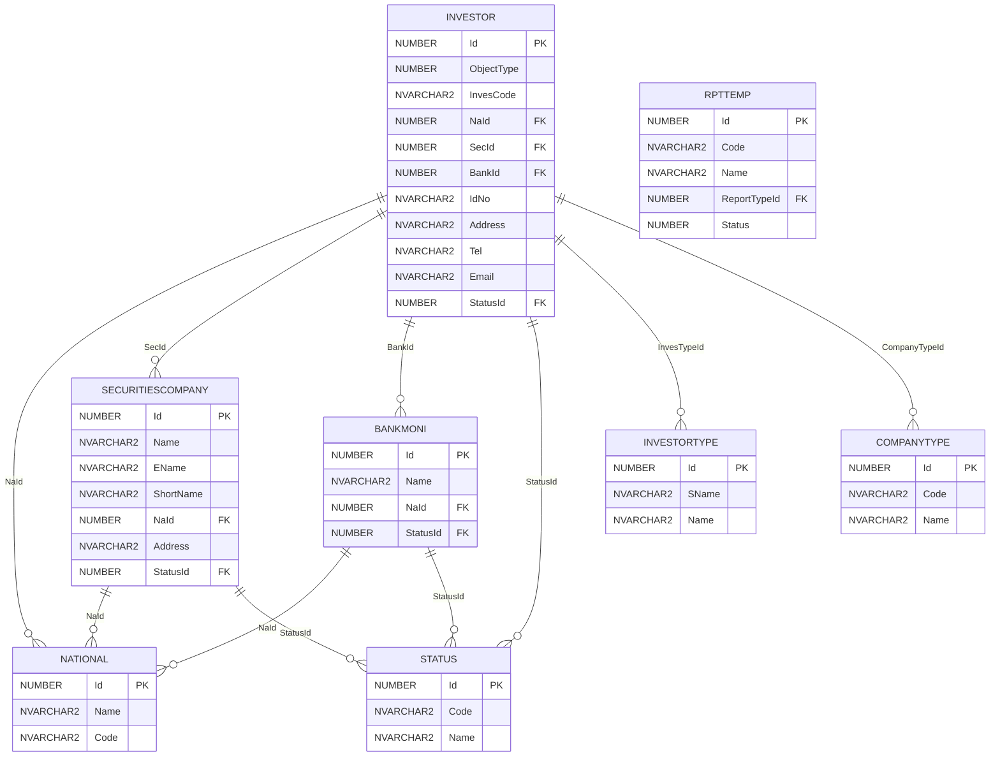
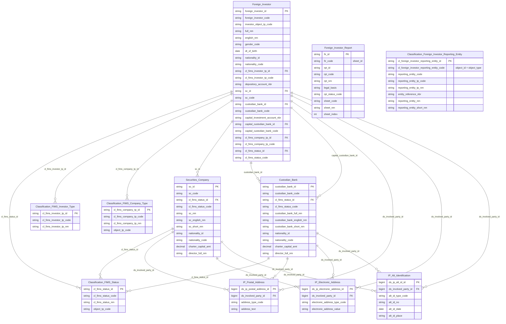

# FIMS HLD — Tier 1

**Source system:** FIMS (Hệ thống quản lý giám sát và công bố thông tin thành viên thị trường — Oracle)
**Tier 1:** Entity độc lập, không FK đến entity nghiệp vụ khác — chỉ FK đến Classification / Classification Value. Gồm 8 entity: Classification FIMS Company Type, Classification FIMS Investor Type, Classification FIMS Status, Classification Foreign Investor Reporting Entity (mới 2026-09-30), Custodian Bank, Foreign Investor, Foreign Investor Report (thay Reporting Template — 2026-09-30), Securities Company — cùng 3 shared entity IP Postal Address / IP Electronic Address / IP Alt Identification (Tier = tier của host entity). Đồng bộ theo LLD ngày 2026-10-21.

> **Cập nhật (2026-07-10):** NATIONAL/LOCATION đã loại khỏi scope Atomic — dữ liệu địa
> giới hành chính chuyển sang chuẩn hóa tại nguồn **ECAT** (xem `ECAT_HLD_Tier1.md`).
> FIMS không tự thiết kế Geographic Area nữa, chỉ tham chiếu qua lookup giá trị. Xem
> mục 7f của `FIMS_HLD_Overview.md`.

> **Cập nhật (2026-10-21):** các entity Tier 1 chưa có LLD (Market Participant Organization, Reporting Period, Reporting Obligation Type, Warning Parameter, Trading Representative, Securities Closing Price) đã gỡ khỏi HLD; bảng nguồn chuyển vào 7f nhóm `Chưa có LLD`; riêng FUNDCOMPANY, DEPOSITORYCENTER, STOCKEXCHANGE, BRANCHS, INFODISCREPRES, TRADINGREPRESENTATIVE là bảng đầu vào của ODS `CL_FOREIGN_INVESTOR_REPORTING_ENTITY` nên vào 7f nhóm `Xử lý luồng khác`.

---

## 6a. Bảng tổng quan BCV Concept

| BCV Core Object | BCV Concept | Category | Source Table | Mô tả bảng nguồn | Atomic Entity | table_type | BCV Term |
|---|---|---|---|---|---|---|---|
| Common | [Common] Organization Legal Structure | Classification | COMPANYTYPE | Danh mục loại hình doanh nghiệp | Classification FIMS Company Type | Relative | (1) BCV term `[Common] Organization Legal Structure` — phân biệt Organization theo hình thức/loại hình doanh nghiệp. (2) Promote từ Classification Value (scheme `FIMS_COMPANY_TYPE`, deprecated) lên entity riêng, cùng pattern `Classification FMS Company Type`; BK = CODE. (3) FK từ Foreign Investor. |
| Common | [Common] Involved Party Type | Classification | INVESTORTYPE | Danh mục loại nhà đầu tư nước ngoài | Classification FIMS Investor Type | Relative | (1) BCV term `[Common] Involved Party Type` — danh mục loại nhà đầu tư. (2) Promote từ Classification Value (scheme `FIMS_INVESTOR_TYPE`, deprecated) lên entity riêng; BK = SNAME. (3) FK từ Foreign Investor. |
| Common | [Common] Involved Party Life Cycle Status | Classification | STATUS | Danh mục tình trạng hoạt động của đối tượng thành viên thị trường / nhà đầu tư | Classification FIMS Status | Relative | (1) BCV term `[Common] Involved Party Life Cycle Status` (không có term trần "Status" trong Common). (2) Promote từ Classification Value (scheme `FIMS_ACTIVITY_STATUS`, deprecated) lên entity riêng, cùng pattern `Classification FMS Status`; BK = Code. (3) FK từ Foreign Investor, Securities Company, Custodian Bank. |
| Common | [Common] Classification | Classification | 9 bảng danh mục đối tượng (qua ODS `CL_FOREIGN_INVESTOR_REPORTING_ENTITY`) | Danh mục tổ chức/cá nhân từng là bên nộp báo cáo động | Classification Foreign Investor Reporting Entity | Relative | (1) **Quyết định Data Modeler 2026-09-30:** BCO `Common`, concept `[Common] Classification` — đây là bảng danh mục tra cứu (mã + tên + loại), không phải hồ sơ Involved Party đầy đủ. BCV không có term Common riêng cho "reporting entity"; dùng cùng concept với các entity `cl_*` khác trong dự án. (2) ODS `CL_FOREIGN_INVESTOR_REPORTING_ENTITY` (tên cũ `dim_object`) UNION 9 bảng FUNDCOMPANY, SECURITIESCOMPANY, BANKMONI, DEPOSITORYCENTER, STOCKEXCHANGE, INFODISCREPRES, BRANCHS, INVESTOR, TRADINGREPRESENTATIVE (không JOIN), gắn `object_type`: object_id, object_code, object_name, object_short_name. (3) Bảng tra cứu hợp nhất (Code + tên + loại) phục vụ báo cáo động → Domain Prefix `Classification`; BK = `object_id ‖ object_type` (object_id không duy nhất giữa các loại). Không tách shared entity IP (chỉ có mã/tên, không có địa chỉ/liên lạc/giấy tờ). |
| Involved Party | [Involved Party] Organization | Organization | BANKMONI | Danh sách ngân hàng lưu ký giám sát — đối tượng thành viên thị trường | Custodian Bank | Fundamental | **[2026-10-05 — thay quyết định gộp cũ]** Theo chỉ đạo Data Modeler: map vào entity `Custodian Bank` (cùng entity với `FMS.BANK_MONI`), không gộp vào Market Participant Organization. Tách IP Postal Address + IP Electronic Address + IP Alt Identification. FK đến Classification FIMS Status. Xem T1-10. |
| Involved Party | [Involved Party] Individual | Individual | INVESTOR | Danh sách nhà đầu tư nước ngoài (cá nhân và tổ chức) đăng ký hoạt động tại Việt Nam theo quy định UBCKNN | Foreign Investor | Fundamental | (1) BCV term `[Involved Party] Individual` — đây là cá nhân/tổ chức nước ngoài. (2) INVESTOR: ObjectType(1=Cá nhân, 2=Tổ chức), IdNo, NaId, Address, Tel, Email, StatusId — profile NĐT NN với thông tin nhận dạng và liên lạc. (3) ObjectType gộp cả cá nhân lẫn tổ chức → 1 entity phân biệt bằng `investor_object_tp_code`. Chọn `[Involved Party] Individual` vì primary use case là cá nhân; tổ chức NĐT NN là ngoại lệ (ít trường hơn). FK đến Securities Company, Custodian Bank (x2: lưu ký + lưu ký vốn), Classification FIMS Investor Type / Company Type / Status. |
| Documentation | [Documentation] Form Document | Form Document | RPTTEMP (qua ODS `FOREIGN_INVESTOR_REPORT`) | Danh sách biểu mẫu báo cáo định kỳ do UBCKNN ban hành — master template mà thành viên thị trường phải nộp | Foreign Investor Report | Relative | (1) Term candidate `Form Document` (BCV Documentation): "Identifies a Documentation Item presented in a standard template layout which requires additional information to be supplied". (2) ODS `FOREIGN_INVESTOR_REPORT` (tên cũ `dim_report_template`) = `RPTTEMP ⋈ SHEET` (`SHEET.RptId = RPTTEMP.Id`, chỉ `Status = 1`): rpt_id, report_code, report_name, legal_basis, template_status, sheet_id, sheet_code, sheet_name, sheet_index. Grain = 1 sheet × 1 mẫu. (3) Mẫu báo cáo là template layout chờ thành viên điền số liệu → khớp `Form Document`; thay quyết định cũ `[Business Activity] Business Activity` của entity `Reporting Template` (2026-09-30). ODS ghi đè toàn bộ mỗi lần chạy → Atomic SCD2 (Relative). Domain Prefix `Foreign Investor Report` (gốc của nhóm; physical `foreign_investor_report`, cột viết tắt `fir_`). |
| Documentation | [Documentation] Form Document | Form Document | SHEET (qua ODS `FOREIGN_INVESTOR_REPORT`) | Danh sách các sheet trong biểu mẫu báo cáo đầu vào | Foreign Investor Report | Relative | Cùng entity với RPTTEMP — SHEET quyết định grain (BK `sheet_id` → `fir_code`). SHEET đồng thời là nguồn parse JSON của `Foreign Investor Report Structure` (Tier 2). |
| Involved Party | Shared Entity | Shared Entity | BANKMONI, INVESTOR, SECURITIESCOMPANY | Địa chỉ/liên lạc/giấy tờ định danh của Involved Party | Involved Party Alternative Identification | Fundamental | Shared entity — mỗi host (Foreign Investor, Securities Company, Custodian Bank) có 1 LLD riêng (`lld_FIMS_*_IP_Alt_Identification.yaml`); Tier = tier của host (T1). |
| Involved Party | Shared Entity | Shared Entity | BANKMONI, INVESTOR, SECURITIESCOMPANY | Địa chỉ/liên lạc/giấy tờ định danh của Involved Party | Involved Party Electronic Address | Fundamental | Shared entity — mỗi host có 1 LLD riêng (`lld_FIMS_*_IP_Electronic_Address.yaml`); Tier = tier của host (T1). |
| Involved Party | Shared Entity | Shared Entity | BANKMONI, INVESTOR, SECURITIESCOMPANY | Địa chỉ/liên lạc/giấy tờ định danh của Involved Party | Involved Party Postal Address | Fundamental | Shared entity — mỗi host có 1 LLD riêng (`lld_FIMS_*_IP_Postal_Address.yaml`); Tier = tier của host (T1). |
| Involved Party | [Involved Party] Broker Dealer | Organization | SECURITIESCOMPANY | Danh sách công ty chứng khoán — đối tượng thành viên thị trường | Securities Company | Fundamental | **[2026-10-05 — thay quyết định gộp cũ]** Theo chỉ đạo Data Modeler: map vào entity `Securities Company` (cùng entity với `SCMS.SC_FIRM_INFO`), không gộp vào Market Participant Organization. BCV `[Involved Party] Broker Dealer`. Tách IP Postal Address + IP Electronic Address + IP Alt Identification. FK đến Classification FIMS Status. Xem T1-11. |

---

## 6b. Diagram Source (Mermaid)

---

> **Ghi chú 6b — nhóm Báo cáo động (2026-09-30):** `Foreign Investor Report` và `Classification Foreign Investor Reporting Entity` KHÔNG map trực tiếp từ bảng staging ở diagram trên mà qua lớp ODS: `RPTTEMP ⋈ SHEET` → ODS `FOREIGN_INVESTOR_REPORT`; UNION 9 bảng danh mục đối tượng → ODS `CL_FOREIGN_INVESTOR_REPORTING_ENTITY`. Chi tiết luồng: ghi chú cuối mục 7a của `FIMS_HLD_Overview.md`.

## 6c. Diagram Atomic (Mermaid)

---

## 6d. Mục Danh mục & Tham chiếu (Reference Data)

| Source Field / Bảng | Mô tả | Scheme Code | source_type | Ghi chú |
|---|---|---|---|---|
| INVESTOR.ObjectType | Loại đối tượng NĐT NN (cá nhân/tổ chức) | `FIMS_STOCKHOLDER_TYPE` | source_table | → FIMS.STOCKHOLDERTYPE |
| RPTTEMP.ReportTypeId → REPORTTYPE | Loại báo cáo thành viên | `FIMS_REPORT_TYPE` | source_table | |
| ODS `CL_FOREIGN_INVESTOR_REPORTING_ENTITY.OBJECT_TYPE` | Loại đối tượng nộp báo cáo (9 loại theo bảng danh mục gốc) | `FIMS_REPORTING_ENTITY_TYPE` | etl_derived | Dùng chung với Foreign Investor Report Value |
| ODS `FOREIGN_INVESTOR_REPORT.TEMPLATE_STATUS` (RPTTEMP.Status) | Trạng thái mẫu báo cáo | `FIMS_REPORT_TEMPLATE_STATUS` | etl_derived | ODS chỉ nạp `Status = 1` |

> STATUS / INVESTORTYPE / COMPANYTYPE đã promote thành entity (6a) — scheme `FIMS_ACTIVITY_STATUS`, `FIMS_INVESTOR_TYPE`, `FIMS_COMPANY_TYPE` không còn dùng.

---

## 6e. Bảng chờ thiết kế

*(Không có — tất cả bảng Tier 1 trong HLD đã có LLD)*

---

## 6f. Điểm cần xác nhận

| # | Câu hỏi | Kết quả |
|---|---|---|
| T1-01 | ~~FUNDCOMPANY, SECURITIESCOMPANY, BANKMONI, DEPOSITORYCENTER, STOCKEXCHANGE gộp thành 1 entity `Market Participant Organization`?~~ | **Đã cập nhật theo LLD (2026-10-21):** SECURITIESCOMPANY → `Securities Company`, BANKMONI → `Custodian Bank` (T1-10, T1-11). FUNDCOMPANY/DEPOSITORYCENTER/STOCKEXCHANGE không có LLD riêng — là bảng đầu vào của ODS `CL_FOREIGN_INVESTOR_REPORTING_ENTITY`, đưa vào 7f nhóm `Xử lý luồng khác`. |
| T1-02 | INVESTOR.ObjectType = 1 (cá nhân) và 2 (tổ chức) — có cần tách thành 2 entity riêng không? | Đề xuất: Giữ 1 entity, phân biệt bằng `investor_object_tp_code`. Cấu trúc cột đồng nhất — không có cột riêng cho từng loại. |
| T1-04 | Geographic Area — FIMS.NATIONAL và FIMS.LOCATION có nên bổ sung vào shared entity `Geographic Area` không? | **Đã chốt (2026-07-10) — không bổ sung.** Geographic Area chỉ còn 1 nguồn duy nhất là ECAT. NATIONAL/LOCATION loại khỏi scope (xem 7f Overview). Entity FIMS FK đến NATIONAL (Securities Company, Custodian Bank, Foreign Investor) resolve bằng cặp `nationality_id/code` đối chiếu Geographic Area nguồn ECAT. |
| T1-07 | **[GHI NHẬN 2026-07-19]** `INVESTOR` có cột `Address` và `Telephone/Fax/Email/Website` nhưng HLD ban đầu chỉ ghi "Tách IP Alt Identification". | Áp dụng quy tắc "grain = Involved Party → luôn tách đủ 3 shared entity" (`lld_FIMS_INVESTOR_IP_*.yaml`). Đã đồng bộ 7a/Entities/diagram. |
| T1-08 | **[2026-09-30]** `Reporting Template` (RPTTEMP) được thay bằng `Foreign Investor Report` (grain = sheet, BK `sheet_id`, qua ODS `FOREIGN_INVESTOR_REPORT`). | Các entity từng FK đến Reporting Template (Reporting Period, Member Periodic Report) chưa có LLD nên đã gỡ khỏi HLD (2026-10-21). |
| T1-09 | **[2026-09-30]** `Classification Foreign Investor Reporting Entity` chồng lấn nội dung với `Securities Company`, `Custodian Bank`, `Foreign Investor` (cùng nguồn trong 9 bảng UNION). Giữ riêng theo quyết định Data Modeler vì là danh mục tra cứu hợp nhất của luồng báo cáo động (ODS). `object_code` loại "Đại diện giao dịch" = `idno` đã được nguồn mã hóa trước khi tới staging (xác nhận BA 24/09/2026) — không phải số giấy tờ gốc. | Không tạo FK sang các entity IP trên ở phạm vi này. |
| T1-10 | **[2026-10-05]** `BANKMONI` map vào `Custodian Bank` (không gộp như T1-01). Cần xác nhận: (a) dùng `Id` nguồn làm BK vì không có mã nghiệp vụ; (b) `RegNo/RegDate/RegAdd` → `BUSINESS_LICENSE`, `IdNo/IdDate/IdAdd` → `IDENTIFICATION`, `DepCert` → `CUSTODIAN_MEMBER_CERTIFICATE`; (c) `FMS.BANK_MONI` và `FIMS.BANKMONI` có cùng tập ngân hàng không — hash khác nhau (`FMS_BANK_MONI` vs `FIMS_BANKMONI`) nên không tự dedupe; (d) `lld_FIMS_INVESTOR` (approved) còn `hash_id('FMS_BANK_MONI', BankAddId)` ở Custodian Bank Id — cần đổi sang `FIMS_BANKMONI`. | Chờ xác nhận. |
| T1-11 | **[2026-10-05]** `SECURITIESCOMPANY` map vào `Securities Company` (không gộp như T1-01; cùng hướng với T1-10). Cần xác nhận: (a) dùng `Id` nguồn làm BK `sc_code` vì không có mã nghiệp vụ — trong khi `SCMS.SC_FIRM_INFO` dùng `CODE` viết tắt (VD SSI); (b) `RegNo/RegDate/RegAdd` → `BUSINESS_LICENSE`, `IdNo/IdDate/IdAdd` → `IDENTIFICATION`, `DepCert` → `CUSTODIAN_MEMBER_CERTIFICATE`; (c) FIMS và SCMS cùng có CTCK nhưng hash khác nhau (`FIMS_SECURITIESCOMPANY` vs `SCMS_SC_FIRM_INFO`) nên không tự dedupe — cần crosswalk theo `ShortName`/`RegNo` nếu muốn hợp nhất; (d) các FK `SecComId` từ nguồn khác phải dùng `hash_id('FIMS_SECURITIESCOMPANY', Id)`. | Chờ xác nhận. |
