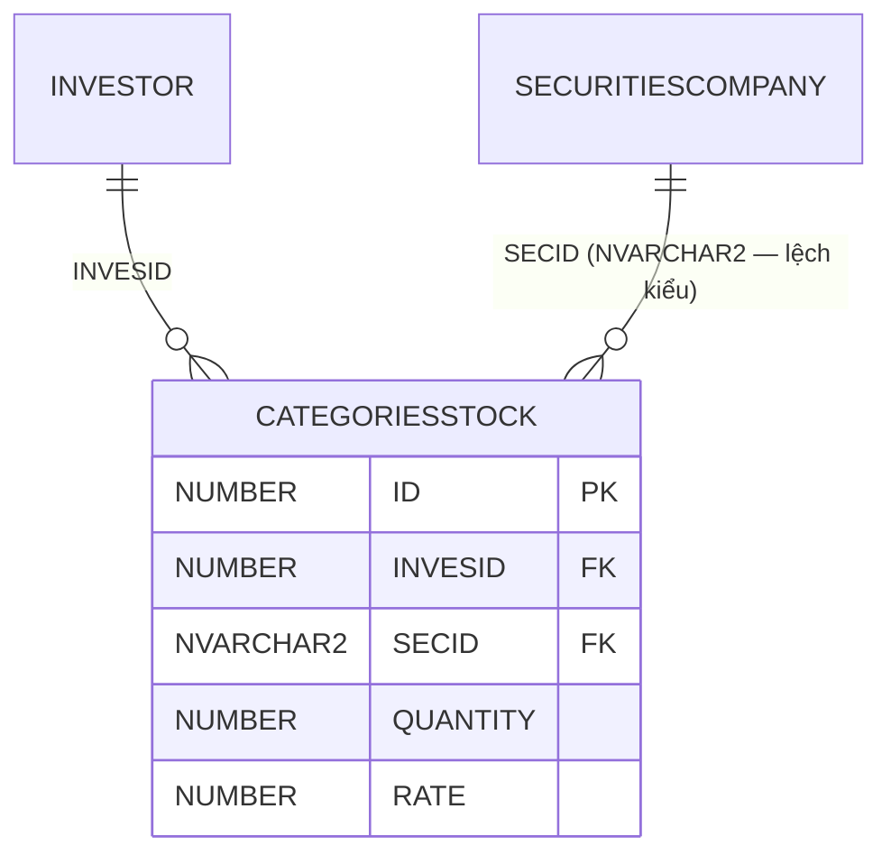
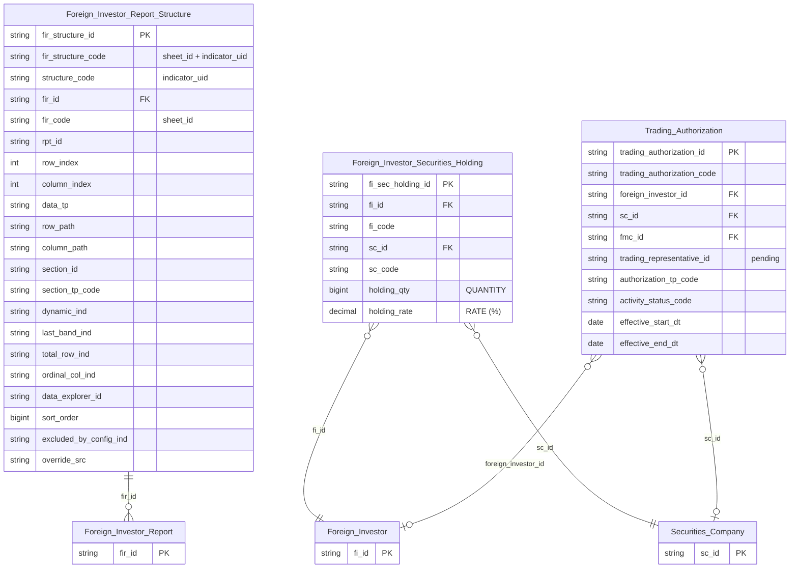

# FIMS HLD — Tier 2

**Source system:** FIMS (Hệ thống quản lý giám sát và công bố thông tin thành viên thị trường — Oracle)
**Tier 2:** Entity có FK đến Tier 1. Gồm 3 entity: Foreign Investor Report Structure (FK đến Foreign Investor Report — mới 2026-09-30), Foreign Investor Securities Holding (FK đến Foreign Investor + Securities Company — mới 2026-10-28) và Trading Authorization (FK đến Foreign Investor + Securities Company — thiết kế lại 2026-10-28). Các entity Tier 2 chưa có LLD (Foreign FM Branch Organization, Info Disclosure Representative, Market Participant Key Person, Member Periodic Report, Warning Condition) đã gỡ khỏi HLD 2026-10-21 — xem 7f `FIMS_HLD_Overview.md` nhóm `Chưa có LLD`.

---

## 6a. Bảng tổng quan BCV Concept

| BCV Core Object | BCV Concept | Category | Source Table | Source Table Change Mode | Mô tả bảng nguồn | Atomic Entity | Table Type | BCV Term |
|---|---|---|---|---|---|---|---|---|
| Arrangement | [Arrangement] Investment Arrangement | Investment Arrangement | CATEGORIESSTOCK | Update | Số lượng và tỷ lệ sở hữu chứng khoán hiện tại của NĐT NN tại 1 CTCK | Foreign Investor Securities Holding | Fact Append | (1) Term candidate `Investment Arrangement` (BCV Arrangement) — thỏa thuận đầu tư của Involved Party (term `Trading Account Arrangement`/`Investment Arrangement` mang các thuộc tính tài khoản/vị thế đầu tư); candidate `Financial Market Position` (Accounting) bị loại theo quyết định Data Modeler 2026-10-28 (concept phải là Arrangement). (2) Cấu trúc trường: INVESID (FK INVESTOR), SECID (FK SECURITIESCOMPANY), QUANTITY (số lượng nắm giữ), RATE (% so với tổng lưu hành), DELETED + 4 cột audit kỹ thuật, ISSYNCED — mô tả mối quan hệ đầu tư giữa NĐT NN và CTCK kèm số lượng/tỷ lệ nắm giữ; không có số tài khoản (thuộc SECURITIESACCOUNT) và không có mã chứng khoán. (3) Chọn `Investment Arrangement`; Table Type = Fact Append (quyết định Data Modeler 2026-10-28): mỗi lần ETL ghi 1 dòng chụp số lượng/tỷ lệ hiện tại, insert-only, giữ lịch sử trên Atomic (thay vai trò CATEGORIESSTOCKHIS ngoài scope). Grain = 1 NĐT NN × 1 CTCK × 1 lần ghi nhận. FK đến Foreign Investor + Securities Company (đều T1) → Tier 2. Domain Prefix rỗng (`Foreign Investor` không thuộc danh sách curated). Thay quyết định cũ (gộp vào `Foreign Investor Securities Account`, T3-06) vì entity đó đã gỡ khỏi HLD 2026-10-21. |
| Arrangement | [Arrangement] Authority Arrangement | Authority Arrangement | TRADINGAUTHORIZATION | Update | Danh sách ủy quyền giao dịch cho đại diện giao dịch | Trading Authorization | Relative | (1) Term candidate `Authority Arrangement` (BCV Arrangement, id 6846) — "Identifies an Involved Party Arrangement which specifies the manner in which" một Involved Party được ủy quyền hành động thay mặt Involved Party khác. (2) Cấu trúc trường: INVESTORID/FUNDCOMID/SECCOMID (bên ủy quyền), TRADINGREPRESENTATIVEID (người được ủy quyền), AUTHORIZATIONTYPEID, STATUS, SDATE/EDATE (thời hạn hiệu lực), FILENAME/FILEDATA/NOTE — mô tả một thỏa thuận ủy quyền có thời hạn và trạng thái. (3) Chọn `Authority Arrangement`. Grain = 1 hợp đồng ủy quyền giao dịch. Nguồn Update → SCD2 (Relative) — Data Modeler đổi từ Fundamental sang Relative 2026-10-28. FK đến Foreign Investor + Securities Company (T1) → Tier 2; FK Trading Representative để pending (entity đã gỡ khỏi HLD 2026-10-21). TRADINGAUTHORIZATIONINVES không còn gộp vào entity này và không thiết kế Atomic (Data Modeler 2026-10-28, giữ ở 7f). |
| Documentation | [Documentation] Form Document | Form Document | SHEET (qua ODS `FIR_STRUCTURE`) | Update (ODS ghi đè toàn bộ mỗi lần chạy) | Cấu hình ô chỉ tiêu của sheet (JSON CellsMeta/SectionsMeta/DataLabel) | Foreign Investor Report Structure | Relative | (1) Term candidate `Form Document` (BCV Documentation) — cấu trúc ô của template layout; BCV không có term riêng cho "form cell/indicator", dùng cùng concept với entity cha `Foreign Investor Report`. (2) ODS `FIR_STRUCTURE` (tên cũ `dim_indicator`) sinh bằng **parse JSON** `CellsMeta`/`SectionsMeta`/`DataLabel` của SHEET (+ cấu hình đè `fims_row_overrides/`), không phải JOIN: indicator_uid, sheet_row/sheet_col, row_path/column_path, section_id/section_type, các cờ is_*, item_id, sort_order, override_source. (3) Grain = 1 ô template trong 1 sheet; BK = `sheet_id ‖ indicator_uid` (indicator_uid chỉ duy nhất trong 1 sheet). FK đến `Foreign Investor Report` (T1) → Tier 2. ODS ghi đè toàn bộ → SCD2 (Relative). `mirror_of_uid` lọc ở bước ODS → ATM. |

---

## 6b. Diagram Source (Mermaid)

> `Foreign Investor Report Structure` không map từ cột bảng staging mà qua ODS `FIR_STRUCTURE`.

> **Ghi chú 6b — nhóm Báo cáo động (2026-09-30):** `Foreign Investor Report Structure` KHÔNG map trực tiếp từ cột SHEET mà qua ODS `FIR_STRUCTURE` — cây chỉ tiêu được **parse từ JSON** `CellsMeta`/`SectionsMeta`/`DataLabel` của SHEET. Chi tiết luồng: ghi chú cuối mục 7a của `FIMS_HLD_Overview.md`.

## 6c. Diagram Atomic (Mermaid)

---

## 6d. Mục Danh mục & Tham chiếu (Reference Data)

| Source Field / Bảng | Mô tả | Scheme Code | source_type | Ghi chú |
|---|---|---|---|---|
| ODS `FIR_STRUCTURE.SECTION_TYPE` (SHEET.SECTIONSMETA) | Loại vùng dữ liệu của ô chỉ tiêu (DYNAMIC/FIXED) | `FIMS_REPORT_SECTION_TYPE` | etl_derived | |
| ODS `FIR_STRUCTURE.FORMAT_DATA_TYPE` (SHEET.CELLSMETA) | Kiểu dữ liệu ô chỉ tiêu (numberic/percentage/string...) | `FIMS_REPORT_DATA_TYPE` | etl_derived | Giữ nguyên chính tả nguồn `numberic` |

---

## 6e. Bảng chờ thiết kế

*(Không có)*

---

## 6f. Điểm cần xác nhận

| # | Câu hỏi | Kết quả |
|---|---|---|
| T2-05 | **[2026-09-30]** `Foreign Investor Report Structure` (SHEET qua ODS `FIR_STRUCTURE`) — cây chỉ tiêu suy ra từ thuật toán parse JSON, có lớp cấu hình đè `fims_row_overrides/`. `data_explorer_id` (ODS `item_id` = MD5 theo `report_code + legal_basis + sheet_name + row_path + column_path`) đổi khi `row_path` bị sửa → không dùng làm BK. | BK = `sheet_id ‖ indicator_uid`; SCD2 ghi nhận version mới khi row_path/data_explorer_id đổi. Cột `report_code/report_name/legal_basis/sheet_name` không map (lấy qua FK Foreign Investor Report); `mirror_of_uid` lọc ở bước ODS → ATM. |
| T2-07 | **[2026-10-28]** `Foreign Investor Securities Holding` (CATEGORIESSTOCK, Fact Append, [Arrangement] Investment Arrangement): (a) Nguồn `Update` nhưng Atomic `Fact Append` (insert-only) — mỗi lần ETL append 1 dòng cho mọi cặp, hay chỉ append khi QUANTITY/RATE đổi? (b) `SECID` kiểu NVARCHAR2(100) lệch `SECURITIESCOMPANY.ID` NUMBER(18,2) — chứa Id số hay mã CTCK? (c) Bảng không có mã chứng khoán — QUANTITY/RATE là tổng tại CTCK hay theo mã? (d) Cặp (INVESID, SECID) có duy nhất khi DELETED=0? | Chưa chốt — Data Modeler xác nhận trước LLD. (a) quyết định BK/dedup và cột ngày ghi nhận (`ds_*`); (b) cách tra `sc_id`; (c) đổi grain nếu theo mã; (d) nếu không duy nhất, BK = ID nguồn + ngày ghi nhận. |
| T2-06 | **[2026-09-30]** Cờ `is_*` (INT 0/1) trên `fir_structure` map domain `Indicator` (hậu tố `_ind` theo bản map Data Modeler). | Nguồn lưu số — ETL convert sang string. |
| T2-08 | **[2026-10-28]** `Trading Authorization` (TRADINGAUTHORIZATION): (a) Table Type đổi Fundamental → Relative theo Data Modeler. (b) TRADINGAUTHORIZATIONINVES không còn gộp và không thiết kế Atomic (giữ ở 7f). (c) FK `TRADINGREPRESENTATIVEID` chưa có entity đích (Trading Representative đã gỡ 2026-10-21) → attribute `status: pending`. (d) FK `FUNDCOMID` trỏ Fund Management Company (FMS) — comment cũ, chưa rà lại. (e) Cột `INVESTORIDS` (danh sách NĐT dạng JSON/CSV) chưa quyết định — xem pending_design.yaml. | (c) khi có entity Trading Representative phải bổ sung FK + hash; (e) nếu INVESTORIDS có nghĩa nghiệp vụ riêng thì cần Array. Chưa chốt. |
