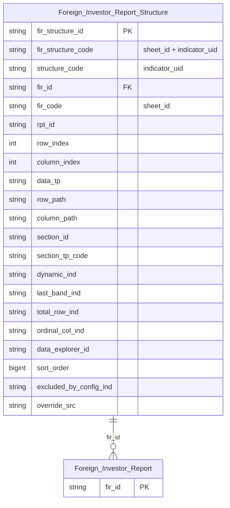

# FIMS HLD — Tier 2

**Source system:** FIMS (Hệ thống quản lý giám sát và công bố thông tin thành viên thị trường — Oracle)
**Tier 2:** Entity có FK đến Tier 1. Gồm 1 entity: Foreign Investor Report Structure (FK đến Foreign Investor Report — mới 2026-09-30). Các entity Tier 2 chưa có LLD (Foreign FM Branch Organization, Info Disclosure Representative, Market Participant Key Person, Member Periodic Report, Warning Condition) đã gỡ khỏi HLD 2026-10-21 — xem 7f `FIMS_HLD_Overview.md` nhóm `Chưa có LLD`.

---

## 6a. Bảng tổng quan BCV Concept

| BCV Core Object | BCV Concept | Category | Source Table | Mô tả bảng nguồn | Atomic Entity | table_type | BCV Term |
|---|---|---|---|---|---|---|---|
| Documentation | [Documentation] Form Document | Form Document | SHEET (qua ODS `FIR_STRUCTURE`) | Cấu hình ô chỉ tiêu của sheet (JSON CellsMeta/SectionsMeta/DataLabel) | Foreign Investor Report Structure | Relative | (1) Term candidate `Form Document` (BCV Documentation) — cấu trúc ô của template layout; BCV không có term riêng cho "form cell/indicator", dùng cùng concept với entity cha `Foreign Investor Report`. (2) ODS `FIR_STRUCTURE` (tên cũ `dim_indicator`) sinh bằng **parse JSON** `CellsMeta`/`SectionsMeta`/`DataLabel` của SHEET (+ cấu hình đè `fims_row_overrides/`), không phải JOIN: indicator_uid, sheet_row/sheet_col, row_path/column_path, section_id/section_type, các cờ is_*, item_id, sort_order, override_source. (3) Grain = 1 ô template trong 1 sheet; BK = `sheet_id ‖ indicator_uid` (indicator_uid chỉ duy nhất trong 1 sheet). FK đến `Foreign Investor Report` (T1) → Tier 2. ODS ghi đè toàn bộ → SCD2 (Relative). `mirror_of_uid` lọc ở bước ODS → ATM. |

---

## 6b. Diagram Source (Mermaid)

> Không có diagram nguồn trực tiếp: `Foreign Investor Report Structure` không map từ cột bảng staging mà qua ODS `FIR_STRUCTURE`.

> **Ghi chú 6b — nhóm Báo cáo động (2026-09-30):** `Foreign Investor Report Structure` KHÔNG map trực tiếp từ cột SHEET mà qua ODS `FIR_STRUCTURE` — cây chỉ tiêu được **parse từ JSON** `CellsMeta`/`SectionsMeta`/`DataLabel` của SHEET. Chi tiết luồng: ghi chú cuối mục 7a của `FIMS_HLD_Overview.md`.

## 6c. Diagram Atomic (Mermaid)

---

## 6d. Mục Danh mục & Tham chiếu (Reference Data)

| Source Field / Bảng | Mô tả | Scheme Code | source_type | Ghi chú |
|---|---|---|---|---|
| ODS `FIR_STRUCTURE.SECTION_TYPE` (SHEET.SectionsMeta) | Loại vùng dữ liệu của ô chỉ tiêu (DYNAMIC/FIXED) | `FIMS_REPORT_SECTION_TYPE` | etl_derived | |
| ODS `FIR_STRUCTURE.FORMAT_DATA_TYPE` (SHEET.CellsMeta) | Kiểu dữ liệu ô chỉ tiêu (numberic/percentage/string...) | `FIMS_REPORT_DATA_TYPE` | etl_derived | Giữ nguyên chính tả nguồn `numberic` |

---

## 6e. Bảng chờ thiết kế

*(Không có)*

---

## 6f. Điểm cần xác nhận

| # | Câu hỏi | Kết quả |
|---|---|---|
| T2-05 | **[2026-09-30]** `Foreign Investor Report Structure` (SHEET qua ODS `FIR_STRUCTURE`) — cây chỉ tiêu suy ra từ thuật toán parse JSON, có lớp cấu hình đè `fims_row_overrides/`. `data_explorer_id` (ODS `item_id` = MD5 theo `report_code + legal_basis + sheet_name + row_path + column_path`) đổi khi `row_path` bị sửa → không dùng làm BK. | BK = `sheet_id ‖ indicator_uid`; SCD2 ghi nhận version mới khi row_path/data_explorer_id đổi. Cột `report_code/report_name/legal_basis/sheet_name` không map (lấy qua FK Foreign Investor Report); `mirror_of_uid` lọc ở bước ODS → ATM. |
| T2-06 | **[2026-09-30]** Cờ `is_*` (INT 0/1) trên `fir_structure` map domain `Indicator` (hậu tố `_ind` theo bản map Data Modeler). | Nguồn lưu số — ETL convert sang string. |
