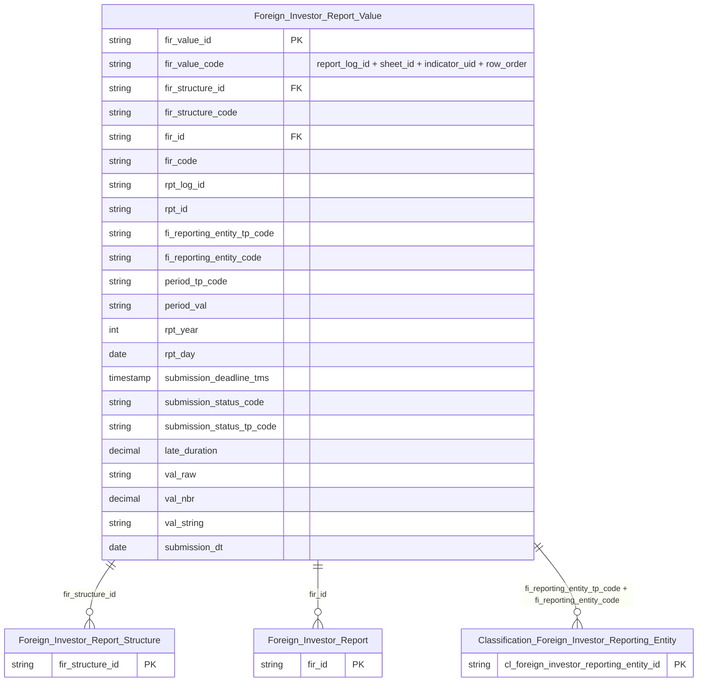

# FIMS HLD — Tier 3

**Source system:** FIMS (Hệ thống quản lý giám sát và công bố thông tin thành viên thị trường — Oracle)
**Tier 3:** Entity có FK đến Tier 2. Gồm 1 entity: Foreign Investor Report Value (FK→Foreign Investor Report Structure + Foreign Investor Report; thay Report Import Value — 2026-09-30). Các entity Tier 3 chưa có LLD (Foreign Investor Securities Account, Report Processing Activity Log, Market Participant Conduct Violation, Info Disclosure Authorization, Trading Authorization, Info Disclosure Announcement) đã gỡ khỏi HLD 2026-10-21 — xem 7f `FIMS_HLD_Overview.md` nhóm `Chưa có LLD`.

---

## 6a. Bảng tổng quan BCV Concept

| BCV Core Object | BCV Concept | Category | Source Table | Mô tả bảng nguồn | Atomic Entity | table_type | BCV Term |
|---|---|---|---|---|---|---|---|
| Documentation | [Documentation] Regulatory Information | Regulatory Information | RPTVALUES (qua ODS `FIR_VALUE`) | Dữ liệu giá trị từng ô (cell) trong báo cáo định kỳ thành viên — bảng phân vùng theo năm | Foreign Investor Report Value | Classification | (1) Term candidate `Regulatory Information` (BCV Documentation): "Identifies Reported Information that is required to be filed with regulatory bodies" — giá trị thành viên nộp lên UBCKNN; thay quyết định cũ `Gov. Registration Document` của entity `Report Import Value` (2026-09-30). (2) ODS `FIR_VALUE` (tên cũ `fact_report_cell`) = `RPTMEMBER ⋈ RPTVALUES` (`RPTVALUES.MEBID = RPTMEMBER.ID`, trạng thái đã nộp 2/3/5, khoảng `DateSubmitted`); ETL tra `TgtId` (RAW(16)) → `indicator_uid` cùng `sheet_id`, và FK đối tượng trên RPTMEMBER (secid→fundid→bankid→depid→stockid→inid→branid→investorid→tradingrepresentativeid, cột đầu tiên có giá trị) → `object_type/object_id`. (3) Grain = 1 ô × 1 lần nộp × 1 dòng động; BK = `report_log_id ‖ sheet_id ‖ indicator_uid ‖ row_order`. Cơ chế Upsert theo BK; Table Type theo LLD = `Classification` (quyết định Data Modeler). FK đến `Foreign Investor Report Structure` (T2) → Tier 3. |
| Documentation | [Documentation] Regulatory Information | Regulatory Information | RPTMEMBER (qua ODS `FIR_VALUE`) | Lần nộp báo cáo của thành viên | Foreign Investor Report Value | Classification | RPTMEMBER cung cấp thông tin lần nộp denormalize trên từng ô: `report_log_id` (= RPTMEMBER.ID), period_type/period_value, year_value, day_report, han_nop, late_status/late_status_code/late_duration, object_type/object_id. |

---

## 6b. Diagram Source (Mermaid)

> Không có diagram nguồn trực tiếp: `Foreign Investor Report Value` không map từ cột RPTVALUES ở staging mà qua ODS `FIR_VALUE`.

> **Ghi chú 6b — nhóm Báo cáo động (2026-09-30):** `Foreign Investor Report Value` KHÔNG map trực tiếp từ RPTVALUES mà qua ODS `FIR_VALUE` (= `RPTMEMBER ⋈ RPTVALUES` + tra `indicator_uid`/`object_type,object_id`). Chi tiết luồng: ghi chú cuối mục 7a của `FIMS_HLD_Overview.md`.

## 6c. Diagram Atomic (Mermaid)

---

## 6d. Mục Danh mục & Tham chiếu (Reference Data)

| Source Field / Bảng | Mô tả | Scheme Code | source_type | Ghi chú |
|---|---|---|---|---|
| ODS `FIR_VALUE.OBJECT_TYPE` | Loại đối tượng nộp báo cáo | `FIMS_REPORTING_ENTITY_TYPE` | etl_derived | Dùng chung với Classification Foreign Investor Reporting Entity (T1) |
| ODS `FIR_VALUE.PERIOD_TYPE` (RPTMEMBER) | Loại kỳ báo cáo (THANG/QUY/NAM...) | `FIMS_REPORT_PERIOD_TYPE` | etl_derived | |
| ODS `FIR_VALUE.LATE_STATUS_CODE` (RPTMEMBER) | Trạng thái nộp đúng hạn/trễ hạn | `FIMS_REPORT_LATE_STATUS` | etl_derived | Nhãn text đi kèm (`late_status`) lưu ở `submission_status_code` (Text) |
| RPTVALUES.FORMATDATATYPE | ~~Định dạng kiểu dữ liệu của ô báo cáo~~ | — | — | **2026-09-30:** không map trên `fir_value` ("bỏ, link tự lấy") — lấy qua `Foreign Investor Report Structure.data_tp` (scheme `FIMS_REPORT_DATA_TYPE`, T2) |

---

## 6e. Bảng chờ thiết kế

*(Không có)*

---

## 6f. Điểm cần xác nhận

| # | Câu hỏi | Kết quả |
|---|---|---|
| T3-01 | RPTVALUES.Change Mode = Update. Khi thành viên gửi lại báo cáo (RPTMEMBER.STATUS = 5=Đã gửi lại) → các giá trị RPTVALUES được update hay tạo dòng mới? | **Đã chốt 2026-09-30:** entity `Foreign Investor Report Value` lấy qua ODS `FIR_VALUE`, Upsert theo BK `report_log_id ‖ sheet_id ‖ indicator_uid ‖ row_order` (Table Type `Classification`). Mỗi lần gửi lại sinh `report_log_id` mới (RPTMEMBER.ID) nên không ghi đè giá trị lần nộp trước. |
| T3-05 | RPTVALUES bảng phân vùng theo năm (RPTVALUES_2020, RPTVALUES_2021, ...). ETL cần union all partitions. Xác nhận có bao nhiêu partition hiện tại và strategy incremental load là gì? | **Đã xử lý tại tầng ODS (2026-09-30):** `fims_staging_to_ods.py` đọc RPTVALUES theo khoảng `[from_date, to_date)` của `RPTMEMBER.DATESUBMITTED` và ghi ODS `FIR_VALUE` partition theo `ngay_nop` — Atomic chỉ đọc ODS, không tự union partition staging. |
| T3-09 | **[2026-09-30]** `Foreign Investor Report Value` denormalize thông tin lần nộp của RPTMEMBER (`rpt_log_id`, kỳ, hạn nộp, trạng thái trễ). Bản map Data Modeler không tạo cặp FK Id sang entity lần nộp. | RPTMEMBER chưa có LLD riêng (2026-10-21) — nếu thiết kế sau này, cân nhắc bổ sung FK Id/Code trên `fir_value` (hash từ `rpt_log_id`). |
| T3-10 | **[2026-09-30]** Đối tượng nộp trên `fir_value` chỉ có `fi_reporting_entity_tp_code` + `fi_reporting_entity_code` (không có Id — theo bản map). Join sang `Classification Foreign Investor Reporting Entity` bắt buộc đủ 2 cột. Các cột "bỏ, link tự lấy" (report_code/name, sheet_name, row_path, column_path, object_name...) không map — lấy qua FK. 5 cờ chẩn đoán (`section_echo_ind`, `band_overflow_ind`, `static_copy_ind`, `rpt_marker_ind`, `dynamic_ind`) giữ nguyên để Datamart lọc dữ liệu thật; `is_mirror`/`is_label_col`/`entity_code`/`indicator_code`/`item_id`/`prd_id` không map. | Xem `pending_design.yaml`. |
