# FMS — HLD Overview: Toàn cảnh thiết kế Atomic Layer

> **Nguồn:** Hệ thống FMS — Quản lý giám sát công ty quản lý quỹ, quỹ đầu tư chứng khoán và đại lý phân phối (SQL Server)
>
> **Phạm vi:** Thành viên thị trường QLQ (công ty QLQ trong nước + VPĐD NN), quỹ đầu tư, ngân hàng lưu ký giám sát, đại lý phân phối, nhà đầu tư, báo cáo định kỳ và xếp hạng thành viên.
>
> **File chi tiết theo tầng:**
> - [FMS_HLD_Tier1.md](FMS_HLD_Tier1.md) — Independent Entities: Fund Management Company, Custodian Bank, Fund Distribution Agent, các Classification FMS (Business, Company Type, Event Type, Fund Type, Agency Type, Job, Status, Stockholder Type), Member Rating Period (kỳ đánh giá xếp loại)
> - [FMS_HLD_Tier2.md](FMS_HLD_Tier2.md) — FK đến Tier 1: Foreign Fund Management Organization Unit, Fund Management Company Employee, Investment Fund, Discretionary Investment Investor, Member Rating
> - [FMS_HLD_Tier3.md](FMS_HLD_Tier3.md) — FK đến Tier 2: Foreign FM Org Unit Staff, Investment Fund Representative Board Member, Discretionary Investment Account, các entity Relationship (Employee X Investment Fund, Distribution Agent X Investment Fund, Distribution Agent X Investment Fund X Agency Type)
> - [FMS_HLD_Tier4.md](FMS_HLD_Tier4.md) — Fund Management Company Insider, Securities Distribution Agent, Fund Management Company Securities Offering
> - [FMS_HLD_Tier5.md](FMS_HLD_Tier5.md) — Fund Management Company Securities Offering Plan
> - [FMS_HLD_Tier6.md](FMS_HLD_Tier6.md) — Nhóm báo cáo thành viên (Fund Management Report): Fund Management Report, Fund Management Report Sheet, Fund Management Report Period, Fund Management Report Submission, Fund Management Report Value
>
> **Ghi chú thiết kế 2026-10-06 (báo cáo thành viên):** Theo yêu cầu Data Modeler, **gỡ 5 bảng RPT_TEMP, SHEET, RPT_PERIOD, RPT_MEMBER, RPT_VALUES khỏi mục 7f** (đảo ngược quyết định review 2026-07-02 "Xử lý luồng khác") và thiết kế thành 5 entity Tier 6 với Domain Prefix `Fund Management Report` (abbr `fmr`) theo mẫu báo cáo IDS: Fund Management Report (RPT_TEMP), Fund Management Report Sheet (SHEET), Fund Management Report Period (RPT_PERIOD), Fund Management Report Submission (RPT_MEMBER), Fund Management Report Value (RPT_VALUES, Table Type Classification). BK của RPT_TEMP/SHEET/RPT_VALUES = hash từ ID; cột NCLOB/CLOB JSON map Text. RPT_MB_HS, RPT_PROCESS, RPT_PD_SHT, RPT_HTORY, SELF_SET_PD, SHEET_CELL_CONFIG và nhóm báo cáo đầu ra (RPT_TP_OUT, SHEET_OUT) vẫn ngoài scope. Xem [FMS_HLD_Tier6.md](FMS_HLD_Tier6.md).
>
> **Ghi chú đồng bộ LLD 2026-10-21 (theo quyết định Data Modeler):** LLD là chuẩn. Đưa lại thành entity: Member Rating Period (RATING_PD, T1), Fund Management Company Securities Offering (OFFERING, T4), Fund Management Company Securities Offering Plan (OFFERING_PLAN, T5). Bảng nguồn không có `lld_FMS_<TABLE>.yaml` được gỡ khỏi HLD và đưa vào 7f nhóm `Chưa có LLD`. Không còn junction table.
>
---

#### 7a. Bảng tổng quan Atomic entities

| Tier | BCV Core Object | BCV Concept | Category | Source Table | Source Table Change Mode | Mô tả bảng nguồn | Atomic Entity | Table Type | BCV Term |
|---|---|---|---|---|---|---|---|---|---|
| 1 | Involved Party | [Involved Party] Portfolio Fund Management Company | Organization | SECURITIES | Update | Danh sách công ty quản lý quỹ trong nước và nước ngoài tại VN | Fund Management Company | Fundamental | Portfolio Fund Management Company — tổ chức được UBCK cấp phép quản lý quỹ đầu tư. Cấu trúc trường: tên VN/EN/viết tắt, mã, địa chỉ, phone, email, website, vốn điều lệ, mã số doanh nghiệp. Tách IP Postal Address + IP Electronic Address + IP Alt Identification. |
| 1 | Involved Party | [Involved Party] Organization | Organization | BANK_MONI | Update | Danh sách ngân hàng lưu ký giám sát (LKGS) | Custodian Bank | Fundamental | Organization — ngân hàng giữ tài sản quỹ và giám sát CTQLQ. Cấu trúc trường: tên, địa chỉ, phone, email. Tách IP Postal Address + IP Electronic Address. |
| 1 | Involved Party | [Involved Party] Organization | Organization | AGENCIES | Update | Danh sách đại lý phân phối quỹ đầu tư | Fund Distribution Agent | Fundamental | Organization — tổ chức phân phối CCQ cho NĐT cá nhân. FK đến AGENCY_TYPE (Classification Value). Tách IP Postal Address. |
| 1 | Common | [Common] Industry Classification | Classification | BUSINESS | Update | Danh mục lĩnh vực/ngành nghề hoạt động kinh doanh của công ty QLQ và các đối tượng liên quan, kèm danh sách loại đối tượng hệ thống áp dụng | Classification FMS Business | Relative | Common — **[MỚI 2026-10-02]** Promote từ Classification Value (scheme `FMS_BUSINESS_TYPE`, nay deprecated) lên entity riêng theo yêu cầu Data Modeler. BCV: `Industry Classification` (phân loại Organization theo hoạt động kinh doanh) — cùng concept với ECAT Classification Business Line; không có CODE riêng nên BK = ID nguồn. FK từ Fund Management Company Employee (TL_PROFILES.BUSI_ID, Tier 2). |
| 1 | Common | [Common] Organization Legal Structure | Classification | COMPANY_TYPE | Update | Danh mục loại hình doanh nghiệp (công ty cổ phần/TNHH...) kèm danh sách loại đối tượng hệ thống áp dụng | Classification FMS Company Type | Relative | Common — **[MỚI 2026-10-02]** Promote từ Classification Value (scheme `FMS_COMPANY_TYPE`, nay deprecated) lên entity riêng — đảo ngược quyết định 2026-07-24 theo yêu cầu Data Modeler. BCV: `Organization Legal Structure` (Involved Party) — "phân biệt Organization theo hình thức pháp lý" khớp cờ JOINT_STOCK (CP/TNHH); DDL UAT 1 bổ sung cột `CODE`. Surrogate Id hash từ ID nguồn (CODE nullable), Code map từ CODE. FK từ Fund Management Company (SECURITIES.CT_ID, Tier 1). |
| 1 | Common | [Common] Event Type | Classification | EVENT_TYPE | Update | Danh mục loại sự vụ báo cáo/CBTT (mở rộng — CATEGORY, OBLIGATION_TYPE, DEADLINE_CALC_METHOD, METADATA) | Classification FMS Event Type | Relative | Common — **[MỚI 2026-07-19]** Promote từ Classification Value (scheme `FMS_EVENT_TYPE`, nay deprecated) lên entity riêng, theo quyết định Data Modeler không dùng chung với entity `Classification Event Type` của SCMS (khác cấu trúc: METADATA/BUSINESS_RULE_CONFIG JSON CLOB đặc thù FMS). Giải quyết 7e#16/Tier5 T5-06. FK từ Fund Management Company (SECURITIES), Foreign Fund Management Organization Unit (FOR_BRCH), Fund Management Company Employee (TL_PROFILES), Fund Management Report Submission (RPT_MEMBER, Tier 6). |
| 1 | Common | [Common] Fund Management Type | Classification | FUND_TYPE | Update | Danh mục loại quỹ đầu tư (quỹ mở, quỹ đóng, ETF, quỹ thành viên, quỹ bất động sản...) kèm cờ quỹ mở | Classification FMS Fund Type | Relative | Common — **[MỚI 2026-10-02]** Promote từ Classification Value (scheme `FMS_FUND_TYPE`, nay deprecated) lên entity riêng theo yêu cầu Data Modeler. BCV: `Fund Management Type` (Group) — "phân biệt Portfolio đại diện Multiple Owner Investment Product theo chính sách giao dịch đơn vị quỹ" khớp cờ IS_OPEN_FUND (quỹ mở/đóng); không có CODE riêng nên BK = ID nguồn. FK từ Investment Fund (FUNDS.FTYPE_ID, Tier 2). |
| 1 | Common | [Common] Agent Type | Classification | AGENCY_TYPE | Update | Danh mục loại đại lý quỹ đầu tư | Classification FMS Agency Type | Relative | Common — **[MỚI 2026-10-06]** Promote từ Classification Value (scheme `FMS_AGENCY_TYPE`, nay deprecated) lên entity riêng theo yêu cầu Data Modeler. BCV: `Agent Type` — "phân biệt các Đại lý theo hoạt động cụ thể thực hiện thay mặt người ủy quyền"; chỉ map ID, ITEM_NAME, DESCRIPTION; không có CODE riêng nên BK = ID nguồn. Được FK từ Fund Distribution Agent X Investment Fund X Classification FMS Agency Type Relationship (Tier 3). |
| 1 | Common | [Common] Position | Classification | JOBS, JOB_TYPE | Update | Danh mục chức danh/vị trí công việc + loại chức danh | Classification FMS Job | Relative | Common — **[MỚI 2026-07-19]** Trước đây chưa khảo sát trong HLD. **[SỬA 2026-10-02]** Đổi tên từ Classification FMS Position; gộp JOB_TYPE vào cùng entity (chỉ map ID, ITEM_NAME, JOB_TYPE_ID / ID, ITEM_NAME). Được FK từ Investment Fund Representative Board Member (REPRESENT) và Foreign Fund Management Organization Unit Staff (STF_FG_BRCH). |
| 1 | Common | [Common] Involved Party Life Cycle Status | Classification | STATUS | Update | Danh mục trạng thái hoạt động của thành viên thị trường (tên, loại đối tượng áp dụng, cờ phải nộp báo cáo) | Classification FMS Status | Relative | Common — **[MỚI 2026-10-02]** Promote từ Classification Value (scheme `FMS_OPERATION_STATUS`, nay deprecated) lên entity riêng theo yêu cầu Data Modeler. BCV: không có term trần "Status" trong Common; term gần nhất `Involved Party Life Cycle Status` (Involved Party — "trạng thái tồn tại hiện tại của Involved Party"), phù hợp vì STATUS gán cho thành viên thị trường (công ty QLQ, quỹ, NH lưu ký, đại lý...) theo TYPE_SEC. DDL UAT 1 bổ sung cột `CODE` (BK, nullable/unique) — Code dùng làm BK và hash Id. FK từ Fund Management Company (SECURITIES), Investment Fund (FUNDS), Custodian Bank (BANK_MONI), Foreign Fund Management Organization Unit (FOR_BRCH). |
| 1 | Common | [Common] Involved Party Type | Classification | STOCKHOLDER_TYPE | Update | Danh mục loại cổ đông/nhà đầu tư (cá nhân/tổ chức trong nước và nước ngoài) kèm cờ phân biệt quan hệ cá nhân | Classification FMS Stockholder Type | Relative | Common — **[MỚI 2026-10-02]** Promote từ Classification Value (scheme `FMS_STOCKHOLDER_TYPE`, nay deprecated) lên entity riêng theo yêu cầu Data Modeler. BCV: `Involved Party Type` (Involved Party) — "phân biệt Involved Party theo đặc tính vốn có, ví dụ Individual/Organization" khớp cờ PERSONAL_TYPE (1=Cá nhân, 0=Tổ chức); không có CODE riêng nên BK = ID nguồn. FK từ Discretionary Investment Investor (INVES.STO_ID, Tier 2). |
| 1 | Business Activity | [Business Activity] Assessment Period | Business Activity | RATING_PD | Update | Danh sách kỳ đánh giá xếp loại công ty QLQ | Member Rating Period | Fundamental | Assessment Period — kỳ đánh giá xếp loại công ty QLQ (năm báo cáo, loại kỳ giữa năm/cuối năm, cờ chốt kết quả). Được FK từ Member Rating (Tier 2). |
| 1 | Involved Party | Shared Entity | Shared Entity | SECURITIES, BANK_MONI, AGENCIES, FOR_BRCH, TL_PROFILES, INVES, REPRESENT, STF_FG_BRCH, INSIDER, DISTRIBUTOR_AGENT | Update | Địa chỉ bưu chính của Involved Party từ các bảng nguồn FMS | Involved Party Postal Address | Fundamental | Shared Entity — extend source_table FMS; Tier ghi theo host đầu tiên (Fund Management Company), các bảng nguồn khác thuộc Tier 1–4 theo entity chủ. |
| 1 | Involved Party | Shared Entity | Shared Entity | SECURITIES, BANK_MONI, AGENCIES, FOR_BRCH, TL_PROFILES, REPRESENT, STF_FG_BRCH, INSIDER, DISTRIBUTOR_AGENT | Update | Địa chỉ điện tử (phone, fax, email, website) của Involved Party từ các bảng nguồn FMS | Involved Party Electronic Address | Fundamental | Shared Entity — extend source_table FMS; Tier ghi theo host đầu tiên (Fund Management Company). |
| 1 | Involved Party | Shared Entity | Shared Entity | SECURITIES, BANK_MONI, AGENCIES, FOR_BRCH, TL_PROFILES, FUNDS, INVES, REPRESENT, STF_FG_BRCH, INSIDER, DISTRIBUTOR_AGENT | Update | Giấy tờ định danh (CCCD/Hộ chiếu/ĐKKD) của Involved Party từ các bảng nguồn FMS | Involved Party Alternative Identification | Fundamental | Shared Entity — extend source_table FMS; Tier ghi theo host đầu tiên (Fund Management Company). |
| 2 | Involved Party | [Involved Party] Organization | Organization | FOR_BRCH | Update | Danh sách VPĐD/CN công ty QLQ nước ngoài tại Việt Nam | Foreign Fund Management Organization Unit | Fundamental | Organization — tổ chức QLQ nước ngoài có hiện diện tại VN (không FK đến SECURITIES). Tách IP Postal Address + IP Electronic Address + IP Alt Identification. |
| 2 | Involved Party | [Involved Party] Individual Employment Status | Employment Status | TL_PROFILES | Update | Danh sách nhân sự chủ chốt công ty QLQ | Fund Management Company Employee | Fundamental | Individual Employment Status — cá nhân giữ vị trí chủ chốt tại CTQLQ. FK đến SECURITIES. Tách IP Alt Identification (CCCD/Hộ chiếu). |
| 2 | Involved Party | [Involved Party] Funds | Investment Fund | FUNDS | Update | Danh sách quỹ đầu tư chứng khoán | Investment Fund | Fundamental | Funds (Involved Party, id 10821) — quỹ đầu tư là một Involved Party đóng vai trò định chế đầu tư, không phải Arrangement. FK đến Fund Management Company + Custodian Bank. FK đơn Custodian Bank (BANK_ID); đại lý phân phối qua entity quan hệ `Fund Distribution Agent X Investment Fund Relationship`. BCO điều chỉnh theo review (Arrangement → Involved Party). |
| 2 | Involved Party | [Involved Party] Individual | Individual | INVES | Update | Danh sách nhà đầu tư ủy thác | Discretionary Investment Investor | Fundamental | Individual — NĐT cá nhân/tổ chức ủy thác đầu tư cho CTQLQ. FK đến SECURITIES. Tách IP Alt Identification. |
| 2 | Business Activity | [Business Activity] Business Activity | Business Activity | RANK | Append | Bảng kết quả xếp hạng theo kỳ đánh giá | Member Rating | Classification | Business Activity — kết quả xếp hạng của CTQLQ trong kỳ đánh giá. FK đến Fund Management Company + Member Rating Period. Table Type Classification theo LLD. |
| 3 | Involved Party | [Involved Party] Individual Employment Status | Employment Status | STF_FG_BRCH | Update | Danh sách nhân sự của VPĐD/CN công ty QLQ nước ngoài tại VN | Foreign Fund Management Organization Unit Staff | Fundamental | Individual Employment Status — cá nhân giữ vị trí trong VPĐD QLQ NN. FK đến Foreign Fund Management Organization Unit + (optional) Fund Management Company Employee. |
| 3 | Involved Party | [Involved Party] Individual Employment Status | Employment Status | REPRESENT | Update | Danh sách thành viên ban đại diện/HĐQT quỹ đầu tư | Investment Fund Representative Board Member | Fundamental | Individual Employment Status — nhân sự giữ chức vụ trong ban đại diện quỹ. FK đến Investment Fund + Fund Management Company Employee. |
| 3 | Arrangement | [Arrangement] Investment Account | Investment Account | INVES_ACC | Update | Danh sách tài khoản của nhà đầu tư ủy thác | Discretionary Investment Account | Relative | Investment Account — tài khoản của NĐT ủy thác tại CTQLQ. FK đến Discretionary Investment Investor. |
| 3 | Involved Party | [Involved Party] Individual Employment Status | Investment Fund | FUND_TL_PRO | Update | Người hành nghề liên quan đến quỹ đầu tư | Fund Management Company Employee X Investment Fund Relationship | Relative | Individual Employment Status — **[SỬA 2026-08-15]** BCO đổi từ Arrangement sang Involved Party, tái dùng concept từ phía Fund Management Company Employee (khớp với chính entity Investment Fund — đã là BCO Involved Party). FK đến Investment Fund (Tier 2) + Fund Management Company Employee (Tier 2). |
| 3 | Involved Party | [Involved Party] Organization | Investment Fund | AGEN_FUNDS | Update | Quan hệ đại lý phân phối và quỹ đầu tư | Fund Distribution Agent X Investment Fund Relationship | Relative | Organization — **[SỬA 2026-08-15]** BCO đổi từ Arrangement sang Involved Party, tái dùng concept từ phía Fund Distribution Agent (khớp với chính entity Investment Fund — đã là BCO Involved Party). FK đến Investment Fund (Tier 2) + Fund Distribution Agent (Tier 1). Cột `DATA_MIGRATION` (cờ migration kỹ thuật) không map — xem 7e#6. |
| 3 | Involved Party | [Involved Party] Organization | Investment Fund | FUD_AG_AGT | Update | Quan hệ quỹ, loại đại lý và đại lý phân phối | Fund Distribution Agent X Investment Fund X Classification FMS Agency Type Relationship | Relative | Involved Party — **[MỚI 2026-10-12]** Entity Relative riêng, PK composite 3 FK (Investment Fund + Fund Distribution Agent + Classification FMS Agency Type). Tái dùng concept `[Involved Party] Organization` như AGEN_FUNDS. Chỉ map FUD_ID, AG_TY_ID, AGEN_ID. |
| 4 | Involved Party | [Involved Party] Individual | Individual | INSIDER | Update | Cổ đông nội bộ/người có liên quan của công ty QLQ | Fund Management Company Insider | Fundamental | Individual — cổ đông lớn/BĐH/HĐQT nắm giữ cổ phần/CCQ CTQLQ. FK đến Fund Management Company (x2), Geographic Area, Fund Management Company Employee (nullable). Tách IP Postal Address + IP Electronic Address + IP Alt Identification. Lấp GAP FK bên mua/bán của Fund Management Company Share Transfer (Tier 4) — xem 7e. |
| 4 | Involved Party | [Involved Party] Organization | Organization | DISTRIBUTOR_AGENT | Update | Đại lý phân phối CCQ có GCN đăng ký hoạt động riêng | Securities Distribution Agent | Fundamental | Organization — nghi ngờ trùng lặp nghiệp vụ với Fund Distribution Agent (AGENCIES, Tier 1) — xem 7e. Tách IP Postal Address + IP Electronic Address. |
| 4 | Business Activity | [Business Activity] Corporate Action | Business Activity | OFFERING | Update | Đợt chào bán cổ phần/trái phiếu của công ty QLQ | Fund Management Company Securities Offering | Fundamental | Corporate Action — đợt chào bán chứng khoán của CTQLQ, cập nhật xuyên suốt lifecycle (kế hoạch → thực hiện → kết quả). FK đến Fund Management Company. Không phải Involved Party — không tách shared entity. |
| 5 | Business Activity | [Business Activity] Corporate Action | Business Activity | OFFERING_PLAN | Update | Kế hoạch phân bổ chào bán theo nhóm đối tượng/phương thức | Fund Management Company Securities Offering Plan | Fundamental | Corporate Action — chi tiết phân bổ kế hoạch/thực tế của 1 đợt chào bán, nhiều dòng/đợt. FK đến Fund Management Company Securities Offering (Tier 4). |
| 6 | Documentation | [Documentation] Form Document | Form Document | RPT_TEMP | Update | Biểu mẫu báo cáo FMS: tên, cơ sở pháp lý, loại báo cáo, cấu hình import/eForm, phiên bản | Fund Management Report | Fundamental | Form Document — biểu mẫu báo cáo có phiên bản, FK duy nhất tới Classification FMS Fund Type. Mẫu theo IDS REPORT_CATALOG/FORMS. Xem Tier 6 mục 6a. |
| 6 | Documentation | [Documentation] Form Document | Form Document | SHEET | Update | Sheet dữ liệu trong biểu mẫu báo cáo đầu vào: tên, thứ tự, cấu hình ô | Fund Management Report Sheet | Relative | Form Document — sheet là 1 phần bố cục của biểu mẫu; FK RPT_ID. Các cột NCLOB JSON map Text. |
| 6 | Documentation | [Documentation] Form Document | Form Document | RPT_PERIOD | Update | Cấu hình kỳ báo cáo của biểu mẫu: loại kỳ, hạn nộp, hạn CBTT | Fund Management Report Period | Relative | Form Document (term gần nhất — BCV chưa có term riêng cho lịch nộp báo cáo, xem Tier 6 6f T6-04); FK RPT_ID. |
| 6 | Documentation | [Documentation] Regulatory Report | Regulatory Report | RPT_MEMBER | Update | Báo cáo của thành viên thị trường (QLQ, QĐT, đại lý...): trạng thái, kỳ, file đính kèm, eForm | Fund Management Report Submission | Relative | Regulatory Report — mỗi dòng = 1 lần nộp báo cáo theo kỳ; FK thành viên/đại lý nullable (Fund Management Company, Investment Fund, Custodian Bank, Foreign FM Org Unit, Securities Distribution Agent). |
| 6 | Documentation | [Documentation] Regulatory Report | Regulatory Report | RPT_VALUES | Update | Giá trị từng ô dữ liệu trong báo cáo: liên kết sheet, kỳ, báo cáo thành viên | Fund Management Report Value | Classification | Regulatory Report — 1 dòng = 1 ô (mirror IDS fr_value/ufr_value); Table Type Classification theo quyết định Data Modeler 2026-10-06. |

---

#### 7b. Diagram Atomic tổng (Mermaid)

```mermaid
graph TD
    classDef atomic fill:#dcfce7,stroke:#16a34a,color:#14532d
    classDef shared fill:#fae8ff,stroke:#9333ea,color:#4a044e
    classDef pattern fill:#e2e8f0,stroke:#64748b,color:#1e293b

    %% Tier 1
    FMC["**Fund Management Company**\n(T1)"]:::atomic
    CB["**Custodian Bank**\n(T1)"]:::atomic
    FDA["**Fund Distribution Agent**\n(T1)"]:::atomic
    CET["**Classification FMS Event Type**\n(T1)"]:::atomic
    CPOS["**Classification FMS Job**\n(T1)"]:::atomic
    MRP["**Member Rating Period**\n(T1)"]:::atomic
    GEO["Geographic Area (nguồn ECAT — không còn tự thiết kế tại FMS)"]:::shared
    ADDR["IP Postal Address"]:::shared
    EADDR["IP Electronic Address"]:::shared
    ALTID["IP Alt Identification"]:::shared

    %% Tier 2
    FFMOU["**Foreign FM Org Unit**\n(T2)"]:::atomic
    KP["**FMC Employee**\n(T2)"]:::atomic
    IF["**Investment Fund**\n(T2)"]:::atomic
    DII["**Discretionary Investment Investor**\n(T2)"]:::atomic
    MR["**Member Rating**\n(T2)"]:::pattern

    %% Tier 3
    FFMS["**Foreign FM Org Unit Staff**\n(T3)"]:::atomic
    RBM["**Investment Fund Rep Board Member**\n(T3)"]:::atomic
    DIA["**Discretionary Investment Account**\n(T3)"]:::atomic
    FUNDPREL["**FMC Employee X Investment Fund Relationship**\n(T3)"]:::atomic
    AGENREL["**Fund Distribution Agent X Investment Fund Relationship**\n(T3)"]:::atomic


    %% Tier 4
    FMCI["**FMC Insider**\n(T4)"]:::atomic
    SDA["**Securities Distribution Agent**\n(T4)"]:::atomic
    OFF["**FMC Securities Offering**\n(T4)"]:::atomic

    %% Tier 5
    OFFP["**FMC Securities Offering Plan**\n(T5)"]:::atomic




    %% Tier 6
    FMR["**Fund Management Report**\n(T6)"]:::atomic
    FMRS["**Fund Management Report Sheet**\n(T6)"]:::atomic
    FMRP["**Fund Management Report Period**\n(T6)"]:::atomic
    FMRSUB["**Fund Management Report Submission**\n(T6)"]:::atomic
    FMRV["**Fund Management Report Value**\n(T6)"]:::pattern
    CFT["**Classification FMS Fund Type**\n(T1)"]:::pattern

    %% Relations
    ADDR -.->|"shared"| FMC
    EADDR -.->|"shared"| FMC
    ALTID -.->|"shared"| FMC
    ADDR -.->|"shared"| CB
    EADDR -.->|"shared"| CB
    ADDR -.->|"shared"| FDA

    ADDR -.->|"shared"| FFMOU
    EADDR -.->|"shared"| FFMOU
    ALTID -.->|"shared"| FFMOU
    KP -->|"FMC FK"| FMC
    ALTID -.->|"shared"| KP
    IF -->|"FMC FK"| FMC
    IF -->|"Custodian Bank FK"| CB
    DII -->|"FMC FK"| FMC
    ALTID -.->|"shared"| DII
    MR -->|"FMC FK"| FMC
    MR -->|"Member Rating Period FK"| MRP

    FFMS -->|"Foreign FM Org Unit FK"| FFMOU
    FFMS -->|"Employee FK (nullable)"| KP
    RBM -->|"Investment Fund FK"| IF
    RBM -->|"Employee FK"| KP
    DIA -->|"Discretionary Investment Investor FK"| DII
    FUNDPREL -->|"Investment Fund FK"| IF
    FUNDPREL -->|"Fund Management Company Employee FK"| KP
    AGENREL -->|"Investment Fund FK"| IF
    AGENREL -->|"Fund Distribution Agent FK"| FDA


    OFF -->|"FMC FK"| FMC
    OFFP -->|"Securities Offering FK"| OFF
    FMCI -->|"FMC FK (x2)"| FMC
    FMCI -->|"Geographic Area FK"| GEO
    FMCI -->|"Employee FK (nullable)"| KP
    ADDR -.->|"shared"| FMCI
    EADDR -.->|"shared"| FMCI
    ALTID -.->|"shared"| FMCI
    ADDR -.->|"shared (bổ sung DISTRIBUTOR_LOCATION.ADDRESS)"| SDA
    EADDR -.->|"shared (bổ sung DISTRIBUTOR_LOCATION.PHONE)"| SDA


    FMR -->|"Fund Type FK"| CFT
    FMRS -->|"Report FK"| FMR
    FMRP -->|"Report FK"| FMR
    FMRSUB -->|"Period FK"| FMRP
    FMRSUB -->|"Report FK"| FMR
    FMRSUB -->|"Member FKs (nullable)"| FMC
    FMRSUB -->|"Member FKs (nullable)"| CB
    FMRSUB -->|"Member FKs (nullable)"| IF
    FMRSUB -->|"Member FKs (nullable)"| FFMOU
    FMRSUB -->|"Agent FKs (nullable)"| SDA
    FMRSUB -->|"Event Type FK"| CET
    FMRV -->|"Submission FK"| FMRSUB
    FMRV -->|"Sheet FK"| FMRS
    FMRV -->|"Report FK"| FMR
    FMRV -->|"Period FK"| FMRP
    FMRV -->|"Member FKs (nullable)"| FMC


```

---

#### 7c. Bảng Classification Value

| Source Table | Mô tả | BCV Term | Xử lý Atomic |
|---|---|---|---|
| ~~BUSINESS~~ | ~~Danh mục ngành nghề kinh doanh~~ | — | **[MỚI 2026-10-02]** Promote lên entity riêng `Classification FMS Business` (Tier 1, xem 7a) — scheme `FMS_BUSINESS_TYPE` đánh dấu `deprecated`. Consumer TL_PROFILES.BUSI_ID đổi sang cặp FK Id + Code. |
| JOBTYPE | Danh sách loại chức vụ nhân sự | Classification Value | Scheme: `FMS_JOB_TYPE`. Values load từ JOBTYPE.CODE + ITEM_NAME. |
| RELATION | Danh mục loại quan hệ cổ đông | Classification Value | Scheme: `FMS_RELATION_TYPE`. Values load từ RELATION.CODE + ITEM_NAME. |
| ~~STATUS~~ | ~~Danh sách trạng thái hoạt động~~ | — | **[MỚI 2026-10-02]** Promote lên entity riêng `Classification FMS Status` (Tier 1, xem 7a) — scheme `FMS_OPERATION_STATUS` đánh dấu `deprecated` trong `classification_schemes.yaml`. 4 entity tiêu thụ (Fund Management Company, Investment Fund, Custodian Bank, Foreign Fund Management Organization Unit) đổi sang cặp FK Id + Code. |
| ~~STOCKHOLDER_TYPE~~ | ~~Danh sách loại hình NĐT/cổ đông~~ | — | **[MỚI 2026-10-02]** Promote lên entity riêng `Classification FMS Stockholder Type` (Tier 1, xem 7a) — scheme `FMS_STOCKHOLDER_TYPE` đánh dấu `deprecated` trong `classification_schemes.yaml`. Consumer INVES (STO_ID) đổi sang cặp FK Id + Code. |
| ~~AGENCY_TYPE~~ | ~~Danh sách loại đại lý quỹ~~ | — | **[MỚI 2026-10-06]** Promote lên entity riêng `Classification FMS Agency Type` (Tier 1, xem 7a) — scheme `FMS_AGENCY_TYPE` đánh dấu `deprecated` trong `classification_schemes.yaml`. |
| ~~COMPANY_TYPE~~ | ~~Danh sách loại hình công ty QLQ (chỉ Code/Name + cờ JOINT_STOCK, không có instance data riêng)~~ | — | **[ĐẢO NGƯỢC 2026-10-02]** Trước đây giữ Classification Value (xác nhận 2026-07-24); theo yêu cầu Data Modeler nay promote lên entity riêng `Classification FMS Company Type` (Tier 1, xem 7a) — scheme `FMS_COMPANY_TYPE` đánh dấu `deprecated`. Consumer SECURITIES.CT_ID đổi sang cặp FK Id + Code. |
| ~~EVENT_TYPE~~ | ~~Danh mục loại sự vụ báo cáo/CBTT~~ | — | **[MỚI 2026-07-19]** Promote lên entity riêng `Classification FMS Event Type` (Tier 1, xem 7a) — scheme `FMS_EVENT_TYPE` đánh dấu `deprecated` trong `classification_schemes.yaml`. Giải quyết 7e#16/Tier5 T5-06. |

---

#### 7d. Junction Tables

Không có junction table.

---

#### 7e. Điểm cần xác nhận

| # | Tier | Câu hỏi | Ảnh hưởng |
|---|---|---|---|
| 2 | 2 | FOR_BRCH không FK đến SECURITIES — xác nhận đặt Tier 1 hay Tier 2? | Phân tầng dependency. |
| 3 | 2 | MEMBER_RATING — BCV Concept `Business Activity` đúng không, hay dùng term cụ thể hơn? | BCV annotation trong atomic_entities.yaml. |
| 5 | 2/3 | FNDSBMN (liên kết FUND↔BANK_MONI) — có tồn tại không? | **Không tồn tại** trong BRD/Source/FMS đã khảo sát — Investment Fund giữ FK đơn Custodian Bank (BANK_ID). AGEN_FUNDS thiết kế thành entity Relative riêng `Fund Distribution Agent X Investment Fund Relationship` (Tier 3), xem 7a. |
| 6 | 2 | FUNDS — BCO đã chốt `Involved Party` (term `Funds`, id 10821) theo review, thay cho `Arrangement`. | Đã chốt. |
| 12 | 4 | Securities Distribution Agent (DISTRIBUTOR_AGENT, Tier 4) có cấu trúc gần trùng Fund Distribution Agent (AGENCIES, Tier 1) — cùng là tổ chức phân phối CCQ. Xác nhận: 2 mạng lưới song song hay 1 nghiệp vụ bị model 2 lần? | Nếu trùng → cần gộp entity trước khi LLD, tránh double-model dữ liệu đại lý phân phối. |
| 16 | — | **[GIẢI QUYẾT 2026-07-19]** ~~EVENT_TYPE có cấu trúc mở rộng (CATEGORY, OBLIGATION_TYPE, DEADLINE_CALC_METHOD, METADATA JSON) hơn danh mục Code+Name thuần — xác nhận xử lý Classification Value mở rộng có đủ hay cần entity riêng.~~ Đã promote lên entity riêng `Classification FMS Event Type` (Tier 1, xem 7a/7c). | Đã cập nhật — xem Tier5 T5-06 (đánh dấu resolved). |
| 19 | 3 | **[ĐÃ GIẢI QUYẾT 2026-10-12]** FUD_AG_AGT thiết kế thành entity Relative riêng `Fund Distribution Agent X Investment Fund X Classification FMS Agency Type Relationship` (không gộp vào AGEN_FUNDS); chỉ map FUD_ID, AG_TY_ID, AGEN_ID; AGEN_ID_PARENT chưa map. | Còn mở: có map AGEN_ID_PARENT (đại lý cấp trên) sau này không. |
| 20 | 3 | **[ĐÃ GIẢI QUYẾT 2026-08-15]** BCV Concept của Fund Management Company Employee X Investment Fund Relationship (BCO Involved Party, tái dùng `[Involved Party] Individual Employment Status`) và Fund Distribution Agent X Investment Fund Relationship (BCO Involved Party, tái dùng `[Involved Party] Organization`) khớp với chính Investment Fund (BCO Involved Party). | Đã chốt. |
| 21 | 6 | **[MỚI 2026-10-06]** Nhóm báo cáo thành viên (RPT_TEMP/SHEET/RPT_PERIOD/RPT_MEMBER/RPT_VALUES) được gỡ khỏi 7f và thiết kế Tier 6 — các điểm mở xem [FMS_HLD_Tier6.md](FMS_HLD_Tier6.md) mục 6f (T6-01…T6-09): RPT_VALUES không có PK, cột NCLOB base64, SF_PD_ID mâu thuẫn DDL, BCV cho Fund Management Report Period, FK nullable đa hướng, AUDIT_FIRM_ID/AUDITOR_ID chưa map, hash SEC_ID/EVENT_TYPE_ID. | Ảnh hưởng LLD/ETL của 5 entity Tier 6. |

---

#### 7f. Bảng ngoài scope

| Nhóm | Source Table | Mô tả bảng nguồn | Lý do ngoài scope |
|---|---|---|---|
| Isolated | NATIONAL | Danh sách quốc gia/quốc tịch | Dữ liệu địa giới chuẩn hóa tại ECAT — không tự thiết kế Atomic entity, chỉ tra cứu qua mã tham chiếu (2026-07-10). |
| System / Auth | USERS | Quản lý người dùng hệ thống FMS | Operational/system data — không có giá trị nghiệp vụ. |
| System / Auth | REFRESHTOKEN | Token đăng nhập phiên làm việc | Operational/system data — session token xác thực. |
| System / Auth | USERSESSIONS | Quản lý tài khoản đang truy cập hệ thống | Operational/system data — session tracking. |
| System / Auth | ROLES | Nhóm quyền chức năng trong hệ thống FMS | Operational/system data — RBAC ứng dụng. |
| System / Auth | ROLESMENUS | Phân quyền menu theo nhóm quyền | Operational/system data — mapping menu-nhóm quyền. |
| System / Auth | MENUS | Danh mục chức năng giao diện FMS | Operational/system data — menu UI. |
| System / Auth | USERSMENUS | Phân quyền chức năng cho người dùng | Operational/system data — phân quyền cá nhân. |
| System / Auth | USERRPTO | Phân quyền người dùng UBCK với báo cáo đầu ra | Operational/system data — phân quyền xem báo cáo. |
| System / Auth | DTSCOPE | Phạm vi phân quyền dữ liệu theo đối tượng | Operational/system data — phân quyền dữ liệu. |
| System / Auth | DTSCBMN | Phân quyền dữ liệu NH LKGS cho chuyên viên | Operational/system data — phân quyền dữ liệu. |
| System / Auth | DTSCFND | Phân quyền dữ liệu quỹ đầu tư cho chuyên viên | Operational/system data — phân quyền dữ liệu. |
| System / Auth | DTSCFR | Phân quyền dữ liệu VPĐD QLQ NN cho chuyên viên | Operational/system data — phân quyền dữ liệu. |
| Isolated | CALENDAR | Danh sách lịch làm việc và lịch nghỉ | Không có quan hệ FK đến bảng nghiệp vụ nào trong scope. |
| Isolated | CERTFCATE | Danh sách chứng thư số của thành viên thị trường | Không có quan hệ FK đến bảng nghiệp vụ nào trong scope. |
| Isolated | PARVALUE | Danh sách mệnh giá cổ phần | Không có quan hệ FK đến bảng nghiệp vụ nào trong scope. |
| Isolated | SYSVAR | Danh sách tham số cấu hình hệ thống | Không có quan hệ FK đến bảng nghiệp vụ nào trong scope. |
| Isolated | LOCATION | Danh sách tỉnh/thành phố | Reference data địa giới thu thập từ ECAT — không collect tại FMS. |
| Audit Log nguồn | SECHISTORY | Lịch sử thông tin công ty QLQ | Audit Log nguồn — cơ chế ghi lịch sử đặc thù source system, không phải sự kiện nghiệp vụ. |
| Audit Log nguồn | FGBRBUP | Lịch sử chi tiết VPĐD/CN QLQ NN | Audit Log nguồn — cơ chế ghi lịch sử đặc thù source system. |
| Audit Log nguồn | TLPRHISTORY | Lịch sử thay đổi nhân sự QLQ | Audit Log nguồn — cơ chế ghi lịch sử đặc thù source system. |
| Audit Log nguồn | FUNDHISTORY | Lịch sử thông tin quỹ đầu tư | Audit Log nguồn — cơ chế ghi lịch sử đặc thù source system. |
| Snapshot nguồn | SECBUP | Lịch sử chi tiết công ty QLQ (bản trước/sau) | Snapshot nguồn — không phải entity nghiệp vụ Atomic. |
| Snapshot nguồn | BRCHBUP | Lịch sử chi tiết CN/VPĐD công ty QLQ trong nước | Snapshot nguồn — không phải entity nghiệp vụ Atomic. |
| Snapshot nguồn | TLPROBUP | Chi tiết lịch sử nhân sự (bản trước/sau) | Snapshot nguồn — không phải entity nghiệp vụ Atomic. |
| Snapshot nguồn | FNDBUP | Bản ghi chi tiết lịch sử quỹ đầu tư | Snapshot nguồn — không phải entity nghiệp vụ Atomic. |
| UI Metadata | SECURITIESREPORT | Thiết lập hiển thị báo cáo công ty QLQ trên FMS | Cấu hình UI — thiết lập hiển thị, không có giá trị nghiệp vụ. |
| UI Metadata | SYSEMAIL | Nội dung trao đổi thông tin (template email hệ thống) | Operational/system data — template email ứng dụng. |
| UI Metadata | NOTIFICATION | Thông báo trong hệ thống FMS | Operational/notification data. |
| UI Metadata | TABSINFO | Thiết lập hiển thị dữ liệu theo tab giao diện | Cấu hình UI — thiết lập hiển thị, không có giá trị nghiệp vụ. |
| Chưa có cột | STAKE | Danh sách các bên liên quan của công ty QLQ | Chưa có thông tin cột nguồn — chờ thiết kế. |
| Xử lý luồng khác | RPT_MB_HS | Lịch sử thay đổi trạng thái báo cáo thành viên | Đã được xử lý ở luồng ETL/nghiệp vụ khác — không thiết kế lại trên Atomic (quyết định review 2026-07-02). |
| Xử lý luồng khác | RPT_PROCESS | Lịch sử xử lý báo cáo thành viên (comment, file import) | Thuộc luồng xử lý báo cáo định kỳ (RPT_MEMBER) — đã xử lý ở luồng khác. |
| Xử lý luồng khác | RPT_PD_SHT | Bảng trung gian SHEET và RPT_PERIOD | Thuộc luồng biểu mẫu báo cáo định kỳ — đã xử lý ở luồng khác. |
| Xử lý luồng khác | RPT_HTORY | Lịch sử thay đổi phiên bản biểu mẫu báo cáo đầu vào | Thuộc luồng biểu mẫu báo cáo định kỳ — đã xử lý ở luồng khác. |
| Xử lý luồng khác | RPT_TP_OUT | Danh mục biểu mẫu báo cáo tổng hợp đầu ra | Thuộc luồng báo cáo tổng hợp đầu ra — đã xử lý ở luồng khác. |
| Xử lý luồng khác | SHEET_OUT | Danh sách sheet trong biểu mẫu báo cáo đầu ra | Thuộc luồng báo cáo tổng hợp đầu ra — đã xử lý ở luồng khác. |
| Xử lý luồng khác | ST_TRGT_OUT | Cấu hình công thức tính giá trị đầu ra theo nhóm đối tượng mục tiêu | Thuộc luồng báo cáo tổng hợp đầu ra — đã xử lý ở luồng khác. |
| Xử lý luồng khác | TOT_ST_TG | Bảng trung gian nhóm mục tiêu và mục tiêu con báo cáo tổng hợp | Thuộc luồng báo cáo tổng hợp đầu ra — đã xử lý ở luồng khác. |
| Xử lý luồng khác | TP_OUT_HTORY | Lịch sử thay đổi phiên bản biểu mẫu báo cáo tổng hợp đầu ra | Thuộc luồng báo cáo tổng hợp đầu ra — đã xử lý ở luồng khác. |
| Xử lý luồng khác | SELF_SET_PD | Thành viên tự thiết lập kỳ gửi báo cáo | Thuộc luồng báo cáo định kỳ — đã xử lý ở luồng khác. |
| Operational / System | CONFIG | Cấu hình mapping cột nguồn-đích cho ETL/đồng bộ dữ liệu | Operational/system data — không có giá trị nghiệp vụ. |
| Operational / System | CONFIG_CONVERT_DATA | Cấu hình migration dữ liệu từ DB cũ sang DB mới theo báo cáo/kỳ | Operational/system data — không có giá trị nghiệp vụ. |
| Operational / System | DYNAMIC_COLUMNS | Metadata mô tả cột của bảng động do người dùng tự định nghĩa | Operational/system data — metadata catalog kỹ thuật ứng dụng. |
| Operational / System | DYNAMIC_TABLES | Metadata khai báo bảng động do người dùng tự tạo trong schema | Operational/system data — metadata catalog kỹ thuật ứng dụng. |
| Operational / System | ERROR_LOG | Log lỗi hệ thống theo module/action/user | Operational/system data — log kỹ thuật, không phải sự kiện nghiệp vụ. |
| Operational / System | FLAG_RUN_CF | Cấu hình tham số chạy job theo kỳ báo cáo | Operational/system data — config vận hành job/ETL. |
| Operational / System | FLYWAY_SCHEMA_HISTORY | Bảng hệ thống Flyway quản lý version migration schema DB | Operational/system data — bảng kỹ thuật framework migration. |
| Operational / System | FMS_INDICATOR_CATALOG | Danh mục định nghĩa chỉ tiêu dữ liệu báo cáo | Operational/system data — metadata catalog kỹ thuật, phục vụ vận hành hệ thống báo cáo. |
| Operational / System | FMS_SHEDLOCK | Bảng kỹ thuật ShedLock quản lý distributed lock cho scheduled job | Operational/system data — cơ chế khóa kỹ thuật ứng dụng. |
| Operational / System | INTEGRATION_CONFIG | Cấu hình tích hợp giữa FMS và các phân hệ khác (TTHC, SCMS, IDS...) | Operational/system data — config kỹ thuật tích hợp hệ thống. |
| Operational / System | LOG_CONVERT_DATA | Log tiến trình convert dữ liệu báo cáo theo kỳ/sheet | Operational/system data — log kỹ thuật ETL/migration. |
| Operational / System | LOG_CONVERT_DATA_2 | Log tổng hợp kết quả convert dữ liệu theo báo cáo/năm | Operational/system data — log kỹ thuật ETL/migration dạng tổng hợp. |
| Hệ thống / Phân quyền | DT_SC_AGENCY | Gán đại lý phân phối cho cấu hình phân quyền dữ liệu | Data scope permission — operational/system, cùng nhóm với DTSCOPE đã có. |
| Hệ thống / Phân quyền | DT_SC_AUDIT_FIRM | Gán công ty kiểm toán cho cấu hình phân quyền dữ liệu | Data scope permission — operational/system. |
| Hệ thống / Phân quyền | DT_SC_DISTRIBUTOR_AGENT | Gán đại lý phân phối (nhóm mới) cho cấu hình phân quyền dữ liệu | Data scope permission — operational/system. |
| Hệ thống / Phân quyền | DT_SC_OTHER_AGENT | Gán đại lý khác cho cấu hình phân quyền dữ liệu | Data scope permission — operational/system. |
| Hệ thống / Phân quyền | DT_SC_PENSION_AGENT | Gán đại lý hưu trí cho cấu hình phân quyền dữ liệu | Data scope permission — operational/system. |
| Hệ thống / Phân quyền | DT_SC_PENSION_FUND | Gán quỹ hưu trí cho cấu hình phân quyền dữ liệu | Data scope permission — operational/system. |
| Hệ thống / Phân quyền | DT_SC_PENSION_PROVIDER | Gán tổ chức cung cấp dịch vụ hưu trí cho cấu hình phân quyền dữ liệu | Data scope permission — operational/system. |
| Hệ thống / Phân quyền | DT_SC_SEC | Gán công ty QLQ cho cấu hình phân quyền dữ liệu | Data scope permission — operational/system. |
| Hệ thống / Phân quyền | DT_SC_TRANSFER_AGENT | Gán đại lý chuyển nhượng cho cấu hình phân quyền dữ liệu | Data scope permission — operational/system. |
| Hệ thống / Phân quyền | GROUP_ROLES | Gán vai trò cho nhóm người dùng | RBAC ứng dụng — operational/system, cùng nhóm với ROLESMENUS đã có. |
| Hệ thống / Phân quyền | GROUP_USERS | Gán người dùng vào nhóm | RBAC ứng dụng — operational/system. |
| Hệ thống / Phân quyền | GROUPS | Danh mục nhóm người dùng | RBAC ứng dụng — operational/system, cùng nhóm với ROLES/USERS đã có. |
| Hệ thống / Phân quyền | USER_RPT_I | Phân quyền truy cập biểu mẫu báo cáo đầu vào cho user | RBAC ứng dụng — cùng nhóm với USERRPTO đã có. |
| Reference Data | FMS_REFERENCE_CATALOG | Danh mục nguồn tham chiếu (Code + Name + Description) | Không có FK inbound từ bảng nghiệp vụ — chỉ phục vụ FMS_INDICATOR_CATALOG (metadata kỹ thuật). |
| Audit Log nguồn | BANK_EMPLOY_HISTORY | Lịch sử thay đổi field nhân sự ngân hàng lưu ký | Audit Log nguồn — CHANGED_FIELD + OLD_VALUE/NEW_VALUE generic, không phải sự kiện nghiệp vụ. |
| Audit Log nguồn | BANK_HISTORY | Lịch sử thay đổi field ngân hàng lưu ký | Audit Log nguồn — CHANGED_FIELD + OLD_VALUE/NEW_VALUE generic. |
| Audit Log nguồn | DISTRIBUTOR_AGENT_HISTORY | Lịch sử thay đổi hồ sơ đại lý phân phối (nhóm mới) | Audit Log nguồn — CHANGE_DETAIL JSON diff array generic. |
| Audit Log nguồn | FG_BR_HISTORY | Lịch sử thay đổi hồ sơ chi nhánh/VPĐD nước ngoài | Audit Log nguồn — VALUE_CHANGE/PREV_VALUE (NCLOB/JSON) generic. |
| Audit Log nguồn | INSDER_RELA_CHG_LOG | Log thay đổi quan hệ người có liên quan nội bộ | Audit Log nguồn — PREV_VALUE/VALUE_CHANGE + SNAPSHOT_JSON generic, khác MB_CHANGE (không có cột số liệu tường minh). |
| Audit Log nguồn | INSIDER_CHG_LOG | Log thay đổi thông tin cổ đông nội bộ | Audit Log nguồn — PREV_VALUE/VALUE_CHANGE/SNAPSHOT_JSON generic. |
| Audit Log nguồn | OTHER_AGENT_HISTORY | Lịch sử thay đổi hồ sơ đại lý khác | Audit Log nguồn — CHANGE_DETAIL JSON diff array generic. |
| Audit Log nguồn | PENSION_AGENT_HISTORY | Lịch sử thay đổi hồ sơ đại lý hưu trí | Audit Log nguồn — CHANGE_DETAIL + EVENT_PAYLOAD (JSON) generic. |
| Audit Log nguồn | PENSION_PROVIDER_HISTORY | Lịch sử thay đổi hồ sơ tổ chức cung cấp dịch vụ hưu trí | Audit Log nguồn — CHANGE_DETAIL generic. |
| Audit Log nguồn | STF_FG_BRCH_HISTORY | Lịch sử thay đổi hồ sơ nhân sự chi nhánh/VPĐD nước ngoài | Audit Log nguồn — CHANGED_FIELD + OLD_VALUE/NEW_VALUE generic. |
| Audit Log nguồn | STF_REP_OFFICE_HISTORY | Lịch sử thay đổi hồ sơ nhân sự VPĐD nước ngoài | Audit Log nguồn — PREV_VALUE/VALUE_CHANGE generic. |
| Audit Log nguồn | TRANSFER_AGENT_HISTORY | Lịch sử thay đổi hồ sơ đại lý chuyển nhượng | Audit Log nguồn — CHANGE_DETAIL JSON diff array generic. |
| Audit Log nguồn | TRS_FER_INDER_CHG_LOG | Log thay đổi cổ đông/người nội bộ đại lý chuyển nhượng | Audit Log nguồn — PREV_VALUE/VALUE_CHANGE/SNAPSHOT_JSON generic. |
| Snapshot nguồn | FACTOR_SNAPSHOT | Snapshot dữ liệu đánh giá dạng JSON | Snapshot nguồn — chỉ ID + SNAPSHOT_JSON blob, không có cột nghiệp vụ structured. |
| Snapshot nguồn | FUND_BUP | Bản backup snapshot toàn bộ hồ sơ quỹ tại thời điểm thay đổi | Snapshot nguồn — cột trùng lặp với FUNDS + JSON snapshot list liên quan, không phải entity độc lập. |
| Snapshot nguồn | SHEET_OUT_BAK_BMBCDR | Cấu hình layout sheet Excel báo cáo tổng hợp | Snapshot nguồn — toàn bộ là blob cấu hình UI/layout. |
| Snapshot nguồn | RNK_FACT_HISTORY | Lịch sử lưu bảng tính đánh giá xếp loại theo kỳ | Snapshot nguồn — DATA_LABEL/CELLS_META là JSON blob cấu hình bảng tính, không phải fact số liệu structured. |
| File Attachment | AUDIT_FIRM_REMINDER_ATTACHMENT | File đính kèm công văn nhắc nhở kiểm toán | Chỉ FILE_NAME/FILE_PATH/FILE_SIZE — pure con trỏ file, không có attribute nghiệp vụ khác. |
| File Attachment | GUIDE_FILE | Tài liệu hướng dẫn nghiệp vụ theo đối tượng áp dụng | Metadata mô tả file hướng dẫn — không có attribute nghiệp vụ độc lập ngoài file. |
| File Attachment | DOCUMENT | Tài liệu lưu trữ trong thư mục | FILE_DATA + metadata, chỉ FK đến FOLDER (container) — không có attribute nghiệp vụ độc lập. |
| Isolated | FOLDER | Thư mục tổ chức tài liệu | Không có FK inbound/outbound đến bảng nghiệp vụ nào trong scope. |
| UI Metadata | CHART_OUT | Cấu hình hiển thị biểu đồ cho báo cáo tổng hợp đầu ra | Cấu hình UI — thiết lập hiển thị, không có giá trị nghiệp vụ. |
| Xử lý luồng khác | EVENT_TYPE_DATA_PERIOD | Cấu hình kỳ dữ liệu và lịch gửi báo cáo theo từng loại sự vụ | Cấu hình lịch/rule báo cáo định kỳ — cùng nhóm với RPT_* đã xử lý ở luồng khác. |
| Xử lý luồng khác | SHEET_CELL_CONFIG | Cấu hình từng ô (cell) trong biểu mẫu báo cáo | Con trực tiếp của SHEET — cùng nhóm biểu mẫu báo cáo đã xử lý ở luồng khác. |
| Xử lý luồng khác | AUDIT_FIRM | Công ty kiểm toán được UBCKNN chấp thuận | Dữ liệu gốc tại IDS — thu thập tại phân hệ IDS, không thiết kế lại tại FMS (quyết định review 2026-07-03). |
| Xử lý luồng khác | AUDITOR | Kiểm toán viên hành nghề trực thuộc công ty kiểm toán | Dữ liệu gốc tại IDS — thu thập tại phân hệ IDS, không thiết kế lại tại FMS (quyết định review 2026-07-03). Cascade drop từ AUDIT_FIRM. |
| Xử lý luồng khác | AUDIT_FIRM_REMINDER | Văn bản/công văn nhắc nhở công ty kiểm toán hoặc kiểm toán viên | Dữ liệu gốc tại IDS — thu thập tại phân hệ IDS, không thiết kế lại tại FMS (quyết định review 2026-07-03). Cascade drop từ AUDIT_FIRM. |
| Shared Entity | DISTRIBUTOR_LOCATION | Địa điểm giao dịch/chi nhánh của Securities Distribution Agent | Không thiết kế Atomic entity riêng theo quyết định review 2026-07-03 — ADDRESS/PHONE denormalize vào IP Postal Address + IP Electronic Address gắn với Securities Distribution Agent (cha). ITEM_NAME chờ xác nhận ở LLD (xem Tier5 T5-04). |
| Xử lý luồng khác | FUND_REPORT | Báo cáo định kỳ NAV/tổng tài sản/tỷ trọng danh mục của quỹ đầu tư | Cấu trúc kỳ báo cáo (PERIOD_TYPE + PERIOD_REPORT) cùng nhóm với luồng báo cáo định kỳ RPT_* đã xử lý ở luồng khác (quyết định review 2026-07-03). |
| Xử lý luồng khác | INVES_REPORT | Báo cáo định kỳ quy mô/giá trị danh mục ủy thác của nhà đầu tư ủy thác | Cấu trúc kỳ báo cáo (PERIOD_TYPE + PERIOD_REPORT) cùng nhóm với luồng báo cáo định kỳ RPT_* đã xử lý ở luồng khác (quyết định review 2026-07-03). |
| Chưa có LLD | PARA_WARN | Danh sách tham số cảnh báo giám sát công ty QLQ, định nghĩa chỉ tiêu theo dõi kèm công thức tính | Gỡ thiết kế HLD (2026-10-13) — LLD không còn trong `lld/FMS` (bản cũ ở `DataModel/working/Backup`); thiết kế lại khi có LLD. |
| Chưa có LLD | BRANCHS | Danh sách chi nhánh/VPĐD của công ty QLQ trong nước | Gỡ thiết kế HLD (2026-10-13) — LLD không còn trong `lld/FMS` (bản cũ ở `DataModel/working/Backup`); thiết kế lại khi có LLD. |
| Chưa có LLD | AGENCIES_BRA | Danh sách CN/PGD của đại lý quỹ đầu tư | Gỡ thiết kế HLD (2026-10-13) — LLD không còn trong `lld/FMS` (bản cũ ở `DataModel/working/Backup`); thiết kế lại khi có LLD. |
| Chưa có LLD | CDT_WARN | Danh sách điều kiện cảnh báo cụ thể (ngưỡng min/max, so sánh kép giữa 2 tham số cảnh báo) | Gỡ thiết kế HLD (2026-10-13) — LLD không còn trong `lld/FMS` (bản cũ ở `DataModel/working/Backup`); thiết kế lại khi có LLD. |
| Chưa có LLD | MB_FUND | Danh sách nhà đầu tư nắm giữ chứng chỉ quỹ | Gỡ thiết kế HLD (2026-10-13) — LLD không còn trong `lld/FMS` (bản cũ ở `DataModel/working/Backup`); thiết kế lại khi có LLD. |
| Chưa có LLD | JOB_TL_PRO | Chức danh công việc của người hành nghề | Gỡ thiết kế HLD (2026-10-13) — LLD không còn trong `lld/FMS` (bản cũ ở `DataModel/working/Backup`); thiết kế lại khi có LLD. |
| Chưa có LLD | MB_CHANGE | Lịch sử thay đổi vốn góp của nhà đầu tư trong quỹ | Gỡ thiết kế HLD (2026-10-13) — LLD không còn trong `lld/FMS` (bản cũ ở `DataModel/working/Backup`); thiết kế lại khi có LLD. |
| Chưa có LLD | TRANSFER_MBF | Giao dịch mua/bán/chuyển nhượng chứng chỉ quỹ | Gỡ thiết kế HLD (2026-10-13) — LLD không còn trong `lld/FMS` (bản cũ ở `DataModel/working/Backup`); thiết kế lại khi có LLD. |
| Chưa có LLD | TRS_FER_INDER | Giao dịch chuyển nhượng cổ phần nội bộ công ty QLQ | Gỡ thiết kế HLD (2026-10-13) — LLD không còn trong `lld/FMS` (bản cũ ở `DataModel/working/Backup`); thiết kế lại khi có LLD. |
| Chưa có LLD | INSPECTION_ROUND | Đợt thanh tra/kiểm tra định kỳ hoặc đột xuất do UBCKNN tổ chức | Gỡ thiết kế HLD (2026-10-13) — LLD không còn trong `lld/FMS` (bản cũ ở `DataModel/working/Backup`); thiết kế lại khi có LLD. |
| Chưa có LLD | PENSION_AGENT | Đại lý phân phối/tổ chức cung cấp dịch vụ hưu trí | Gỡ thiết kế HLD (2026-10-13) — LLD không còn trong `lld/FMS` (bản cũ ở `DataModel/working/Backup`); thiết kế lại khi có LLD. |
| Chưa có LLD | PENSION_PROVIDER | Đại lý phân phối/tổ chức cung cấp dịch vụ hưu trí | Gỡ thiết kế HLD (2026-10-13) — LLD không còn trong `lld/FMS` (bản cũ ở `DataModel/working/Backup`); thiết kế lại khi có LLD. |
| Chưa có LLD | PENSION_FUND | Quỹ hưu trí bổ sung tự nguyện do công ty QLQ quản lý | Gỡ thiết kế HLD (2026-10-13) — LLD không còn trong `lld/FMS` (bản cũ ở `DataModel/working/Backup`); thiết kế lại khi có LLD. |
| Chưa có LLD | GRP_FACTOR | Nhóm tiêu chí chấm điểm xếp hạng công ty QLQ | Gỡ thiết kế HLD (2026-10-13) — LLD không còn trong `lld/FMS` (bản cũ ở `DataModel/working/Backup`); thiết kế lại khi có LLD. |
| Chưa có LLD | BANK_EMPLOY | Nhân sự của ngân hàng lưu ký giám sát | Gỡ thiết kế HLD (2026-10-13) — LLD không còn trong `lld/FMS` (bản cũ ở `DataModel/working/Backup`); thiết kế lại khi có LLD. |
| Chưa có LLD | TL_PRO_RELA | Người có quan hệ gia đình/liên quan với nhân sự chủ chốt CTQLQ | Gỡ thiết kế HLD (2026-10-13) — LLD không còn trong `lld/FMS` (bản cũ ở `DataModel/working/Backup`); thiết kế lại khi có LLD. |
| Chưa có LLD | OTHER_AGENT | Đại lý/tổ chức trung gian khác tham gia thị trường quỹ | Gỡ thiết kế HLD (2026-10-13) — LLD không còn trong `lld/FMS` (bản cũ ở `DataModel/working/Backup`); thiết kế lại khi có LLD. |
| Chưa có LLD | TRANSFER_AGENT | Đại lý chuyển nhượng quyền sở hữu CCQ (VSDC, NHTM hoặc tổ chức khác) | Gỡ thiết kế HLD (2026-10-13) — LLD không còn trong `lld/FMS` (bản cũ ở `DataModel/working/Backup`); thiết kế lại khi có LLD. |
| Chưa có LLD | INSDER_RELA | Người có quan hệ gia đình/liên quan với cổ đông nội bộ | Gỡ thiết kế HLD (2026-10-13) — LLD không còn trong `lld/FMS` (bản cũ ở `DataModel/working/Backup`); thiết kế lại khi có LLD. |
| Chưa có LLD | INSDER_RPRST | Người đại diện theo ủy quyền của cổ đông nội bộ | Gỡ thiết kế HLD (2026-10-13) — LLD không còn trong `lld/FMS` (bản cũ ở `DataModel/working/Backup`); thiết kế lại khi có LLD. |
| Chưa có LLD | INSID_CHANGE | Giao dịch chuyển nhượng cổ phần/CCQ của cổ đông nội bộ | Gỡ thiết kế HLD (2026-10-13) — LLD không còn trong `lld/FMS` (bản cũ ở `DataModel/working/Backup`); thiết kế lại khi có LLD. |
| Chưa có LLD | INSPECTION_TARGET | Đối tượng cụ thể chịu thanh tra trong 1 đợt | Gỡ thiết kế HLD (2026-10-13) — LLD không còn trong `lld/FMS` (bản cũ ở `DataModel/working/Backup`); thiết kế lại khi có LLD. |
| Chưa có LLD | FACTOR | Tiêu chí chấm điểm xếp hạng chi tiết (self-ref cha/con) | Gỡ thiết kế HLD (2026-10-13) — LLD không còn trong `lld/FMS` (bản cũ ở `DataModel/working/Backup`); thiết kế lại khi có LLD. |
| Chưa có LLD | RNK_GR_FTOR | Điểm số của 1 kết quả xếp hạng theo từng nhóm tiêu chí | Gỡ thiết kế HLD (2026-10-13) — LLD không còn trong `lld/FMS` (bản cũ ở `DataModel/working/Backup`); thiết kế lại khi có LLD. |
| Chưa có LLD | ANNOUNCE | Công bố thông tin (CBTT)/thông báo của thành viên thị trường | Gỡ thiết kế HLD (2026-10-13) — LLD không còn trong `lld/FMS` (bản cũ ở `DataModel/working/Backup`); thiết kế lại khi có LLD. |
| Chưa có LLD | VIOLT | Danh sách vi phạm của thành viên thị trường (đa hướng) | Gỡ thiết kế HLD (2026-10-13) — LLD không còn trong `lld/FMS` (bản cũ ở `DataModel/working/Backup`); thiết kế lại khi có LLD. |
| Chưa có LLD | INSPECTION_PENALTY_DECISION | Quyết định xử phạt vi phạm hành chính phát sinh từ đợt thanh tra | Gỡ thiết kế HLD (2026-10-13) — LLD không còn trong `lld/FMS` (bản cũ ở `DataModel/working/Backup`); thiết kế lại khi có LLD. |
| Chưa có LLD | DISTRIBUTOR_PERSONNEL | Nhân sự tại địa điểm giao dịch của Securities Distribution Agent | Gỡ thiết kế HLD (2026-10-13) — LLD không còn trong `lld/FMS` (bản cũ ở `DataModel/working/Backup`); thiết kế lại khi có LLD. |
| Chưa có LLD | FTOR_SCALE | Thang điểm/khoảng giá trị áp dụng cho từng tiêu chí | Gỡ thiết kế HLD (2026-10-13) — LLD không còn trong `lld/FMS` (bản cũ ở `DataModel/working/Backup`); thiết kế lại khi có LLD. |
| Chưa có LLD | RNK_FACTOR | Điểm số thực tế theo từng tiêu chí chi tiết của 1 kết quả xếp hạng | Gỡ thiết kế HLD (2026-10-13) — LLD không còn trong `lld/FMS` (bản cũ ở `DataModel/working/Backup`); thiết kế lại khi có LLD. |
| Chưa có LLD | AGEN_TF_MBF | Gán đại lý phân phối cho thành viên quỹ đầu tư | Không có LLD trong dự án — HLD gỡ theo quyết định Data Modeler 2026-10-21 |
| Chưa có LLD | BRA_BUSINESS | Ngành nghề kinh doanh của chi nhánh CTQLQ | Không có LLD trong dự án — HLD gỡ theo quyết định Data Modeler 2026-10-21 |
| Chưa có LLD | EVENT_TYPE_AGENCY_TYPE | Loại sự vụ áp dụng cho loại đại lý | Không có LLD trong dự án — HLD gỡ theo quyết định Data Modeler 2026-10-21 |
| Chưa có LLD | FUD_TAGT | Liên kết quỹ với loại đại lý chuyển nhượng | Không có LLD trong dự án — HLD gỡ theo quyết định Data Modeler 2026-10-21 |
| Chưa có LLD | SEC_FUND_MANAGER | Gán người hành nghề làm người quản lý quỹ được chỉ định | Không có LLD trong dự án — HLD gỡ theo quyết định Data Modeler 2026-10-21 |

---

## Entities

> Single source of truth cho metadata entity. `aggregate_atomic.py` parse section này để sinh `atomic_entities.yaml`.

> Format bắt buộc: heading `### N.` + dòng `**Description:**` trong 500 ký tự đầu tiên sau heading.

### 1. Fund Management Company
**Tier:** 1 | **Source:** `FMS.SECURITIES` | **BCV Concept:** [Involved Party] Portfolio Fund Management Company | **BCO:** Involved Party | **Table Type:** Fundamental
**Description:** Công ty quản lý quỹ được UBCK cấp phép hoạt động tại Việt Nam. Ghi nhận tên, mã, vốn điều lệ, ngày đăng ký, trạng thái hoạt động và thông tin liên hệ. Là entity trung tâm của nguồn FMS, nhiều entity khác FK trực tiếp về đây.

### 3. Custodian Bank
**Tier:** 1 | **Source:** `FMS.BANK_MONI` | **BCV Concept:** [Involved Party] Organization | **BCO:** Involved Party | **Table Type:** Fundamental
**Description:** Ngân hàng lưu ký giám sát (LKGS) được chỉ định để lưu giữ tài sản quỹ và giám sát hoạt động công ty QLQ. Ghi nhận tên, mã, địa chỉ và thông tin liên hệ.

### 4. Fund Distribution Agent
**Tier:** 1 | **Source:** `FMS.AGENCIES` | **BCV Concept:** [Involved Party] Organization | **BCO:** Involved Party | **Table Type:** Fundamental
**Description:** Đại lý phân phối chứng chỉ quỹ được ủy quyền bán CCQ cho nhà đầu tư cá nhân. Ghi nhận tên, mã, loại đại lý và địa chỉ.

### 8. Foreign Fund Management Organization Unit
**Tier:** 2 | **Source:** `FMS.FOR_BRCH` | **BCV Concept:** [Involved Party] Organization | **BCO:** Involved Party | **Table Type:** Fundamental
**Description:** Văn phòng đại diện hoặc chi nhánh của công ty QLQ nước ngoài tại Việt Nam. Không có FK đến Fund Management Company trong nước. Ghi nhận tên, địa chỉ, ngành nghề kinh doanh và nhân sự.

### 9. Fund Management Company Employee
**Tier:** 2 | **Source:** `FMS.TL_PROFILES` | **BCV Concept:** [Involved Party] Individual Employment Status | **BCO:** Involved Party | **Table Type:** Fundamental
**Description:** Nhân sự chủ chốt (Tổng Giám đốc, Phó Tổng Giám đốc, Trưởng bộ phận...) của công ty QLQ. Ghi nhận họ tên, ngày sinh, chức vụ, ngày bổ nhiệm và thông tin định danh.

### 10. Investment Fund
**Tier:** 2 | **Source:** `FMS.FUNDS` | **BCV Concept:** [Involved Party] Funds | **BCO:** Involved Party | **Table Type:** Fundamental
**Description:** Quỹ đầu tư chứng khoán được thành lập và quản lý bởi công ty QLQ. Ghi nhận tên quỹ, mã CCQ, loại quỹ, vốn điều lệ, NAV, chiến lược đầu tư và ngân hàng LKGS. BCV Concept điều chỉnh theo review: `[Involved Party] Funds` (thay cho `[Arrangement] Investment Fund`).

### 11. Discretionary Investment Investor
**Tier:** 2 | **Source:** `FMS.INVES` | **BCV Concept:** [Involved Party] Individual | **BCO:** Involved Party | **Table Type:** Fundamental
**Description:** Nhà đầu tư ủy thác đầu tư cho công ty QLQ. Ghi nhận thông tin nhân thân, số định danh và công ty QLQ nhận ủy thác.

### 13. Member Rating
**Tier:** 2 | **Source:** `FMS.RANK` | **BCV Concept:** [Business Activity] Business Activity | **BCO:** Business Activity | **Table Type:** Classification
**Description:** Kết quả xếp hạng của công ty QLQ trong một kỳ đánh giá. Ghi nhận tổng điểm, thứ hạng và loại xếp hạng. Mỗi dòng = 1 kết quả per CTQLQ per kỳ, insert-only.

### 15. Foreign Fund Management Organization Unit Staff
**Tier:** 3 | **Source:** `FMS.STF_FG_BRCH` | **BCV Concept:** [Involved Party] Individual Employment Status | **BCO:** Involved Party | **Table Type:** Fundamental
**Description:** Nhân sự giữ vị trí tại VPĐD/CN công ty QLQ nước ngoài tại VN. FK đến Foreign Fund Management Organization Unit và (tùy chọn) Fund Management Company Employee khi kiêm nhiệm.

### 16. Investment Fund Representative Board Member
**Tier:** 3 | **Source:** `FMS.REPRESENT` | **BCV Concept:** [Involved Party] Individual Employment Status | **BCO:** Involved Party | **Table Type:** Fundamental
**Description:** Thành viên ban đại diện hoặc HĐQT của quỹ đầu tư. FK đến Investment Fund và Fund Management Company Employee. Ghi nhận chức vụ và ngày bổ nhiệm/thôi chức.

### 18. Discretionary Investment Account
**Tier:** 3 | **Source:** `FMS.INVES_ACC` | **BCV Concept:** [Arrangement] Investment Account | **BCO:** Arrangement | **Table Type:** Relative
**Description:** Tài khoản đầu tư ủy thác được mở cho nhà đầu tư tại công ty QLQ. FK đến Discretionary Investment Investor. Ghi nhận mã tài khoản, ngày mở và trạng thái.

### 22. Fund Management Company Insider
**Tier:** 4 | **Source:** `FMS.INSIDER` | **BCV Concept:** [Involved Party] Individual | **BCO:** Involved Party | **Table Type:** Fundamental
**Description:** Cổ đông nội bộ/người có liên quan của công ty QLQ (cổ đông lớn, ban điều hành, HĐQT). Ghi nhận vốn góp/CCQ nắm giữ, thông tin nhân thân. FK đến Fund Management Company (x2), Geographic Area, Fund Management Company Employee (kiêm nhiệm).

### 27. Securities Distribution Agent
**Tier:** 4 | **Source:** `FMS.DISTRIBUTOR_AGENT` | **BCV Concept:** [Involved Party] Organization | **BCO:** Involved Party | **Table Type:** Fundamental
**Description:** Đại lý phân phối chứng chỉ quỹ có giấy chứng nhận đăng ký hoạt động phân phối riêng biệt. Nghi ngờ trùng lặp nghiệp vụ với Fund Distribution Agent — cần xác nhận trước LLD.

### 46. Classification FMS Business
**Tier:** 1 | **Source:** `FMS.BUSINESS` | **BCV Concept:** [Common] Industry Classification | **BCO:** Common | **Table Type:** Relative
**Domain Prefix:** Classification
**Description:** Danh mục lĩnh vực/ngành nghề hoạt động kinh doanh của công ty QLQ và các đối tượng liên quan kèm danh sách loại đối tượng hệ thống áp dụng. **[MỚI 2026-10-02]** Promote từ Classification Value (scheme `FMS_BUSINESS_TYPE`, nay deprecated) lên entity riêng; không có cột CODE nên BK = ID nguồn. FK từ Fund Management Company Employee (Tier 2).

### 47. Classification FMS Company Type
**Tier:** 1 | **Source:** `FMS.COMPANY_TYPE` | **BCV Concept:** [Common] Organization Legal Structure | **BCO:** Common | **Table Type:** Relative
**Domain Prefix:** Classification
**Description:** Danh mục loại hình doanh nghiệp (công ty cổ phần/TNHH...) kèm danh sách loại đối tượng hệ thống áp dụng và cờ công ty cổ phần. **[MỚI 2026-10-02]** Promote từ Classification Value (scheme `FMS_COMPANY_TYPE`, nay deprecated) lên entity riêng; Id hash từ ID nguồn, Code map từ cột CODE. FK từ Fund Management Company (Tier 1).

### 48. Classification FMS Event Type
**Tier:** 1 | **Source:** `FMS.EVENT_TYPE` | **BCV Concept:** [Common] Event Type | **BCO:** Common | **Table Type:** Relative
**Domain Prefix:** Classification
**Description:** Danh mục loại sự vụ báo cáo/CBTT (định kỳ/bất thường/theo yêu cầu/khác), làm cơ sở xác định nghĩa vụ báo cáo/CBTT của thành viên thị trường. **[MỚI 2026-07-19]** Promote từ Classification Value (scheme `FMS_EVENT_TYPE`, nay deprecated) lên entity riêng — theo quyết định Data Modeler, KHÔNG dùng chung với entity "Classification Event Type" đã có từ SCMS (SCMS.CAT_EVENT_TYPE) dù cùng BCV Concept, vì FMS.EVENT_TYPE có thêm METADATA/BUSINESS_RULE_CONFIG (JSON CLOB cấu hình form/lịch gửi) đặc thù không có ở SCMS. Giải quyết 7e#16/Tier5 T5-06. FK từ Fund Management Company (Tier 1), Fund Management Company Employee (Tier 2), Foreign Fund Management Organization Unit (Tier 2), Fund Management Report Submission (Tier 6).

### 49. Classification FMS Fund Type
**Tier:** 1 | **Source:** `FMS.FUND_TYPE` | **BCV Concept:** [Common] Fund Management Type | **BCO:** Common | **Table Type:** Relative
**Domain Prefix:** Classification
**Description:** Danh mục loại quỹ đầu tư chứng khoán (quỹ mở, quỹ đóng, ETF, quỹ thành viên, quỹ bất động sản...) kèm cờ đánh dấu quỹ mở. **[MỚI 2026-10-02]** Promote từ Classification Value (scheme `FMS_FUND_TYPE`, nay deprecated) lên entity riêng; không có cột CODE nên BK = ID nguồn. FK từ Investment Fund (Tier 2).

### 50. Classification FMS Job
**Tier:** 1 | **Source:** `FMS.JOBS`, `FMS.JOB_TYPE` | **BCV Concept:** [Common] Position | **BCO:** Common | **Table Type:** Relative
**Domain Prefix:** Classification
**Description:** Danh mục chức danh/vị trí công việc áp dụng cho nhân sự công ty QLQ. **[MỚI 2026-07-19]** Trước đây chưa khảo sát trong HLD. **[SỬA 2026-10-02]** Đổi tên từ Classification FMS Position; gộp JOB_TYPE vào cùng entity (Job Type Code/Name), chỉ map ID, ITEM_NAME, JOB_TYPE_ID / ID, ITEM_NAME. Được FK từ Investment Fund Representative Board Member (Tier 3) và Foreign Fund Management Organization Unit Staff (Tier 3).

### 51. Classification FMS Status
**Tier:** 1 | **Source:** `FMS.STATUS` | **BCV Concept:** [Common] Involved Party Life Cycle Status | **BCO:** Common | **Table Type:** Relative
**Domain Prefix:** Classification
**Description:** Danh mục trạng thái hoạt động của thành viên thị trường (công ty QLQ, quỹ, ngân hàng lưu ký, đại lý...) kèm loại đối tượng áp dụng và cờ trạng thái phải nộp báo cáo. **[MỚI 2026-10-02]** Promote từ Classification Value (scheme `FMS_OPERATION_STATUS`, nay deprecated) lên entity riêng; mã nghiệp vụ `CODE` (DDL UAT 1) là BK. FK từ Fund Management Company, Investment Fund, Custodian Bank, Foreign Fund Management Organization Unit.

### 52. Classification FMS Stockholder Type
**Tier:** 1 | **Source:** `FMS.STOCKHOLDER_TYPE` | **BCV Concept:** [Common] Involved Party Type | **BCO:** Common | **Table Type:** Relative
**Domain Prefix:** Classification
**Description:** Danh mục loại cổ đông/nhà đầu tư (cá nhân/tổ chức trong nước và nước ngoài) kèm cờ phân biệt quan hệ cá nhân. **[MỚI 2026-10-02]** Promote từ Classification Value (scheme `FMS_STOCKHOLDER_TYPE`, nay deprecated) lên entity riêng; không có cột CODE nên BK = ID nguồn. FK từ Discretionary Investment Investor (Tier 2).

### 54. Fund Management Company Employee X Investment Fund Relationship
**Tier:** 3 | **Source:** `FMS.FUND_TL_PRO` | **BCV Concept:** [Involved Party] Individual Employment Status | **BCO:** Involved Party | **Table Type:** Relative
**Description:** Quan hệ gán người hành nghề (nhân sự chủ chốt CTQLQ) liên quan đến quỹ đầu tư. **[MỚI 2026-07-19]** FK đến Fund Management Company Employee (Tier 2) + Investment Fund (Tier 2). **[SỬA 2026-08-15]** BCO đổi từ Arrangement sang Involved Party, tên đổi thứ tự đặt Employee lên trước — tái dùng concept từ phía Fund Management Company Employee, khớp với chính entity Investment Fund (đã là BCO Involved Party).

### 55. Fund Distribution Agent X Investment Fund Relationship
**Tier:** 3 | **Source:** `FMS.AGEN_FUNDS` | **BCV Concept:** [Involved Party] Organization | **BCO:** Involved Party | **Table Type:** Relative
**Description:** Quan hệ đại lý phân phối CCQ được ủy quyền cho quỹ đầu tư. FK đến Fund Distribution Agent (Tier 1) + Investment Fund (Tier 2). Cột `DATA_MIGRATION` (cờ migration kỹ thuật) không map — xem 7e#6. **[SỬA 2026-08-15]** BCO đổi từ Arrangement sang Involved Party, tên đổi thứ tự đặt Agent lên trước — tái dùng concept từ phía Fund Distribution Agent.

### 56. Classification FMS Agency Type
**Tier:** 1 | **Source:** `FMS.AGENCY_TYPE` | **BCV Concept:** [Common] Agent Type | **BCO:** Common | **Table Type:** Relative
**Domain Prefix:** Classification
**Description:** Danh mục loại đại lý quỹ đầu tư (đại lý phân phối, đại lý chuyển nhượng, đại lý khác...), chỉ gồm tên và mô tả. **[MỚI 2026-10-06]** Promote từ Classification Value (scheme `FMS_AGENCY_TYPE`, nay deprecated) lên entity riêng; không có cột CODE nên BK = ID nguồn. Được FK từ Fund Distribution Agent X Investment Fund X Classification FMS Agency Type Relationship (Tier 3).

### 57. Fund Management Report
**Tier:** 6 | **Source:** `FMS.RPT_TEMP` | **BCV Concept:** [Documentation] Form Document | **BCO:** Documentation | **Table Type:** Fundamental
**Domain Prefix:** Fund Management Report
**Description:** Biểu mẫu báo cáo mà thành viên thị trường (công ty QLQ, quỹ đầu tư, đại lý...) phải nộp: tên, cơ sở pháp lý, loại báo cáo, phiên bản, cấu hình import/eForm. Entity gốc của nhóm báo cáo; chỉ tham chiếu danh mục Classification FMS Fund Type.

### 58. Fund Management Report Sheet
**Tier:** 6 | **Source:** `FMS.SHEET` | **BCV Concept:** [Documentation] Form Document | **BCO:** Documentation | **Table Type:** Relative
**Domain Prefix:** Fund Management Report
**Description:** Sheet dữ liệu trong biểu mẫu báo cáo đầu vào: tên, thứ tự sheet, cấu hình bố cục ô (JSON lưu dạng chuỗi). Con của Fund Management Report.

### 59. Fund Management Report Period
**Tier:** 6 | **Source:** `FMS.RPT_PERIOD` | **BCV Concept:** [Documentation] Form Document | **BCO:** Documentation | **Table Type:** Relative
**Domain Prefix:** Fund Management Report
**Description:** Cấu hình kỳ báo cáo của biểu mẫu: loại kỳ (ngày/tuần/tháng/quý/bán niên/năm), hạn nộp và hạn công bố thông tin trong kỳ. Con của Fund Management Report.

### 60. Fund Management Report Submission
**Tier:** 6 | **Source:** `FMS.RPT_MEMBER` | **BCV Concept:** [Documentation] Regulatory Report | **BCO:** Documentation | **Table Type:** Relative
**Domain Prefix:** Fund Management Report
**Description:** Báo cáo của thành viên thị trường theo kỳ: biểu mẫu, kỳ, trạng thái, ngày nộp, kết quả xử lý, file đính kèm và dữ liệu eForm; gắn tới thành viên liên quan (công ty QLQ, quỹ, ngân hàng lưu ký, VPĐD NN, đại lý phân phối) qua các FK nullable.

### 61. Fund Management Report Value
**Tier:** 6 | **Source:** `FMS.RPT_VALUES` | **BCV Concept:** [Documentation] Regulatory Report | **BCO:** Documentation | **Table Type:** Classification
**Domain Prefix:** Fund Management Report
**Description:** Giá trị từng ô dữ liệu trong báo cáo thành viên: gắn với báo cáo, sheet, kỳ và thành viên; 1 dòng = 1 ô (mô hình EAV theo ô, tương tự Financial Report Value của IDS).

### 62. Fund Distribution Agent X Investment Fund X Classification FMS Agency Type Relationship
**Tier:** 3 | **Source:** `FMS.FUD_AG_AGT` | **BCV Concept:** [Involved Party] Organization | **BCO:** Involved Party | **Table Type:** Relative
**Domain Prefix:** (none)
**Description:** Quan hệ đại lý phân phối giữ vai trò theo loại đại lý đối với quỹ đầu tư (1 quỹ có thể có nhiều đại lý, mỗi đại lý theo 1 loại đại lý). **[MỚI 2026-10-12]** Entity Relative riêng, PK composite 3 FK; AGEN_ID_PARENT (đại lý cấp trên) không map.

### 63. Member Rating Period
**Tier:** 1 | **Source:** `FMS.RATING_PD` | **BCV Concept:** [Business Activity] Assessment Period | **BCO:** Business Activity | **Table Type:** Fundamental
**Description:** Kỳ đánh giá xếp loại công ty QLQ: năm báo cáo, loại kỳ (giữa năm/cuối năm) và cờ chốt kết quả xếp hạng. Được FK từ Member Rating (Tier 2).

### 64. Fund Management Company Securities Offering
**Tier:** 4 | **Source:** `FMS.OFFERING` | **BCV Concept:** [Business Activity] Corporate Action | **BCO:** Business Activity | **Table Type:** Fundamental
**Description:** Đợt chào bán cổ phần/trái phiếu của công ty QLQ: loại chào bán, loại chứng khoán, số lượng, giá, mục đích sử dụng vốn, thời gian dự kiến/thực tế và kết quả chào bán. 1 dòng/đợt, cập nhật xuyên suốt lifecycle (kế hoạch → thực hiện → kết quả). FK đến Fund Management Company.

### 65. Fund Management Company Securities Offering Plan
**Tier:** 5 | **Source:** `FMS.OFFERING_PLAN` | **BCV Concept:** [Business Activity] Corporate Action | **BCO:** Business Activity | **Table Type:** Fundamental
**Description:** Kế hoạch phân bổ chào bán theo từng nhóm đối tượng/phương thức của 1 đợt chào bán: số lượng, giá, giá trị, số nhà đầu tư kế hoạch và thực tế. Nhiều dòng/đợt. FK đến Fund Management Company Securities Offering.
