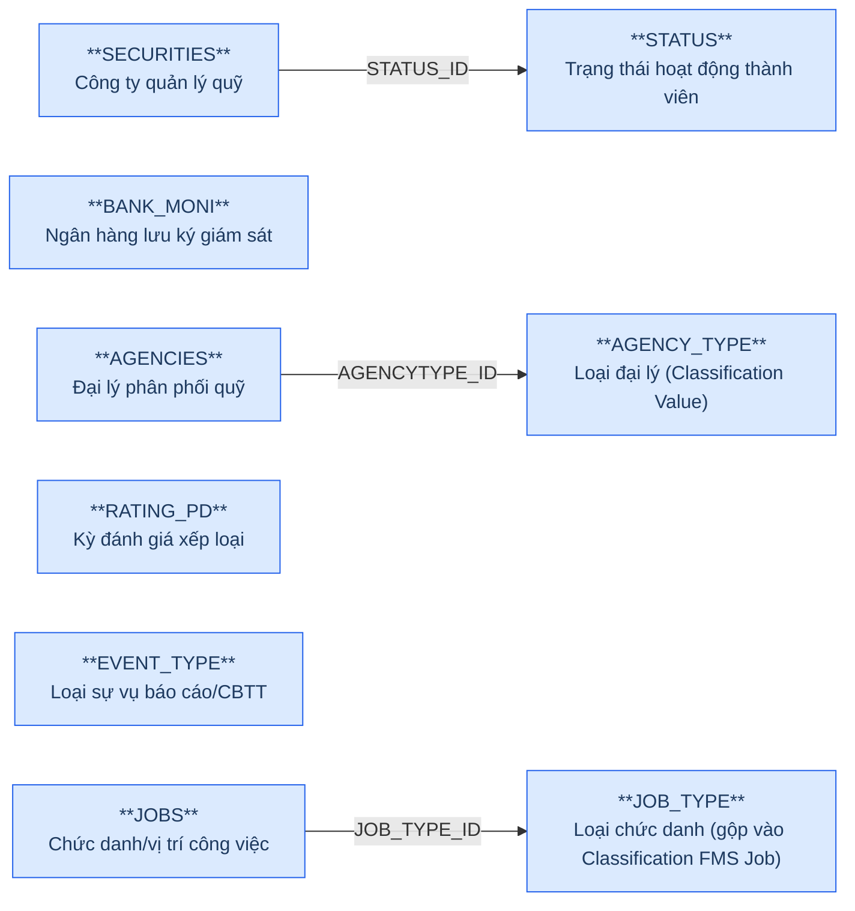

# FMS — HLD Tier 1: Independent Entities (Reference Data)

> **Phụ thuộc:** Không phụ thuộc Tier nào — là nền tảng cho tất cả Tier sau.
>
> **Thiết kế theo:** [FMS_HLD_Overview.md](FMS_HLD_Overview.md)

> **Cập nhật (2026-07-10):** NATIONAL đã loại khỏi scope Atomic — dữ liệu địa giới hành
> chính (quốc gia/quốc tịch) chuyển sang chuẩn hóa tại nguồn **ECAT** (xem
> `ECAT_HLD_Tier1.md`). FMS không tự thiết kế Geographic Area nữa, chỉ tham chiếu qua
> lookup giá trị. Xem mục 7f của `FMS_HLD_Overview.md`.

---

## 6a. Bảng tổng quan BCV Concept

| BCV Core Object | BCV Concept | Category | Source Table | Source Table Change Mode | Mô tả bảng nguồn | Atomic Entity | Table Type | BCV Term |
|---|---|---|---|---|---|---|---|---|
| Involved Party | [Involved Party] Portfolio Fund Management Company | Organization | SECURITIES | Update | Danh sách công ty quản lý quỹ (QLQ) trong nước và nước ngoài tại VN | Fund Management Company | Fundamental | (1) Term candidate: `Portfolio Fund Management Company` — BCV mô tả tổ chức quản lý quỹ đầu tư được UBCK giám sát. (2) Cấu trúc trường: SECURITIES có mã công ty (CODE), tên VN/EN/viết tắt, địa chỉ, phone, fax, email, website, vốn điều lệ (CAPITAL), ngày đăng ký, trạng thái hoạt động (STATUS_ID), mã định danh doanh nghiệp (ID_NO) → entity tổ chức độc lập, lifecycle riêng, có địa chỉ + liên lạc → tách IP Postal Address + IP Electronic Address + IP Alt Identification. (3) Chọn `Portfolio Fund Management Company`. |
| Involved Party | [Involved Party] Organization | Organization | BANK_MONI | Update | Danh sách ngân hàng lưu ký giám sát (LKGS) | Custodian Bank | Fundamental | (1) Term candidate: `Custodian Bank` — BCV mô tả ngân hàng lưu giữ tài sản quỹ và giám sát hoạt động quỹ. (2) Cấu trúc trường: BANK_MONI có tên, địa chỉ, phone, email → entity tổ chức độc lập, FK từ FUNDS (BANK_ID) → lifecycle riêng, tách IP Postal Address + IP Electronic Address + IP Alt Identification (CERT_NO → `ELIGIBILITY_CERTIFICATE`, [MỚI 2026-10-02]). (3) Chọn `Custodian Bank`. |
| Involved Party | [Involved Party] Organization | Organization | AGENCIES | Update | Danh sách đại lý quỹ đầu tư | Fund Distribution Agent | Fundamental | (1) Term candidate: `Fund Distribution Agent` — BCV mô tả tổ chức phân phối chứng chỉ quỹ cho nhà đầu tư. (2) Cấu trúc trường: AGENCIES có tên, loại đại lý (AGENCY_TYPE FK), địa chỉ → entity tổ chức độc lập, FK từ AGEN_FUNDS. (3) Chọn `Fund Distribution Agent`. |
| Common | [Common] Industry Classification | Classification | BUSINESS | Update | Danh mục lĩnh vực/ngành nghề hoạt động kinh doanh của công ty QLQ và các đối tượng liên quan, kèm danh sách loại đối tượng hệ thống áp dụng | Classification FMS Business | Relative | **[MỚI 2026-10-02]** (1) Term candidate: `Industry Classification` (Common) — "phân loại Organization theo những gì tổ chức sản xuất/kinh doanh"; `Line Of Business` (Involved Party) bị loại vì phân biệt đơn vị tổ chức theo loại khách hàng. (2) Cấu trúc trường: ITEM_NAME + DESCRIPTION + SYSTEM_OBJECT (danh sách loại đối tượng áp dụng), không có CODE riêng. (3) Chọn `Industry Classification` cùng concept với ECAT Classification Business Line. Promote từ Classification Value (scheme `FMS_BUSINESS_TYPE`, nay deprecated). BK = ID nguồn. Domain Prefix: `Classification` (bare). |
| Common | [Common] Organization Legal Structure | Classification | COMPANY_TYPE | Update | Danh mục loại hình doanh nghiệp (công ty cổ phần/TNHH...) kèm danh sách loại đối tượng hệ thống áp dụng | Classification FMS Company Type | Relative | **[MỚI 2026-10-02]** (1) Term candidate: `Organization Legal Structure` (Involved Party) — "phân biệt Organization theo hình thức pháp lý"; `Organization Type` (đặc tính và cấu trúc vốn có) kém khớp vì bảng nguồn chỉ phân biệt hình thức cổ phần/TNHH. (2) Cấu trúc trường: ITEM_NAME + DESCRIPTION + SYSTEM_OBJECT (danh sách loại đối tượng áp dụng) + JOINT_STOCK (1=CP, 0=TNHH) + CODE (DDL UAT 1). (3) Chọn `Organization Legal Structure` vì JOINT_STOCK mô tả hình thức pháp lý. Promote từ Classification Value (scheme `FMS_COMPANY_TYPE`, nay deprecated — đảo ngược quyết định 2026-07-24). Id hash từ ID nguồn (CODE nullable). Domain Prefix: `Classification` (bare). |
| Common | [Common] Event Type | Classification | EVENT_TYPE | Update | Danh mục loại sự vụ báo cáo/CBTT (mở rộng — CATEGORY, OBLIGATION_TYPE, DEADLINE_CALC_METHOD, METADATA) | Classification FMS Event Type | Relative | **[MỚI 2026-07-19]** Promote từ Classification Value (scheme `FMS_EVENT_TYPE`, nay deprecated) lên entity riêng — theo quyết định Data Modeler, không dùng chung với entity "Classification Event Type" của SCMS (khác cấu trúc: METADATA/BUSINESS_RULE_CONFIG JSON CLOB đặc thù FMS). Domain Prefix: `Classification` (bare). Giải quyết Overview 7e#16/Tier5 T5-06. |
| Common | [Common] Fund Management Type | Classification | FUND_TYPE | Update | Danh mục loại quỹ đầu tư (quỹ mở, quỹ đóng, ETF, quỹ thành viên, quỹ bất động sản...) kèm cờ quỹ mở | Classification FMS Fund Type | Relative | **[MỚI 2026-10-02]** (1) Term candidate: `Fund Management Type` (Group) — "phân biệt Portfolio đại diện Multiple Owner Investment Product theo chính sách giao dịch đơn vị quỹ"; `Investment Arrangement Type` (theo số nhà đầu tư) và `Fund Share Issue Type` bị loại vì không mô tả mở/đóng. (2) Cấu trúc trường: ITEM_NAME + DESCRIPTION + IS_OPEN_FUND (cờ quỹ mở) — danh mục loại hình quỹ, không có CODE riêng. (3) Chọn `Fund Management Type` vì IS_OPEN_FUND khớp khái niệm chính sách giao dịch đơn vị quỹ. Promote từ Classification Value (scheme `FMS_FUND_TYPE`, nay deprecated). BK = ID nguồn. Domain Prefix: `Classification` (bare). |
| Common | [Common] Agent Type | Classification | AGENCY_TYPE | Update | Danh mục loại đại lý quỹ đầu tư | Classification FMS Agency Type | Relative | **[MỚI 2026-10-06]** (1) Term candidate: `Agent Type` (Involved Party) — "phân biệt các Đại lý theo hoạt động cụ thể thực hiện thay mặt người ủy quyền". (2) Cấu trúc trường: chỉ ITEM_NAME + DESCRIPTION, không có CODE riêng — danh mục phân loại thuần. (3) Chọn `Agent Type`, đặt BCO Common theo pattern các entity Classification FMS. Promote từ Classification Value (scheme `FMS_AGENCY_TYPE`, nay deprecated). BK = ID nguồn. Domain Prefix: `Classification` (bare). |
| Common | [Common] Position | Classification | JOBS, JOB_TYPE | Update | Danh mục chức danh/vị trí công việc + loại chức danh | Classification FMS Job | Relative | **[MỚI 2026-07-19]** Trước đây chưa khảo sát trong HLD. **[SỬA 2026-10-02]** Đổi tên từ Classification FMS Position; gộp JOB_TYPE vào cùng entity (Job Type Code/Name denormalize qua JOBS.JOB_TYPE_ID = JOB_TYPE.ID), chỉ map ID, ITEM_NAME, JOB_TYPE_ID (JOBS) và ID, ITEM_NAME (JOB_TYPE). Domain Prefix: `Classification` (bare). |
| Common | [Common] Involved Party Type | Classification | STOCKHOLDER_TYPE | Update | Danh mục loại cổ đông/nhà đầu tư (cá nhân/tổ chức trong nước và nước ngoài) kèm cờ phân biệt quan hệ cá nhân | Classification FMS Stockholder Type | Relative | **[MỚI 2026-10-02]** (1) Term candidate: `Involved Party Type` (Involved Party) — "phân biệt Involved Party theo đặc tính vốn có và cấu trúc, ví dụ Individual, Organization"; `Investor Preference Type` bị loại vì mô tả sở thích đầu tư. (2) Cấu trúc trường: ITEM_NAME + DESCRIPTION + PERSONAL_TYPE (1=Cá nhân, 0=Tổ chức/Kinh tế), không có CODE riêng. (3) Chọn `Involved Party Type` vì PERSONAL_TYPE phân biệt cá nhân/tổ chức. Promote từ Classification Value (scheme `FMS_STOCKHOLDER_TYPE`, nay deprecated). BK = ID nguồn. Domain Prefix: `Classification` (bare). |
| Common | [Common] Involved Party Life Cycle Status | Classification | STATUS | Update | Danh mục trạng thái hoạt động của thành viên thị trường (tên, loại đối tượng áp dụng, cờ phải nộp báo cáo) | Classification FMS Status | Relative | **[MỚI 2026-10-02]** (1) Term candidate: BCV không có term trần "Status" trong Common; `Involved Party Life Cycle Status` (Involved Party) = "phân biệt Involved Party theo trạng thái tồn tại hiện tại". (2) Cấu trúc trường: ITEM_NAME + TYPE_SEC (loại đối tượng 1=QLQ, 2=QĐT, 3=BKGS, 4=ĐLPP) + SUBMIT_REPORT + CODE (mã nghiệp vụ, DDL UAT 1) — danh mục trạng thái gán cho thành viên thị trường. (3) Chọn term này vì STATUS_ID được FK từ SECURITIES/FUNDS/BANK_MONI/FOR_BRCH — đều là Involved Party. Promote từ Classification Value (scheme `FMS_OPERATION_STATUS`, nay deprecated). BK = CODE. Domain Prefix: `Classification` (bare). |
| Business Activity | [Business Activity] Assessment Period | Business Activity | RATING_PD | Update | Danh sách kỳ đánh giá xếp loại công ty QLQ | Member Rating Period | Fundamental | (1) Term candidate: `Assessment Period` — kỳ đánh giá xếp loại công ty QLQ. (2) Cấu trúc trường (theo LLD `lld_FMS_RATING_PD.yaml`): năm báo cáo (Report Year), loại kỳ (PERIOD_TYPE: 1=Giữa năm, 2=Cuối năm), cờ chốt kết quả xếp hạng → entity tham chiếu độc lập, được FK từ Member Rating (RANK, Tier 2). (3) Chọn `[Business Activity] Assessment Period`, Table Type `Fundamental`. Lưu ý: PERIOD (1=Giữa năm, 2=Cuối năm) ngược thứ tự so với RANK.RANK_TYPE (1=Cuối năm, 2=Giữa năm) dùng cùng scheme `FMS_RATING_PERIOD_TYPE` — cần đối chiếu khi ETL. |
| Involved Party | Shared Entity | Shared Entity | SECURITIES, BANK_MONI, AGENCIES, FOR_BRCH, TL_PROFILES, INVES, REPRESENT, STF_FG_BRCH, INSIDER, DISTRIBUTOR_AGENT | Update | Địa chỉ bưu chính của Involved Party từ các bảng nguồn FMS | Involved Party Postal Address | Fundamental | Shared Entity — extend source_table FMS; Tier ghi theo host đầu tiên (Fund Management Company), các bảng nguồn khác thuộc Tier 1–4 theo entity chủ. |
| Involved Party | Shared Entity | Shared Entity | SECURITIES, BANK_MONI, AGENCIES, FOR_BRCH, TL_PROFILES, REPRESENT, STF_FG_BRCH, INSIDER, DISTRIBUTOR_AGENT | Update | Địa chỉ điện tử (phone, fax, email, website) của Involved Party từ các bảng nguồn FMS | Involved Party Electronic Address | Fundamental | Shared Entity — extend source_table FMS; Tier ghi theo host đầu tiên (Fund Management Company). |
| Involved Party | Shared Entity | Shared Entity | SECURITIES, BANK_MONI, AGENCIES, FOR_BRCH, TL_PROFILES, FUNDS, INVES, REPRESENT, STF_FG_BRCH, INSIDER, DISTRIBUTOR_AGENT | Update | Giấy tờ định danh (CCCD/Hộ chiếu/ĐKKD) của Involved Party từ các bảng nguồn FMS | Involved Party Alternative Identification | Fundamental | Shared Entity — extend source_table FMS; Tier ghi theo host đầu tiên (Fund Management Company). |

---

## 6b. Diagram Source (Mermaid)

---

## 6c. Diagram Atomic (Mermaid)

```mermaid
graph TD
    classDef atomic fill:#dcfce7,stroke:#16a34a,color:#14532d
    classDef shared fill:#fae8ff,stroke:#9333ea,color:#4a044e

    FMC["**Fund Management Company**\n[Involved Party] Portfolio Fund Management Company\nSECURITIES"]:::atomic
    CB["**Custodian Bank**\n[Involved Party] Organization\nBANKMONI"]:::atomic
    FDA["**Fund Distribution Agent**\n[Involved Party] Organization\nAGENCIES"]:::atomic
    CBU["**Classification FMS Business**\n[Common] Industry Classification\nBUSINESS"]:::atomic
    CCT["**Classification FMS Company Type**\n[Common] Organization Legal Structure\nCOMPANY_TYPE"]:::atomic
    CET["**Classification FMS Event Type**\n[Common] Event Type\nEVENT_TYPE"]:::atomic
    CFT["**Classification FMS Fund Type**\n[Common] Fund Management Type\nFUND_TYPE"]:::atomic
    CPOS["**Classification FMS Job**\n[Common] Position\nJOBS"]:::atomic
    CSHT["**Classification FMS Stockholder Type**\n[Common] Involved Party Type\nSTOCKHOLDER_TYPE"]:::atomic
    CST["**Classification FMS Status**\n[Common] Involved Party Life Cycle Status\nSTATUS"]:::atomic
    MRP["**Member Rating Period**\n[Business Activity] Assessment Period\nRATING_PD"]:::atomic
    ADDR["IP Postal Address"]:::shared
    EADDR["IP Electronic Address"]:::shared
    ALTID["IP Alt Identification"]:::shared

    ADDR -.->|"shared"| FMC
    EADDR -.->|"shared"| FMC
    ALTID -.->|"shared"| FMC
    ADDR -.->|"shared"| CB
    EADDR -.->|"shared"| CB
    ADDR -.->|"shared"| FDA
```

---

## 6d. Danh mục & Tham chiếu

| Source Table | Mô tả | Scheme Code dự kiến | Ghi chú |
|---|---|---|---|
| ~~BUSINESS~~ | ~~Danh mục ngành nghề kinh doanh của công ty QLQ~~ | ~~`FMS_BUSINESS_TYPE`~~ | **[MỚI 2026-10-02]** Promote lên entity `Classification FMS Business` (xem 6a) — scheme `deprecated`. Consumer TL_PROFILES.BUSI_ID đổi sang FK Id + Code. |
| JOBTYPE (= JOB_TYPE) | Danh sách loại chức vụ nhân sự | `FMS_JOB_TYPE` | source_table — Values load từ JOB_TYPE.CODE + ITEM_NAME. **[MỚI 2026-07-19]** Dùng chung cho FK của Classification FMS Job (JOBS.JOB_TYPE_ID) ngoài TL_PROFILES.JOB_TYPE/STF_FG_BRCH đã có. |
| RELATION | Danh mục loại quan hệ cổ đông | `FMS_RELATION_TYPE` | source_table — Values load từ RELATION.CODE + ITEM_NAME. |
| ~~STATUS~~ | ~~Danh sách trạng thái hoạt động~~ | ~~`FMS_OPERATION_STATUS`~~ | **[MỚI 2026-10-02]** Promote lên entity `Classification FMS Status` (xem 6a) — scheme `deprecated`. Consumer SECURITIES, FUNDS, BANK_MONI, FOR_BRCH đổi sang FK Id + Code. |
| ~~STOCKHOLDER_TYPE~~ | ~~Danh sách loại hình NĐT/cổ đông~~ | ~~`FMS_STOCKHOLDER_TYPE`~~ | **[MỚI 2026-10-02]** Promote lên entity `Classification FMS Stockholder Type` (xem 6a) — scheme `deprecated`. Consumer INVES (STO_ID) đổi sang FK Id + Code. |
| ~~AGENCY_TYPE~~ | ~~Danh sách loại đại lý quỹ~~ | ~~`FMS_AGENCY_TYPE`~~ | **[MỚI 2026-10-06]** Promote lên entity `Classification FMS Agency Type` (xem 6a) — scheme `deprecated`. |
| SECURITIES.BORF_FLAG | Loại tổ chức theo địa giới: 1=Trong nước, 0=Nước ngoài | `FMS_ORG_TERRITORY_TYPE` | etl_derived — ETL derived: DOMESTIC / FOREIGN. |
| RANK.RANK_TYPE | Loại xếp hạng: 1=Cuối năm, 2=Giữa năm | `FMS_RATING_PERIOD_TYPE` | etl_derived — ETL derived: YEAR_END / MID_YEAR. |

---

## 6e. Bảng chờ thiết kế

Không có bảng nào trong Tier 1 chưa đủ thông tin cột.

---

## 6f. Điểm cần xác nhận

| # | Câu hỏi | Ảnh hưởng |
|---|---|---|
| T1-01 | SECURITIES dùng chung 1 bảng cho cả công ty QLQ trong nước (BORF_FLAG=1) và VPĐD/CN nước ngoài (BORF_FLAG=0) — xác nhận grain của entity Fund Management Company có bao gồm cả 2 loại không, hay chỉ bao gồm loại trong nước? | **Chờ xác nhận.** BRD notes ghi FOR_BRCH là entity riêng cho VPĐD/CN QLQ nước ngoài — SECURITIES chỉ cho công ty QLQ trong nước. Cần kiểm tra BORF_FLAG thực tế. |
| T1-04 | NATIONAL — quyết định (2026-07-10): Geographic Area chỉ còn 1 nguồn duy nhất là **ECAT**. NHNCK/FMS/SCMS không tự thiết kế Geographic Area nữa. | **Đã chốt.** NATIONAL loại khỏi scope (xem mục 7f FMS_HLD_Overview.md). Entity FMS đang FK đến NATIONAL (INSIDER, INVES, REPRESENT, FOR_BRCH, STF_FG_BRCH) chuyển sang resolve bằng lookup giá trị đối chiếu Geographic Area nguồn ECAT thay vì hash_id('FMS.NATIONAL', ...). |
