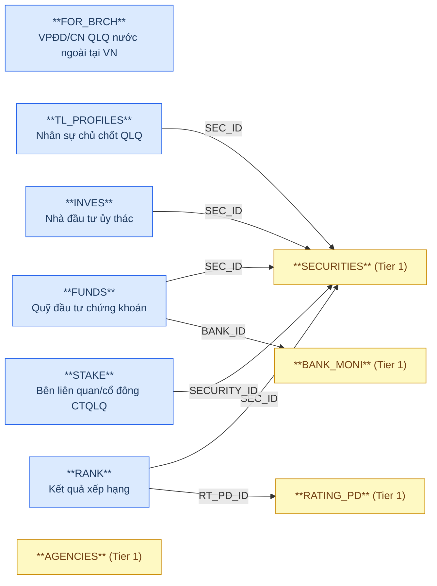
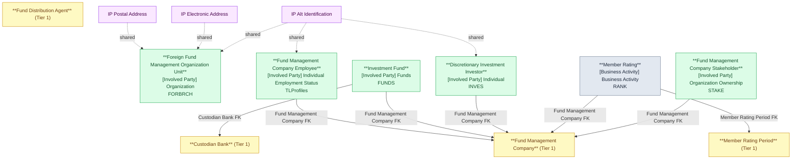

# FMS — HLD Tier 2: Phụ thuộc Tier 1

> **Phụ thuộc Tier 1:** Fund Management Company, Custodian Bank, Fund Distribution Agent, Member Rating Period
>
> **Thiết kế theo:** [FMS_HLD_Overview.md](FMS_HLD_Overview.md)
>
> **Cập nhật 2026-10-28:** Tier 2 gồm 6 entity: Foreign Fund Management Organization Unit, Fund Management Company Employee, Investment Fund, Discretionary Investment Investor, Member Rating và **Fund Management Company Stakeholder** (STAKE — mới, theo `lld_FMS_STAKE.yaml`, `group` = T2; phụ thuộc Fund Management Company ở Tier 1).

---

## 6a. Bảng tổng quan BCV Concept

| BCV Core Object | BCV Concept | Category | Source Table | Source Table Change Mode | Mô tả bảng nguồn | Atomic Entity | Table Type | BCV Term |
|---|---|---|---|---|---|---|---|---|
| Involved Party | [Involved Party] Organization | Organization | FOR_BRCH | Update | Danh sách VPĐD/CN công ty QLQ nước ngoài tại VN | Foreign Fund Management Organization Unit | Fundamental | (1) Term candidate: `Organization` — BCV mô tả đơn vị tổ chức nước ngoài có pháp nhân tại VN. (2) Cấu trúc trường: FOR_BRCH có tên, địa chỉ, phone, FK tự quản, không FK đến SECURITIES → entity độc lập tuy nhiên có STF_FG_BRCH (nhân sự) phụ thuộc. (3) Chọn `Organization` — tổ chức QLQ nước ngoài có hiện diện tại VN. Lưu ý: FOR_BRCH không có FK đến SECURITIES → ở Tier 1 xét về độc lập; tuy nhiên vì nhóm nghiệp vụ thành viên QLQ → đặt Tier 2 cùng nhóm thành viên QLQ để gộp phân tích. |
| Involved Party | [Involved Party] Individual Employment Status | Employment Status | TL_PROFILES | Update | Danh sách nhân sự chủ chốt công ty QLQ | Fund Management Company Employee | Fundamental | (1) Term candidate: `Individual Employment Status` — BCV mô tả cá nhân đang giữ vị trí trong tổ chức. (2) Cấu trúc trường: TL_PROFILES có họ tên, ngày sinh, giới tính, CCCD, chức vụ (JOB_TYPE FK), ngày bổ nhiệm, ngày thôi → entity nhân sự với lifecycle bổ nhiệm/thôi chức. IP Alt Identification từ CCCD/Hộ chiếu. (3) Chọn `Individual Employment Status`. |
| Involved Party | [Involved Party] Funds | Investment Fund | FUNDS | Update | Danh sách quỹ đầu tư chứng khoán | Investment Fund | Fundamental | (1) Term candidate ban đầu: `Investment Fund` (Arrangement). (2) Cấu trúc trường: FUNDS có tên quỹ, mã CCQ (CER_CODE), loại quỹ (FTYPE_ID), vốn điều lệ, NAV, NAV/CCQ, ngày niêm yết, FK đến SECURITIES (công ty QLQ) + BANK_MONI (NH LKGS). (3) BCO điều chỉnh theo review: `Involved Party` — tra BCV term `Funds` (Involved Party, id 10821): "Identifies an Involved Party that represents any managed pool of investment assets. Fund representatives play a role as institutional investors or investing entities...". Quỹ đầu tư đóng vai trò một Involved Party (định chế đầu tư), không phải Arrangement. Chọn `[Involved Party] Funds`. |
| Involved Party | [Involved Party] Individual | Individual | INVES | Update | Danh sách nhà đầu tư ủy thác | Discretionary Investment Investor | Fundamental | (1) Term candidate: `Individual` — BCV mô tả cá nhân/tổ chức là nhà đầu tư ủy thác. (2) Cấu trúc trường: INVES có họ tên, CCCD, địa chỉ, FK đến SECURITIES (công ty QLQ nhận ủy thác) → entity NĐT ủy thác với thông tin cá nhân đầy đủ; tách IP Alt Identification. (3) Chọn `Individual`. |
| Involved Party | [Involved Party] Organization Ownership | Organization Ownership | STAKE | Update | Cổ đông/bên liên quan (nhà đầu tư chiến lược) của công ty QLQ: tên tổ chức, quan hệ sở hữu, vốn góp, mô tả | Fund Management Company Stakeholder | Fundamental | **[MỚI 2026-10-28]** (1) Term candidate: `Organization Ownership` (BCV id 11558) — Involved Party có quyền kiểm soát tài chính/quản trị đối với Organization. (2) Cấu trúc trường (theo LLD): ID (BK), SECURITY_ID (FK SECURITIES), ITEM_NAME (tên), RELATION_SHIP (text tự do mô tả quan hệ, KHÔNG FK RELATION), CAPITAL (vốn góp), OWNER_FLAG (cờ cổ đông kiểm soát), ID_NO (số đăng ký), DESCRIPTION, PERIOD_TYPE/PERIOD_VALUE/YEAR_VALUE (kỳ báo cáo). (3) Chọn `Organization Ownership`; Fundamental; Domain Prefix `Fund Management Company`. Grain = 1 bên liên quan × 1 CTQLQ. FK đến Fund Management Company (T1) → Tier 2. Nguồn chỉ có 1 cột giấy tờ (ID_NO), không có địa chỉ/liên lạc → giữ denormalized, không tách IP Alt Identification (nhất quán Insider Related Person, Data Modeler 2026-10-28); nguồn không phân biệt loại giấy tờ. Thay mục 7f `Chưa có cột`. |
| Business Activity | [Business Activity] Business Activity | Business Activity | RANK | Append | Bảng xếp hạng theo kỳ đánh giá (1 dòng = 1 kết quả xếp hạng/kỳ) | Member Rating | Classification | (1) Term candidate: `Conduct Violation` không phù hợp. Tra lại: kết quả xếp hạng = outcome của một đợt đánh giá — gần `Assessment Result` hơn. (2) Cấu trúc trường: RANK có SEC_ID (FK SECURITIES), RT_PD_ID (FK RATING_PD → Member Rating Period, Tier 1), TOTAL_SCORE, RANK_INDEX, RANK_TYPE → mỗi dòng = 1 kết quả xếp hạng của 1 CTQLQ trong 1 kỳ, append theo kỳ. (3) Chọn `Business Activity` → Table Type `Classification` (theo LLD `lld_FMS_RANK.yaml`). |

---

## 6b. Diagram Source (Mermaid)

---

## 6c. Diagram Atomic (Mermaid)

---

## 6d. Danh mục & Tham chiếu

| Source Table | Mô tả | Scheme Code dự kiến | Ghi chú |
|---|---|---|---|
| ~~FUNDS.FTYPE_ID → FUND_TYPE~~ | ~~Loại quỹ đầu tư~~ | ~~`FMS_FUND_TYPE`~~ | **[MỚI 2026-10-02]** FUND_TYPE promote lên entity `Classification FMS Fund Type` (Tier 1, xem FMS_HLD_Tier1.md 6a) — scheme `deprecated`. FUNDS.FTYPE_ID đổi sang cặp FK Fund Type Id + Code. **[SỬA 2026-10-28 — đồng bộ LLD 2026-10-27]** BK của Classification FMS Fund Type nay là `CODE` → FUNDS.FTYPE_ID đi qua ETL crosswalk (FTYPE_ID = FUND_TYPE.ID → CODE → hash_id('FMS_FUND_TYPE', CODE)), không hash trực tiếp theo ID. |
| RANK.RANK_TYPE | Loại xếp hạng: 1=Cuối năm, 2=Giữa năm | `FMS_RATING_PERIOD_TYPE` | etl_derived — Đã đăng ký Tier 1; tham chiếu lại. |

---

## 6e. Bảng chờ thiết kế

| Source Table | Mô tả bảng nguồn | Lý do chưa thiết kế |
|---|---|---|
| FOR_BRCH | Danh sách VPĐD/CN công ty QLQ NN tại VN | Tạm đặt Tier 2 — thực tế không FK đến SECURITIES. Cần xác nhận: FOR_BRCH có FK nghiệp vụ nào đến entity Tier 1 không? Nếu không → chuyển về Tier 1. |

---

## 6f. Điểm cần xác nhận

| # | Câu hỏi | Ảnh hưởng |
|---|---|---|
| T2-01 | FOR_BRCH — thực tế không có FK đến SECURITIES trong BRD per-table. FOR_BRCH là entity độc lập (VPĐD/CN QLQ nước ngoài tại VN, không có quan hệ pháp lý FK với SECURITIES trong nước). Xác nhận có nên chuyển lên Tier 1 không? | **Chờ xác nhận.** Nếu FOR_BRCH hoàn toàn không FK đến SECURITIES → chuyển Tier 1. Thiết kế hiện tại giữ Tier 2 để gộp phân tích nhóm thành viên QLQ. |
| T2-04 | MEMBER_RATING — BCV Concept tạm dùng `Business Activity`. Cần tra lại BCV term chính xác cho kết quả xếp hạng tổ chức giám sát. | **Chờ xác nhận.** Xem xét `Assessment Result` hay `Business Activity`. |
| T2-06 | FUNDS — BCO đã chốt `Involved Party` (term `Funds`, id 10821) theo review, thay cho `Arrangement`. | **Đã chốt.** |
| T2-07 | **[MỚI 2026-10-28]** `Fund Management Company Stakeholder` (STAKE): (a) `RELATION_SHIP` là text tự do, không phải FK đến RELATION (LLD map `rltnp_description`). (b) Giấy tờ (ID_NO) giữ denormalized — nguồn không có loại giấy tờ. (c) Bảng có kỳ báo cáo (PERIOD_TYPE/PERIOD_VALUE/YEAR_VALUE) — BK hiện = ID nguồn; chưa rõ cùng 1 bên liên quan có nhiều dòng theo kỳ hay không. | Chờ Data Modeler xác nhận grain/BK theo kỳ và có cần chuẩn hóa `RELATION_SHIP` sang Classification Value hay không. Xem Overview 7e #23. |
