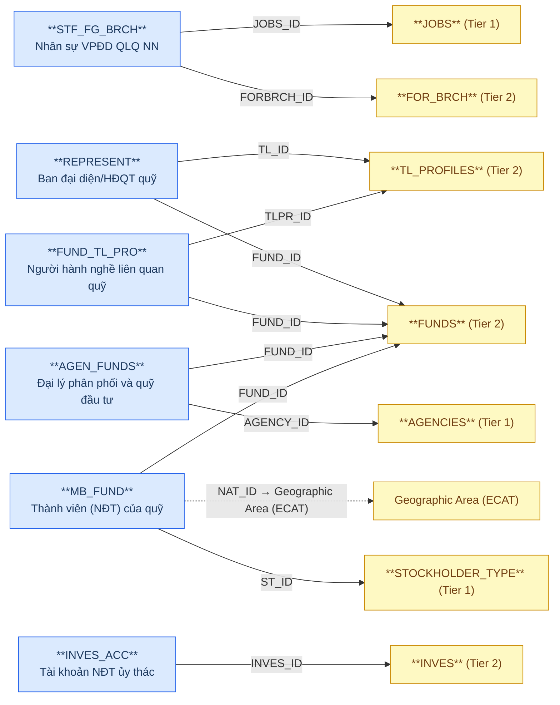

# FMS — HLD Tier 3: Phụ thuộc Tier 2

> **Phụ thuộc Tier 1:** Fund Management Company, Custodian Bank, Fund Distribution Agent, Classification FMS Job
> **Phụ thuộc Tier 2:** Foreign Fund Management Organization Unit, Fund Management Company Employee, Investment Fund, Discretionary Investment Investor
>
> **Thiết kế theo:** [FMS_HLD_Overview.md](FMS_HLD_Overview.md)
>
> **Cập nhật 2026-10-28:** Tier 3 gồm 7 entity — thêm **Investment Fund Investor Membership** (MB_FUND, theo `lld_FMS_MB_FUND.yaml`, `group` = T3; phụ thuộc Investment Fund (T2), Classification FMS Stockholder Type (T1), Geographic Area (ECAT)). Entity Tier 4 Investment Fund Investor Capital Change Log (MB_CHANGE) FK về entity này.

---

## 6a. Bảng tổng quan BCV Concept

| BCV Core Object | BCV Concept | Category | Source Table | Source Table Change Mode | Mô tả bảng nguồn | Atomic Entity | Table Type | BCV Term |
|---|---|---|---|---|---|---|---|---|
| Involved Party | [Involved Party] Individual Employment Status | Employment Status | STF_FG_BRCH | Update | Danh sách nhân sự của VPĐD/CN công ty QLQ nước ngoài tại VN | Foreign Fund Management Organization Unit Staff | Fundamental | (1) Term candidate: `Individual Employment Status` — cá nhân giữ vị trí trong tổ chức. (2) Cấu trúc trường: STF_FG_BRCH có FK đến FOR_BRCH (tổ chức) + FK đến JOBS (chức danh), họ tên, ngày bổ nhiệm → entity vai trò nhân sự trong tổ chức VPĐD NN. [SỬA 2026-10-28 — đồng bộ LLD] BRD STF_FG_BRCH không có cột TL_ID nên không có FK đến TL_PROFILES. (3) Chọn `Individual Employment Status`. |
| Involved Party | [Involved Party] Individual Employment Status | Employment Status | REPRESENT | Update | Danh sách ban đại diện/HĐQT quỹ đầu tư | Investment Fund Representative Board Member | Fundamental | (1) Term candidate: `Individual Employment Status` — thành viên ban đại diện là cá nhân đang giữ vị trí trong cơ cấu quản trị quỹ. (2) Cấu trúc trường: REPRESENT có FK đến FUNDS (quỹ) + FK đến TL_PROFILES (nhân sự QLQ), chức vụ trong BĐD, ngày bổ nhiệm/thôi chức → giao giữa nhân sự và quỹ. (3) Chọn `Individual Employment Status`. |
| Arrangement | [Arrangement] Investment Fund | Investment Fund | MB_FUND | Update | Thành viên (nhà đầu tư) của quỹ đầu tư: tên, quốc tịch, loại thành viên, số lượng và tỷ lệ CCQ nắm giữ | Investment Fund Investor Membership | Fundamental | **[MỚI 2026-10-28]** (1) Term candidate: `Investment Fund` (BCV Arrangement, theo `lld_FMS_MB_FUND.yaml`) — tư cách tham gia của nhà đầu tư/thành viên vào 1 quỹ. (2) Cấu trúc trường: ID (BK), FUND_ID (FK FUNDS), ST_ID (FK STOCKHOLDER_TYPE), NAT_ID (quốc tịch → Geographic Area ECAT), ITEM_NAME, DORF (trong nước/nước ngoài), MB_ID/FN_CODE (mã thành viên/mã quỹ), PROVINCE/COUNTRY (text), CAPITAL (vốn góp), HOLD_QTTY/HOLD_PERCENT/HOLD_DATE (CCQ nắm giữ), MB_TYPE, REPRESENT_NAME/REPRESENT_JOB/FREPRESENT_DATE/SREPRESENT_DATE (người đại diện). (3) Grain = 1 NĐT/thành viên × 1 quỹ (T3-02 chờ xác nhận); Fundamental. FK đến Investment Fund (T2) → Tier 3. `notes` LLD: tách IP Postal Address + IP Alt Identification (NATIONAL_ID mặc định) nhưng chưa có file IP — xem T3-07. Domain Prefix rỗng. Thay 7f `Chưa có LLD` (gỡ HLD 2026-10-13). |
| Arrangement | [Arrangement] Investment Account | Investment Account | INVES_ACC | Update | Danh sách tài khoản của nhà đầu tư ủy thác | Discretionary Investment Account | Relative | (1) Term candidate: `Investment Account` — tài khoản được mở cho NĐT ủy thác. (2) Cấu trúc trường: INVES_ACC có FK đến INVES (NĐT ủy thác), mã tài khoản, ngày mở, trạng thái → entity tài khoản phụ thuộc NĐT ủy thác (Tier 2). (3) Chọn `Investment Account`. |
| Involved Party | [Involved Party] Individual Employment Status | Investment Fund | FUND_TL_PRO | Update | Người hành nghề liên quan đến quỹ đầu tư | Fund Management Company Employee X Investment Fund Relationship | Relative | Entity Relative (FUND_ID + TLPR_ID). FK đến Fund Management Company Employee (Tier 2) + Investment Fund (Tier 2). **[SỬA 2026-08-15]** BCO đổi Arrangement→Involved Party, tái dùng concept từ phía Employee — khớp với chính Investment Fund (đã BCO Involved Party). Đã tra BCV chính thức — xem Overview 7e#20. |
| Involved Party | [Involved Party] Organization | Investment Fund | AGEN_FUNDS | Update | Quan hệ đại lý phân phối và quỹ đầu tư | Fund Distribution Agent X Investment Fund Relationship | Relative | Entity Relative (AGENCY_ID + FUND_ID + DATA_MIGRATION). FK đến Fund Distribution Agent (Tier 1) + Investment Fund (Tier 2). `DATA_MIGRATION` (cờ migration kỹ thuật) không map. FUD_AG_AGT thiết kế entity riêng (dòng dưới). **[SỬA 2026-08-15]** BCO đổi Arrangement→Involved Party, tái dùng concept từ phía Agent — khớp với chính Investment Fund (đã BCO Involved Party). Đã tra BCV chính thức — xem Overview 7e#20. |
| Involved Party | [Involved Party] Organization | Investment Fund | FUD_AG_AGT | Update | Quan hệ quỹ, loại đại lý và đại lý phân phối | Fund Distribution Agent X Investment Fund X Classification FMS Agency Type Relationship | Relative | **[MỚI 2026-10-12]** Entity Relative 4-FK, thiết kế riêng theo Data Modeler (không gộp AGEN_FUNDS) — giải quyết Overview 7e#19. FK đến Fund Distribution Agent (T1) + Investment Fund (T2) + Classification FMS Agency Type (T1). Chỉ map FUD_ID, AG_TY_ID, AGEN_ID; AGEN_ID_PARENT chưa map. |

---

## 6b. Diagram Source (Mermaid)

---

## 6c. Diagram Atomic (Mermaid)

```mermaid
graph TD
    classDef atomic fill:#dcfce7,stroke:#16a34a,color:#14532d
    classDef pattern fill:#e2e8f0,stroke:#64748b,color:#1e293b
    classDef outscope fill:#fef9c3,stroke:#ca8a04,color:#713f12

    FFMS["**Foreign Fund Management Organization Unit Staff**\n[Involved Party] Individual Employment Status\nSTFFGBRCH"]:::atomic
    RBM["**Investment Fund Representative Board Member**\n[Involved Party] Individual Employment Status\nREPRESENT"]:::atomic
    DIA["**Discretionary Investment Account**\n[Arrangement] Investment Account\nINVESACC"]:::atomic
    FUNDPREL["**FMC Employee X Investment Fund Relationship**\n[Involved Party] Individual Employment Status\nFUND_TL_PRO"]:::atomic
    AGENREL["**Fund Distribution Agent X Investment Fund Relationship**\n[Involved Party] Organization\nAGEN_FUNDS"]:::atomic
    IFIM["**Investment Fund Investor Membership**\n[Arrangement] Investment Fund\nMB_FUND"]:::atomic
    CSHT["**Classification FMS Stockholder Type** (Tier 1)"]:::outscope
    GEO["**Geographic Area** (ECAT, shared)"]:::outscope

    FFMOU["**Foreign Fund Management Organization Unit** (Tier 2)"]:::outscope
    KP["**Fund Management Company Employee** (Tier 2)"]:::outscope
    IF["**Investment Fund** (Tier 2)"]:::outscope
    DII["**Discretionary Investment Investor** (Tier 2)"]:::outscope
    CPOS["**Classification FMS Job** (Tier 1)"]:::outscope
    FDA["**Fund Distribution Agent** (Tier 1)"]:::outscope

    FFMS -->|"Foreign Fund Management Organization Unit FK"| FFMOU
    RBM -->|"Investment Fund FK"| IF
    RBM -->|"Employee FK"| KP
    DIA -->|"Discretionary Investment Investor FK"| DII
    FUNDPREL -->|"Investment Fund FK"| IF
    FUNDPREL -->|"Fund Management Company Employee FK"| KP
    AGENREL -->|"Investment Fund FK"| IF
    AGENREL -->|"Fund Distribution Agent FK"| FDA
    FFMS -->|"Classification FMS Job FK"| CPOS
    IFIM -->|"Investment Fund FK"| IF
    IFIM -->|"Stockholder Type FK"| CSHT
    IFIM -->|"Nationality FK"| GEO
```

---

## 6d. Danh mục & Tham chiếu

| Source Table | Mô tả | Scheme Code dự kiến | Ghi chú |
|---|---|---|---|
| STF_FG_BRCH.JOBTYPE_ID | Loại chức vụ nhân sự VPĐD NN | `FMS_JOB_TYPE` | source_table — Đã đăng ký Tier 1; tham chiếu lại. |

---

## 6e. Bảng chờ thiết kế

Không có bảng nào trong Tier 3 chưa đủ thông tin cột.

---

## 6f. Điểm cần xác nhận

| # | Câu hỏi | Ảnh hưởng |
|---|---|---|
| T3-01 | **[SỬA 2026-10-28 — đồng bộ LLD]** BRD columns thực tế của STF_FG_BRCH KHÔNG có cột TL_ID (chỉ có FORBRCH_ID + JOBS_ID) — mô tả cũ "FK TL_ID kiêm nhiệm đến TL_PROFILES" không còn đúng; LLD không tạo FK Fund Management Company Employee. | **Chờ xác nhận.** Cần Data Modeler xác nhận bỏ hẳn quan hệ kiêm nhiệm với Fund Management Company Employee. |
| T3-06 | **[MỚI 2026-10-28]** `Investment Fund Investor Membership` (MB_FUND): grain = 1 NĐT/thành viên per quỹ — xác nhận BK = ID nguồn đủ phân biệt (cùng NĐT tham gia nhiều quỹ có nhiều dòng), `member_code` (MB_ID) và `fund_membership_code` (FN_CODE) có ý nghĩa nghiệp vụ riêng hay trùng. | Chờ Data Modeler xác nhận (T3-02 trong `notes` LLD). Xem Overview 7e #24. |
| T3-07 | **[ĐÃ XỬ LÝ 2026-10-29]** MB_FUND đã có `lld_FMS_MB_FUND_IP_Postal_Address.yaml` + `lld_FMS_MB_FUND_IP_Alt_Identification.yaml` (MB_TYPE có thể cá nhân hoặc tổ chức; `IP_ALT_ID_TYPE` = `IDENTIFICATION`, nguồn không có cột loại giấy tờ). | MB_FUND đã nằm trong source của IP Postal Address và IP Alternative Identification. Xem Overview 7e #25. |
| T3-04 | REPRESENT — 1 nhân sự có thể là thành viên BĐD của nhiều quỹ cùng lúc. Grain = (FUND_ID, TL_ID, FR_DATE) → xác nhận. | **Chờ xác nhận.** |
| T3-05 | **[MỚI 2026-07-19, MỘT PHẦN GIẢI QUYẾT 2026-08-15]** 2 entity Relationship (FUND_TL_PRO, AGEN_FUNDS) — BCO Involved Party, tái dùng concept từ phía Employee/Agent tương ứng (xem Overview 7e#20). | Đã giải quyết. |
