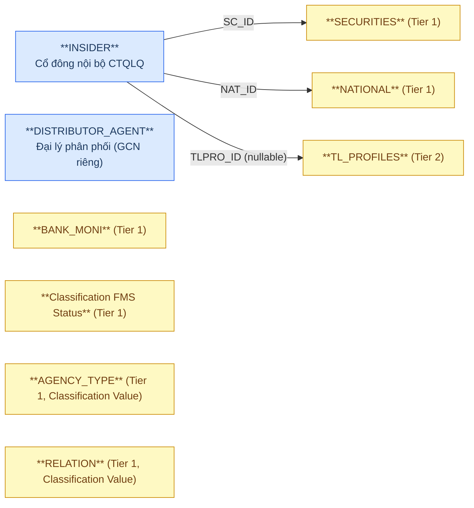
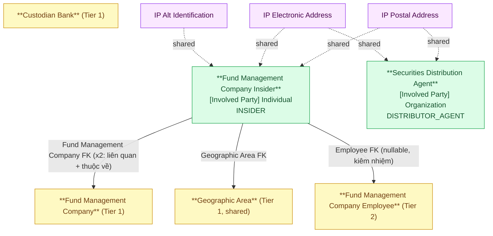

# FMS — HLD Tier 5: Independent Entities (Nhóm nghiệp vụ mới phát hiện)

> **Phụ thuộc:** Không phụ thuộc Tier nào (một số FK đến entity Tier 1/2 đã có: Fund Management Company, Custodian Bank, Fund Management Company Employee).
>
> **Bối cảnh:** Tier 5 thiết kế cho các bảng nguồn phát hiện sau khi BRD/Source/FMS mở rộng khảo sát. Hiện còn: Fund Management Company Insider, Securities Distribution Agent. Các bảng còn lại của Tier 5 đã chuyển sang mục 7f Overview (chưa có LLD). **[CẬP NHẬT REVIEW 2026-07-03]** Nhóm Audit Firm bỏ khỏi scope thiết kế Atomic — thông tin kiểm toán lấy từ phân hệ IDS.
>
> **Thiết kế theo:** [FMS_HLD_Overview.md](FMS_HLD_Overview.md)

---

## 6a. Bảng tổng quan BCV Concept

| BCV Core Object | BCV Concept | Category | Source Table | Source Table Change Mode | Mô tả bảng nguồn | Atomic Entity | Table Type | BCV Term |
|---|---|---|---|---|---|---|---|---|
| Involved Party | [Involved Party] Individual | Individual | INSIDER | Update | Cổ đông nội bộ/người có liên quan của công ty QLQ | Fund Management Company Insider | Fundamental | (1) Term candidate: `Individual` — không tìm được BCV term riêng "Insider"/"Related Party" khớp cấu trúc; INSIDER nghiêng cá nhân (BIRTH, EMPLOY_STATUS, ID_NO) nhưng ID_NO cũng nhận "Mã số doanh nghiệp" (bao gồm tổ chức). (2) Cấu trúc trường: FK SC_ID (SECURITIES), S_ID (STOCKHOLDER_TYPE — loại cổ đông), TLPRO_ID (TL_PROFILES, kiêm nhiệm), NAT_ID (NATIONAL), CAPITAL/QTTY (vốn góp/CCQ nắm giữ), INSIDER_TYPE (cổ đông lớn/BĐH/HĐQT), ADDRESS/TELEPHONE/FAX/EMAIL, ID_NO/ID_DATE/ID_ADD. Tách IP Postal Address + IP Electronic Address + IP Alt Identification. (3) Chọn `Individual`, đặt tên `Fund Management Company Insider` vì FK cha là Fund Management Company (SECURITIES). |
| Involved Party | [Involved Party] Organization | Organization | DISTRIBUTOR_AGENT | Update | Đại lý phân phối chứng chỉ quỹ có GCN đăng ký hoạt động riêng | Securities Distribution Agent | Fundamental | (1) Term candidate: `Organization` — generic, cấu trúc gần như trùng Fund Distribution Agent (AGENCIES) đã thiết kế Tier 1. (2) Cấu trúc trường: ITEM_NAME, NAME_EN, SHORT_NAME, BUSINESS_LICENSE_NO, TAX_CODE, **DISTRIBUTION_CERT_NO/DATE/ISSUED_BY** (GCN đăng ký hoạt động phân phối CCQ — cột KHÔNG có ở AGENCIES), ADDRESS, PHONE, FAX. (3) Chọn `Organization`, đặt tên riêng `Securities Distribution Agent` (không trùng `Fund Distribution Agent`) do có GCN phân phối riêng biệt — **nghi ngờ trùng lặp nghiệp vụ với Fund Distribution Agent (AGENCIES), xem 6f.** Tách IP Postal Address + IP Electronic Address. |

**[CẬP NHẬT REVIEW 2026-07-03] AUDIT_FIRM bỏ không thiết kế:** Thông tin kiểm toán (công ty kiểm toán, kiểm toán viên, nhắc nhở kiểm toán) lấy từ phân hệ IDS — không thiết kế Atomic entity `Audit Firm` tại FMS. Cascade: AUDITOR (Tier 6) và AUDIT_FIRM_REMINDER (Tier 7) cũng bỏ theo. Xem mục 7f Overview (nhóm `Xử lý luồng khác`).

---

## 6b. Diagram Source (Mermaid)

---

## 6c. Diagram Atomic (Mermaid)

---

## 6d. Danh mục & Tham chiếu

| Source Table | Mô tả | Scheme Code dự kiến | Ghi chú |
|---|---|---|---|
| INSIDER.INSIDER_TYPE | Loại cổ đông nội bộ: 1=Cổ đông lớn, 2=Ban điều hành, 3=HĐQT | `FMS_INSIDER_TYPE` | etl_derived — ETL derived: MAJOR_SHAREHOLDER / EXECUTIVE / BOARD_MEMBER. |
| DISTRIBUTOR_AGENT.COMPANY_TYPE | Loại hình công ty: 1=CK, 2=NHTM, 3=Bảo hiểm, 4=Khác | `FMS_AGENT_COMPANY_TYPE` | etl_derived — Securities Distribution Agent. |

---

## 6e. Bảng chờ thiết kế

Không có bảng nào trong Tier 5 chưa đủ thông tin cột.

---

## 6f. Điểm cần xác nhận

| # | Câu hỏi | Ảnh hưởng |
|---|---|---|
| T5-02 | **Securities Distribution Agent** (DISTRIBUTOR_AGENT) có cấu trúc cột gần như trùng **Fund Distribution Agent** (AGENCIES, Tier 1) — cùng là tổ chức phân phối CCQ, chỉ khác DISTRIBUTOR_AGENT có thêm GCN đăng ký hoạt động phân phối riêng. Xác nhận nghiệp vụ: đây là 2 mạng lưới đại lý song song, hay DISTRIBUTOR_AGENT là phiên bản mới/thay thế AGENCIES? | Nếu là 1 nghiệp vụ → cần gộp lại thành 1 entity trước khi LLD, tránh trùng lặp dữ liệu. |
| T5-04 | **Đã chốt (2026-10-02):** Fund Management Company Insider chỉ có 1 FK đến SECURITIES (SC_ID). S_ID là FK đến STOCKHOLDER_TYPE (Classification FMS Stockholder Type) — thiết kế lại thành cặp Stockholder Type Id + Code. | Đóng điểm cần xác nhận; INSIDER thêm quan hệ đến STOCKHOLDER_TYPE. |

---

## Shared Entity — bổ sung source_table

Các entity Tier 5 sau bổ sung `source_table` vào shared entity đã có (không tạo entity mới):

| Shared Entity | Entity tham chiếu | Trường nguồn |
|---|---|---|
| IP Postal Address | Fund Management Company Insider, Securities Distribution Agent | ADDRESS |
| IP Electronic Address | Fund Management Company Insider (TELEPHONE/FAX/EMAIL), Securities Distribution Agent (PHONE/FAX) | EMAIL, PHONE, FAX, WEBSITE |
| IP Alt Identification | Fund Management Company Insider | ID_NO, ID_DATE, ID_ADD / ID_PLACE |
