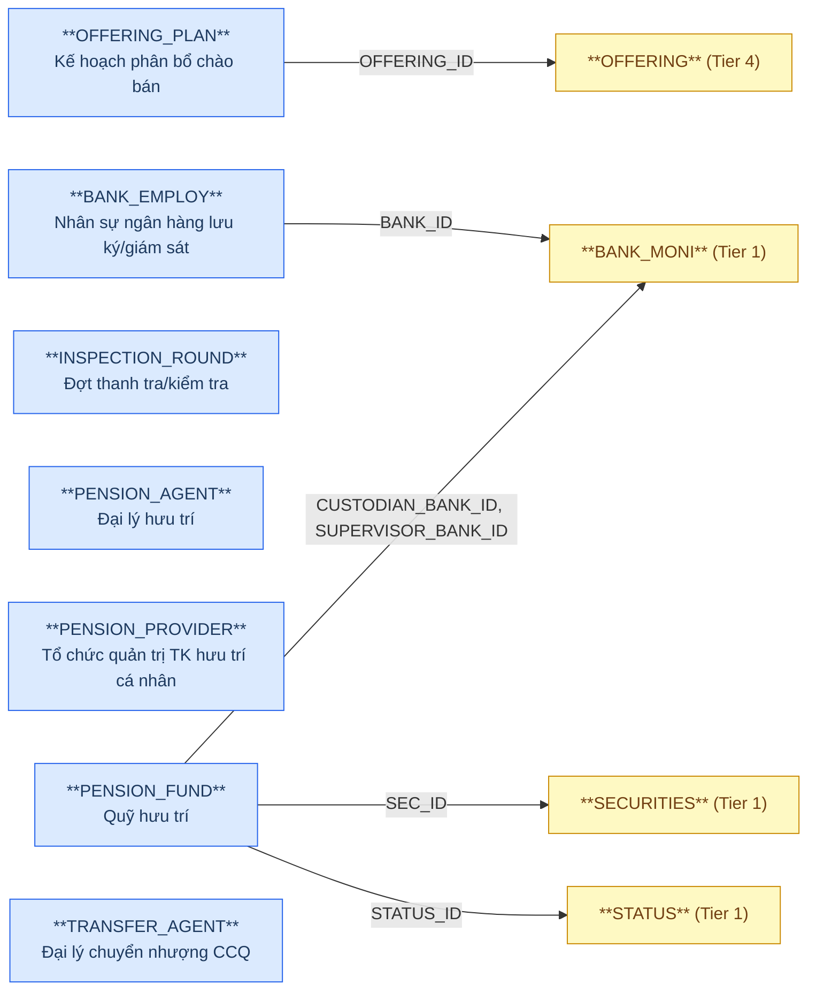
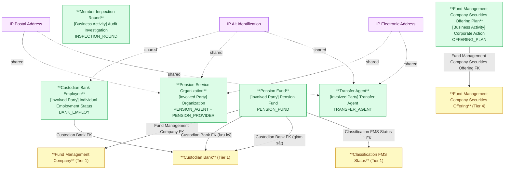

# FMS — HLD Tier 5: Phụ thuộc Tier 4

> **Phụ thuộc Tier 4:** Fund Management Company Securities Offering
>
> **Phụ thuộc Tier 1 (cập nhật 2026-10-28):** Fund Management Company, Custodian Bank, Classification FMS Status (các entity mới theo `group` = T5 trong LLD: Custodian Bank Employee, Pension Fund; Member Inspection Round, Pension Service Organization, Transfer Agent không có FK entity nội bộ FMS)
>
> **Thiết kế theo:** [FMS_HLD_Overview.md](FMS_HLD_Overview.md)
>
> **Cập nhật 2026-10-28 (khôi phục LLD, commit `660df05b`):** Tier 5 nay gồm 6 entity: Fund Management Company Securities Offering Plan (OFFERING_PLAN) và 5 entity mới — Custodian Bank Employee (BANK_EMPLOY), Member Inspection Round (INSPECTION_ROUND), Pension Service Organization (PENSION_AGENT + PENSION_PROVIDER gộp), Pension Fund (PENSION_FUND), Transfer Agent (TRANSFER_AGENT). INSDER_RELA nay có LLD với `group` = T6 (xem Tier 6).
>
> **Đồng bộ LLD 2026-10-21 (lịch sử):** Tier 5 khi đó có 1 entity theo LLD (`lld_FMS_OFFERING_PLAN.yaml`). Các bảng khác từng xếp Tier 5 (INSDER_RELA, INSDER_RPRST, INSID_CHANGE, INSPECTION_TARGET, FACTOR, RNK_GR_FTOR, ANNOUNCE, VIOLT) không có LLD nên đã gỡ khỏi HLD và nằm ở mục 7f `FMS_HLD_Overview.md` (nhóm `Chưa có LLD`).

---

## 6a. Bảng tổng quan BCV Concept

| BCV Core Object | BCV Concept | Category | Source Table | Source Table Change Mode | Mô tả bảng nguồn | Atomic Entity | Table Type | BCV Term |
|---|---|---|---|---|---|---|---|---|
| Involved Party | [Involved Party] Individual Employment Status | Employment Status | BANK_EMPLOY | Update | Nhân sự nghiệp vụ của ngân hàng lưu ký/giám sát: thông tin cá nhân, chứng chỉ hành nghề, chức vụ | Custodian Bank Employee | Fundamental | **[MỚI 2026-10-28]** (1) Term candidate: `Individual Employment Status` — cá nhân giữ vị trí tại tổ chức (ngân hàng lưu ký). (2) Cấu trúc trường: ID (BK), BANK_ID (FK BANK_MONI), ITEM_NAME (họ tên), CERT_NO (chứng chỉ hành nghề), CERT_LAW (chứng chỉ pháp lý), CERT_AUDIT (chứng chỉ kiểm toán), CERT_DATE (ngày cấp CCHN), POSITION (chức vụ), ID_NO/ID_DATE (giấy tờ). (3) Grain = 1 nhân sự của 1 ngân hàng lưu ký. FK đến Custodian Bank (T1). Tách IP Alt Identification; không có địa chỉ/liên lạc nên không tách IP Postal/Electronic Address. Domain Prefix rỗng. Xem T5-03. |
| Business Activity | [Business Activity] Audit Investigation | Business Activity | INSPECTION_ROUND | Update | Đợt thanh tra/kiểm tra: năm, loại (định kỳ/đột xuất), đối tượng, thời gian, số quyết định | Member Inspection Round | Fundamental | **[MỚI 2026-10-28]** (1) Term candidate: `Audit Investigation` (BCV Business Activity). (2) Cấu trúc trường: ID (BK), OBJECT_TYPE (loại đối tượng — polymorphic), OTHER_OBJECT_NAME, INSPECTION_YEAR, START_DATE/END_DATE, DECISION_NO/DECISION_DATE, PERIOD_FROM/PERIOD_TO (kỳ thanh tra), INSPECTION_KIND. (3) Master entity đợt thanh tra — không FK cố định đến entity nghiệp vụ; đối tượng cụ thể xác định ở Member Inspection Target (INSPECTION_TARGET, vẫn ở 7f chưa có LLD). Không phải Involved Party — không tách shared entity. Xem T5-04. |
| Involved Party | [Involved Party] Organization | Organization | PENSION_AGENT, PENSION_PROVIDER | Update | Tổ chức cung cấp dịch vụ cho quỹ hưu trí: đại lý hưu trí (PENSION_AGENT), tổ chức quản trị tài khoản hưu trí cá nhân (PENSION_PROVIDER) | Pension Service Organization | Fundamental | **[MỚI 2026-10-28]** (1) Term candidate: `Organization`. (2) PENSION_AGENT và PENSION_PROVIDER có cấu trúc ~100% giống nhau (ID, AGENT_TYPE, COMPANY_TYPE, ITEM_NAME, ENG_NAME, SHORT_NAME, TERMINATION_DATE, giấy phép: BUSINESS_LICENSE_NO/LICENSE_ISSUE_DATE/LICENSE_ISSUED_BY, TAX_CODE, địa chỉ/liên lạc). (3) Gộp thành 1 entity theo `notes` LLD, phân biệt vai trò bằng Pension Role Type Code (`AGENT`/`PROVIDER`, scheme `FMS_PENSION_ROLE_TYPE`); `src_stm_code` = `FMS_PENSION_AGENT`/`FMS_PENSION_PROVIDER`. Tách IP Postal Address + IP Electronic Address + IP Alt Identification (BUSINESS_LICENSE + TAX_ID). Xem T5-01. |
| Involved Party | [Involved Party] Pension Fund | Pension Fund | PENSION_FUND | Update | Hồ sơ quỹ hưu trí: tên, số GCN thành lập, ngân hàng lưu ký/giám sát, trạng thái | Pension Fund | Fundamental | **[MỚI 2026-10-28]** (1) Term candidate: `Pension Fund` (BCV Involved Party). (2) Cấu trúc trường: ID (BK), SEC_ID (FK SECURITIES), BUSINESS_CERT_NO, ITEM_NAME/NAME_EN/SHORT_NAME, CUSTODIAN_BANK_ID + SUPERVISOR_BANK_ID (2 FK BANK_MONI), STATUS_ID (FK STATUS), NOTE. (3) Grain = 1 quỹ hưu trí. FK đến Fund Management Company (T1), Custodian Bank (T1, vai trò lưu ký + giám sát), Classification FMS Status (T1, ETL crosswalk lấy CODE). Không có cột địa chỉ/liên lạc → không tách shared entity (giống Investment Fund). Xem T5-02. |
| Involved Party | [Involved Party] Transfer Agent | Transfer Agent | TRANSFER_AGENT | Update | Đại lý chuyển nhượng CCQ (VSDC hoặc tổ chức khác): thông tin giấy phép, loại tổ chức, trạng thái | Transfer Agent | Fundamental | **[MỚI 2026-10-28]** (1) Term candidate: `Transfer Agent` (BCV Involved Party). (2) Cấu trúc trường: ID (BK), AGENT_TYPE, COMPANY_TYPE, ITEM_NAME/NAME_EN/SHORT_NAME, TERMINATION_DATE, giấy phép + mã số thuế, địa chỉ/liên lạc. (3) Grain = 1 đại lý chuyển nhượng. Tách IP Postal Address + IP Electronic Address + IP Alt Identification (file IP dùng BUSINESS_LICENSE + TAX_ID; `notes` LLD ghi OPERATING_LICENSE — lệch, xem T5-03). Domain Prefix rỗng. |
| Business Activity | [Business Activity] Corporate Action | Business Activity | OFFERING_PLAN | Update | Kế hoạch phân bổ chào bán theo từng nhóm đối tượng/phương thức | Fund Management Company Securities Offering Plan | Fundamental | (1) Term candidate: `Corporate Action` (kế thừa từ entity cha Fund Management Company Securities Offering). (2) Cấu trúc trường: FK OFFERING_ID, SORT_ORDER, TARGET_AUDIENCE, METHOD_CODE, kế hoạch (QUANTITY_CB/PRICE_CB/VALUE_CB) + thực tế (ACTUAL_QUANTITY_CB...) → chi tiết phân bổ của 1 đợt chào bán, nhiều dòng/đợt. (3) Chọn `Corporate Action`. **[CẬP NHẬT REVIEW 2026-07-03]** Table Type = `Fundamental` (đổi từ `Relative` theo quyết định review). Không phải Involved Party — không tách shared entity. |

---

## 6b. Diagram Source (Mermaid)

---

## 6c. Diagram Atomic (Mermaid)

---

## 6d. Danh mục & Tham chiếu

| Source Table | Mô tả | Scheme Code dự kiến | Ghi chú |
|---|---|---|---|
| OFFERING_PLAN.METHOD_CODE | Phương thức chào bán của kế hoạch phân bổ | `FMS.STOCK_OFFERING_PLAN_METHOD` | Theo LLD (Offering Method Code). |
| PENSION_AGENT/PENSION_PROVIDER (hardcode) | Vai trò của tổ chức dịch vụ hưu trí: AGENT / PROVIDER | `FMS_PENSION_ROLE_TYPE` | etl_derived — Pension Service Organization (Pension Role Type Code); theo LLD. |
| PENSION_AGENT/PENSION_PROVIDER.COMPANY_TYPE, TRANSFER_AGENT.COMPANY_TYPE | Loại hình công ty | Theo LLD (`company_tp_code` / `transfer_agent_company_tp_code`) | Chưa kiểm tra scheme cụ thể trong HLD — cần Data Modeler xác nhận. |

---

## 6e. Bảng chờ thiết kế

Không có bảng nào trong Tier 5 chưa đủ thông tin cột.

---

## 6f. Điểm cần xác nhận

| # | Câu hỏi | Ảnh hưởng |
|---|---|---|
| T5-01 | **[MỚI 2026-10-28]** `Pension Service Organization` gộp PENSION_AGENT + PENSION_PROVIDER (cấu trúc ~100% giống nhau), phân biệt bằng Pension Role Type Code. BK/Id hash theo ID nguồn của từng bảng — 2 bảng có thể trùng ID? | Nếu trùng cần thêm role/`src_stm_code` vào hash. Xem Overview 7e #27. |
| T5-02 | **[MỚI 2026-10-28]** `Pension Fund` (PENSION_FUND): chưa thấy FK trực tiếp đến Pension Service Organization trong cấu trúc cột hiện có (T5-03 trong `notes` LLD). FK `STATUS_ID` đi qua ETL crosswalk sang FMS.STATUS lấy CODE. | Nếu nghiệp vụ cần quan hệ quỹ hưu trí ↔ đại lý/provider phải bổ sung bảng nguồn/entity quan hệ. Xem Overview 7e #28. |
| T5-03 | **[ĐÃ CHỐT 2026-10-29]** `IP_ALT_ID_TYPE`: BANK_EMPLOY = `IDENTIFICATION`; TRANSFER_AGENT = `BUSINESS_LICENSE` + `TAX_ID` (PENSION_AGENT/PROVIDER cũng `BUSINESS_LICENSE` + `TAX_ID`). `notes` LLD đã sửa khớp file IP. | Không còn lệch. Xem Overview 7e #29. |
| T5-04 | **[MỚI 2026-10-28]** `Member Inspection Round` (INSPECTION_ROUND): OBJECT_TYPE polymorphic, đối tượng cụ thể ở INSPECTION_TARGET (7f, chưa có LLD). | Khi INSPECTION_TARGET có LLD phải bổ sung FK về Member Inspection Round. Xem Overview 7e #30. |
