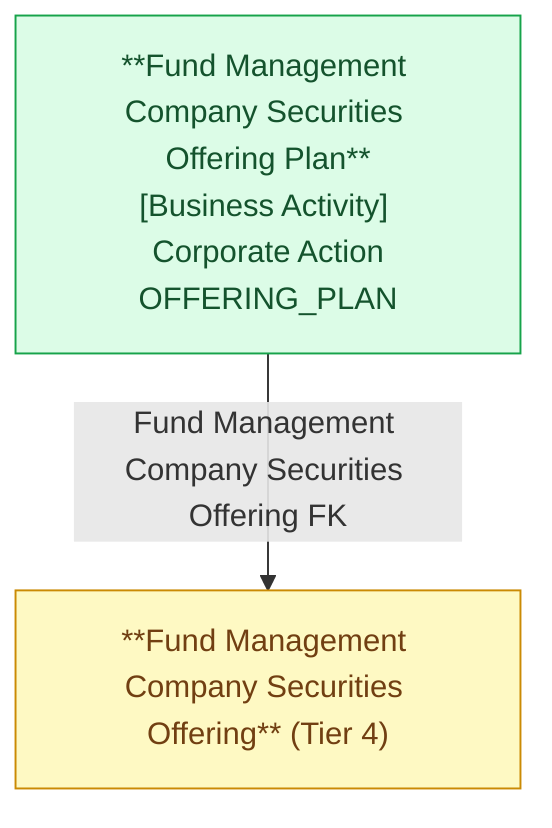

# FMS — HLD Tier 5: Phụ thuộc Tier 4

> **Phụ thuộc Tier 4:** Fund Management Company Securities Offering
>
> **Thiết kế theo:** [FMS_HLD_Overview.md](FMS_HLD_Overview.md)
>
> **Đồng bộ LLD 2026-10-21:** Tier 5 hiện có 1 entity theo LLD (`lld_FMS_OFFERING_PLAN.yaml`). Các bảng khác từng xếp Tier 5 (INSDER_RELA, INSDER_RPRST, INSID_CHANGE, INSPECTION_TARGET, FACTOR, RNK_GR_FTOR, ANNOUNCE, VIOLT) không có LLD nên đã gỡ khỏi HLD và nằm ở mục 7f `FMS_HLD_Overview.md` (nhóm `Chưa có LLD`).

---

## 6a. Bảng tổng quan BCV Concept

| BCV Core Object | BCV Concept | Category | Source Table | Source Table Change Mode | Mô tả bảng nguồn | Atomic Entity | Table Type | BCV Term |
|---|---|---|---|---|---|---|---|---|
| Business Activity | [Business Activity] Corporate Action | Business Activity | OFFERING_PLAN | Update | Kế hoạch phân bổ chào bán theo từng nhóm đối tượng/phương thức | Fund Management Company Securities Offering Plan | Fundamental | (1) Term candidate: `Corporate Action` (kế thừa từ entity cha Fund Management Company Securities Offering). (2) Cấu trúc trường: FK OFFERING_ID, SORT_ORDER, TARGET_AUDIENCE, METHOD_CODE, kế hoạch (QUANTITY_CB/PRICE_CB/VALUE_CB) + thực tế (ACTUAL_QUANTITY_CB...) → chi tiết phân bổ của 1 đợt chào bán, nhiều dòng/đợt. (3) Chọn `Corporate Action`. **[CẬP NHẬT REVIEW 2026-07-03]** Table Type = `Fundamental` (đổi từ `Relative` theo quyết định review). Không phải Involved Party — không tách shared entity. |

---

## 6b. Diagram Source (Mermaid)

---

## 6c. Diagram Atomic (Mermaid)

---

## 6d. Danh mục & Tham chiếu

| Source Table | Mô tả | Scheme Code dự kiến | Ghi chú |
|---|---|---|---|
| OFFERING_PLAN.METHOD_CODE | Phương thức chào bán của kế hoạch phân bổ | `FMS_STOCK_OFFERING_PLAN_METHOD` | Theo LLD (Offering Method Code). |

---

## 6e. Bảng chờ thiết kế

Không có bảng nào trong Tier 5 chưa đủ thông tin cột.

---

## 6f. Điểm cần xác nhận

Không có điểm mở.
