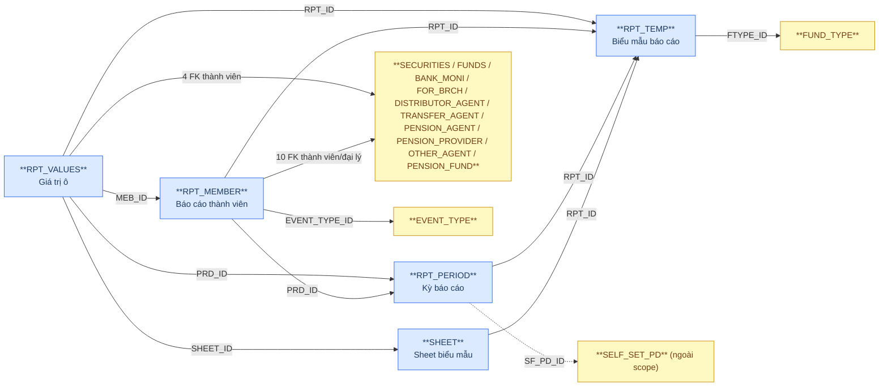
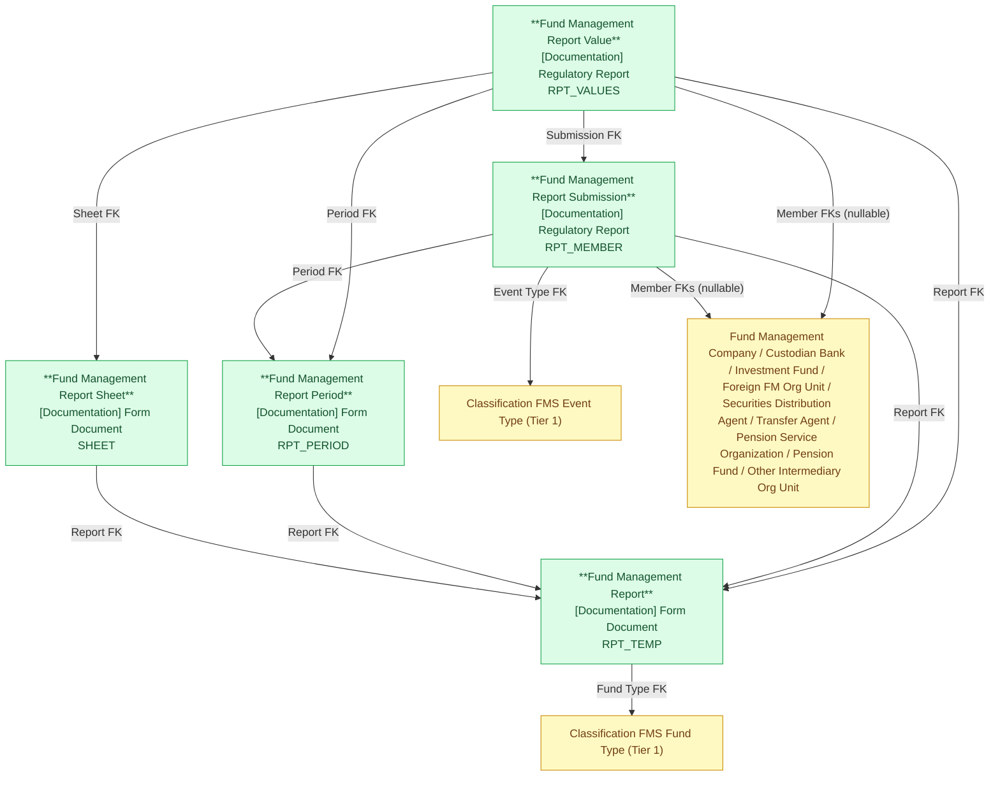

# FMS — HLD Tier 8: Nhóm báo cáo thành viên (Fund Management Report)

> **Phụ thuộc Tier 1:** Classification FMS Fund Type, Custodian Bank, Fund Management Company, Classification FMS Event Type
> **Phụ thuộc Tier 2:** Investment Fund, Foreign Fund Management Organization Unit
> **Phụ thuộc Tier 5:** Securities Distribution Agent, Transfer Agent, Pension Service Organization, Pension Fund, Other Intermediary Organization Unit
>
> **Thiết kế theo:** [FMS_HLD_Overview.md](FMS_HLD_Overview.md)
>
> **Tham khảo mẫu:** họ báo cáo IDS (`Financial Report` → `fr_value`; `Unstructured Financial Report` → `ufr_value`).
>
> **Ghi chú đánh Tier:** 5 bảng thuộc cùng một nhóm nghiệp vụ nên gộp 1 file Tier 8. Thứ tự phụ thuộc nội bộ: Fund Management Report → (Sheet, Period) → Submission → Value. Entity cao nhất (Submission) phụ thuộc Tier 5 nên toàn nhóm xếp sau Tier 7.
>
> **[MỚI 2026-10-06]** Gỡ 5 bảng RPT_TEMP, SHEET, RPT_PERIOD, RPT_MEMBER, RPT_VALUES khỏi mục 7f (quyết định review 2026-07-02 "Xử lý luồng khác") theo yêu cầu Data Modeler. DDL chuẩn: `Source/DDL UAT 1/FMS_UAT_schema 1.txt`.

---

## 6a. Bảng tổng quan BCV Concept

| BCV Core Object | BCV Concept | Category | Source Table | Source Table Change Mode | Mô tả bảng nguồn | Atomic Entity | Table Type | BCV Term |
|---|---|---|---|---|---|---|---|---|
| Documentation | [Documentation] Form Document | Form Document | RPT_TEMP | Update | Biểu mẫu báo cáo FMS: tên, cơ sở pháp lý, loại báo cáo, cấu hình import/eForm, phiên bản | Fund Management Report | Fundamental | (1) Term candidate: `Form Document` — "Documentation Item trình bày theo layout mẫu chuẩn, cần bổ sung thông tin" (VD: mẫu đơn, bảng câu hỏi); IDS dùng cùng term cho FORMS/RROW/RCOL. (2) Cấu trúc trường: ITEM_NAME, LEGAL_BASIS, REPORT_TYPE, REQUIRE_IMPORT, EFORM_SCHEMA_JSON, VERSION, FTYPE_ID → mỗi dòng = 1 biểu mẫu báo cáo có phiên bản; FK duy nhất tới danh mục Fund Type. (3) Chọn `Form Document`. Table Type = `Fundamental` (entity gốc, không FK đến entity nghiệp vụ). Tên bỏ chữ "Template" theo yêu cầu Data Modeler. |
| Documentation | [Documentation] Form Document | Form Document | SHEET | Update | Sheet dữ liệu trong biểu mẫu báo cáo đầu vào: tên, thứ tự, cấu hình ô | Fund Management Report Sheet | Relative | (1) Term candidate: `Form Document` — sheet là 1 phần bố cục của biểu mẫu. (2) Cấu trúc trường: FK RPT_ID, SHEET_INDEX, CELLS_META/MERGE_CELLS/ROW_HEIGHTS/COL_WIDTHS (blob JSON cấu hình bố cục) → mỗi dòng = 1 sheet của 1 biểu mẫu. (3) Chọn `Form Document` (cùng term cha). Các cột NCLOB JSON map Text (string). |
| Documentation | [Documentation] Form Document | Form Document | RPT_PERIOD | Update | Cấu hình kỳ báo cáo của biểu mẫu: loại kỳ, hạn nộp, hạn CBTT | Fund Management Report Period | Relative | (1) Term candidate: `Form Document` — BCV không có term riêng cho lịch nộp/kỳ báo cáo của 1 biểu mẫu (đã tra `reporting period`, `report schedule`: chỉ có các property của Communication/Event không phù hợp). (2) Cấu trúc trường: FK RPT_ID, PERIOD_TYPE, SEND_IN_DAY, LATEST_SEND_DATE/WEEK, ANNOUNCE_* → cấu hình hạn nộp theo kỳ gắn với biểu mẫu. (3) Chọn `Form Document` làm term gần nhất — xem 6f T8-04. |
| Documentation | [Documentation] Regulatory Report | Regulatory Report | RPT_MEMBER | Update | Báo cáo của thành viên thị trường (QLQ, QĐT, đại lý...): trạng thái, kỳ, file đính kèm, eForm | Fund Management Report Submission | Relative | (1) Term candidate: `Regulatory Report` — "báo cáo về các quy định, liên quan đến hoạt động của tổ chức tài chính"; IDS dùng cho COMPANY_DATA. (2) Cấu trúc trường: FK PRD_ID/RPT_ID, 10 FK thành viên/đại lý nullable (BKM, FND, FR_BR, SEC, DISTRIBUTOR, TRANSFER_AGENT, PENSION_AGENT, PENSION_PROVIDER, OTHER_AGENT, PENSION_FUND), DATE_SUBMITTED, APPROVAL_ACTION, DEADLINE_SEND → mỗi dòng = 1 lần thành viên nộp 1 báo cáo theo kỳ. (3) Chọn `Regulatory Report`. |
| Documentation | [Documentation] Regulatory Report | Regulatory Report | RPT_VALUES | Update | Giá trị từng ô dữ liệu trong báo cáo: liên kết sheet, kỳ, báo cáo thành viên | Fund Management Report Value | Classification | (1) Term candidate: `Regulatory Report` — nội dung số liệu của báo cáo (IDS dùng cùng term cho DATA/REP_DATA). (2) Cấu trúc trường: FK MEB_ID/SHEET_ID/RPT_ID/PRD_ID, VALUES (text), ACC_VALUES, ROW_DYNAMIC, 4 FK thành viên → mỗi dòng = 1 ô của 1 sheet trong 1 báo cáo (EAV theo ô). (3) Chọn `Regulatory Report`. Table Type = `Classification` theo quyết định Data Modeler 2026-10-06 (mirror `fr_value`/`ufr_value` của IDS). |

---

## 6b. Diagram Source (Mermaid)

---

## 6c. Diagram Atomic (Mermaid)

---

## 6d. Danh mục & Tham chiếu

| Source Table | Mô tả | Scheme Code | Ghi chú |
|---|---|---|---|
| RPT_TEMP.REPORT_TYPE / RPT_MEMBER.REPORT_TYPE | Loại báo cáo: 1=Định kỳ, 2=Bất thường, 3=Theo yêu cầu, 4=Khác | `FMS_REPORT_TYPE` | etl_derived. |
| RPT_TEMP.REPORT_GROUP | Nhóm báo cáo: 1=QLQ, 2=QĐT, 3=Quỹ hưu trí, 4=Đại lý... | `FMS_REPORT_GROUP` | etl_derived; mô tả nguồn liệt kê "..." — cần profile. |
| RPT_TEMP.SYSTEM_OBJECTS | Đối tượng hệ thống áp dụng 1–5 | `FMS_WARNING_SYSTEM_OBJECT_TYPE` | Tái sử dụng scheme đã đăng ký (cùng encoding 1=QLQ, 2=QĐT, 3=BKGS, 4=ĐLPP, 5=ĐLCN). |
| RPT_PERIOD.PERIOD_TYPE / RPT_MEMBER.PERIOD_TYPE / RPT_VALUES.PERIOD_TYPE | Loại kỳ: 1=Ngày ... 7=Nửa tháng | `FMS_REPORT_PERIOD_TYPE` | etl_derived. |
| RPT_TEMP/SHEET/RPT_PERIOD/RPT_MEMBER.RECORD_STATUS | Trạng thái: 1=Hoạt động, 0=Ngừng | `FMS_REPORT_RECORD_STATUS` | etl_derived. |
| RPT_MEMBER.APPROVAL_ACTION | Kết quả xử lý: 1=Chấp thuận, 2=Từ chối | `FMS_REPORT_APPROVAL_ACTION` | etl_derived. |
| RPT_VALUES.FORMAT_DATA_TYPE | Kiểu định dạng giá trị ô (NUMBER, PERCENT, TEXT...) | `FMS_REPORT_VALUE_FORMAT_TYPE` | modeler_defined — chưa profile. |

---

## 6e. Bảng chờ thiết kế

Không có bảng nào trong Tier 8 chưa đủ thông tin cột.

---

## 6f. Điểm cần xác nhận

| # | Câu hỏi | Ảnh hưởng |
|---|---|---|
| T8-01 | **RPT_VALUES không khai PK** trong DDL UAT 1 (ID NOT NULL nhưng cột Khóa trống). BK hiện = hash từ ID theo quyết định Data Modeler. Xác nhận ID duy nhất trên dữ liệu thật; nếu không, dùng composite (MEB_ID, SHEET_ID, CODE, ROW_DYNAMIC). | Ảnh hưởng khóa surrogate `fmr_value_id` và toàn bộ ETL dedupe. |
| T8-02 | Các cột NCLOB/CLOB (FILE_DATA, FILE_IMPORT, EFORM_DATA_JSON, EFORM_SCHEMA_JSON, CELLS_META, DATA_LABEL, MERGE_CELLS, ROW_HEIGHTS, COL_WIDTHS) map Text (string). FILE_DATA/FILE_IMPORT chứa base64 file — xác nhận có đưa nội dung lên Atomic hay chỉ giữ tham chiếu. | Kích thước bản ghi Delta; có thể loại khỏi Atomic. |
| T8-03 | `RPT_PERIOD.SF_PD_ID`: DDL ghi mô tả "FK → RPT_PERIOD: Kỳ báo cáo cha" nhưng cột liên kết là `SELF_SET_PD.ID`. SELF_SET_PD ngoài scope Atomic nên hiện giữ `self_set_period_code` dạng Text (không FK). | Xác định đích FK thật; có thể cần đưa SELF_SET_PD vào scope. |
| T8-04 | BCV chưa có term riêng cho "lịch/kỳ nộp báo cáo" của 1 biểu mẫu — Fund Management Report Period tạm dùng `[Documentation] Form Document`. Xác nhận hoặc đề xuất concept Condition phù hợp hơn. | Ảnh hưởng BCV Concept của entity (LOCKED sau approve). |
| T8-05 | RPT_MEMBER có 10 FK thành viên/đại lý đều nullable (đa hướng, cùng pattern VIOLT/ANNOUNCE). Xác nhận mỗi dòng chỉ có 1 FK có giá trị hay có thể nhiều. PENSION_AGENT_ID và PENSION_PROVIDER_ID cùng trỏ về Pension Service Organization (đặt role-name `Pension Agent`/`Pension Provider`). | Ràng buộc FK ở LLD/ETL. |
| T8-06 | AUDIT_FIRM_ID, AUDITOR_ID (RPT_MEMBER) trỏ tới AUDIT_FIRM/AUDITOR — ngoài scope FMS (thông tin kiểm toán lấy từ IDS, review 2026-07-03). Hiện document pending, không map. | Mất liên kết báo cáo ↔ công ty kiểm toán nếu cần phân tích. |
| T8-07 | FK `SEC_ID` → Fund Management Company và `EVENT_TYPE_ID` → Classification FMS Event Type: BK của entity đích lấy từ `SECURITIES.CODE`/`EVENT_TYPE.EVENT_CODE`, nhưng LLD hiện hash theo cột FK (ID) giống `lld_FMS_FUNDS`/`lld_FMS_ANNOUNCE` đã có. Xác nhận cách hash Id của entity đích (từ ID hay từ CODE) để tránh hash-mismatch. | Id không khớp giữa bảng con và bảng cha nếu BK ≠ ID. |
| T8-08 | `SHEET.IS_ADMIN_REPORT` chỉ có ở DDL UAT 1 (bản ' 1'), mô tả cột trống; `RPT_VALUES.VALUES` không có mô tả. Xác nhận ý nghĩa. | Description attribute. |
| T8-09 | RPT_VALUES.VALUES lưu cả số lẫn text (NVARCHAR2(4000)) → map Text, khác IDS `fr_value.data_val` (Currency Amount). Xác nhận có cần cột số tách riêng cho khai thác Datamart. | Khai thác Gold cần cast. |
