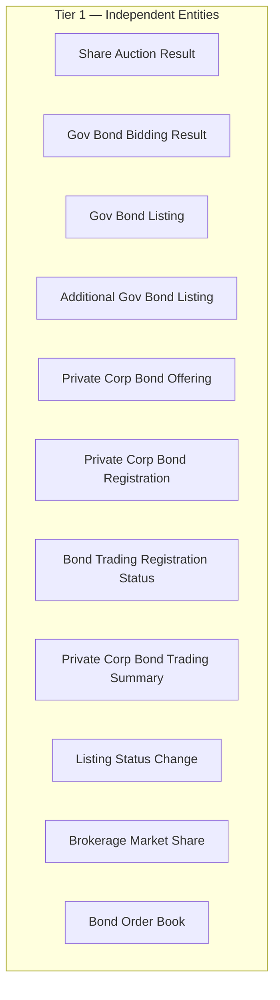

# HNX HLD — Overview

**Source system:** HNX (Dữ liệu Sở Giao dịch Chứng khoán Hà Nội — vùng staging `uat_hnx_stg`)
**Mô tả:** HNX cung cấp các báo cáo và sổ lệnh của thị trường do Sở quản lý: kết quả đấu giá cổ phiếu, đấu thầu/niêm yết trái phiếu Chính phủ, chào bán/đăng ký giao dịch trái phiếu doanh nghiệp riêng lẻ, quyết định thay đổi niêm yết, thị phần môi giới và sổ lệnh trái phiếu (Outright/Repo/Repo2). Các entity `Share Auction Result`, `Listing Status Change`, `Brokerage Market Share` dùng chung với HOSE; `listed_securities_list` bổ sung nguồn cho entity `Listed Share Information` của VSDC.

---

## Tổng quan Atomic Entities

| Tier | Atomic Entity | BCV Core Object | BCV Concept | table_type | Source Table(s) | Ghi chú |
|---|---|---|---|---|---|---|
| T1 | Additional Gov Bond Listing | Documentation | [Documentation] Regulatory Report | Fact Snapshot | HNX.gov_bond_additional_listing | Sự kiện niêm yết bổ sung trái phiếu Chính phủ |
| T1 | Bond Order Book | Transaction | [Transaction] Financial Market Transaction | Fact Snapshot | HNX.outright_order_book, HNX.repo_order_book, HNX.repo2_order_book | Gộp 3 sổ lệnh, phân biệt `order_book_type` |
| T1 | Bond Trading Registration Status | Documentation | [Documentation] Regulatory Report | Fact Snapshot | HNX.registration_status_change | Trạng thái đăng ký giao dịch trái phiếu |
| T1 | Brokerage Market Share | Documentation | [Documentation] Regulatory Report | Fact Snapshot | HNX.brokerage_market_share, HOSE.brokerage_market_share | Dùng chung HNX + HOSE |
| T1 | Gov Bond Bidding Result | Documentation | [Documentation] Regulatory Report | Fact Snapshot | HNX.gov_bond_offering | Kết quả đấu thầu trái phiếu Chính phủ |
| T1 | Gov Bond Listing | Documentation | [Documentation] Regulatory Report | Fact Snapshot | HNX.gov_bond_listed_list | Danh sách trái phiếu Chính phủ niêm yết |
| T1 | Listing Status Change | Documentation | [Documentation] Regulatory Report | Fact Snapshot | HNX.listing_status_change, HOSE.listing_status_change | Dùng chung HNX + HOSE |
| T1 | Private Corp Bond Offering | Documentation | [Documentation] Regulatory Report | Fact Snapshot | HNX.private_corp_bond_offering | Chào bán trái phiếu doanh nghiệp riêng lẻ |
| T1 | Private Corp Bond Registration | Documentation | [Documentation] Regulatory Report | Fact Snapshot | HNX.private_corp_bond_registration | Đăng ký giao dịch trái phiếu doanh nghiệp |
| T1 | Private Corp Bond Trading Summary | Documentation | [Documentation] Regulatory Report | Fact Snapshot | HNX.private_corp_bond_trading | Chỉ tiêu giao dịch thị trường |
| T1 | Share Auction Result | Documentation | [Documentation] Regulatory Report | Fact Snapshot | HNX.share_auction, HOSE.share_auction | Dùng chung HNX + HOSE |

**Tổng: 11 Atomic entities** (11 Tier 1)
*(Trong đó: 1 bảng nguồn extend entity của source khác — `HNX.listed_securities_list` → entity `Listed Share Information` (định nghĩa ở VSDC) — không tạo mới)*

---

## Diagram Phân tầng Dependencies (Mermaid)

---

## Quyết định thiết kế chính

| # | Quyết định | Lý do |
|---|---|---|
| D-01 | Tất cả entity HNX xếp Tier 1, không FK nghiệp vụ giữa các entity | Bảng staging phẳng, không có bảng master; join theo `bond_code`/`ticker_symbol` thực hiện ở Gold |
| D-02 | Gộp `outright_order_book`, `repo_order_book`, `repo2_order_book` thành 1 entity `Bond Order Book`, phân biệt bằng `order_book_type` (ETL-derived) | Cấu trúc 3 bảng gần giống nhau (≈ 42/50/55 cột, trùng ~40 cột); cột đặc thù Repo/Repo2/Outright NULL phía còn lại |
| D-03 | Entity dùng chung HNX + HOSE (`Share Auction Result`, `Listing Status Change`, `Brokerage Market Share`) định nghĩa ở HNX; HOSE bổ sung `source_table` | HNX là source đầu tiên chứa các bảng này (quy tắc không tạo dòng trùng) |
| D-04 | Không dùng prefix `HNX` trong tên entity | Tên entity dùng BCV Term/tên nghiệp vụ, đồng nhất với MDDS D-04 |
| D-05 | Toàn bộ bảng báo cáo/sổ lệnh → `Fact Snapshot` (chỉ định Data Modeler 2026-10-18) | Cùng `VSDC_HLD_Overview` D-05 |

---

#### 7a. Bảng tổng quan Atomic entities

| Tier | BCV Core Object | BCV Concept | Category | Source Table | Source Table Change Mode | Mô tả bảng nguồn | Atomic Entity | Table Type | BCV Term |
|---|---|---|---|---|---|---|---|---|---|
| T1 | Documentation | [Documentation] Regulatory Report | Documentation | gov_bond_additional_listing | Append | Niêm yết bổ sung/thay đổi niêm yết trái phiếu Chính phủ | Additional Gov Bond Listing | Fact Snapshot | Regulatory Report (9297) — Core Object Documentation theo chỉ định Data Modeler |
| T1 | Transaction | [Transaction] Financial Market Transaction | Transaction | outright_order_book, repo_order_book, repo2_order_book | Append | Sổ lệnh trái phiếu Outright/Repo/Repo2 | Bond Order Book | Fact Snapshot | Financial Market Transaction (13339) — Core Object Transaction theo chỉ định Data Modeler |
| T1 | Documentation | [Documentation] Regulatory Report | Documentation | registration_status_change | Append | Trạng thái đăng ký giao dịch trái phiếu | Bond Trading Registration Status | Fact Snapshot | Regulatory Report (9297) — Core Object Documentation theo chỉ định Data Modeler |
| T1 | Documentation | [Documentation] Regulatory Report | Documentation | brokerage_market_share | Append | Thị phần môi giới theo quý | Brokerage Market Share | Fact Snapshot | Regulatory Report (9297) — Core Object Documentation theo chỉ định Data Modeler |
| T1 | Documentation | [Documentation] Regulatory Report | Documentation | gov_bond_offering | Append | Kết quả đấu thầu trái phiếu Chính phủ | Gov Bond Bidding Result | Fact Snapshot | Regulatory Report (9297) — Core Object Documentation theo chỉ định Data Modeler |
| T1 | Documentation | [Documentation] Regulatory Report | Documentation | gov_bond_listed_list | Append | Danh sách trái phiếu Chính phủ niêm yết | Gov Bond Listing | Fact Snapshot | Regulatory Report (9297) — Core Object Documentation theo chỉ định Data Modeler |
| T1 (extend) | Documentation | [Documentation] Regulatory Report | Documentation | listed_securities_list | Append | Danh sách chứng khoán niêm yết HNX (số lượng niêm yết, giá tham chiếu) — entity `Listed Share Information` định nghĩa ở VSDC | Listed Share Information | Fact Snapshot | Regulatory Report (9297) — Core Object Documentation theo chỉ định Data Modeler |
| T1 | Documentation | [Documentation] Regulatory Report | Documentation | listing_status_change | Append | Quyết định thay đổi niêm yết | Listing Status Change | Fact Snapshot | Regulatory Report (9297) — Core Object Documentation theo chỉ định Data Modeler |
| T1 | Documentation | [Documentation] Regulatory Report | Documentation | private_corp_bond_offering | Append | Chào bán trái phiếu doanh nghiệp riêng lẻ | Private Corp Bond Offering | Fact Snapshot | Regulatory Report (9297) — Core Object Documentation theo chỉ định Data Modeler |
| T1 | Documentation | [Documentation] Regulatory Report | Documentation | private_corp_bond_registration | Append | Đăng ký giao dịch trái phiếu doanh nghiệp riêng lẻ | Private Corp Bond Registration | Fact Snapshot | Regulatory Report (9297) — Core Object Documentation theo chỉ định Data Modeler |
| T1 | Documentation | [Documentation] Regulatory Report | Documentation | private_corp_bond_trading | Append | Chỉ tiêu thống kê giao dịch trái phiếu doanh nghiệp | Private Corp Bond Trading Summary | Fact Snapshot | Regulatory Report (9297) — Core Object Documentation theo chỉ định Data Modeler |
| T1 | Documentation | [Documentation] Regulatory Report | Documentation | share_auction | Append | Kết quả đấu giá cổ phiếu | Share Auction Result | Fact Snapshot | Regulatory Report (9297) — Core Object Documentation theo chỉ định Data Modeler |

#### 7b. Diagram Atomic tổng (Mermaid)

```mermaid
erDiagram
    Share_Auction_Result {
        string share_auction_result_id PK
    }
    Gov_Bond_Bidding_Result {
        string gov_bond_bidding_result_id PK
    }
    Gov_Bond_Listing {
        string gov_bond_listing_id PK
    }
    Additional_Gov_Bond_Listing {
        string additional_gov_bond_listing_id PK
    }
    Private_Corp_Bond_Offering {
        string private_corp_bond_offering_id PK
    }
    Private_Corp_Bond_Registration {
        string private_corp_bond_registration_id PK
    }
    Bond_Trading_Registration_Status {
        string bond_trading_registration_status_id PK
    }
    Private_Corp_Bond_Trading_Summary {
        string private_corp_bond_trading_summary_id PK
    }
    Listing_Status_Change {
        string listing_status_change_id PK
    }
    Brokerage_Market_Share {
        string brokerage_market_share_id PK
    }
    Bond_Order_Book {
        string bond_order_book_id PK
    }
```

#### 7c. Bảng Classification Value

| Source Table | Mô tả | BCV Term | Xử lý Atomic |
|---|---|---|---|
| — | Không có Classification Value scheme | — | Các cột phân loại giữ dạng Text |

#### 7d. Junction Tables

Không có junction table.

#### 7e. Điểm cần xác nhận

| # | Tier | Câu hỏi | Ảnh hưởng |
|---|---|---|---|
| 1 | T1 | `Share Auction Result`, `Listing Status Change`, `Brokerage Market Share` gộp HNX + HOSE vào 1 entity | Có thể phải tách entity theo sàn nếu cấu trúc phát sinh khác biệt |
| 2 | T1 | `Bond Order Book` gộp 3 bảng, nhiều cột NULL theo loại sổ lệnh | Nullable, ETL pattern theo `order_book_type` |
| 3 | T1 | `HNX.listed_securities_list` bổ sung nguồn cho `Listed Share Information` | Xem `VSDC_HLD_Overview` 7e #3 |

#### 7f. Bảng ngoài scope

| Nhóm | Source Table | Mô tả bảng nguồn | Lý do ngoài scope |
|---|---|---|---|
| Shared Entity | listed_securities_list | Danh sách chứng khoán niêm yết HNX | Dùng entity `Listed Share Information` (định nghĩa ở VSDC) — chỉ bổ sung `source_table`, không tạo entity mới tại HNX |

---

## Entities

> Single source of truth cho metadata entity. `aggregate_atomic.py` parse section này để sinh `atomic_entities.yaml`.

### 1. Additional Gov Bond Listing
**Tier:** 1 | **Source:** `HNX.gov_bond_additional_listing` | **BCV Concept:** [Documentation] Regulatory Report | **BCO:** Documentation | **Table Type:** Fact Snapshot
**Domain Prefix:** (none)
**Description:** Sự kiện niêm yết bổ sung hoặc thay đổi niêm yết của trái phiếu Chính phủ: mã trái phiếu, loại, trạng thái, khối lượng, mệnh giá và ngày thay đổi niêm yết.

**Grain:** 1 dòng = 1 mã trái phiếu × 1 trạng thái niêm yết × 1 ngày thay đổi.

**Attributes chính:** `bond_code`, trạng thái niêm yết, ngày thay đổi (BK), loại trái phiếu, khối lượng, mệnh giá, tháng báo cáo.

### 2. Bond Order Book
**Tier:** 1 | **Source:** `HNX.outright_order_book`, `HNX.repo_order_book`, `HNX.repo2_order_book` | **BCV Concept:** [Transaction] Financial Market Transaction | **BCO:** Transaction | **Table Type:** Fact Snapshot
**Domain Prefix:** (none)
**Description:** Sổ lệnh giao dịch trái phiếu tại HNX theo 3 phương thức Outright, Repo và Repo2: thông tin lệnh, trái phiếu, giá, khối lượng, bên bán, bên mua và thông tin thanh toán.

**Grain:** 1 dòng = 1 lệnh (số hiệu lệnh) × 1 loại sổ lệnh × 1 ngày giao dịch.

**Attributes chính:** `order_nbr` (BK), `order_book_type` (ETL-derived), mã trái phiếu, loại/chiều/trạng thái lệnh, giá, lợi suất, khối lượng, thành viên mua/bán, các cột Repo/Repo2 (kỳ hạn, lãi suất, coupon, thanh toán lần 1/2).

### 3. Bond Trading Registration Status
**Tier:** 1 | **Source:** `HNX.registration_status_change` | **BCV Concept:** [Documentation] Regulatory Report | **BCO:** Documentation | **Table Type:** Fact Snapshot
**Domain Prefix:** (none)
**Description:** Trạng thái đăng ký giao dịch của trái phiếu: mã trái phiếu, tổ chức phát hành, mệnh giá, khối lượng đăng ký giao dịch hiện tại, ngày giao dịch đầu/cuối và trạng thái đăng ký.

**Grain:** 1 dòng = 1 mã trái phiếu × 1 trạng thái đăng ký giao dịch × 1 kỳ báo cáo.

**Attributes chính:** `bond_code`, trạng thái đăng ký giao dịch (BK ghép), mệnh giá, khối lượng, ngày giao dịch đầu/cuối.

### 4. Brokerage Market Share
**Tier:** 1 | **Source:** `HNX.brokerage_market_share`, `HOSE.brokerage_market_share` | **BCV Concept:** [Documentation] Regulatory Report | **BCO:** Documentation | **Table Type:** Fact Snapshot
**Domain Prefix:** (none)
**Description:** Thị phần môi giới của từng công ty chứng khoán thành viên theo quý: tên công ty, mã thành viên, tổng giá trị giao dịch, thị phần theo giá trị và phân loại.

**Grain:** 1 dòng = 1 thành viên môi giới × 1 quý × 1 sàn (nguồn).

**Attributes chính:** `sc_member_code` (BK), tên công ty, tổng giá trị giao dịch, thị phần theo giá trị, phân loại, quý báo cáo, ETL-derived `src_stm_code`.

### 5. Gov Bond Bidding Result
**Tier:** 1 | **Source:** `HNX.gov_bond_offering` | **BCV Concept:** [Documentation] Regulatory Report | **BCO:** Documentation | **Table Type:** Fact Snapshot
**Domain Prefix:** (none)
**Description:** Kết quả đấu thầu phát hành trái phiếu Chính phủ theo đợt: phương thức đấu thầu, mã trái phiếu, tổ chức phát hành, kỳ hạn, giá trị gọi thầu, đặt thầu, trúng thầu và lãi suất.

**Grain:** 1 dòng = 1 đợt đấu thầu × 1 mã trái phiếu.

**Attributes chính:** `bidding_session` (BK), phương thức đấu thầu, mã trái phiếu, loại trái phiếu, ngày/phương thức phát hành, giá trị gọi/đặt/trúng thầu, lãi suất danh nghĩa/trúng thầu.

### 6. Gov Bond Listing
**Tier:** 1 | **Source:** `HNX.gov_bond_listed_list` | **BCV Concept:** [Documentation] Regulatory Report | **BCO:** Documentation | **Table Type:** Fact Snapshot
**Domain Prefix:** (none)
**Description:** Danh sách trái phiếu Chính phủ niêm yết tại HNX: mã, tổ chức phát hành, loại, khối lượng niêm yết, kỳ hạn, hình thức trả lãi, lãi suất, ngày giao dịch đầu tiên và trạng thái.

**Grain:** 1 dòng = 1 mã trái phiếu niêm yết × 1 kỳ báo cáo.

**Attributes chính:** `bond_code` (BK), loại trái phiếu, khối lượng niêm yết, kỳ hạn/kỳ hạn còn lại, hình thức/loại hình trả lãi, lãi suất, trạng thái.

### 7. Listing Status Change
**Tier:** 1 | **Source:** `HNX.listing_status_change`, `HOSE.listing_status_change` | **BCV Concept:** [Documentation] Regulatory Report | **BCO:** Documentation | **Table Type:** Fact Snapshot
**Domain Prefix:** (none)
**Description:** Quyết định thay đổi niêm yết chứng khoán tại Sở Giao dịch: số và ngày quyết định, số lượng/giá trị niêm yết mới, niêm yết bổ sung, hủy niêm yết, chuyển sàn, ngày hiệu lực và lý do.

**Grain:** 1 dòng = 1 quyết định × 1 mã chứng khoán × 1 sàn (nguồn).

**Attributes chính:** `decision_nbr`, `decision_dt`, `ticker_symbol` (BK ghép), số lượng và giá trị niêm yết, ngày hiệu lực, ngày giao dịch đầu/cuối, lý do hủy/chuyển, ETL-derived `src_stm_code`.

### 8. Private Corp Bond Offering
**Tier:** 1 | **Source:** `HNX.private_corp_bond_offering` | **BCV Concept:** [Documentation] Regulatory Report | **BCO:** Documentation | **Table Type:** Fact Snapshot
**Domain Prefix:** (none)
**Description:** Thông tin chào bán trái phiếu doanh nghiệp riêng lẻ: thị trường, ngày đăng tin, tổ chức phát hành, loại hình và ngành doanh nghiệp, mã trái phiếu, kỳ hạn, khối lượng chào bán, mệnh giá, lãi suất phát hành và các cờ điều kiện.

**Grain:** 1 dòng = 1 thông báo chào bán × 1 mã trái phiếu × 1 thị trường.

**Attributes chính:** `bond_code`, thị trường, ngày đăng tin (BK ghép), tổ chức phát hành, kỳ hạn, ngày phát hành/đáo hạn, khối lượng, mệnh giá, lãi suất phát hành, cờ (mua lại/hoán đổi, chuyển đổi, kèm chứng quyền, bảo đảm).

### 9. Private Corp Bond Registration
**Tier:** 1 | **Source:** `HNX.private_corp_bond_registration` | **BCV Concept:** [Documentation] Regulatory Report | **BCO:** Documentation | **Table Type:** Fact Snapshot
**Domain Prefix:** (none)
**Description:** Thông tin đăng ký giao dịch trái phiếu doanh nghiệp riêng lẻ: mã, tổ chức phát hành, mệnh giá, kỳ hạn, các khối lượng phát hành, mua lại, đăng ký giao dịch, lưu hành và ngày giao dịch đầu tiên.

**Grain:** 1 dòng = 1 mã trái phiếu × 1 kỳ báo cáo (ngày/tháng/năm).

**Attributes chính:** `bond_code` (BK), tổ chức phát hành, mệnh giá, kỳ hạn, ngày phát hành/đáo hạn, các khối lượng, lãi suất phát hành, ngày giao dịch đầu tiên.

### 10. Private Corp Bond Trading Summary
**Tier:** 1 | **Source:** `HNX.private_corp_bond_trading` | **BCV Concept:** [Documentation] Regulatory Report | **BCO:** Documentation | **Table Type:** Fact Snapshot
**Domain Prefix:** (none)
**Description:** Chỉ tiêu thống kê giao dịch trái phiếu doanh nghiệp riêng lẻ theo ngày báo cáo: tên chỉ tiêu, đơn vị tính và giá trị.

**Grain:** 1 dòng = 1 chỉ tiêu × 1 ngày báo cáo.

**Attributes chính:** `indicator_name` (BK), đơn vị tính, giá trị chỉ tiêu, ngày báo cáo.

### 11. Share Auction Result
**Tier:** 1 | **Source:** `HNX.share_auction`, `HOSE.share_auction` | **BCV Concept:** [Documentation] Regulatory Report | **BCO:** Documentation | **Table Type:** Fact Snapshot
**Domain Prefix:** (none)
**Description:** Kết quả đấu giá cổ phiếu theo tổ chức phát hành và loại đấu giá: số cổ phiếu chào bán, số nhà đầu tư đăng ký và trúng giá (trong nước/nước ngoài, tổ chức/cá nhân), giá khởi điểm, giá trúng bình quân, khối lượng và giá trị trúng giá/bán thực tế.

**Grain:** 1 dòng = 1 tổ chức phát hành × 1 loại đấu giá × 1 kỳ báo cáo × 1 sàn (nguồn).

**Attributes chính:** `issuer_name`, `auction_tp` (BK ghép), số nhà đầu tư/khối lượng/giá trị theo nhóm NĐT, giá khởi điểm, giá trúng bình quân, tháng/năm báo cáo, ETL-derived `src_stm_code`.
