# HNX HLD — Tier 1

**Source system:** HNX (Dữ liệu Sở Giao dịch Chứng khoán Hà Nội — vùng staging `uat_hnx_stg`)
**Tier 1:** Toàn bộ entity HNX là báo cáo/sổ lệnh độc lập — không FK đến bảng nghiệp vụ khác (bảng staging phẳng; `bond_code`, `ticker_symbol` chỉ là business key, không có bảng master trong scope). Gồm 11 entity mới và 1 bảng bổ sung `source_table` cho entity của VSDC

---

## 6a. Bảng tổng quan BCV Concept

| BCV Core Object | BCV Concept | Category | Source Table | Source Table Change Mode | Mô tả bảng nguồn | Atomic Entity | Table Type | BCV Term |
|---|---|---|---|---|---|---|---|---|
| Documentation | [Documentation] Regulatory Report | Documentation | share_auction | Append | Kết quả đấu giá cổ phiếu theo tổ chức phát hành và loại đấu giá: số cổ phiếu chào bán, số NĐT đăng ký/trúng giá (trong nước/nước ngoài, tổ chức/cá nhân), giá khởi điểm, giá trúng bình quân, khối lượng và giá trị trúng/bán thực tế | Share Auction Result | Fact Snapshot | (1) BCV term: **Regulatory Report** (Documentation, id 9297) — *"Regulatory Information which is a report on regulations"*. (2) Cấu trúc trường: kết quả đấu giá cổ phiếu theo tổ chức phát hành và loại đấu giá — bảng báo cáo do Sở/VSDC cung cấp. (3) Theo chỉ định Data Modeler (2026-10-18): Core Object Documentation, table_type Fact Snapshot cho toàn bộ bảng báo cáo VSDC/HNX/HOSE. |
| Documentation | [Documentation] Regulatory Report | Documentation | private_corp_bond_trading | Append | Chỉ tiêu thống kê giao dịch trái phiếu doanh nghiệp riêng lẻ theo ngày: chỉ tiêu, đơn vị tính, giá trị | Private Corp Bond Trading Summary | Fact Snapshot | (1) BCV term: **Regulatory Report** (Documentation, id 9297) — *"Regulatory Information which is a report on regulations"*. (2) Cấu trúc trường: chỉ tiêu thống kê giao dịch trái phiếu doanh nghiệp riêng lẻ theo ngày — bảng báo cáo do Sở/VSDC cung cấp. (3) Theo chỉ định Data Modeler (2026-10-18): Core Object Documentation, table_type Fact Snapshot cho toàn bộ bảng báo cáo VSDC/HNX/HOSE. |
| Documentation | [Documentation] Regulatory Report | Documentation | gov_bond_offering | Append | Kết quả đấu thầu trái phiếu Chính phủ theo đợt: phương thức, mã, tổ chức phát hành, loại, kỳ hạn, ngày/phương thức phát hành, giá trị gọi thầu/đặt thầu/trúng thầu, lãi suất danh nghĩa/trúng thầu | Gov Bond Bidding Result | Fact Snapshot | (1) BCV term: **Regulatory Report** (Documentation, id 9297) — *"Regulatory Information which is a report on regulations"*. (2) Cấu trúc trường: kết quả đấu thầu trái phiếu Chính phủ theo đợt — bảng báo cáo do Sở/VSDC cung cấp. (3) Theo chỉ định Data Modeler (2026-10-18): Core Object Documentation, table_type Fact Snapshot cho toàn bộ bảng báo cáo VSDC/HNX/HOSE. |
| Documentation | [Documentation] Regulatory Report | Documentation | gov_bond_listed_list | Append | Danh sách trái phiếu Chính phủ niêm yết: mã, tổ chức phát hành, loại, khối lượng niêm yết, kỳ hạn/kỳ hạn còn lại, hình thức/loại hình trả lãi, lãi suất, ngày giao dịch đầu tiên, trạng thái | Gov Bond Listing | Fact Snapshot | (1) BCV term: **Regulatory Report** (Documentation, id 9297) — *"Regulatory Information which is a report on regulations"*. (2) Cấu trúc trường: danh sách trái phiếu Chính phủ niêm yết theo tháng — bảng báo cáo do Sở/VSDC cung cấp. (3) Theo chỉ định Data Modeler (2026-10-18): Core Object Documentation, table_type Fact Snapshot cho toàn bộ bảng báo cáo VSDC/HNX/HOSE. |
| Documentation | [Documentation] Regulatory Report | Documentation | gov_bond_additional_listing | Append | Danh sách trái phiếu Chính phủ niêm yết bổ sung/thay đổi niêm yết: mã, loại, trạng thái, khối lượng, mệnh giá, ngày thay đổi | Additional Gov Bond Listing | Fact Snapshot | (1) BCV term: **Regulatory Report** (Documentation, id 9297) — *"Regulatory Information which is a report on regulations"*. (2) Cấu trúc trường: niêm yết bổ sung/thay đổi niêm yết trái phiếu Chính phủ — bảng báo cáo do Sở/VSDC cung cấp. (3) Theo chỉ định Data Modeler (2026-10-18): Core Object Documentation, table_type Fact Snapshot cho toàn bộ bảng báo cáo VSDC/HNX/HOSE. |
| Documentation | [Documentation] Regulatory Report | Documentation | private_corp_bond_offering | Append | Thông tin chào bán trái phiếu doanh nghiệp riêng lẻ: thị trường, ngày đăng tin, tổ chức phát hành, loại hình/ngành, mã, tiền tệ, kỳ hạn, ngày phát hành/đáo hạn, khối lượng, mệnh giá, loại hình/kiểu trả lãi, lãi suất phát hành, các cờ (mua lại/hoán đổi, chuyển đổi, kèm chứng quyền, bảo đảm) | Private Corp Bond Offering | Fact Snapshot | (1) BCV term: **Regulatory Report** (Documentation, id 9297) — *"Regulatory Information which is a report on regulations"*. (2) Cấu trúc trường: thông tin chào bán trái phiếu doanh nghiệp riêng lẻ — bảng báo cáo do Sở/VSDC cung cấp. (3) Theo chỉ định Data Modeler (2026-10-18): Core Object Documentation, table_type Fact Snapshot cho toàn bộ bảng báo cáo VSDC/HNX/HOSE. |
| Documentation | [Documentation] Regulatory Report | Documentation | private_corp_bond_registration | Append | Đăng ký giao dịch trái phiếu doanh nghiệp riêng lẻ: mã, tiền tệ, tổ chức phát hành, mệnh giá, kỳ hạn, ngày phát hành/đáo hạn, trả lãi, các khối lượng phát hành/mua lại/đăng ký giao dịch/lưu hành, ngày giao dịch đầu tiên | Private Corp Bond Registration | Fact Snapshot | (1) BCV term: **Regulatory Report** (Documentation, id 9297) — *"Regulatory Information which is a report on regulations"*. (2) Cấu trúc trường: đăng ký giao dịch trái phiếu doanh nghiệp riêng lẻ — bảng báo cáo do Sở/VSDC cung cấp. (3) Theo chỉ định Data Modeler (2026-10-18): Core Object Documentation, table_type Fact Snapshot cho toàn bộ bảng báo cáo VSDC/HNX/HOSE. |
| Documentation | [Documentation] Regulatory Report | Documentation | registration_status_change | Append | Thay đổi trạng thái đăng ký giao dịch trái phiếu: mã, tổ chức phát hành, mệnh giá, khối lượng đăng ký giao dịch hiện tại, ngày giao dịch đầu/cuối, trạng thái đăng ký | Bond Trading Registration Status | Fact Snapshot | (1) BCV term: **Regulatory Report** (Documentation, id 9297) — *"Regulatory Information which is a report on regulations"*. (2) Cấu trúc trường: trạng thái đăng ký giao dịch trái phiếu — bảng báo cáo do Sở/VSDC cung cấp. (3) Theo chỉ định Data Modeler (2026-10-18): Core Object Documentation, table_type Fact Snapshot cho toàn bộ bảng báo cáo VSDC/HNX/HOSE. |
| Documentation | [Documentation] Regulatory Report | Documentation | listing_status_change | Append | Quyết định thay đổi niêm yết: số quyết định, ngày quyết định, số cổ phiếu niêm yết mới/bổ sung/hủy niêm yết, chuyển sàn, giá trị tương ứng, mã chứng khoán, tổ chức phát hành, ngày hiệu lực, ngày giao dịch đầu/cuối, lý do hủy/chuyển | Listing Status Change | Fact Snapshot | (1) BCV term: **Regulatory Report** (Documentation, id 9297) — *"Regulatory Information which is a report on regulations"*. (2) Cấu trúc trường: quyết định thay đổi niêm yết chứng khoán — bảng báo cáo do Sở/VSDC cung cấp. (3) Theo chỉ định Data Modeler (2026-10-18): Core Object Documentation, table_type Fact Snapshot cho toàn bộ bảng báo cáo VSDC/HNX/HOSE. |
| Documentation | [Documentation] Regulatory Report | Documentation | brokerage_market_share | Append | Thị phần môi giới theo quý: tên công ty môi giới, mã thành viên, tổng giá trị giao dịch, thị phần theo giá trị, phân loại | Brokerage Market Share | Fact Snapshot | (1) BCV term: **Regulatory Report** (Documentation, id 9297) — *"Regulatory Information which is a report on regulations"*. (2) Cấu trúc trường: thị phần môi giới của công ty chứng khoán thành viên theo quý — bảng báo cáo do Sở/VSDC cung cấp. (3) Theo chỉ định Data Modeler (2026-10-18): Core Object Documentation, table_type Fact Snapshot cho toàn bộ bảng báo cáo VSDC/HNX/HOSE. |
| Transaction | [Transaction] Financial Market Transaction | Transaction | outright_order_book, repo_order_book, repo2_order_book | Append | Sổ lệnh giao dịch trái phiếu theo 3 phương thức: Outright (mua bán thẳng), Repo, Repo2 — số hiệu lệnh, thời gian, loại/chiều/trạng thái lệnh, mã trái phiếu, giá, lợi suất, khối lượng, giá trị, bên bán/bên mua, thanh toán; Repo/Repo2 có thêm kỳ hạn, lãi suất repo, coupon, thanh toán lần 1/2 | Bond Order Book | Fact Snapshot | (1) BCV term: **Financial Market Transaction** (Transaction, id 13339) — *"transaction that represents the adjustment of a holding in a Financial Market Instrument"*; ứng viên `Financial Market Order` (Communication, 8539) bị loại theo chỉ định Core Object Transaction. (2) Cấu trúc trường: số hiệu lệnh/lệnh gốc, giá, khối lượng, bên mua/bán, thanh toán của sổ lệnh trái phiếu. (3) Chọn Financial Market Transaction; gộp 3 bảng Outright/Repo/Repo2 phân biệt bằng `order_book_type` (ETL-derived). |

---

## 6b. Diagram Source (Mermaid)

```mermaid
erDiagram
    share_auction {
        string issuer_name
        string auction_type
        bigint registered_offering_shares
        decimal average_winning_price
    }
    gov_bond_offering {
        string bidding_session
        string bond_code
        decimal winning_value
    }
    gov_bond_listed_list {
        string bond_code
        string status
        bigint listed_volume
    }
    gov_bond_additional_listing {
        string bond_code
        string status
        date listing_change_date
    }
    private_corp_bond_offering {
        string bond_code
        string market_type
        date posting_date
    }
    private_corp_bond_registration {
        string bond_code
        bigint registered_trading_volume
    }
    registration_status_change {
        string bond_code
        string trading_registration_status
    }
    listing_status_change {
        string decision_no
        date decision_date
        string ticker_symbol
    }
    brokerage_market_share {
        string member_code
        decimal market_share_by_value
        string report_quarter
    }
    outright_order_book {
        string order_no
        string bond_code
    }
    repo_order_book {
        string order_no
        string bond_code
    }
    repo2_order_book {
        string order_no
        string bond_code
    }
    private_corp_bond_trading {
        string indicator
        decimal value
        date report_date
    }
    listed_securities_list {
        string ticker_symbol
        bigint listed_shares
    }
```

> Nguồn HNX không khai báo FK; các bảng liên quan trái phiếu chia sẻ `bond_code` làm business key nhưng không có bảng master.

---

## 6c. Diagram Atomic (Mermaid)

```mermaid
erDiagram
    Share_Auction_Result {
        string share_auction_result_id PK
    }
    Private_Corp_Bond_Trading_Summary {
        string private_corp_bond_trading_summary_id PK
    }
    Gov_Bond_Bidding_Result {
        string gov_bond_bidding_result_id PK
    }
    Gov_Bond_Listing {
        string gov_bond_listing_id PK
    }
    Additional_Gov_Bond_Listing {
        string additional_gov_bond_listing_id PK
    }
    Private_Corp_Bond_Offering {
        string private_corp_bond_offering_id PK
    }
    Private_Corp_Bond_Registration {
        string private_corp_bond_registration_id PK
    }
    Bond_Trading_Registration_Status {
        string bond_trading_registration_status_id PK
    }
    Listing_Status_Change {
        string listing_status_change_id PK
    }
    Brokerage_Market_Share {
        string brokerage_market_share_id PK
    }
    Bond_Order_Book {
        string bond_order_book_id PK
    }
    Listed_Share_Information {
        string listed_share_information_id PK
    }
```

> `Listed_Share_Information` là node tham chiếu — entity định nghĩa ở `VSDC_HLD_Tier1`. Các entity HNX độc lập, không có quan hệ FK.

---

## 6d. Mục Danh mục & Tham chiếu (Reference Data)

| Source Field / Bảng | Mô tả | Scheme Code | source_type | Ghi chú |
|---|---|---|---|---|
| — | Không có Classification Value scheme | — | — | Các cột phân loại giữ dạng Text, không đăng ký scheme |

---

## 6e. Bảng chờ thiết kế

| Source Table | Mô tả bảng nguồn | Lý do chưa thiết kế |
|---|---|---|

*(Không có)*

---

## 6f. Điểm cần xác nhận

| # | Câu hỏi | Kết quả |
|---|---|---|
| T1-01 | `listed_securities_list` (HNX) bổ sung `source_table` cho `Listed Share Information` (định nghĩa ở `VSDC_HLD_Tier1`) | Không tạo entity mới; HNX là nguồn thứ 2 của entity |
| T1-02 | `share_auction`, `listing_status_change`, `brokerage_market_share` gộp HNX + HOSE vào 1 entity, phân biệt qua `src_stm_code` | Xác nhận gộp thay vì tách theo sàn |
| T1-03 | `Bond Order Book` gộp 3 bảng (Outright/Repo/Repo2) → nhiều cột chỉ có ở 1–2 loại sổ lệnh (NULL phía còn lại) | Xác nhận gộp 1 entity nullable, phân biệt `order_book_type` ETL-derived |
