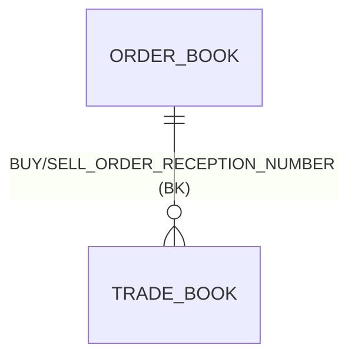
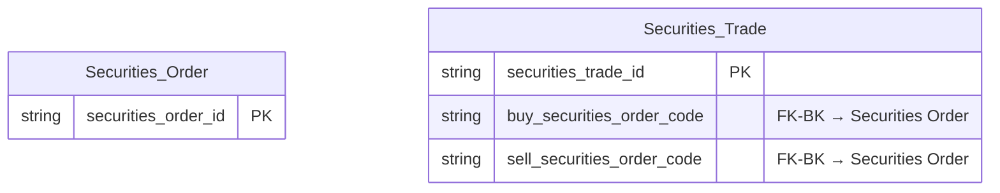

# HNX HLD — Tier 2

**Source system:** HNX (Dữ liệu Sở Giao dịch Chứng khoán Hà Nội — vùng staging `uat_hnx_stg`)
**Tier 2:** `TRADE_BOOK` (sổ khớp) mang số hiệu lệnh mua/bán trỏ về `ORDER_BOOK` (sổ lệnh, Tier 1) → entity `Securities Trade` phụ thuộc `Securities Order` qua business key. Thiết kế tham khảo ORDERTRADE (`Securities Trade`, D-03/D-04).

---

## 6a. Bảng tổng quan BCV Concept

| BCV Core Object | BCV Concept | Category | Source Table | Source Table Change Mode | Mô tả bảng nguồn | Atomic Entity | Table Type | BCV Term |
|---|---|---|---|---|---|---|---|---|
| Transaction | [Transaction] Financial Market Transaction | Financial Markets Trading | TRADE_BOOK | Update | Sổ khớp chi tiết HNX — mỗi bản ghi là 1 lần khớp thành công: thị trường, bảng giao dịch, mã chứng khoán, số hiệu khớp, giá/khối lượng khớp, thông tin bên mua và bên bán (thành viên, tài khoản, loại lệnh, loại nhà đầu tư, giá/khối lượng lệnh), số hiệu lệnh mua/bán, Spread legs. Dùng chung với `HOSE.TRADE_BOOK` | Securities Trade | Fact Append | (1) Financial Market Transaction (13339) — giao dịch điều chỉnh vị thế nắm giữ công cụ tài chính. (2) Cột nguồn: số hiệu khớp, giá, khối lượng, hai phía mua/bán trên cùng dòng — mỗi dòng 1 lần khớp. (3) Chọn Financial Market Transaction, cùng term thiết kế ORDERTRADE; lưu cả hai phía trên 1 dòng để giữ grain nguồn |

---

## 6b. Diagram Source (Mermaid)

---

## 6c. Diagram Atomic (Mermaid)

> `Securities_Order` là node tham chiếu — entity định nghĩa ở `HNX_HLD_Tier1`. Không tạo surrogate FK (khối lượng lớn), liên kết bằng business key.

---

## 6d. Mục Danh mục & Tham chiếu (Reference Data)

| Source Field / Bảng | Mô tả | Scheme Code | source_type | Ghi chú |
|---|---|---|---|---|
| ORDER_BOOK / TRADE_BOOK | Các cột có bộ mã (market, board, session, side, order action, account/investor/foreign type, order type/condition, currency…) dùng domain Classification Value, giữ mã raw từng sàn | Chưa đặt (Data Modeler đặt sau) | — | Thiết kế lại 2026-11-03 |

---

## 6e. Bảng chờ thiết kế

| Source Table | Mô tả bảng nguồn | Lý do chưa thiết kế |
|---|---|---|

*(Không có)*

---

## 6f. Điểm cần xác nhận

| # | Câu hỏi | Kết quả |
|---|---|---|
| T2-01 | `TRADE_BOOK` (HNX + HOSE) → `Securities Trade`, `Fact Append`; liên kết BK về `Securities Order` | Xem `HNX_HLD_Overview` 7e #4, #6, #7, #9 |
| T2-02 | Cặp số hiệu lệnh để join về `Securities Order`: HNX dùng `*_ORDER_RECEPTION_NUMBER`, HOSE dùng `*_ORDER_ACCEPT_NO` | Cần xác nhận khóa join (kèm `trade_date`, mã chứng khoán) khi thiết kế LLD |
