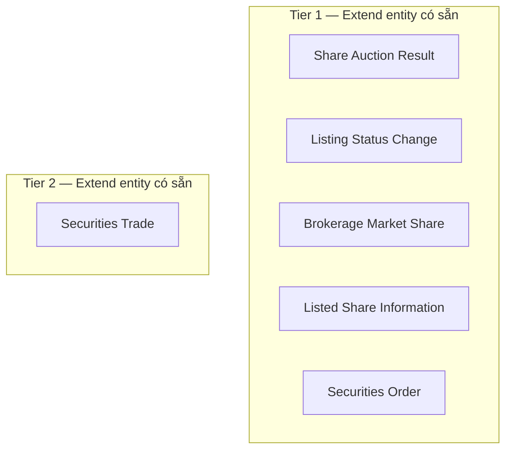

# HOSE HLD — Overview

**Source system:** HOSE (Dữ liệu Sở Giao dịch Chứng khoán TP.HCM — vùng staging `uat_hose_stg`)
**Mô tả:** HOSE cung cấp 4 báo cáo có cấu trúc tương tự HNX/VSDC: kết quả đấu giá cổ phiếu, quyết định thay đổi niêm yết, danh sách chứng khoán niêm yết và thị phần môi giới. Không có entity riêng — toàn bộ bổ sung `source_table` cho entity đã định nghĩa ở HNX và VSDC.

---

## Tổng quan Atomic Entities

| Tier | Atomic Entity | BCV Core Object | BCV Concept | table_type | Source Table(s) | Ghi chú |
|---|---|---|---|---|---|---|
| T1 (extend) | Brokerage Market Share | Documentation | [Documentation] Regulatory Report | Fact Snapshot | HOSE.brokerage_market_share | Định nghĩa ở HNX |
| T1 (extend) | Listed Share Information | Documentation | [Documentation] Regulatory Report | Fact Snapshot | HOSE.listed_securities_list | Định nghĩa ở VSDC |
| T1 (extend) | Listing Status Change | Documentation | [Documentation] Regulatory Report | Fact Snapshot | HOSE.listing_status_change | Định nghĩa ở HNX |
| T1 (extend) | Securities Order | Communication | [Communication] Financial Market Order | Fact Append | HOSE.order_book | Định nghĩa ở HNX |
| T1 (extend) | Share Auction Result | Documentation | [Documentation] Regulatory Report | Fact Snapshot | HOSE.share_auction | Định nghĩa ở HNX |
| T2 (extend) | Securities Trade | Transaction | [Transaction] Financial Market Transaction | Fact Append | HOSE.trade_book | Định nghĩa ở HNX |

**Tổng: 0 Atomic entities mới**
*(Trong đó: 6 bảng nguồn extend `source_table` của entity thuộc source khác — không tạo mới)*

---

## Diagram Phân tầng Dependencies (Mermaid)

---

## Quyết định thiết kế chính

| # | Quyết định | Lý do |
|---|---|---|
| D-01 | Không tạo entity riêng cho HOSE | Cấu trúc cột 4 bảng trùng khớp HNX/VSDC; `src_stm_code` phân biệt nguồn |
| D-02 | Không dùng prefix `HOSE` trong tên entity | Đồng nhất với MDDS D-04 / HNX D-04 |
| D-03 | `order_book` và `trade_book` extend `Securities Order` / `Securities Trade` (định nghĩa ở HNX), `Fact Append` | Tham khảo thiết kế ORDERTRADE; cùng grain 1 event lệnh / 1 lần khớp với HNX; xem `HNX_HLD_Overview` D-06…D-09 |

---

#### 7a. Bảng tổng quan Atomic entities

| Tier | BCV Core Object | BCV Concept | Category | Source Table | Source Table Change Mode | Mô tả bảng nguồn | Atomic Entity | Table Type | BCV Term |
|---|---|---|---|---|---|---|---|---|---|
| T1 (extend) | Documentation | [Documentation] Regulatory Report | Documentation | brokerage_market_share | Append | Thị phần môi giới theo quý tại HOSE — entity định nghĩa ở HNX | Brokerage Market Share | Fact Snapshot | Regulatory Report (9297) — Core Object Documentation theo chỉ định Data Modeler |
| T1 (extend) | Documentation | [Documentation] Regulatory Report | Documentation | listed_securities_list | Append | Danh sách chứng khoán niêm yết HOSE — entity định nghĩa ở VSDC | Listed Share Information | Fact Snapshot | Regulatory Report (9297) — Core Object Documentation theo chỉ định Data Modeler |
| T1 (extend) | Documentation | [Documentation] Regulatory Report | Documentation | listing_status_change | Append | Quyết định thay đổi niêm yết tại HOSE — entity định nghĩa ở HNX | Listing Status Change | Fact Snapshot | Regulatory Report (9297) — Core Object Documentation theo chỉ định Data Modeler |
| T1 (extend) | Documentation | [Documentation] Regulatory Report | Documentation | share_auction | Append | Kết quả đấu giá cổ phiếu tại HOSE — entity định nghĩa ở HNX | Share Auction Result | Fact Snapshot | Regulatory Report (9297) — Core Object Documentation theo chỉ định Data Modeler |
| T1 (extend) | Communication | [Communication] Financial Market Order | Financial Markets Trading | order_book | Update | Sổ lệnh chi tiết HOSE — mỗi bản ghi là 1 event lệnh (cổ phiếu/trái phiếu/repo) — entity định nghĩa ở HNX | Securities Order | Fact Append | Financial Market Order (8539) — xem HNX_HLD_Overview 7a |
| T2 (extend) | Transaction | [Transaction] Financial Market Transaction | Financial Markets Trading | trade_book | Update | Sổ khớp chi tiết HOSE — mỗi bản ghi là 1 lần khớp, chứa đồng thời bên mua và bên bán — entity định nghĩa ở HNX | Securities Trade | Fact Append | Financial Market Transaction (13339) — xem HNX_HLD_Overview 7a |

#### 7b. Diagram Atomic tổng (Mermaid)

```mermaid
erDiagram
    Share_Auction_Result {
        string share_auction_result_id PK
    }
    Listing_Status_Change {
        string listing_status_change_id PK
    }
    Listed_Share_Information {
        string listed_share_information_id PK
    }
    Brokerage_Market_Share {
        string brokerage_market_share_id PK
    }
    Securities_Order {
        string securities_order_id PK
    }
    Securities_Trade {
        string securities_trade_id PK
    }

```

#### 7c. Bảng Classification Value

| Source Table | Mô tả | BCV Term | Xử lý Atomic |
|---|---|---|---|
| — | Không có Classification Value scheme | — | Các cột phân loại giữ dạng Text |

#### 7d. Junction Tables

Không có junction table.

#### 7e. Điểm cần xác nhận

| # | Tier | Câu hỏi | Ảnh hưởng |
|---|---|---|---|
| 1 | T1 | 4 bảng HOSE extend entity có sẵn; cần xác nhận không có khác biệt ngữ nghĩa/giá trị so với HNX/VSDC | Có thể phải tách entity riêng nếu khác |
| 2 | T1/T2 | `HOSE.order_book` / `HOSE.trade_book` có Change Mode `Update` (mặc định) nhưng entity là `Fact Append`; nhiều cột chỉ có ở HOSE (`LTP`, `MATCHED_RATIO`, `BUY_UP_SELL_DOWN_*`, `SHORT_SELL_INDICATOR`…) | Xem `HNX_HLD_Overview` 7e #4, #6, #7 |

#### 7f. Bảng ngoài scope

| Nhóm | Source Table | Mô tả bảng nguồn | Lý do ngoài scope |
|---|---|---|---|
| Shared Entity | brokerage_market_share | Thị phần môi giới theo quý tại HOSE | Dùng entity `Brokerage Market Share` (định nghĩa ở HNX) — chỉ bổ sung `source_table` |
| Shared Entity | listed_securities_list | Danh sách chứng khoán niêm yết HOSE | Dùng entity `Listed Share Information` (định nghĩa ở VSDC) — chỉ bổ sung `source_table` |
| Shared Entity | listing_status_change | Quyết định thay đổi niêm yết tại HOSE | Dùng entity `Listing Status Change` (định nghĩa ở HNX) — chỉ bổ sung `source_table` |
| Shared Entity | order_book | Sổ lệnh chi tiết HOSE | Dùng entity `Securities Order` (định nghĩa ở HNX) — chỉ bổ sung `source_table` |
| Shared Entity | share_auction | Kết quả đấu giá cổ phiếu tại HOSE | Dùng entity `Share Auction Result` (định nghĩa ở HNX) — chỉ bổ sung `source_table` |
| Shared Entity | trade_book | Sổ khớp chi tiết HOSE | Dùng entity `Securities Trade` (định nghĩa ở HNX) — chỉ bổ sung `source_table` |

---

## Entities

> Không có entity mới trong HOSE — 4 bảng nguồn extend `source_table` của entity thuộc HNX/VSDC (xem Tổng quan và 7f). Section này để trống có chủ đích.
