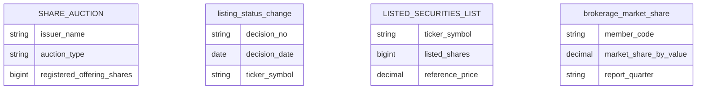
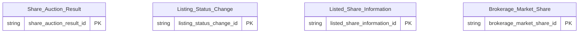

# HOSE HLD — Tier 1

**Source system:** HOSE (Dữ liệu Sở Giao dịch Chứng khoán TP.HCM — vùng staging `uat_hose_stg`)
**Tier 1:** 5 bảng HOSE (4 bảng + `ORDER_BOOK`; `TRADE_BOOK` ở Tier 2) có cấu trúc trùng với bảng cùng tên của HNX/VSDC → không tạo entity mới, chỉ bổ sung `source_table` cho entity đã định nghĩa ở `HNX_HLD_Tier1` và `VSDC_HLD_Tier1`

---

## 6a. Bảng tổng quan BCV Concept

> Tier này **không có entity mới** — các dòng dưới đây là bảng nguồn extend entity có sẵn (không tính vào số entity).

| BCV Core Object | BCV Concept | Category | Source Table | Source Table Change Mode | Mô tả bảng nguồn | Atomic Entity | Table Type | BCV Term |
|---|---|---|---|---|---|---|---|---|
| Documentation | [Documentation] Regulatory Report | Documentation | SHARE_AUCTION | Append | Kết quả đấu giá cổ phiếu tại HOSE — cấu trúc 24 cột giống hệt `HNX.SHARE_AUCTION` — entity định nghĩa ở HNX_HLD_Tier1 | Share Auction Result | Fact Snapshot | (1) BCV term: **Regulatory Report** (Documentation, id 9297) — *"Regulatory Information which is a report on regulations"*. (2) Cấu trúc trường: kết quả đấu giá cổ phiếu theo tổ chức phát hành và loại đấu giá — bảng báo cáo do Sở/VSDC cung cấp. (3) Theo chỉ định Data Modeler (2026-10-18): Core Object Documentation, table_type Fact Snapshot cho toàn bộ bảng báo cáo VSDC/HNX/HOSE. |
| Documentation | [Documentation] Regulatory Report | Documentation | listing_status_change | Append | Quyết định thay đổi niêm yết tại HOSE — cấu trúc 18 cột giống hệt `HNX.LISTING_STATUS_CHANGE` — entity định nghĩa ở HNX_HLD_Tier1 | Listing Status Change | Fact Snapshot | (1) BCV term: **Regulatory Report** (Documentation, id 9297) — *"Regulatory Information which is a report on regulations"*. (2) Cấu trúc trường: quyết định thay đổi niêm yết chứng khoán — bảng báo cáo do Sở/VSDC cung cấp. (3) Theo chỉ định Data Modeler (2026-10-18): Core Object Documentation, table_type Fact Snapshot cho toàn bộ bảng báo cáo VSDC/HNX/HOSE. |
| Documentation | [Documentation] Regulatory Report | Documentation | LISTED_SECURITIES_LIST | Append | Danh sách chứng khoán niêm yết HOSE: mã, tổ chức phát hành, số lượng niêm yết, số lượng lưu hành, giá tham chiếu — entity định nghĩa ở VSDC_HLD_Tier1 | Listed Share Information | Fact Snapshot | (1) BCV term: **Regulatory Report** (Documentation, id 9297) — *"Regulatory Information which is a report on regulations"*. (2) Cấu trúc trường: cơ cấu số lượng cổ phiếu theo mã/ngày (VSDC) và số lượng niêm yết, giá tham chiếu (HNX/HOSE) — bảng báo cáo do Sở/VSDC cung cấp. (3) Theo chỉ định Data Modeler (2026-10-18): Core Object Documentation, table_type Fact Snapshot cho toàn bộ bảng báo cáo VSDC/HNX/HOSE. |
| Documentation | [Documentation] Regulatory Report | Documentation | brokerage_market_share | Append | Thị phần môi giới theo quý tại HOSE — cấu trúc 8 cột giống hệt `HNX.BROKERAGE_MARKET_SHARE` — entity định nghĩa ở HNX_HLD_Tier1 | Brokerage Market Share | Fact Snapshot | (1) BCV term: **Regulatory Report** (Documentation, id 9297) — *"Regulatory Information which is a report on regulations"*. (2) Cấu trúc trường: thị phần môi giới của công ty chứng khoán thành viên theo quý — bảng báo cáo do Sở/VSDC cung cấp. (3) Theo chỉ định Data Modeler (2026-10-18): Core Object Documentation, table_type Fact Snapshot cho toàn bộ bảng báo cáo VSDC/HNX/HOSE. |
| Communication | [Communication] Financial Market Order | Financial Markets Trading | ORDER_BOOK | Update | Sổ lệnh chi tiết HOSE — mỗi bản ghi là 1 event lệnh (cổ phiếu/trái phiếu/repo); cùng cấu trúc `HNX.ORDER_BOOK` ở các cột chung | Securities Order | Fact Append | Financial Market Order (8539) — xem `HNX_HLD_Tier1` 6a; entity định nghĩa ở HNX |

---

## 6b. Diagram Source (Mermaid)

> Nguồn HOSE không khai báo FK; 4 bảng độc lập.

---

## 6c. Diagram Atomic (Mermaid)

> Cả 4 entity là node tham chiếu — định nghĩa ở `HNX_HLD_Tier1` / `VSDC_HLD_Tier1`; HOSE thêm `src_stm_code = HOSE`.

---

## 6d. Mục Danh mục & Tham chiếu (Reference Data)

| Source Field / Bảng | Mô tả | Scheme Code | source_type | Ghi chú |
|---|---|---|---|---|
| ORDER_BOOK / TRADE_BOOK | Các cột có bộ mã (market, board, session, side, order action, account/investor/foreign type, order type/condition, currency…) dùng domain Classification Value, giữ mã raw từng sàn | Chưa đặt (Data Modeler đặt sau) | — | Thiết kế lại 2026-11-03, xem `HNX_HOSE_Order_Trade_Overlap.md` |

---

## 6e. Bảng chờ thiết kế

| Source Table | Mô tả bảng nguồn | Lý do chưa thiết kế |
|---|---|---|

*(Không có)*

---

## 6f. Điểm cần xác nhận

| # | Câu hỏi | Kết quả |
|---|---|---|
| T1-01 | 4 bảng HOSE extend entity có sẵn thay vì tạo entity riêng cho HOSE | Cấu trúc cột trùng khớp HNX/VSDC; `src_stm_code` phân biệt nguồn. Cần xác nhận không có khác biệt ngữ nghĩa/giá trị ở dữ liệu thực |
| T1-02 | `HOSE.LISTED_SECURITIES_LIST` có đủ cột như HNX (`issuer_name`, `listed_shares`, `outstanding_shares`, `reference_price`) nhưng khác `VSDC.OUTSTANDING_SHARES` | Xem `VSDC_HLD_Overview` 7e #3 |
| T1-03 | `HOSE.ORDER_BOOK` extend `Securities Order` (định nghĩa ở `HNX_HLD_Tier1`); `HOSE.TRADE_BOOK` xếp Tier 2 | Xem `HOSE_HLD_Tier2`; nhiều cột chỉ có ở HOSE (nullable ở phía HNX) |
