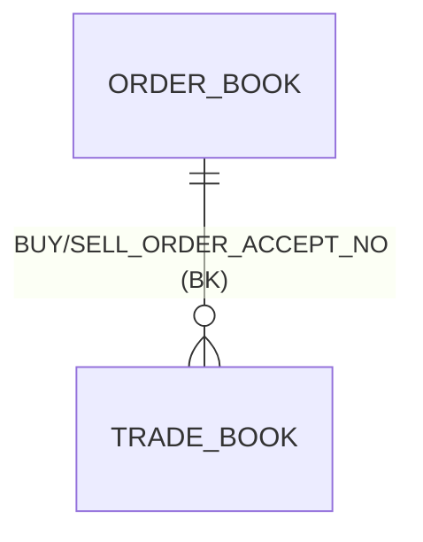
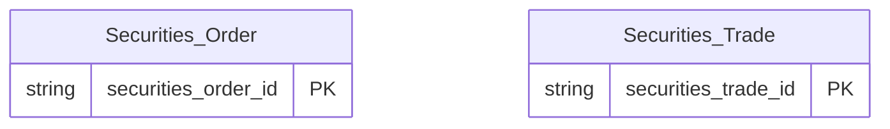

# HOSE HLD — Tier 2

**Source system:** HOSE (Dữ liệu Sở Giao dịch Chứng khoán TP.HCM — vùng staging `uat_hose_stg`)
**Tier 2:** `TRADE_BOOK` extend entity `Securities Trade` (định nghĩa ở `HNX_HLD_Tier2`), liên kết BK về `Securities Order` (`HOSE.ORDER_BOOK` extend ở `HOSE_HLD_Tier1`). Không tạo entity mới.

---

## 6a. Bảng tổng quan BCV Concept

| BCV Core Object | BCV Concept | Category | Source Table | Source Table Change Mode | Mô tả bảng nguồn | Atomic Entity | Table Type | BCV Term |
|---|---|---|---|---|---|---|---|---|
| Transaction | [Transaction] Financial Market Transaction | Financial Markets Trading | TRADE_BOOK | Update | Sổ khớp chi tiết HOSE — mỗi bản ghi là 1 lần khớp: thị trường, mã chứng khoán, số hiệu khớp, giá/khối lượng/giá trị khớp, thông tin bên mua và bên bán (đặt lệnh, thành viên, tài khoản, loại nhà đầu tư, giá/khối lượng lệnh, trader). Entity định nghĩa ở HNX | Securities Trade | Fact Append | Financial Market Transaction (13339) — xem `HNX_HLD_Tier2` 6a |

---

## 6b. Diagram Source (Mermaid)

---

## 6c. Diagram Atomic (Mermaid)

> Cả hai entity định nghĩa ở HNX; HOSE chỉ bổ sung `source_table`.

---

## 6d. Mục Danh mục & Tham chiếu (Reference Data)

| Source Field / Bảng | Mô tả | Scheme Code | source_type | Ghi chú |
|---|---|---|---|---|
| ORDER_BOOK / TRADE_BOOK | Các cột có bộ mã (market, board, session, side, order action, account/investor/foreign type, order type/condition, currency…) dùng domain Classification Value, giữ mã raw từng sàn | Chưa đặt (Data Modeler đặt sau) | — | Thiết kế lại 2026-11-03, xem `HNX_HOSE_Order_Trade_Overlap.md` |

---

## 6e. Bảng chờ thiết kế

| Source Table | Mô tả bảng nguồn | Lý do chưa thiết kế |
|---|---|---|

*(Không có)*

---

## 6f. Điểm cần xác nhận

| # | Câu hỏi | Kết quả |
|---|---|---|
| T2-01 | `HOSE.TRADE_BOOK` extend `Securities Trade`; nhiều cột chỉ có ở HOSE (`EXECUTION_LTP`, `EXECUTION_NEW_HIGH_LOW_PRICE`, `*_TRADER_NO`…) | Xem `HNX_HLD_Overview` 7e #6, #7 |
