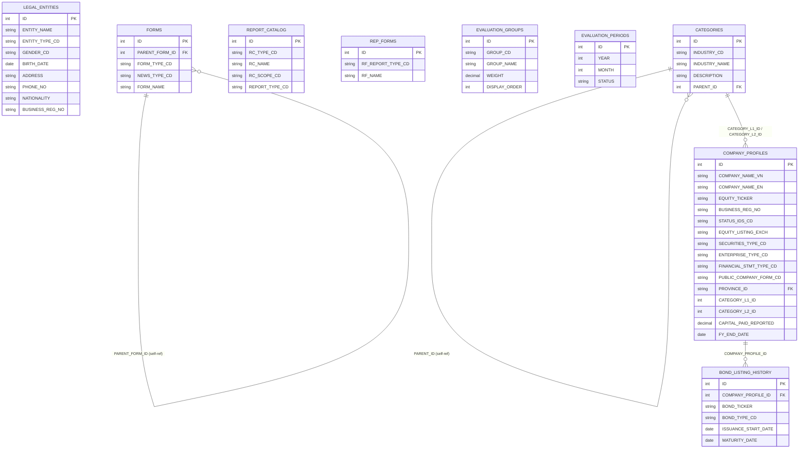
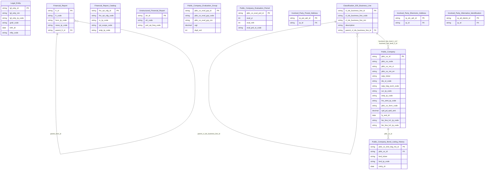

# IDS HLD — Tier 1

**Source system:** IDS (Information Disclosure System — Hệ thống Công bố Thông tin)
**Tier 1:** Các entity độc lập — không FK đến entity nghiệp vụ khác trong scope IDS. Gồm 2 nhánh: (A) Công ty đại chúng (`COMPANY_PROFILES`), (B) Thực thể pháp lý (`LEGAL_ENTITIES`), và các entity template/danh mục độc lập (FORMS, REPORT_CATALOG, REP_FORMS, EVALUATION_GROUPS, EVALUATION_PERIODS), entity lịch sử niêm yết trái phiếu `BOND_LISTING_HISTORY` (LLD không có FK tới entity nào khác → `group: T1`) và 3 shared entity Involved Party Postal Address/Electronic Address/Alternative Identification (host `COMPANY_PROFILES`, `LEGAL_ENTITIES` group T1; host khác group T2 — ghi nhận ở Tier thấp nhất = 1, chi tiết ở cột BCV Term mục 6a). `CATEGORIES` → entity `Classification IDS Business Line` (danh mục ngành nghề 2 cấp, xem 6f T1-13). *(Nhánh Công ty kiểm toán `AF_PROFILES` đã tách sang `AUDIT_HLD_Tier1.md` — 2026-10-16.)*

---

## 6a. Bảng tổng quan BCV Concept

| BCV Core Object | BCV Concept | Category | Source Table | Source Table Change Mode | Mô tả bảng nguồn | Atomic Entity | Table Type | BCV Term |
|---|---|---|---|---|---|---|---|---|
| Involved Party | [Involved Party] Organization | Organization | `COMPANY_PROFILES` | Update | Thông tin cơ bản của công ty đại chúng: tên VI/EN, mã CK, sàn niêm yết, trạng thái, vốn điều lệ, loại hình doanh nghiệp. Hạt nhân của toàn bộ IDS — hầu hết bảng nghiệp vụ FK về đây. | Public Company | Fundamental | (1) Term candidate: `[Involved Party] Organization` — BCV mô tả tổ chức/pháp nhân có lifecycle riêng, được UBCKNN quản lý. (2) Cấu trúc trường: tên VI/EN/viết tắt, mã CK, sàn niêm yết (EQUITY_LISTING_EXCH), trạng thái (STATUS_IDS_CD), vốn điều lệ (CAPITAL_PAID_REPORTED), loại doanh nghiệp (ENTERPRISE_TYPE_CD), loại BCTC (FINANCIAL_STMT_TYPE_CD) — rõ ràng là profile của pháp nhân tổ chức; không có bảng `company_detail` riêng trong BRD thực tế. (3) Chọn `[Involved Party] Organization` — công ty đại chúng là pháp nhân tổ chức; shared entity với SCMS.DM_CONG_TY_DC. |
| Involved Party | [Involved Party] Individual | Involved Party | `LEGAL_ENTITIES` | Update | Cổ đông giao dịch, người nội bộ, người liên quan của công ty đại chúng (cá nhân hoặc tổ chức). Grain = 1 thực thể pháp lý độc lập — không FK đến COMPANY_PROFILES ở bảng này; quan hệ với công ty thể hiện qua COMPANY_ENTITY_ROLE và COMPANY_SHAREHOLDING (Tier 2). | Legal Entity | Fundamental | (1) Term candidate: `[Involved Party] Individual` — BCV mô tả cá nhân hoặc tổ chức là Involved Party có lifecycle riêng. (2) Cấu trúc trường: ENTITY_NAME, ENTITY_TYPE_CD (cá nhân/tổ chức), GENDER_CD, BIRTH_DATE, ADDRESS, PHONE_NO, FAX_NO, NATIONALITY, EDUCATION_LEVEL_CD, BUSINESS_REG_NO (nếu là tổ chức), PAID_UP_CHARTER_CAPITAL, WEBSITE — đây là profile đầy đủ của một thực thể pháp lý độc lập không gắn với công ty cụ thể. (3) Chọn `[Involved Party] Individual` — LEGAL_ENTITIES là Involved Party với lifecycle riêng; grain = 1 thực thể, không phải 1 giao dịch. Fundamental vì không FK đến bảng nghiệp vụ ở T1. |
| Documentation | [Documentation] Form Document | Documentation | `FORMS` | Update | Định nghĩa template form CBTT — mỗi form là một loại hồ sơ/tin công bố; self-ref qua `parent_form_id` tạo cấu trúc cha-con. | Financial Report | Relative | (1) Term candidate: `[Documentation] Form Document` (BCV id 9348, category Documentation, part_of `Documentation Item`) — "Mục Tài liệu được trình bày theo bố cục mẫu tiêu chuẩn, yêu cầu cung cấp thêm thông tin" (VD: mẫu đơn vay, bảng câu hỏi). (2) Cấu trúc trường: form_type_cd, news_type_cd, parent_form_id (self-ref), tên biểu mẫu — chỉ là metadata của bản mẫu (layout chuẩn), không có dữ liệu nghiệp vụ thực; dữ liệu thực (đã điền vào form) nằm ở `Financial Report Value` (`DATA`) — đúng khớp mô tả "yêu cầu cung cấp thêm thông tin". (3) Chọn `[Documentation] Form Document`, thay cho `[Condition] Form Definition` trước đây — term "Form Definition" **không tồn tại** trong `knowledge/terms.csv` (grep xác nhận 0 kết quả; term cũ tự đặt, không qua tra cứu BCV đúng quy trình rule#6), trong khi "Form Document" là term thật (id 9348) khớp chính xác cấu trúc bảng. Đổi theo yêu cầu tường minh Data Modeler (2026-08-13) — xem Overview 7e #21. Domain prefix giữ nguyên `Financial Report` (`fr`). |
| Documentation | [Documentation] Form Document | Documentation | `REPORT_CATALOG` | Update | Danh mục báo cáo tài chính: định nghĩa loại báo cáo (BCTC, KQKD...) với tập hàng/cột tương ứng. | Financial Report Catalog | Relative | (1) Term: `[Documentation] Form Document` (BCV id 9348) theo LLD `lld_IDS_REPORT_CATALOG.yaml` — cùng họ với `FORMS`/`RROW`/`RCOL`. (2) Cấu trúc trường: rc_type_cd, tên catalog, phạm vi (rc_scope_cd), loại doanh nghiệp (report_type_cd), kỳ báo cáo — metadata bản mẫu BCTC, không phải dữ liệu thực. (3) Chọn `[Documentation] Form Document` (đồng bộ theo LLD 2026-10-21, thay `[Condition] Form Definition`). |
| Documentation | [Documentation] Form Document | Documentation | `REP_FORMS` | Update | Template báo cáo định kỳ (tháng/quý/năm/bán niên) — bộ mẫu độc lập với báo cáo tài chính. | Unstructured Financial Report | Relative | (1) Term candidate: `[Documentation] Form Document` (BCV id 9348, category Documentation, part_of `Documentation Item`) — "Mục Tài liệu được trình bày theo bố cục mẫu tiêu chuẩn, yêu cầu cung cấp thêm thông tin". (2) Cấu trúc trường: rf_report_type_cd (tần suất), tên form, mô tả — chỉ là metadata của bản mẫu báo cáo định kỳ, không có dữ liệu nghiệp vụ thực (số liệu điền vào từng kỳ). (3) Chọn `[Documentation] Form Document`, thay cho `[Condition] Form Definition` trước đây — term "Form Definition" **không tồn tại** trong `knowledge/terms.csv` (grep xác nhận 0 kết quả; tự đặt, không qua tra cứu BCV đúng quy trình rule#6), trong khi "Form Document" là term thật (id 9348) khớp chính xác. Đổi theo yêu cầu tường minh Data Modeler (2026-08-13) — xem Overview 7e #21. Đổi tên entity từ `Periodic Report Form` (2026-08-05); domain prefix đổi sang `Unstructured Financial Report` (`ufr`) (2026-08-27, theo yêu cầu tường minh Data Modeler — chỉ áp dụng 3 entity REP_FORMS/REP_ROW/REP_COLUMN) — xem Overview 7e #22. Bỏ chữ "Sub" khỏi tên entity (2026-08-27) — xem Overview 7e #23. |
| Group | [Group] Group | Group | `EVALUATION_GROUPS` | Update | Nhóm chỉ tiêu đánh giá xếp hạng công ty đại chúng (không có FK đến bảng nghiệp vụ khác). | Public Company Evaluation Group | Relative | (1) Term candidate: `[Group] Group` — BCV mô tả nhóm phân loại. (2) Cấu trúc trường: GROUP_NAME, GROUP_CD, WEIGHT, DISPLAY_ORDER — đây là danh mục nhóm chỉ tiêu phục vụ đánh giá, có CODE + NAME + metadata. Tuy nhiên có WEIGHT (trọng số) là attribute nghiệp vụ quan trọng. (3) Chọn `[Group] Group` — EVALUATION_GROUPS là bảng phân nhóm chỉ tiêu đánh giá; Table Type = Relative theo LLD (`lld_IDS_EVALUATION_GROUPS.yaml`, 2026-10-21). |
| Event | [Event] Period | Event | `EVALUATION_PERIODS` | Update | Kỳ đánh giá xếp hạng công ty đại chúng (năm + tháng + trạng thái đã duyệt). | Public Company Evaluation Period | Fundamental | (1) Term candidate: `[Event] Period` — BCV mô tả khoảng thời gian nghiệp vụ có lifecycle riêng (draft → approved). (2) Cấu trúc trường: YEAR, MONTH, STATUS (approved/draft) — đây là kỳ đánh giá có lifecycle riêng, không chỉ là reference data Code + Name. (3) Chọn `[Event] Period` — EVALUATION_PERIODS là kỳ nghiệp vụ độc lập phục vụ đánh giá. Fundamental vì không FK đến entity nghiệp vụ khác. |
| Business Activity | [Business Activity] Business Activity | Business Activity | `BOND_LISTING_HISTORY` | Update | Lịch sử phát hành/niêm yết trái phiếu: mã TP, loại TP, số quyết định, ngày phát hành, lãi suất, ngày đáo hạn. | Public Company Bond Listing History | Fact Append | (1) Term candidate: `[Business Activity] Business Activity` — sự kiện phát hành/niêm yết trái phiếu là occurrence không sửa. (2) Cấu trúc trường: BOND_TICKER, BOND_TYPE_CD, DECISION_NO/DATE, ISSUANCE_QTY, PAR_VALUE, COUPON_RATE, ISSUANCE_START/END_DATE, MATURITY_DATE. (3) Chọn `[Business Activity] Business Activity`. Fact Append. |
| Common | [Common] Industry Classification | Common | `CATEGORIES` | Update | Mô tả danh mục ngành nghề của công ty đại chúng theo cấu trúc phân cấp 2 cấp (cha - con qua PARENT_ID): mã, tên và mô tả ngành nghề. | Classification IDS Business Line | Classification | (1) Term candidate: `[Common] Industry Classification` — phân loại ngành nghề/lĩnh vực hoạt động kinh doanh của tổ chức (cùng concept với `Classification FMS Business`). (2) Cấu trúc trường: INDUSTRY_CD, INDUSTRY_NAME, DESCRIPTION, PARENT_ID (self-ref FK tạo cây 2 cấp) — danh mục có phân cấp, được `COMPANY_PROFILES.CATEGORY_L1_ID/L2_ID` tham chiếu. (3) Chọn `[Common] Industry Classification`; Classification Table Type, Domain Prefix = `Classification` (giữ tên nguồn `IDS` theo quyết định Data Modeler 2026-10-21). |
| Involved Party | Shared Entity | Shared Entity | `COMPANY_PROFILES`, `COMPANY_RELATIONSHIP`, `LEGAL_ENTITIES` | Update | Địa chỉ bưu chính của Involved Party từ nhiều bảng nguồn IDS (CTĐC, quan hệ CTĐC, thực thể pháp lý). | Involved Party Postal Address | Fundamental | Shared Entity — extend source_table IDS. Tier = 1 (thấp nhất theo LLD): host `COMPANY_PROFILES`, `LEGAL_ENTITIES` group T1; host `COMPANY_RELATIONSHIP` group T2. |
| Involved Party | Shared Entity | Shared Entity | `COMPANY_PROFILES`, `LEGAL_ENTITIES`, `LEGAL_REPRESENTATIVE` | Update | Địa chỉ điện tử (điện thoại/email/fax/website) của Involved Party. | Involved Party Electronic Address | Fundamental | Shared Entity — extend source_table IDS. Tier = 1 (thấp nhất theo LLD): host `COMPANY_PROFILES`, `LEGAL_ENTITIES` group T1; host `LEGAL_REPRESENTATIVE` group T2. |
| Involved Party | Shared Entity | Shared Entity | `COMPANY_PROFILES`, `COMPANY_RELATIONSHIP`, `IDENTITY` | Update | Giấy tờ định danh của cổ đông/người nội bộ/người liên quan (nguồn IDENTITY) và mã số thuế của CTĐC/pháp nhân liên quan (nguồn COMPANY_PROFILES, COMPANY_RELATIONSHIP). | Involved Party Alternative Identification | Fundamental | Shared Entity — extend source_table IDS. Tier = 1 (thấp nhất theo LLD): host `COMPANY_PROFILES` group T1; host `COMPANY_RELATIONSHIP`, `IDENTITY` group T2. |

---

## 6b. Diagram Source (Mermaid)

---

## 6c. Diagram Atomic (Mermaid)

---

## 6d. Mục Danh mục & Tham chiếu (Reference Data)

| Source Field / Bảng | Mô tả | Scheme Code | source_type | Ghi chú |
|---|---|---|---|---|
| `COMPANY_PROFILES.STATUS_IDS_CD` | Trạng thái niêm yết IDS | `IDS_COMPANY_STATUS` | source_table | Values load từ `LOOKUP_VALUES` (LOOKUP_GROUP = 'IDS_COMPANY_STATUS') |
| `COMPANY_PROFILES.EQUITY_LISTING_EXCH` | Sàn niêm yết cổ phiếu (HNX/HOSE/UPCoM) | `IDS_EQUITY_LISTING_EXCH` | source_table | Values load từ `LOOKUP_VALUES` |
| `COMPANY_PROFILES.SECURITIES_TYPE_CD` | Loại chứng khoán phát hành | `IDS_SECURITIES_TYPE` | source_table | Values load từ `LOOKUP_VALUES` |
| `COMPANY_PROFILES.PUBLIC_COMPANY_FORM_CD` | Hình thức trở thành CTĐC (IPO / nộp hồ sơ) | `IDS_PUBLIC_COMPANY_FORM` | source_table | Values load từ `LOOKUP_VALUES` |
| `COMPANY_PROFILES.ENTERPRISE_TYPE_CD` | Loại hình doanh nghiệp | `IDS_ENTERPRISE_TYPE` | source_table | Values load từ `LOOKUP_VALUES`. Dùng chung với Financial Report Catalog |
| `COMPANY_PROFILES.FINANCIAL_STMT_TYPE_CD` | Loại báo cáo tài chính (IFRS/VAS) | `IDS_FINANCIAL_STMT_TYPE` | source_table | Values load từ `LOOKUP_VALUES` |
| `LEGAL_ENTITIES.ENTITY_TYPE_CD` | Loại hình thực thể (cá nhân/tổ chức) | `IDS_ENTITY_TYPE` | source_table | Values load từ `LOOKUP_VALUES` (LOOKUP_GROUP = 'ENTITY_TYPE') |
| `LEGAL_ENTITIES.GENDER_CD` | Giới tính | `IDS_GENDER` | source_table | Values load từ `LOOKUP_VALUES` (LOOKUP_GROUP = 'GENDER') |
| `LEGAL_ENTITIES.EDUCATION_LEVEL_CD` | Trình độ học vấn | `IDS_EDUCATION_LEVEL` | source_table | Values load từ `LOOKUP_VALUES` (LOOKUP_GROUP = 'EDUCATION_LEVEL') |
| `FORMS.FORM_TYPE_CD` | Loại hồ sơ/tin CBTT | `IDS_FORM_TYPE` | source_table | Values load từ `LOOKUP_VALUES` |
| `FORMS.NEWS_TYPE_CD` | Loại tin gốc | `IDS_NEWS_TYPE` | source_table | Values load từ `LOOKUP_VALUES` |
| `REPORT_CATALOG.RC_TYPE_CD` | Loại catalog báo cáo tài chính | `IDS_REPORT_CATALOG_TYPE` | etl_derived | Values lấy trực tiếp từ cột nguồn |
| `REPORT_CATALOG.RC_SCOPE_CD` | Phạm vi báo cáo (hợp nhất, mẹ...) | `IDS_REPORT_SCOPE` | source_table | Values load từ `LOOKUP_VALUES` |
| `REP_FORMS.RF_REPORT_TYPE_CD` | Tần suất báo cáo định kỳ (tháng/quý/năm...) | `IDS_PERIODIC_REPORT_FREQUENCY` | etl_derived | Values lấy trực tiếp từ cột nguồn |
| `EVALUATION_PERIODS.STATUS` | Trạng thái kỳ đánh giá (approved/draft) | `IDS_EVAL_PERIOD_STATUS` | etl_derived | Values lấy trực tiếp từ cột nguồn |

---

## 6e. Bảng chờ thiết kế

*(Để trống — tất cả bảng Tier 1 đã có thông tin cột)*

---

## 6f. Điểm cần xác nhận

| # | Câu hỏi | Kết quả |
|---|---|---|
| T1-01 | `COMPANY_PROFILES` trong BRD thực tế đã bao gồm cả các cột mà HLD cũ gán cho `company_detail` (FINANCIAL_STMT_TYPE_CD, FY_END_DATE, EQUITY_LISTING_EXCH...) — xác nhận không có bảng `company_detail` riêng. | Xác nhận — BRD per-table `brd_IDS_COMPANY_PROFILES.yaml` đã có đầy đủ các cột trên. Merge 1 entity từ 1 bảng. |
| T1-02 | `LEGAL_ENTITIES` là Tier 1 Fundamental (không FK đến COMPANY_PROFILES tại bảng này). Quan hệ cổ đông × công ty = Tier 2 qua `COMPANY_SHAREHOLDING` và `COMPANY_ENTITY_ROLE`. Xác nhận phân tầng đúng. | Xác nhận — LEGAL_ENTITIES.yaml không có cột FK → COMPANY_PROFILES. Quan hệ chỉ thể hiện qua bảng Tier 2. |
| T1-03 | `EVALUATION_GROUPS` có WEIGHT là attribute nghiệp vụ, không chỉ Code + Name → cần entity riêng thay vì Classification Value. Tuy nhiên đây là reference data dùng để phân nhóm chỉ tiêu, không phải instance nghiệp vụ → Table Type theo LLD = Relative (cập nhật 2026-10-21, trước đó Classification). | Đã đồng bộ theo LLD: Table Type = Relative. |
| T1-04 | `EVALUATION_PERIODS` có STATUS lifecycle riêng (draft → approved) → Fundamental, không phải Classification. Xác nhận. | Xác nhận — có lifecycle status, grain = 1 kỳ đánh giá. |
| T1-13 | `CATEGORIES` (danh mục ngành nghề 2 cấp): **đảo quyết định (2026-10-21, Data Modeler)** — thiết kế thành entity `Classification IDS Business Line` (`lld_IDS_CATEGORIES.yaml`, draft; giữ tiền tố nguồn `IDS` theo yêu cầu). `COMPANY_PROFILES.CATEGORY_L1_ID/L2_ID` đổi sang cặp FK Id + Code (`Business Line Level 1/2 Id/Code`) theo `lld_IDS_COMPANY_PROFILES.yaml`. Cần xác nhận lọc `TYPE` (IDS/BTC) và `DELETE_FLG = 0` khi ETL. | Đã xử lý ở 6a/6b/6c + Overview. |
| T1-14 | `Shared entities` (IP Postal Address, IP Electronic Address, IP Alt Identification) đã approved từ NHNCK — chỉ bổ sung source_table IDS, không tạo mới. Source cho IP Postal Address từ IDS: COMPANY_PROFILES (HEAD_OFFICE_ADDR + PROVINCE_ID), LEGAL_ENTITIES (ADDRESS). | Xác nhận — bổ sung source khi chạy aggregate_atomic.py sau khi xuất Overview. Chuyển từ Tier2.md T2-05 (2026-10-21): theo LLD, host `COMPANY_PROFILES`/`LEGAL_ENTITIES` group T1 → 3 shared entity ghi ở Tier 1 (Tier thấp nhất); host khác group T2. |
