# IDS HLD — Tier 2

**Source system:** IDS (Information Disclosure System — Hệ thống Công bố Thông tin)
**Tier 2:** Các entity thuộc Tier 2 theo LLD (`group: T2`). Gồm:
- Con của **Public Company** (T1): Legal Representative, State Capital, Foreign Ownership Limit, Related Entity, Inspection, Penalty, Capital Mobilization, Capital Increase, Tender Offer, Treasury Stock Activity, Treasury Share Transaction, Share Statistics, Stock Listing History, Registration, Cancellation, Report Extension, Bond Evaluation
- Con của **Financial Report Catalog** (T1): Financial Report Row/Column; Financial Report Value (cùng FK Public Company)
- Con của **Financial Report** (T1): Violation Report Template
- Con của **Unstructured Financial Report** (T1): Unstructured Financial Report Row/Column
- Con của **Evaluation Group** (T1): Evaluation Criterion
- Con của **Legal Entity** (T1): Legal Entity Position, Stock Holder Trading Account, Stock Holder Relationship, Stock Control
- Con của **Public Company** + **Legal Entity** (T1): Public Company Shareholding, Public Company Entity Role, Public Company Securities Offering
- Con của **Public Company** + **Public Company Evaluation Period** (T1): Public Company Evaluation
- *(Bond Listing History và 3 shared entity IP Postal/Electronic/Alternative Identification ghi ở Tier1.md — LLD `group: T1`.)*

---

## 6a. Bảng tổng quan BCV Concept

| BCV Core Object | BCV Concept | Category | Source Table | Source Table Change Mode | Mô tả bảng nguồn | Atomic Entity | Table Type | BCV Term |
|---|---|---|---|---|---|---|---|---|
| Involved Party | [Involved Party] Individual Employment Status | Involved Party | `LEGAL_REPRESENTATIVE` | Update | Người đại diện pháp luật và người CBTT của CTĐC; phân biệt vai trò qua REPRESENTATIVE_ROLE (0=đại diện PL, 1=người CBTT); 1 công ty có thể có nhiều bản ghi. | Public Company Legal Representative | Fundamental | (1) Term candidate: `[Involved Party] Individual Employment Status` — BCV mô tả quan hệ vai trò của cá nhân tại tổ chức theo thời gian. (2) Cấu trúc trường: NAME, POSITION_CD, APPOINTMENT_DATE, PHONE_NO, EMAIL, IDENTITY_NO, REPRESENTATIVE_ROLE — đây là vai trò đại diện của cá nhân tại CTĐC, không phải profile cá nhân độc lập. (3) Chọn `[Involved Party] Individual Employment Status`. Fundamental theo LLD (FK → Public Company). |
| Arrangement | [Arrangement] Ownership | Arrangement | `STATE_CAPITAL` | Update | Thông tin tỷ lệ và cơ quan đại diện phần vốn nhà nước tại CTĐC. | Public Company State Capital | Fundamental | (1) Term candidate: `[Arrangement] Ownership` — BCV mô tả quan hệ sở hữu giữa 2 pháp nhân. (2) Cấu trúc trường: STATE_REP_NAME_VI/EN, OWNED_SHARE_QTY, OWNERSHIP_RATIO, STATE_OWNER_ORG_VI/EN — đây là thỏa thuận/sắp xếp về quyền sở hữu vốn nhà nước. (3) Chọn `[Arrangement] Ownership`. Fundamental theo LLD (FK → Public Company). |
| Condition | [Condition] Ownership Constraint | Condition | `FOREIGN_OWNER_LIMIT` | Update | Lịch sử quyết định quy định tỷ lệ giới hạn sở hữu nước ngoài tại CTĐC theo thời gian. | Public Company Foreign Ownership Limit | Fundamental | (1) Term candidate: `[Condition] Ownership Constraint` — BCV mô tả ràng buộc/điều kiện về quyền sở hữu do cơ quan quản lý ban hành. (2) Cấu trúc trường: MAX_OWNER_RATE (%), FROM_DATE, TO_DATE — đây là quy định hành chính ràng buộc tỷ lệ sở hữu nước ngoài. (3) Chọn `[Condition] Ownership Constraint`. Fundamental theo LLD (FK → Public Company). |
| Involved Party | [Involved Party] Involved Party Relationship | Involved Party | `COMPANY_RELATIONSHIP` | Update | Quan hệ mẹ/con/liên doanh/liên kết giữa CTĐC và pháp nhân liên quan kèm tỷ lệ sở hữu và ngày hiệu lực. | Public Company Related Entity | Fundamental | (1) Term candidate: `[Involved Party] Involved Party Relationship` — BCV mô tả quan hệ giữa các Involved Party. (2) Cấu trúc trường: RELATIONSHIP_TYPE_CD, FULL_NAME_VI/EN, BUSINESS_REG_NO, OWNED_SHARE_QTY, OWNERSHIP_RATIO, EFFECTIVE_FROM/TO_DATE — đây là quan hệ giữa 2 pháp nhân với loại quan hệ và tỷ lệ sở hữu. (3) Chọn `[Involved Party] Involved Party Relationship`. Fundamental theo LLD (FK → Public Company). |
| Business Activity | [Business Activity] Inspection | Business Activity | `COMPANY_INSPECTION` | Update | Đợt thanh tra/kiểm tra công ty đại chúng do UBCKNN thực hiện: số quyết định, ngày, hình thức, phạm vi, đơn vị chủ trì. | Public Company Inspection | Fact Append | (1) Term candidate: `[Business Activity] Inspection` — BCV mô tả hoạt động kiểm tra/thanh tra do cơ quan quản lý thực hiện. (2) Cấu trúc trường: INSPECTION_TYPE_CD, DECISION_NO, DECISION_DATE, INSPECTION_MODE_CD (định kỳ/bất thường), INSPECTION_SCOPE, LEAD_INSPECTION_UNIT_VI/EN, SANCTION_DECISION_NO — đây là sự kiện thanh tra/kiểm tra nghiệp vụ, mỗi đợt là 1 occurrence. (3) Chọn `[Business Activity] Inspection`. Source Change Mode = Update nhưng mỗi bản ghi là 1 đợt thanh tra riêng biệt — Table Type = Fact Append phù hợp với ngữ nghĩa insert per inspection event. |
| Business Activity | [Business Activity] Enforcement Action | Business Activity | `COMPANY_PENALTIES` | Update | Quyết định xử phạt hành chính đối với CTĐC hoặc cá nhân liên quan: số quyết định, ngày, hình thức xử phạt, số tiền. | Public Company Penalty | Fact Append | (1) Term candidate: `[Business Activity] Enforcement Action` — BCV mô tả hành động chế tài/xử phạt do cơ quan quản lý thực hiện. (2) Cấu trúc trường: PENALIZED_SUBJECT_TYPE_CD, INVESTOR_NAME/ID_NO, POSITION_CD, PENALTY_DECISION_NO/DATE, VIOLATION_DESC, PENALTY_FORM, PENALTY_AMOUNT — đây là quyết định xử phạt hành chính, mỗi quyết định là 1 occurrence. (3) Chọn `[Business Activity] Enforcement Action`. Table Type = Fact Append — mỗi bản ghi là 1 quyết định xử phạt. |
| Business Activity | [Business Activity] Business Activity | Business Activity | `CAPITAL_MOBILIZATION` | Update | Thông tin về quá trình huy động vốn trước khi trở thành công ty đại chúng (lịch sử tăng vốn theo năm). | Public Company Capital Mobilization | Fundamental | (1) Term candidate: `[Business Activity] Business Activity` — BCV mô tả hoạt động kinh doanh tổng quát. (2) Cấu trúc trường: REPORT_YEAR, PAID_IN_CAPITAL_EOY, CAPITAL_INCREASE_COUNT, CAPITAL_INCREASE_METHOD, AUDIT_FIRM_NAME_VI/EN — đây là lịch sử tăng vốn hàng năm gắn với CTĐC. (3) Chọn `[Business Activity] Business Activity` — ghi nhận hoạt động vốn định kỳ. Fundamental theo LLD (FK → Public Company). |
| Business Activity | [Business Activity] Business Activity | Business Activity | `COMPANY_ADD_CAPITAL` | Update | Thông tin về quá trình tăng vốn sau khi là công ty đại chúng: vốn cuối năm, số đợt tăng, mục đích tăng vốn, số công văn. | Public Company Capital Increase | Fundamental | (1) Term candidate: `[Business Activity] Business Activity` — hoạt động tăng vốn định kỳ của CTĐC. (2) Cấu trúc trường: REPORT_YEAR, PAID_IN_CAPITAL_EOFY, CAPITAL_INCREASE_AM, CAPITAL_INCREASE_COUNT, CAPITAL_INCREASE_PURPOSE, OFFICIAL_LETTER_NO/DATE, LICENSING_AUTHORITY_VI/EN. (3) Chọn `[Business Activity] Business Activity`. Fundamental theo LLD (FK → Public Company). |
| Business Activity | [Business Activity] Business Activity | Business Activity | `COMPANY_TENDER_OFFER` | Update | Thông tin phương án chào mua công khai: tên bên chào mua, đại lý chứng khoán, số lượng CP dự kiến mua, giá chào mua. | Public Company Tender Offer | Fundamental | (1) Term candidate: `[Business Activity] Business Activity` — hoạt động chào mua công khai là sự kiện nghiệp vụ của CTĐC. (2) Cấu trúc trường: TENDER_OFFEROR_NAME_VI/EN, SECURITIES_AGENT_NAME_VI/EN, PLANNED_OFFER_FROM/TO_DATE, PRE/POST_OFFER_SHARE_QTY, PLANNED_OFFER_PRICE — đây là thông tin một đợt chào mua công khai. (3) Chọn `[Business Activity] Business Activity`. Fundamental theo LLD (FK → Public Company). |
| Business Activity | [Business Activity] Business Activity | Business Activity | `COMPANY_TREASURY_STOCKS` | Update | Thông tin mua bán cổ phiếu quỹ theo năm: số lượng mua, giá bình quân, số lượng bán. | Public Company Treasury Stock Activity | Fundamental | (1) Term candidate: `[Business Activity] Business Activity` — hoạt động mua bán cổ phiếu quỹ là hoạt động kinh doanh của CTĐC. (2) Cấu trúc trường: TRANSACTION_YEAR, TREASURY_BUY_QTY, TREASURY_BUY_RC, TREASURY_SELL_QTY, TREASURY_SELL_RC. (3) Chọn `[Business Activity] Business Activity`. Fundamental theo LLD (FK → Public Company). |
| Business Activity | [Business Activity] Business Activity | Business Activity | `COMPANY_TREASURY_SHARES` | Update | Đợt (phương án) mua/bán cổ phiếu quỹ của CTĐC: quy trình phê duyệt, số lượng đăng ký, giá, thời gian dự kiến. | Public Company Treasury Share Transaction | Fundamental | (1) Term candidate: `[Business Activity] Business Activity` — grep `knowledge/terms.csv`/`term_relationships.csv`/`reference_data_sets.csv` không có term riêng cho treasury stock/treasury share/buyback/share repurchase. (2) Cấu trúc trường: `APPROVAL_STATUS_CD`, `ADMINISTRATIVE_STATUS_CD`, `CERTIFICATE_NO/DATE`, `PLANNED_TRANS_START/END_DATE`, `MIN/MAX_TRANS_PRICE`, `TREASURY_TRANS_PURPOSE` — đây là 1 phương án mua/bán có quy trình phê duyệt riêng, khác `COMPANY_TREASURY_STOCKS` (thống kê tổng hợp theo năm). (3) Chọn `[Business Activity] Business Activity`, giống fallback đã dùng cho `Tender Offer`/`Capital Mobilization`/`Capital Increase`/`Securities Offering`. Table Type = Fundamental (không phải Relative) vì entity này là cha của `Public Company Treasury Share Transaction Result` (Tier 3) và được `COMPANY_DATA.COMPANY_TREASURY_SHARE_ID` FK đến — cùng pattern `Securities Offering` làm cha của Plan/Result. Tên entity + entity con theo yêu cầu tường minh Data Modeler (2026-08-09) — xem 6f T2-17. |
| Arrangement | [Arrangement] Ownership | Arrangement | `COMPANY_SHARE_STATISTICS` | Update | Thống kê số lượng cổ phần sau mỗi đợt mua/bán: tổng CP phát hành, đang lưu hành, quỹ, giá trị CP ưu đãi. | Public Company Share Statistics | Fundamental | (1) Term candidate: `[Arrangement] Ownership` — BCV mô tả cấu trúc sở hữu tổng thể của doanh nghiệp. (2) Cấu trúc trường: TOTAL_ISSUED_SHARE, TOTAL_OUTSTANDING_SHARE, TOTAL_OUTSTANDING_VALUE, TOTAL_TREASURY_SHARE, TOTAL_PREFERRED_SHARE/VALUE — đây là bức tranh cấu trúc vốn tại thời điểm nhất định. (3) Chọn `[Arrangement] Ownership`. Fundamental theo LLD (FK → Public Company). |
| Business Activity | [Business Activity] Business Activity | Business Activity | `STOCK_LISTING_HISTORY` | Update | Lịch sử niêm yết/đăng ký giao dịch cổ phiếu: loại action, sàn, số quyết định, ngày giao dịch đầu tiên, số lượng CP. | Public Company Stock Listing History | Fact Append | (1) Term candidate: `[Business Activity] Business Activity` — sự kiện thay đổi niêm yết là hoạt động nghiệp vụ insert-only. (2) Cấu trúc trường: ACTION_TYPE_CD, EXCHANGE_CD, EQUITY_TICKER, DECISION_NO/DATE, FIRST_TRADING_DATE, LISTED/CHANGE/TOTAL_SHARE_QTY_AFTER_CHANGE. (3) Chọn `[Business Activity] Business Activity`. Fact Append — mỗi sự kiện niêm yết là occurrence không xóa. |
| Documentation | [Documentation] Gov. Registration Document | Documentation | `PUB_COMPANY_REGISTRATION` | Update | Lịch sử đăng ký trở thành công ty đại chúng: số thứ tự đăng ký, ngày đủ điều kiện, số/ngày quyết định, trạng thái phê duyệt. | Public Company Registration | Fact Append | (1) Term candidate: `[Documentation] Gov. Registration Document` — BCV mô tả văn bản pháp lý/hành chính đăng ký với cơ quan nhà nước. (2) Cấu trúc trường: REG_SEQUENCE, ELIGIBILITY_DATE, APPLICATION_SUBMISSION_DATE, APPROVAL_STATUS_CD, DECISION_NO/DATE, OFFICIAL_LETTER_NO/DATE. (3) Chọn `[Documentation] Gov. Registration Document`. Fact Append — mỗi lần đăng ký là sự kiện riêng. |
| Documentation | [Documentation] Gov. Registration Document | Documentation | `PUB_COMPANY_CANCELLATION` | Update | Lịch sử hủy đăng ký tư cách công ty đại chúng: loại hủy, ngày hủy, số/ngày quyết định. | Public Company Cancellation | Fact Append | (1) Term candidate: `[Documentation] Gov. Registration Document` — văn bản hành chính hủy đăng ký. (2) Cấu trúc trường: CANCEL_TYPE_CD, CANCELLATION_DATE, ELIGIBILITY_DATE_AFTER_CANCELLATION, DECISION_NO/DATE. (3) Chọn `[Documentation] Gov. Registration Document`. Fact Append. |
| Documentation | [Documentation] Filing | Documentation | `REPORT_EXTENSIONS` | Update | Dữ liệu gia hạn nộp báo cáo định kỳ của CTĐC: mã form, kỳ báo cáo, số ngày gia hạn, số/ngày công văn. | Public Company Report Extension | Fundamental | (1) Term candidate: `[Documentation] Filing` — BCV mô tả hồ sơ/yêu cầu nộp lên cơ quan quản lý. (2) Cấu trúc trường: FORM_CD, REPORT_PERIOD, EXTENSION_DAYS, DOC_NO/DATE, REPORT_YEAR, REPORT_QUARTER — đây là văn bản xin gia hạn có giá trị nghiệp vụ. (3) Chọn `[Documentation] Filing`. Fundamental theo LLD (FK → Public Company). |
| Documentation | [Documentation] Form Document | Documentation | `RROW` | Update | Hàng của template báo cáo tài chính: loại hàng (value/formula/description), mã hàng, tên, công thức. | Financial Report Row | Relative | (1) Term candidate: `[Documentation] Form Document` (BCV id 9348) — thành phần cấu trúc (detail) của bản mẫu Form Document `Financial Report Catalog`. (2) Cấu trúc trường: ROW_CODE, ROW_NAME, ROW_TYPE_CD, formula, display_order — chỉ metadata layout, không có dữ liệu nghiệp vụ thực. (3) Chọn `[Documentation] Form Document`, thay cho `[Condition] Form Definition` — term "Form Definition" không tồn tại trong `knowledge/terms.csv` (tự đặt trước đây, không qua tra cứu BCV đúng quy trình rule#6); "Form Document" là term thật khớp chính xác. Đổi theo yêu cầu tường minh Data Modeler (2026-08-13) — xem Overview 7e #21. **Lưu ý:** `Financial Report Catalog` (`REPORT_CATALOG`, T1) — bảng cha của RROW/RCOL — chưa đổi theo trong lần này (không thuộc phạm vi yêu cầu), vẫn giữ `[Condition] Form Definition`; phát sinh lệch BCO giữa cha/con — xem Overview 7e #21. Table Type = Fundamental theo quyết định chủ đích của Data Modeler (2026-08-05, đồng bộ với pattern override đã áp dụng cho ~30 entity Tier 2/3/4 khác — xem 7e #7) dù còn FK → Financial Report Catalog (T1); tên entity bỏ chữ "Form" để khớp diagram 6c/Overview 7b và physical_name `fnc_rpt_row_tpl` (đồng nhất với bản LinhLV tham chiếu). Bỏ chữ "Template" khỏi tên và Table Type Fundamental → Relative (2026-09-15, theo yêu cầu tường minh Data Modeler, đảo ngược quyết định override ở trên) — xem Overview 7e #27. |
| Documentation | [Documentation] Form Document | Documentation | `RCOL` | Update | Cột của template báo cáo tài chính: thường là kỳ báo cáo (năm hiện tại, năm trước). | Financial Report Column | Relative | (1) Term candidate: `[Documentation] Form Document` (BCV id 9348) — thành phần cấu trúc (detail) của bản mẫu Form Document `Financial Report Catalog`. (2) Cấu trúc trường: COL_CODE, COL_NAME, COL_TYPE_CD, display_order — chỉ metadata layout, không có dữ liệu nghiệp vụ thực. (3) Chọn `[Documentation] Form Document` — lý do tương tự RROW (xem ghi chú dòng trên), cùng lưu ý lệch BCO với `Financial Report Catalog` (chưa đổi). Table Type = Fundamental — lý do tương tự RROW. Tên entity bỏ chữ "Form" để khớp diagram 6c/Overview 7b và physical_name `fnc_rpt_clmn_tpl`. Bỏ chữ "Template" khỏi tên và Table Type Fundamental → Relative (2026-09-15, theo yêu cầu tường minh Data Modeler) — xem Overview 7e #27. |
| Documentation | [Documentation] Form Document | Documentation | `REP_ROW` | Update | Hàng của template báo cáo định kỳ với DATA_TYPE_CD phân biệt loại dữ liệu. | Unstructured Financial Report Row | Relative | (1) Term candidate: `[Documentation] Form Document` (BCV id 9348) — thành phần cấu trúc (detail) của bản mẫu Form Document `Unstructured Financial Report`. (2) Cấu trúc trường: ROW_CODE, ROW_NAME, DATA_TYPE_CD, display_order — chỉ metadata layout, không có dữ liệu nghiệp vụ thực. (3) Chọn `[Documentation] Form Document`, thay cho `[Condition] Form Definition` — term "Form Definition" không tồn tại trong `knowledge/terms.csv`; "Form Document" là term thật khớp chính xác. Đổi theo yêu cầu tường minh Data Modeler (2026-08-13) — xem Overview 7e #21. FK → Unstructured Financial Report (nay cũng Documentation — không phát sinh lệch BCO cha/con). Table Type sửa `Relative` → `Fundamental` để đồng bộ với Overview 7a/Entities/LLD/manifest (đã là Fundamental ở các nguồn đó — lệch tài liệu tồn tại từ trước, không liên quan đổi BCO). Đổi tên entity từ `Periodic Report Form Row Template` (2026-08-05). Domain Prefix đổi từ `Financial Report` sang `Unstructured Financial Report` (`ufr`) (2026-08-27) — xem Overview 7e #22. Bỏ chữ "Sub" khỏi tên entity (2026-08-27) — xem Overview 7e #23. Bỏ chữ "Template" khỏi tên và Table Type Fundamental → Relative (2026-09-15, theo yêu cầu tường minh Data Modeler) — xem Overview 7e #27. |
| Documentation | [Documentation] Form Document | Documentation | `REP_COLUMN` | Update | Cột của template báo cáo định kỳ với DATA_TYPE_CD phân biệt loại dữ liệu. | Unstructured Financial Report Column | Relative | (1) Term candidate: `[Documentation] Form Document` (BCV id 9348) — thành phần cấu trúc (detail) của bản mẫu Form Document `Unstructured Financial Report`. (2) Cấu trúc trường: COL_CODE, COL_NAME, DATA_TYPE_CD, display_order — chỉ metadata layout, không có dữ liệu nghiệp vụ thực. (3) Chọn `[Documentation] Form Document` — lý do tương tự REP_ROW (xem ghi chú dòng trên). FK → Unstructured Financial Report (nay cũng Documentation — không phát sinh lệch BCO cha/con). Table Type sửa `Relative` → `Fundamental` để đồng bộ với Overview 7a/Entities/LLD/manifest (lệch tài liệu tồn tại từ trước, không liên quan đổi BCO). Đổi tên entity từ `Periodic Report Form Column Template` (2026-08-05). Domain Prefix đổi từ `Financial Report` sang `Unstructured Financial Report` (`ufr`) (2026-08-27) — xem Overview 7e #22. Bỏ chữ "Sub" khỏi tên entity (2026-08-27) — xem Overview 7e #23. Bỏ chữ "Template" khỏi tên và Table Type Fundamental → Relative (2026-09-15, theo yêu cầu tường minh Data Modeler) — xem Overview 7e #27. |
| Condition | [Condition] Compliance Rule | Condition | `VIOLATION_TEMPLATES` | Update | Cấu hình mẫu vi phạm báo cáo CBTT: loại vi phạm, mã form liên quan, loại kỳ, ngày trigger, số ngày offset, hiệu lực. | Violation Report Template | Fundamental | (1) Term candidate: `[Condition] Compliance Rule` — BCV mô tả quy tắc/tiêu chuẩn tuân thủ được định nghĩa sẵn. (2) Cấu trúc trường: VIOLATION_CD, VIOLATION_NAME_VI/EN, VIOLATION_TYPE_CD, VIOLATION_SUBTYPE_CD, REPORT_TYPE_CD, PERIOD_TYPE_CD, OFFSET_DAYS, EFFECTIVE_START/END_DATE, ACTIVE_FLG — đây là cấu hình quy tắc xác định khi nào xảy ra vi phạm báo cáo. (3) Chọn `[Condition] Compliance Rule`. Fundamental theo LLD (FK → Financial Report, đổi tên từ Disclosure Form Definition 2026-08-05, bỏ chữ "Template" 2026-09-15). Đổi tên entity từ `Disclosure Form Definition Violation Template` → `Violation Report Template` (2026-08-05, theo yêu cầu tường minh Data Modeler) — xem 7e #18. |
| Condition | [Condition] Evaluation Criteria | Condition | `EVALUATION_CRITERIA` | Update | Chỉ tiêu đánh giá xếp hạng CTĐC: tên, mã chỉ tiêu, nhóm chỉ tiêu, trọng số, thứ tự hiển thị. | Public Company Evaluation Criterion | Fundamental | (1) Term candidate: `[Condition] Evaluation Criteria` — BCV mô tả tiêu chí/điều kiện đánh giá được định nghĩa trước. (2) Cấu trúc trường: CRITERION_NAME, CRITERION_CD, SUBGROUP_NAME, GROUP_CD, BASIC_FLG, DISPLAY_ORDER_GROUP/SUBGROUP — đây là tiêu chí đánh giá phụ thuộc nhóm. (3) Chọn `[Condition] Evaluation Criteria` gần nhất. Fundamental theo LLD (FK → Public Company Evaluation Group). |
| Business Activity | [Business Activity] Evaluation | Business Activity | `EVALUATION_CBONDS` | Update | Chỉ số trái phiếu của CTĐC theo kỳ (năm/tháng): xếp hạng, tỷ lệ TP đảm bảo/giá trị TP, tỷ lệ TP lưu hành/vốn CSH. Grain: 1 CTĐC × 1 kỳ (YEAR + MONTH). | Public Company Bond Evaluation | Fundamental | (1) Term candidate: `[Business Activity] Evaluation` — đánh giá/chỉ số tài chính theo kỳ. (2) Cấu trúc trường: COMPANY_ID (FK → COMPANY_PROFILES), YEAR, MONTH, RANKING (A/B/C/E), PER_TP_DB (tỷ lệ TP đảm bảo/giá trị TP), PRICE_TP_LH (TP lưu hành/vốn CSH). Không FK đến EVALUATIONS. (3) Chọn `[Business Activity] Evaluation`. Table Type = Fundamental theo LLD. FK → Public Company T1 → Tier 2. |
| Documentation | [Documentation] Regulatory Report | Documentation | `DATA` | Update | Giá trị từng ô số liệu trong báo cáo tài chính của CTĐC theo kỳ: mã hàng, mã cột, giá trị, năm/quý báo cáo. | Financial Report Value | Classification | (1) Term candidate: `[Documentation] Regulatory Report` (BCV #9297) — "Identifies Regulatory Information which is a report on regulations" — báo cáo/số liệu nộp cho cơ quan quản lý. (2) Cấu trúc trường thực tế (BRD/DDL khớp nhau): REPORT_CATALOG_ID (FK), COMPANY_PROFILE_ID, ROW_CD, COL_CD, DATA_VALUE, REPORT_YEAR, REPORT_QUARTER, CELL_ENABLED_FLG, RC_TYPE — mỗi dòng là 1 giá trị ô cụ thể của 1 báo cáo. **Không có cột `company_data_id`** — khác giả định của bản LinhLV tham chiếu (FK trực tiếp `COMPANY_PROFILE_ID` → Public Company, không qua Public Company Report Submission). (3) Chọn `[Documentation] Regulatory Report`. Tên đổi từ `Public Company Financial Report Value` → `Financial Report Value` (2026-08-05, theo yêu cầu tường minh Data Modeler) — Domain Prefix đổi từ `Public Company` sang `Financial Report`, nhóm cùng họ với Financial Report Catalog/Row/Column. Table Type = Fundamental (đổi từ Fact Append, theo yêu cầu tường minh Data Modeler) — khớp pattern override đã áp dụng cho ~30 entity khác dù còn FK đến Financial Report Catalog (T1) + Public Company (T1) (xem 7e #7 Overview); cặp (Update, Fundamental) là combo bình thường, không còn cảnh báo crosswalk — xem 6f T2-13 (đã xử lý). FK → Financial Report Catalog (T1) + Public Company (T1) → Tier 2. Khôi phục lại scope theo yêu cầu Data Modeler (2026-08-05), xem 6f T2-10. Table Type Fundamental → Classification (2026-09-15, theo yêu cầu tường minh Data Modeler) — xem Overview 7e #27. |
| Involved Party | [Involved Party] Individual Employment Status | Involved Party | `POSITIONS` | Update | Chức vụ của người nội bộ/cổ đông tại công ty: mã chức vụ, ngày bổ nhiệm, ngày miễn nhiệm. | Legal Entity Position | Fundamental | (1) [Involved Party] Individual Employment Status — vai trò chức vụ của cá nhân. (2) FK → LEGAL_ENTITIES. Cấu trúc: POSITION_CD, APPOINTMENT_DATE, DISMISSAL_DATE. (3) Chọn [Involved Party] Individual Employment Status. |
| Arrangement | [Arrangement] Account | Arrangement | `ACCOUNT_NUMBERS` | Update | Tài khoản giao dịch chứng khoán của cổ đông tại CTCK: số tài khoản, mã CTCK, cờ tài khoản chính. | Stock Holder Trading Account | Fundamental | (1) [Arrangement] Account — thỏa thuận tài khoản giao dịch. (2) FK → LEGAL_ENTITIES. Cấu trúc: ACCOUNT_NO, CTCK_CODE, PRIMARY_ACCOUNT_FLG, OPEN_DATE. (3) Chọn [Arrangement] Account. |
| Involved Party | [Involved Party] Involved Party Relationship | Involved Party | `HOLDER_RELATIONSHIP` | Update | Quan hệ giữa các cổ đông: vợ-chồng, cha-con, ủy quyền, sở hữu chéo. | Stock Holder Relationship | Fundamental | (1) [Involved Party] Involved Party Relationship — quan hệ giữa 2 Legal Entity. (2) FK × 2 → LEGAL_ENTITIES (self-referencing). Cấu trúc: LEGAL_ENTITY_ID, RELATED_LEGAL_ENTITY_ID, RELATIONSHIP_TYPE_CD. (3) Chọn [Involved Party] Involved Party Relationship. |
| Arrangement | [Arrangement] Ownership | Arrangement | `STOCK_CONTROLS` | Update | Chứng khoán của cổ đông bị đưa vào diện kiểm soát/hạn chế chuyển nhượng: loại hạn chế, thời gian hiệu lực. | Stock Control | Fundamental | (1) [Arrangement] Ownership — sở hữu có ràng buộc kiểm soát. (2) FK → LEGAL_ENTITIES. Cấu trúc: TICKER, RESTRICTION_TYPE_CD, START_DATE, END_DATE. (3) Chọn [Arrangement] Ownership. |
| Arrangement | [Arrangement] Ownership | Arrangement | `COMPANY_SHAREHOLDING` | Update | Thông tin cổ đông của CTĐC: số lượng, tỷ lệ sở hữu, phân loại cổ đông (sáng lập/lớn/chiến lược/nội bộ/nhà nước/liên quan). | Public Company Shareholding | Fundamental | (1) [Arrangement] Ownership — quan hệ sở hữu giữa cổ đông và công ty. (2) FK → COMPANY_PROFILES + LEGAL_ENTITIES. Cấu trúc: SHAREHOLDER_TYPE, OWNERSHIP_QTY/RATIO/DATE, 7 cờ phân loại. (3) Chọn [Arrangement] Ownership. |
| Involved Party | [Involved Party] Individual Employment Status | Involved Party | `COMPANY_ENTITY_ROLE` | Update | Vai trò của người nội bộ/cổ đông tại CTĐC: loại vai trò, trạng thái hoạt động, thời gian hiệu lực. | Public Company Entity Role | Fundamental | (1) [Involved Party] Individual Employment Status — vai trò theo thời gian tại tổ chức. (2) FK → COMPANY_PROFILES + LEGAL_ENTITIES. Cấu trúc: ROLE_TYPE_CD, ACTIVE_FLG, EFFECTIVE_FROM/TO_DATE. (3) Chọn [Involved Party] Individual Employment Status. |
| Business Activity | [Business Activity] Business Activity | Business Activity | `SECURITIES_OFFERING` | Update | Hồ sơ đăng ký chào bán/phát hành chứng khoán của CTĐC hoặc cá nhân (APPLICANT_TYPE_FLG phân biệt). | Public Company Securities Offering | Fundamental | (1) [Business Activity] Business Activity — phát hành CK là hoạt động kinh doanh quan trọng. (2) FK → COMPANY_PROFILES (nullable) hoặc LEGAL_ENTITIES (nullable), loại trừ nhau theo APPLICANT_TYPE_FLG. (3) Chọn [Business Activity] Business Activity. |
| Business Activity | [Business Activity] Evaluation | Business Activity | `EVALUATIONS` | Update | Đánh giá/xếp hạng CTĐC theo kỳ: tổng điểm, ngày đánh giá, loại đánh giá (A/B/C), trạng thái. | Public Company Evaluation | Fundamental | (1) [Business Activity] Evaluation — hoạt động đánh giá xếp hạng. (2) FK → COMPANY_PROFILES + EVALUATION_PERIODS. (3) Chọn [Business Activity] Evaluation. |

---

## 6b. Diagram Source (Mermaid)

```mermaid
erDiagram
    COMPANY_PROFILES {
        int ID PK
    }

    EVALUATION_PERIODS {
        int ID PK
    }

    LEGAL_ENTITIES {
        int ID PK
    }

    LEGAL_REPRESENTATIVE {
        int ID PK
        int COMPANY_PROFILE_ID FK
        string NAME
        string REPRESENTATIVE_ROLE
        string POSITION_CD
        date APPOINTMENT_DATE
    }

    STATE_CAPITAL {
        int ID PK
        int COMPANY_PROFILE_ID FK
        decimal OWNERSHIP_RATIO
        string STATE_OWNER_ORG_VI
    }

    FOREIGN_OWNER_LIMIT {
        int ID PK
        int COMPANY_PROFILE_ID FK
        decimal MAX_OWNER_RATE
        date FROM_DATE
        date TO_DATE
    }

    COMPANY_RELATIONSHIP {
        int ID PK
        int COMPANY_PROFILE_ID FK
        string RELATIONSHIP_TYPE_CD
        string FULL_NAME_VI
        decimal OWNERSHIP_RATIO
        date EFFECTIVE_FROM_DATE
    }

    COMPANY_INSPECTION {
        int ID PK
        int COMPANY_PROFILE_ID FK
        string INSPECTION_TYPE_CD
        string DECISION_NO
        date DECISION_DATE
        string INSPECTION_MODE_CD
    }

    COMPANY_PENALTIES {
        int ID PK
        int COMPANY_PROFILE_ID FK
        string PENALIZED_SUBJECT_TYPE_CD
        string PENALTY_DECISION_NO
        date PENALTY_DECISION_DATE
        decimal PENALTY_AMOUNT
    }

    CAPITAL_MOBILIZATION {
        int ID PK
        int COMPANY_PROFILE_ID FK
        int REPORT_YEAR
        decimal PAID_IN_CAPITAL_EOY
        int CAPITAL_INCREASE_COUNT
    }

    COMPANY_ADD_CAPITAL {
        int ID PK
        int COMPANY_PROFILE_ID FK
        int REPORT_YEAR
        decimal PAID_IN_CAPITAL_EOFY
        decimal CAPITAL_INCREASE_AM
    }

    COMPANY_TENDER_OFFER {
        int ID PK
        int COMPANY_PROFILE_ID FK
        string TENDER_OFFEROR_NAME_VI
        date PLANNED_OFFER_FROM_DATE
        decimal PLANNED_OFFER_PRICE
    }

    COMPANY_TREASURY_STOCKS {
        int ID PK
        int COMPANY_PROFILE_ID FK
        int TRANSACTION_YEAR
        int TREASURY_BUY_QTY
        int TREASURY_SELL_QTY
    }

    COMPANY_TREASURY_SHARES {
        int ID PK
        int COMPANY_PROFILE_ID FK
        string TRANSACTION_TYPE_CD
        string APPROVAL_STATUS_CD
        date PLANNED_TRANS_START_DATE
        decimal MIN_TRANS_PRICE
        decimal MAX_TRANS_PRICE
    }

    COMPANY_SHARE_STATISTICS {
        int ID PK
        int COMPANY_PROFILE_ID FK
        int TOTAL_ISSUED_SHARE
        int TOTAL_OUTSTANDING_SHARE
        int TOTAL_TREASURY_SHARE
    }

    STOCK_LISTING_HISTORY {
        int ID PK
        int COMPANY_PROFILE_ID FK
        string ACTION_TYPE_CD
        string EXCHANGE_CD
        string EQUITY_TICKER
        date FIRST_TRADING_DATE
    }

    PUB_COMPANY_REGISTRATION {
        int ID PK
        int COMPANY_PROFILE_ID FK
        string APPROVAL_STATUS_CD
        string DECISION_NO
        date DECISION_DATE
    }

    PUB_COMPANY_CANCELLATION {
        int ID PK
        int COMPANY_PROFILE_ID FK
        string CANCEL_TYPE_CD
        date CANCELLATION_DATE
        string DECISION_NO
    }

    REPORT_EXTENSIONS {
        int ID PK
        int COMPANY_PROFILE_ID FK
        string FORM_CD
        int EXTENSION_DAYS
        string DOC_NO
    }

    REPORT_CATALOG {
        int ID PK
    }

    RROW {
        int ID PK
        int REPORT_CATALOG_ID FK
        string ROW_CODE
        string ROW_TYPE_CD
    }

    RCOL {
        int ID PK
        int REPORT_CATALOG_ID FK
        string COL_CODE
    }

    DATA {
        int ID PK
        int REPORT_CATALOG_ID FK
        int COMPANY_PROFILE_ID
        string ROW_CD
        string COL_CD
        float DATA_VALUE
        int REPORT_YEAR
        int REPORT_QUARTER
    }

    REP_FORMS {
        int ID PK
    }

    REP_ROW {
        int ID PK
        int REP_FORM_ID FK
        string ROW_CODE
        string DATA_TYPE_CD
    }

    REP_COLUMN {
        int ID PK
        int REP_FORM_ID FK
        string COL_CODE
        string DATA_TYPE_CD
    }

    FORMS {
        int ID PK
    }

    VIOLATION_TEMPLATES {
        int ID PK
        int FORM_ID FK
        string VIOLATION_CD
        string VIOLATION_TYPE_CD
        date EFFECTIVE_START_DATE
    }

    EVALUATION_GROUPS {
        int ID PK
    }

    EVALUATION_CRITERIA {
        int ID PK
        int GROUP_ID FK
        string CRITERION_CD
        string CRITERION_NAME
        boolean BASIC_FLG
    }

    POSITIONS {
        int ID PK
        int LEGAL_ENTITY_ID FK
        string POSITION_CD
        date APPOINTMENT_DATE
        date DISMISSAL_DATE
    }

    ACCOUNT_NUMBERS {
        int ID PK
        int LEGAL_ENTITY_ID FK
        string ACCOUNT_NO
        string CTCK_CODE
        boolean PRIMARY_ACCOUNT_FLG
    }

    HOLDER_RELATIONSHIP {
        int ID PK
        int LEGAL_ENTITY_ID FK
        int RELATED_LEGAL_ENTITY_ID FK
        string RELATIONSHIP_TYPE_CD
    }

    STOCK_CONTROLS {
        int ID PK
        int LEGAL_ENTITY_ID FK
        string TICKER
        string RESTRICTION_TYPE_CD
        date START_DATE
        date END_DATE
    }

    COMPANY_SHAREHOLDING {
        int ID PK
        int COMPANY_PROFILE_ID FK
        int LEGAL_ENTITY_ID FK
        string SHAREHOLDER_TYPE
        int OWNERSHIP_QTY
        decimal OWNERSHIP_RATIO
        date OWNERSHIP_DATE
    }

    COMPANY_ENTITY_ROLE {
        int ID PK
        int COMPANY_PROFILE_ID FK
        int LEGAL_ENTITY_ID FK
        string ROLE_TYPE_CD
        boolean ACTIVE_FLG
        date EFFECTIVE_FROM_DATE
    }

    SECURITIES_OFFERING {
        int ID PK
        int COMPANY_PROFILE_ID FK
        int LEGAL_ENTITY_ID FK
        string APPLICANT_TYPE_FLG
        string APPLICATION_CD
        string CERTIFICATE_NO
    }

    EVALUATIONS {
        int ID PK
        int COMPANY_ID FK
        int PERIOD_ID FK
        decimal TOTAL_SCORE
        date EVALUATION_DATE
        string TYPE
    }

    COMPANY_PROFILES ||--o{ LEGAL_REPRESENTATIVE : "COMPANY_PROFILE_ID"
    COMPANY_PROFILES ||--o{ STATE_CAPITAL : "COMPANY_PROFILE_ID"
    COMPANY_PROFILES ||--o{ FOREIGN_OWNER_LIMIT : "COMPANY_PROFILE_ID"
    COMPANY_PROFILES ||--o{ COMPANY_RELATIONSHIP : "COMPANY_PROFILE_ID"
    COMPANY_PROFILES ||--o{ COMPANY_INSPECTION : "COMPANY_PROFILE_ID"
    COMPANY_PROFILES ||--o{ COMPANY_PENALTIES : "COMPANY_PROFILE_ID"
    COMPANY_PROFILES ||--o{ CAPITAL_MOBILIZATION : "COMPANY_PROFILE_ID"
    COMPANY_PROFILES ||--o{ COMPANY_ADD_CAPITAL : "COMPANY_PROFILE_ID"
    COMPANY_PROFILES ||--o{ COMPANY_TENDER_OFFER : "COMPANY_PROFILE_ID"
    COMPANY_PROFILES ||--o{ COMPANY_TREASURY_STOCKS : "COMPANY_PROFILE_ID"
    COMPANY_PROFILES ||--o{ COMPANY_TREASURY_SHARES : "COMPANY_PROFILE_ID"
    COMPANY_PROFILES ||--o{ COMPANY_SHARE_STATISTICS : "COMPANY_PROFILE_ID"
    COMPANY_PROFILES ||--o{ STOCK_LISTING_HISTORY : "COMPANY_PROFILE_ID"
    COMPANY_PROFILES ||--o{ PUB_COMPANY_REGISTRATION : "COMPANY_PROFILE_ID"
    COMPANY_PROFILES ||--o{ PUB_COMPANY_CANCELLATION : "COMPANY_PROFILE_ID"
    COMPANY_PROFILES ||--o{ REPORT_EXTENSIONS : "COMPANY_PROFILE_ID"
    REPORT_CATALOG ||--o{ RROW : "REPORT_CATALOG_ID"
    REPORT_CATALOG ||--o{ RCOL : "REPORT_CATALOG_ID"
    REPORT_CATALOG ||--o{ DATA : "REPORT_CATALOG_ID"
    COMPANY_PROFILES ||--o{ DATA : "COMPANY_PROFILE_ID"
    REP_FORMS ||--o{ REP_ROW : "REP_FORM_ID"
    REP_FORMS ||--o{ REP_COLUMN : "REP_FORM_ID"
    FORMS ||--o{ VIOLATION_TEMPLATES : "FORM_ID"
    EVALUATION_GROUPS ||--o{ EVALUATION_CRITERIA : "GROUP_ID"
    LEGAL_ENTITIES ||--o{ POSITIONS : "LEGAL_ENTITY_ID"
    LEGAL_ENTITIES ||--o{ ACCOUNT_NUMBERS : "LEGAL_ENTITY_ID"
    LEGAL_ENTITIES ||--o{ HOLDER_RELATIONSHIP : "LEGAL_ENTITY_ID"
    LEGAL_ENTITIES ||--o{ HOLDER_RELATIONSHIP : "RELATED_LEGAL_ENTITY_ID"
    LEGAL_ENTITIES ||--o{ STOCK_CONTROLS : "LEGAL_ENTITY_ID"
    COMPANY_PROFILES ||--o{ COMPANY_SHAREHOLDING : "COMPANY_PROFILE_ID"
    LEGAL_ENTITIES ||--o{ COMPANY_SHAREHOLDING : "LEGAL_ENTITY_ID"
    COMPANY_PROFILES ||--o{ COMPANY_ENTITY_ROLE : "COMPANY_PROFILE_ID"
    LEGAL_ENTITIES ||--o{ COMPANY_ENTITY_ROLE : "LEGAL_ENTITY_ID"
    COMPANY_PROFILES ||--o| SECURITIES_OFFERING : "COMPANY_PROFILE_ID (nullable)"
    LEGAL_ENTITIES ||--o| SECURITIES_OFFERING : "LEGAL_ENTITY_ID (nullable)"
    COMPANY_PROFILES ||--o{ EVALUATIONS : "COMPANY_ID"
    EVALUATION_PERIODS ||--o{ EVALUATIONS : "PERIOD_ID"
```

---

## 6c. Diagram Atomic (Mermaid)

```mermaid
erDiagram
    Public_Company {
        string pblc_co_id PK
    }

    Legal_Entity {
        string lgl_enty_id PK
    }

    Financial_Report_Catalog {
        string fnc_rpt_ctlg_id PK
    }

    Unstructured_Financial_Report {
        string ufr_id PK
    }

    Financial_Report {
        string fr_id PK
    }

    Public_Company_Evaluation_Group {
        string pblc_co_eval_grp_id PK
    }

    Public_Company_Evaluation_Period {
        string pblc_co_eval_prd_id PK
    }

    Public_Company_Legal_Representative {
        string pblc_co_lgl_rprs_id PK
        string pblc_co_id FK
        string rprs_role_code
    }

    Public_Company_State_Capital {
        string pblc_co_ste_cptl_id PK
        string pblc_co_id FK
        decimal ste_own_ratio
    }

    Public_Company_Foreign_Ownership_Limit {
        string pblc_co_frgn_own_lmt_id PK
        string pblc_co_id FK
        decimal max_own_rate
        date from_dt
        date to_dt
    }

    Public_Company_Related_Entity {
        string pblc_co_rel_ent_id PK
        string pblc_co_id FK
        string rltnp_tp_code
        decimal own_ratio
    }

    Public_Company_Inspection {
        string pblc_co_inspc_id PK
        string pblc_co_id FK
        string inspc_tp_code
        string dcsn_nbr
        date dcsn_dt
        string inspc_mode_code
    }

    Public_Company_Penalty {
        string pblc_co_pnlty_id PK
        string pblc_co_id FK
        string pnlzd_sbj_tp_code
        string pnlty_dcsn_nbr
        date pnlty_dcsn_dt
        decimal pnlty_amt
    }

    Public_Company_Capital_Mobilization {
        string pblc_co_cptl_mob_id PK
        string pblc_co_id FK
        int rpt_yr
        decimal pd_in_cptl_eoy_amt
    }

    Public_Company_Capital_Increase {
        string pblc_co_cptl_inc_id PK
        string pblc_co_id FK
        int rpt_yr
        decimal cptl_inc_amt
    }

    Public_Company_Tender_Offer {
        string pblc_co_tndr_ofr_id PK
        string pblc_co_id FK
        string tndr_ofr_nm_vi
        date plnd_ofr_from_dt
    }

    Public_Company_Treasury_Stock_Activity {
        string pblc_co_trsry_stk_id PK
        string pblc_co_id FK
        int trsn_yr
        int trsry_buy_qty
        int trsry_sell_qty
    }

    Public_Company_Treasury_Share_Transaction {
        string pc_treasury_share_transaction_id PK
        string pblc_co_id FK
        string transaction_type_cd
        string approval_status_cd
        date planned_trans_start_dt
    }

    Public_Company_Share_Statistics {
        string pblc_co_shr_stat_id PK
        string pblc_co_id FK
        int tot_isd_shr
        int tot_outst_shr
        int tot_trsry_shr
    }

    Public_Company_Stock_Listing_History {
        string pblc_co_stk_lstg_his_id PK
        string pblc_co_id FK
        string actn_tp_code
        string exch_code
        date frst_tdg_dt
    }

    Public_Company_Registration {
        string pblc_co_reg_id PK
        string pblc_co_id FK
        string aprv_st_code
        string dcsn_nbr
        date dcsn_dt
    }

    Public_Company_Cancellation {
        string pblc_co_dereg_id PK
        string pblc_co_id FK
        string cncl_tp_code
        date cncl_dt
    }

    Public_Company_Report_Extension {
        string pblc_co_rpt_ext_id PK
        string pblc_co_id FK
        string form_code
        int ext_days
    }

    Financial_Report_Row {
        string fr_row_id PK
        string fnc_rpt_ctlg_id FK
        string row_code
        string row_tp_code
    }

    Financial_Report_Column {
        string fr_column_id PK
        string fnc_rpt_ctlg_id FK
        string col_code
    }

    Financial_Report_Value {
        string fnc_rpt_val_id PK
        string fnc_rpt_ctlg_id FK
        string pblc_co_id FK
        string row_code
        string clmn_code
        string data_val
    }

    Unstructured_Financial_Report_Row {
        string ufr_row_id PK
        string ufr_id FK
        string row_code
        string data_tp_code
    }

    Unstructured_Financial_Report_Column {
        string ufr_column_id PK
        string ufr_id FK
        string col_code
        string data_tp_code
    }

    Violation_Report_Template {
        string violation_rpt_template_id PK
        string fr_id FK
        string viol_code
        string viol_tp_code
        date eff_strt_dt
    }

    Public_Company_Evaluation_Criterion {
        string pblc_co_eval_crt_id PK
        string pblc_co_eval_grp_id FK
        string crt_code
        string crt_nm
        boolean basic_f
    }

    Public_Company_Bond_Evaluation {
        string pblc_co_bnd_eval_id PK
        string pblc_co_id FK
        int eval_yr
        int eval_mo
        string ranking_code
        decimal per_tp_db
        decimal price_tp_lh
    }

    Legal_Entity_Position {
        string lgl_enty_pos_id PK
        string lgl_enty_id FK
        string pos_code
        date appnt_dt
        date dsmsl_dt
    }

    Stock_Holder_Trading_Account {
        string lgl_enty_tdg_ac_id PK
        string lgl_enty_id FK
        string ac_nbr
        string ctck_code
        boolean prm_ac_f
    }

    Stock_Holder_Relationship {
        string lgl_enty_rltnp_id PK
        string lgl_enty_id FK
        string rltd_lgl_enty_id FK
        string rltnp_tp_code
    }

    Stock_Control {
        string lgl_enty_stk_cntl_id PK
        string lgl_enty_id FK
        string ticker
        string rst_tp_code
        date strt_dt
        date end_dt
    }

    Public_Company_Shareholding {
        string co_shldhg_id PK
        string pblc_co_id FK
        string lgl_enty_id FK
        string shhldr_tp_code
        int own_qty
        decimal own_ratio
        date own_dt
    }

    Public_Company_Entity_Role {
        string co_enty_role_id PK
        string pblc_co_id FK
        string lgl_enty_id FK
        string role_tp_code
        boolean actv_f
        date eff_from_dt
    }

    Public_Company_Securities_Offering {
        string scrt_ofr_id PK
        string pblc_co_id FK
        string lgl_enty_id FK
        string appl_tp_f
        string appl_code
        string cert_nbr
        date cert_dt
    }

    Public_Company_Evaluation {
        string pblc_co_eval_id PK
        string pblc_co_id FK
        string pblc_co_eval_prd_id FK
        decimal tot_scr
        date eval_dt
        string eval_tp_code
    }

    Public_Company ||--o{ Public_Company_Legal_Representative : "pblc_co_id"
    Public_Company ||--o{ Public_Company_State_Capital : "pblc_co_id"
    Public_Company ||--o{ Public_Company_Foreign_Ownership_Limit : "pblc_co_id"
    Public_Company ||--o{ Public_Company_Related_Entity : "pblc_co_id"
    Public_Company ||--o{ Public_Company_Inspection : "pblc_co_id"
    Public_Company ||--o{ Public_Company_Penalty : "pblc_co_id"
    Public_Company ||--o{ Public_Company_Capital_Mobilization : "pblc_co_id"
    Public_Company ||--o{ Public_Company_Capital_Increase : "pblc_co_id"
    Public_Company ||--o{ Public_Company_Tender_Offer : "pblc_co_id"
    Public_Company ||--o{ Public_Company_Treasury_Stock_Activity : "pblc_co_id"
    Public_Company ||--o{ Public_Company_Treasury_Share_Transaction : "pblc_co_id"
    Public_Company ||--o{ Public_Company_Share_Statistics : "pblc_co_id"
    Public_Company ||--o{ Public_Company_Stock_Listing_History : "pblc_co_id"
    Public_Company ||--o{ Public_Company_Registration : "pblc_co_id"
    Public_Company ||--o{ Public_Company_Cancellation : "pblc_co_id"
    Public_Company ||--o{ Public_Company_Report_Extension : "pblc_co_id"
    Public_Company ||--o{ Financial_Report_Value : "pblc_co_id"
    Financial_Report_Catalog ||--o{ Financial_Report_Row : "fnc_rpt_ctlg_id"
    Financial_Report_Catalog ||--o{ Financial_Report_Column : "fnc_rpt_ctlg_id"
    Financial_Report_Catalog ||--o{ Financial_Report_Value : "fnc_rpt_ctlg_id"
    Unstructured_Financial_Report ||--o{ Unstructured_Financial_Report_Row : "ufr_id"
    Unstructured_Financial_Report ||--o{ Unstructured_Financial_Report_Column : "ufr_id"
    Financial_Report ||--o{ Violation_Report_Template : "fr_id"
    Public_Company_Evaluation_Group ||--o{ Public_Company_Evaluation_Criterion : "pblc_co_eval_grp_id"
    Public_Company ||--o{ Public_Company_Bond_Evaluation : "pblc_co_id"
    Legal_Entity ||--o{ Legal_Entity_Position : "lgl_enty_id"
    Legal_Entity ||--o{ Stock_Holder_Trading_Account : "lgl_enty_id"
    Legal_Entity ||--o{ Stock_Holder_Relationship : "lgl_enty_id"
    Legal_Entity ||--o{ Stock_Holder_Relationship : "rltd_lgl_enty_id"
    Legal_Entity ||--o{ Stock_Control : "lgl_enty_id"
    Public_Company ||--o{ Public_Company_Shareholding : "pblc_co_id"
    Legal_Entity ||--o{ Public_Company_Shareholding : "lgl_enty_id"
    Public_Company ||--o{ Public_Company_Entity_Role : "pblc_co_id"
    Legal_Entity ||--o{ Public_Company_Entity_Role : "lgl_enty_id"
    Public_Company ||--o| Public_Company_Securities_Offering : "pblc_co_id (nullable)"
    Legal_Entity ||--o| Public_Company_Securities_Offering : "lgl_enty_id (nullable)"
    Public_Company ||--o{ Public_Company_Evaluation : "pblc_co_id"
    Public_Company_Evaluation_Period ||--o{ Public_Company_Evaluation : "pblc_co_eval_prd_id"
```

---

## 6d. Mục Danh mục & Tham chiếu (Reference Data)

| Source Field / Bảng | Mô tả | Scheme Code | source_type | Ghi chú |
|---|---|---|---|---|
| `IDENTITY.IDENTITY_TYPE_CD` | Loại giấy tờ định danh (CMND/CCCD/Hộ chiếu/ĐKKD) | `IDS_IDENTITY_TYPE` | source_table | ETL map sang `IP_ALT_ID_TYPE` — dùng scheme IDS cho staging |
| `LEGAL_REPRESENTATIVE.REPRESENTATIVE_ROLE` | Vai trò đại diện (0=Đại diện pháp luật, 1=Người CBTT) | `IDS_REPRESENTATIVE_ROLE` | etl_derived | Giá trị số 0/1 → ETL map sang text code |
| `COMPANY_RELATIONSHIP.RELATIONSHIP_TYPE_CD` | Loại quan hệ công ty | `IDS_COMPANY_RELATIONSHIP_TYPE` | source_table | Values load từ `LOOKUP_VALUES` |
| `COMPANY_INSPECTION.INSPECTION_TYPE_CD` | Thanh tra/Kiểm tra | `IDS_INSPECTION_TYPE` | source_table | Values load từ `LOOKUP_VALUES` (GROUP = INSPECTION_TYPE) |
| `COMPANY_INSPECTION.INSPECTION_MODE_CD` | Hình thức thanh tra (định kỳ/bất thường) | `IDS_INSPECTION_MODE` | source_table | Values load từ `LOOKUP_VALUES` (GROUP = INSPECTION_MODE) |
| `COMPANY_PENALTIES.PENALIZED_SUBJECT_TYPE_CD` | Đối tượng xử phạt CTĐC | `IDS_PENALIZED_SUBJECT_TYPE` | source_table | Values load từ `LOOKUP_VALUES` |
| `STOCK_LISTING_HISTORY.ACTION_TYPE_CD` | Loại action niêm yết (niêm yết mới, hủy niêm yết...) | `IDS_STOCK_LISTING_ACTION_TYPE` | etl_derived | Values lấy trực tiếp từ cột nguồn |
| `PUB_COMPANY_CANCELLATION.CANCEL_TYPE_CD` | Loại hủy đăng ký CTĐC | `IDS_PUB_CO_CANCEL_TYPE` | source_table | Values load từ `LOOKUP_VALUES` |
| `RROW.ROW_TYPE_CD` | Loại hàng BCTC (value/formula/description) | `IDS_REPORT_ROW_TYPE` | etl_derived | Values lấy trực tiếp từ cột nguồn |
| `REP_ROW.DATA_TYPE_CD` | Kiểu dữ liệu hàng báo cáo định kỳ | `IDS_PERIODIC_FORM_ROW_DATA_TYPE` | etl_derived | Values lấy trực tiếp từ cột nguồn |
| `REP_COLUMN.DATA_TYPE_CD` | Kiểu dữ liệu cột báo cáo định kỳ | `IDS_PERIODIC_FORM_COLUMN_DATA_TYPE` | etl_derived | Values lấy trực tiếp từ cột nguồn |
| `VIOLATION_TEMPLATES.VIOLATION_TYPE_CD` | Loại vi phạm | `IDS_VIOLATION_TYPE` | source_table | Values load từ `LOOKUP_VALUES` |
| `DATA.RC_TYPE` | Kiểu ô BCTC (I=input, O=output) | `IDS_REPORT_CELL_TYPE` | etl_derived | Values lấy trực tiếp từ cột nguồn |
| `COMPANY_TREASURY_SHARES.TRANSACTION_TYPE_CD` | Loại giao dịch (Mua/Bán cổ phiếu quỹ) | `IDS_TS_TRANSACTION_TYPE` | source_table | Values load từ `LOOKUP_VALUES` (GROUP = TS_TRANSACTION_TYPE) |
| `COMPANY_TREASURY_SHARES.APPROVAL_STATUS_CD` | Trạng thái phê duyệt đợt mua/bán cổ phiếu quỹ | `IDS_TS_APPROVAL_STATUS` | source_table | Values load từ `LOOKUP_VALUES` (GROUP = TS_APPROVAL_STATUS). Dùng chung với `TREASURY_SHARE_TRANS_RESULT.APPROVAL_STATUS_CD` (Tier 3) — cùng domain trạng thái phê duyệt, giống pattern `IDS_APPROVAL_STATUS`/`IDS_SO_APPROVAL_STATUS` chia sẻ giữa nhiều entity. |
| `COMPANY_TREASURY_SHARES.ADMINISTRATIVE_STATUS_CD` | Trạng thái thủ tục hành chính | `IDS_TS_ADMINISTRATIVE_STATUS` | source_table | Values load từ `LOOKUP_VALUES` (GROUP = TS_ADMINISTRATIVE_STATUS) |
| `COMPANY_TREASURY_SHARES.ADMINISTRATIVE_PROC_CD` | Thủ tục hành chính | `IDS_TS_ADMINISTRATIVE_PROC` | source_table | Values load từ `LOOKUP_VALUES` (GROUP = TS_ADMINISTRATIVE_PROCEDURE) |
| `COMPANY_TREASURY_SHARES.APPLICATION_CD` | Mã hồ sơ | `IDS_TS_APPLICATION` | source_table | Values load từ `LOOKUP_VALUES` |
| `POSITIONS.POSITION_CD` | Chức vụ (Chủ tịch HĐQT, Thành viên BGĐ...) | `IDS_POSITION_CD` | source_table | Values load từ `LOOKUP_VALUES` |
| `ACCOUNT_NUMBERS.CTCK_CODE` | Mã CTCK (nơi mở tài khoản) | `IDS_CTCK_CODE` | etl_derived | Values từ thực tế thị trường |
| `HOLDER_RELATIONSHIP.RELATIONSHIP_TYPE_CD` | Loại quan hệ giữa cổ đông | `IDS_HOLDER_RELATIONSHIP_TYPE` | source_table | Values load từ `LOOKUP_VALUES` |
| `STOCK_CONTROLS.RESTRICTION_TYPE_CD` | Loại hạn chế chuyển nhượng CK | `IDS_STOCK_RESTRICTION_TYPE` | source_table | Values load từ `LOOKUP_VALUES` |
| `COMPANY_ENTITY_ROLE.ROLE_TYPE_CD` | Vai trò (Người nội bộ / Cổ đông) | `IDS_ENTITY_ROLE_TYPE` | source_table | Values load từ `LOOKUP_VALUES` |
| `EVALUATIONS.TYPE` | Loại đánh giá xếp hạng (A/B/C) | `IDS_EVALUATION_TYPE` | etl_derived | Values lấy trực tiếp từ cột nguồn |
| `SECURITIES_OFFERING.ADMINISTRATIVE_PROC_CD` | Thủ tục hành chính chào bán | `IDS_SO_ADMINISTRATIVE_PROC` | source_table | Values từ LOOKUP_VALUES (LOOKUP_GROUP = 'SO_ADMINISTRATIVE_PROCEDURE') |

---

## 6e. Bảng chờ thiết kế

*(Để trống — tất cả bảng Tier 2 đã có thông tin cột)*

---

## 6f. Điểm cần xác nhận

| # | Câu hỏi | Kết quả |
|---|---|---|
| T2-03 | `VIOLATION_TEMPLATES` FK → `FORMS` (Tier 1 `Financial Report`) → Tier 2. Template vi phạm là Condition định nghĩa khi nào xảy ra vi phạm báo cáo. | Xác nhận — Tier 2; Table Type theo LLD = Fundamental. |
| T2-04 | `EVALUATION_CRITERIA` FK → `EVALUATION_GROUPS` (Tier 1) → Tier 2. | Xác nhận Tier 2; Table Type theo LLD = Fundamental. |
| T2-06 | `COMPANY_INSPECTION` và `COMPANY_PENALTIES` có Source Change Mode = Update nhưng Table Type = Fact Append. Cần review ETL — mỗi bản ghi là 1 đợt thanh tra/quyết định xử phạt riêng biệt nên Insert-only về mặt nghiệp vụ. Nếu nguồn Update → ETL cần drop & reload theo partition? | Ghi vào điểm cần xác nhận — cần xác định ETL pattern cho các bảng Fact Append có source Change Mode = Update. |
| T2-08 | `LEGAL_REPRESENTATIVE.IDENTITY_NO` không có cột phân biệt loại giấy tờ (CMND/CCCD/Hộ chiếu). | Đã xử lý (2026-09-04) cho `LEGAL_REPRESENTATIVE` — theo yêu cầu tường minh Data Modeler, KHÔNG tách shared entity IP Alt Identification (không đủ thông tin để xác định type). `IDENTITY_NO/ISSUE_DATE/ISSUE_PLACE` map denormalized trực tiếp trên `Public Company Legal Representative` (`lld_IDS_LEGAL_REPRESENTATIVE.yaml`); file shared entity riêng đã xóa. *(Phần `AF_LEGAL_REPRESENTATIVE` đã tách sang AUDIT_HLD_Tier2.md T2-08.)* |
| T2-09 | `EVALUATION_CRITERIA.GROUP_ID` không có `fk_note` tường minh trong BRD dù mô tả cột là "Id của nhóm đánh giá" và rõ ràng tham chiếu `EVALUATION_GROUPS` theo ngữ cảnh nghiệp vụ. LLD vẫn map thành FK pair (Public Company Evaluation Group Id/Code) nhưng để `nullable: true` thay vì `false`. | Đã xử lý (2026-07-15) — GROUP_ID không map. FK pair Public Company Evaluation Group Id/Code hash trực tiếp từ `GROUP_CD` (đã có sẵn trên cùng dòng nguồn, không cần join qua `EVALUATION_GROUPS.ID` kỹ thuật). `nullable: true` giữ nguyên, cần profile dữ liệu nguồn xác nhận NOT NULL trước go-live. |
| T2-10 | `RROW`, `RCOL`, `DATA`, `COMPANY_DATA` từng bị đánh dấu `out_of_scope` trong `brd_IDS.yaml` (RROW/RCOL: retired 2026-07-22; DATA: loại 2026-07-14; COMPANY_DATA: loại 2026-07-24) dù `IDS_HLD_Overview.md`/`Tier2.md` vẫn còn hiển thị RROW/RCOL như đã thiết kế — 2 tài liệu bị lệch đồng bộ. Theo yêu cầu tường minh của Data Modeler (2026-08-05, tham chiếu thiết kế cũ folder LinhLV), đảo ngược toàn bộ 4 quyết định loại scope, đưa cả 4 bảng trở lại `in_scope`. | Đã xử lý — `brd_IDS.yaml` cập nhật `scope_status: in_scope`, `scope_reason: null` cho cả 4 bảng. RROW/RCOL giữ thiết kế Tier 2 hiện có (chỉ đồng bộ Table Type/tên — xem dòng 6a). DATA/COMPANY_DATA thiết kế mới trong mục 6a này. |
| T2-11 | `DATA` (`Financial Report Value`, đổi tên từ `Public Company Financial Report Value` 2026-08-05) — bản LinhLV tham chiếu giả định có cột `company_data_id` FK đến `COMPANY_DATA` (Public Company Report Submission). Cấu trúc BRD/DDL thực tế **không có cột này** — `DATA` chỉ FK trực tiếp đến `COMPANY_PROFILE_ID` (Public Company) và `REPORT_CATALOG_ID` (Financial Report Catalog), độc lập hoàn toàn với `COMPANY_DATA`. | Thiết kế theo đúng cấu trúc BRD hiện tại (không theo giả định LinhLV) — `Financial Report Value` và `Public Company Report Submission` là 2 entity Tier 2 độc lập, không có quan hệ cha-con. |
| T2-13 | `DATA` (`Financial Report Value`) từng có Update + Fact Append (cảnh báo crosswalk, tương tự T2-06). | Đã xử lý — Table Type theo LLD = Classification (Overview 7e #16, #27). |
| T2-15 | Theo yêu cầu tường minh Data Modeler (2026-08-05): (a) `rule_domain_prefix_abbreviations.csv` — sửa `Financial Report Form,frf` → `Financial Report,fr`, xóa `Periodic Report Form,prf`; (b) đổi tên 4 entity: `FORMS` (`Disclosure Form Definition` → `Financial Report Template`), `REP_FORMS` (`Periodic Report Form` → `Financial Report Sub Template`), `REP_ROW` (`Periodic Report Form Row Template` → `Financial Report Sub Row Template`), `REP_COLUMN` (`Periodic Report Form Column Template` → `Financial Report Sub Column Template`). Domain Prefix cả 4 entity đổi sang `Financial Report` (`fr`). Đồng thời đồng bộ lại `Financial Report Row/Column Template`/`Financial Report Value` (thiết kế trước đó, 2026-08-05) sang physical_name viết tắt `fr_*` để nhất quán cả họ. | Đã xử lý: `atomic_entities.yaml`, `manifest.yaml`, `classification_schemes.yaml`, `lld_IDS_FORMS/REP_FORMS/REP_ROW/REP_COLUMN.yaml` + mọi entity FK trực tiếp đến `FORMS` (`NOTIFICATIONS`, `REPORT_EXTENSIONS`, `VIOLATION_REPORT`, `VIOLATION_TEMPLATES`, `COMPANY_DATA`) đã cập nhật tên/physical_name. **Giải quyết ở T2-16.** |
| T2-16 | Theo yêu cầu Data Modeler (2026-08-05): đổi tên `VIOLATION_TEMPLATES` → `Violation Report Template`; `VIOLATION_REPORT` → `Violation Report` (root, xem Tier3.md T3-07); bổ sung `Violation Report,vr` vào `rule_domain_prefix_abbreviations.csv`. `NOTIFICATIONS` không có LLD → gỡ khỏi HLD (2026-10-21), xem Overview 7f. | Đã xử lý: `atomic_entities.yaml`, `manifest.yaml`, `classification_schemes.yaml`, mục 6a/6c ở trên + `lld_IDS_VIOLATION_TEMPLATES.yaml`. |
| T2-17 | `COMPANY_TREASURY_SHARES` chưa từng có file BRD/HLD/manifest — phát hiện khi Data Modeler khảo sát lại `COMPANY_TREASURY_STOCKS` (2026-08-09) và nhận ra bảng này chỉ là thống kê tổng hợp theo năm, còn từng đợt mua/bán thực tế nằm ở `COMPANY_TREASURY_SHARES` (chưa thiết kế). Đặt tên `Public Company Treasury Share Transaction` theo yêu cầu tường minh Data Modeler, kèm bảng con `TREASURY_SHARE_TRANS_RESULT` → `Public Company Treasury Share Transaction Result` (Tier 3, xem Tier3.md). Phát sinh 2 điểm chưa xử lý: (a) `COMPANY_DATA.COMPANY_TREASURY_SHARE_ID` (FK thực tế trên DDL, xem T2-12) hiện bị map sai vào `pc_treasury_stock_activity` trong `lld_IDS_COMPANY_DATA.yaml`/`atomic_attributes.yaml` do entity thật chưa tồn tại — cần redirect sang `pc_treasury_share_transaction` khi làm LLD; (b) `FUNDING_SOURCE` trên cả `COMPANY_TREASURY_SHARES` và `TREASURY_SHARE_TRANS_RESULT` có kiểu `NUMBER(24,0)` bất thường cho nội dung có vẻ là text/nguồn vốn — cần verify dữ liệu thật trước khi thiết kế attribute LLD. `COMPANY_TREASURY_STOCKS`/`Public Company Treasury Stock Activity` giữ nguyên, KHÔNG đổi trong lần này — Data Modeler sẽ khảo sát lại riêng trước khi quyết định tên/Table Type. | Chưa xử lý — (a)/(b) thuộc phạm vi `/atomic-lld-design`. Entity mới đã thêm vào 6a/6b/6c/6d ở trên, `manifest.yaml`/`atomic_entities.yaml` (status draft). |
| T2-18 | `SECURITIES_OFFERING` FK loại trừ nhau: COMPANY_PROFILE_ID (cho tổ chức) hoặc LEGAL_ENTITY_ID (cho cá nhân). Pattern này tương tự `AF_APPROVAL` (nay thuộc source AUDIT). ETL cần dùng APPLICANT_TYPE_FLG để xác định. | Xác nhận — giữ 2 FK nullable trên Atomic entity `Securities Offering`. ETL dùng APPLICANT_TYPE_FLG. Chuyển từ Tier3.md T3-04 (2026-10-21) — entity nay ở Tier 2 theo LLD. |
| T2-19 | Tier theo dependency (quyết định Data Modeler 2026-10-21, LLD là chuẩn): `group` đổi 3→2 cho 8 entity chỉ FK tới entity Tier 1 (Legal Entity Position, Public Company Entity Role, Public Company Evaluation, Public Company Securities Offering, Public Company Shareholding, Stock Control, Stock Holder Relationship, Stock Holder Trading Account); 4→3 cho Public Company Evaluation Detail, Public Company Securities Offering Plan/Result; 2→1 cho Public Company Bond Listing History (LLD không có FK); 3 shared entity IP Postal/Electronic/Alternative Identification có host `COMPANY_PROFILES`/`LEGAL_ENTITIES` group T1 (host khác vẫn T2). Thay thế ghi chú T3-11 cũ ("giữ T3 theo LLD"). | Đã xử lý: 6a/6b/6c/6d chuyển giữa Tier1-4.md, Overview 7a/7b/Entities/7e #30; Tier 4 chỉ còn Unstructured Financial Report Value. |
