# IDS HLD — Tier 3

**Source system:** IDS (Information Disclosure System — Hệ thống Công bố Thông tin)
**Tier 3:** Các entity thuộc Tier 3 theo LLD (`group: T3`). Gồm:
- Con của **Legal Entity** (T1): Legal Entity Position, Stock Holder Trading Account, Stock Holder Relationship, Stock Control
- Con của **Public Company** + **Legal Entity** (T1): Public Company Shareholding, Public Company Entity Role, Public Company Securities Offering
- Con của **Public Company** + **Public Company Evaluation Period** (T1): Public Company Evaluation
- Con của **Public Company** + **Financial Report** (T1) + **Violation Report Template** (T2): Violation Report (gộp VIOLATION_REPORT + HTE_VIOLATION_REPORT)
- Con của **Public Company** + **Financial Report** (T1) + **Public Company Securities Offering** (T3) + **Public Company Tender Offer** (T2) + **Legal Entity** (T1): Public Company Report Submission
- Con của **Public Company Tender Offer** (T2): Public Company Tender Offer Result
- Con của **Public Company Treasury Share Transaction** (T2): Public Company Treasury Share Transaction Result

---

## 6a. Bảng tổng quan BCV Concept

| BCV Core Object | BCV Concept | Category | Source Table | Source Table Change Mode | Mô tả bảng nguồn | Atomic Entity | Table Type | BCV Term |
|---|---|---|---|---|---|---|---|---|
| Documentation | [Documentation] Regulatory Report | Documentation | `COMPANY_DATA` | Update | Lần nộp báo cáo/tin CBTT của CTĐC: form, trạng thái duyệt, ngày nộp/duyệt/từ chối, tin đính chính. | Public Company Report Submission | Relative | (1) [Documentation] Regulatory Report — hồ sơ nộp báo cáo/tin CBTT, có lifecycle duyệt riêng. (2) FK → COMPANY_PROFILES (T1) + FORMS (T1), self-ref PARENT_ID/REF_ID. BRD hiện tại thiếu 11 cột đã có trên DDL thực tế (gồm 4 FK) — xem Tier2.md 6f T2-12. (3) Chọn [Documentation] Regulatory Report. Khôi phục scope 2026-08-05 — xem 7e, Tier2.md 6f T2-10/T2-12/T2-14. |
| Involved Party | [Involved Party] Individual Employment Status | Involved Party | `POSITIONS` | Update | Chức vụ của người nội bộ/cổ đông tại công ty: mã chức vụ, ngày bổ nhiệm, ngày miễn nhiệm. | Legal Entity Position | Fundamental | (1) [Involved Party] Individual Employment Status — vai trò chức vụ của cá nhân. (2) FK → LEGAL_ENTITIES. Cấu trúc: POSITION_CD, APPOINTMENT_DATE, DISMISSAL_DATE. (3) Chọn [Involved Party] Individual Employment Status. |
| Arrangement | [Arrangement] Account | Arrangement | `ACCOUNT_NUMBERS` | Update | Tài khoản giao dịch chứng khoán của cổ đông tại CTCK: số tài khoản, mã CTCK, cờ tài khoản chính. | Stock Holder Trading Account | Fundamental | (1) [Arrangement] Account — thỏa thuận tài khoản giao dịch. (2) FK → LEGAL_ENTITIES. Cấu trúc: ACCOUNT_NO, CTCK_CODE, PRIMARY_ACCOUNT_FLG, OPEN_DATE. (3) Chọn [Arrangement] Account. |
| Involved Party | [Involved Party] Involved Party Relationship | Involved Party | `HOLDER_RELATIONSHIP` | Update | Quan hệ giữa các cổ đông: vợ-chồng, cha-con, ủy quyền, sở hữu chéo. | Stock Holder Relationship | Fundamental | (1) [Involved Party] Involved Party Relationship — quan hệ giữa 2 Legal Entity. (2) FK × 2 → LEGAL_ENTITIES (self-referencing). Cấu trúc: LEGAL_ENTITY_ID, RELATED_LEGAL_ENTITY_ID, RELATIONSHIP_TYPE_CD. (3) Chọn [Involved Party] Involved Party Relationship. |
| Arrangement | [Arrangement] Ownership | Arrangement | `STOCK_CONTROLS` | Update | Chứng khoán của cổ đông bị đưa vào diện kiểm soát/hạn chế chuyển nhượng: loại hạn chế, thời gian hiệu lực. | Stock Control | Fundamental | (1) [Arrangement] Ownership — sở hữu có ràng buộc kiểm soát. (2) FK → LEGAL_ENTITIES. Cấu trúc: TICKER, RESTRICTION_TYPE_CD, START_DATE, END_DATE. (3) Chọn [Arrangement] Ownership. |
| Arrangement | [Arrangement] Ownership | Arrangement | `COMPANY_SHAREHOLDING` | Update | Thông tin cổ đông của CTĐC: số lượng, tỷ lệ sở hữu, phân loại cổ đông (sáng lập/lớn/chiến lược/nội bộ/nhà nước/liên quan). | Public Company Shareholding | Fundamental | (1) [Arrangement] Ownership — quan hệ sở hữu giữa cổ đông và công ty. (2) FK → COMPANY_PROFILES + LEGAL_ENTITIES. Cấu trúc: SHAREHOLDER_TYPE, OWNERSHIP_QTY/RATIO/DATE, 7 cờ phân loại. (3) Chọn [Arrangement] Ownership. |
| Involved Party | [Involved Party] Individual Employment Status | Involved Party | `COMPANY_ENTITY_ROLE` | Update | Vai trò của người nội bộ/cổ đông tại CTĐC: loại vai trò, trạng thái hoạt động, thời gian hiệu lực. | Public Company Entity Role | Fundamental | (1) [Involved Party] Individual Employment Status — vai trò theo thời gian tại tổ chức. (2) FK → COMPANY_PROFILES + LEGAL_ENTITIES. Cấu trúc: ROLE_TYPE_CD, ACTIVE_FLG, EFFECTIVE_FROM/TO_DATE. (3) Chọn [Involved Party] Individual Employment Status. |
| Business Activity | [Business Activity] Business Activity | Business Activity | `SECURITIES_OFFERING` | Update | Hồ sơ đăng ký chào bán/phát hành chứng khoán của CTĐC hoặc cá nhân (APPLICANT_TYPE_FLG phân biệt). | Public Company Securities Offering | Fundamental | (1) [Business Activity] Business Activity — phát hành CK là hoạt động kinh doanh quan trọng. (2) FK → COMPANY_PROFILES (nullable) hoặc LEGAL_ENTITIES (nullable), loại trừ nhau theo APPLICANT_TYPE_FLG. (3) Chọn [Business Activity] Business Activity. |
| Business Activity | [Business Activity] Evaluation | Business Activity | `EVALUATIONS` | Update | Đánh giá/xếp hạng CTĐC theo kỳ: tổng điểm, ngày đánh giá, loại đánh giá (A/B/C), trạng thái. | Public Company Evaluation | Fundamental | (1) [Business Activity] Evaluation — hoạt động đánh giá xếp hạng. (2) FK → COMPANY_PROFILES + EVALUATION_PERIODS. (3) Chọn [Business Activity] Evaluation. |
| Business Activity | [Business Activity] Business Activity | Business Activity | `VIOLATION_REPORT` | Update | Hạn nộp báo cáo định kỳ và trạng thái vi phạm của CTĐC: kỳ báo cáo, ngày hạn nộp, ngày nộp thực tế, trạng thái. | Violation Report | Fundamental | (1) Term: `[Business Activity] Business Activity` theo LLD — theo dõi tuân thủ báo cáo CBTT. (2) Cấu trúc trường: COMPANY_PROFILE_ID, FORM_ID, VIOLATION_TEMPLATE_ID, PERIOD_NAME, BASE_DATE, DEADLINE_DATE, ACTUAL_SUBMIT_DATE, STATUS. (3) Table Type = Fundamental theo LLD; gộp với `HTE_VIOLATION_REPORT` (Source System Code phân biệt). Đổi tên từ `Public Company Violation Report` (2026-08-05) — xem Overview 7e #18. |
| Business Activity | [Business Activity] Business Activity | Business Activity | `HTE_VIOLATION_REPORT` | Update | Vi phạm nộp báo cáo (tương tự VIOLATION_REPORT nhưng cho module HTE): ngày hạn, ngày nộp, kỳ, trạng thái. | Violation Report | Fundamental | (1) Cấu trúc giống VIOLATION_REPORT: COMPANY_PROFILE_ID, FORM_ID, VIOLATION_TEMPLATE_ID, PERIOD_QUARTER/YEAR, BASE_DATE, DEADLINE_DATE, ACTUAL_SUBMIT_DATE, STATUS. (2) Gộp với VIOLATION_REPORT vào cùng 1 entity `Violation Report`, phân biệt qua Source System Code. (3) Fundamental theo LLD (FK → Public Company T1 + Financial Report T1 + Violation Report Template T2). |
| Business Activity | [Business Activity] Business Activity | Business Activity | `TREASURY_SHARE_TRANS_RESULT` | Update | Kết quả thực hiện thực tế của một đợt mua/bán cổ phiếu quỹ: số lượng đăng ký/thực hiện, giá bình quân, thời gian thực tế. | Public Company Treasury Share Transaction Result | Fundamental | (1) Term candidate: `[Business Activity] Business Activity` — fallback giống entity cha, không có BCV term riêng cho kết quả giao dịch cổ phiếu quỹ. (2) Cấu trúc trường: `REGISTERED_TRANS_QTY`, `EXECUTED_TRANS_QTY`, `AVERAGE_TRANS_PRICE`, `TRANS_START/END_DATE`, `APPROVAL_STATUS_CD` — bản ghi kết quả thực hiện, có quy trình phê duyệt riêng tương tự entity cha. (3) Chọn `[Business Activity] Business Activity`. Table Type = Fundamental — đúng precedent `Public Company Securities Offering Result` (Result FK vào Fundamental khác vẫn = Fundamental, xem `atomic_entities.yaml`) và Overview 7e #7 (pattern override chung). FK → Public Company Treasury Share Transaction (T2) → Tier 3. Rule #8: tên cha `Public Company Treasury Share Transaction` là substring liên tục trong tên con. |
| Business Activity | [Business Activity] Business Activity | Business Activity | `COMPANY_TENDER_OFFER_RESULT` | Update | Kết quả thực hiện của một đợt chào mua công khai: số lượng CP đăng ký bán/thực tế mua, số NĐT tương ứng, tổng vốn thực hiện, tỷ lệ sở hữu sau chào mua, giấy chứng nhận/công văn UBCKNN, trạng thái phê duyệt, người phê duyệt/xử lý. | Public Company Tender Offer Result | Fundamental | (1) Term candidate: `[Business Activity] Business Activity` — mirror đúng entity cha `Public Company Tender Offer` (cùng concept), không tìm được BCV term chuyên biệt hơn cho "tender offer result" khi tra `knowledge/terms.csv` (chỉ có 1 mục nhắc "Tender Offer" như 1 giá trị ví dụ của `Financial Market Offering Declaration Type`, không phải entity concept riêng). (2) Cấu trúc trường: `COMPANY_TENDER_OFFER_ID` (FK cha, không crosswalk — Code của cha map thẳng từ ID kỹ thuật), `REGISTERED_SALE_SHARE_QTY`/`REGISTERED_SALE_INVESTOR_QTY`/`ACTUAL_PURCHASED_SHARE_QTY`/`ACTUAL_PURCHASED_INVESTOR_QTY`/`POST_OFFER_SHARE_QTY` (Small Counter), `TOTAL_FUNDING_AM` (Currency Amount), `POST_OFFER_OWNERSHIP_RATIO` (Percentage), `CERTIFICATE_NO/DATE`, `OFFICIAL_LETTER_NO/DATE`, `APPROVAL_STATUS_CD` (SO_APPROVAL_STATUS, mirror cha), `APPROVER_USER_ID/NAME` + `PROCESSOR_USER_ID/NAME` (mirror pattern `lld_IDS_SECURITIES_OFFERING_RESULT.yaml`, pending FK → IAM.USERS), `REVISION_REASON`. (3) Chọn `[Business Activity] Business Activity`. Table Type = **Fundamental** (theo yêu cầu tường minh Data Modeler 2026-09-05 — đúng precedent `Public Company Treasury Share Transaction Result`/`Public Company Securities Offering Result` ở dòng trên: Result FK vào Fundamental khác vẫn = Fundamental). FK → Public Company Tender Offer (T2) → Tier 3. Rule #8: tên cha `Public Company Tender Offer` là substring liên tục trong tên con. Entity mới, chưa từng có trong HLD trước lượt này — xem T3-10. |

---

## 6b. Diagram Source (Mermaid)

```mermaid
erDiagram
    LEGAL_ENTITIES {
        int ID PK
    }

    POSITIONS {
        int ID PK
        int LEGAL_ENTITY_ID FK
        string POSITION_CD
        date APPOINTMENT_DATE
        date DISMISSAL_DATE
    }

    ACCOUNT_NUMBERS {
        int ID PK
        int LEGAL_ENTITY_ID FK
        string ACCOUNT_NO
        string CTCK_CODE
        boolean PRIMARY_ACCOUNT_FLG
    }

    HOLDER_RELATIONSHIP {
        int ID PK
        int LEGAL_ENTITY_ID FK
        int RELATED_LEGAL_ENTITY_ID FK
        string RELATIONSHIP_TYPE_CD
    }

    STOCK_CONTROLS {
        int ID PK
        int LEGAL_ENTITY_ID FK
        string TICKER
        string RESTRICTION_TYPE_CD
        date START_DATE
        date END_DATE
    }

    COMPANY_PROFILES {
        int ID PK
    }

    COMPANY_SHAREHOLDING {
        int ID PK
        int COMPANY_PROFILE_ID FK
        int LEGAL_ENTITY_ID FK
        string SHAREHOLDER_TYPE
        int OWNERSHIP_QTY
        decimal OWNERSHIP_RATIO
        date OWNERSHIP_DATE
    }

    COMPANY_ENTITY_ROLE {
        int ID PK
        int COMPANY_PROFILE_ID FK
        int LEGAL_ENTITY_ID FK
        string ROLE_TYPE_CD
        boolean ACTIVE_FLG
        date EFFECTIVE_FROM_DATE
    }








    FORMS {
        int ID PK
    }

    SECURITIES_OFFERING {
        int ID PK
        int COMPANY_PROFILE_ID FK
        int LEGAL_ENTITY_ID FK
        string APPLICANT_TYPE_FLG
        string APPLICATION_CD
        string CERTIFICATE_NO
    }

    EVALUATION_PERIODS {
        int ID PK
    }

    EVALUATIONS {
        int ID PK
        int COMPANY_ID FK
        int PERIOD_ID FK
        decimal TOTAL_SCORE
        date EVALUATION_DATE
        string TYPE
    }

    VIOLATION_TEMPLATES {
        int ID PK
    }

    VIOLATION_REPORT {
        int ID PK
        int COMPANY_PROFILE_ID FK
        int FORM_ID FK
        int VIOLATION_TEMPLATE_ID FK
        date DEADLINE_DATE
        date ACTUAL_SUBMIT_DATE
        string STATUS
    }

    HTE_VIOLATION_REPORT {
        int ID PK
        int COMPANY_PROFILE_ID FK
        int FORM_ID FK
        int VIOLATION_TEMPLATE_ID FK
        date DEADLINE_DATE
        date ACTUAL_SUBMIT_DATE
        string STATUS
    }

    COMPANY_TREASURY_SHARES {
        int ID PK
    }

    TREASURY_SHARE_TRANS_RESULT {
        int ID PK
        int COMPANY_TREASURY_SHARE_ID FK
        int REGISTERED_TRANS_QTY
        int EXECUTED_TRANS_QTY
        decimal AVERAGE_TRANS_PRICE
        string APPROVAL_STATUS_CD
    }

    COMPANY_DATA {
        int ID PK
        int COMPANY_PROFILE_ID
        int FORM_ID FK
        int PARENT_ID FK
        int REF_ID FK
        string NEWS_STATUS_CD
        string NEWS_TYPE_CD
        date SUBMISSION_DATE
    }

    LEGAL_ENTITIES ||--o{ POSITIONS : "LEGAL_ENTITY_ID"
    LEGAL_ENTITIES ||--o{ ACCOUNT_NUMBERS : "LEGAL_ENTITY_ID"
    LEGAL_ENTITIES ||--o{ HOLDER_RELATIONSHIP : "LEGAL_ENTITY_ID"
    LEGAL_ENTITIES ||--o{ HOLDER_RELATIONSHIP : "RELATED_LEGAL_ENTITY_ID"
    LEGAL_ENTITIES ||--o{ STOCK_CONTROLS : "LEGAL_ENTITY_ID"
    COMPANY_PROFILES ||--o{ COMPANY_SHAREHOLDING : "COMPANY_PROFILE_ID"
    LEGAL_ENTITIES ||--o{ COMPANY_SHAREHOLDING : "LEGAL_ENTITY_ID"
    COMPANY_PROFILES ||--o{ COMPANY_ENTITY_ROLE : "COMPANY_PROFILE_ID"
    LEGAL_ENTITIES ||--o{ COMPANY_ENTITY_ROLE : "LEGAL_ENTITY_ID"
    COMPANY_PROFILES ||--o| SECURITIES_OFFERING : "COMPANY_PROFILE_ID (nullable)"
    LEGAL_ENTITIES ||--o| SECURITIES_OFFERING : "LEGAL_ENTITY_ID (nullable)"
    COMPANY_PROFILES ||--o{ EVALUATIONS : "COMPANY_ID"
    EVALUATION_PERIODS ||--o{ EVALUATIONS : "PERIOD_ID"
    COMPANY_PROFILES ||--o{ VIOLATION_REPORT : "COMPANY_PROFILE_ID"
    FORMS ||--o{ VIOLATION_REPORT : "FORM_ID"
    VIOLATION_TEMPLATES ||--o{ VIOLATION_REPORT : "VIOLATION_TEMPLATE_ID"
    COMPANY_PROFILES ||--o{ HTE_VIOLATION_REPORT : "COMPANY_PROFILE_ID"
    FORMS ||--o{ HTE_VIOLATION_REPORT : "FORM_ID"
    VIOLATION_TEMPLATES ||--o{ HTE_VIOLATION_REPORT : "VIOLATION_TEMPLATE_ID"
    COMPANY_TREASURY_SHARES ||--o{ TREASURY_SHARE_TRANS_RESULT : "COMPANY_TREASURY_SHARE_ID"
    COMPANY_PROFILES ||--o{ COMPANY_DATA : "COMPANY_PROFILE_ID"
    FORMS ||--o{ COMPANY_DATA : "FORM_ID"
    COMPANY_DATA ||--o{ COMPANY_DATA : "PARENT_ID / REF_ID (self-ref)"
```

---

## 6c. Diagram Atomic (Mermaid)

```mermaid
erDiagram
    Legal_Entity {
        string lgl_enty_id PK
    }



    Public_Company {
        string pblc_co_id PK
    }

    Financial_Report {
        string fr_id PK
    }

    Public_Company_Evaluation_Period {
        string pblc_co_eval_prd_id PK
    }

    Violation_Report_Template {
        string vr_template_id PK
    }

    Legal_Entity_Position {
        string lgl_enty_pos_id PK
        string lgl_enty_id FK
        string pos_code
        date appnt_dt
        date dsmsl_dt
    }

    Stock_Holder_Trading_Account {
        string lgl_enty_tdg_ac_id PK
        string lgl_enty_id FK
        string ac_nbr
        string ctck_code
        boolean prm_ac_f
    }

    Stock_Holder_Relationship {
        string lgl_enty_rltnp_id PK
        string lgl_enty_id FK
        string rltd_lgl_enty_id FK
        string rltnp_tp_code
    }

    Stock_Control {
        string lgl_enty_stk_cntl_id PK
        string lgl_enty_id FK
        string ticker
        string rst_tp_code
        date strt_dt
        date end_dt
    }

    Public_Company_Shareholding {
        string co_shldhg_id PK
        string pblc_co_id FK
        string lgl_enty_id FK
        string shhldr_tp_code
        int own_qty
        decimal own_ratio
        date own_dt
    }

    Public_Company_Entity_Role {
        string co_enty_role_id PK
        string pblc_co_id FK
        string lgl_enty_id FK
        string role_tp_code
        boolean actv_f
        date eff_from_dt
    }







    Public_Company_Securities_Offering {
        string scrt_ofr_id PK
        string pblc_co_id FK
        string lgl_enty_id FK
        string appl_tp_f
        string appl_code
        string cert_nbr
        date cert_dt
    }

    Public_Company_Evaluation {
        string pblc_co_eval_id PK
        string pblc_co_id FK
        string pblc_co_eval_prd_id FK
        decimal tot_scr
        date eval_dt
        string eval_tp_code
    }

    Violation_Report {
        string vr_id PK
        string pblc_co_id FK
        string fr_id FK
        string vr_template_id FK
        date ddln_dt
        date actl_subm_dt
        string st_code
    }

    Public_Company_Treasury_Share_Transaction {
        string pc_treasury_share_transaction_id PK
    }

    Public_Company_Treasury_Share_Transaction_Result {
        string pc_treasury_share_transaction_result_id PK
        string pc_treasury_share_transaction_id FK
        int registered_trans_qty
        int executed_trans_qty
        decimal average_trans_price
        string approval_status_cd
    }

    Public_Company_Report_Submission {
        string pblc_co_rpt_subm_id PK
        string pblc_co_id FK
        string fr_id FK
        string prn_subm_id FK
        string subm_st_code
    }

    Legal_Entity ||--o{ Legal_Entity_Position : "lgl_enty_id"
    Legal_Entity ||--o{ Stock_Holder_Trading_Account : "lgl_enty_id"
    Legal_Entity ||--o{ Stock_Holder_Relationship : "lgl_enty_id"
    Legal_Entity ||--o{ Stock_Holder_Relationship : "rltd_lgl_enty_id"
    Legal_Entity ||--o{ Stock_Control : "lgl_enty_id"
    Public_Company ||--o{ Public_Company_Shareholding : "pblc_co_id"
    Legal_Entity ||--o{ Public_Company_Shareholding : "lgl_enty_id"
    Public_Company ||--o{ Public_Company_Entity_Role : "pblc_co_id"
    Legal_Entity ||--o{ Public_Company_Entity_Role : "lgl_enty_id"
    Public_Company ||--o| Public_Company_Securities_Offering : "pblc_co_id (nullable)"
    Legal_Entity ||--o| Public_Company_Securities_Offering : "lgl_enty_id (nullable)"
    Public_Company ||--o{ Public_Company_Evaluation : "pblc_co_id"
    Public_Company_Evaluation_Period ||--o{ Public_Company_Evaluation : "pblc_co_eval_prd_id"
    Public_Company ||--o{ Violation_Report : "pblc_co_id"
    Financial_Report ||--o{ Violation_Report : "fr_id"
    Violation_Report_Template ||--o{ Violation_Report : "vr_template_id"
    Public_Company_Treasury_Share_Transaction ||--o{ Public_Company_Treasury_Share_Transaction_Result : "pc_treasury_share_transaction_id"
    Public_Company ||--o{ Public_Company_Report_Submission : "pblc_co_id"
    Financial_Report ||--o{ Public_Company_Report_Submission : "fr_id"
    Public_Company_Report_Submission ||--o{ Public_Company_Report_Submission : "prn_subm_id / corr_refr_id (self-ref)"
```

---

## 6d. Mục Danh mục & Tham chiếu (Reference Data)

| Source Field / Bảng | Mô tả | Scheme Code | source_type | Ghi chú |
|---|---|---|---|---|
| `COMPANY_DATA.NEWS_STATUS_CD` | Trạng thái duyệt lần nộp báo cáo/tin CBTT | `IDS_SUBMISSION_STATUS` | source_table | Values load từ `LOOKUP_VALUES` (GROUP = NEWS_APPROVAL_STATUS) |
| `POSITIONS.POSITION_CD` | Chức vụ (Chủ tịch HĐQT, Thành viên BGĐ...) | `IDS_POSITION_CD` | source_table | Values load từ `LOOKUP_VALUES` |
| `ACCOUNT_NUMBERS.CTCK_CODE` | Mã CTCK (nơi mở tài khoản) | `IDS_CTCK_CODE` | etl_derived | Values từ thực tế thị trường |
| `HOLDER_RELATIONSHIP.RELATIONSHIP_TYPE_CD` | Loại quan hệ giữa cổ đông | `IDS_HOLDER_RELATIONSHIP_TYPE` | source_table | Values load từ `LOOKUP_VALUES` |
| `STOCK_CONTROLS.RESTRICTION_TYPE_CD` | Loại hạn chế chuyển nhượng CK | `IDS_STOCK_RESTRICTION_TYPE` | source_table | Values load từ `LOOKUP_VALUES` |
| `COMPANY_ENTITY_ROLE.ROLE_TYPE_CD` | Vai trò (Người nội bộ / Cổ đông) | `IDS_ENTITY_ROLE_TYPE` | source_table | Values load từ `LOOKUP_VALUES` |
| `EVALUATIONS.TYPE` | Loại đánh giá xếp hạng (A/B/C) | `IDS_EVALUATION_TYPE` | etl_derived | Values lấy trực tiếp từ cột nguồn |
| `SECURITIES_OFFERING.ADMINISTRATIVE_PROC_CD` | Thủ tục hành chính chào bán | `IDS_SO_ADMINISTRATIVE_PROC` | source_table | Values từ LOOKUP_VALUES (LOOKUP_GROUP = 'SO_ADMINISTRATIVE_PROCEDURE') |
| `TREASURY_SHARE_TRANS_RESULT.APPROVAL_STATUS_CD` | Trạng thái phê duyệt kết quả giao dịch cổ phiếu quỹ | `IDS_TS_APPROVAL_STATUS` | source_table | Dùng lại scheme đã đăng ký ở Tier2.md 6d (entity cha `COMPANY_TREASURY_SHARES`) — cùng domain trạng thái phê duyệt. |

---

## 6e. Bảng chờ thiết kế

*(Để trống — tất cả bảng Tier 3 đã có thông tin cột)*

---

## 6f. Điểm cần xác nhận

| # | Câu hỏi | Kết quả |
|---|---|---|
| T3-04 | `SECURITIES_OFFERING` FK loại trừ nhau: COMPANY_PROFILE_ID (cho tổ chức) hoặc LEGAL_ENTITY_ID (cho cá nhân). Pattern này tương tự `AF_APPROVAL` (nay thuộc source AUDIT). ETL cần dùng APPLICANT_TYPE_FLG để xác định. | Xác nhận — giữ 2 FK nullable trên Atomic entity `Securities Offering`. ETL dùng APPLICANT_TYPE_FLG. |
| T3-05 | `VIOLATION_REPORT` và `HTE_VIOLATION_REPORT` có cấu trúc gần như giống nhau — xem xét gộp thành 1 entity `Violation Report` (đổi tên từ `Public Company Violation Report`, 2026-08-05) với Source System Code phân biệt module. | Đã xử lý — gộp thành 1 entity `Violation Report`, phân biệt qua Source System Code (`IDS.VIOLATION_REPORT` vs `IDS.HTE_VIOLATION_REPORT`). |
| T3-07 | Theo yêu cầu Data Modeler (2026-08-05): `VIOLATION_TEMPLATES` → `Violation Report Template` (Domain Prefix `Violation Report`, `vr`), `VIOLATION_REPORT`+`HTE_VIOLATION_REPORT` → `Violation Report` (root, gộp 1 entity). `NOTIFICATIONS`/`NOTIFICATIONS_DTL`/`VIOLATION_PENALTY_CONFIG` không có LLD → gỡ khỏi HLD (2026-10-21), xem Overview 7f. | Đã xử lý: `atomic_entities.yaml`, `manifest.yaml`, `classification_schemes.yaml`, 6a/6c, Overview 7a/7b/Entities, `lld_IDS_VIOLATION_TEMPLATES/VIOLATION_REPORT.yaml`. |
| T3-08 | `COMPANY_DATA` (`Public Company Report Submission`) — BRD (`brd_IDS_COMPANY_DATA.yaml`, 30 cột) thiếu 11 cột có trên DDL thực tế (`ALERT_AUDIT`, `SYSTEM_CD`, `CLOSE_DATE`, `SECURITIES_OFFERING_ID` (FK), `DISCLOSURE_TYPE`, `LEGAL_ENTITY_ID` (FK), `COMPANY_TENDER_OFFER_ID` (FK), `COMPANY_TREASURY_SHARE_ID` (FK), `APPROVER_USER_ID`, `APPROVER_USER_NAME`, `FLATTENED_FLG`). | Đã bổ sung vào `lld_IDS_COMPANY_DATA.yaml` (2026-08-08). Tier 3 theo LLD (`group: T3`): FK tới Public Company Securities Offering (T3) và Public Company Tender Offer (T2); Table Type Relative theo LLD. `SYSTEM_CD`/`CLOSE_DATE` không có mô tả nguồn — cần Data Modeler xác nhận. |
| T3-09 | `TREASURY_SHARE_TRANS_RESULT` FK → `COMPANY_TREASURY_SHARES` (Tier 2, entity mới `Public Company Treasury Share Transaction` — xem Tier2.md 6f T2-17) → Tier 3. | Đã xử lý ở mục 6a/6b/6c/6d Tier3.md này. |
| T3-10 | `COMPANY_TENDER_OFFER_RESULT` chưa từng có file BRD in_scope/HLD/manifest trước lượt thiết kế này (2026-09-05) — phát hiện khi Data Modeler yêu cầu bổ sung LLD trực tiếp cho bảng này (mirror tiền lệ `COMPANY_TREASURY_SHARES` — Tier2.md T2-17 — và `TREASURY_SHARE_TRANS_RESULT` — T3-09). FK duy nhất → `COMPANY_TENDER_OFFER` (Tier 2) → Tier 3. Table Type = Fundamental theo yêu cầu tường minh Data Modeler. | Đã xử lý — entity mới `Public Company Tender Offer Result` thêm vào mục 6a Tier3.md ở trên, `atomic_entities.yaml`, `manifest.yaml`, `IDS_HLD_Overview.md` (7a + Entities), `BRD/Source/brd_IDS.yaml` (`scope_status: pending → in_scope`). LLD: `lld_IDS_COMPANY_TENDER_OFFER_RESULT.yaml` (`design_status: draft`). |
| T3-11 | Tier theo LLD: 8 entity Tier 3 (Legal Entity Position, Stock Holder Trading Account/Relationship, Stock Control, Public Company Shareholding/Entity Role/Securities Offering/Evaluation) chỉ FK tới entity Tier 1 — theo dependency thuần sẽ là Tier 2, nhưng LLD ghi `group: T3`. | Giữ theo LLD (LLD là chuẩn); cần Data Modeler xác nhận nếu muốn đổi. |
