# IDS HLD — Tier 3

**Source system:** IDS (Information Disclosure System — Hệ thống Công bố Thông tin)
**Tier 3:** Các entity thuộc Tier 3 theo LLD (`group: T3`). Gồm:
- Con của **Public Company** + **Financial Report** (T1) + **Violation Report Template** (T2): Violation Report
- Con của **Public Company** + **Financial Report** (T1) + **Public Company Securities Offering** (T2) + **Public Company Tender Offer** (T2) + **Legal Entity** (T1): Public Company Report Submission
- Con của **Public Company Securities Offering** (T2): Public Company Securities Offering Plan, Public Company Securities Offering Result
- Con của **Public Company Evaluation** (T2) + **Public Company Evaluation Criterion** (T2): Public Company Evaluation Detail
- Con của **Public Company Tender Offer** (T2): Public Company Tender Offer Result
- Con của **Public Company Treasury Share Transaction** (T2): Public Company Treasury Share Transaction Result

---

## 6a. Bảng tổng quan BCV Concept

| BCV Core Object | BCV Concept | Category | Source Table | Source Table Change Mode | Mô tả bảng nguồn | Atomic Entity | Table Type | BCV Term |
|---|---|---|---|---|---|---|---|---|
| Documentation | [Documentation] Regulatory Report | Documentation | `COMPANY_DATA` | Update | Lần nộp báo cáo/tin CBTT của CTĐC: form, trạng thái duyệt, ngày nộp/duyệt/từ chối, tin đính chính. | Public Company Report Submission | Relative | (1) [Documentation] Regulatory Report — hồ sơ nộp báo cáo/tin CBTT, có lifecycle duyệt riêng. (2) FK → COMPANY_PROFILES (T1) + FORMS (T1), self-ref PARENT_ID/REF_ID. BRD hiện tại thiếu 11 cột đã có trên DDL thực tế (gồm 4 FK) — xem Tier2.md 6f T2-12. (3) Chọn [Documentation] Regulatory Report. Khôi phục scope 2026-08-05 — xem 7e, Tier2.md 6f T2-10/T2-12/T2-14. |
| Business Activity | [Business Activity] Business Activity | Business Activity | `VIOLATION_REPORT` | Update | Hạn nộp báo cáo định kỳ và trạng thái vi phạm của CTĐC: kỳ báo cáo, ngày hạn nộp, ngày nộp thực tế, trạng thái. | Violation Report | Fundamental | (1) Term: `[Business Activity] Business Activity` theo LLD — theo dõi tuân thủ báo cáo CBTT. (2) Cấu trúc trường: COMPANY_PROFILE_ID, FORM_ID, VIOLATION_TEMPLATE_ID, PERIOD_NAME, BASE_DATE, DEADLINE_DATE, ACTUAL_SUBMIT_DATE, STATUS. (3) Table Type = Fundamental theo LLD. Đổi tên từ `Public Company Violation Report` (2026-08-05) — xem Overview 7e #18. |
| Business Activity | [Business Activity] Business Activity | Business Activity | `TREASURY_SHARE_TRANS_RESULT` | Update | Kết quả thực hiện thực tế của một đợt mua/bán cổ phiếu quỹ: số lượng đăng ký/thực hiện, giá bình quân, thời gian thực tế. | Public Company Treasury Share Transaction Result | Fundamental | (1) Term candidate: `[Business Activity] Business Activity` — fallback giống entity cha, không có BCV term riêng cho kết quả giao dịch cổ phiếu quỹ. (2) Cấu trúc trường: `REGISTERED_TRANS_QTY`, `EXECUTED_TRANS_QTY`, `AVERAGE_TRANS_PRICE`, `TRANS_START/END_DATE`, `APPROVAL_STATUS_CD` — bản ghi kết quả thực hiện, có quy trình phê duyệt riêng tương tự entity cha. (3) Chọn `[Business Activity] Business Activity`. Table Type = Fundamental — đúng precedent `Public Company Securities Offering Result` (Result FK vào Fundamental khác vẫn = Fundamental, xem `atomic_entities.yaml`) và Overview 7e #7 (pattern override chung). FK → Public Company Treasury Share Transaction (T2) → Tier 3. Rule #8: tên cha `Public Company Treasury Share Transaction` là substring liên tục trong tên con. |
| Business Activity | [Business Activity] Business Activity | Business Activity | `COMPANY_TENDER_OFFER_RESULT` | Update | Kết quả thực hiện của một đợt chào mua công khai: số lượng CP đăng ký bán/thực tế mua, số NĐT tương ứng, tổng vốn thực hiện, tỷ lệ sở hữu sau chào mua, giấy chứng nhận/công văn UBCKNN, trạng thái phê duyệt, người phê duyệt/xử lý. | Public Company Tender Offer Result | Fundamental | (1) Term candidate: `[Business Activity] Business Activity` — mirror đúng entity cha `Public Company Tender Offer` (cùng concept), không tìm được BCV term chuyên biệt hơn cho "tender offer result" khi tra `knowledge/terms.csv` (chỉ có 1 mục nhắc "Tender Offer" như 1 giá trị ví dụ của `Financial Market Offering Declaration Type`, không phải entity concept riêng). (2) Cấu trúc trường: `COMPANY_TENDER_OFFER_ID` (FK cha, không crosswalk — Code của cha map thẳng từ ID kỹ thuật), `REGISTERED_SALE_SHARE_QTY`/`REGISTERED_SALE_INVESTOR_QTY`/`ACTUAL_PURCHASED_SHARE_QTY`/`ACTUAL_PURCHASED_INVESTOR_QTY`/`POST_OFFER_SHARE_QTY` (Small Counter), `TOTAL_FUNDING_AM` (Currency Amount), `POST_OFFER_OWNERSHIP_RATIO` (Percentage), `CERTIFICATE_NO/DATE`, `OFFICIAL_LETTER_NO/DATE`, `APPROVAL_STATUS_CD` (SO_APPROVAL_STATUS, mirror cha), `APPROVER_USER_ID/NAME` + `PROCESSOR_USER_ID/NAME` (mirror pattern `lld_IDS_SECURITIES_OFFERING_RESULT.yaml`, pending FK → IAM.USERS), `REVISION_REASON`. (3) Chọn `[Business Activity] Business Activity`. Table Type = **Fundamental** (theo yêu cầu tường minh Data Modeler 2026-09-05 — đúng precedent `Public Company Treasury Share Transaction Result`/`Public Company Securities Offering Result` ở dòng trên: Result FK vào Fundamental khác vẫn = Fundamental). FK → Public Company Tender Offer (T2) → Tier 3. Rule #8: tên cha `Public Company Tender Offer` là substring liên tục trong tên con. Entity mới, chưa từng có trong HLD trước lượt này — xem T3-10. |
| Business Activity | [Business Activity] Business Activity | Business Activity | `SECURITIES_OFFERING_PLAN` | Update | Kế hoạch chi tiết chào bán chứng khoán: phương thức phân phối, loại CK, số lượng, giá, thời gian, điều kiện đặc thù theo loại CK (cổ phiếu/trái phiếu/quyền mua). | Public Company Securities Offering Plan | Fundamental | (1) Term candidate: gần nhất là `[Business Activity] Business Activity` — kế hoạch chào bán là activity con của hồ sơ phát hành CK. (2) Cấu trúc trường: 57 cột chi tiết kế hoạch (OFFERING_METHOD_CD, SECURITY_TYPE_CD, PAR_VALUE, TOTAL_REGISTERED_QTY, OFFERING_PRICE, thông tin trái phiếu INTEREST_RATE/BOND_TERM_VALUE, thông tin quyền mua EXERCISE_RATIO/EXERCISE_PERIOD). Grain = 1 kế hoạch chào bán của 1 hồ sơ. (3) Chọn `[Business Activity] Business Activity`. Fundamental theo LLD (FK → Securities Offering T2). |
| Business Activity | [Business Activity] Business Activity | Business Activity | `SECURITIES_OFFERING_RESULT` | Update | Kết quả thực tế chào bán chứng khoán: số lượng thành công, giá thực tế, tổng giá trị huy động, phân chia trong nước/nước ngoài, chi phí phát hành (tư vấn, bảo lãnh, kiểm toán), số CK lưu hành sau phát hành. | Public Company Securities Offering Result | Fundamental | (1) Term candidate: `[Business Activity] Business Activity` — kết quả chào bán là outcome của hoạt động phát hành CK. (2) Cấu trúc trường: 65 cột kết quả (TOTAL_SUCCESSFUL_QTY, ACTUAL_OFFERING_PRICE, TOTAL_COLLECTED_AM, phân chia DOMESTIC/FOREIGN số lượng và giá trị, chi phí TOTAL_EXPENSE/UNDERWRITING_FEE/DISTRIBUTION_FEE/AUDIT_FEE, POST_ISSUANCE_TOTAL_QTY). Source Change Mode = Update nhưng về nghiệp vụ kết quả là event có thể chốt → xem điểm cần xác nhận T3-12. (3) Chọn `[Business Activity] Business Activity`. Fact Append tạm thời. |
| Business Activity | [Business Activity] Evaluation | Business Activity | `EVALUATION_DETAILS` | Update | Chi tiết từng chỉ tiêu trong kết quả đánh giá xếp hạng CTĐC: kết quả (RESULT), điểm (SCORE), cờ đánh giá (EVALUATE). Grain = 1 chỉ tiêu × 1 kỳ đánh giá × 1 công ty. | Public Company Evaluation Detail | Fundamental | (1) Term candidate: `[Business Activity] Evaluation` — chi tiết từng chỉ tiêu là thành phần của kết quả đánh giá tổng thể. (2) Cấu trúc trường: EVALUATION_ID (FK → EVALUATIONS T2), CRITERION_ID (FK → EVALUATION_CRITERIA T2), RESULT (VARCHAR500), SCORE (NUMBER), EVALUATE (cờ). Junction table với attribute nghiệp vụ (RESULT, SCORE). (3) Chọn `[Business Activity] Evaluation`. Fundamental theo LLD (FK → Public Company Evaluation T2 + Public Company Evaluation Criterion T2). |

---

## 6b. Diagram Source (Mermaid)

```mermaid
erDiagram
    COMPANY_PROFILES {
        int ID PK
    }

    FORMS {
        int ID PK
    }

    SECURITIES_OFFERING {
        int ID PK
    }

    EVALUATIONS {
        int ID PK
    }

    VIOLATION_TEMPLATES {
        int ID PK
    }

    EVALUATION_CRITERIA {
        int ID PK
    }

    VIOLATION_REPORT {
        int ID PK
        int COMPANY_PROFILE_ID FK
        int FORM_ID FK
        int VIOLATION_TEMPLATE_ID FK
        date DEADLINE_DATE
        date ACTUAL_SUBMIT_DATE
        string STATUS
    }

    COMPANY_TREASURY_SHARES {
        int ID PK
    }

    TREASURY_SHARE_TRANS_RESULT {
        int ID PK
        int COMPANY_TREASURY_SHARE_ID FK
        int REGISTERED_TRANS_QTY
        int EXECUTED_TRANS_QTY
        decimal AVERAGE_TRANS_PRICE
        string APPROVAL_STATUS_CD
    }

    COMPANY_DATA {
        int ID PK
        int COMPANY_PROFILE_ID
        int FORM_ID FK
        int PARENT_ID FK
        int REF_ID FK
        string NEWS_STATUS_CD
        string NEWS_TYPE_CD
        date SUBMISSION_DATE
    }

    SECURITIES_OFFERING_PLAN {
        int ID PK
        int SECURITIES_OFFERING_ID FK
        string OFFERING_METHOD_CD
        string SECURITY_TYPE_CD
        int TOTAL_REGISTERED_QTY
        decimal OFFERING_PRICE
        decimal INTEREST_RATE
    }

    SECURITIES_OFFERING_RESULT {
        int ID PK
        int SECURITIES_OFFERING_ID FK
        int TOTAL_SUCCESSFUL_QTY
        decimal ACTUAL_OFFERING_PRICE
        decimal TOTAL_COLLECTED_AM
        decimal TOTAL_EXPENSE
        int POST_ISSUANCE_TOTAL_QTY
    }

    EVALUATION_DETAILS {
        int ID PK
        int EVALUATION_ID FK
        int CRITERION_ID FK
        string RESULT
        int SCORE
        int EVALUATE
    }

    COMPANY_PROFILES ||--o{ VIOLATION_REPORT : "COMPANY_PROFILE_ID"
    FORMS ||--o{ VIOLATION_REPORT : "FORM_ID"
    VIOLATION_TEMPLATES ||--o{ VIOLATION_REPORT : "VIOLATION_TEMPLATE_ID"
    COMPANY_TREASURY_SHARES ||--o{ TREASURY_SHARE_TRANS_RESULT : "COMPANY_TREASURY_SHARE_ID"
    COMPANY_PROFILES ||--o{ COMPANY_DATA : "COMPANY_PROFILE_ID"
    FORMS ||--o{ COMPANY_DATA : "FORM_ID"
    COMPANY_DATA ||--o{ COMPANY_DATA : "PARENT_ID / REF_ID (self-ref)"
    SECURITIES_OFFERING ||--o{ SECURITIES_OFFERING_PLAN : "SECURITIES_OFFERING_ID"
    SECURITIES_OFFERING ||--o{ SECURITIES_OFFERING_RESULT : "SECURITIES_OFFERING_ID"
    EVALUATIONS ||--o{ EVALUATION_DETAILS : "EVALUATION_ID"
    EVALUATION_CRITERIA ||--o{ EVALUATION_DETAILS : "CRITERION_ID"
```

---

## 6c. Diagram Atomic (Mermaid)

```mermaid
erDiagram
    Public_Company {
        string pblc_co_id PK
    }

    Financial_Report {
        string fr_id PK
    }

    Violation_Report_Template {
        string vr_template_id PK
    }

    Public_Company_Securities_Offering {
        string scrt_ofr_id PK
    }

    Public_Company_Evaluation {
        string pblc_co_eval_id PK
    }

    Public_Company_Evaluation_Criterion {
        string pblc_co_eval_crt_id PK
    }

    Violation_Report {
        string vr_id PK
        string pblc_co_id FK
        string fr_id FK
        string vr_template_id FK
        date ddln_dt
        date actl_subm_dt
        string st_code
    }

    Public_Company_Treasury_Share_Transaction {
        string pc_treasury_share_transaction_id PK
    }

    Public_Company_Treasury_Share_Transaction_Result {
        string pc_treasury_share_transaction_result_id PK
        string pc_treasury_share_transaction_id FK
        int registered_trans_qty
        int executed_trans_qty
        decimal average_trans_price
        string approval_status_cd
    }

    Public_Company_Report_Submission {
        string pblc_co_rpt_subm_id PK
        string pblc_co_id FK
        string fr_id FK
        string prn_subm_id FK
        string subm_st_code
    }

    Public_Company_Securities_Offering_Plan {
        string scrt_ofr_pln_id PK
        string scrt_ofr_id FK
        string ofr_mthd_code
        string scrt_tp_code
        int tot_reg_qty
        decimal ofr_prc
        decimal intrst_rt
    }

    Public_Company_Securities_Offering_Result {
        string scrt_ofr_rslt_id PK
        string scrt_ofr_id FK
        int tot_scs_qty
        decimal actl_ofr_prc
        decimal tot_cll_am
        decimal tot_exp_am
        int post_iss_tot_qty
    }

    Public_Company_Evaluation_Detail {
        string pblc_co_eval_dtl_id PK
        string pblc_co_eval_id FK
        string pblc_co_eval_crt_id FK
        string rslt
        int scr
        int eval_f
    }

    Public_Company ||--o{ Violation_Report : "pblc_co_id"
    Financial_Report ||--o{ Violation_Report : "fr_id"
    Violation_Report_Template ||--o{ Violation_Report : "vr_template_id"
    Public_Company_Treasury_Share_Transaction ||--o{ Public_Company_Treasury_Share_Transaction_Result : "pc_treasury_share_transaction_id"
    Public_Company ||--o{ Public_Company_Report_Submission : "pblc_co_id"
    Financial_Report ||--o{ Public_Company_Report_Submission : "fr_id"
    Public_Company_Report_Submission ||--o{ Public_Company_Report_Submission : "prn_subm_id / corr_refr_id (self-ref)"
    Public_Company_Securities_Offering ||--o{ Public_Company_Securities_Offering_Plan : "scrt_ofr_id"
    Public_Company_Securities_Offering ||--o{ Public_Company_Securities_Offering_Result : "scrt_ofr_id"
    Public_Company_Evaluation ||--o{ Public_Company_Evaluation_Detail : "pblc_co_eval_id"
    Public_Company_Evaluation_Criterion ||--o{ Public_Company_Evaluation_Detail : "pblc_co_eval_crt_id"
```

---

## 6d. Mục Danh mục & Tham chiếu (Reference Data)

| Source Field / Bảng | Mô tả | Scheme Code | source_type | Ghi chú |
|---|---|---|---|---|
| `COMPANY_DATA.NEWS_STATUS_CD` | Trạng thái duyệt lần nộp báo cáo/tin CBTT | `IDS_SUBMISSION_STATUS` | source_table | Values load từ `LOOKUP_VALUES` (GROUP = NEWS_APPROVAL_STATUS) |
| `TREASURY_SHARE_TRANS_RESULT.APPROVAL_STATUS_CD` | Trạng thái phê duyệt kết quả giao dịch cổ phiếu quỹ | `IDS_TS_APPROVAL_STATUS` | source_table | Dùng lại scheme đã đăng ký ở Tier2.md 6d (entity cha `COMPANY_TREASURY_SHARES`) — cùng domain trạng thái phê duyệt. |
| `SECURITIES_OFFERING_PLAN.OFFERING_METHOD_CD` | Phương thức chào bán (ra công chúng/riêng lẻ/quyền mua) | `IDS_SO_OFFERING_METHOD` | source_table | Values từ LOOKUP_VALUES (LOOKUP_GROUP = 'SO_OFFERING_METHOD'); dùng chung với SECURITIES_OFFERING_RESULT.OFFERING_METHOD_CD |
| `SECURITIES_OFFERING_PLAN.DISTRIBUTION_METHOD_CD` | Phương thức phân phối CK | `IDS_SO_DISTRIBUTION_METHOD` | source_table | Values từ LOOKUP_VALUES |
| `SECURITIES_OFFERING_PLAN.SECURITY_TYPE_CD` | Loại chứng khoán chào bán | `IDS_SECURITY_TYPE` | source_table | Dùng chung với SECURITIES_OFFERING_RESULT.SECURITY_TYPE_CD |
| `SECURITIES_OFFERING_PLAN.GUARANTEE_TYPE_CD` | Loại bảo lãnh phát hành | `IDS_SO_GUARANTEE_TYPE` | source_table | Values từ LOOKUP_VALUES |
| `SECURITIES_OFFERING_RESULT.APPROVAL_STATUS_CD` | Trạng thái phê duyệt kết quả chào bán | `IDS_SO_RESULT_APPROVAL_STATUS` | source_table | Values từ LOOKUP_VALUES |

---

## 6e. Bảng chờ thiết kế

*(Để trống — tất cả bảng Tier 3 đã có thông tin cột)*

---

## 6f. Điểm cần xác nhận

| # | Câu hỏi | Kết quả |
|---|---|---|
| T3-05 | Entity `Violation Report` (đổi tên từ `Public Company Violation Report`, 2026-08-05) lấy từ bảng nguồn `VIOLATION_REPORT`. | Đã xử lý — 1 bảng nguồn → 1 entity `Violation Report`; Source System Code `IDS.VIOLATION_REPORT`. |
| T3-07 | Theo yêu cầu Data Modeler (2026-08-05): `VIOLATION_TEMPLATES` → `Violation Report Template` (Domain Prefix `Violation Report`, `vr`), `VIOLATION_REPORT` → `Violation Report` (root). `NOTIFICATIONS`/`NOTIFICATIONS_DTL`/`VIOLATION_PENALTY_CONFIG` không có LLD → gỡ khỏi HLD (2026-10-21), xem Overview 7f. | Đã xử lý: `atomic_entities.yaml`, `manifest.yaml`, `classification_schemes.yaml`, 6a/6c, Overview 7a/7b/Entities, `lld_IDS_VIOLATION_TEMPLATES/VIOLATION_REPORT.yaml`. |
| T3-08 | `COMPANY_DATA` (`Public Company Report Submission`) — BRD (`brd_IDS_COMPANY_DATA.yaml`, 30 cột) thiếu 11 cột có trên DDL thực tế (`ALERT_AUDIT`, `SYSTEM_CD`, `CLOSE_DATE`, `SECURITIES_OFFERING_ID` (FK), `DISCLOSURE_TYPE`, `LEGAL_ENTITY_ID` (FK), `COMPANY_TENDER_OFFER_ID` (FK), `COMPANY_TREASURY_SHARE_ID` (FK), `APPROVER_USER_ID`, `APPROVER_USER_NAME`, `FLATTENED_FLG`). | Đã bổ sung vào `lld_IDS_COMPANY_DATA.yaml` (2026-08-08). Tier 3 theo LLD (`group: T3`): FK tới Public Company Securities Offering (T2) và Public Company Tender Offer (T2); Table Type Relative theo LLD. `SYSTEM_CD`/`CLOSE_DATE` không có mô tả nguồn — cần Data Modeler xác nhận. |
| T3-09 | `TREASURY_SHARE_TRANS_RESULT` FK → `COMPANY_TREASURY_SHARES` (Tier 2, entity mới `Public Company Treasury Share Transaction` — xem Tier2.md 6f T2-17) → Tier 3. | Đã xử lý ở mục 6a/6b/6c/6d Tier3.md này. |
| T3-10 | `COMPANY_TENDER_OFFER_RESULT` chưa từng có file BRD in_scope/HLD/manifest trước lượt thiết kế này (2026-09-05) — phát hiện khi Data Modeler yêu cầu bổ sung LLD trực tiếp cho bảng này (mirror tiền lệ `COMPANY_TREASURY_SHARES` — Tier2.md T2-17 — và `TREASURY_SHARE_TRANS_RESULT` — T3-09). FK duy nhất → `COMPANY_TENDER_OFFER` (Tier 2) → Tier 3. Table Type = Fundamental theo yêu cầu tường minh Data Modeler. | Đã xử lý — entity mới `Public Company Tender Offer Result` thêm vào mục 6a Tier3.md ở trên, `atomic_entities.yaml`, `manifest.yaml`, `IDS_HLD_Overview.md` (7a + Entities), `BRD/Source/brd_IDS.yaml` (`scope_status: pending → in_scope`). LLD: `lld_IDS_COMPANY_TENDER_OFFER_RESULT.yaml` (`design_status: draft`). |
| T3-12 | `SECURITIES_OFFERING_RESULT` Source Change Mode = Update. Về nghiệp vụ, kết quả chào bán có thể được chỉnh sửa trước khi chốt chính thức. Table Type theo LLD = Fundamental. | Cần xác nhận với nghiệp vụ/Data Engineer về khả năng sửa đổi kết quả sau khi ghi. Chuyển từ Tier4.md T4-01 (2026-10-21). |
| T3-13 | `EVALUATION_DETAILS.EVALUATION_ID` là trường FK trong DB nhưng trong BRD per-table YAML không được đánh dấu `key: FK`. Tương tự `CRITERION_ID`. Cần xác nhận FK này luôn khác NULL và join được với EVALUATIONS/EVALUATION_CRITERIA. | Cần xác nhận constraint tại DB nguồn. Nếu nullable → ETL phải xử lý orphan rows. Chuyển từ Tier4.md T4-02 (2026-10-21). |
