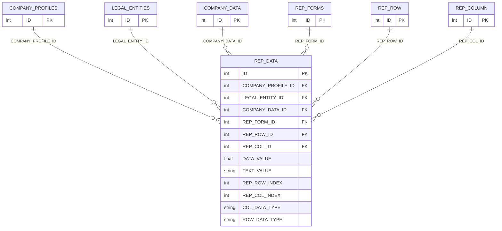
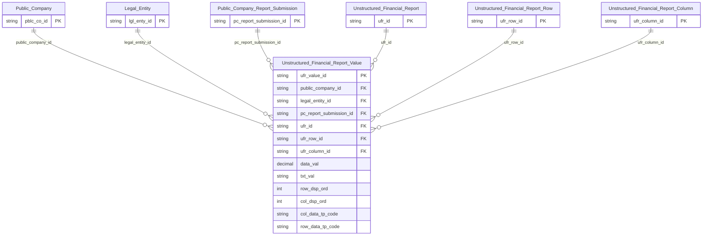

# IDS HLD — Tier 4

**Source system:** IDS (Information Disclosure System — Hệ thống Công bố Thông tin)
**Tier 4:** Các entity thuộc Tier 4 theo LLD (`group: T4`). Gồm:
- Con của **Public Company Report Submission** (T3) + **Public Company** (T1) + **Legal Entity** (T1) + **Unstructured Financial Report** (T1) + **Unstructured Financial Report Row/Column** (T2): Unstructured Financial Report Value (Tier 4 theo LLD)

---

## 6a. Bảng tổng quan BCV Concept

| BCV Core Object | BCV Concept | Category | Source Table | Source Table Change Mode | Mô tả bảng nguồn | Atomic Entity | Table Type | BCV Term |
|---|---|---|---|---|---|---|---|---|
| Documentation | [Documentation] Regulatory Report | Documentation | `REP_DATA` | Update | Lưu trữ dữ liệu của hàng và cột của báo cáo có cấu trúc (báo cáo định kỳ): mã hàng/cột, giá trị số/chuỗi, kỳ báo cáo qua liên kết đến bản ghi nộp báo cáo. | Unstructured Financial Report Value | Classification | (1) Term candidate: `[Documentation] Regulatory Report` (BCV #9297) — cùng term đã dùng cho `Financial Report Value` (`DATA`, T2): "Regulatory Information which is a report on regulations". (2) Cấu trúc trường: COMPANY_PROFILE_ID (FK tagged → COMPANY_PROFILES), LEGAL_ENTITY_ID (soft-FK, nullable — "ID Nhà đầu tư NNB/NLQ/CĐ"), COMPANY_DATA_ID (soft-FK → COMPANY_DATA, T3), REP_FORM_ID/REP_ROW_ID/REP_COL_ID (soft-FK → REP_FORMS T1/REP_ROW T2/REP_COLUMN T2), DATA_VALUE, TEXT_VALUE, REP_ROW_INDEX, REP_COL_INDEX, COL_DATA_TYPE, ROW_DATA_TYPE — mỗi dòng là 1 giá trị ô cụ thể của 1 báo cáo định kỳ, cùng vai trò với `DATA` nhưng cho họ template `REP_FORMS`/`REP_ROW`/`REP_COLUMN` thay vì `REPORT_CATALOG`/`RROW`/`RCOL`. (3) Chọn `[Documentation] Regulatory Report`. Domain Prefix `Unstructured Financial Report` (mở rộng nhóm REP_FORMS/REP_ROW/REP_COLUMN — xem 6f T4-04). Table Type = Fundamental, theo đúng pattern đã áp dụng cho toàn bộ họ Value/Template liên quan (`DATA`, `RROW`, `RCOL`, `REP_ROW`, `REP_COLUMN`, `COMPANY_DATA`) dù còn FK lên Tier 1/2/3 — xem 6f T4-05. Tier 4 theo LLD (`group: T4`; FK mềm tới Public Company Report Submission — Tier 3 theo LLD, Unstructured Financial Report Row/Column — Tier 2). Table Type Fundamental → Classification (2026-09-15, theo yêu cầu tường minh Data Modeler) — xem Overview 7e #27. |

---

## 6b. Diagram Source (Mermaid)

---

## 6c. Diagram Atomic (Mermaid)

---

## 6d. Mục Danh mục & Tham chiếu (Reference Data)

| Source Field / Bảng | Mô tả | Scheme Code | source_type | Ghi chú |
|---|---|---|---|---|
| `REP_DATA.COL_DATA_TYPE` | Kiểu dữ liệu cột (N=Number, T=Text) | `IDS_PERIODIC_FORM_COLUMN_DATA_TYPE` | source_table | Tái dùng scheme đã đăng ký cho `REP_COLUMN.DATA_TYPE_CD` (Tier2.md 6d) — cùng LOOKUP_GROUP `RF_C_DATA_TYPE`, không tạo scheme mới |
| `REP_DATA.ROW_DATA_TYPE` | Kiểu dữ liệu hàng (V=Value, D=Description) | `IDS_PERIODIC_FORM_ROW_DATA_TYPE` | source_table | Tái dùng scheme đã đăng ký cho `REP_ROW.DATA_TYPE_CD` (Tier2.md 6d) — cùng LOOKUP_GROUP `RF_R_DATA_TYPE`, không tạo scheme mới |

---

## 6e. Bảng chờ thiết kế

*(Để trống — tất cả bảng Tier 4 đã có thông tin cột)*

---

## 6f. Điểm cần xác nhận

| # | Câu hỏi | Kết quả |
|---|---|---|
| T4-03 | Sau khi điều chỉnh tier theo dependency (2026-10-21), Tier 4 chỉ còn Unstructured Financial Report Value (`REP_DATA`). Public Company Securities Offering Plan/Result và Public Company Evaluation Detail chuyển sang Tier 3; Securities Offering/Evaluation chuyển sang Tier 2. Có giữ Tier 4 riêng cho 1 entity không? | Giữ Tier 4 theo LLD (`group: T4`) — `REP_DATA` có soft-FK tới Public Company Report Submission (T3) nên nằm sau Tier 3. |
| T4-04 | `REP_DATA` (`Unstructured Financial Report Value`) dùng Domain Prefix `Unstructured Financial Report` — quyết định 2026-08-27 (Tier2.md T2-22/Overview 7e #22) từng ghi rõ "chỉ áp dụng 3 entity REP_FORMS/REP_ROW/REP_COLUMN". Đề xuất mở rộng nhóm này thành 4 entity (thêm REP_DATA) do cùng gia đình template/value và cùng physical prefix `ufr`. | Cần Data Modeler xác nhận việc mở rộng phạm vi quyết định 2026-08-27. |
| T4-05 | `REP_DATA` chỉ có `COMPANY_PROFILE_ID` được tag `key: FK` trong BRD; `LEGAL_ENTITY_ID`, `COMPANY_DATA_ID`, `REP_FORM_ID`, `REP_ROW_ID`, `REP_COL_ID` đều là soft-FK (`key: null`, `fk_note: null`) dù mô tả cột nêu rõ là khóa liên kết. Table Type tạm chọn Fundamental theo pattern đã áp dụng cho `DATA`/`RROW`/`RCOL`/`REP_ROW`/`REP_COLUMN`/`COMPANY_DATA` (cùng họ Value/Template, cùng lý do override). | Cần Data Modeler xác nhận: (1) constraint FK thực tế tại nguồn cho 5 soft-FK trên, (2) đồng ý Table Type = Fundamental theo pattern có sẵn. |
| T4-06 | `REP_DATA` có cả `LEGAL_ENTITY_ID` (nullable, mô tả "ID Nhà đầu tư NNB/NLQ/CĐ") lẫn `COMPANY_PROFILE_ID` — chưa rõ 2 FK này loại trừ nhau (giống pattern `SECURITIES_OFFERING.APPLICANT_TYPE_FLG`) hay có thể cùng khác NULL đồng thời (báo cáo vừa gắn CTĐC vừa gắn 1 cá nhân liên quan cụ thể). Ảnh hưởng đến thiết kế grain ở bước LLD. | Cần Data Modeler xác nhận ý nghĩa nghiệp vụ khi cả 2 FK cùng có giá trị. |
