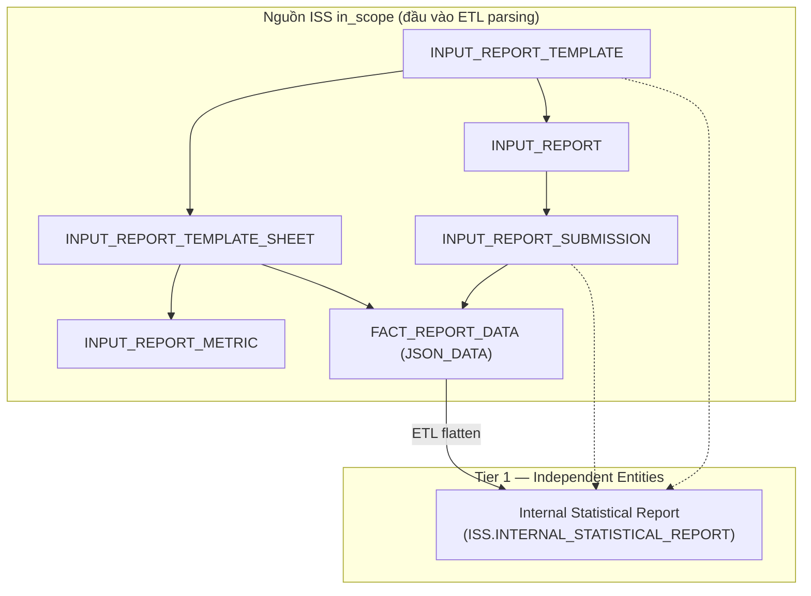
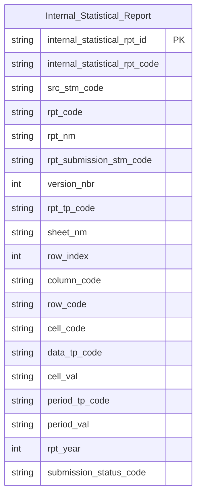

# ISS HLD — Overview

**Source system:** ISS (Input/Output Statistical Reporting System — Hệ thống quản lý báo cáo thống kê định kỳ đầu vào/đầu ra của UBCKNN)
**Mô tả:** ISS quản lý mẫu báo cáo đầu vào/đầu ra, lịch nộp và hạn phát sinh, quá trình nộp báo cáo của tổ chức, sinh báo cáo đầu ra tự động và phân quyền truy cập báo cáo. Dữ liệu báo cáo đã nộp lưu dạng JSON theo sheet (`FACT_REPORT_DATA.JSON_DATA`) nên được parsing/flatten đến cấp ô biểu mẫu để đưa lên Atomic. DDL nguồn không có comment Oracle — mô tả bảng/cột trong BRD được suy luận từ tên trường, cần đội ISS xác nhận.

---

## Tổng quan Atomic Entities

| Tier | Atomic Entity | BCV Core Object | BCV Concept | Table Type | Source Table(s) | Ghi chú |
|---|---|---|---|---|---|---|
| T1 | Internal Statistical Report | Documentation | [Documentation] Form Documentation | Classification | ISS.INTERNAL_STATISTICAL_REPORT | Bảng ODS flatten từ 6 bảng Input Report in_scope; grain = 1 ô × 1 lần nộp × 1 kỳ |

**Tổng: 1 Atomic entity** (1 Tier 1)
*(Trong đó: 0 shared entities — grain là ô biểu mẫu, không phải Involved Party)*

---

## Diagram Phân tầng Dependencies (Mermaid)

---

## Quyết định thiết kế chính

| # | Quyết định | Lý do |
|---|---|---|
| D-01 | Toàn bộ nhóm Input Report được denormalize vào 1 entity cấp ô, không tạo entity riêng cho Template/Sheet/Metric/Submission | Dữ liệu báo cáo lưu JSON theo sheet — nhu cầu khai thác là giá trị từng ô theo kỳ; LLD `ISS/lld_ISS_INTERNAL_STATISTICAL_REPORT.yaml` đã approved theo hướng này |
| D-02 | Table Type = `Classification`, Upsert theo BK composite `report_code ‖ sheet_nm ‖ field_code ‖ row_index ‖ origin_date_value` | Quyết định Data Modeler 2026-10-07 |
| D-03 | Nhóm Output Report (8 bảng), phân quyền (2 bảng), `REPORT_SEND_LOG`, `FILE_INFO`, `INPUT_REPORT_DEADLINE` ngoài scope | BRD `scope_status: out_of_scope` — báo cáo đầu ra do ISS tự sinh (dẫn xuất), còn lại là cấu hình/log/phân quyền/file đính kèm không có giá trị nghiệp vụ Atomic |
| D-04 | Không áp dụng Bước 2c (technical bundle 9 cột) làm cơ sở loại trừ cho ODS; các cột audit của bảng nguồn không đi vào entity | Cột audit (`CREATED_*`, `UPDATED_*`, `DELETED`) không được flatten sang bảng ODS |

---

#### 7a. Bảng tổng quan Atomic entities

| Tier | BCV Core Object | BCV Concept | Category | Source Table | Source Table Change Mode | Mô tả bảng nguồn | Atomic Entity | Table Type | BCV Term |
|---|---|---|---|---|---|---|---|---|---|
| T1 | Documentation | [Documentation] Form Documentation | Form | INTERNAL_STATISTICAL_REPORT | Update | Dữ liệu báo cáo thống kê định kỳ đã nộp, flatten thành 1 dòng/ô biểu mẫu kèm mẫu báo cáo, sheet, lần nộp và kỳ báo cáo (bảng ODS sinh từ 6 bảng nguồn Input Report) | Internal Statistical Report | Classification | (1) Form Documentation: biểu mẫu dạng form mà tổ chức điền và nộp. (2) Cấu trúc trường mô tả nội dung từng ô biểu mẫu đã nộp (mã dòng/cột/ô, giá trị ô, kỳ báo cáo, trạng thái nộp). (3) Chọn Form Documentation vì grain là ô biểu mẫu của 1 lần nộp; Table Type theo quyết định Data Modeler 2026-10-07. |

#### 7b. Diagram Atomic tổng (Mermaid)

#### 7c. Bảng Classification Value

Không có bảng danh mục thuần (Code + Name) trong ISS.

#### 7d. Junction Tables

| Source Table | Mô tả | Entity chính | Xử lý trên Atomic |
|---|---|---|---|
| OUTPUT_REPORT_SOURCE | Liên kết N-N: mẫu báo cáo đầu vào là nguồn dữ liệu cho mẫu báo cáo đầu ra (PK composite 2 FK) | — (cả 2 phía đều ngoài scope) | Không tạo entity — cùng ngoài scope với `OUTPUT_REPORT_TEMPLATE` |

#### 7e. Điểm cần xác nhận

| # | Tier | Câu hỏi | Ảnh hưởng |
|---|---|---|---|
| 1 | T1 | Bảng ODS `INTERNAL_STATISTICAL_REPORT` không có trong DDL/BRD ISS (19 bảng) → 26 `source_column` LLD bị báo Check B. Bổ sung BRD cho bảng ODS? | Source coverage Check B; chuỗi lineage BRD → HLD → LLD |
| 2 | T1 | `ORGANIZATION_ID` (tổ chức nộp, hệ thống ngoài) có cần FK Id + Code đến Involved Party không? | Phát sinh FK cross-source trong LLD |
| 3 | T1 | Có cần entity riêng cho Template (`INPUT_REPORT_TEMPLATE`/`METRIC`) và Submission (`INPUT_REPORT_SUBMISSION`) thay vì chỉ denormalize cấp ô? | Phát sinh Tier 2 nếu có |
| 4 | T1 | `REPORT_LAYOUT_TYPE`, `DATA_TYPE`, `DATE_TYPE`, `SUBMIT_STATUS` có đăng ký Classification Value scheme `ISS_*` không? | Ảnh hưởng LLD + `classification_schemes.yaml` |
| 5 | T1 | Tên attribute dùng `internal_statistical_rpt_*` còn `entity_physical_name` là `internal_statistical_report` — có chủ đích không? | Đồng nhất physical name (LOCKED vì entity đã approved) |
| 6 | T1 | Cặp (Source Change Mode = `Update`, Table Type = `Classification`/Upsert): xác nhận ETL ghi đè theo BK, không giữ lịch sử các lần nộp lại (`RESUBMIT_REASON`). | Mất lịch sử nộp lại nếu Upsert |

#### 7f. Bảng ngoài scope

| Nhóm | Source Table | Mô tả bảng nguồn | Lý do ngoài scope |
|---|---|---|---|
| Operational / System | FILE_INFO | Thông tin file đính kèm dùng chung (tên file, dung lượng, đường dẫn lưu trữ) | Operational/system data — không có giá trị nghiệp vụ |
| Operational / System | INPUT_REPORT_DEADLINE | Cấu hình hạn nộp và nhắc nhở cho báo cáo đầu vào theo mẫu | Operational/system data — không có giá trị nghiệp vụ |
| Operational / System | OUTPUT_REPORT | Bản ghi báo cáo đầu ra được sinh theo kỳ báo cáo | Báo cáo đầu ra do ISS tự sinh — dữ liệu dẫn xuất từ báo cáo đầu vào |
| Operational / System | OUTPUT_REPORT_DEADLINE | Cấu hình hạn phát sinh báo cáo đầu ra theo mẫu | Operational/system data — không có giá trị nghiệp vụ |
| Operational / System | OUTPUT_REPORT_GENERATE_JOB | Job nền sinh báo cáo đầu ra tự động | Operational/system data — không có giá trị nghiệp vụ |
| Operational / System | OUTPUT_REPORT_GENERATE_JOB_ITEM | Chi tiết báo cáo đầu ra được sinh trong một job | Operational/system data — không có giá trị nghiệp vụ |
| Operational / System | OUTPUT_REPORT_METRIC | Cây chỉ tiêu (metric) trong mẫu báo cáo đầu ra | Báo cáo đầu ra do ISS tự sinh — dữ liệu dẫn xuất từ báo cáo đầu vào |
| Junction | OUTPUT_REPORT_SOURCE | Liên kết N-N giữa mẫu báo cáo đầu vào và mẫu báo cáo đầu ra | Pure junction — không có business attribute, cả 2 phía ngoài scope |
| Operational / System | OUTPUT_REPORT_TEMPLATE | Mẫu báo cáo đầu ra — mã báo cáo, căn cứ pháp lý, cấu hình truy vấn | Báo cáo đầu ra do ISS tự sinh — dữ liệu dẫn xuất từ báo cáo đầu vào |
| Operational / System | OUTPUT_REPORT_TEMPLATE_COMBO_USED | Tổ hợp hợp lệ giữa mẫu báo cáo đầu vào và đầu ra | Operational/system data — không có giá trị nghiệp vụ |
| Hệ thống / Phân quyền | REPORT_PERMISSION_GROUP | Nhóm quyền truy cập báo cáo | Operational/system data — không có giá trị nghiệp vụ |
| Operational / System | REPORT_SEND_LOG | Nhật ký gửi/phát báo cáo đến nơi nhận | Operational/system data — không có giá trị nghiệp vụ |
| Hệ thống / Phân quyền | USER_PERMISSION_GROUP | Gán người dùng vào nhóm quyền báo cáo | Operational/system data — không có giá trị nghiệp vụ |

<!--
GRAIN: 1 dòng = 1 bảng nguồn. KHÔNG gộp `table1, table2`.
GROUP: dùng từ danh sách chuẩn (xem reference/group_classification.md).
-->

---

## Entities

> Single source of truth cho metadata entity. `aggregate_atomic.py` parse section này để sinh `atomic_entities.yaml`.
> Format bắt buộc: heading `### N.` + dòng `**Description:**` trong 500 ký tự đầu tiên sau heading.

### 1. Internal Statistical Report
**Tier:** 1 | **Source:** `ISS.INTERNAL_STATISTICAL_REPORT` | **BCV Concept:** [Documentation] Form Documentation | **BCO:** Documentation | **Table Type:** Classification
**Domain Prefix:** Internal Statistical Report
**Description:** Báo cáo định kỳ ISS (thống kê nội bộ UBCKNN). Grain = 1 ô × 1 lần nộp × 1 kỳ báo cáo. Dữ liệu flatten đến từng ô biểu mẫu (cell-level), hỗ trợ cả 3 layout: MIXED / COLUMN_BASED / ROW_BASED. BK composite: report_code || sheet_nm || field_code || row_index || origin_dt_val.

**Grain:** 1 dòng = 1 ô biểu mẫu của 1 lần nộp báo cáo trong 1 kỳ báo cáo.

**Attributes chính:** internal_statistical_rpt_code (BK composite), src_stm_code, rpt_code, rpt_nm, rpt_submission_stm_code, version_nbr, rpt_tp_code (layout), sheet_nm, column/row address + path + code, row_index, cell_code, cell_val, data_tp_code, period_tp_code, period_val, rpt_day/month/quarter/half_year/year, submission_status_code.
