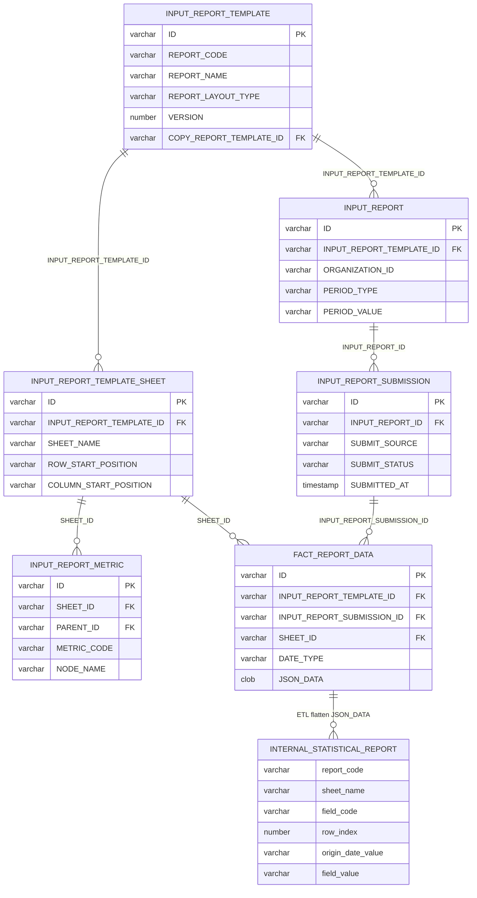
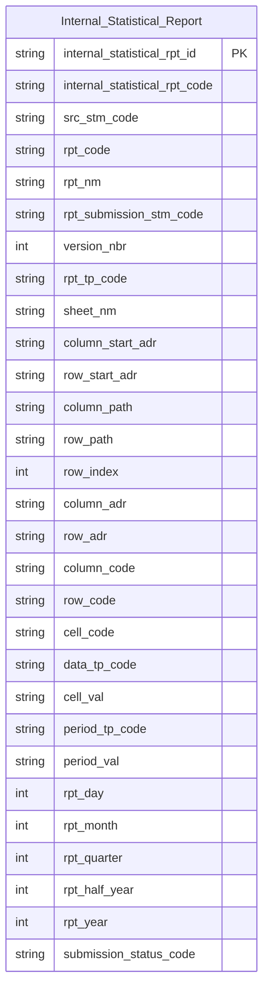

# ISS HLD — Tier 1

**Source system:** ISS (Input/Output Statistical Reporting System — Hệ thống quản lý báo cáo thống kê định kỳ đầu vào/đầu ra của UBCKNN)
**Tier 1:** Entity độc lập duy nhất của ISS: dữ liệu báo cáo đã nộp được flatten đến cấp ô biểu mẫu (cell-level). Entity không FK đến entity Atomic nào khác trong ISS.

---

## 6a. Bảng tổng quan BCV Concept

| BCV Core Object | BCV Concept | Category | Source Table | Source Table Change Mode | Mô tả bảng nguồn | Atomic Entity | Table Type | BCV Term |
|---|---|---|---|---|---|---|---|---|
| Documentation | [Documentation] Form Documentation | Form | INTERNAL_STATISTICAL_REPORT | Update | Dữ liệu báo cáo thống kê định kỳ đã nộp, flatten từ `FACT_REPORT_DATA.JSON_DATA` thành 1 dòng/ô biểu mẫu, kèm thông tin mẫu báo cáo, sheet, lần nộp và kỳ báo cáo (bảng ODS sinh từ 6 bảng nguồn Input Report) | Internal Statistical Report | Classification | (1) **Form Documentation**: biểu mẫu/tài liệu dạng form mà tổ chức điền và nộp. (2) Cấu trúc trường: mã báo cáo, tên sheet, mã dòng/cột/ô, giá trị ô, kỳ báo cáo, trạng thái nộp — mô tả nội dung từng ô của biểu mẫu đã nộp, không phải hồ sơ nộp (submission) hay mẫu (template) riêng lẻ. (3) Chọn Form Documentation vì grain là ô biểu mẫu thuộc 1 lần nộp; Table Type `Classification` theo quyết định Data Modeler 2026-10-07 (Upsert theo BK composite). |

> **Lineage:** `INTERNAL_STATISTICAL_REPORT` là bảng ODS (`ods.uat_ISS_ods`) do ETL parsing sinh ra từ 6 bảng ISS `in_scope`: `FACT_REPORT_DATA` (JSON_DATA — bảng cần parsing), `INPUT_REPORT`, `INPUT_REPORT_METRIC`, `INPUT_REPORT_SUBMISSION`, `INPUT_REPORT_TEMPLATE`, `INPUT_REPORT_TEMPLATE_SHEET`. Bảng ODS chưa có file `brd_ISS_INTERNAL_STATISTICAL_REPORT.yaml` — xem 6f T1-01.

---

## 6b. Diagram Source (Mermaid)

> Bảng `INTERNAL_STATISTICAL_REPORT` là đích ODS (không phải bảng DDL nguồn); quan hệ cuối là luồng ETL, không phải FK.

---

## 6c. Diagram Atomic (Mermaid)

> Không có FK Id đến entity nào: `ORGANIZATION_ID` (tổ chức nộp) và `USER_ID` thuộc hệ thống ngoài, chưa được đưa vào entity (xem 6f T1-03).

---

## 6d. Mục Danh mục & Tham chiếu (Reference Data)

| Source Field / Bảng | Mô tả | Scheme Code | source_type | Ghi chú |
|---|---|---|---|---|
| (hardcode) | Mã hệ thống nguồn | `SOURCE_SYSTEM` (`ISS_INTERNAL_STATISTICAL_REPORT`) | etl_derived | Scheme dùng chung toàn dự án — giá trị literal gạch dưới |

Các cột `rpt_tp_code` (REPORT_LAYOUT_TYPE: MIXED / COLUMN_BASED / ROW_BASED), `data_tp_code`, `period_tp_code`, `submission_status_code` hiện giữ dạng `Text` nguyên giá trị nguồn trong LLD đã approved — chưa đăng ký Classification Value scheme (xem 6f T1-05).

---

## 6e. Bảng chờ thiết kế

| Source Table | Mô tả bảng nguồn | Lý do chưa thiết kế |
|---|---|---|
| — | — | Không có. 6 bảng `in_scope` (FACT_REPORT_DATA, INPUT_REPORT, INPUT_REPORT_METRIC, INPUT_REPORT_SUBMISSION, INPUT_REPORT_TEMPLATE, INPUT_REPORT_TEMPLATE_SHEET) là đầu vào ETL parsing của entity trên, không tạo entity riêng. |

---

## 6f. Điểm cần xác nhận

| # | Câu hỏi | Kết quả |
|---|---|---|
| T1-01 | Bảng ODS `INTERNAL_STATISTICAL_REPORT` không có trong DDL/BRD ISS (19 bảng) nên 26 `source_column` của LLD bị `post_check_source_coverage.py` báo "bảng không có trong BRD/Source/ISS/". Cần bổ sung `brd_ISS_INTERNAL_STATISTICAL_REPORT.yaml` (hoặc khai báo bảng ODS là nguồn chính thức)? | Open — ảnh hưởng Check B của source coverage |
| T1-02 | Table Type = `Classification` cho dữ liệu cấp ô (grain ô × lần nộp × kỳ) khác với dấu hiệu nhận biết thông thường (dữ liệu nhiều kỳ → `Fact Snapshot`). | Đã chốt: Data Modeler 2026-10-07 — Upsert theo BK composite `report_code ‖ sheet_nm ‖ field_code ‖ row_index ‖ origin_date_value` |
| T1-03 | `INPUT_REPORT.ORGANIZATION_ID` (tổ chức nộp báo cáo, hệ thống ngoài) chưa có trong entity. Có cần FK Id + Code đến Involved Party (CTCK/quỹ…) không? Nếu có phát sinh cross-source crosswalk. | Open |
| T1-04 | Hai thuộc tính định danh `internal_statistical_rpt_*` ở cấp attribute khác với `entity_physical_name` = `internal_statistical_report` (viết tắt `rpt` chỉ ở attribute). | Open — cần Data Modeler xác nhận có chủ đích hay chạy lại `transform_physical_names.py` |
| T1-05 | `REPORT_LAYOUT_TYPE`, `DATA_TYPE`, `DATE_TYPE`, `SUBMIT_STATUS` có đăng ký Classification Value scheme (`ISS_*`) không, hay giữ `Text`? | Open |
| T1-06 | Template (`INPUT_REPORT_TEMPLATE`, `INPUT_REPORT_METRIC`) và Submission (`INPUT_REPORT_SUBMISSION`) hiện chỉ được denormalize vào cell-level. Có cần entity riêng (Form Documentation / Event) cho template và lần nộp không? | Open — nếu có sẽ phát sinh Tier 2 |
| T1-07 | `FILE_INFO` (file báo cáo nộp, file mẫu) ngoài scope: xác nhận không cần lưu con trỏ file trên Atomic. | Đề xuất ngoài scope (File Attachment) |
