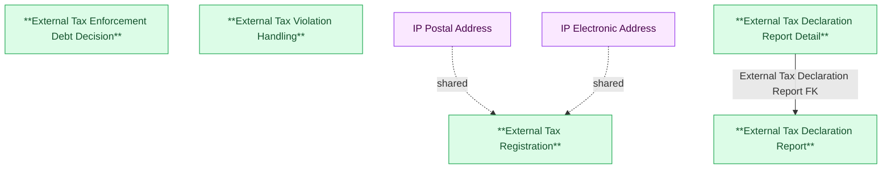

# KNT — HLD Overview: Toàn cảnh thiết kế Atomic Layer

> **Nguồn:** Hệ thống KNT — Dữ liệu trao đổi giữa UBCKNN và Tổng cục Thuế (Cục Thuế)/Bộ Tài chính (Oracle)
>
> **Phạm vi:** Đăng ký thuế doanh nghiệp trên TTCK, báo cáo tài chính/tờ khai thuế, cưỡng chế nợ thuế/ngừng sử dụng hóa đơn, xử lý vi phạm pháp luật về thuế, giám sát doanh nghiệp rủi ro cao, trao đổi yêu cầu thông tin với Cục Thuế. Đã thiết kế 5/53 bảng nguồn (có LLD) — các bảng còn lại (báo cáo tổng hợp UBCKNN, xử phạt VPHC chứng khoán, thông tin công ty/kiểm toán, danh mục dùng chung, hạ tầng hệ thống...) đang được Data Modeler đánh giá, sẽ thiết kế ở đợt sau.
>
> **File chi tiết theo tầng:**
> - [KNT_HLD_Tier1.md](KNT_HLD_Tier1.md) — External Tax Registration, External Tax Declaration Report, External Tax Enforcement Debt Decision, External Tax Violation Handling
> - [KNT_HLD_Tier2.md](KNT_HLD_Tier2.md) — External Tax Declaration Report Detail
>
> **Domain Prefix:** `External Tax` (abbreviation `et`) áp dụng cho toàn bộ 5 entity nguồn KNT ở trên — quyết định Data Modeler 2026-07-19, đăng ký vào `system/rules/rule_domain_prefix_abbreviations.csv`.

---

#### 7a. Bảng tổng quan Atomic entities

| Tier | BCV Core Object | BCV Concept | Category | Source Table | Source Table Change Mode | Mô tả bảng nguồn | Atomic Entity | Table Type | BCV Term |
|---|---|---|---|---|---|---|---|---|---|
| 1 | Involved Party | [Involved Party] Organization | Organization | TAX_REGISTRATION_INFO | Update | Thông tin đăng ký thuế do Cục Thuế cung cấp: địa chỉ, vốn điều lệ, người đại diện, trạng thái hoạt động, tạm ngừng kinh doanh | External Tax Registration | Fundamental | Organization — hồ sơ đăng ký thuế của 1 doanh nghiệp/hộ kinh doanh trên TTCK. Tách IP Postal Address + IP Electronic Address. |
| 1 | Documentation | [Documentation] Declaration Document | Declaration Document | TAX_REPORT | Append | Báo cáo tài chính do Cục Thuế cung cấp cho UBCKNN: thông tin tờ khai, kỳ kê khai, MST, thông tin kiểm toán | External Tax Declaration Report | Fact Append | Declaration Document — tờ khai/báo cáo tài chính theo kỳ, mỗi lần nộp (kể cả bổ sung) là 1 bản ghi mới. |
| 1 | Documentation | [Documentation] Gov. Registration Document | Gov. Registration Document | TAX_ENFORCEMENT_DEBT | Append | Thông tin quyết định cưỡng chế nợ thuế do Cục Thuế ban hành: phương thức cưỡng chế, số tiền, tài sản kê biên | External Tax Enforcement Debt Decision | Fact Append | Gov. Registration Document — quyết định hành chính cưỡng chế nợ thuế (kê biên tài sản/phong tỏa tài khoản). |
| 1 | Documentation | [Documentation] Gov. Registration Document | Gov. Registration Document | TAX_VIOLATION_HANDLING | Append | Thông tin xử lý vi phạm pháp luật về thuế do Cục Thuế cung cấp: số QĐ xử lý, tên đối tượng, kỳ thanh tra, tiền phạt | External Tax Violation Handling | Fact Append | Gov. Registration Document — quyết định hành chính xử lý vi phạm pháp luật thuế (phạt/truy thu). BCO đổi từ Business Activity sang Documentation (2026-07-19) để nhất quán với entity quyết định cưỡng chế nợ thuế cùng nguồn. |
| 2 | Documentation | [Documentation] Reported Information | Reported Information | TAX_REPORT_DETAIL | Append | Chi tiết chỉ tiêu trong báo cáo tài chính từ Cục Thuế: giá trị đầu năm, cuối năm, năm nay, năm trước theo từng sheet | External Tax Declaration Report Detail | Fact Append | Reported Information — dòng chỉ tiêu con của External Tax Declaration Report, phân loại theo SHEET_NAME (Classification Value). |

---

#### 7b. Diagram Atomic tổng (Mermaid)

---

#### 7c. Bảng Classification Value

| Source Table | Mô tả | BCV Term | Xử lý Atomic |
|---|---|---|---|
| TAX_REGISTRATION_INFO.OPERATION_STATUS | Trạng thái hoạt động doanh nghiệp (TrangThaiHoatDongEnum) | Classification Value | Scheme: `KNT_OPERATION_STATUS`. FK từ External Tax Registration. |
| TAX_REGISTRATION_INFO.SUSPENSION_TYPE | Lý do ngừng hoạt động (LyDoNgungHoatDongEnum) | Classification Value | Scheme: `KNT_SUSPENSION_TYPE`. FK từ External Tax Registration. |
| TAX_REPORT.PERIOD_TYPE | Kiểu kỳ báo cáo (Năm/Bán niên/Quý/Tháng) | Classification Value | Scheme: `KNT_REPORT_PERIOD_TYPE`. FK từ External Tax Declaration Report. |
| TAX_ENFORCEMENT_DEBT.ENFORCEMENT_METHOD_CODE/NAME | Hình thức cưỡng chế | ~~Classification Value~~ | **[ĐÃ ĐIỀU CHỈNH 2026-07-20]** Không phải Classification Value. Scheme `KNT_ENFORCEMENT_METHOD` deprecated. Map 1:1 (Text). |
| TAX_REPORT_DETAIL.SHEET_NAME | Loại sheet báo cáo tài chính (BCDKT/KQKD/LCTT...) | Classification Value | Scheme: `KNT_REPORT_SHEET`. FK từ External Tax Declaration Report Detail. |
| TAX_REGISTRATION_INFO (địa chỉ/điện thoại/fax/email) | Loại địa chỉ bưu chính / điện tử | Classification Value (dùng chung dự án) | Tái sử dụng scheme `IP_ADDR_TYPE` / `IP_ELEC_ADDR_TYPE` đã có — không tạo scheme mới. |

---

#### 7d. Junction Tables

Không có junction table.

---

#### 7e. Điểm cần xác nhận

| # | Tier | Câu hỏi | Ảnh hưởng |
|---|---|---|---|
| 1 | 1 | `TAX_REPORT` (báo cáo tài chính do Cục Thuế cung cấp) có trùng lặp nghiệp vụ với `SSC_REPORT` (báo cáo tài chính do UBCKNN tổng hợp gửi Cục Thuế/BTC — đang pending, chưa thiết kế) không? | Ảnh hưởng thiết kế khi SSC_REPORT được đánh giá ở đợt sau — có thể cần entity riêng biệt (2 chiều dữ liệu in/out) hoặc gộp. |
| 2 | 1 | **[GỠ 2026-10-21]** `TAX_REG_ADDRESS_TYPE` không có LLD trong dự án — HLD gỡ, bảng đưa vào 7f nhóm `Chưa có LLD`. | Không còn ảnh hưởng. |

---

#### 7f. Bảng ngoài scope

| Nhóm | Source Table | Mô tả bảng nguồn | Lý do ngoài scope |
|---|---|---|---|
| Chưa có LLD | TAX_REG_ADDRESS_TYPE | Loại địa chỉ trong thông tin đăng ký thuế của doanh nghiệp (trụ sở/chi nhánh/địa điểm kinh doanh) | Không có LLD trong dự án — HLD gỡ theo quyết định Data Modeler 2026-10-21 |
| Chưa có LLD | TAX_ENFORCEMENT_INVOICE | Quyết định cưỡng chế ngừng sử dụng hóa đơn do Cục Thuế ban hành (số QĐ, đối tượng bị cưỡng chế, thời gian hiệu lực) | Không có LLD trong dự án — HLD gỡ theo quyết định Data Modeler 2026-10-21 |
| Chưa có LLD | INFO_REQUEST_DETAIL | Chi tiết yêu cầu thông tin từ Cục Thuế gửi UBCKNN (tên yêu cầu, MST, trạng thái xử lý) | Không có LLD trong dự án — HLD gỡ theo quyết định Data Modeler 2026-10-21 |
| Chưa có LLD | HIGH_RISK_ENTERPRISE | Danh sách doanh nghiệp rủi ro cao về thuế do Cục Thuế cung cấp theo năm đánh giá | Không có LLD trong dự án — HLD gỡ theo quyết định Data Modeler 2026-10-21 |
| Chưa có LLD | INVOICE_DETAIL | Chi tiết từng hóa đơn trong quyết định cưỡng chế ngừng sử dụng hóa đơn | Không có LLD trong dự án — HLD gỡ theo quyết định Data Modeler 2026-10-21 |
| Chưa có LLD | TAX_REG_REPRESENTATIVE | Người đại diện/chủ hộ kinh doanh trong hồ sơ đăng ký thuế (họ tên, chức vụ, giấy tờ định danh) | Không có LLD trong dự án — HLD gỡ theo quyết định Data Modeler 2026-10-21 |
| Chưa có LLD | TAX_REG_BUSINESS_LINE | Ngành nghề kinh doanh trong hồ sơ đăng ký thuế | Không có LLD trong dự án — HLD gỡ theo quyết định Data Modeler 2026-10-21 |
| Operational / System | MSG_PACKET | Gói tin trao đổi dữ liệu giữa UBCKNN và Cục Thuế/Bộ Tài chính (nội dung XML, trạng thái gửi/nhận) | Operational/system data — bảng quản lý lifecycle gói tin truyền nhận, không có giá trị nghiệp vụ. Là FK reference chung của toàn bộ entity Tier 1. |

---

## Entities

> Single source of truth cho metadata entity. `aggregate_atomic.py` parse section này để sinh `atomic_entities.yaml`.

> Format bắt buộc: heading `### N.` + dòng `**Description:**` trong 500 ký tự đầu tiên sau heading.

### 1. External Tax Declaration Report
**Tier:** 1 | **Source:** `TAX_REPORT` | **BCV Concept:** [Documentation] Declaration Document | **BCO:** Documentation | **Table Type:** Fact Append
**Domain Prefix:** External Tax
**Description:** Tờ khai/báo cáo tài chính do Cục Thuế cung cấp cho UBCKNN theo từng kỳ kê khai. Ghi nhận mã/loại tờ khai, kỳ kê khai, số lần nộp (kể cả bổ sung — attempt_count) và thông tin kiểm toán liên quan.

### 2. External Tax Enforcement Debt Decision
**Tier:** 1 | **Source:** `TAX_ENFORCEMENT_DEBT` | **BCV Concept:** [Documentation] Gov. Registration Document | **BCO:** Documentation | **Table Type:** Fact Append
**Domain Prefix:** External Tax
**Description:** Quyết định cưỡng chế nợ thuế do Cục Thuế ban hành đối với doanh nghiệp trên TTCK. Ghi nhận số quyết định, hình thức cưỡng chế, số tiền cưỡng chế và tài sản kê biên.

### 3. External Tax Registration
**Tier:** 1 | **Source:** `TAX_REGISTRATION_INFO` | **BCV Concept:** [Involved Party] Organization | **BCO:** Involved Party | **Table Type:** Fundamental
**Domain Prefix:** External Tax
**Description:** Hồ sơ đăng ký thuế của 1 doanh nghiệp/hộ kinh doanh trên TTCK do Cục Thuế cung cấp: địa chỉ, vốn điều lệ, người đại diện, trạng thái hoạt động, tạm ngừng kinh doanh. Tách IP Postal Address + IP Electronic Address.

### 4. External Tax Violation Handling
**Tier:** 1 | **Source:** `TAX_VIOLATION_HANDLING` | **BCV Concept:** [Documentation] Gov. Registration Document | **BCO:** Documentation | **Table Type:** Fact Append
**Domain Prefix:** External Tax
**Description:** Quyết định xử lý vi phạm pháp luật về thuế do Cục Thuế cung cấp: số quyết định xử lý, kỳ thanh tra, số tiền phạt và truy thu. BCO điều chỉnh 2026-07-19 (từ Business Activity) để nhất quán với các entity quyết định cưỡng chế cùng nguồn.

### 5. External Tax Declaration Report Detail
**Tier:** 2 | **Source:** `TAX_REPORT_DETAIL` | **BCV Concept:** [Documentation] Reported Information | **BCO:** Documentation | **Table Type:** Fact Append
**Domain Prefix:** External Tax
**Description:** Dòng chỉ tiêu chi tiết trong 1 External Tax Declaration Report: giá trị đầu năm, cuối năm, năm nay, năm trước theo từng loại sheet báo cáo tài chính. FK đến External Tax Declaration Report. Đổi tên từ "Tax Declaration Report Indicator" 2026-07-19.

