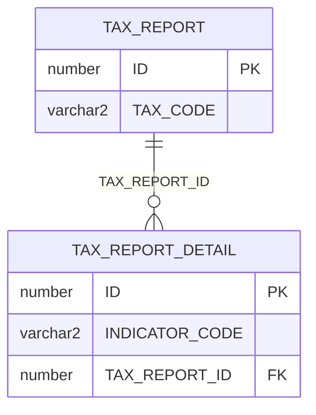
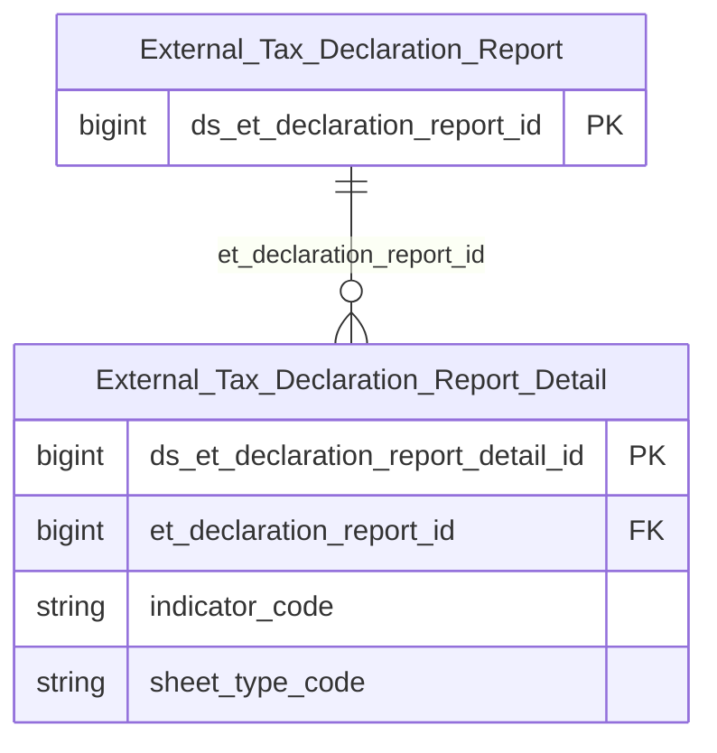

# KNT HLD — Tier 2

**Source system:** KNT (Dữ liệu trao đổi giữa UBCKNN và Tổng cục Thuế — Cơ quan Thuế)
**Tier 2:** Bảng có FK (vật lý hoặc business key) đến entity Tier 1. Gồm 1 Atomic entity mới (FK ID vật lý).

---

## 6a. Bảng tổng quan BCV Concept

| BCV Core Object | BCV Concept | Category | Source Table | Mô tả bảng nguồn | Atomic Entity | table_type | BCV Term |
|---|---|---|---|---|---|---|---|
| Documentation | [Documentation] Reported Information | Reported Information | TAX_REPORT_DETAIL | Chi tiết chỉ tiêu trong báo cáo tài chính từ Cục Thuế: giá trị đầu năm, cuối năm, năm nay, năm trước theo từng sheet | External Tax Declaration Report Detail | Fact Append | (1) Term "Reported Information" (Documentation, id 9248): "identifies information contained within a report" — khớp các dòng chỉ tiêu (INDICATOR_CODE/NAME + giá trị theo kỳ) nằm trong 1 báo cáo/tờ khai. (2) Cấu trúc trường: FK TAX_REPORT_ID + INDICATOR_CODE + SHEET_NAME (loại sheet: BCDKT/KQKD/LCTT...) + các giá trị đầu/cuối kỳ — đúng bản chất dòng chỉ tiêu con của 1 report, không phải bản thân 1 report riêng. (3) Chọn `[Documentation] Reported Information` thay vì các term "Statement" cụ thể (Balance Sheet/P&L/Cash Flow Statement) vì 1 bảng này gộp chung nhiều loại sheet qua cột SHEET_NAME (ETL-derived Classification Value), không tách riêng theo từng loại báo cáo tài chính. Tên entity đổi từ "Tax Declaration Report Indicator" thành "External Tax Declaration Report Detail" (quyết định Data Modeler 2026-07-19) — vẫn chứa đầy đủ tên entity cha `External Tax Declaration Report` theo rule đặt tên entity con. |

---

## 6b. Diagram Source (Mermaid)

---

## 6c. Diagram Atomic (Mermaid)

> `External_Tax_Declaration_Report` là node tham chiếu từ Tier 1.

---

## 6d. Mục Danh mục & Tham chiếu (Reference Data)

| Source Field / Bảng | Mô tả | Scheme Code | source_type | Ghi chú |
|---|---|---|---|---|
| TAX_REPORT_DETAIL.SHEET_NAME | Loại sheet báo cáo tài chính (LoaiBaoCaoChiTietEnum) | `KNT_REPORT_SHEET` | source_table | 1=BCDKT, 2=KQKD, 3=KQKDHD, 4=LCTT-TT, 5=LCTT-GT, 6=CTTKC, 9=THBDVCSH |

---

## 6e. Bảng chờ thiết kế

*(Không có bảng chờ thiết kế ở Tier 2.)*

---

## 6f. Điểm cần xác nhận

| # | Câu hỏi | Kết quả |
|---|---|---|
| — | *(Không có điểm cần xác nhận ở Tier 2)* | — |

---

## Shared Entity — bổ sung source_table

Các entity Tier 2 sau bổ sung `source_table` vào shared entity đã có (không tạo entity mới):

| Shared Entity | Entity tham chiếu | Trường nguồn |
|---|---|---|
| IP Postal Address | External Tax Registration (từ TAX_REGISTRATION_INFO.HQ_ADDRESS/BUSINESS_*) | HQ_ADDRESS, BUSINESS_ADDRESS_DESC |
| IP Electronic Address | External Tax Registration (TAX_REGISTRATION_INFO.PHONE/FAX/BUSINESS_PHONE/BUSINESS_EMAIL/BUSINESS_FAX) | PHONE, FAX, BUSINESS_PHONE, BUSINESS_EMAIL, BUSINESS_FAX |
