# SCMS — HLD Overview: Toàn cảnh thiết kế Atomic Layer

> **Nguồn:** Hệ thống SCMS — Phân hệ Quản lý Giám sát Công ty Chứng khoán (Oracle)
>
> **Phạm vi:** Quản lý thông tin pháp lý, tổ chức, nhân sự, báo cáo, cổ đông, giám sát rủi ro (CAMEL) và cảnh báo tự động của các Công ty Chứng khoán (CTCK) thành viên do UBCKNN quản lý.
>
> **File chi tiết theo tầng:**
> - [SCMS_HLD_Tier1.md](SCMS_HLD_Tier1.md) — Entity độc lập: Securities Company, Securities Company Bank, Classification Securities Company Firm Status/Firm Service/Event Type/Position, Securities Company Report, Securities Company Report Indicator (Geographic Area đã chuyển sang nguồn ECAT — xem mục 7f)
> - [SCMS_HLD_Tier2.md](SCMS_HLD_Tier2.md) — Phụ thuộc Tier 1: chi nhánh/PGD/VPĐD (Organization Unit), chi nhánh/VPĐD nước ngoài (Foreign Organization Unit) và nhân sự (Senior Personnel, Foreign Branch/Representative Office Personnel), báo cáo định kỳ/đột xuất, CBTT chào bán chứng khoán, thay đổi hồ sơ, cổ đông/người nội bộ/người liên quan/cổ đông lớn, các entity `_x_ Relationship` dịch vụ được cấp phép, Securities Company Bank Periodic, Securities Company Report Input Submission/Sheet/Deep Config/Event Type Relationship, shared entity Involved Party Postal/Electronic Address và Alternative Identification
> - [SCMS_HLD_Tier3.md](SCMS_HLD_Tier3.md) — Phụ thuộc Tier 2: Securities Company Shareholder Ownership Change, báo cáo định kỳ chi nhánh/VPĐD nước ngoài (Foreign Organization Unit Periodic Report), Securities Company Report Input Value, Report Sheet Row/Column
> - [SCMS_HLD_Tier4.md](SCMS_HLD_Tier4.md) — Phụ thuộc Tier 3: Securities Company Report Sheet Cell (Tier 4 đầu tiên của SCMS)

---

#### 7a. Bảng tổng quan Atomic entities

| Tier | BCV Core Object | BCV Concept | Category | Source Table | Source Table Change Mode | Mô tả bảng nguồn | Atomic Entity | Table Type | BCV Term |
|---|---|---|---|---|---|---|---|---|---|
| 1 | Common | [Common] Event Type | — | CAT_EVENT_TYPE | Update | Danh mục loại sự kiện/sự vụ nghiệp vụ làm cơ sở xác định nghĩa vụ báo cáo/CBTT | Classification Securities Company Event Type | Relative | (1) Term BCV khớp: `Event Type` (id 9924, Event). (2) Bảng: EVENT_TYPE_CODE/NAME, REQUIRES_LICENSE, REQUIRES_DISCLOSURE, OBLIGATION_TYPE, EVENT_CATEGORY, CYCLE, FREQUENCY. (3) Theo chỉ đạo Data Modeler: gán Common (không dùng Event dù match mạnh). Table Type = Relative (khác 3 bảng CAT_ trên) theo chỉ đạo — không FK rõ ràng đến Fundamental khác, xem 7e #11/#12. **[ĐỔI TÊN 2026-09-16]** `Classification Securities Company Event Type` → `Classification Securities Company Event Type`, đối xứng tiền lệ `Classification FMS Event Type` — xem 7e #23. |
| 1 | Common | [Common] Service | — | CAT_SERVICE_LEGAL_CAPITAL | Update | Danh mục dịch vụ + nghiệp vụ kinh doanh chứng khoán CTCK/CN nước ngoài, kèm vốn pháp định tối thiểu theo tổ hợp loại hình + nghiệp vụ | Classification Securities Company Firm Service | Classification | (1) Term BCV: `Service` (id 11846, Product) — giữ nguyên quyết định gán Common thay vì Product. (2) Bảng: SERVICE_ID (PK riêng, không FK CAT_SERVICE), SERVICE_NAME, CATALOG_TYPE, CATALOG_CODE, APPLICATION_TYPE, LEGAL_CAPITAL, DESCRIPTION, RECORD_STATUS. (3) **Thay thế CAT_SERVICE và CAT_BUSINESS_LINE (cả 2 deprecated — xem 7e).** Đặt tên `Classification Securities Company Firm Service` theo yêu cầu tường minh Data Modeler (physical_name `cl_securities_company_firm_service` — theo đúng viết tắt curated chuẩn `Classification` → `cl`). Xem Tier1 6f T1-11. |
| 1 | Common | [Common] Firm Status | — | CAT_SC_FIRM_STATUS | Append | Danh mục trạng thái pháp lý CTCK/Chi nhánh/VPĐD/PGD/Ngân hàng | Classification Securities Company Firm Status | Classification | (1) Term gần nhất trong BCV: `Organization Life Cycle Status` (id 10930, Involved Party) / `Organization Registration Status` (id 11478) — mô tả vòng đời/đăng ký của 1 Organization. (2) Bảng: SC_FIRM_STATUS_CODE/NAME, REPORT_SUBMISSION_ENABLED, DISCLOSURE_ENABLED, APPLICABLE_ENTITY (CTCK/CN/VPĐD/NH/Cả hai) — danh mục dùng chung nhiều loại đối tượng. (3) Theo chỉ đạo Data Modeler: gán Common (không dùng Involved Party dù match khá tốt). Table Type = Classification theo chỉ đạo. Tên entity dạng bare `Classification [Term]` theo CLAUDE.md #7 (rev. 2026-07-14). Xem 7e #11. |
| 1 | Common | [Common] Position | — | CAT_POSITION | Update | Danh mục chức vụ nhân sự CTCK (nhóm chức vụ, mã, tên, các cờ người đại diện/thành viên Ban lãnh đạo/giám đốc chi nhánh) | Classification Securities Company Position | Classification | (1) Term BCV gần nhất `Employment Position Type` (id 11300, Involved Party) — không dùng để giữ nhất quán pattern Classification-naming; gán Common theo chỉ đạo Data Modeler. (2) Bảng: POSITION_GROUP, POSITION_CODE, POSITION_NAME, NOTE, REPRESENTATIVE, BOARD_MEMBER, BRANCH_DIRECTOR, ECATALOG_ID — danh mục Code+Name có cờ phân loại. (3) Nâng cấp từ Classification Value (scheme SCMS_POSITION_TYPE, deprecated) lên entity thật theo `lld_SCMS_CAT_POSITION.yaml` (2026-10-08). |
| 1 | Involved Party | [Involved Party] Broker Dealer | Organization | SC_FIRM_INFO | Update | Thông tin pháp lý toàn diện công ty chứng khoán thành viên do UBCKNN quản lý | Securities Company | Fundamental | (1) Broker Dealer — BCV: "an Involved Party that engages in the business of buying and selling securities for its own account or on behalf of customers". (2) Bảng: SC_FIRM_CODE(UNIQUE), SC_FIRM_NAME_VI/EN, CHARTER_CAPITAL, BUSINESS_LICENSE_NUMBER, COMPANY_TYPE_ID, STATUS, FOUNDER_NAME, LISTED_DATE — thông tin pháp lý đầy đủ CTCK. (3) Broker Dealer khớp hoàn toàn — CTCK môi giới/tự doanh/quản lý danh mục/ngân hàng đầu tư. Entity trung tâm SCMS. |
| 1 | Involved Party | [Involved Party] Depositary Bank | Organization | BANK | Update | Danh mục ngân hàng đối tác lưu ký/thanh toán cho CTCK | Securities Company Bank | Fundamental | (1) Depositary Bank — BCV: "an Involved Party that holds financial assets in custody on behalf of customers". (2) Bảng: BANK_CODE(UNIQUE), BANK_NAME, STATUS — danh mục ngân hàng đối tác. (3) Depositary Bank khớp. Danh mục ngân hàng trong SCMS độc lập với NHNCK.BANKS. |
| 1 | Documentation | [Documentation] Form Document | Documentation | FORM_REPORT | Update | Biểu mẫu báo cáo (định kỳ/bất thường/theo yêu cầu/CBTT) CTCK/CN/VPĐD phải nộp UBCKNN, gồm căn cứ pháp lý, phiên bản, phân cấp cha-con | Securities Company Report | Relative | (1) BCV term `Form Document` (id 9348, Documentation) — theo tiền lệ IDS (FORMS/RROW/RCOL/REP_FORMS), thay thế term tự đặt `[Condition] Regulatory Reporting Requirement` trước đây (không có thật trong BCV). (2) Bảng: REPORT_CODE/NAME, LEGAL_BASIS, REPORT_TYPE, REPORT_STYLE, VERSION/VERSION_DATE, PARENT_ID tự tham chiếu, EFORM_ENABLED, STRUCTURE_FORMAT — biểu mẫu chuẩn hóa cần điền thông tin, khớp Form Document. (3) Sửa BCV Concept + đổi tên entity theo chỉ đạo Data Modeler (2026-09-15). Table Type giữ Relative (ngoại lệ tự tham chiếu). Đảo ngược quyết định loại-scope trước đây — xem 7e #12/#13/#22. |
| 1 | Documentation | [Documentation] Form Document | Documentation | FORM_INDICATOR_INPUT | Append | Định nghĩa chỉ tiêu/trường dữ liệu có thể gắn vào ô biểu mẫu báo cáo | Securities Company Report Indicator | Relative | (1) Tái dùng `Form Document` (id 9348) — thành phần định nghĩa trường dữ liệu của biểu mẫu. (2) Bảng: CODE/ITEM_NAME/DESCRIPTION/DATA_TYPE, REFERENCE_CATALOG_ID/TYPE, CATEGORY, FIELD_METADATA_ID — định nghĩa chỉ tiêu, không lưu giá trị. (3) BCO=Documentation theo chỉ đạo Data Modeler. Table Type=Relative — ngoại lệ tường minh (không FK nội bộ scope, cùng pattern Classification Securities Company Event Type/Securities Company Report). Đảo ngược quyết định loại-scope trước đây — xem 7e #23, SCMS_HLD_Tier1.md T1-14. |
| 2 | Involved Party | Shared Entity | Shared Entity | `BANK`, `SC_FIRM_BRANCH`, `SC_FIRM_FOREIGN_BRANCH`, `SC_FIRM_FOREIGN_BRANCH_PERSONNEL`, `SC_FIRM_FOREIGN_REP_OFFICE`, `SC_FIRM_FOREIGN_REP_OFFICE_PERSONNEL`, `SC_FIRM_INFO`, `SC_FIRM_INSIDER_RELATION`, `SC_FIRM_MAJOR_SHAREHOLDER_RELATION`, `SC_FIRM_RELATED_PERSON`, `SC_FIRM_REP_OFFICE`, `SC_FIRM_SENIOR_PERSONNEL`, `SC_FIRM_SHAREHOLDER`, `SC_FIRM_TRANSACTION_OFFICE` | Update | Giấy tờ định danh/giấy phép (GPKD, mã số thuế, CCCD/hộ chiếu...) của các Involved Party trong SCMS. | Involved Party Alternative Identification | Fundamental | Shared Entity — extend source_table SCMS (theo các file `lld_SCMS_<TABLE>_IP_*.yaml`). |
| 2 | Involved Party | Shared Entity | Shared Entity | `BANK`, `SC_FIRM_BRANCH`, `SC_FIRM_FOREIGN_BRANCH`, `SC_FIRM_FOREIGN_BRANCH_PERSONNEL`, `SC_FIRM_FOREIGN_REP_OFFICE`, `SC_FIRM_FOREIGN_REP_OFFICE_PERSONNEL`, `SC_FIRM_INFO`, `SC_FIRM_INSIDER_RELATION`, `SC_FIRM_MAJOR_SHAREHOLDER_RELATION`, `SC_FIRM_RELATED_PERSON`, `SC_FIRM_REP_OFFICE`, `SC_FIRM_SENIOR_PERSONNEL`, `SC_FIRM_SHAREHOLDER`, `SC_FIRM_TRANSACTION_OFFICE` | Update | Địa chỉ điện tử (điện thoại/fax/email/website) của các Involved Party trong SCMS. | Involved Party Electronic Address | Fundamental | Shared Entity — extend source_table SCMS (theo các file `lld_SCMS_<TABLE>_IP_*.yaml`). |
| 2 | Involved Party | Shared Entity | Shared Entity | `BANK`, `SC_FIRM_BRANCH`, `SC_FIRM_FOREIGN_BRANCH`, `SC_FIRM_FOREIGN_BRANCH_PERSONNEL`, `SC_FIRM_FOREIGN_REP_OFFICE`, `SC_FIRM_FOREIGN_REP_OFFICE_PERSONNEL`, `SC_FIRM_INFO`, `SC_FIRM_INSIDER_RELATION`, `SC_FIRM_MAJOR_SHAREHOLDER_RELATION`, `SC_FIRM_RELATED_PERSON`, `SC_FIRM_REP_OFFICE`, `SC_FIRM_SENIOR_PERSONNEL`, `SC_FIRM_SHAREHOLDER`, `SC_FIRM_TRANSACTION_OFFICE` | Update | Địa chỉ bưu chính (trụ sở/địa chỉ liên hệ) của các Involved Party trong SCMS: CTCK, chi nhánh/PGD/VPĐD, ngân hàng, nhân sự, cổ đông. | Involved Party Postal Address | Fundamental | Shared Entity — extend source_table SCMS (theo các file `lld_SCMS_<TABLE>_IP_*.yaml`). |
| 2 | Documentation | [Documentation] Regulatory Report | Documentation | SC_FIRM_ADHOC_REPORT | Update | Báo cáo đột xuất của CTCK nộp lên UBCKNN | Securities Company Adhoc Report | Relative | (1) BCV term `Regulatory Report` (BCV id 9297, Documentation) — "Identifies Regulatory Information which is a report on regulations... any aspect of the financial institution's operations", cùng term với `Securities Company Report Input Submission`. (2) Bảng: FK→SC_FIRM_INFO, FORM_REPORT_ID(Classification Value), EVENT_DATE, SUBMISSION_DATE, STATUS — triggered by event. (3) Đồng bộ theo LLD (2026-10-21): BCO = Documentation, BCV Concept = `[Documentation] Regulatory Report`, Table Type = Relative; thay concept cũ `[Business Activity] Transaction`. |
| 2 | Business Activity | [Event] Transaction | Business Activity | BANK_PERIODIC_REPORT | Update | Báo cáo định kỳ của ngân hàng lưu ký nộp UBCKNN | Securities Company Bank Periodic | Relative | (1) Tái dùng `[Event] Transaction` như `SC_FIRM_PERIODIC_REPORT`. (2) Bảng: BANK_ID(FK), FORM_REPORT_ID(FK), EVENT_TYPE_ID(FK), REPORT_YEAR/PERIOD/QUARTER, START/END/SUBMISSION_DEADLINE, RECORD_STATUS, SENT/APPROVED/CANCELLED_AT — vòng đời nộp báo cáo của ngân hàng, cùng cấu trúc với báo cáo định kỳ CTCK (thay SC_FIRM_INFO_ID bằng BANK_ID). (3) Chọn `[Event] Transaction`; tên entity theo chỉ đạo Data Modeler, chứa trọn tên entity cha `Securities Company Bank`. |
| 2 | Event | [Event] Communication | Event | DISCLOSURE_SECURITIES_OFFERING | Update | Thông tin công bố đợt chào bán chứng khoán của CTCK | Securities Company Disclosure Securities Offering | Relative | (1) Communication — BCV: cùng định nghĩa. (2) Bảng: FK→SC_FIRM_INFO, OFFERING_TYPE, OFFERING_VALUE, DISCLOSURE_DATE, STATUS. (3) Communication khớp. |
| 2 | Involved Party | [Involved Party] Key Personnel | Individual | SC_FIRM_FOREIGN_BRANCH_PERSONNEL | Update | Nhân sự tại chi nhánh CTCK nước ngoài tại Việt Nam | Securities Company Foreign Branch Personnel | Fundamental | (1) BCV term `Key Personnel` — nhân sự chủ chốt của tổ chức. (2) Bảng: FK→chi nhánh/VPĐD nước ngoài, thông tin cá nhân (họ tên, chức vụ, bộ phận phụ trách): FK đến `Securities Company Foreign Organization Unit`; grain = Involved Party cá nhân → tách Involved Party Postal/Electronic Address, Alternative Identification. (3) Chọn `[Involved Party] Key Personnel`, Fundamental theo `lld_SCMS_SC_FIRM_FOREIGN_BRANCH_PERSONNEL.yaml`. |
| 2 | Involved Party | [Involved Party] Branch | Organization | SC_FIRM_FOREIGN_BRANCH | Update | Chi nhánh CTCK nước ngoài được cấp phép hoạt động tại Việt Nam | Securities Company Foreign Organization Unit | Relative | (1) Branch — BCV: cùng định nghĩa. (2) Bảng: CODE, NAME, FK→SC_FIRM_INFO, PARENT_COMPANY_NAME/COUNTRY, CHARTER_CAPITAL, BUSINESS_LICENSE_NUMBER, STATUS, ESTABLISH_DATE. (3) Branch khớp. Phụ thuộc Securities Company (T1). (4) **[2026-10-10]** Gộp cùng SC_FIRM_FOREIGN_REP_OFFICE vào entity `Securities Company Foreign Organization Unit` (type FOREIGN_BRANCH) theo yêu cầu Data Modeler, thiết kế tương tự `Securities Company Organization Unit`; COUNTRY → FK Geographic Area qua CAT_NATIONALITY; RECORD_STATUS → Classification Securities Company Firm Status. |
| 2 | Involved Party | [Involved Party] Branch | Organization | SC_FIRM_FOREIGN_REP_OFFICE | Update | Văn phòng đại diện CTCK nước ngoài tại Việt Nam | Securities Company Foreign Organization Unit | Relative | (1) Representative Office — BCV: cùng định nghĩa. (2) Bảng: CODE, NAME, FK→SC_FIRM_INFO, PARENT_COMPANY_NAME/COUNTRY, SCOPE_OF_ACTIVITY, STATUS, ESTABLISH_DATE. (3) Representative Office khớp. (4) **[2026-10-10]** Tách khỏi `Securities Company Organization Unit`, gộp cùng SC_FIRM_FOREIGN_BRANCH vào `Securities Company Foreign Organization Unit` (type FOREIGN_REP_OFFICE); COUNTRY → FK Geographic Area qua CAT_NATIONALITY. |
| 2 | Involved Party | [Involved Party] Branch | Organization | LNK_SC_FIRM_FOREIGN_BRANCH_SERVICE | Append | Liên kết chi nhánh CTCK nước ngoài với dịch vụ chứng khoán được cấp phép (SC_FIRM_FOREIGN_BRANCH_ID + SERVICE_ID + CREATED_AT) | Securities Company Foreign Organization Unit X Classification Securities Company Firm Service Relationship | Relative | (1) Theo chỉ đạo Data Modeler (2026-10-10) — tách entity `_x_` riêng, mirror pattern `Securities Company X Classification Securities Company Firm Service Relationship` (LNK_SC_FIRM_SERVICE) và `Securities Company Organization Unit X ...` (LNK_TRANSACTION_OFFICE_SERVICE), chỉ khác entity cha. (2) Cấu trúc bảng: SC_FIRM_FOREIGN_BRANCH_ID (FK → Securities Company Foreign Organization Unit), SERVICE_ID (FK → Classification Securities Company Firm Service, CAT_SERVICE_LEGAL_CAPITAL), CREATED_AT. (3) Tái dùng BCV Concept `[Involved Party] Branch` của entity cha. Phụ thuộc Securities Company Foreign Organization Unit (T2) và Classification Securities Company Firm Service (T1). |
| 2 | Involved Party | [Involved Party] Key Personnel | Individual | SC_FIRM_FOREIGN_REP_OFFICE_PERSONNEL | Update | Nhân sự tại VPĐD CTCK nước ngoài tại Việt Nam | Securities Company Foreign Representative Office Personnel | Fundamental | (1) BCV term `Key Personnel` — nhân sự chủ chốt của tổ chức. (2) Bảng: FK→chi nhánh/VPĐD nước ngoài, thông tin cá nhân (họ tên, chức vụ, bộ phận phụ trách): FK đến `Securities Company Foreign Organization Unit`; grain = Involved Party cá nhân → tách Involved Party Postal/Electronic Address, Alternative Identification. (3) Chọn `[Involved Party] Key Personnel`, Fundamental theo `lld_SCMS_SC_FIRM_FOREIGN_REP_OFFICE_PERSONNEL.yaml`. |
| 2 | Involved Party | [Involved Party] Insider | Individual | SC_FIRM_INSIDER_RELATION | Update | Người nội bộ của CTCK theo quy định công bố thông tin | Securities Company Insider Related Person | Fundamental | (1) Insider — BCV: "an Involved Party that is an insider of an organization (has access to material non-public information)". (2) Bảng: FK→SC_FIRM_INFO, INSIDER_NAME, POSITION, RELATIONSHIP_TYPE_ID, START_DATE, END_DATE. (3) Insider khớp. |
| 2 | Involved Party | [Involved Party] Major Shareholder | Individual / Organization | SC_FIRM_MAJOR_SHAREHOLDER_RELATION | Update | Quan hệ cổ đông lớn (sở hữu ≥5%) của CTCK | Securities Company Major Shareholder Relation | Relative | (1) Major Shareholder — BCV: "an Involved Party that holds a significant ownership stake". (2) Bảng: FK→SC_FIRM_INFO(FK cứng), SHAREHOLDER_ID(key: null, fk_note: null — không phải FK). (3) Major Shareholder khớp. Chỉ FK→SC_FIRM_INFO(T1) → T2. |
| 2 | Involved Party | [Involved Party] Branch | Organization | SC_FIRM_BRANCH | Update | Chi nhánh CTCK trong nước có địa chỉ pháp lý và giấy phép riêng | Securities Company Organization Unit | Fundamental | (1) Branch — BCV: "an Involved Party that is a division of a larger organization operating in a specific location". (2) Bảng: CODE, NAME, FK→SC_FIRM_INFO, FK→CAT_PROVINCE/DISTRICT/WARD, BUSINESS_LICENSE_NUMBER, STATUS, ESTABLISH_DATE, self-ref FK→parent branch. (3) Branch khớp. Phụ thuộc Securities Company (T1). |
| 2 | Involved Party | [Involved Party] Representative Office | Organization | SC_FIRM_REP_OFFICE | Update | Văn phòng đại diện nội địa CTCK, có thể trực thuộc chi nhánh hoặc hội sở | Securities Company Organization Unit | Fundamental | (1) Representative Office — BCV: "an Involved Party that is an office of a larger organization that represents, but does not do business on behalf of, the organization". (2) Bảng: CODE, NAME, FK→SC_FIRM_INFO, FK→SC_FIRM_BRANCH(nullable), FK→CAT_PROVINCE, STATUS, ESTABLISH_DATE. (3) Representative Office khớp. |
| 2 | Involved Party | [Involved Party] Branch | Organization | SC_FIRM_TRANSACTION_OFFICE | Update | Phòng giao dịch CTCK — đơn vị nhỏ nhất giao dịch trực tiếp với khách hàng | Securities Company Organization Unit | Fundamental | (1) Branch — BCV: cùng định nghĩa sub-unit theo địa điểm. (2) Bảng: CODE, NAME, FK→SC_FIRM_INFO, FK→SC_FIRM_BRANCH(nullable), FK→CAT_PROVINCE, STATUS, ESTABLISH_DATE — PGD có thể trực thuộc CN hoặc hội sở. (3) Branch phù hợp nhất cho PGD. |
| 2 | Involved Party | [Involved Party] Branch | Organization | LNK_TRANSACTION_OFFICE_SERVICE | Append | Liên kết phòng giao dịch CTCK với dịch vụ chứng khoán được cấp phép (SC_FIRM_TRANSACTION_OFFICE_ID + SERVICE_ID + RECORD_STATUS) | Securities Company Organization Unit X Classification Securities Company Firm Service Relationship | Relative | (1) Theo chỉ đạo Data Modeler (2026-09-23) — tách entity `_x_` riêng, mirror chính xác pattern `Securities Company X Classification Securities Company Firm Service Relationship` (#58, LNK_SC_FIRM_SERVICE), chỉ khác entity cha là Securities Company Organization Unit thay vì Securities Company. Tái dùng BCV Concept `[Involved Party] Branch` của entity cha (#46). (2) Bảng chỉ có 2 FK + RECORD_STATUS + CREATED_AT — không có business attribute riêng; khác #58 (có LICENSE_NUMBER/START_DATE/END_DATE). PK composite (SC_FIRM_TRANSACTION_OFFICE_ID, SERVICE_ID), không tạo Id/Code riêng. ID/CREATED_AT/RECORD_STATUS không map — kỹ thuật/audit, nhất quán với lld_SCMS_LNK_SC_FIRM_SERVICE.yaml (không khai báo ds_* field). (3) Table Type = Relative theo pattern `_x_`. |
| 2 | Documentation | [Documentation] Regulatory Report | Documentation | SC_FIRM_PERIODIC_REPORT | Update | Báo cáo định kỳ của CTCK nộp lên UBCKNN | Securities Company Periodic Report | Relative | (1) BCV term `Regulatory Report` (BCV id 9297, Documentation) — "Identifies Regulatory Information which is a report on regulations... any aspect of the financial institution's operations", cùng term với `Securities Company Report Input Submission`. (2) Bảng: FK→SC_FIRM_INFO, FORM_REPORT_ID(Classification Value — FORM_REPORT excluded), PERIOD, YEAR, DEADLINE, SUBMISSION_DATE, STATUS. (3) Đồng bộ theo LLD (2026-10-21): BCO = Documentation, BCV Concept = `[Documentation] Regulatory Report`, Table Type = Relative; thay concept cũ `[Business Activity] Transaction`. |
| 2 | Event | [Event] Business Activity | Event | SC_FIRM_PROFILE_CHANGE | Append | Sự kiện thay đổi thông tin hồ sơ CTCK hoặc đơn vị trực thuộc | Securities Company Profile Change | Fact Append | (1) Business Activity — BCV: "an Event involving an action or series of actions". (2) Bảng: FK→SC_FIRM_INFO, CHANGE_OBJECT_TYPE, CHANGE_TYPE_ID, CHANGE_DATE, APPROVAL_DOCUMENT_NUMBER, BEFORE_VALUE, AFTER_VALUE, STATUS. (3) Business Activity phù hợp. Fact Append — mỗi lần thay đổi là event insert-only. |
| 2 | Involved Party | [Involved Party] Connected Person | Individual | SC_FIRM_RELATED_PERSON | Update | Người liên quan của CTCK theo quy định pháp luật chứng khoán | Securities Company Related Person | Fundamental | (1) Connected Person — BCV: "an Involved Party connected to another through personal or business relationship". (2) Bảng: FK→SC_FIRM_INFO, RELATED_PERSON_NAME, NATIONALITY_ID, RELATIONSHIP_TYPE_ID, START_DATE. (3) Connected Person phù hợp. |
| 2 | Documentation | [Documentation] Form Document | Documentation | FORM_REPORT_DEEP_CONFIG | Update | Cấu hình sâu (deep config) của biểu mẫu báo cáo | Securities Company Report Deep Config | Relative | (1) Tái dùng `Form Document` như FORM_SHEET*. (2) Bảng: FORM_REPORT_ID(FK) + các cột JSON cấu hình (chỉ map SHEETS_JSON theo chỉ đạo Data Modeler). (3) Chọn `[Documentation] Form Document`. |
| 2 | Documentation | [Documentation] Regulatory Report | Documentation | REPORT_INPUT_SUBMISSION | Update | Lần nộp dữ liệu báo cáo đầu vào (eForm) gắn với 1 biểu mẫu báo cáo, có thể liên kết tới báo cáo định kỳ cụ thể hoặc không liên kết | Securities Company Report Input Submission | Fact Append | (1) BCV term `Regulatory Report` (id 9297, Documentation) — tiền lệ IDS `Public Company Report Submission`. BCV không có concept "Submission" độc lập. (2) Bảng: FORM_REPORT_ID (FK→FORM_REPORT), REF_TYPE (BAO_CAO_DINH_KY/UNLINKED), REF_ID (con trỏ logic), FORM_VERSION_ID, CREATED_AT/LAST_MODIFIED_AT. (3) Chọn `[Documentation] Regulatory Report`. Tên chứa trọn "Securities Company Report" (Rule #8). Table Type = Relative theo chỉ đạo Data Modeler; FORM_REPORT_ID model cặp FK chuẩn Id+Code (nhất quán LLD thật của Periodic/Adhoc/Disclosure Report, xem Tier2 6f T2-13). Đảo ngược quyết định loại-scope trước đây — xem 7e #22. |
| 2 | Documentation | [Documentation] Form Document | Documentation | FORM_SHEET | Update | Sheet/trang cụ thể trong 1 biểu mẫu báo cáo | Securities Company Report Sheet | Relative | (1) Tái dùng `Form Document` — sheet cụ thể bên trong FORM_REPORT. (2) Bảng: FORM_REPORT_ID(FK), SHEET_CODE/NAME, MAIN_TITLE/SUB_TITLE, PAPER_SIZE/ORIENTATION, SIGNATORY, REPORT_STYLE, RECORD_TYPE. (3) Documentation, Relative — phụ thuộc Securities Company Report (T1). Đảo ngược quyết định loại-scope trước đây — xem 7e #23. |
| 2 | Documentation | [Documentation] Form Document | Documentation | LNK_EVENT_TYPE_FORM | Update | Quy định biểu mẫu nào bắt buộc nộp cho loại sự kiện nào, trong khoảng thời gian nào | Securities Company Report X Classification Securities Company Event Type Relationship | Relative | (1) Tái dùng `Form Document` — quan hệ Form Document ↔ Event Type, cùng pattern tái dùng BCV Concept entity cha như LNK_SC_FIRM_SERVICE. (2) Bảng: EVENT_TYPE_ID(FK), FORM_REPORT_ID(FK), APPLICABLE_FROM/TO, REQUIRED, SORT_ORDER — có attribute nghiệp vụ thật, không phải junction thuần. (3) Đặt tên `_x_ Relationship` theo tham khảo NHNCK APPLICATION_DECISIONS. Domain Prefix (none), Relative. Đảo ngược quyết định loại-scope trước đây — xem 7e #23. |
| 2 | Involved Party | [Involved Party] Senior Officer | Individual | SC_FIRM_SENIOR_PERSONNEL | Update | Nhân sự cấp cao của CTCK (GĐ, PGĐ, KTT, ...) | Securities Company Senior Personnel | Fundamental | (1) Senior Officer — BCV: "an Involved Party that is a high-ranking officer in an organization". (2) Bảng: FK→SC_FIRM_INFO, FK→SC_FIRM_BRANCH/TRANSACTION_OFFICE/REP_OFFICE(nullable), FULL_NAME, POSITION_ID, APPOINTMENT_DATE, CCHN_NUMBER, NATIONALITY_ID. (3) Senior Officer khớp. FK chính → SC_FIRM_INFO (T1); FK phụ đến T2 entities là location pointer, không gây circular. |
| 2 | Involved Party | [Involved Party] Shareholder | Individual / Organization | SC_FIRM_SHAREHOLDER | Update | Cổ đông của CTCK (cá nhân hoặc tổ chức sở hữu cổ phần) | Securities Company Shareholder | Fundamental | (1) Shareholder — BCV: "an Involved Party that owns shares in an organization". (2) Bảng: FK→SC_FIRM_INFO, SHAREHOLDER_TYPE(INDIVIDUAL/ORGANIZATION), SHAREHOLDER_NAME, NATIONALITY_ID, SHARE_COUNT, OWNERSHIP_RATIO, REGISTER_DATE. (3) Shareholder khớp. |
| 2 | Involved Party | [Involved Party] Broker Dealer | Organization | LNK_SC_FIRM_SERVICE | Append | Danh mục số giấy phép dịch vụ chứng khoán hiện hành theo CTCK × dịch vụ (LICENSE_NUMBER, LICENSE_DATE, START_DATE, END_DATE) | Securities Company X Classification Securities Company Firm Service Relationship | Relative | (1) Term candidate ban đầu `[Event] Party Registration` (cùng pattern SC_FIRM_SERVICE/LNK_SC_FIRM_BUSINESS_LINE) — bị loại theo chỉ đạo tường minh Data Modeler (2026-09-15): entity mô tả năng lực/thuộc tính hiện hành của Involved Party Securities Company, không phải sự kiện đăng ký — tái dùng đúng `[Involved Party] Broker Dealer` của entity cha `Securities Company`. (2) Bảng: SC_FIRM_INFO_ID (FK→Securities Company), SERVICE_ID (FK→Classification Securities Company Firm Service, retarget theo T1-11), LICENSE_NUMBER/LICENSE_DATE/START_DATE/END_DATE — có attribute nghiệp vụ riêng; theo quyết định Data Modeler business key vẫn là composite (SC_FIRM_INFO_ID, SERVICE_ID) — không tạo Id/Code riêng, không map ID kỹ thuật nguồn, không thiết kế CREATED_AT/RECORD_STATUS (dư thừa với ds_rcrd_eff_dt/ds_rcrd_end_dt SCD2). (3) Đặt tên theo pattern `_x_` (composite PK 2 FK Id), mirror `lld_NHNCK_APPLICATION_DECISIONS.yaml`. Table Type = Relative (SCD2) — khác Fundamental của SC_FIRM_SERVICE vì là danh mục hiện hành (state), không phải sự kiện đăng ký/thu hồi. Trả lời dứt điểm 7e-04/T2-05 (xem mục 6e cũ SCMS_HLD_Tier2.md). |
| 3 | Business Activity | [Business Activity] Transaction | Business Activity | SC_FIRM_FOREIGN_BRANCH_PERIODIC_REPORT | Update | Báo cáo định kỳ do chi nhánh CTCK nước ngoài nộp lên UBCKNN | Securities Company Foreign Organization Unit Periodic Report | Relative | (1) Transaction — BCV: cùng định nghĩa. (2) Bảng: FK→SC_FIRM_FOREIGN_BRANCH(T2), FORM_REPORT_ID(Classification Value), PERIOD, YEAR, DEADLINE, SUBMISSION_DATE, STATUS. (3) Transaction phù hợp. Phụ thuộc Securities Company Foreign Branch (T2). (4) **[2026-10-10]** Gộp cùng SC_FIRM_FOREIGN_REP_OFFICE_PERIODIC_REPORT vào `Securities Company Foreign Organization Unit Periodic Report`; BCO Business Activity / [Business Activity] Transaction; RECORD_STATUS (branch) → Classification Securities Company Firm Status. |
| 3 | Business Activity | [Business Activity] Transaction | Business Activity | SC_FIRM_FOREIGN_REP_OFFICE_PERIODIC_REPORT | Update | Báo cáo định kỳ do VPĐD CTCK nước ngoài nộp lên UBCKNN | Securities Company Foreign Organization Unit Periodic Report | Relative | (1) Transaction — BCV: cùng định nghĩa. (2) Bảng: FK→SC_FIRM_FOREIGN_REP_OFFICE(T2), FORM_REPORT_ID(Classification Value), PERIOD, YEAR, SUBMISSION_DATE, STATUS. (3) Transaction phù hợp. (4) **[2026-10-10]** Gộp vào `Securities Company Foreign Organization Unit Periodic Report` cùng SC_FIRM_FOREIGN_BRANCH_PERIODIC_REPORT. |
| 3 | Documentation | [Documentation] Regulatory Report | Documentation | REPORT_INPUT_CELL_VALUE | Update | Giá trị từng ô dữ liệu (cell) trong 1 lần nộp báo cáo đầu vào, xác định theo tọa độ sheet/section/cell | Securities Company Report Input Value | Classification | (1) Cùng BCV Concept với entity cha, ở grain cell — tiền lệ IDS `Financial Report Value` dùng cùng term 9297. Không có BCV term riêng cho "Cell". (2) Bảng: REPORT_INPUT_SUBMISSION_ID (FK thật→REPORT_INPUT_SUBMISSION), SHEET_ID/SECTION_ID/CELL_ID (tọa độ text, không FK family FORM_SHEET*), ROW_NO, ITEM_VALUE. (3) Đặt tên theo chỉ đạo Data Modeler (ngoại lệ Rule #8 — xem Tier3 6f T3-07). Table Type = **Classification (Upsert/SCD1)** theo chỉ đạo Data Modeler (2026-09-15, đổi từ Relative — ngoại lệ, xem Tier3 6f T3-09), FK surrogate `Report Input Submission Id`. Đảo ngược quyết định loại-scope trước đây — xem 7e #22. |
| 3 | Documentation | [Documentation] Form Document | Documentation | FORM_SHEET_COLUMN | Update | Cột dữ liệu trong 1 sheet của biểu mẫu báo cáo | Securities Company Report Sheet Column | Relative | (1) Tái dùng `Form Document`. (2) Bảng: FORM_SHEET_ID(FK), COLUMN_CODE/NAME, DATA_TYPE, REQUIRED/EDITABLE, WIDTH, FORMULA. (3) Documentation, Relative. Đảo ngược quyết định loại-scope trước đây — xem 7e #23. |
| 3 | Documentation | [Documentation] Form Document | Documentation | FORM_SHEET_ROW | Update | Hàng dữ liệu trong 1 sheet của biểu mẫu báo cáo | Securities Company Report Sheet Row | Relative | (1) Tái dùng `Form Document` — thành phần cấu trúc chi tiết của Securities Company Report Sheet (T2). (2) Bảng: FORM_SHEET_ID(FK), ROW_CODE/NAME, ROW_TYPE, PARENT_ROW_ID(self-ref), NAME_FORMAT, COLOR/ALIGNMENT/BOLD/ITALIC/FORMULA. (3) Documentation, Relative. Đảo ngược quyết định loại-scope trước đây — xem 7e #23. |
| 3 | Event | [Event] Transaction | Event | SC_FIRM_SHAREHOLDER_OWNERSHIP_CHANGE | Append | Giao dịch thay đổi sở hữu cổ đông CTCK | Securities Company Shareholder Ownership Change | Fact Append | (1) Transaction — BCV: "an Event that exchanges value between parties". (2) Bảng: FK→SC_FIRM_SHAREHOLDER, FK→SC_FIRM_INFO, CHANGE_DATE, SHARES_BEFORE, SHARES_AFTER, RATIO_BEFORE, RATIO_AFTER, VERIFICATION_STATUS. (3) Transaction khớp — thay đổi giá trị sở hữu insert-only. |
| 4 | Documentation | [Documentation] Form Document | Documentation | FORM_SHEET_CELL | Update | Ô dữ liệu (cell) cụ thể trong sheet biểu mẫu báo cáo | Securities Company Report Sheet Cell | Relative | (1) Tái dùng `Form Document` — thành phần chi tiết nhất của biểu mẫu. (2) Bảng: FORM_SHEET_ID/FORM_SHEET_ROW_ID/FORM_SHEET_COLUMN_ID(FK), FORM_SHEET_CELL_INPUT_ID(FK→Securities Company Report Indicator), CELL_CODE, DATA_TYPE, FORMULA/SUM_FORMULA, REQUIRED/EDITABLE. (3) Documentation, Relative — Tier 4 đầu tiên của SCMS. Đảo ngược quyết định loại-scope trước đây — xem 7e #23, SCMS_HLD_Tier4.md (file mới). |

**Tổng: 38 Atomic entities** (T1: 8 entities, T2: 24 entities, T3: 5 entities, T4: 1 entity) — đồng bộ theo LLD (2026-10-21): gỡ các bảng nguồn không có LLD (xem 7f nhóm `Chưa có LLD`, 7e #26); bao gồm 3 shared entity `Involved Party Postal Address`/`Electronic Address`/`Alternative Identification` (extend source_table SCMS).
*(Geographic Area không còn extend từ SCMS — CAT_PROVINCE/CAT_DISTRICT/CAT_WARD loại khỏi scope (2026-07-10), xem mục 7f. Không còn junction table — xem 7d.)*

---

#### 7b. Diagram Atomic tổng (Mermaid)

```mermaid
graph TD
    classDef atomic fill:#dcfce7,stroke:#16a34a,color:#14532d
    classDef shared fill:#fae8ff,stroke:#9333ea,color:#4a044e

    %% Tier 1
    SC_CO["**Securities Company**\n(SC_FIRM_INFO)"]:::atomic
    BANK["**Securities Company Bank**\n(BANK)"]:::atomic
    GEO["Geographic Area\n(nguồn ECAT — không còn extend tại SCMS)"]:::shared
    CLS_STATUS["**Classification Securities Company Firm Status**\n(CAT_SC_FIRM_STATUS)"]:::atomic
    CLS_SVC_FIRM["**Classification Securities Company Firm Service**\n(CAT_SERVICE_LEGAL_CAPITAL)"]:::atomic
    CLS_EVT["**Classification Securities Company Event Type**\n(CAT_EVENT_TYPE)"]:::atomic
    CLS_POS["**Classification Securities Company Position**\n(CAT_POSITION)"]:::atomic
    FORM_RPT["**Securities Company Report**\n(FORM_REPORT)"]:::atomic
    RPT_IND["**Securities Company Report Indicator**\n(FORM_INDICATOR_INPUT)"]:::atomic

    %% Tier 2
    ORG_UNIT["**Securities Company Organization Unit**\n(BRANCH / TXN_OFFICE / REP_OFFICE)"]:::atomic
    FOR_BR["**Securities Company Foreign Organization Unit**\n(FOREIGN_BRANCH / FOREIGN_REP_OFFICE)"]:::atomic
    FOR_SVC_LNK["**Securities Company Foreign Organization Unit X Classification Securities Company Firm Service Relationship**\n(LNK_SC_FIRM_FOREIGN_BRANCH_SERVICE)"]:::atomic
    SENIOR["**Securities Company Senior Personnel**"]:::atomic
    SVC_LNK["**Securities Company X Classification Securities Company Firm Service Relationship**\n(LNK_SC_FIRM_SERVICE)"]:::atomic
    OU_SVC_LNK["**Securities Company Organization Unit X Classification Securities Company Firm Service Relationship**\n(LNK_TRANSACTION_OFFICE_SERVICE)"]:::atomic
    RPT_SUB["**Securities Company Report Input Submission**\n(REPORT_INPUT_SUBMISSION)"]:::atomic
    PERIODIC_RPT["**Securities Company Periodic Report**"]:::atomic
    ADHOC_RPT["**Securities Company Adhoc Report**"]:::atomic
    DISCLOSURE_SO["**Securities Company Disclosure Securities Offering**"]:::atomic
    SHAREHOLDER["**Securities Company Shareholder**"]:::atomic
    INSIDER["**Securities Company Insider Related Person**"]:::atomic
    RELATED_PER["**Securities Company Related Person**"]:::atomic
    PROFILE_CHG["**Securities Company Profile Change**"]:::atomic
    MAJ_SH_REL["**Securities Company Major Shareholder Relation**"]:::atomic
    RPT_SHEET["**Securities Company Report Sheet**\n(FORM_SHEET)"]:::atomic
    FOR_BR_PERS["**Securities Company Foreign Branch Personnel**\n(SC_FIRM_FOREIGN_BRANCH_PERSONNEL)"]:::atomic
    FOR_RO_PERS["**Securities Company Foreign Representative Office Personnel**\n(SC_FIRM_FOREIGN_REP_OFFICE_PERSONNEL)"]:::atomic
    BANK_PRD["**Securities Company Bank Periodic**\n(BANK_PERIODIC_REPORT)"]:::atomic
    RPT_DEEP["**Securities Company Report Deep Config**\n(FORM_REPORT_DEEP_CONFIG)"]:::atomic
    EVT_FORM_REL["**Securities Company Report X Classification Securities Company Event Type Relationship**\n(LNK_EVENT_TYPE_FORM)"]:::atomic

    %% Tier 3
    SH_CHANGE["**Securities Company Shareholder Ownership Change**"]:::atomic
    FOR_BR_RPT["**Securities Company Foreign Organization Unit Periodic Report**"]:::atomic
    RPT_VAL["**Securities Company Report Input Value**\n(REPORT_INPUT_CELL_VALUE)"]:::atomic
    RPT_SHEET_ROW["**Securities Company Report Sheet Row**\n(FORM_SHEET_ROW)"]:::atomic
    RPT_SHEET_COL["**Securities Company Report Sheet Column**\n(FORM_SHEET_COLUMN)"]:::atomic

    %% Tier 4
    RPT_SHEET_CELL["**Securities Company Report Sheet Cell**\n(FORM_SHEET_CELL)"]:::atomic

    %% T1 → T2
    SC_CO --> ORG_UNIT
    SC_CO --> FOR_BR
    SC_CO --> SENIOR
    SC_CO --> SVC_LNK
    CLS_SVC_FIRM --> SVC_LNK
    ORG_UNIT --> OU_SVC_LNK
    CLS_SVC_FIRM --> OU_SVC_LNK
    SC_CO --> PERIODIC_RPT
    SC_CO --> ADHOC_RPT
    SC_CO --> DISCLOSURE_SO
    SC_CO --> SHAREHOLDER
    SC_CO --> INSIDER
    SC_CO --> RELATED_PER
    SC_CO --> PROFILE_CHG
    SC_CO --> MAJ_SH_REL
    FORM_RPT --> FORM_RPT
    FORM_RPT --> RPT_SUB
    FORM_RPT --> RPT_SHEET
    BANK --> BANK_PRD
    FORM_RPT --> BANK_PRD
    CLS_EVT --> BANK_PRD
    FORM_RPT --> RPT_DEEP
    FOR_BR --> FOR_BR_PERS
    FOR_BR --> FOR_RO_PERS
    CLS_EVT --> EVT_FORM_REL
    FORM_RPT --> EVT_FORM_REL

    %% T2 → T3
    SHAREHOLDER --> SH_CHANGE
    FOR_BR --> FOR_BR_RPT
    FOR_BR --> FOR_SVC_LNK
    CLS_SVC_FIRM --> FOR_SVC_LNK
    RPT_SUB --> RPT_VAL
    RPT_SHEET --> RPT_SHEET_ROW
    RPT_SHEET --> RPT_SHEET_COL

    %% T3 → T4
    RPT_SHEET_ROW --> RPT_SHEET_CELL
    RPT_SHEET_COL --> RPT_SHEET_CELL
    RPT_SHEET --> RPT_SHEET_CELL
    RPT_IND --> RPT_SHEET_CELL

```

---

#### 7c. Bảng Classification Value

| Source Table | Mô tả | BCV Term | Xử lý Atomic |
|---|---|---|---|
| CAT_COMPANY_TYPE | Danh mục loại hình doanh nghiệp CTCK | Classification Value | Scheme: SCMS_COMPANY_TYPE. |
| CAT_SC_FIRM_STATUS | Danh mục trạng thái pháp lý CTCK/CN/VPĐD/PGD | **Đã nâng cấp lên Atomic entity thật** | ~~Scheme: SCMS_SC_FIRM_STATUS (deprecated)~~ → entity `Classification Securities Company Firm Status` (Tier 1, xem 7a + Entities). |
| CAT_SERVICE, CAT_BUSINESS_LINE | Danh mục dịch vụ / nghiệp vụ kinh doanh chứng khoán (2 bảng deprecated ở nguồn) | **Deprecated — thay thế bởi entity thật khác nguồn** | ~~Scheme: SCMS_SERVICE_TYPE / SCMS_BUSINESS_LINE (deprecated)~~ → gộp vào entity `Classification Securities Company Firm Service` (Tier 1, source CAT_SERVICE_LEGAL_CAPITAL, xem 7a + Entities + Tier1 6f T1-11). |
| CAT_POSITION | Danh mục chức vụ nhân sự | **Đã nâng cấp lên Atomic entity thật** | ~~Scheme: SCMS_POSITION_TYPE (deprecated)~~ → entity `Classification Securities Company Position` (Tier 1, xem Entities). |
| CAT_RELATIONSHIP | Danh mục mối quan hệ (gia đình/sở hữu/quản lý) | Classification Value | Scheme: SCMS_RELATIONSHIP_TYPE. |
| CAT_SHAREHOLDER_TRANSACTION_TYPE | Danh mục loại giao dịch cổ đông | Classification Value | Scheme: SCMS_SHAREHOLDER_TXN_TYPE. |
| CAT_VIOLATION_TYPE | Danh mục loại vi phạm | Classification Value | Scheme: SCMS_VIOLATION_TYPE. |
| CAT_EVENT_TYPE | Danh mục loại sự kiện/loại văn bản | **Đã nâng cấp lên Atomic entity thật** | ~~Scheme: SCMS_EVENT_TYPE (deprecated)~~ → entity `Classification Securities Company Event Type` (Tier 1, table_type Relative, đổi tên 2026-09-16, xem 7a + Entities). |
| CAT_PROFILE_STATUS | Danh mục trạng thái hồ sơ phê duyệt | Classification Value | Scheme: SCMS_PROFILE_STATUS. |
| CAT_ALERT | Danh mục loại cảnh báo | Classification Value | Scheme: SCMS_ALERT_TYPE. |
| CAT_INDICATOR | Danh mục chỉ tiêu báo cáo | Classification Value | Scheme: SCMS_INDICATOR_TYPE. |
| CAT_INDICATOR_CATALOG | Danh mục nhóm chỉ tiêu | Classification Value | Scheme: SCMS_INDICATOR_CATALOG. |
| CAT_INDICATOR_STATISTIC | Danh mục chỉ tiêu thống kê | Classification Value | Scheme: SCMS_INDICATOR_STATISTIC. |
~~| CAT_SERVICE_LEGAL_CAPITAL | Vốn pháp định theo từng dịch vụ chứng khoán | Classification Value | Scheme: SCMS_SERVICE_LEGAL_CAPITAL. |~~ *(gỡ khỏi bảng này 2026-09-12 — không phải Classification Value, có instance data thật (LEGAL_CAPITAL/CATALOG_TYPE/APPLICATION_TYPE). Đã nâng cấp thành Atomic entity thật `Classification Securities Company Firm Service`, xem 7a + Entities + Tier1 6f T1-11.)*
| CATEGORY | Danh mục chung hệ thống | Classification Value | Scheme: SCMS_GENERAL_CATEGORY. |
| CAT_SC_FIRM_POSITION | Danh mục vị trí tại công ty chứng khoán | Classification Value | Scheme: SCMS_SC_FIRM_POSITION_TYPE. |
| CAT_STATISTIC | Danh mục mã thống kê | Classification Value | Scheme: SCMS_STATISTIC_TYPE. |
| FORM_INDICATOR_REFERENCE_VALUE | Danh sách giá trị tham chiếu dùng chung nhiều loại cho chỉ tiêu SELECT (PROVINCE/NATIONALITY/SC_FIRM_STATUS/CUSTOM) | Classification Value (giữ ngoài scope Atomic) | Không nâng cấp thành entity — không có FK inbound từ bảng nghiệp vụ trong scope (`FORM_INDICATOR_INPUT.REFERENCE_CATALOG_ID` không model làm FK Atomic). Đánh giá lại 2026-09-16, xem 7f + Tier1 6f T1-14. |

---

#### 7d. Junction Tables

Không có junction table.

---

#### 7e. Điểm cần xác nhận

| # | Tier | Câu hỏi | Ảnh hưởng |
|---|---|---|---|
| 1 | T1 | CAT_PROVINCE/DISTRICT/WARD — dữ liệu có trùng với NHNCK COUNTRIES/PROVINCES/DISTRICTS không? | **Đã chốt (2026-07-10) — không còn liên quan.** Geographic Area chỉ còn 1 nguồn ECAT; CAT_PROVINCE/CAT_DISTRICT/CAT_WARD loại khỏi scope (xem 7f). |
| 6 | T2 | SC_FIRM_MAJOR_SHAREHOLDER_RELATION.SHAREHOLDER_ID — nullable? Cổ đông lớn có thể không có trong SC_FIRM_SHAREHOLDER không? | **Đã xác nhận từ BRD:** SHAREHOLDER_ID có `key: null, fk_note: null` — không phải FK khai báo, chỉ là cột lưu ID tham chiếu mềm. Không có FK đến SC_FIRM_SHAREHOLDER. Entity chỉ FK→SC_FIRM_INFO(T1) → **hạ xuống T2**. |
| 10 | T2 | SC_FIRM_FOREIGN_BRANCH_PERSONNEL — nguồn Append (chỉ có CREATED_AT, không có UPDATED_AT), đề xuất ban đầu Table Type = Relative (SCD4A) — mâu thuẫn với hành vi cập nhật. | **Đã resolve:** đổi `table_type` = `Fundamental` cho cả `SC_FIRM_FOREIGN_BRANCH_PERSONNEL` và `SC_FIRM_FOREIGN_REP_OFFICE_PERSONNEL` — không cần track SCD4A qua UPDATED_AT. Đưa lại vào scope Tier 2 (nhóm B Personnel), BCV Core Object = Involved Party. Xem chi tiết SCMS_HLD_Tier2.md. |
| 11 | T1 | `CAT_SC_FIRM_STATUS`, `CAT_SERVICE`, `CAT_NATIONALITY`, `CAT_EVENT_TYPE` — nâng cấp từ Classification Value lên Atomic entity thật `Classification [Term]`. Tra BCV cho thấy term khớp mạnh hơn ở category khác (Organization Life Cycle Status/Involved Party; Service Type/Product; Event Type/Event) nhưng Data Modeler chỉ đạo giữ Common cho cả 4 để nhất quán naming convention. | **Quyết định Data Modeler (chốt).** BCV Core Object = Common cho cả 4 bảng. Table Type: Classification cho `CAT_SC_FIRM_STATUS`/`CAT_SERVICE`/`CAT_NATIONALITY`; Relative cho `CAT_EVENT_TYPE` (khác 3 bảng còn lại, theo chỉ đạo tường minh). Xem SCMS_HLD_Tier1.md 6f T1-05. **[2026-10-21]** `CAT_NATIONALITY` (Classification Nationality) đã gỡ khỏi HLD — không có LLD, xem 7f. |
| 12 | T1 | `FORM_REPORT` — trước đây bị loại khỏi scope Atomic (đã xóa khỏi 7f/`atomic_out_of_scope.yaml` trong lượt này). Data Modeler yêu cầu đảo ngược, thiết kế thành entity `Securities Company Form Report`. Cả nhóm cascade (`FORM_SHEET*`, `FORM_REPORT_PERIODIC`, `FORM_REPORT_DEEP_CONFIG`, `FORM_REPORT_HISTORY`, `FORM_ROW_HEADER*`, `FORM_INDICATOR_*`, `LNK_EVENT_TYPE_FORM`) vẫn giữ ngoài scope trong 7f/`atomic_out_of_scope.yaml`, nhưng lý do cũ "Cascade từ FORM_REPORT đã loại" không còn đúng. | **Quyết định Data Modeler (chốt) — chỉ đảo ngược riêng FORM_REPORT.** Nhóm cascade cần đánh giá lại lý do loại-scope độc lập ở lượt thiết kế sau — CHƯA thực hiện trong task này. Không tự ý đưa nhóm cascade vào scope. |
| 13 | T1 | `Table Type = Relative` cho `CAT_EVENT_TYPE` và `Securities Company Form Report` không khớp định nghĩa chuẩn trong skill ("phụ thuộc Fundamental qua FK") — cả 2 bảng không FK nghiệp vụ rõ ràng đến 1 Fundamental entity khác (FORM_REPORT chỉ tự tham chiếu PARENT_ID; CAT_EVENT_TYPE không FK đi đâu). | **Xác nhận từ Data Modeler: giữ nguyên Relative** — quyết định tường minh, ghi nhận ngoại lệ so với định nghĩa chuẩn. |
| 16 | T1 | ~~`CAT_BUSINESS_LINE` — nâng cấp từ Classification Value (scheme `SCMS_BUSINESS_LINE`) lên Atomic entity thật, theo đúng tiền lệ #11 (4 entity Classification khác). Đặt tên `Classification SCMS Business Line` theo convention chèn tên hệ thống nguồn ngay sau "Classification" — áp dụng chung cho mọi Classification entity đa nguồn.~~ | **Superseded bởi #18 (2026-07-14)** — xem #18. |
| 18 | T1 | Đảo ngược #16 theo yêu cầu tường minh của Data Modeler (2026-07-14): quy tắc đặt tên Classification entity quay lại bare `Classification [Term]` (bỏ tiền tố nguồn) — áp dụng cho toàn dự án (CLAUDE.md #7, `atomic-hld-design/SKILL.md`), không riêng SCMS. `CAT_BUSINESS_LINE` đổi tên thành `Classification Business Transaction` (bỏ "SCMS" + đổi BCV Term hiển thị từ "Business Line" sang "Business Transaction", BCV Concept giữ nguyên `[Common] Business Line`). 9 entity Classification khác trong dự án (ECAT×1, NHNCK×3, SCMS×4 còn lại) cũng đổi về bare name cùng lượt. Riêng `Classification IDS Business Line` (IDS.CATEGORIES) — **xóa hẳn**, không dùng chung entity ECAT, không giữ riêng; xem IDS_HLD_Overview.md 7e #11. | Đã xử lý — mục 7a/7b/7c cập nhật; xem SCMS_HLD_Tier1.md 6f T1-10, ECAT_HLD_Tier1.md, NHNCK_HLD_Overview.md, IDS_HLD_Overview.md/Tier1.md. |
| 20 | T1 | Nguồn SCMS bổ sung bảng mới `CAT_SERVICE_LEGAL_CAPITAL` — theo xác nhận Data Modeler (2026-09-12), bảng này thay thế cả `CAT_SERVICE` và `CAT_BUSINESS_LINE` ở phía nghiệp vụ (2 bảng cũ bị bỏ). `SERVICE_ID` trên bảng mới là PK/identity riêng — KHÔNG phải FK đến `CAT_SERVICE.ID`. | **Quyết định Data Modeler (chốt, 2026-09-12).** Deprecate 2 entity `Classification Service` và `Classification Business Transaction`; gộp thành 1 entity mới `Classification Securities Company Firm Service` (Tier 1, Classification, physical_name `cl_securities_company_firm_service` — viết tắt curated chuẩn `Classification` → `cl`, xem Tier1 6f T1-11). BK/Id hash từ `SERVICE_ID`. `Catalog Type`/`Catalog Code` giữ nguyên tên trường (không prefix entity). `Application Type Code` thay thế vai trò Business Transaction. `RECORD_STATUS` không thiết kế attribute. Xem chi tiết đầy đủ tại SCMS_HLD_Tier1.md 6f T1-11. **Còn mở:** (a) `lld_SCMS_CAT_SERVICE.yaml`/`lld_SCMS_CAT_BUSINESS_LINE.yaml` đang `design_status: approved` — cần Data Modeler đổi status trước khi xoá; (b) scope_status của `CAT_SERVICE`/`CAT_BUSINESS_LINE` trong `brd_SCMS.yaml` — cần xác nhận chuyển sang giá trị nào (khả năng out_of_scope, lý do "superseded"); (c) 2 entity Relative `Securities Company Business Transaction Relationship`/`Securities Company Practitioner Business Transaction Relationship` — cần xác nhận còn cần tách riêng không khi business line đã là attribute trên entity chính. **[2026-10-21]** Ý (c) không còn áp dụng: 2 entity Relationship `Business Transaction` đã gỡ khỏi HLD (không có LLD, xem 7f). |
| 21 | T2 | `LNK_SC_FIRM_SERVICE` — nguồn `data_change_mode: Append` (filter theo `CREATED_AT`) nhưng Table Type Atomic = `Relative` (SCD2, thường đi kèm nguồn Update). Cross-check Change Mode ↔ Table Type theo skill. | **Ghi nhận, chưa resolve dứt điểm.** Theo quyết định Data Modeler (2026-09-15): không thiết kế `CREATED_AT` (không cần cho ETL vì đã có `ds_etl_pcs_tms`), business key = composite (SC_FIRM_INFO_ID, SERVICE_ID). Nếu nguồn thực sự chỉ Append (không có cột `UPDATED_AT`), ETL cần làm rõ cơ chế phát hiện thay đổi LICENSE_NUMBER/START_DATE/END_DATE cho cùng 1 cặp khóa (drop & reload theo snapshot, hay so sánh full row mỗi lần nạp) để duy trì đúng SCD2 (`ds_rcrd_eff_dt`/`ds_rcrd_end_dt`) — cần Data Modeler/ETL xác nhận ở bước triển khai. |
| 22 | T1/T2/T3 | Data Modeler yêu cầu (2026-09-15) đảo ngược scope cho `REPORT_INPUT_SUBMISSION`/`REPORT_INPUT_CELL_VALUE` (trước đây ngoài scope, nhóm UI Metadata) và sửa lại thiết kế `FORM_REPORT` theo tiền lệ IDS. `REPORT_CELL_VALUE` giữ nguyên ngoài scope, không đưa vào lượt này. | **Quyết định Data Modeler (chốt, 2026-09-15).** `FORM_REPORT`: BCV Concept sửa `[Condition] Regulatory Reporting Requirement` → `[Documentation] Form Document` (id 9348, theo tiền lệ IDS FORMS/RROW/RCOL); đổi tên entity `Securities Company Form Report` → `Securities Company Report`. Thiết kế mới `Securities Company Report Input Submission` (Tier 2, REPORT_INPUT_SUBMISSION, `[Documentation] Regulatory Report` id 9297) và `Securities Company Report Input Value` (Tier 3, REPORT_INPUT_CELL_VALUE, cùng BCV Concept ở grain cell). Cả 3 entity Table Type = Relative theo chỉ đạo tường minh Data Modeler. Đã xóa 2 dòng khỏi 7f/`atomic_out_of_scope.yaml`. Xem SCMS_HLD_Tier1.md 6f T1-12, Tier2.md 6f T2-13/14/15, Tier3.md 6f T3-07/08. |
| 23 | T1/T2/T3/T4 | Đánh giá lại nhóm cascade `FORM_SHEET*`/`FORM_INDICATOR_*`/`LNK_EVENT_TYPE_FORM` bị loại khỏi scope với lý do lỗi thời "Cascade từ FORM_REPORT đã loại" (không còn đúng từ khi `FORM_REPORT` được đảo ngược vào scope tại #22) — theo yêu cầu Data Modeler (2026-09-16). Đồng thời 3 bảng `FORM_REPORT_INPUT_SOURCE`/`OUTPUT_REPORT_FILTER`/`OUTPUT_REPORT_CHART_CONFIG` chưa từng được khảo sát BRD. | **Quyết định Data Modeler (chốt, 2026-09-16).** Đưa vào scope 9 entity mới (xem 7a/7b/Entities): `Securities Company Report Indicator` (T1, FORM_INDICATOR_INPUT — BCO=Documentation theo chỉ đạo, Table Type=Relative là ngoại lệ tường minh không FK nội bộ scope, cùng pattern #13); `Securities Company Report Sheet` (T2, FORM_SHEET); `Securities Company Report X Classification Securities Company Event Type Relationship` (T2, LNK_EVENT_TYPE_FORM — đặt tên `_x_ Relationship` theo tham khảo NHNCK APPLICATION_DECISIONS + tiền lệ SCMS LNK_SC_FIRM_SERVICE, vì có attribute nghiệp vụ thật APPLICABLE_FROM/TO/REQUIRED, không phải junction thuần); `Securities Company Report Input Source` (T2, FORM_REPORT_INPUT_SOURCE — BRD mới tạo từ DDL UAT); `Securities Company Report Output Filter` (T2, OUTPUT_REPORT_FILTER — BRD mới tạo từ DDL UAT, FILTER_CATALOG_ID→CAT_FILTER ngoài scope nên denormalize Text); `Securities Company Report Sheet Row`/`...Sheet Column`/`Securities Company Report Row Header` (T3, FORM_SHEET_ROW/COLUMN/FORM_ROW_HEADER); `Securities Company Report Sheet Cell` (T4, FORM_SHEET_CELL — Tier 4 đầu tiên của SCMS, file `SCMS_HLD_Tier4.md` mới). Giữ ngoài scope (lý do cập nhật, không còn "cascade"): `FORM_INDICATOR_FIELD_META`/`FORM_INDICATOR_DATA_SOURCE` (Operational/System — metadata kỹ thuật field-binding), `FORM_INDICATOR_REFERENCE_VALUE` (Reference Data), `OUTPUT_REPORT_CHART_CONFIG` (UI Metadata, BRD mới tạo từ DDL UAT — cùng nhóm/lý do sibling OUTPUT_REPORT_EXTRACTION* đã loại). Đồng thời đổi tên `Classification Securities Company Event Type` → `Classification Securities Company Event Type` (đối xứng tiền lệ `Classification FMS Event Type` đã có sẵn — 2 source "Event Type" khác cấu trúc; ngoại lệ so với CLAUDE.md #7 chấp nhận vì lý do nhất quán). **Còn mở:** Tier3 6f T3-08 — `REPORT_INPUT_CELL_VALUE.SHEET_ID/SECTION_ID/CELL_ID` nay có thể FK thật tới family FORM_SHEET*, chưa xử lý trong lượt này, cần Data Modeler xác nhận ở vòng sau. Xem SCMS_HLD_Tier1.md 6f T1-14, Tier3.md 6f T3-08/T3-10, Tier4.md 6f T4-01/T4-02/T4-03. **[2026-10-21]** `Securities Company Report Input Source` (FORM_REPORT_INPUT_SOURCE) và `Securities Company Report Output Filter` (OUTPUT_REPORT_FILTER) đã gỡ khỏi HLD — không có LLD, xem 7f. |
| 24 | T3 | `Securities Company Report Row Header` (FORM_ROW_HEADER, vừa đưa vào scope ở #23) — Data Modeler yêu cầu loại lại ngay trong cùng lượt (2026-09-16): bảng phục vụ khai thác báo cáo đầu ra ở hệ thống cũ, hiện không còn cần thiết. | **Quyết định Data Modeler (chốt, 2026-09-16).** Gỡ bỏ hoàn toàn thiết kế: xóa entity khỏi 7a/atomic_entities.yaml, xóa `lld_SCMS_FORM_ROW_HEADER.yaml`, xóa entry manifest.yaml, xóa scheme `SCMS_FORM_ROW_HEADER_RECORD_STATUS` (không dùng chung entity khác), xóa node/edge khỏi diagram Overview + Tier3 6b/6c, xóa entity khỏi Tier3 6a. Chuyển `FORM_ROW_HEADER` về `atomic_out_of_scope.yaml` + `scope_status: out_of_scope` trong `brd_SCMS.yaml`. Không ảnh hưởng `FORM_SHEET_ROW`/`FORM_SHEET_COLUMN`/`FORM_SHEET_CELL` (không FK đến Row Header). Xem SCMS_HLD_Tier3.md 6f T3-11. |
| 25 | T2/T3 | **[MỚI 2026-10-10]** Gộp SC_FIRM_FOREIGN_BRANCH + SC_FIRM_FOREIGN_REP_OFFICE → `Securities Company Foreign Organization Unit`; SC_FIRM_FOREIGN_BRANCH_PERIODIC_REPORT + SC_FIRM_FOREIGN_REP_OFFICE_PERIODIC_REPORT → `Securities Company Foreign Organization Unit Periodic Report`; LNK_SC_FIRM_FOREIGN_BRANCH_SERVICE → entity `_x_` `Securities Company Foreign Organization Unit X Classification Securities Company Firm Service Relationship`. Các entity con/cháu đang FK tới `Securities Company Foreign Branch` (PERSONNEL, DISCLOSURE_REPORT, SC_FIRM_ADHOC_REPORT, ALERT_VIOLATION) cần đổi target. | **Quyết định Data Modeler (chốt, 2026-10-10).** LLD đã sửa: FOREIGN_BRANCH/FOREIGN_REP_OFFICE (+ IP Postal/Electronic/Alt Identification), 2 PERIODIC_REPORT (BCO → Business Activity), BRANCH_PERSONNEL, REP_OFFICE_PERSONNEL, DISCLOSURE_REPORT, ALERT_VIOLATION (notes). **Còn mở:** `lld_SCMS_SC_FIRM_ADHOC_REPORT.yaml` đang `approved` và vẫn FK tới `sc_foreign_branch` — cần hạ về draft để đổi target sang `sc_foreign_organization_unit`; RECORD_STATUS của SC_FIRM_FOREIGN_REP_OFFICE_PERIODIC_REPORT chưa được map. **[2026-10-21]** Entity con DISCLOSURE_REPORT/ALERT_VIOLATION đã gỡ khỏi HLD (không có LLD, xem 7f); PERSONNEL/SC_FIRM_ADHOC_REPORT còn trong HLD. |
| 26 | T1/T2/T3 | **[2026-10-21]** Đồng bộ HLD theo LLD (LLD là chuẩn, quyết định Data Modeler). | Gỡ 34 bảng nguồn không có LLD khỏi 7a/Entities/Tier 6a/mermaid, chuyển 7f nhóm `Chưa có LLD`. Thêm `Classification Securities Company Position`, `Securities Company Foreign Branch Personnel`, `Securities Company Foreign Representative Office Personnel`, 3 shared entity IP Postal/Electronic/Alternative Identification. Adhoc/Periodic Report: BCO Documentation, `[Documentation] Regulatory Report`, Relative; Disclosure Securities Offering: Relative; Organization Unit/Insider Related Person/Related Person/Senior Personnel/Shareholder: Fundamental. Không còn junction table. |
| 27 | T2 | **[2026-10-24]** Data Modeler yêu cầu đổi Table Type của `Securities Company Report Input Submission` (`REPORT_INPUT_SUBMISSION`) từ `Relative` sang `Fact Append` (đảo phần Table Type của #22). Cross-check Change Mode ↔ Table Type: nguồn `data_change_mode: Update` nhưng Atomic `Fact Append` (insert-only). | **Quyết định Data Modeler (chốt, 2026-10-24).** Mỗi dòng = 1 lần nộp dữ liệu báo cáo đầu vào, coi là sự kiện bất biến. **Còn mở:** nguồn cho phép Update — ETL cần làm rõ cách xử lý bản ghi nguồn bị sửa sau khi nạp (bỏ qua, hay chèn dòng mới). Entity con `Securities Company Report Input Value` (T3) không đổi. Xem SCMS_HLD_Tier2.md 6f T2-22. |
| 28 | T1 | **[2026-10-24]** Data Modeler yêu cầu đổi `data_change_mode` của `FORM_INDICATOR_INPUT` từ `Update` sang `Append` (`brd_SCMS.yaml`). Cross-check Change Mode ↔ Table Type: nguồn `Append` nhưng `Securities Company Report Indicator` đang `Relative` (SCD2, thường đi kèm nguồn Update) — cùng dạng #21. | **Quyết định Data Modeler (chốt, 2026-10-24) về Change Mode; Table Type giữ nguyên Relative.** **Còn mở:** nếu nguồn chỉ Append thì ETL cần làm rõ cơ chế phát hiện thay đổi của cùng 1 chỉ tiêu để duy trì SCD2, hoặc Data Modeler cân nhắc Table Type khác. |

---

#### 7f. Bảng ngoài scope

| Nhóm | Source Table | Mô tả bảng nguồn | Lý do ngoài scope |
|---|---|---|---|
| Isolated | CAT_PROVINCE | Danh mục tỉnh/thành phố trực thuộc trung ương | Dữ liệu địa giới chuẩn hóa tại ECAT — không tự thiết kế Atomic entity, chỉ tra cứu qua mã tham chiếu (2026-07-10). |
| Isolated | CAT_DISTRICT | Danh mục quận/huyện/thị xã | Dữ liệu địa giới chuẩn hóa tại ECAT — không tự thiết kế Atomic entity, chỉ tra cứu qua mã tham chiếu (2026-07-10). |
| Isolated | CAT_WARD | Danh mục phường/xã/thị trấn | Dữ liệu địa giới chuẩn hóa tại ECAT — không tự thiết kế Atomic entity, chỉ tra cứu qua mã tham chiếu (2026-07-10). |
| Form Metadata | FORM_REPORT_PERIODIC | Cấu hình kỳ báo cáo của biểu mẫu | Cascade — cần review lý do loại-scope độc lập (FORM_REPORT không còn ngoài scope, xem 7e #12). Chưa đánh giá lại trong lượt #23 (2026-09-16) — chỉ nhóm FORM_SHEET*/FORM_INDICATOR_*/LNK_EVENT_TYPE_FORM được xử lý. |
| Form Metadata | MEMBER_REPORT | Báo cáo đã nộp của đơn vị thành viên | Loại theo yêu cầu người thiết kế. |
| Form Metadata | REPORT_CELL_VALUE | Giá trị dữ liệu từng ô báo cáo | Loại theo yêu cầu người thiết kế — khác REPORT_INPUT_CELL_VALUE (đã vào scope, xem 7e #22), giữ nguyên ngoài scope theo quyết định #22. |
| Form Metadata | FORM_REPORT_HISTORY | Lịch sử phiên bản biểu mẫu | Cascade — cần review lý do loại-scope độc lập (FORM_REPORT không còn ngoài scope). Không nằm trong phạm vi 14 bảng được yêu cầu thiết kế lượt này — chưa đánh giá lại. |
| Form Metadata | FORM_ROW_HEADER | Tiêu đề hàng biểu mẫu | Đưa vào scope ở #23 (2026-09-16), đảo ngược lại ngoài scope cùng ngày theo yêu cầu Data Modeler (#24) — bảng phục vụ khai thác báo cáo đầu ra ở hệ thống cũ, hiện không còn cần thiết. Thiết kế `Securities Company Report Row Header` đã bị gỡ bỏ hoàn toàn. |
| Form Metadata | FORM_ROW_HEADER_COLUMN | Cột tiêu đề hàng biểu mẫu | Cascade — cùng nhóm với FORM_ROW_HEADER (ngoài scope, xem dòng trên). |
| Reference Data | FORM_INDICATOR_DATA_SOURCE | Nguồn dữ liệu chỉ tiêu biểu mẫu | Operational/system data — metadata kỹ thuật (DB_TABLE_NAME, URL pattern) cho engine form động, không mang ý nghĩa nghiệp vụ. Đánh giá lại 2026-09-16 (trước đó "Cascade từ FORM_REPORT đã loại" — lý do cũ không còn đúng, xem 7e #23). |
| Reference Data | FORM_INDICATOR_FIELD_META | Metadata trường chỉ tiêu biểu mẫu | Operational/system data — metadata ánh xạ field-binding (ENTITY_CODE/DB_COLUMN_NAME/JUNCTION_TABLE_NAME...) cho engine form động, không mang ý nghĩa nghiệp vụ. Đánh giá lại 2026-09-16 (trước đó "Cascade từ FORM_REPORT đã loại" — lý do cũ không còn đúng, xem 7e #23). |
| Reference Data | FORM_INDICATOR_REFERENCE_VALUE | Giá trị tham chiếu chỉ tiêu biểu mẫu | Không có FK inbound từ bảng nghiệp vụ trong scope — danh sách giá trị tham chiếu dùng chung nhiều loại (PROVINCE/NATIONALITY/SC_FIRM_STATUS/CUSTOM), FORM_INDICATOR_INPUT.REFERENCE_CATALOG_ID không model làm FK Atomic. Đánh giá lại 2026-09-16 (trước đó "Cascade từ FORM_REPORT đã loại" — lý do cũ không còn đúng, xem 7e #23). |
| UI Metadata | OUTPUT_REPORT_CHART_CONFIG | Cấu hình hiển thị biểu đồ (line marker, round point/marker) cho báo cáo đầu ra | Cấu hình hiển thị chart thuần túy, không mang ý nghĩa nghiệp vụ độc lập — cùng nhóm/lý do với sibling OUTPUT_REPORT_EXTRACTION/OUTPUT_REPORT_EXTRACTION_VALUE đã loại trước đó. Bảng chưa từng khảo sát BRD, bổ sung 2026-09-16 (xem 7e #23). |
| Audit Log nguồn | SC_FIRM_PROFILE_HISTORY | Lịch sử phê duyệt hồ sơ CTCK | Cấu trúc BEFORE_DATA/AFTER_DATA blob generic + LINKED_TABLE — Audit log nguồn. |
| Audit Log nguồn | SC_FIRM_FOREIGN_BRANCH_HISTORY | Lịch sử chi nhánh CTCK nước ngoài | Cấu trúc BEFORE_DATA_JSON/AFTER_DATA_JSON + ACTION — Audit log nguồn. |
| Audit Log nguồn | SC_FIRM_FOREIGN_BRANCH_PERSONNEL_HISTORY | Lịch sử nhân sự chi nhánh NN | Audit log nguồn. |
| Audit Log nguồn | SC_FIRM_FOREIGN_REP_OFFICE_HISTORY | Lịch sử VPĐD CTCK nước ngoài | Cấu trúc BEFORE_DATA_JSON/AFTER_DATA_JSON + ACTION — Audit log nguồn. |
| Audit Log nguồn | SC_FIRM_INSIDER_RELATION_HISTORY | Lịch sử người nội bộ CTCK | Audit log nguồn — CHANGE_TYPE + CONTENT generic. |
| Audit Log nguồn | SC_FIRM_PERIODIC_REPORT_HISTORY | Lịch sử nộp báo cáo định kỳ | Audit log nguồn ghi trạng thái từng action. |
| Audit Log nguồn | SC_FIRM_ADHOC_REPORT_HISTORY | Lịch sử báo cáo đột xuất | Audit log nguồn. |
| Audit Log nguồn | SC_FIRM_DELETION_HISTORY | Lịch sử xóa hồ sơ CTCK | Audit log kỹ thuật — không có instance nghiệp vụ. |
| Audit Log nguồn | BANK_HISTORY | Lịch sử ngân hàng đối tác | Audit log nguồn. |
| Audit Log nguồn | SYS_AUDIT_LOG | Log kiểm tra hệ thống tổng quát | Cấu trúc OLD_DATA/NEW_DATA JSON + ACTION_TYPE — Audit log kỹ thuật. |
| Operational / System | SCMS_SHEDLOCK | Khóa phân tán tác vụ định kỳ (Shedlock) | Operational lock — không có giá trị nghiệp vụ. |
| Operational / System | SCMS_SYSTEM_PARAM | Tham số cấu hình hệ thống SCMS | System configuration. |
| Operational / System | SCMS_WORKING_DAY | Ngày làm việc trong hệ thống SCMS | Operational calendar. |
| Operational / System | SYS_CONFIG_PARAM | Tham số cấu hình hệ thống | System configuration. |
| Operational / System | SYS_WORKING_CALENDAR | Lịch làm việc hệ thống | Operational calendar. |
| Operational / System | SYS_USER_LOGIN_LOG | Log đăng nhập người dùng hệ thống | Operational security log. |
| Operational / System | SYS_USER_BACKUP | Dữ liệu backup tài khoản người dùng | Backup table — không load lên Atomic. |
| Operational / System | SYS_EXPORT_FULL_01 | Metadata export Oracle DataPump (phần 1) | Oracle internal export metadata. |
| Operational / System | SYS_EXPORT_FULL_02 | Metadata export Oracle DataPump (phần 2) | Oracle internal export metadata. |
| Operational / System | flyway_schema_history | Lịch sử cập nhật schema CSDL | DB migration metadata. |
| Operational / System | MESSAGE | Tin nhắn nội bộ hệ thống | Internal messaging — operational. |
| Operational / System | MESSAGE_RECIPIENT | Người nhận tin nhắn nội bộ | Cascade từ MESSAGE operational. |
| Operational / System | NOTIFICATION | Thông báo hệ thống chung | Operational notification — không có entity nghiệp vụ độc lập. |
| Operational / System | SSC_NOTIFICATION | Thông báo phát đi từ UBCKNN | Operational notification — không có entity nghiệp vụ độc lập. |
| Operational / System | SSC_NOTIFICATION_RECIPIENT | Người nhận thông báo UBCKNN | Cascade từ SSC_NOTIFICATION operational. |
| Operational / System | PERMISSION_DATA | Phân quyền truy cập dữ liệu | ACL/security metadata. |
| Operational / System | PERMISSION_INPUT_REPORT | Phân quyền nhập liệu báo cáo | ACL metadata. |
| Operational / System | PERMISSION_INPUT_REPORT_EVENT | Phân quyền sự kiện nhập liệu báo cáo | ACL metadata. |
| Operational / System | PERMISSION_OUTPUT_REPORT | Phân quyền khai thác báo cáo | ACL metadata. |
| Operational / System | PERMISSION_OUTPUT_REPORT_FORM | Phân quyền biểu mẫu khai thác báo cáo | ACL metadata. |
| Operational / System | SYS_FUNCTION | Danh mục chức năng hệ thống (menu/API route) | Application function metadata. |
| Operational / System | SYS_FUNCTION_DETAIL | Chi tiết chức năng (API endpoint) | Application function metadata. |
| Operational / System | SYS_ORGANIZATION | Cơ cấu tổ chức nội bộ UBCKNN | Internal org chart — đã có Regulatory Authority Organization Unit từ NHNCK. |
| Operational / System | SYS_USER | Tài khoản người dùng hệ thống SCMS | Application user account — không phải entity nghiệp vụ. |
| Operational / System | SYS_USER_GROUP | Nhóm người dùng hệ thống | Application user group. |
| Operational / System | LNK_FUNCTION_USER | Liên kết chức năng và người dùng | ACL metadata. |
| Operational / System | LNK_FUNCTION_USER_GROUP | Liên kết chức năng và nhóm người dùng | ACL metadata. |
| Operational / System | LNK_USER_BANK | Liên kết người dùng và ngân hàng | User-bank assignment operational. |
| Operational / System | LNK_USER_GROUP | Liên kết người dùng và nhóm | User group membership operational. |
| Operational / System | LNK_USER_GROUP_REPORT | Liên kết nhóm người dùng và báo cáo | ACL report access. |
| Operational / System | LNK_USER_REPORT | Liên kết người dùng và báo cáo | ACL report access. |
| Operational / System | LNK_USER_SC_FIRM | Liên kết người dùng và CTCK | User-firm assignment operational. |
| Operational / System | LNK_SC_FIRM_REPORT | Liên kết CTCK và báo cáo định kỳ | Operational link phục vụ quy trình nộp báo cáo tại nguồn. |
| Operational / System | LNK_SC_FIRM_STATUS_REPORT | Liên kết trạng thái CTCK và loại báo cáo | Operational config. |
| Operational / System | LNK_SERVICE_SC_FIRM_REPORT | Liên kết dịch vụ, CTCK và báo cáo | Operational config. |
| UI Metadata | DIGITAL_CERTIFICATE | Chứng thư số (metadata PKI xác thực) | Metadata kỹ thuật PKI — không có instance nghiệp vụ độc lập. |
| UI Metadata | DOCUMENT_FOLDER | Thư mục tài liệu hệ thống | UI/storage metadata. |
| UI Metadata | DOCUMENT_STORAGE | Lưu trữ tài liệu (file storage) | File storage metadata. |
| UI Metadata | HELP_DOCUMENT | Tài liệu hỗ trợ người dùng | UI help content. |
| UI Metadata | LEGAL_DOCUMENT_LOOKUP | Tra cứu văn bản pháp luật | Reference lookup UI. |
| UI Metadata | OUTPUT_REPORT_EXTRACTION | Metadata trích xuất báo cáo đầu ra | Output report engine metadata. |
| UI Metadata | OUTPUT_REPORT_EXTRACTION_VALUE | Giá trị trích xuất báo cáo đầu ra | Output report engine metadata. |
| UI Metadata | REPORT_DYNAMIC_ROW_VALUE | Giá trị hàng động trong báo cáo | Dynamic report rendering metadata. |
| UI Metadata | REPORT_INPUT_SUBMISSION_FILE | Tệp đính kèm lần nộp báo cáo | File attachment metadata. |
| UI Metadata | MEMBER_REPORT_HISTORY | Lịch sử báo cáo đơn vị thành viên | Cascade từ MEMBER_REPORT đã loại. |
| UI Metadata | MEMBER_REPORT_PROCESSING | Xử lý báo cáo đơn vị thành viên | Workflow processing state. |
| Operational / System | BANK_PERIODIC_REPORT_HISTORY | Lịch sử báo cáo định kỳ ngân hàng | Cascade từ BANK_PERIODIC_REPORT chưa xác định. |
| Isolated | SMSNEWS | Dữ liệu tin tức từ schema SMS cũ | Schema SMS cũ, không có FK đến bảng nghiệp vụ SCMS. |
| Isolated | SMSOFFEROFSTOCKS | Dữ liệu đề nghị cổ phiếu từ schema SMS cũ | Schema SMS cũ, isolated. |
| Isolated | SMSREPORTDATA | Dữ liệu báo cáo từ schema SMS cũ | Schema SMS cũ, isolated. |
| Isolated | SMSTLLOG | Log tăng trưởng từ schema SMS cũ | Schema SMS cũ, isolated. |
| Isolated | SMSVW_SECURITIES | View danh sách chứng khoán từ schema SMS | View/shadow từ schema SMS cũ. |
| Isolated | SMSVW_TLPROFILES | View hồ sơ TL từ schema SMS | View/shadow từ schema SMS cũ. |
| Isolated | DISCLOSURE_NEWS | Tin tức công bố thông tin | Không tìm thấy FK rõ ràng đến SC_FIRM_INFO — cần xác nhận thêm. |
| Isolated | DISCLOSURE_NEWS_FILE | Tệp đính kèm tin tức CBTT | Cascade từ DISCLOSURE_NEWS chưa xác định. |
| Loại sau review | RISK_REPORTING_PERIOD_SC_FIRM | Gán kỳ đánh giá rủi ro cho từng CTCK cụ thể | Không có trong danh sách entity đã review — quan hệ gán kỳ được xử lý trực tiếp qua FK trên RISK_SUMMARY và RISK_SCORING_SC_FIRM_DETAIL, không cần entity trung gian. |
| Loại sau review | RISK_SUMMARY_DETAIL | Chi tiết điểm tổng hợp rủi ro theo từng nhóm chỉ tiêu CAMEL | Không có trong danh sách entity đã review — thông tin điểm nhóm CAMEL có thể suy ra từ RISK_SCORING_SC_FIRM_DETAIL group by RISK_INDICATOR_GROUP. |
| Chưa có LLD | ALERT_FINANCIAL_INDICATOR | Danh mục chỉ tiêu tài chính dùng trong hệ thống cảnh báo | Không có LLD trong dự án — HLD gỡ theo quyết định Data Modeler 2026-10-21 |
| Chưa có LLD | ALERT_INDICATOR | Danh mục chỉ tiêu cảnh báo giám sát CTCK | Không có LLD trong dự án — HLD gỡ theo quyết định Data Modeler 2026-10-21 |
| Chưa có LLD | ALERT_INDICATOR_CONDITION | Điều kiện kích hoạt cảnh báo cho từng chỉ tiêu cảnh báo | Không có LLD trong dự án — HLD gỡ theo quyết định Data Modeler 2026-10-21 |
| Chưa có LLD | ALERT_RUN | Lần chạy batch hệ thống cảnh báo tự động kiểm tra ngưỡng vi phạm cho 1 chỉ tiêu cảnh báo | Không có LLD trong dự án — HLD gỡ theo quyết định Data Modeler 2026-10-21 |
| Chưa có LLD | AUDITOR | Kiểm toán viên cá nhân trực thuộc công ty kiểm toán | Không có LLD trong dự án — HLD gỡ theo quyết định Data Modeler 2026-10-21 |
| Chưa có LLD | AUDIT_FIRM | Danh mục công ty kiểm toán được UBCKNN chấp thuận | Không có LLD trong dự án — HLD gỡ theo quyết định Data Modeler 2026-10-21 |
| Chưa có LLD | CAT_NATIONALITY | Danh mục quốc tịch | Không có LLD trong dự án — HLD gỡ theo quyết định Data Modeler 2026-10-21 |
| Chưa có LLD | CUSTODIAN_BANK | Thỏa thuận lưu ký/thanh toán giữa CTCK và ngân hàng được chỉ định | Không có LLD trong dự án — HLD gỡ theo quyết định Data Modeler 2026-10-21 |
| Chưa có LLD | DISCLOSURE_REPORT | Báo cáo công bố thông tin (CBTT) của CTCK gửi lên UBCKNN | Không có LLD trong dự án — HLD gỡ theo quyết định Data Modeler 2026-10-21 |
| Chưa có LLD | DISCLOSURE_SHAREHOLDER | Thông tin công bố về cổ đông lớn hoặc thay đổi sở hữu CTCK | Không có LLD trong dự án — HLD gỡ theo quyết định Data Modeler 2026-10-21 |
| Chưa có LLD | FORM_REPORT_INPUT_SOURCE | Ánh xạ biểu mẫu báo cáo gộp (canonical) sang nguồn đọc dữ liệu khai thác/cảnh báo | Không có LLD trong dự án — HLD gỡ theo quyết định Data Modeler 2026-10-21 |
| Chưa có LLD | LNK_PRACTITIONER_BUSINESS_LINE | Liên kết người hành nghề chứng khoán và nghiệp vụ kinh doanh chứng khoán được phép thực hiện | Không có LLD trong dự án — HLD gỡ theo quyết định Data Modeler 2026-10-21 |
| Chưa có LLD | LNK_SC_FIRM_BUSINESS_LINE | Liên kết CTCK và nghiệp vụ kinh doanh chứng khoán được cấp phép, kèm trạng thái liên kết | Không có LLD trong dự án — HLD gỡ theo quyết định Data Modeler 2026-10-21 |
| Chưa có LLD | OUTPUT_REPORT_FILTER | Cấu hình bộ lọc khả dụng khi khai thác 1 biểu mẫu báo cáo đầu ra | Không có LLD trong dự án — HLD gỡ theo quyết định Data Modeler 2026-10-21 |
| Chưa có LLD | REPORT_VIOLATION | Vi phạm phát hiện từ kết quả kiểm tra báo cáo CTCK | Không có LLD trong dự án — HLD gỡ theo quyết định Data Modeler 2026-10-21 |
| Chưa có LLD | RISK_INDICATOR | Danh mục chỉ tiêu đánh giá rủi ro CTCK theo phương pháp CAMEL | Không có LLD trong dự án — HLD gỡ theo quyết định Data Modeler 2026-10-21 |
| Chưa có LLD | RISK_INDICATOR_GROUP | Danh mục nhóm chỉ tiêu rủi ro theo phương pháp CAMEL (C/A/M/E/L) | Không có LLD trong dự án — HLD gỡ theo quyết định Data Modeler 2026-10-21 |
| Chưa có LLD | RISK_REPORTING_PERIOD | Danh mục kỳ đánh giá rủi ro CTCK (quý/năm) | Không có LLD trong dự án — HLD gỡ theo quyết định Data Modeler 2026-10-21 |
| Chưa có LLD | RISK_SCORING_SCALE | Thang điểm đánh giá rủi ro quy định cho từng chỉ tiêu | Không có LLD trong dự án — HLD gỡ theo quyết định Data Modeler 2026-10-21 |
| Chưa có LLD | RISK_SCORING_SC_FIRM_DETAIL | Chi tiết điểm rủi ro từng chỉ tiêu cho từng CTCK theo từng kỳ đánh giá | Không có LLD trong dự án — HLD gỡ theo quyết định Data Modeler 2026-10-21 |
| Chưa có LLD | RISK_SUMMARY | Tổng hợp điểm rủi ro của CTCK theo kỳ đánh giá | Không có LLD trong dự án — HLD gỡ theo quyết định Data Modeler 2026-10-21 |
| Chưa có LLD | SC_FIRM_ADMIN_PENALTY_DECISION | Quyết định xử phạt vi phạm hành chính do UBCKNN ban hành cho CTCK | Không có LLD trong dự án — HLD gỡ theo quyết định Data Modeler 2026-10-21 |
| Chưa có LLD | SC_FIRM_ADMIN_SANCTION | Biện pháp xử lý hành chính áp dụng cho CTCK | Không có LLD trong dự án — HLD gỡ theo quyết định Data Modeler 2026-10-21 |
| Chưa có LLD | SC_FIRM_ALERT_VIOLATION | Vi phạm ngưỡng được hệ thống cảnh báo tự động phát hiện | Không có LLD trong dự án — HLD gỡ theo quyết định Data Modeler 2026-10-21 |
| Chưa có LLD | SC_FIRM_COMPLAINT_PETITION | Đơn khiếu nại, tố cáo, kiến nghị, phản ánh liên quan đến CTCK | Không có LLD trong dự án — HLD gỡ theo quyết định Data Modeler 2026-10-21 |
| Chưa có LLD | SC_FIRM_DOMESTIC_REP_OFFICE | Văn phòng đại diện trong nước (cấu trúc cột khác SC_FIRM_REP_OFFICE, không FK chi nhánh cha) | Không có LLD trong dự án — HLD gỡ theo quyết định Data Modeler 2026-10-21 |
| Chưa có LLD | SC_FIRM_FOREIGN_REP_OFFICE_VN | Văn phòng đại diện CTCK nước ngoài đã được cấp giấy phép VN | Không có LLD trong dự án — HLD gỡ theo quyết định Data Modeler 2026-10-21 |
| Chưa có LLD | SC_FIRM_INSPECTION_SCHEDULE | Lịch kiểm tra/thanh tra CTCK do UBCKNN thực hiện | Không có LLD trong dự án — HLD gỡ theo quyết định Data Modeler 2026-10-21 |
| Chưa có LLD | SC_FIRM_LICENSED_PRACTITIONER | Người hành nghề chứng khoán đang công tác tại CTCK | Không có LLD trong dự án — HLD gỡ theo quyết định Data Modeler 2026-10-21 |
| Chưa có LLD | SC_FIRM_OWNERSHIP_RELATION | Quan hệ sở hữu của CTCK với các tổ chức khác (mẹ/con/liên kết) | Không có LLD trong dự án — HLD gỡ theo quyết định Data Modeler 2026-10-21 |
| Chưa có LLD | SC_FIRM_SERVICE | Dịch vụ chứng khoán được UBCKNN cấp phép cho CTCK (đăng ký/thu hồi dịch vụ) | Không có LLD trong dự án — HLD gỡ theo quyết định Data Modeler 2026-10-21 |
| Chưa có LLD | SC_FIRM_SHAREHOLDER_RELATION | Người có liên quan của cổ đông CTCK | Không có LLD trong dự án — HLD gỡ theo quyết định Data Modeler 2026-10-21 |
| Chưa có LLD | SC_FIRM_SHAREHOLDER_REPRESENTATIVE | Người được cổ đông tổ chức ủy quyền đại diện quyền lợi tại CTCK | Không có LLD trong dự án — HLD gỡ theo quyết định Data Modeler 2026-10-21 |
| Chưa có LLD | SC_FIRM_SHAREHOLDER_TRANSFER | Chuyển nhượng cổ phần giữa hai cổ đông CTCK | Không có LLD trong dự án — HLD gỡ theo quyết định Data Modeler 2026-10-21 |

---

## Entities

> Single source of truth cho metadata entity. `aggregate_atomic.py` parse section này để sinh `atomic_entities.yaml`.

> Format bắt buộc: heading `### N.` + dòng `**Description:**` trong 500 ký tự đầu tiên sau heading.

### 1. Classification Securities Company Event Type
**Tier:** 1 | **Source:** `SCMS.CAT_EVENT_TYPE` | **BCV Concept:** [Common] Event Type | **BCO:** Common | **Table Type:** Relative
**Domain Prefix:** Classification
**Description:** Danh mục loại sự kiện/sự vụ nghiệp vụ (thành lập, điều chỉnh vốn, đổi tên...) làm cơ sở xác định nghĩa vụ báo cáo/CBTT của CTCK. Nâng cấp từ Classification Value (scheme SCMS_EVENT_TYPE) lên entity thật. Table Type = Relative (khác 3 entity Classification khác trong nhóm) theo chỉ đạo Data Modeler. **[ĐỔI TÊN 2026-09-16]** `Classification Securities Company Event Type` → `Classification Securities Company Event Type` — đối xứng với `Classification FMS Event Type` đã có sẵn (2 source có "Event Type" khác cấu trúc). Ngoại lệ so với CLAUDE.md #7 (prefix Classification chuẩn là trần, không chèn tên nguồn) — chấp nhận để nhất quán với tiền lệ FMS. Xem 7e #11/#13/#23.

### 2. Classification Securities Company Firm Service
**Tier:** 1 | **Source:** `SCMS.CAT_SERVICE_LEGAL_CAPITAL` | **BCV Concept:** [Common] Service | **BCO:** Common | **Table Type:** Classification
**Domain Prefix:** Classification
**Description:** Danh mục dịch vụ và nghiệp vụ kinh doanh chứng khoán của CTCK/CN nước ngoài, kèm vốn pháp định tối thiểu theo tổ hợp loại hình (Catalog Type) + nghiệp vụ (Application Type). Thay thế `Classification Service` (CAT_SERVICE) và `Classification Business Transaction` (CAT_BUSINESS_LINE, cả 2 deprecated) theo quyết định Data Modeler (2026-09-12) — nguồn đã gộp 2 danh mục cũ vào 1 bảng. physical_name `cl_securities_company_firm_service` — viết tắt curated chuẩn `Classification` → `cl`. Xem 7e #20, Tier1 6f T1-11.

### 3. Classification Securities Company Firm Status
**Tier:** 1 | **Source:** `SCMS.CAT_SC_FIRM_STATUS` | **BCV Concept:** [Common] Firm Status | **BCO:** Common | **Table Type:** Classification
**Domain Prefix:** Classification
**Description:** Danh mục trạng thái pháp lý áp dụng cho CTCK, Chi nhánh, VPĐD, PGD, Ngân hàng đối tác — mã, tên, cờ yêu cầu nộp báo cáo/CBTT theo từng trạng thái. Nâng cấp từ Classification Value (scheme SCMS_SC_FIRM_STATUS) lên entity thật. Tên bare (bỏ tiền tố nguồn) theo CLAUDE.md #7 rev. 2026-07-14. Xem 7e #11.

### 4. Classification Securities Company Position
**Tier:** 1 | **Source:** `SCMS.CAT_POSITION` | **BCV Concept:** [Common] Position | **BCO:** Common | **Table Type:** Classification
**Domain Prefix:** Classification
**Description:** Danh mục chức vụ nhân sự CTCK — mã, tên, nhóm chức vụ và các cờ phân loại (người đại diện, thành viên Ban lãnh đạo, giám đốc chi nhánh/PGD/VPĐD). Nâng cấp từ Classification Value (scheme SCMS_POSITION_TYPE) lên entity thật theo yêu cầu Data Modeler (2026-10-08).

### 5. Securities Company
**Tier:** 1 | **Source:** `SCMS.SC_FIRM_INFO` | **BCV Concept:** [Involved Party] Broker Dealer | **BCO:** Involved Party | **Table Type:** Fundamental
**Description:** Công ty chứng khoán thành viên do UBCKNN quản lý. Ghi nhận thông tin pháp lý toàn diện: tên, địa chỉ, vốn điều lệ, số giấy phép UBCKNN, loại hình doanh nghiệp và trạng thái hoạt động.

### 6. Securities Company Bank
**Tier:** 1 | **Source:** `SCMS.BANK` | **BCV Concept:** [Involved Party] Depositary Bank | **BCO:** Involved Party | **Table Type:** Fundamental
**Description:** Ngân hàng đối tác thanh toán hoặc lưu ký tài sản của CTCK trong hệ thống SCMS. Ghi nhận mã ngân hàng, tên và trạng thái hoạt động.

### 7. Securities Company Report
**Tier:** 1 | **Source:** `SCMS.FORM_REPORT` | **BCV Concept:** [Documentation] Form Document | **BCO:** Documentation | **Table Type:** Relative
**Domain Prefix:** Securities Company
**Description:** Biểu mẫu báo cáo (định kỳ/bất thường/theo yêu cầu/CBTT) mà CTCK/Chi nhánh/VPĐD phải nộp UBCKNN — căn cứ pháp lý, phiên bản, phân cấp biểu mẫu cha-con. BCV Concept sửa theo tiền lệ IDS (2026-09-15, xem 7e #22) — trước đây dùng term tự đặt không có thật trong BCV. Đổi tên từ "Securities Company Form Report". Xem 7e #12/#13/#22.

### 8. Securities Company Report Indicator
**Tier:** 1 | **Source:** `SCMS.FORM_INDICATOR_INPUT` | **BCV Concept:** [Documentation] Form Document | **BCO:** Documentation | **Table Type:** Relative
**Domain Prefix:** Securities Company
**Description:** Định nghĩa 1 chỉ tiêu/trường dữ liệu có thể gắn vào ô (cell) của biểu mẫu báo cáo — mã, tên, kiểu dữ liệu, nguồn giá trị tham chiếu. Table Type = Relative là ngoại lệ tường minh (không FK nội bộ scope đến Fundamental khác, cùng pattern Classification Securities Company Event Type/Securities Company Report). Đảo ngược quyết định loại-scope trước đây (cascade từ FORM_REPORT) — xem 7e #23.

### 9. Involved Party Alternative Identification
**Tier:** 2 | **Source:** `SCMS.BANK`, `SCMS.SC_FIRM_BRANCH`, `SCMS.SC_FIRM_FOREIGN_BRANCH`, `SCMS.SC_FIRM_FOREIGN_BRANCH_PERSONNEL`, `SCMS.SC_FIRM_FOREIGN_REP_OFFICE`, `SCMS.SC_FIRM_FOREIGN_REP_OFFICE_PERSONNEL`, `SCMS.SC_FIRM_INFO`, `SCMS.SC_FIRM_INSIDER_RELATION`, `SCMS.SC_FIRM_MAJOR_SHAREHOLDER_RELATION`, `SCMS.SC_FIRM_RELATED_PERSON`, `SCMS.SC_FIRM_REP_OFFICE`, `SCMS.SC_FIRM_SENIOR_PERSONNEL`, `SCMS.SC_FIRM_SHAREHOLDER`, `SCMS.SC_FIRM_TRANSACTION_OFFICE` | **BCV Concept:** Shared Entity | **BCO:** Involved Party | **Table Type:** Fundamental
**Domain Prefix:** Involved Party
**Description:** Giấy tờ định danh/giấy phép (GPKD, mã số thuế, CCCD/hộ chiếu...) của các Involved Party trong SCMS. Shared entity — extend source_table SCMS vào entity dùng chung.

### 10. Involved Party Electronic Address
**Tier:** 2 | **Source:** `SCMS.BANK`, `SCMS.SC_FIRM_BRANCH`, `SCMS.SC_FIRM_FOREIGN_BRANCH`, `SCMS.SC_FIRM_FOREIGN_BRANCH_PERSONNEL`, `SCMS.SC_FIRM_FOREIGN_REP_OFFICE`, `SCMS.SC_FIRM_FOREIGN_REP_OFFICE_PERSONNEL`, `SCMS.SC_FIRM_INFO`, `SCMS.SC_FIRM_INSIDER_RELATION`, `SCMS.SC_FIRM_MAJOR_SHAREHOLDER_RELATION`, `SCMS.SC_FIRM_RELATED_PERSON`, `SCMS.SC_FIRM_REP_OFFICE`, `SCMS.SC_FIRM_SENIOR_PERSONNEL`, `SCMS.SC_FIRM_SHAREHOLDER`, `SCMS.SC_FIRM_TRANSACTION_OFFICE` | **BCV Concept:** Shared Entity | **BCO:** Involved Party | **Table Type:** Fundamental
**Domain Prefix:** Involved Party
**Description:** Địa chỉ điện tử (điện thoại/fax/email/website) của các Involved Party trong SCMS. Shared entity — extend source_table SCMS vào entity dùng chung.

### 11. Involved Party Postal Address
**Tier:** 2 | **Source:** `SCMS.BANK`, `SCMS.SC_FIRM_BRANCH`, `SCMS.SC_FIRM_FOREIGN_BRANCH`, `SCMS.SC_FIRM_FOREIGN_BRANCH_PERSONNEL`, `SCMS.SC_FIRM_FOREIGN_REP_OFFICE`, `SCMS.SC_FIRM_FOREIGN_REP_OFFICE_PERSONNEL`, `SCMS.SC_FIRM_INFO`, `SCMS.SC_FIRM_INSIDER_RELATION`, `SCMS.SC_FIRM_MAJOR_SHAREHOLDER_RELATION`, `SCMS.SC_FIRM_RELATED_PERSON`, `SCMS.SC_FIRM_REP_OFFICE`, `SCMS.SC_FIRM_SENIOR_PERSONNEL`, `SCMS.SC_FIRM_SHAREHOLDER`, `SCMS.SC_FIRM_TRANSACTION_OFFICE` | **BCV Concept:** Shared Entity | **BCO:** Involved Party | **Table Type:** Fundamental
**Domain Prefix:** Involved Party
**Description:** Địa chỉ bưu chính (trụ sở/địa chỉ liên hệ) của các Involved Party trong SCMS: CTCK, chi nhánh/PGD/VPĐD, ngân hàng, nhân sự, cổ đông. Shared entity — extend source_table SCMS vào entity dùng chung.

### 12. Securities Company Adhoc Report
**Tier:** 2 | **Source:** `SCMS.SC_FIRM_ADHOC_REPORT` | **BCV Concept:** [Documentation] Regulatory Report | **BCO:** Documentation | **Table Type:** Relative
**Description:** Báo cáo đột xuất của CTCK nộp lên UBCKNN khi phát sinh sự kiện bất thường hoặc theo yêu cầu. Ghi nhận từng lần nộp báo cáo với loại sự kiện, ngày nộp và trạng thái xử lý.

### 13. Securities Company Bank Periodic
**Tier:** 2 | **Source:** `SCMS.BANK_PERIODIC_REPORT` | **BCV Concept:** [Event] Transaction | **BCO:** Business Activity | **Table Type:** Relative
**Domain Prefix:** Securities Company
**Description:** Báo cáo định kỳ của ngân hàng lưu ký nộp lên UBCKNN — kỳ, năm, hạn nộp theo quy định, ngày gửi/duyệt/hủy thực tế và trạng thái xử lý. Tên entity theo chỉ đạo Data Modeler (2026-10-06).

### 14. Securities Company Disclosure Securities Offering
**Tier:** 2 | **Source:** `SCMS.DISCLOSURE_SECURITIES_OFFERING` | **BCV Concept:** [Event] Communication | **BCO:** Event | **Table Type:** Relative
**Description:** Thông tin công bố về đợt chào bán chứng khoán của CTCK theo quy định minh bạch thông tin thị trường. Ghi nhận loại chào bán, giá trị, ngày công bố và trạng thái.

### 15. Securities Company Foreign Branch Personnel
**Tier:** 2 | **Source:** `SCMS.SC_FIRM_FOREIGN_BRANCH_PERSONNEL` | **BCV Concept:** [Involved Party] Key Personnel | **BCO:** Involved Party | **Table Type:** Fundamental
**Domain Prefix:** Securities Company
**Description:** Nhân sự tại chi nhánh CTCK nước ngoài tại Việt Nam (Involved Party cá nhân). Ghi nhận họ tên, chức vụ, bộ phận phụ trách; liên kết `Securities Company Foreign Organization Unit`. Giấy tờ định danh và địa chỉ tách sang Involved Party Alternative Identification/Postal Address/Electronic Address.

### 16. Securities Company Foreign Organization Unit
**Tier:** 2 | **Source:** `SCMS.SC_FIRM_FOREIGN_BRANCH` | **BCV Concept:** [Involved Party] Branch | **BCO:** Involved Party | **Table Type:** Relative
**Domain Prefix:** Securities Company
**Description:** Chi nhánh của CTCK nước ngoài được cấp phép hoạt động tại Việt Nam (org_unit_type_code = FOREIGN_BRANCH; gộp cùng VPĐD nước ngoài trong entity này). Ghi nhận thông tin công ty mẹ, quốc tịch, vốn được cấp, số giấy phép và trạng thái pháp lý.

### 17. Securities Company Foreign Organization Unit
**Tier:** 2 | **Source:** `SCMS.SC_FIRM_FOREIGN_REP_OFFICE` | **BCV Concept:** [Involved Party] Branch | **BCO:** Involved Party | **Table Type:** Relative
**Description:** Văn phòng đại diện của CTCK nước ngoài tại Việt Nam. Ghi nhận thông tin công ty mẹ, phạm vi hoạt động, số giấy phép và thời hạn hoạt động. org_unit_type_code = FOREIGN_REP_OFFICE.

### 18. Securities Company Foreign Organization Unit X Classification Securities Company Firm Service Relationship
**Tier:** 2 | **Source:** `SCMS.LNK_SC_FIRM_FOREIGN_BRANCH_SERVICE` | **BCV Concept:** [Involved Party] Branch | **BCO:** Involved Party | **Table Type:** Relative
**Domain Prefix:** (none)
**Description:** Danh mục dịch vụ chứng khoán được cấp phép cho từng chi nhánh CTCK nước ngoài (FK Securities Company Foreign Organization Unit + Classification Securities Company Firm Service). Theo chỉ đạo Data Modeler (2026-10-10) — tách entity `_x_` riêng, mirror pattern LNK_SC_FIRM_SERVICE / LNK_TRANSACTION_OFFICE_SERVICE, chỉ khác entity cha.

### 19. Securities Company Foreign Representative Office Personnel
**Tier:** 2 | **Source:** `SCMS.SC_FIRM_FOREIGN_REP_OFFICE_PERSONNEL` | **BCV Concept:** [Involved Party] Key Personnel | **BCO:** Involved Party | **Table Type:** Fundamental
**Domain Prefix:** Securities Company
**Description:** Nhân sự tại VPĐD CTCK nước ngoài tại Việt Nam (Involved Party cá nhân). Ghi nhận họ tên, chức vụ, bộ phận phụ trách; liên kết `Securities Company Foreign Organization Unit`. Giấy tờ định danh và địa chỉ tách sang Involved Party Alternative Identification/Postal Address/Electronic Address.

### 20. Securities Company Insider Related Person
**Tier:** 2 | **Source:** `SCMS.SC_FIRM_INSIDER_RELATION` | **BCV Concept:** [Involved Party] Insider | **BCO:** Involved Party | **Table Type:** Fundamental
**Description:** Người nội bộ của CTCK theo quy định CBTT — bao gồm người thân có quan hệ gia đình với nhân sự cấp cao. Ghi nhận họ tên, chức vụ, loại quan hệ và thời gian công tác.

### 21. Securities Company Major Shareholder Relation
**Tier:** 2 | **Source:** `SCMS.SC_FIRM_MAJOR_SHAREHOLDER_RELATION` | **BCV Concept:** [Involved Party] Major Shareholder | **BCO:** Involved Party | **Table Type:** Relative
**Description:** Quan hệ cổ đông lớn (sở hữu từ 5% trở lên) của CTCK. Ghi nhận tên cổ đông lớn, tỷ lệ sở hữu và ngày đạt ngưỡng cổ đông lớn.

### 22. Securities Company Organization Unit
**Tier:** 2 | **Source:** `SCMS.SC_FIRM_BRANCH` | **BCV Concept:** [Involved Party] Branch | **BCO:** Involved Party | **Table Type:** Fundamental
**Description:** Chi nhánh của CTCK tại Việt Nam có địa chỉ pháp lý và giấy phép hoạt động riêng do UBCKNN cấp. Ghi nhận mã, địa chỉ, ngày thành lập và trạng thái pháp lý. org_unit_type_code = BRANCH.

### 23. Securities Company Organization Unit
**Tier:** 2 | **Source:** `SCMS.SC_FIRM_REP_OFFICE` | **BCV Concept:** [Involved Party] Representative Office | **BCO:** Involved Party | **Table Type:** Fundamental
**Description:** Văn phòng đại diện trong nước của CTCK, có thể trực thuộc chi nhánh hoặc hội sở chính. Ghi nhận mã, địa chỉ, ngày thành lập và trạng thái pháp lý. org_unit_type_code = REP_OFFICE.

### 24. Securities Company Organization Unit
**Tier:** 2 | **Source:** `SCMS.SC_FIRM_TRANSACTION_OFFICE` | **BCV Concept:** [Involved Party] Branch | **BCO:** Involved Party | **Table Type:** Fundamental
**Description:** Phòng giao dịch của CTCK — đơn vị nhỏ nhất giao dịch trực tiếp với khách hàng. Ghi nhận mã, địa chỉ, chi nhánh quản lý (nullable), ngày thành lập và trạng thái pháp lý. org_unit_type_code = TRANSACTION_OFFICE.

### 25. Securities Company Organization Unit X Classification Securities Company Firm Service Relationship
**Tier:** 2 | **Source:** `SCMS.LNK_TRANSACTION_OFFICE_SERVICE` | **BCV Concept:** [Involved Party] Branch | **BCO:** Involved Party | **Table Type:** Relative
**Domain Prefix:** (none)
**Description:** Danh mục dịch vụ chứng khoán được cấp phép cho từng phòng giao dịch CTCK (FK Securities Company Organization Unit + Classification Securities Company Firm Service). Theo chỉ đạo Data Modeler (2026-09-23) — tách entity `_x_` riêng, mirror pattern #58 `Securities Company X Classification Securities Company Firm Service Relationship` (LNK_SC_FIRM_SERVICE), chỉ khác entity cha. PK composite (Securities Company Organization Unit Id + Classification Securities Company Firm Service Id) — không tạo Id/Code riêng cho entity. Bảng nguồn chỉ có 2 FK + RECORD_STATUS + CREATED_AT — không có business attribute riêng; khác #58 nên ID/CREATED_AT/RECORD_STATUS không map, nhất quán với lld_SCMS_LNK_SC_FIRM_SERVICE.yaml (không khai báo ds_* field).

### 26. Securities Company Periodic Report
**Tier:** 2 | **Source:** `SCMS.SC_FIRM_PERIODIC_REPORT` | **BCV Concept:** [Documentation] Regulatory Report | **BCO:** Documentation | **Table Type:** Relative
**Description:** Báo cáo định kỳ của CTCK nộp lên UBCKNN (tài chính, hoạt động kinh doanh). Ghi nhận kỳ, năm, hạn nộp theo quy định, ngày nộp thực tế và trạng thái xử lý.

### 27. Securities Company Profile Change
**Tier:** 2 | **Source:** `SCMS.SC_FIRM_PROFILE_CHANGE` | **BCV Concept:** [Event] Business Activity | **BCO:** Event | **Table Type:** Fact Append
**Description:** Sự kiện thay đổi thông tin hồ sơ của CTCK hoặc đơn vị trực thuộc. Mỗi dòng = 1 lần thay đổi insert-only với đối tượng thay đổi, giá trị trước/sau và số văn bản chấp thuận.

### 28. Securities Company Related Person
**Tier:** 2 | **Source:** `SCMS.SC_FIRM_RELATED_PERSON` | **BCV Concept:** [Involved Party] Connected Person | **BCO:** Involved Party | **Table Type:** Fundamental
**Description:** Người liên quan của CTCK theo quy định pháp luật chứng khoán — cá nhân và tổ chức có quan hệ sở hữu hoặc quản trị. Ghi nhận loại quan hệ, thông tin định danh và thời gian.

### 29. Securities Company Report Deep Config
**Tier:** 2 | **Source:** `SCMS.FORM_REPORT_DEEP_CONFIG` | **BCV Concept:** [Documentation] Form Document | **BCO:** Documentation | **Table Type:** Relative
**Domain Prefix:** Securities Company
**Description:** Cấu hình sâu của biểu mẫu báo cáo — danh sách và cấu trúc các sheet dưới dạng JSON, gắn với 1 biểu mẫu báo cáo. Chỉ map ID, FORM_REPORT_ID, SHEETS_JSON theo chỉ đạo Data Modeler (2026-10-06).

### 30. Securities Company Report Input Submission
**Tier:** 2 | **Source:** `SCMS.REPORT_INPUT_SUBMISSION` | **BCV Concept:** [Documentation] Regulatory Report | **BCO:** Documentation | **Table Type:** Fact Append
**Domain Prefix:** Securities Company
**Description:** Lần nộp dữ liệu báo cáo đầu vào (eForm) gắn với 1 biểu mẫu báo cáo (Securities Company Report), có thể liên kết tới báo cáo định kỳ cụ thể hoặc không liên kết. Đảo ngược quyết định loại-scope trước đây — xem 7e #22.

### 31. Securities Company Report Sheet
**Tier:** 2 | **Source:** `SCMS.FORM_SHEET` | **BCV Concept:** [Documentation] Form Document | **BCO:** Documentation | **Table Type:** Relative
**Domain Prefix:** Securities Company
**Description:** Sheet/trang cụ thể trong 1 biểu mẫu báo cáo — tiêu đề, khổ giấy, người ký, loại sheet (DATA/SUMMARY/HEADER). Đảo ngược quyết định loại-scope trước đây (cascade từ FORM_REPORT) — xem 7e #23.

### 32. Securities Company Report X Classification Securities Company Event Type Relationship
**Tier:** 2 | **Source:** `SCMS.LNK_EVENT_TYPE_FORM` | **BCV Concept:** [Documentation] Form Document | **BCO:** Documentation | **Table Type:** Relative
**Domain Prefix:** (none)
**Description:** Quy định biểu mẫu báo cáo nào bắt buộc nộp cho loại sự kiện nào, trong khoảng thời gian nào (APPLICABLE_FROM/APPLICABLE_TO, REQUIRED). Đặt tên theo pattern `_x_ Relationship` — tham khảo NHNCK APPLICATION_DECISIONS và tiền lệ SCMS LNK_SC_FIRM_SERVICE — vì có attribute nghiệp vụ thật, không phải pure junction 2 cột. Đảo ngược quyết định loại-scope trước đây (cascade từ FORM_REPORT) — xem 7e #23.

### 33. Securities Company Senior Personnel
**Tier:** 2 | **Source:** `SCMS.SC_FIRM_SENIOR_PERSONNEL` | **BCV Concept:** [Involved Party] Senior Officer | **BCO:** Involved Party | **Table Type:** Fundamental
**Description:** Nhân sự cấp cao của CTCK (GĐ, PGĐ, KTT, ...). Ghi nhận thông tin cá nhân, chức vụ, số CCHN, ngày bổ nhiệm và đơn vị công tác (hội sở/chi nhánh/PGD).

### 34. Securities Company Shareholder
**Tier:** 2 | **Source:** `SCMS.SC_FIRM_SHAREHOLDER` | **BCV Concept:** [Involved Party] Shareholder | **BCO:** Involved Party | **Table Type:** Fundamental
**Description:** Cổ đông của CTCK (cá nhân hoặc tổ chức). Ghi nhận thông tin định danh, loại cổ đông, quốc tịch, số cổ phần và tỷ lệ sở hữu.

### 35. Securities Company X Classification Securities Company Firm Service Relationship
**Tier:** 2 | **Source:** `SCMS.LNK_SC_FIRM_SERVICE` | **BCV Concept:** [Involved Party] Broker Dealer | **BCO:** Involved Party | **Table Type:** Relative
**Domain Prefix:** (none)
**Description:** Danh mục số giấy phép dịch vụ chứng khoán hiện hành theo từng CTCK (FK Securities Company + Classification Securities Company Firm Service), gồm số giấy phép và ngày hiệu lực/hết hiệu lực. Tái dùng BCV Concept của entity cha Securities Company thay vì Party Registration. Đặt tên theo pattern `_x_` vì PK là composite 2 FK Id (Securities Company Id + Classification Securities Company Firm Service Id) — theo quyết định Data Modeler (2026-09-15), business key vẫn là cặp (SC_FIRM_INFO_ID, SERVICE_ID) như các bảng link khác trong dự án, không tạo Id/Code riêng, không map ID/CREATED_AT/RECORD_STATUS kỹ thuật nguồn. Xem 7e #21.

### 36. Securities Company Foreign Organization Unit Periodic Report
**Tier:** 3 | **Source:** `SCMS.SC_FIRM_FOREIGN_BRANCH_PERIODIC_REPORT` | **BCV Concept:** [Business Activity] Transaction | **BCO:** Business Activity | **Table Type:** Relative
**Description:** Báo cáo định kỳ do chi nhánh CTCK nước ngoài nộp lên UBCKNN. Ghi nhận kỳ, năm, hạn nộp theo quy định, ngày nộp thực tế và trạng thái xử lý.

### 37. Securities Company Foreign Organization Unit Periodic Report
**Tier:** 3 | **Source:** `SCMS.SC_FIRM_FOREIGN_REP_OFFICE_PERIODIC_REPORT` | **BCV Concept:** [Business Activity] Transaction | **BCO:** Business Activity | **Table Type:** Relative
**Description:** Báo cáo định kỳ do VPĐD CTCK nước ngoài nộp lên UBCKNN. Ghi nhận kỳ, năm, hạn nộp, ngày nộp thực tế và trạng thái xử lý.

### 38. Securities Company Report Input Value
**Tier:** 3 | **Source:** `SCMS.REPORT_INPUT_CELL_VALUE` | **BCV Concept:** [Documentation] Regulatory Report | **BCO:** Documentation | **Table Type:** Classification
**Domain Prefix:** Securities Company
**Description:** Giá trị từng ô dữ liệu (cell) trong 1 lần nộp báo cáo đầu vào (Securities Company Report Input Submission), xác định theo tọa độ sheet/section/cell. Đảo ngược quyết định loại-scope trước đây — xem 7e #22. Table Type đổi Relative → Classification (Upsert/SCD1) theo chỉ đạo Data Modeler (2026-09-15) — xem Tier3 6f T3-09.

### 39. Securities Company Report Sheet Column
**Tier:** 3 | **Source:** `SCMS.FORM_SHEET_COLUMN` | **BCV Concept:** [Documentation] Form Document | **BCO:** Documentation | **Table Type:** Relative
**Domain Prefix:** Securities Company
**Description:** Cột dữ liệu trong 1 sheet của biểu mẫu báo cáo — mã, tên, kiểu dữ liệu, định dạng hiển thị. Đảo ngược quyết định loại-scope trước đây (cascade từ FORM_REPORT) — xem 7e #23.

### 40. Securities Company Report Sheet Row
**Tier:** 3 | **Source:** `SCMS.FORM_SHEET_ROW` | **BCV Concept:** [Documentation] Form Document | **BCO:** Documentation | **Table Type:** Relative
**Domain Prefix:** Securities Company
**Description:** Hàng dữ liệu trong 1 sheet của biểu mẫu báo cáo — mã, tên, định dạng, phân cấp cha-con (self-ref), loại hàng (DU_LIEU/TONG_CONG/TIEU_DE). Đảo ngược quyết định loại-scope trước đây (cascade từ FORM_REPORT) — xem 7e #23.

### 41. Securities Company Shareholder Ownership Change
**Tier:** 3 | **Source:** `SCMS.SC_FIRM_SHAREHOLDER_OWNERSHIP_CHANGE` | **BCV Concept:** [Event] Transaction | **BCO:** Event | **Table Type:** Fact Append
**Description:** Giao dịch thay đổi sở hữu cổ đông CTCK. Mỗi dòng = 1 lần thay đổi insert-only. Ghi nhận số cổ phần và tỷ lệ sở hữu trước/sau thay đổi.

### 42. Securities Company Report Sheet Cell
**Tier:** 4 | **Source:** `SCMS.FORM_SHEET_CELL` | **BCV Concept:** [Documentation] Form Document | **BCO:** Documentation | **Table Type:** Relative
**Domain Prefix:** Securities Company
**Description:** Ô dữ liệu (cell) cụ thể trong sheet biểu mẫu báo cáo — gắn chỉ tiêu (Securities Company Report Indicator) vào đúng vị trí hàng/cột, kèm định dạng hiển thị và công thức tính toán. Entity Tier 4 đầu tiên của SCMS. Đảo ngược quyết định loại-scope trước đây (cascade từ FORM_REPORT) — xem 7e #23.
