# SCMS HLD — Tier 2

**Source system:** SCMS (Quản lý Giám sát Công ty Chứng khoán)
**Tier 2:** Các entity có FK đến Tier 1 — bao gồm chi nhánh, VPĐD, PGD (Organization Unit), chi nhánh/VPĐD nước ngoài (Foreign Organization Unit), nhân sự cấp cao và nhân sự chi nhánh/VPĐD nước ngoài, báo cáo định kỳ/đột xuất, báo cáo định kỳ ngân hàng, CBTT chào bán chứng khoán, thay đổi hồ sơ, cổ đông/người nội bộ/người liên quan/cổ đông lớn, Securities Company Administrative Sanction/Practitioner/Ownership Relation (khôi phục 2026-10-28), các entity `_x_ Relationship` dịch vụ được cấp phép, nhóm biểu mẫu báo cáo (Input Submission/Sheet/Deep Config/Event Type Relationship) và shared entity Involved Party Postal/Electronic Address, Alternative Identification.

---

## 6a. Bảng tổng quan BCV Concept

| BCV Core Object | BCV Concept | Category | Source Table | Mô tả bảng nguồn | Atomic Entity | table_type | BCV Term |
|---|---|---|---|---|---|---|---|
| Involved Party | [Involved Party] Branch | Involved Party | SC_FIRM_BRANCH | Chi nhánh của CTCK trong nước (có địa chỉ, giấy phép, trạng thái riêng) | Securities Company Organization Unit | Fundamental | (1) BCV có `Branch` trong Involved Party — đơn vị thành viên có địa chỉ pháp lý riêng của một Involved Party lớn hơn. (2) SC_FIRM_BRANCH lưu chi nhánh CTCK: địa chỉ, tỉnh/huyện/xã, giấy phép, ngày hoạt động, trạng thái — đây là Involved Party con của Securities Company. (3) Chọn `[Involved Party] Branch`. |
| Involved Party | [Involved Party] Representative Office | Involved Party | SC_FIRM_REP_OFFICE | Văn phòng đại diện trong nước của CTCK (VPDD nội địa) | Securities Company Organization Unit | Fundamental | (1) BCV có `Representative Office` trong Involved Party. (2) SC_FIRM_REP_OFFICE có FK đến cả SC_FIRM_INFO và SC_FIRM_BRANCH — VPDD có thể trực thuộc hội sở hoặc chi nhánh. (3) Chọn `[Involved Party] Representative Office`. |
| Involved Party | [Involved Party] Branch | Involved Party | SC_FIRM_TRANSACTION_OFFICE | Phòng giao dịch của CTCK (PGD — đơn vị phụ thuộc chi nhánh hoặc hội sở) | Securities Company Organization Unit | Fundamental | (1) BCV có `Branch` hoặc `Transaction Office` trong Involved Party. (2) SC_FIRM_TRANSACTION_OFFICE có FK đến SC_FIRM_INFO và SC_FIRM_BRANCH — PGD là đơn vị nhỏ nhất trực tiếp giao dịch với KH. (3) Chọn `[Involved Party] Branch` vì không có term Transaction Office riêng trong BCV; entity name phân biệt bằng từ Transaction Office. |
| Involved Party | [Involved Party] Branch | Involved Party | SC_FIRM_FOREIGN_BRANCH | Chi nhánh CTCK nước ngoài hoạt động tại Việt Nam | Securities Company Foreign Organization Unit | Relative | (1) BCV có `Branch` Involved Party — chi nhánh của tổ chức nước ngoài. (2) SC_FIRM_FOREIGN_BRANCH lưu thông tin pháp lý chi nhánh CTCK NN tại VN: giấy phép, công ty mẹ ở nước ngoài, vốn cấp, trạng thái. (3) Chọn `[Involved Party] Branch` với prefix Securities Company Foreign Organization Unit để phân biệt. (4) **[2026-10-10]** Gộp cùng SC_FIRM_FOREIGN_REP_OFFICE vào `Securities Company Foreign Organization Unit` (type FOREIGN_BRANCH) theo yêu cầu Data Modeler. |
| Involved Party | [Involved Party] Branch | Involved Party | SC_FIRM_FOREIGN_REP_OFFICE | Văn phòng đại diện CTCK nước ngoài tại Việt Nam | Securities Company Foreign Organization Unit | Relative | (1) BCV có `Representative Office` Involved Party. (2) SC_FIRM_FOREIGN_REP_OFFICE lưu VPDD của CTCK nước ngoài: công ty mẹ, giấy phép, thời hạn hoạt động, phạm vi hoạt động. (3) Chọn `[Involved Party] Representative Office`. (4) **[2026-10-10]** Tách khỏi `Securities Company Organization Unit`, gộp vào `Securities Company Foreign Organization Unit` (type FOREIGN_REP_OFFICE). |
| Involved Party | [Involved Party] Senior Officer | Involved Party | SC_FIRM_SENIOR_PERSONNEL | Nhân sự cao cấp của CTCK (Giám đốc, Phó GĐ, Kế toán trưởng...) | Securities Company Senior Personnel | Fundamental | (1) BCV có `Senior Officer` hoặc `Key Personnel` trong Involved Party. (2) SC_FIRM_SENIOR_PERSONNEL lưu nhân sự cấp cao: họ tên, CCCD, ngày bổ nhiệm/miễn nhiệm, chức vụ, FK đến SC_FIRM_INFO/BRANCH/REP_OFFICE/TRANSACTION_OFFICE. Đây là Involved Party cá nhân gắn với CTCK. (3) Chọn `[Involved Party] Senior Officer`. |
| Involved Party | [Involved Party] Key Personnel | Involved Party | SC_FIRM_FOREIGN_BRANCH_PERSONNEL | Nhân sự tại chi nhánh CTCK nước ngoài tại Việt Nam | Securities Company Foreign Branch Personnel | Fundamental | (1) Đưa lại vào scope từ Tier 3 sau khi resolve mâu thuẫn Append/SCD4A (xem SCMS_HLD_Overview.md mục 7e #10) — table_type đổi thành Fundamental, không cần track SCD4A qua UPDATED_AT. (2) FK → SC_FIRM_FOREIGN_BRANCH.ID (Securities Company Foreign Organization Unit). (3) Grain = Involved Party (cá nhân) → tách Involved Party Postal Address, Involved Party Electronic Address, Involved Party Alternative Identification. (4) Chọn `[Involved Party] Key Personnel`. |
| Involved Party | [Involved Party] Key Personnel | Involved Party | SC_FIRM_FOREIGN_REP_OFFICE_PERSONNEL | Nhân sự tại VPĐD CTCK nước ngoài tại Việt Nam | Securities Company Foreign Representative Office Personnel | Fundamental | (1) Đưa lại vào scope từ Tier 3, cùng lý do với SC_FIRM_FOREIGN_BRANCH_PERSONNEL. (2) FK → SC_FIRM_FOREIGN_REP_OFFICE.ID (Securities Company Foreign Organization Unit). (3) Grain = Involved Party (cá nhân) → tách Involved Party Postal Address, Involved Party Electronic Address, Involved Party Alternative Identification. (4) Chọn `[Involved Party] Key Personnel`. |
| Documentation | [Documentation] Regulatory Report | Documentation | SC_FIRM_PERIODIC_REPORT | Báo cáo định kỳ CTCK nộp lên UBCKNN (mỗi kỳ = 1 event nộp báo cáo) | Securities Company Periodic Report | Relative | (1) BCV term `Regulatory Report` (BCV id 9297, Documentation) — "Identifies Regulatory Information which is a report on regulations... any aspect of the financial institution's operations", cùng term với `Securities Company Report Input Submission`. (2) SC_FIRM_PERIODIC_REPORT ghi nhận từng lần nộp báo cáo định kỳ: REPORT_YEAR, PERIOD, RECORD_STATUS (0=chưa gửi,1=đã gửi,2=đã duyệt). Đây là event nộp báo cáo, có trạng thái lifecycle. (3) Đồng bộ theo LLD (2026-10-21): BCO = Documentation, BCV Concept = `[Documentation] Regulatory Report`, Table Type = Relative; thay concept cũ `[Business Activity] Transaction`. |
| Documentation | [Documentation] Regulatory Report | Documentation | SC_FIRM_ADHOC_REPORT | Báo cáo đột xuất/bất thường CTCK nộp lên UBCKNN | Securities Company Adhoc Report | Relative | (1) BCV term `Regulatory Report` (BCV id 9297, Documentation) — "Identifies Regulatory Information which is a report on regulations... any aspect of the financial institution's operations", cùng term với `Securities Company Report Input Submission`. (2) SC_FIRM_ADHOC_REPORT có RECORD_STATUS, EVENT_TYPE_ID, DETAIL_TYPE — mô tả event nghiệp vụ. (3) Đồng bộ theo LLD (2026-10-21): BCO = Documentation, BCV Concept = `[Documentation] Regulatory Report`, Table Type = Relative; thay concept cũ `[Business Activity] Transaction`. |
| Event | [Event] Communication | Event | DISCLOSURE_SECURITIES_OFFERING | Thông tin chào bán chứng khoán CTCK công bố | Securities Company Disclosure Securities Offering | Relative | (1) CBTT chào bán chứng khoán là event Communication cụ thể. (2) DISCLOSURE_SECURITIES_OFFERING có SC_FIRM_INFO_ID, thông tin về đợt chào bán. (3) Chọn `[Event] Communication`. |
| Involved Party | [Involved Party] Shareholder | Involved Party | SC_FIRM_SHAREHOLDER | Cổ đông của CTCK (cá nhân hoặc tổ chức) | Securities Company Shareholder | Fundamental | (1) BCV có `Shareholder` trong Involved Party — đây là Involved Party nắm cổ phần trong CTCK. (2) SC_FIRM_SHAREHOLDER lưu thông tin cổ đông: tỷ lệ sở hữu, số cổ phần, loại cổ đông (lớn/sáng lập/phổ thông). (3) Chọn `[Involved Party] Shareholder`. |
| Involved Party | [Involved Party] Insider | Involved Party | SC_FIRM_INSIDER_RELATION | Người nội bộ (người có liên quan) của CTCK theo quy định CBTT | Securities Company Insider Related Person | Fundamental | (1) BCV có `Insider` hoặc `Connected Person` trong Involved Party. (2) SC_FIRM_INSIDER_RELATION lưu người nội bộ: quan hệ với SENIOR_PERSONNEL (vợ/chồng/con...), CCCD, tỷ lệ sở hữu. (3) Chọn `[Involved Party] Insider`. |
| Event | [Event] Business Activity | Event | SC_FIRM_ADMIN_SANCTION | Biện pháp xử lý hành chính áp dụng cho CTCK | Securities Company Administrative Sanction | Relative | **[2026-10-28]** Khôi phục theo `lld_SCMS_SC_FIRM_ADMIN_SANCTION.yaml`. (1) `[Event] Business Activity`. (2) Bảng: FK→SC_FIRM_INFO, hình thức, số tiền (Currency Amount), nội dung, ngày quyết định, hình phạt bổ sung, biện pháp khắc phục, đơn vị xử lý. (3) Relative theo LLD. Xem T2-23. |
| Involved Party | [Involved Party] Individual | Involved Party | SC_FIRM_LICENSED_PRACTITIONER | Người hành nghề chứng khoán đang công tác tại CTCK | Securities Company Practitioner | Fundamental | **[2026-10-28]** Khôi phục theo `lld_SCMS_SC_FIRM_LICENSED_PRACTITIONER.yaml`. (1) `[Involved Party] Individual`. (2) Bảng: FK→SC_FIRM_INFO (+ SC_FIRM_BRANCH/TRANSACTION_OFFICE/REP_OFFICE nullable), số CCHN, trạng thái việc làm, xác minh CCHN với NHNCK, sync status; tách IP Postal/Electronic/Alt Identification. (3) Fundamental độc lập, KHÔNG extend `Securities Practitioner` (NHNCK). Xem T2-23. |
| Involved Party | [Involved Party] Connected Entity | Involved Party | SC_FIRM_OWNERSHIP_RELATION | Quan hệ sở hữu của CTCK với các tổ chức khác (mẹ/con/liên kết) | Securities Company Ownership Relation | Relative | **[2026-10-28]** Khôi phục theo `lld_SCMS_SC_FIRM_OWNERSHIP_RELATION.yaml`. (1) `[Involved Party] Connected Entity`. (2) Bảng: FK→SC_FIRM_INFO, COMPANY_NAME (denormalized), OWNERSHIP_RATIO (Percentage), thời hạn; tách IP Postal/Alt Identification. (3) Relative theo LLD. Xem T2-23. |
| Involved Party | [Involved Party] Connected Person | Involved Party | SC_FIRM_RELATED_PERSON | Người liên quan của CTCK (theo quy định CBTT/sở hữu) | Securities Company Related Person | Fundamental | (1) BCV có `Connected Person` trong Involved Party. (2) SC_FIRM_RELATED_PERSON lưu người liên quan: loại (CA_NHAN/TO_CHUC), tỷ lệ sở hữu, mối quan hệ. Khác INSIDER_RELATION ở chỗ không gắn SENIOR_PERSONNEL_ID. (3) Chọn `[Involved Party] Connected Person`. |
| Event | [Event] Business Activity | Event | SC_FIRM_PROFILE_CHANGE | Lịch sử thay đổi hồ sơ CTCK (loại thay đổi, trước/sau, số văn bản) | Securities Company Profile Change | Fact Append | (1) BCV có `Change Event` hoặc `Profile Amendment` trong Business Activity/Event. (2) SC_FIRM_PROFILE_CHANGE ghi nhận từng lần thay đổi hồ sơ: ENTITY_TYPE (CTCK/CHI_NHANH/NHAN_SU...), BEFORE_INFO/AFTER_INFO, EVENT_TYPE_ID, số văn bản. Insert-only. (3) Chọn `[Event] Business Activity`, Fact Append. |
| Involved Party | [Involved Party] Major Shareholder | Involved Party | SC_FIRM_MAJOR_SHAREHOLDER_RELATION | Quan hệ cổ đông lớn (sở hữu ≥5%) của CTCK | Securities Company Major Shareholder Relation | Relative | (1) BCV có `Major Shareholder` trong Involved Party — Involved Party nắm tỷ lệ sở hữu lớn. (2) Bảng: FK→SC_FIRM_INFO(FK cứng), SHAREHOLDER_ID(key: null — không phải FK). Grain = 1 cổ đông lớn × 1 CTCK. (3) Chọn `[Involved Party] Major Shareholder`. Chuyển từ Tier 3 xuống Tier 2 sau khi xác nhận BRD. |
| Documentation | [Documentation] Regulatory Report | Documentation | REPORT_INPUT_SUBMISSION | Lần nộp dữ liệu báo cáo đầu vào (eForm) gắn với 1 biểu mẫu báo cáo, có thể liên kết tới báo cáo định kỳ cụ thể hoặc không liên kết | Securities Company Report Input Submission | Fact Append | (1) BCV term `Regulatory Report` (id 9297, category Documentation) — "Identifies Regulatory Information which is a report on regulations... any aspect of the financial institution's operations." Tiền lệ IDS: `Public Company Report Submission` (COMPANY_DATA) dùng đúng term này cho bảng ghi nhận 1 lần nộp báo cáo/CBTT. BCV không có concept "Submission" độc lập — chỉ có property Submission Date/Number/Authority thuộc Reported Information/Regulatory Report. (2) Cấu trúc bảng: FORM_REPORT_ID (FK→FORM_REPORT), REF_TYPE (BAO_CAO_DINH_KY/UNLINKED — 2 giá trị theo xác nhận Data Modeler), REF_ID (con trỏ logic, chỉ có ý nghĩa khi REF_TYPE=BAO_CAO_DINH_KY), FORM_VERSION_ID, CREATED_AT/LAST_MODIFIED_AT — đúng bản chất "1 lần nộp dữ liệu báo cáo", khớp Regulatory Report. (3) Chọn `[Documentation] Regulatory Report`. Đặt tên `Securities Company Report Input Submission` — chứa trọn "Securities Company Report" (entity cha, Tier 1) làm substring liên tục, tuân thủ Rule #8. Table Type = Relative theo chỉ đạo Data Modeler (không dùng Fundamental cho nhóm report family này — xem Tier1 T1-12). FORM_REPORT_ID model đúng cặp FK chuẩn `Securities Company Report Id` + `Securities Company Report Code` (Rule 3 CLAUDE.md) — nhất quán pattern thật đã dùng ở LLD cho FORM_REPORT_ID trên Securities Company Periodic/Adhoc/Disclosure Report. Đảo ngược quyết định loại-scope trước đây — xem 7e/7f Overview. |
| Documentation | [Documentation] Form Document | Documentation | FORM_SHEET | Sheet/trang cụ thể trong 1 biểu mẫu báo cáo — tiêu đề, khổ giấy, người ký, loại sheet (DATA/SUMMARY/HEADER) | Securities Company Report Sheet | Relative | (1) Tái dùng term `Form Document` (id 9348, category Documentation) — đã dùng cho entity cha FORM_REPORT; FORM_SHEET là 1 sheet/trang cụ thể bên trong biểu mẫu, cùng concept Documentation. (2) Cấu trúc bảng: FORM_REPORT_ID (FK), SHEET_CODE/SHEET_NAME, MAIN_TITLE/SUB_TITLE, PAPER_SIZE/PAPER_ORIENTATION, SIGNATORY, REPORT_STYLE (H/C/HC/TH), RECORD_TYPE (DATA/SUMMARY/HEADER), SORT_ORDER, ACTIVE, RECORD_STATUS — định nghĩa 1 trang cụ thể (không chỉ hiển thị) với ý nghĩa nghiệp vụ (người ký, loại sheet). (3) Chọn Documentation, Relative — phụ thuộc `Securities Company Report` (Tier 1). Đặt tên chứa trọn "Securities Company Report" (Rule #8). Đảo ngược quyết định loại-scope trước đây (xem 7e/7f Overview, T1-14). |
| Documentation | [Documentation] Form Document | Documentation | LNK_EVENT_TYPE_FORM | Quy định biểu mẫu nào bắt buộc nộp cho loại sự kiện nào, trong khoảng thời gian nào | Securities Company Report X Classification Securities Company Event Type Relationship | Relative | (1) Tái dùng term `Form Document` — quan hệ xác định Form Document nào (`Securities Company Report`) áp dụng bắt buộc cho loại sự kiện nào (`Classification Securities Company Event Type`), cùng pattern tái dùng BCV Concept của entity cha như dòng `Securities Company X Classification Securities Company Firm Service Relationship` (LNK_SC_FIRM_SERVICE, xem dưới). (2) Cấu trúc bảng: EVENT_TYPE_ID (FK), FORM_REPORT_ID (FK), APPLICABLE_FROM/APPLICABLE_TO (khoảng hiệu lực), REQUIRED (bắt buộc/không), SORT_ORDER, RECORD_STATUS — có attribute nghiệp vụ thật, không phải junction 2 cột thuần. (3) Theo tham khảo pattern NHNCK `APPLICATION_DECISIONS` (đảo ngược pure-junction → entity riêng, naming `_x_ Relationship`) và tiền lệ SCMS `LNK_SC_FIRM_SERVICE` — đặt tên `Securities Company Report X Classification Securities Company Event Type Relationship`, Domain Prefix `(none)`, Table Type Relative. Đảo ngược quyết định loại-scope trước đây (xem 7e/7f Overview, T1-14). |
| Involved Party | [Involved Party] Broker Dealer | Involved Party | LNK_SC_FIRM_SERVICE | Danh mục số giấy phép dịch vụ chứng khoán hiện hành theo CTCK × dịch vụ (LICENSE_NUMBER, LICENSE_DATE, START_DATE, END_DATE) | Securities Company X Classification Securities Company Firm Service Relationship | Relative | (1) Term candidate ban đầu `[Event] Party Registration` (cùng pattern SC_FIRM_SERVICE/LNK_SC_FIRM_BUSINESS_LINE) — **bị loại theo chỉ đạo tường minh của Data Modeler (2026-09-15)**: entity này mô tả năng lực/thuộc tính hiện hành của chính Involved Party Securities Company (dịch vụ nào CTCK đang được cấp phép), không phải sự kiện đăng ký — tái dùng đúng BCV Concept `[Involved Party] Broker Dealer` của entity cha `Securities Company`. (2) Cấu trúc bảng: SC_FIRM_INFO_ID (FK → Securities Company), SERVICE_ID (FK → `Classification Securities Company Firm Service`, retarget theo T1-11 — nguồn `fk_note` còn ghi `cat_service` deprecated), LICENSE_NUMBER/LICENSE_DATE/START_DATE/END_DATE — có attribute nghiệp vụ riêng; theo quyết định Data Modeler **business key vẫn là composite (SC_FIRM_INFO_ID, SERVICE_ID)** như các bảng link khác trong dự án — không tạo Id/Code riêng cho entity, không map cột `ID` kỹ thuật nguồn (xem pending_design.yaml), không thiết kế `CREATED_AT`/`RECORD_STATUS` (dư thừa với ds_rcrd_eff_dt/ds_rcrd_end_dt của SCD2). (3) Đặt tên theo pattern `_x_` (nêu rõ cả 2 entity liên kết) vì PK là composite 2 FK Id, mirror `lld_NHNCK_APPLICATION_DECISIONS.yaml` và entity `Regulatory Authority Organization Unit X Securities Practitioner License Certificate Type Relationship` (NHNCK). Table Type = Relative (SCD2) — khác Fundamental của SC_FIRM_SERVICE vì đây là danh mục hiện hành (state), không phải sự kiện đăng ký/thu hồi. Trả lời dứt điểm mục 6e cũ (7e-04/T2-05). |
| Involved Party | [Involved Party] Branch | Involved Party | LNK_TRANSACTION_OFFICE_SERVICE | Liên kết phòng giao dịch CTCK với dịch vụ chứng khoán được cấp phép (SC_FIRM_TRANSACTION_OFFICE_ID + SERVICE_ID + RECORD_STATUS) | Securities Company Organization Unit X Classification Securities Company Firm Service Relationship | Relative | (1) Theo chỉ đạo Data Modeler (2026-09-23) — mirror chính xác dòng trên (`Securities Company X Classification Securities Company Firm Service Relationship`, LNK_SC_FIRM_SERVICE): tái dùng BCV Concept `[Involved Party] Branch` của entity cha `Securities Company Organization Unit` (thay vì `Party Registration`). (2) Cấu trúc bảng: SC_FIRM_TRANSACTION_OFFICE_ID (FK → Securities Company Organization Unit), SERVICE_ID (FK → `Classification Securities Company Firm Service`), CREATED_AT, RECORD_STATUS — chỉ 2 FK, không có business attribute riêng (khác dòng trên vốn có LICENSE_NUMBER/START_DATE/END_DATE). PK vẫn composite (SC_FIRM_TRANSACTION_OFFICE_ID, SERVICE_ID) — không tạo Id/Code riêng cho entity, không map `ID`/`CREATED_AT`/`RECORD_STATUS` kỹ thuật nguồn (xem pending_design.yaml), nhất quán với `lld_SCMS_LNK_SC_FIRM_SERVICE.yaml` (không khai báo `ds_*` field). (3) Đặt tên theo pattern `_x_`. Table Type = Relative. |
| Involved Party | [Involved Party] Branch | Involved Party | LNK_SC_FIRM_FOREIGN_BRANCH_SERVICE | Liên kết chi nhánh CTCK nước ngoài với dịch vụ chứng khoán được cấp phép (SC_FIRM_FOREIGN_BRANCH_ID + SERVICE_ID + CREATED_AT) | Securities Company Foreign Organization Unit X Classification Securities Company Firm Service Relationship | Relative | (1) Theo chỉ đạo Data Modeler (2026-10-10) — mirror dòng LNK_TRANSACTION_OFFICE_SERVICE / LNK_SC_FIRM_SERVICE, chỉ khác entity cha `Securities Company Foreign Organization Unit`. (2) Bảng không có attribute nghiệp vụ riêng ngoài CREATED_AT nhưng đã chọn entity `_x_` theo chỉ đạo; composite PK 2 FK. (3) Tái dùng BCV Concept `[Involved Party] Branch`. |
| Business Activity | [Event] Transaction | Business Activity | BANK_PERIODIC_REPORT | Báo cáo định kỳ của ngân hàng lưu ký nộp UBCKNN | Securities Company Bank Periodic | Relative | (1) Term `[Event] Transaction` như `SC_FIRM_PERIODIC_REPORT`. (2) Bảng có BANK_ID/FORM_REPORT_ID/EVENT_TYPE_ID, kỳ-năm, hạn nộp, RECORD_STATUS, các mốc gửi/duyệt/hủy — 1 dòng = 1 lần ngân hàng nộp báo cáo; cấu trúc giống báo cáo CTCK. (3) Chọn `[Event] Transaction`. |
| Documentation | [Documentation] Form Document | Documentation | FORM_REPORT_DEEP_CONFIG | Cấu hình sâu của biểu mẫu báo cáo | Securities Company Report Deep Config | Relative | (1) Term `Form Document` (id 9348) — tài liệu theo mẫu chuẩn. (2) Bảng gắn 1 FORM_REPORT với cấu hình JSON (SHEETS_JSON cấu trúc sheet; 5 cột còn lại không map). (3) Chọn `[Documentation] Form Document` như FORM_SHEET*. |
| Involved Party | Shared Entity | Shared Entity | `BANK`, `SC_FIRM_BRANCH`, `SC_FIRM_FOREIGN_BRANCH`, `SC_FIRM_FOREIGN_BRANCH_PERSONNEL`, `SC_FIRM_FOREIGN_REP_OFFICE`, `SC_FIRM_FOREIGN_REP_OFFICE_PERSONNEL`, `SC_FIRM_INFO`, `SC_FIRM_INSIDER_RELATION`, `SC_FIRM_LICENSED_PRACTITIONER`, `SC_FIRM_MAJOR_SHAREHOLDER_RELATION`, `SC_FIRM_OWNERSHIP_RELATION`, `SC_FIRM_RELATED_PERSON`, `SC_FIRM_REP_OFFICE`, `SC_FIRM_SENIOR_PERSONNEL`, `SC_FIRM_SHAREHOLDER`, `SC_FIRM_TRANSACTION_OFFICE` | Địa chỉ bưu chính (trụ sở/địa chỉ liên hệ) của các Involved Party trong SCMS: CTCK, chi nhánh/PGD/VPĐD, ngân hàng, nhân sự, cổ đông. | Involved Party Postal Address | Fundamental | Shared Entity — extend source_table SCMS (theo các file `lld_SCMS_<TABLE>_IP_*.yaml`). |
| Involved Party | Shared Entity | Shared Entity | `BANK`, `SC_FIRM_BRANCH`, `SC_FIRM_FOREIGN_BRANCH`, `SC_FIRM_FOREIGN_BRANCH_PERSONNEL`, `SC_FIRM_FOREIGN_REP_OFFICE`, `SC_FIRM_FOREIGN_REP_OFFICE_PERSONNEL`, `SC_FIRM_INFO`, `SC_FIRM_INSIDER_RELATION`, `SC_FIRM_LICENSED_PRACTITIONER`, `SC_FIRM_MAJOR_SHAREHOLDER_RELATION`, `SC_FIRM_RELATED_PERSON`, `SC_FIRM_REP_OFFICE`, `SC_FIRM_SENIOR_PERSONNEL`, `SC_FIRM_SHAREHOLDER`, `SC_FIRM_TRANSACTION_OFFICE` | Địa chỉ điện tử (điện thoại/fax/email/website) của các Involved Party trong SCMS. | Involved Party Electronic Address | Fundamental | Shared Entity — extend source_table SCMS (theo các file `lld_SCMS_<TABLE>_IP_*.yaml`). |
| Involved Party | Shared Entity | Shared Entity | `BANK`, `SC_FIRM_BRANCH`, `SC_FIRM_FOREIGN_BRANCH`, `SC_FIRM_FOREIGN_BRANCH_PERSONNEL`, `SC_FIRM_FOREIGN_REP_OFFICE`, `SC_FIRM_FOREIGN_REP_OFFICE_PERSONNEL`, `SC_FIRM_INFO`, `SC_FIRM_INSIDER_RELATION`, `SC_FIRM_LICENSED_PRACTITIONER`, `SC_FIRM_MAJOR_SHAREHOLDER_RELATION`, `SC_FIRM_OWNERSHIP_RELATION`, `SC_FIRM_RELATED_PERSON`, `SC_FIRM_REP_OFFICE`, `SC_FIRM_SENIOR_PERSONNEL`, `SC_FIRM_SHAREHOLDER`, `SC_FIRM_TRANSACTION_OFFICE` | Giấy tờ định danh/giấy phép (GPKD, mã số thuế, CCCD/hộ chiếu...) của các Involved Party trong SCMS. | Involved Party Alternative Identification | Fundamental | Shared Entity — extend source_table SCMS (theo các file `lld_SCMS_<TABLE>_IP_*.yaml`). |

---

## 6b. Diagram Source (Mermaid)

```mermaid
erDiagram
    SC_FIRM_INFO {
        int ID PK
    }
    BANK {
        int ID PK
    }
    CAT_SERVICE_LEGAL_CAPITAL {
        int SERVICE_ID PK
    }
    SC_FIRM_BRANCH {
        int ID PK
        int SC_FIRM_INFO_ID FK
        int PROVINCE_ID FK
    }
    SC_FIRM_REP_OFFICE {
        int ID PK
        int SC_FIRM_INFO_ID FK
        int SC_FIRM_BRANCH_ID FK
    }
    SC_FIRM_TRANSACTION_OFFICE {
        int ID PK
        int SC_FIRM_INFO_ID FK
        int SC_FIRM_BRANCH_ID FK
    }
    SC_FIRM_FOREIGN_BRANCH {
        int ID PK
        int SC_FIRM_INFO_ID FK
    }
    SC_FIRM_FOREIGN_REP_OFFICE {
        int ID PK
        int SC_FIRM_INFO_ID FK
    }
    SC_FIRM_SENIOR_PERSONNEL {
        int ID PK
        int SC_FIRM_INFO_ID FK
        int SC_FIRM_BRANCH_ID FK
    }
    SC_FIRM_FOREIGN_BRANCH_PERSONNEL {
        int ID PK
        int SC_FIRM_FOREIGN_BRANCH_ID FK
    }
    SC_FIRM_FOREIGN_REP_OFFICE_PERSONNEL {
        int ID PK
        int SC_FIRM_FOREIGN_REP_OFFICE_ID FK
    }
    SC_FIRM_PERIODIC_REPORT {
        int ID PK
        int SC_FIRM_INFO_ID FK
    }
    SC_FIRM_ADHOC_REPORT {
        int ID PK
        int SC_FIRM_INFO_ID FK
    }
    DISCLOSURE_SECURITIES_OFFERING {
        int ID PK
        int SC_FIRM_INFO_ID FK
    }
    SC_FIRM_SHAREHOLDER {
        int ID PK
        int SC_FIRM_INFO_ID FK
    }
    SC_FIRM_INSIDER_RELATION {
        int ID PK
        int SC_FIRM_INFO_ID FK
    }
    SC_FIRM_RELATED_PERSON {
        int ID PK
        int SC_FIRM_INFO_ID FK
    }
    SC_FIRM_ADMIN_SANCTION {
        int ID PK
        int SC_FIRM_INFO_ID FK
    }
    SC_FIRM_LICENSED_PRACTITIONER {
        int ID PK
        int SC_FIRM_INFO_ID FK
    }
    SC_FIRM_OWNERSHIP_RELATION {
        int ID PK
        int SC_FIRM_INFO_ID FK
    }
    SC_FIRM_PROFILE_CHANGE {
        int ID PK
        int SC_FIRM_INFO_ID FK
    }
    LNK_SC_FIRM_SERVICE {
        int ID PK
        int SC_FIRM_INFO_ID FK
        int SERVICE_ID FK
        string LICENSE_NUMBER
        date LICENSE_DATE
        date START_DATE
        date END_DATE
    }
    LNK_TRANSACTION_OFFICE_SERVICE {
        int ID PK
        int SC_FIRM_TRANSACTION_OFFICE_ID FK
        int SERVICE_ID FK
        int RECORD_STATUS
    }
    FORM_REPORT {
        int ID PK
    }
    CAT_EVENT_TYPE {
        int ID PK
    }
    REPORT_INPUT_SUBMISSION {
        int ID PK
        nvarchar REF_TYPE
        int REF_ID
        int FORM_REPORT_ID FK
        int FORM_VERSION_ID
    }
    FORM_SHEET {
        int ID PK
        int FORM_REPORT_ID FK
        nvarchar SHEET_CODE
        nvarchar SHEET_NAME
        nvarchar REPORT_STYLE
        number RECORD_TYPE
    }
    LNK_EVENT_TYPE_FORM {
        int ID PK
        int EVENT_TYPE_ID FK
        int FORM_REPORT_ID FK
        date APPLICABLE_FROM
        date APPLICABLE_TO
        number REQUIRED
    }
    BANK_PERIODIC_REPORT {
        int ID PK
        int BANK_ID FK
        int FORM_REPORT_ID FK
        int EVENT_TYPE_ID FK
    }
    FORM_REPORT_DEEP_CONFIG {
        int ID PK
        int FORM_REPORT_ID FK
    }
    LNK_SC_FIRM_FOREIGN_BRANCH_SERVICE {
        int SC_FIRM_FOREIGN_BRANCH_ID FK
        int SERVICE_ID FK
    }
    SC_FIRM_MAJOR_SHAREHOLDER_RELATION {
        int ID PK
        int SC_FIRM_INFO_ID FK
    }

    SC_FIRM_INFO ||--o{ SC_FIRM_BRANCH : "SC_FIRM_INFO_ID"
    SC_FIRM_INFO ||--o{ SC_FIRM_REP_OFFICE : "SC_FIRM_INFO_ID"
    SC_FIRM_INFO ||--o{ SC_FIRM_TRANSACTION_OFFICE : "SC_FIRM_INFO_ID"
    SC_FIRM_INFO ||--o{ SC_FIRM_FOREIGN_BRANCH : "SC_FIRM_INFO_ID"
    SC_FIRM_INFO ||--o{ SC_FIRM_FOREIGN_REP_OFFICE : "SC_FIRM_INFO_ID"
    SC_FIRM_INFO ||--o{ SC_FIRM_SENIOR_PERSONNEL : "SC_FIRM_INFO_ID"
    SC_FIRM_FOREIGN_BRANCH ||--o{ SC_FIRM_FOREIGN_BRANCH_PERSONNEL : "SC_FIRM_FOREIGN_BRANCH_ID"
    SC_FIRM_FOREIGN_REP_OFFICE ||--o{ SC_FIRM_FOREIGN_REP_OFFICE_PERSONNEL : "SC_FIRM_FOREIGN_REP_OFFICE_ID"
    SC_FIRM_INFO ||--o{ SC_FIRM_PERIODIC_REPORT : "SC_FIRM_INFO_ID"
    SC_FIRM_INFO ||--o{ SC_FIRM_ADHOC_REPORT : "SC_FIRM_INFO_ID"
    SC_FIRM_INFO ||--o{ SC_FIRM_SHAREHOLDER : "SC_FIRM_INFO_ID"
    SC_FIRM_INFO ||--o{ SC_FIRM_INSIDER_RELATION : "SC_FIRM_INFO_ID"
    SC_FIRM_INFO ||--o{ SC_FIRM_RELATED_PERSON : "SC_FIRM_INFO_ID"
    SC_FIRM_INFO ||--o{ SC_FIRM_ADMIN_SANCTION : "SC_FIRM_INFO_ID"
    SC_FIRM_INFO ||--o{ SC_FIRM_LICENSED_PRACTITIONER : "SC_FIRM_INFO_ID"
    SC_FIRM_INFO ||--o{ SC_FIRM_OWNERSHIP_RELATION : "SC_FIRM_INFO_ID"
    SC_FIRM_INFO ||--o{ SC_FIRM_PROFILE_CHANGE : "SC_FIRM_INFO_ID"
    SC_FIRM_BRANCH ||--o{ SC_FIRM_REP_OFFICE : "SC_FIRM_BRANCH_ID"
    SC_FIRM_BRANCH ||--o{ SC_FIRM_TRANSACTION_OFFICE : "SC_FIRM_BRANCH_ID"
    SC_FIRM_BRANCH ||--o{ SC_FIRM_SENIOR_PERSONNEL : "SC_FIRM_BRANCH_ID"
    SC_FIRM_INFO ||--o{ LNK_SC_FIRM_SERVICE : "SC_FIRM_INFO_ID"
    CAT_SERVICE_LEGAL_CAPITAL ||--o{ LNK_SC_FIRM_SERVICE : "SERVICE_ID"
    SC_FIRM_TRANSACTION_OFFICE ||--o{ LNK_TRANSACTION_OFFICE_SERVICE : "SC_FIRM_TRANSACTION_OFFICE_ID"
    CAT_SERVICE_LEGAL_CAPITAL ||--o{ LNK_TRANSACTION_OFFICE_SERVICE : "SERVICE_ID"
    FORM_REPORT ||--o{ REPORT_INPUT_SUBMISSION : "FORM_REPORT_ID"
    FORM_REPORT ||--o{ FORM_SHEET : "FORM_REPORT_ID"
    CAT_EVENT_TYPE ||--o{ LNK_EVENT_TYPE_FORM : "EVENT_TYPE_ID"
    FORM_REPORT ||--o{ LNK_EVENT_TYPE_FORM : "FORM_REPORT_ID"
    BANK ||--o{ BANK_PERIODIC_REPORT : "BANK_ID"
    FORM_REPORT ||--o{ BANK_PERIODIC_REPORT : "FORM_REPORT_ID"
    CAT_EVENT_TYPE ||--o{ BANK_PERIODIC_REPORT : "EVENT_TYPE_ID"
    FORM_REPORT ||--o{ FORM_REPORT_DEEP_CONFIG : "FORM_REPORT_ID"
    SC_FIRM_FOREIGN_BRANCH ||--o{ LNK_SC_FIRM_FOREIGN_BRANCH_SERVICE : "SC_FIRM_FOREIGN_BRANCH_ID"
    CAT_SERVICE_LEGAL_CAPITAL ||--o{ LNK_SC_FIRM_FOREIGN_BRANCH_SERVICE : "SERVICE_ID"
    SC_FIRM_INFO ||--o{ SC_FIRM_MAJOR_SHAREHOLDER_RELATION : "SC_FIRM_INFO_ID"
```

---

## 6c. Diagram Atomic (Mermaid)

```mermaid
erDiagram
    Securities_Company {
        bigint ds_securities_company_id PK
        string sc_firm_code
    }
    Securities_Company_Bank {
        bigint ds_bank_id PK
        string bank_code
    }
    Classification_Securities_Company_Firm_Service {
        bigint cl_sc_firm_service_id PK
        string cl_sc_firm_service_code
    }
    Securities_Company_Report {
        bigint sc_report_id PK
        string sc_report_code
    }
    Classification_Securities_Company_Event_Type {
        bigint cl_sc_event_tp_id PK
        string cl_sc_event_tp_code
    }
    Securities_Company_Organization_Unit {
        bigint ds_org_unit_id PK
        bigint securities_company_id FK
        string securities_company_code
        string ds_org_unit_type_code
        string org_unit_code
        date establish_date
        string ds_org_unit_status_code
    }
    Securities_Company_Foreign_Organization_Unit {
        bigint ds_sc_firm_foreign_branch_id PK
        bigint securities_company_id FK
        string securities_company_code
        string license_number
    }
    Securities_Company_Senior_Personnel {
        bigint ds_sc_firm_senior_personnel_id PK
        bigint securities_company_id FK
        string securities_company_code
        string full_name
        date appointment_date
    }
    Securities_Company_Periodic_Report {
        bigint ds_periodic_report_id PK
        bigint securities_company_id FK
        string securities_company_code
        int report_year
        int period
        string ds_report_status_code
    }
    Securities_Company_Adhoc_Report {
        bigint ds_adhoc_report_id PK
        bigint securities_company_id FK
        string securities_company_code
    }
    Securities_Company_Disclosure_Securities_Offering {
        bigint ds_id PK
        bigint securities_company_id FK
    }
    Securities_Company_Shareholder {
        bigint ds_id PK
        bigint securities_company_id FK
        string securities_company_code
    }
    Securities_Company_Insider_Related_Person {
        bigint ds_id PK
        bigint securities_company_id FK
    }
    Securities_Company_Related_Person {
        bigint ds_id PK
        bigint securities_company_id FK
    }
    Securities_Company_Profile_Change {
        bigint ds_id PK
        bigint securities_company_id FK
    }
    Securities_Company_X_Classification_Securities_Company_Firm_Service_Relationship {
        bigint sc_id PK
        string sc_code
        bigint cl_sc_firm_service_id PK
        string cl_sc_firm_service_code
        string license_number
        date license_date
        date start_date
        date end_date
    }
    Securities_Company_Organization_Unit_X_Classification_Securities_Company_Firm_Service_Relationship {
        bigint sc_ou_id PK
        string sc_ou_code
        bigint cl_sc_firm_service_id PK
        string cl_sc_firm_service_code
    }
    Securities_Company_Report_Input_Submission {
        bigint ds_id PK
        bigint sc_report_id FK
        string sc_report_code
        string ds_ref_type_code
        bigint ref_id
        bigint form_version_id
    }
    Securities_Company_Report_Sheet {
        bigint ds_id PK
        bigint sc_report_id FK
        string sc_report_code
        string sheet_code
        string sheet_name
        string ds_report_style_code
        string ds_record_type_code
    }
    Securities_Company_Report_X_Classification_Securities_Company_Event_Type_Relationship {
        bigint cl_sc_event_tp_x_sc_rpt_rltnp_id PK
        string cl_sc_event_tp_x_sc_rpt_rltnp_code
        bigint cl_sc_event_tp_id FK
        string cl_sc_event_tp_code
        bigint sc_report_id FK
        string sc_report_code
        date applicable_from_dt
        date applicable_to_dt
        boolean required_ind
    }
    Securities_Company_Bank_Periodic {
        bigint sc_bank_periodic_id PK
        bigint sc_bank_id FK
        bigint sc_report_id FK
    }
    Securities_Company_Report_Deep_Config {
        bigint sc_report_deep_config_id PK
        bigint sc_report_id FK
    }
    Securities_Company_Foreign_Branch_Personnel {
        bigint sc_foreign_branch_personnel_id PK
        bigint sc_foreign_organization_unit_id FK
    }
    Securities_Company_Foreign_Representative_Office_Personnel {
        bigint sc_foreign_representative_office_personnel_id PK
        bigint sc_foreign_organization_unit_id FK
    }
    Securities_Company_Foreign_Organization_Unit_X_Classification_Securities_Company_Firm_Service_Relationship {
        bigint sc_foreign_organization_unit_id FK
        bigint cl_sc_firm_service_id FK
    }
    Securities_Company_Major_Shareholder_Relation {
        bigint sc_major_shareholder_relation_id PK
        bigint securities_company_id FK
    }
    Securities_Company_Administrative_Sanction {
        bigint sc_administrative_sanction_id PK
        bigint securities_company_id FK
    }
    Securities_Company_Practitioner {
        bigint sc_practitioner_id PK
        bigint securities_company_id FK
    }
    Securities_Company_Ownership_Relation {
        bigint sc_ownership_relation_id PK
        bigint securities_company_id FK
    }

    Securities_Company ||--o{ Securities_Company_Organization_Unit : "securities_company_id"
    Securities_Company ||--o{ Securities_Company_Foreign_Organization_Unit : "securities_company_id"
    Securities_Company ||--o{ Securities_Company_Senior_Personnel : "securities_company_id"
    Securities_Company ||--o{ Securities_Company_X_Classification_Securities_Company_Firm_Service_Relationship : "sc_id"
    Classification_Securities_Company_Firm_Service ||--o{ Securities_Company_X_Classification_Securities_Company_Firm_Service_Relationship : "cl_sc_firm_service_id"
    Securities_Company_Organization_Unit ||--o{ Securities_Company_Organization_Unit_X_Classification_Securities_Company_Firm_Service_Relationship : "sc_ou_id"
    Classification_Securities_Company_Firm_Service ||--o{ Securities_Company_Organization_Unit_X_Classification_Securities_Company_Firm_Service_Relationship : "cl_sc_firm_service_id"
    Securities_Company_Report ||--o{ Securities_Company_Report_Input_Submission : "sc_report_id"
    Securities_Company_Report ||--o{ Securities_Company_Report_Sheet : "sc_report_id"
    Classification_Securities_Company_Event_Type ||--o{ Securities_Company_Report_X_Classification_Securities_Company_Event_Type_Relationship : "cl_sc_event_tp_id"
    Securities_Company_Report ||--o{ Securities_Company_Report_X_Classification_Securities_Company_Event_Type_Relationship : "sc_report_id"
    Securities_Company_Bank ||--o{ Securities_Company_Bank_Periodic : "sc_bank_id"
    Securities_Company_Report ||--o{ Securities_Company_Bank_Periodic : "sc_report_id"
    Classification_Securities_Company_Event_Type ||--o{ Securities_Company_Bank_Periodic : "event_type"
    Securities_Company_Report ||--o{ Securities_Company_Report_Deep_Config : "sc_report_id"
    Securities_Company_Foreign_Organization_Unit ||--o{ Securities_Company_Foreign_Branch_Personnel : "sc_foreign_organization_unit_id"
    Securities_Company_Foreign_Organization_Unit ||--o{ Securities_Company_Foreign_Representative_Office_Personnel : "sc_foreign_organization_unit_id"
    Securities_Company_Foreign_Organization_Unit ||--o{ Securities_Company_Foreign_Organization_Unit_X_Classification_Securities_Company_Firm_Service_Relationship : "sc_foreign_organization_unit_id"
    Classification_Securities_Company_Firm_Service ||--o{ Securities_Company_Foreign_Organization_Unit_X_Classification_Securities_Company_Firm_Service_Relationship : "cl_sc_firm_service_id"
    Securities_Company ||--o{ Securities_Company_Major_Shareholder_Relation : "securities_company_id"
    Securities_Company ||--o{ Securities_Company_Administrative_Sanction : "securities_company_id"
    Securities_Company ||--o{ Securities_Company_Practitioner : "securities_company_id"
    Securities_Company ||--o{ Securities_Company_Ownership_Relation : "securities_company_id"
```

---

## 6d. Mục Danh mục & Tham chiếu (Reference Data)

| Source Field / Bảng | Mô tả | Scheme Code | source_type | Ghi chú |
|---|---|---|---|---|
| SC_FIRM_PERIODIC_REPORT.RECORD_STATUS | Trạng thái nộp báo cáo định kỳ (0=Chưa gửi, 1=Đã gửi, 2=Đã duyệt, -1=Từ chối, 3=Bị hủy) | `SCMS_REPORT_SUBMISSION_STATUS` | source_table | Dùng chung cho periodic, adhoc, foreign branch report |
| REPORT_INPUT_SUBMISSION.REF_TYPE | Loại đối tượng được liên kết khi nộp dữ liệu báo cáo đầu vào | `SCMS_REPORT_INPUT_SUBMISSION_REF_TYPE` | source_table | Values: BAO_CAO_DINH_KY (liên kết báo cáo định kỳ — REF_ID trỏ logic tới Securities Company Periodic Report), UNLINKED (không liên kết) |
| BANK_PERIODIC_REPORT.RECORD_STATUS | Trạng thái nộp báo cáo định kỳ của ngân hàng lưu ký (0=Chưa gửi, 1=Đã gửi, 2=Đã duyệt, -1=Từ chối, 3=Bị hủy) | `SCMS_REPORT_SUBMISSION_STATUS` | source_table | Dùng chung scheme với báo cáo CTCK (cùng bộ giá trị) |
| FORM_SHEET.REPORT_STYLE | Kiểu trình bày sheet | `SCMS_SHEET_REPORT_STYLE` | source_table | Values: H, C, HC, TH (theo mô tả nguồn) |
| FORM_SHEET.RECORD_TYPE | Loại sheet | `SCMS_SHEET_RECORD_TYPE` | source_table | Values: DATA, SUMMARY, HEADER |
| FORM_SHEET.PAPER_SIZE | Khổ giấy | `SCMS_SHEET_PAPER_SIZE` | source_table | Values suy luận: A4, A3 |
| FORM_SHEET.PAPER_ORIENTATION | Chiều giấy | `SCMS_SHEET_PAPER_ORIENTATION` | source_table | Values suy luận: PORTRAIT, LANDSCAPE |

---

## 6e. Bảng chờ thiết kế

| Source Table | Mô tả bảng nguồn | Lý do chưa thiết kế |
|---|---|---|
| (không còn bảng nào) | | |

---

## 6f. Điểm cần xác nhận

| # | Câu hỏi | Kết quả |
|---|---|---|
| T2-04 | SC_FIRM_SENIOR_PERSONNEL cũng có FK đến SC_FIRM_BRANCH, SC_FIRM_REP_OFFICE, SC_FIRM_TRANSACTION_OFFICE (T2) — có tạo circular với Tier 2 không? | Không — chính FK là SC_FIRM_INFO_ID (T1); FK đến sub-office là optional. |
| T2-07 | SC_FIRM_SENIOR_PERSONNEL.DISCLOSURE_PERSON_ID, SC_FIRM_PERIODIC_REPORT/DISCLOSURE_REPORT/SC_FIRM_ADHOC_REPORT.APPROVED_BY/SENDER_ID/CANCELLED_BY và các field tương tự (PROCESSOR_ID, PERFORMED_BY, USER_ID) trước đây pending FK đến placeholder "SCMS.SYS_USER" — target thật là gì? | **Đã xác nhận 2026-07-10 (theo yêu cầu Data Modeler):** Target thật là `Identity and Access Management User` (IAM.USERS, xem `lld_IAM_USERS.yaml`). Đã đổi tên attribute `{Role} SCMS User Id/Code` → `{Role} IAM User Id/Code` trong 9 file LLD SCMS. Vẫn giữ `status: pending` vì SCMS lưu ID dạng NUMBER còn IAM.USERS.ID là UUIDv7 (string) — chưa xác nhận cơ chế crosswalk/join key giữa 2 hệ thống. Cần Data Modeler xác nhận cách map giá trị trước khi chuyển draft. **[2026-10-21]** `DISCLOSURE_REPORT` đã gỡ khỏi HLD (không có LLD, xem 7f Overview). |
| T2-09 | SC_FIRM_INFO.TOTAL_SHARES (số lượng cổ phần, NUMBER(38)) — data_domain nào phù hợp? | **Đề xuất 2026-07-10:** Không domain nào trong 12 domain chuẩn phù hợp (Small Counter=int quá nhỏ, các domain số khác mang ý nghĩa tiền tệ/lãi suất sai ngữ nghĩa). Đã tạm gắn `[PROPOSE NEW DOMAIN] Quantity (decimal(38,0))` trên attribute — cần Data Modeler duyệt bổ sung domain `Quantity` vào `reference/data_domains.md` (hiện `validate_lld_yaml.py` sẽ báo lỗi cho đến khi duyệt). |
| T2-13 | `FORM_REPORT_ID` trên `REPORT_INPUT_SUBMISSION` xử lý thế nào — cặp Id+Code chuẩn (Rule 3 CLAUDE.md) hay denormalize code đơn? | **Đính chính (2026-09-15).** Kiểm tra lại LLD thật (`lld_SCMS_SC_FIRM_PERIODIC_REPORT.yaml` v.v.) cho thấy `FORM_REPORT_ID` trên các entity sibling (Periodic/Adhoc/Disclosure Report) **đã luôn được model đúng cặp FK chuẩn** `Securities Company Report Id` + `Securities Company Report Code` (Rule 3). `REPORT_INPUT_SUBMISSION` theo đúng pattern thật này — cặp Id+Code chuẩn, không ngoại lệ. |
| T2-14 | `REPORT_INPUT_SUBMISSION.REF_ID` (số, `key: null` trong BRD — không khai báo FK) xử lý thế nào? | **Quyết định Data Modeler (chốt, 2026-09-15).** Map 1:1 thành attribute số (soft pointer, không FK cứng). Chỉ có ý nghĩa khi `REF_TYPE=BAO_CAO_DINH_KY`, lúc đó trỏ logic tới `Securities Company Periodic Report.ID`; nguồn không enforce nên không model FK. `REF_TYPE` thực tế chỉ có 2 giá trị `BAO_CAO_DINH_KY`/`UNLINKED` (xác nhận Data Modeler) — xem scheme `SCMS_REPORT_INPUT_SUBMISSION_REF_TYPE` mục 6d. |
| T2-15 | `REPORT_INPUT_SUBMISSION.FORM_VERSION_ID` — chưa rõ bảng đích tham chiếu. | **Chưa resolve.** Giữ plain attribute — có thể liên quan `FORM_REPORT_HISTORY` (hiện ngoài scope, xem 7f Overview). Cần Data Modeler xác nhận khi có thêm thông tin nguồn. |
| T2-18 | **[MỚI 2026-10-06]** `BANK_PERIODIC_REPORT` → entity `Securities Company Bank Periodic` (tên theo chỉ đạo Data Modeler; không có hậu tố "Report"). Đồng thời đổi tên entity cha BANK từ `Securities Company Depositary Bank` → `Securities Company Bank` (xem Tier1). Cặp (Update, Relative) bình thường. `APPROVED_BY`/`SENDER_ID`/`CANCELLED_BY` → pending (SYS_USER ngoài scope). `BANK_PERIODIC_REPORT_HISTORY` vẫn ngoài scope. | **Đã thiết kế (draft).** Xem `lld_SCMS_BANK_PERIODIC_REPORT.yaml`. |
| T2-19 | **[MỚI 2026-10-06]** `FORM_REPORT_DEEP_CONFIG` — chỉ map ID, FORM_REPORT_ID, SHEETS_JSON (NCLOB, lưu Text). Quan hệ với FORM_REPORT là 1:1 hay 1:N? Định dạng SHEETS_JSON có cần parse thành cấu trúc sheet không? | **Chưa resolve.** Tạm grain 1 dòng cấu hình/biểu mẫu; Text thô. Cần Data Modeler xác nhận. Xem `lld_SCMS_FORM_REPORT_DEEP_CONFIG.yaml`. |
| T2-20 | **[MỚI 2026-10-10]** Gộp SC_FIRM_FOREIGN_BRANCH + SC_FIRM_FOREIGN_REP_OFFICE → `Securities Company Foreign Organization Unit`; LNK_SC_FIRM_FOREIGN_BRANCH_SERVICE → entity `_x_` `Securities Company Foreign Organization Unit X Classification Securities Company Firm Service Relationship`. | **Quyết định Data Modeler (chốt, 2026-10-10).** Thiết kế tương tự `Securities Company Organization Unit`; COUNTRY → Geographic Area qua CAT_NATIONALITY. Entity con PERSONNEL/DISCLOSURE_REPORT/ADHOC_REPORT/ALERT_VIOLATION đổi FK target (ADHOC_REPORT đang approved — chưa sửa). |
| T2-21 | **[2026-10-21]** Đồng bộ HLD Tier 2 theo LLD (LLD là chuẩn). | Gỡ khỏi HLD (không có LLD, chuyển 7f Overview nhóm `Chưa có LLD`): chế tài/khiếu nại/kiểm tra (Administrative Penalty Decision/Sanction, Complaint Petition, Inspection Schedule), Disclosure Report/Shareholder Change, Report Violation, Alert Violation/Run/Indicator Condition, Custodian Bank, Licensed Service, Practitioner, Ownership Relation, Audit Firm Auditor, Risk Summary/Scoring Scale, Business Transaction Relationship, Report Input Source/Output Filter, và các dòng Organization Unit từ SC_FIRM_DOMESTIC_REP_OFFICE/SC_FIRM_FOREIGN_REP_OFFICE_VN. Thêm `Securities Company Foreign Branch Personnel`/`Foreign Representative Office Personnel` (đã có LLD), 3 shared entity IP. Adhoc/Periodic Report: BCO Documentation, `[Documentation] Regulatory Report`, Relative; Disclosure Securities Offering: Relative; Organization Unit/Insider/Related Person/Senior Personnel/Shareholder: Fundamental. |
| T2-22 | **[2026-10-24]** `REPORT_INPUT_SUBMISSION` — Table Type đổi `Relative` → `Fact Append` theo yêu cầu Data Modeler. Nguồn `data_change_mode: Update` nhưng Atomic insert-only. | **Quyết định Data Modeler (chốt, 2026-10-24).** Không còn SCD2 (`ds_rcrd_eff_dt`/`ds_rcrd_end_dt`). **Còn mở:** ETL xác nhận cách xử lý bản ghi nguồn bị sửa sau khi nạp. Xem Overview 7e #27. |
| T2-23 | **[2026-10-28]** Khôi phục 3 entity theo LLD (commit 660df05b): `SC_FIRM_ADMIN_SANCTION` → `Securities Company Administrative Sanction`; `SC_FIRM_LICENSED_PRACTITIONER` → `Securities Company Practitioner`; `SC_FIRM_OWNERSHIP_RELATION` → `Securities Company Ownership Relation`. | **Quyết định Data Modeler (chốt, 2026-10-28), LLD là chuẩn.** Sanction: `[Event] Business Activity`, Relative. Practitioner: `[Involved Party] Individual`, Fundamental độc lập — KHÔNG extend `Securities Practitioner` (NHNCK); `NHN_ID` chỉ là bridge FK nullable. Ownership Relation: `[Involved Party] Connected Entity`, Relative; `ENTERPRISE_TYPE_ID`/`COUNTRY_ID` pending. Cả 3 FK→`Securities Company` (T1) → Tier 2. Shared IP entity extend thêm source (Postal: Practitioner + Ownership Relation; Electronic: Practitioner; Alt Identification: Practitioner + Ownership Relation). **Đã xử lý 2026-10-29:** LLD Sanction `Remediation Measures` đã đổi sang cột nguồn `REMEDIAL_MEASURE` (khớp BRD). Xem Overview 7e #29. |
