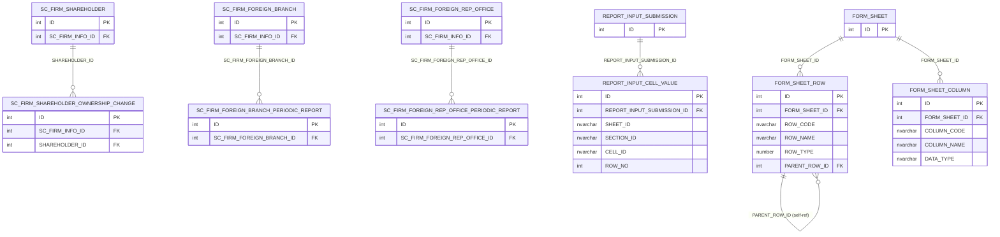

# SCMS HLD — Tier 3

**Source system:** SCMS (Quản lý Giám sát Công ty Chứng khoán)
**Tier 3:** Các entity có FK đến Tier 2 — bao gồm thay đổi sở hữu cổ đông, báo cáo định kỳ chi nhánh/VPĐD nước ngoài, giá trị ô dữ liệu báo cáo đầu vào, hàng/cột sheet biểu mẫu báo cáo.

> **Lưu ý cập nhật:** `Securities Company Major Shareholder Relation` đã được **hạ xuống Tier 2** sau khi xác nhận từ BRD (SHAREHOLDER_ID có `key: null, fk_note: null` — không phải FK khai báo). `Securities Company Foreign Branch Personnel` và `Securities Company Foreign Representative Office Personnel` đã **chuyển lên Tier 2** (table_type Fundamental) — xem `SCMS_HLD_Tier2.md`. Các entity rủi ro/cảnh báo, cổ đông đại diện/chuyển nhượng/quan hệ cổ đông và Practitioner Business Transaction Relationship đã **gỡ khỏi HLD** (không có LLD) — xem SCMS_HLD_Overview.md mục 7f nhóm `Chưa có LLD`.

---

## 6a. Bảng tổng quan BCV Concept

| BCV Core Object | BCV Concept | Category | Source Table | Mô tả bảng nguồn | Atomic Entity | table_type | BCV Term |
|---|---|---|---|---|---|---|---|
| Event | [Event] Transaction | Event | SC_FIRM_SHAREHOLDER_OWNERSHIP_CHANGE | Thay đổi sở hữu cổ đông CTCK (tăng/giảm vốn góp, chuyển nhượng) | Securities Company Shareholder Ownership Change | Fact Append | (1) BCV có `Transaction` trong Event — giao dịch thay đổi sở hữu. (2) SC_FIRM_SHAREHOLDER_OWNERSHIP_CHANGE ghi nhận từng lần thay đổi sở hữu: vốn trước/sau, tỷ lệ trước/sau, loại giao dịch (TANG_VON/GIAM_VON/CHUYEN_NHUONG). Insert-only (Fact Append). (3) Chọn `[Event] Transaction`, Fact Append. |
| Business Activity | [Business Activity] Transaction | Business Activity | SC_FIRM_FOREIGN_BRANCH_PERIODIC_REPORT | Báo cáo định kỳ của chi nhánh CTCK nước ngoài | Securities Company Foreign Organization Unit Periodic Report | Relative | (1) BCV có `Transaction` (submission/event) trong Event. (2) SC_FIRM_FOREIGN_BRANCH_PERIODIC_REPORT lưu từng lần nộp báo cáo định kỳ của chi nhánh NN: FK SC_FIRM_FOREIGN_BRANCH_ID, năm, kỳ, trạng thái. (3) Chọn `[Event] Transaction`. |
| Business Activity | [Business Activity] Transaction | Business Activity | SC_FIRM_FOREIGN_REP_OFFICE_PERIODIC_REPORT | Báo cáo định kỳ của VPDD CTCK nước ngoài | Securities Company Foreign Organization Unit Periodic Report | Relative | (1) Tương tự SC_FIRM_FOREIGN_BRANCH_PERIODIC_REPORT. (2) FK → SC_FIRM_FOREIGN_REP_OFFICE_ID. (3) Chọn `[Event] Transaction`. |
| Documentation | [Documentation] Regulatory Report | Documentation | REPORT_INPUT_CELL_VALUE | Giá trị từng ô dữ liệu (cell) trong 1 lần nộp báo cáo đầu vào (eForm), xác định theo tọa độ sheet/section/cell | Securities Company Report Input Value | Classification | (1) Cùng BCV Concept `[Documentation] Regulatory Report` (id 9297) với entity cha Securities Company Report Input Submission, ở grain chi tiết từng ô dữ liệu — tiền lệ IDS: `Financial Report Value` (DATA) dùng cùng term 9297 ở cấp giá trị cell. Không có BCV term riêng cho "Cell". (2) Cấu trúc bảng: REPORT_INPUT_SUBMISSION_ID (FK→REPORT_INPUT_SUBMISSION, khai báo rõ trong BRD), SHEET_ID/SECTION_ID/CELL_ID (tọa độ text trong cấu trúc eForm động — không FK đến family FORM_SHEET* nguồn, hiện ngoài scope), ROW_NO, ITEM_VALUE. (3) Chọn `[Documentation] Regulatory Report`. Đặt tên `Securities Company Report Input Value` theo chỉ đạo Data Modeler — xem 6f T3-07 về ngoại lệ Rule #8. Table Type = **Classification (Upsert/SCD1)** theo chỉ đạo tường minh Data Modeler (2026-09-15, đổi từ Relative) — ngoại lệ so với định nghĩa mặc định (entity không phải reference/danh mục thuần mà là chi tiết/dòng con phụ thuộc Submission, vẫn giữ FK surrogate tới `Report Input Submission Id`), xem 6f T3-09. **[CẬP NHẬT 2026-09-16]** Family `FORM_SHEET*` nay đã vào scope (xem SCMS_HLD_Tier2.md/Tier3.md/Tier4.md mới) — SHEET_ID/SECTION_ID/CELL_ID **chưa đổi thành FK thật trong lượt này**, xem 6f T3-08 (cập nhật) và 7e Overview. |
| Documentation | [Documentation] Form Document | Documentation | FORM_SHEET_ROW | Hàng dữ liệu trong 1 sheet của biểu mẫu báo cáo — mã, tên, định dạng, phân cấp cha-con | Securities Company Report Sheet Row | Relative | (1) Tái dùng term `Form Document` (id 9348) — cùng concept với entity cha `Securities Company Report Sheet` (Tier 2), là thành phần cấu trúc chi tiết của biểu mẫu. (2) Cấu trúc bảng: FORM_SHEET_ID (FK), ROW_CODE/ROW_NAME, SORT_ORDER, NAME_FORMAT, COLOR/ALIGNMENT/BOLD/ITALIC/BACKGROUND_COLOR (định dạng hiển thị), FROZEN_ROW/HIDDEN_ROW/EDITABLE, FORMULA, ROW_TYPE (DU_LIEU/TONG_CONG/TIEU_DE), PARENT_ROW_ID (self-ref) — mã/tên/loại hàng mang ý nghĩa nghiệp vụ (loại dòng dữ liệu/tổng cộng/tiêu đề), không chỉ hiển thị thuần túy. (3) Chọn Documentation, Relative — phụ thuộc `Securities Company Report Sheet` (Tier 2). Đặt tên chứa trọn "Securities Company Report Sheet" (Rule #8). Đảo ngược quyết định loại-scope trước đây (xem 7e/7f Overview, T1-14). |
| Documentation | [Documentation] Form Document | Documentation | FORM_SHEET_COLUMN | Cột dữ liệu trong 1 sheet của biểu mẫu báo cáo — mã, tên, kiểu dữ liệu, định dạng | Securities Company Report Sheet Column | Relative | (1) Tái dùng term `Form Document` (id 9348) — cùng concept với entity cha `Securities Company Report Sheet` (Tier 2). (2) Cấu trúc bảng: FORM_SHEET_ID (FK), COLUMN_CODE/COLUMN_NAME, SORT_ORDER, DATA_TYPE (TEXT/NUMBER/DATE/BOOLEAN/SELECT), FORMULA, REQUIRED/EDITABLE, WIDTH, COLOR/ALIGNMENT/FROZEN_COLUMN/LOCKED_COLUMN/HIDDEN_COLUMN — DATA_TYPE/REQUIRED mang ý nghĩa nghiệp vụ (kiểu dữ liệu, bắt buộc nhập), không chỉ hiển thị thuần túy. (3) Chọn Documentation, Relative — phụ thuộc `Securities Company Report Sheet` (Tier 2). Đặt tên chứa trọn "Securities Company Report Sheet" (Rule #8). Đảo ngược quyết định loại-scope trước đây (xem 7e/7f Overview, T1-14). |

---

## 6b. Diagram Source (Mermaid)

---

## 6c. Diagram Atomic (Mermaid)

```mermaid
erDiagram
    Securities_Company_Shareholder {
        bigint ds_id PK
        bigint securities_company_id FK
    }
    Securities_Company_Foreign_Organization_Unit {
        bigint ds_id PK
        bigint securities_company_id FK
    }
    Classification_Securities_Company_Firm_Service {
        bigint cl_sc_firm_service_id PK
        string cl_sc_firm_service_code
    }
    Securities_Company_Shareholder_Ownership_Change {
        bigint ds_id PK
        bigint securities_company_shareholder_id FK
        string ds_transaction_type_code
        number capital_before
        number ratio_before
        number capital_after
        number ratio_after
    }
    Securities_Company_Foreign_Organization_Unit_Periodic_Report {
        bigint ds_id PK
        bigint securities_company_foreign_branch_id FK
        int report_year
        int period
        string ds_report_status_code
    }
    Securities_Company_Report_Input_Submission {
        bigint ds_id PK
    }
    Securities_Company_Report_Input_Value {
        bigint ds_id PK
        bigint report_input_submission_id FK
        string sheet_id
        string section_id
        string cell_id
        int row_no
        string item_value
    }
    Securities_Company_Report_Sheet {
        bigint ds_id PK
    }
    Securities_Company_Report_Sheet_Row {
        bigint ds_id PK
        bigint sc_report_sheet_id FK
        string row_code
        string row_name
        string ds_row_type_code
        bigint parent_sc_report_sheet_row_id FK
    }
    Securities_Company_Report_Sheet_Column {
        bigint ds_id PK
        bigint sc_report_sheet_id FK
        string column_code
        string column_name
        string ds_data_type_code
    }

    Securities_Company_Shareholder ||--o{ Securities_Company_Shareholder_Ownership_Change : "securities_company_shareholder_id"
    Securities_Company_Foreign_Organization_Unit ||--o{ Securities_Company_Foreign_Organization_Unit_Periodic_Report : "securities_company_foreign_branch_id"
    Securities_Company_Foreign_Organization_Unit ||--o{ Securities_Company_Foreign_Organization_Unit_Periodic_Report : "securities_company_foreign_representative_office_id"
    Securities_Company_Report_Input_Submission ||--o{ Securities_Company_Report_Input_Value : "report_input_submission_id"
    Securities_Company_Report_Sheet ||--o{ Securities_Company_Report_Sheet_Row : "sc_report_sheet_id"
    Securities_Company_Report_Sheet_Row ||--o{ Securities_Company_Report_Sheet_Row : "parent_sc_report_sheet_row_id"
    Securities_Company_Report_Sheet ||--o{ Securities_Company_Report_Sheet_Column : "sc_report_sheet_id"
```

---

## 6d. Mục Danh mục & Tham chiếu (Reference Data)

| Source Field / Bảng | Mô tả | Scheme Code | source_type | Ghi chú |
|---|---|---|---|---|
| SC_FIRM_SHAREHOLDER_OWNERSHIP_CHANGE.TRANSACTION_TYPE | Loại giao dịch thay đổi sở hữu | `SCMS_SHAREHOLDER_TXN_TYPE` | source_table | Values: TANG_VON, GIAM_VON, CHUYEN_NHUONG, TANG_VON_DIEU_LE |
| SC_FIRM_FOREIGN_BRANCH_PERIODIC_REPORT.RECORD_STATUS | **[2026-10-10]** Không còn dùng scheme `SCMS_REPORT_SUBMISSION_STATUS` — FK sang `Classification Securities Company Firm Status` (CAT_SC_FIRM_STATUS) theo yêu cầu Data Modeler | (FK entity Classification, không còn scheme) | source_table | Crosswalk lấy SC_FIRM_STATUS_CODE |
| FORM_SHEET_ROW.ROW_TYPE | Loại hàng trong sheet | `SCMS_SHEET_ROW_TYPE` | source_table | Values: DU_LIEU, TONG_CONG, TIEU_DE |
| FORM_SHEET_ROW.NAME_FORMAT / FORM_SHEET_COLUMN.NAME_FORMAT | Định dạng hiển thị tên hàng/cột | `SCMS_SHEET_NAME_FORMAT` | source_table | Values: ID, IN, IH, GC (theo mô tả nguồn) |
| FORM_SHEET_COLUMN.DATA_TYPE | Kiểu dữ liệu cột | `SCMS_FORM_DATA_TYPE` | source_table | Tái dùng scheme đã đăng ký ở Tier 1 (FORM_INDICATOR_INPUT.DATA_TYPE) — cùng value set TEXT/NUMBER/DATE/BOOLEAN/SELECT. |

---

## 6e. Bảng chờ thiết kế

*(Để trống)*

---

## 6f. Điểm cần xác nhận

| # | Câu hỏi | Kết quả |
|---|---|---|
| T3-01 | SC_FIRM_MAJOR_SHAREHOLDER_RELATION có SHAREHOLDER_ID (nullable FK đến SC_FIRM_SHAREHOLDER) — đây là entity riêng hay extend của SC_FIRM_SHAREHOLDER? | **Đã xác nhận:** SHAREHOLDER_ID có `key: null, fk_note: null` — không phải FK khai báo. Entity chỉ FK→SC_FIRM_INFO(T1) → **hạ xuống Tier 2**, đã chuyển vào SCMS_HLD_Tier2.md. |
| T3-07 | Tên entity `Securities Company Report Input Value` không chứa trọn tên cha `Securities Company Report Input Submission` (chỉ chung phần "Securities Company Report") — có vi phạm Rule #8 (CLAUDE.md) không? | **Ngoại lệ đặt tên theo chỉ đạo tường minh Data Modeler (2026-09-15)**, tương tự các ngoại lệ đặt tên khác theo chỉ đạo Data Modeler. Ghi nhận minh bạch, không phải suy luận sai rule. |
| T3-08 | `REPORT_INPUT_CELL_VALUE.SHEET_ID`/`SECTION_ID`/`CELL_ID` có nên FK đến family `FORM_SHEET*` (FORM_SHEET/FORM_SHEET_ROW/FORM_SHEET_COLUMN/FORM_SHEET_CELL) không? | **[CẬP NHẬT 2026-09-16] Chưa xử lý trong lượt này — chỉ ghi nhận điểm cần xác nhận, không tự sửa entity cũ.** Lý do loại-scope cũ ("family FORM_SHEET* ngoài scope") **không còn đúng** — cả family nay đã vào scope Atomic (xem 6a Tier2/Tier3/Tier4 mới, T1-14). Cần Data Modeler xác nhận ở vòng thiết kế sau: có nên đổi SHEET_ID/SECTION_ID/CELL_ID trên `Securities Company Report Input Value` thành FK thật tới `Securities Company Report Sheet`/`...Sheet Row`/`...Sheet Column`/`...Sheet Cell` hay không (ảnh hưởng LLD đã có, `design_status` hiện tại). |
| T3-09 | Table Type của `Securities Company Report Input Value` đổi từ Relative → Classification (Upsert/SCD1) theo yêu cầu tường minh Data Modeler (2026-09-15) — entity vẫn có FK tới Submission (Tier 2) + attribute nghiệp vụ riêng (SHEET_ID/SECTION_ID/CELL_ID/ROW_NO/ITEM_VALUE), không phải reference/danh mục thuần (Code+Name) như định nghĩa mặc định của Classification. | **Quyết định Data Modeler (chốt, 2026-09-15) — ngoại lệ so với định nghĩa mặc định**, ghi nhận minh bạch tương tự các ngoại lệ table_type khác đã có trong dự án (T1-07). ETL pattern đổi từ SCD2 sang Upsert (SCD1) — không còn theo dõi lịch sử thay đổi giá trị ô dữ liệu qua các lần ETL, chỉ giữ trạng thái mới nhất. Xem `lld_SCMS_REPORT_INPUT_CELL_VALUE.yaml` (technical field đổi từ `ds_rcrd_eff_dt`/`ds_rcrd_end_dt` sang chỉ còn `ds_etl_pcs_tms`, theo `reference/technical_fields.md`). |
| T3-10 | **[MỚI 2026-09-16]** `FORM_SHEET_ROW`/`FORM_SHEET_COLUMN`/`FORM_ROW_HEADER` — đánh giá lại nhóm cascade bị loại khỏi scope với lý do lỗi thời (xem Tier1 T1-14). | **Quyết định Data Modeler (chốt, 2026-09-16).** Đưa cả 3 vào scope Tier 3, phụ thuộc `Securities Company Report Sheet` (Tier 2). Xem 6a/6b/6c. `FORM_SHEET_CELL` (phụ thuộc cả 2 bảng này + FORM_SHEET + FORM_INDICATOR_INPUT) đặt Tier 4 — xem `SCMS_HLD_Tier4.md` (file mới). **[CẬP NHẬT — xem T3-11]** `FORM_ROW_HEADER` đã bị đảo ngược lại ngoài scope cùng ngày; quyết định "vào scope" ở dòng này chỉ còn áp dụng cho `FORM_SHEET_ROW`/`FORM_SHEET_COLUMN`. |
| T3-11 | **[MỚI 2026-09-16]** `FORM_ROW_HEADER` (vừa đưa vào scope ở T3-10) — Data Modeler yêu cầu loại lại ngay trong cùng lượt: bảng phục vụ khai thác báo cáo đầu ra ở hệ thống cũ, hiện không còn cần thiết. | **Quyết định Data Modeler (chốt, 2026-09-16).** Gỡ bỏ hoàn toàn thiết kế `Securities Company Report Row Header` (entity, LLD, manifest, scheme `SCMS_FORM_ROW_HEADER_RECORD_STATUS`) — chuyển `FORM_ROW_HEADER` về `atomic_out_of_scope.yaml`, `scope_status: out_of_scope` trong `brd_SCMS.yaml`. Không ảnh hưởng `FORM_SHEET_ROW`/`FORM_SHEET_COLUMN`/`FORM_SHEET_CELL` — các entity này không FK đến Row Header. |
