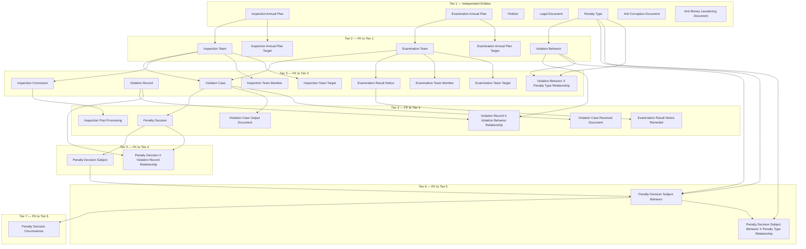

# THANHTRA HLD — Overview

**Source system:** THANHTRA (Hệ thống Thanh tra, Kiểm tra và Xử phạt vi phạm hành chính — UBCKNN)
**Mô tả:** Hệ thống quản lý toàn bộ quy trình thanh tra, kiểm tra, tiếp công dân, xử lý đơn thư và xử lý vi phạm hành chính (VPHC) của Ủy ban Chứng khoán Nhà nước (UBCKNN). Bao gồm kế hoạch năm, đoàn thanh tra/kiểm tra, kết luận, quyết định xử phạt và theo dõi thi hành.

---

#### 7a. Bảng tổng quan Atomic entities

| Tier | BCV Core Object | BCV Concept | Category | Source Table | Source Table Change Mode | Mô tả bảng nguồn | Atomic Entity | Table Type | BCV Term |
|---|---|---|---|---|---|---|---|---|---|
| T1 | Business Direction | [Business Direction] Business Plan | Regulatory Planning | INSPECTION_ANNUAL_PLAN | Update | Kế hoạch thanh tra hàng năm: 1 kế hoạch/1 năm, phê duyệt bằng quyết định hành chính | Inspection Annual Plan | Fundamental | (1) Business Plan — BCV: "a Business Direction to attain objectives; combines activities, timeframe, assigned responsibilities". (2) Bảng: PLAN_YEAR(unique/năm), DECISION_NUMBER, DECISION_DATE, STATUS(DRAFT/APPROVED) — kế hoạch chính thức với năm, quyết định, trạng thái lifecycle. (3) Chọn Business Plan: khớp với "kế hoạch nghiệp vụ hàng năm có timeframe và trạng thái phê duyệt". Không có BCV term chuyên biệt cho "regulatory inspection plan". |
| T1 | Business Direction | [Business Direction] Business Plan | Regulatory Planning | EXAMINATION_ANNUAL_PLAN | Update | Kế hoạch kiểm tra hàng năm: cấu trúc đồng nhất với INSPECTION_ANNUAL_PLAN, dành cho đoàn kiểm tra | Examination Annual Plan | Fundamental | (1) Business Plan — BCV: cùng mô tả. (2) Bảng: cấu trúc hoàn toàn đồng nhất với INSPECTION_ANNUAL_PLAN. (3) Tách entity riêng vì Inspection và Examination là 2 loại hình khác thẩm quyền. Cùng BCV Concept, khác prefix. |
| T1 | Communication | [Communication] Feedback | Petition Management | PETITION | Update | Đơn thư công dân/tổ chức: PETITION_CATEGORY(FEEDBACK_SUGGESTION/COMPLAINT/DENUNCIATION), self-ref đơn trùng, STATUS | Petition | Fundamental | (1) Feedback — BCV: "a Communication to offer a compliment or a complaint". Complaint — BCV sub-type: "indicate dissatisfaction". (2) Bảng: PETITION_CATEGORY(3 values), SENDER_NAME/ADDRESS, self-ref ORIGINAL_PETITION_ID, STATUS. (3) Dùng Feedback (parent) thay Complaint vì FEEDBACK_SUGGESTION không phải "dissatisfaction" — Feedback bao hàm cả 3 loại đơn thư. |
| T1 | Business Direction | [Business Direction] Law | Legal Reference | LEGAL_DOCUMENT | Update | Danh mục văn bản pháp luật làm căn cứ xử phạt: CODE(VBPL-XXXX), NAME, ISSUED_DATE, STATUS(ACTIVE/INACTIVE) | Legal Document | Fundamental | (1) Law — BCV: "a Business Direction defining binding rules legally enforceable; failure to comply may result in penalty". (2) Bảng: CODE(VBPL-XXXX), NAME, ISSUED_DATE, STATUS lifecycle. (3) Chọn Law: bảng lưu văn bản pháp luật làm căn cứ xử phạt. Có ISSUED_DATE + STATUS lifecycle → Fundamental (không phải Classification Value thuần túy). |
| T1 | Business Direction | [Business Direction] Law | Regulatory Catalog | PENALTY_TYPE | Update | Danh mục hình thức xử phạt hành chính: CATEGORY(PRIMARY/SUPPLEMENTARY/REMEDIAL), STATUS(ACTIVE/INACTIVE), LEGAL_BASIS | Classification THANHTRA Penalty Type | Classification | (1) Law — BCV: "defines binding rules legally enforceable". (2) Bảng: CODE(UNIQUE), NAME, CATEGORY(3 values), STATUS lifecycle, LEGAL_BASIS. (3) Không thuần Code+Name vì có CATEGORY, STATUS, LEGAL_BASIS → Fundamental. Law phù hợp vì các hình thức xử phạt được pháp luật quy định. |
| T1 | Documentation | [Documentation] Documentation Item | Anti-Corruption Management | ANTI_CORRUPTION_DOCUMENT | Update | Văn bản PCTN đi/đến: DOCUMENT_TYPE(SENT/RECEIVED), DOCUMENT_NUMBER, ISSUED_DATE, SUMMARY, DOCUMENT_YEAR, QUARTER, RECEIVING_UNIT | Anti Corruption Document | Relative | (1) Documentation Item — BCV: "a Documentation Item identifies a piece of documentation"; Form Document không khớp vì không có cấu trúc biểu mẫu. (2) Bảng: sổ văn bản PCTN, 1 dòng = 1 văn bản, DOCUMENT_TYPE(SENT/RECEIVED), DOCUMENT_NUMBER, ISSUED_DATE, SUMMARY, DOCUMENT_YEAR, QUARTER, RECEIVING_UNIT; không FK nghiệp vụ. (3) Documentation Item (general) vì cùng bảng chứa cả văn bản đi và đến. Chi tiết xem THANHTRA_HLD_Tier1.md. |
| T1 | Documentation | [Documentation] Documentation Item | Anti-Money Laundering Management | ANTI_MONEY_LAUNDERING_DOCUMENT | Update | Văn bản PCRT đi/đến: cấu trúc đồng nhất ANTI_CORRUPTION_DOCUMENT; cột DOSSIER_ID không map lên Atomic | Anti Money Laundering Document | Relative | (1) Documentation Item — BCV: cùng mô tả. (2) Bảng: 8 cột nghiệp vụ trùng ANTI_CORRUPTION_DOCUMENT + DOSSIER_ID (inferred, nullable). (3) Tách entity riêng vì PCTN/PCRT là 2 lĩnh vực khác nhau. Theo quyết định Data Modeler: không map DOSSIER_ID, bảng ANTI_MONEY_LAUNDERING_DOSSIER giữ ngoài scope. Chi tiết xem THANHTRA_HLD_Tier1.md. |
| T2 | Business Activity | [Business Activity] Business Review | Inspection | INSPECTION_TEAM | Update | Hồ sơ đoàn thanh tra: CODE(HSTT-YYYY-XXX), FK→ANNUAL_PLAN(nullable), FORM_TYPE(PERIODIC/UNSCHEDULED), DECISION_NUMBER | Inspection Team | Fundamental | (1) Business Review — BCV: "a Business Activity in which business operations are studied and compared to business objectives". (2) Bảng: CODE(HSTT-YYYY-XXX), FK→INSPECTION_ANNUAL_PLAN(nullable), PLAN_YEAR, FORM_TYPE, DECISION_NUMBER(UNIQUE), rich inspection details, VERIFICATION_MINUTES_SIGN_DATE. (3) Business Review là BCV term phù hợp nhất cho hoạt động thanh tra (review operations vs objectives). Không có "Regulatory Inspection" trong BCV. |
| T2 | Business Activity | [Business Activity] Business Review | Examination | EXAMINATION_TEAM | Update | Hồ sơ đoàn kiểm tra: CODE(HSKT-YYYY-XXX), FK→ANNUAL_PLAN(nullable), UNIT_ID/UNIT_NAME, FORM_TYPE | Examination Team | Fundamental | (1) Business Review — BCV: cùng mô tả. (2) Bảng: CODE(HSKT-YYYY-XXX), FK→EXAMINATION_ANNUAL_PLAN(nullable), UNIT_ID, UNIT_NAME, FORM_TYPE, DECISION_NUMBER(UNIQUE). (3) Business Review khớp. Tách 2 entity vì Inspection và Examination khác thẩm quyền. |
| T2 | Business Activity | [Business Activity] Business Review | Inspection Target | INSPECTION_ANNUAL_PLAN_TARGET | Update | Danh sách đối tượng thanh tra trong kế hoạch năm: TARGET_TYPE(3 values), TARGET_NAME | Inspection Annual Plan Target | Fundamental | (1) Business Plan — entity này mở rộng kế hoạch với danh sách mục tiêu. (2) Bảng: FK→INSPECTION_ANNUAL_PLAN, TARGET_TYPE(SECURITIES_COMPANY/FUND_MANAGEMENT_COMPANY/PUBLIC_COMPANY), TARGET_NAME. (3) Relative của TT Inspection Annual Plan, tên chứa parent ✓. |
| T2 | Business Activity | [Business Activity] Business Review | Examination Target | EXAMINATION_ANNUAL_PLAN_TARGET | Update | Danh sách đối tượng kiểm tra trong kế hoạch năm: cấu trúc tương tự INSPECTION_ANNUAL_PLAN_TARGET | Examination Annual Plan Target | Fundamental | (1) Business Plan — cùng mô tả. (2) Cấu trúc đồng nhất với INSPECTION_ANNUAL_PLAN_TARGET. (3) Relative của TT Examination Annual Plan, tên chứa parent ✓. |
| T2 | Business Activity | [Business Activity] Conduct Violation | Violation Behavior Catalog | VIOLATION_BEHAVIOR | Update | Danh mục hành vi vi phạm hành chính: CODE(UNIQUE), FK→PENALTY_TYPE, MIN/MAX_FINE_AMOUNT, REMEDIAL_MEASURE, VIOLATION_CLAUSE | Violation Behavior | Fundamental | (1) Conduct Violation — BCV: "a Business Activity that breaches a business code of conduct". (2) Bảng: CODE(UNIQUE), NAME, FK→PENALTY_TYPE, MIN_FINE_AMOUNT, MAX_FINE_AMOUNT, REMEDIAL_MEASURE, VIOLATION_CLAUSE — danh mục hành vi với mức phạt min/max, căn cứ pháp lý. (3) Không thuần Code+Name vì có FK + fine range → Fundamental. Conduct Violation phù hợp hơn Law vì đây mô tả hành vi vi phạm cụ thể. |
| T3 | Business Activity | [Business Activity] Conduct Violation | VPHC Case | VIOLATION_CASE | Update | Hồ sơ xử lý vi phạm hành chính: SOURCE_CATEGORY(5 types), FK→INSPECTION/EXAMINATION_TEAM(nullable), STATUS(5 states) | Violation Case | Fundamental | (1) Conduct Violation — BCV: "a Business Activity that breaches a business code of conduct of the Financial Institution". (2) Bảng: CODE, NAME, SOURCE_CATEGORY(5 values), FK→INSPECTION_TEAM(nullable), FK→EXAMINATION_TEAM(nullable), ASSIGNED_OFFICER_ID, STATUS(NEW/PROCESSING/DECISION_ISSUED/ENFORCED/CLOSED), BOND fields. (3) Conduct Violation khớp hoàn toàn — entity hồ sơ vi phạm pháp luật với lifecycle đầy đủ. |
| T3 | Business Activity | [Business Activity] Conduct Violation | Violation Record | VIOLATION_RECORD | Update | Biên bản vi phạm hành chính: RECORD_NUMBER, RECORD_TYPE(PAPER/ELECTRONIC), FK suy luận→Teams, STATUS(DRAFT→SIGNED→NUMBERED→SENT) | Violation Record | Fundamental | (1) Form Document — BCV: "a Documentation Item in a standard template layout requiring additional information". (2) Bảng: RECORD_NUMBER, RECORD_TYPE(2 values), FK suy luận→INSPECTION/EXAMINATION_TEAM, SUBJECT_TYPE/NAME/ID_NUMBER, STATUS(4 states), signing/forwarding tracking. (3) Form Document khớp — biên bản vi phạm là biểu mẫu pháp lý với workflow phê duyệt 4 bước. FK suy luận → Tier 3 (xem T3-01). |
| T3 | Documentation | [Documentation] Form Document | Inspection Conclusion | INSPECTION_CONCLUSION | Update | Kết luận thanh tra: CONCLUSION_NUMBER, FK→INSPECTION_TEAM, TARGET_TYPE/REFERENCE/NAME, EXECUTION_STATUS(3 states) | Inspection Conclusion | Fundamental | (1) Form Document — BCV: formal document produced as outcome of Business Activity. Status Document — BCV: "issued by inspector to document condition". (2) Bảng: FK→INSPECTION_TEAM, CONCLUSION_NUMBER, ISSUED_DATE, ANNOUNCED_DATE, TARGET_TYPE, CONTENT, RECOMMENDATION, EXECUTION_STATUS, GOVERNMENT_INSPECTOR_SENT_DATE. (3) Form Document phù hợp — kết luận là tài liệu pháp lý chính thức kết thúc đoàn thanh tra. |
| T3 | Documentation | [Documentation] Form Document | Examination Result Notice | EXAMINATION_RESULT_NOTICE | Update | Thông báo kết quả kiểm tra: NOTICE_NUMBER, FK→EXAMINATION_TEAM, TARGET_TYPE, EXECUTION_STATUS(3 states) | Examination Result Notice | Fundamental | (1) Form Document — BCV: cùng mô tả. (2) Bảng: FK→EXAMINATION_TEAM, NOTICE_NUMBER, ISSUED_DATE, ANNOUNCED_DATE, TARGET_TYPE, CONTENT, RECOMMENDATION, EXECUTION_STATUS. (3) Form Document khớp — thông báo kết quả kiểm tra là tài liệu chính thức tương đương kết luận thanh tra cho đoàn kiểm tra. |
| T3 | Business Activity | [Business Activity] Business Review | Inspection Team Member | INSPECTION_TEAM_MEMBER | Update | Danh sách thành viên đoàn thanh tra: USER_ID, ROLE_TYPE (vai trò trong đoàn) | Inspection Team Member | Fundamental | (1) Involved Party — BCV: entity này ghi nhận vai trò cá nhân trong đoàn. (2) Bảng: FK→INSPECTION_TEAM, USER_ID(FK→system_user), ROLE_TYPE, USER_NAME. (3) Involved Party khớp — 1 thành viên là 1 Involved Party trong đoàn. Tên chứa "TT Inspection Team" ✓. |
| T3 | Business Activity | [Business Activity] Business Review | Examination Team Member | EXAMINATION_TEAM_MEMBER | Update | Danh sách thành viên đoàn kiểm tra: cấu trúc đồng nhất với INSPECTION_TEAM_MEMBER | Examination Team Member | Fundamental | (1) Involved Party — BCV: cùng mô tả. (2) Cấu trúc đồng nhất với INSPECTION_TEAM_MEMBER. (3) Tên chứa "TT Examination Team" ✓. |
| T3 | Business Activity | [Business Activity] Business Review | Inspection Team Target | INSPECTION_TEAM_TARGET | Update | Đối tượng được thanh tra trong đoàn: TARGET_TYPE(7 values), TARGET_REFERENCE_ID, TARGET_NAME | Inspection Team Target | Fundamental | (1) Business Review — entity này ghi nhận "ai được review" trong inspection activity. (2) Bảng: FK→INSPECTION_TEAM, TARGET_TYPE(7 values), TARGET_REFERENCE_ID, TARGET_NAME. (3) Business Review phù hợp. Tên chứa "TT Inspection Team" ✓. |
| T3 | Business Activity | [Business Activity] Business Review | Examination Team Target | EXAMINATION_TEAM_TARGET | Update | Đối tượng được kiểm tra trong đoàn: TARGET_TYPE(7 values), TARGET_REFERENCE_ID, TARGET_NAME | Examination Team Target | Fundamental | (1) Business Review — cùng mô tả. (2) Cấu trúc đồng nhất với INSPECTION_TEAM_TARGET. (3) Tên chứa "TT Examination Team" ✓. |
| T3 | Business Activity | [Business Activity] Conduct Violation | Violation Behavior Penalty Type | PENALTY_TYPE_VIOLATION_BEHAVIOR | Update | Hình thức xử phạt bổ sung theo hành vi vi phạm (DDL UAT): FK→PENALTY_TYPE, FK→VIOLATION_BEHAVIOR | Violation Behavior X Penalty Type Relationship | Relative | Domain Prefix rỗng (entity link). Cross-tier FK →T1 Penalty Type. Chi tiết xem THANHTRA_HLD_Tier3.md. |
| T4 | Event | [Event] Event | Penalty Decision | PENALTY_DECISION | Update | Quyết định xử phạt VPHC: DECISION_NUMBER, FK→VIOLATION_CASE, TOTAL_FINE_AMOUNT, STATUS(7 states), COMPLAINT_EXISTS, LAWSUIT_EXISTS | Penalty Decision | Fundamental | (1) Event — BCV: "identifies a significant occurrence". Judicial Event — BCV: "deals with violation of law". (2) Bảng: DECISION_NUMBER, ISSUED_DATE, FK→VIOLATION_CASE, TOTAL_FINE_AMOUNT, STATUS(7 values), COMPLAINT_EXISTS, LAWSUIT_EXISTS, SUBMITTED_BY_ID, APPROVER_ID. (3) Judicial Event gần nhất nhưng đây là quyết định hành chính (không tư pháp). Dùng parent [Event] để tránh gán concept sai. Xem T4-01. |
| T4 | Documentation | [Documentation] Form Document | VPHC Output Document | VIOLATION_CASE_OUTPUT_DOCUMENT | Update | Văn bản đầu ra quy trình VPHC: DOCUMENT_TYPE(9 values) liên kết tài liệu phát sinh | Violation Case Output Document | Fundamental | (1) Form Document — BCV: formal document. (2) Bảng: FK→VIOLATION_CASE, DOCUMENT_TYPE(9 values gồm cả PENALTY_DECISION). (3) Form Document phù hợp. Tên chứa "TT Violation Case" ✓. |
| T4 | Documentation | [Documentation] Documentation Item | VPHC Received Document | VIOLATION_CASE_RECEIVED_DOCUMENT | Update | Văn bản tiếp nhận trong hồ sơ VPHC: DOCUMENT_NUMBER, RECEIVED_DATE, SUMMARY | Violation Case Received Document | Fundamental | (1) Documentation Item — BCV: "a piece of documentation". (2) Bảng: FK→VIOLATION_CASE, DOCUMENT_NUMBER, RECEIVED_DATE, SUMMARY — tài liệu nhận vào. (3) Documentation Item (chứ không phải Form Document) vì đây là tài liệu tiếp nhận từ bên ngoài. Tên chứa "TT Violation Case" ✓. |
| T4 | Business Activity | [Business Activity] Conduct Violation | Violation Record X Violation Behavior Relationship | VIOLATION_RECORD_BEHAVIOR | Update | Liên kết biên bản VPHC với danh mục hành vi vi phạm: FK→VIOLATION_RECORD, FK→VIOLATION_BEHAVIOR | Violation Record X Violation Behavior Relationship | Relative | [SỬA 2026-09-22] Đổi từ Fundamental sang pure link/relationship "_x_" (đồng nhất pattern NHNCK.APPLICATION_DECISIONS) — DESCRIPTION/LEGAL_BASIS bỏ khỏi thiết kế, PK composite trên 2 FK Id, không Id/Code riêng. Tên chứa cả "Violation Record" lẫn "Violation Behavior" ✓. |
| T4 | Documentation | [Documentation] Form Document | Examination Result Notice Remedial | EXAMINATION_RESULT_NOTICE_REMEDIAL | Update | Biện pháp khắc phục trong thông báo kết quả kiểm tra: FK→EXAMINATION_RESULT_NOTICE, DESCRIPTION | Examination Result Notice Remedial | Fundamental | (1) Form Document — cùng mô tả. (2) Cấu trúc đồng nhất với INSPECTION_CONCLUSION_REMEDIAL. (3) Tên chứa "TT Examination Result Notice" ✓. |
| T4 | Business Activity | [Business Activity] Business Review | Inspection Post Processing | POST_INSPECTION_PROCESSING | Update | Theo dõi thực hiện kiến nghị sau thanh tra: FK→INSPECTION_CONCLUSION, REQUIREMENT_TYPE, STATUS(5 states), DUE_DATE | Inspection Post Processing | Fundamental | (1) Status Review (sub-type Business Review) — BCV: "reviews status to determine if still valid". (2) Bảng: FK→INSPECTION_CONCLUSION, REQUIREMENT_TYPE, RESPONSIBLE_PARTY, DUE_DATE, STATUS(5 values), IMPLEMENTATION_NOTES, RESULT_SUMMARY. (3) Status Review phù hợp — theo dõi tiến độ thực hiện kiến nghị. Tên chứa "TT Inspection" nhưng không đủ "TT Inspection Conclusion" (xem T4-03). |
| T5 | Event | [Event] Event | Penalty Subject | PENALTY_DECISION_SUBJECT | Update | Đối tượng bị xử phạt trong quyết định: SUBJECT_TYPE, embedded identity, TOTAL_FINE_AMOUNT, PAID_AMOUNT, COMPLIANCE_STATUS(4 states) | Penalty Decision Subject | Fundamental | (1) Involved Party — BCV: "an Entity involved in the Financial Institution's business". (2) Bảng: FK→PENALTY_DECISION, SUBJECT_TYPE, SUBJECT_NAME, SUBJECT_ID_NUMBER, TOTAL_FINE_AMOUNT, PAID_AMOUNT, COERCED_AMOUNT, COMPLIANCE_STATUS, PAYMENT_PROOF_URL. (3) Involved Party khớp — mỗi đối tượng bị xử phạt là Involved Party trong bối cảnh quyết định. Tên chứa "TT Penalty Decision" ✓. |
| T5 | Event | [Event] Event | Penalty Decision Violation Link | PENALTY_DECISION_VIOLATION_RECORD | Update | Liên kết quyết định xử phạt với biên bản vi phạm liên quan: FK→PENALTY_DECISION, FK→VIOLATION_RECORD, không có business attribute nào khác ngoài audit fields chuẩn (CREATED_AT/BY, LAST_MODIFIED_AT/BY, VERSION, DELETED) | Penalty Decision X Violation Record Relationship | Relative | (1) Event — BCV Concept kế thừa từ Penalty Decision (entity neo/anchor của quan hệ), nhưng KHÔNG dùng domain prefix "Penalty Decision" của nhóm — Domain Prefix = rỗng vì đây là entity link/relationship thuần bắc cầu 2 domain khác nhau (Penalty Decision T4 + Violation Record T3), không thuộc riêng nhóm nào. (2) Bảng: chỉ 2 FK nghiệp vụ (PENALTY_DECISION_ID, VIOLATION_RECORD_ID) + audit fields — về business attribute là pure junction, nhưng có VERSION + DELETED (soft-delete) cho thấy bản thân liên kết có vòng đời riêng (gắn/gỡ biên bản khỏi quyết định qua thời gian, cần audit trail độc lập chứ không chỉ là quan hệ tĩnh). (3) Quyết định Data Modeler: giữ làm entity Relative riêng, đặt tên theo pattern junction-entity đã dùng trong dự án (`{A} X {B} Relationship`, xem `Fund Distribution Agent X Investment Fund Relationship`). Theo cơ chế bảng link đã chuẩn hóa (SKILL.md `atomic-lld-design` mục 3e): entity KHÔNG có cặp Id/Code riêng — PK là composite trên 2 FK Id (Penalty Decision Id + Violation Record Id). Table Type = Relative vì FK đến 2 Fundamental (Penalty Decision T4, Violation Record T3). Lưu ý: quan hệ chi tiết hơn (biên bản nào gắn với hành vi/đối tượng nào trong quyết định) đã có sẵn ở FK `PENALTY_DECISION_SUBJECT_BEHAVIOR.VIOLATION_RECORD_ID` (T6) — entity header-level này chỉ phản ánh liên kết tổng quát quyết định↔biên bản, không thay thế quan hệ chi tiết đó. |
| T6 | Event | [Event] Event | Penalty Subject Behavior | PENALTY_DECISION_SUBJECT_BEHAVIOR | Update | Chi tiết hành vi vi phạm của từng đối tượng: FK→PENALTY_DECISION_SUBJECT, FK→VIOLATION_BEHAVIOR, FK→PENALTY_TYPE, MIN/MAX/APPLIED_FINE_AMOUNT | Penalty Decision Subject Behavior | Fundamental | (1) Event — BCV: "a happening about which the Financial Institution wishes to keep information". Đây là parent concept của nhóm Penalty Decision (xem 7e #2); không dùng Conduct Violation vì entity này là chi tiết xử lý trong quyết định xử phạt (Event), không phải bản thân hành vi vi phạm (Business Activity). (2) Bảng: FK→PENALTY_DECISION_SUBJECT, FK→VIOLATION_BEHAVIOR, FK→PENALTY_TYPE, MIN/MAX/APPLIED_FINE_AMOUNT, REMEDIAL_MEASURE, LEGAL_BASIS. (3) `[Event] Event` theo LLD — chi tiết từng hành vi được xử lý của 1 đối tượng bị xử phạt. Tên chứa "Penalty Decision Subject" ✓. |
| T6 | Event | [Event] Event | Penalty Subject Behavior Supplementary | PENALTY_DECISION_SUBJECT_BEHAVIOR_SUPPLEMENTARY | Update | Hình thức xử phạt bổ sung theo hành vi (bảng mới): FK→PENALTY_DECISION_SUBJECT_BEHAVIOR, FK→PENALTY_TYPE | Penalty Decision Subject Behavior X Penalty Type Relationship | Relative | Domain Prefix rỗng (entity link). Cross-tier FK →T1 Penalty Type. Chi tiết xem THANHTRA_HLD_Tier6.md. |
| T7 | Event | [Event] Event | Circumstance | PENALTY_DECISION_CIRCUMSTANCE | Update | Tình tiết tăng nặng/giảm nhẹ: FK→PENALTY_DECISION_SUBJECT_BEHAVIOR, CIRCUMSTANCE_TYPE(AGGRAVATING/MITIGATING), CONTENT | Penalty Decision Circumstance | Fundamental | (1) Event — BCV: "a happening about which the Financial Institution wishes to keep information". Đồng concept với chuỗi parent Penalty Decision. (2) Bảng: FK→PENALTY_DECISION_SUBJECT_BEHAVIOR, CIRCUMSTANCE_TYPE(AGGRAVATING/MITIGATING), CONTENT(CLOB) — ghi nhận từng tình tiết tăng nặng/giảm nhẹ ảnh hưởng mức phạt. (3) `[Event] Event` theo LLD. Tên entity theo LLD: "Penalty Decision Circumstance" (prefix "Penalty Decision" của nhóm). |

**Tổng: 32 Atomic entities** (T1: 7, T2: 5, T3: 9, T4: 6, T5: 2, T6: 2, T7: 1)

---

#### 7b. Diagram Atomic tổng (Mermaid)

---

#### 7c. Bảng Classification Value

| Source Table | Mô tả | BCV Term | Xử lý Atomic |
|---|---|---|---|
| PENALTY_TYPE | Danh mục hình thức xử phạt: có STATUS + DESCRIPTION + LEGAL_BASIS | [Business Direction] Law | Thiết kế Fundamental entity TT Penalty Type (không phải thuần Classification Value vì có lifecycle và attributes) |
| VIOLATION_BEHAVIOR | Danh mục hành vi vi phạm: có fine range + FK→PENALTY_TYPE | [Business Activity] Conduct Violation | Thiết kế Fundamental entity TT Violation Behavior (có instance data phong phú) |

> Ghi chú: THANHTRA source ít có bảng thuần Classification Value (Code+Name only). Hầu hết danh mục đã được thiết kế thành entity riêng vì có lifecycle attributes.

---

#### 7d. Junction Tables

Không có junction table.

---

#### 7e. Điểm cần xác nhận

| # | Tier | Câu hỏi | Ảnh hưởng |
|---|---|---|---|
| 1 | T3 | VIOLATION_RECORD có FK suy luận đến INSPECTION/EXAMINATION_TEAM (không formal FK) — nếu không có FK chính thức → có thể là T2 | Xác nhận với BA/dev team |
| 2 | T4 | Penalty Decision dùng BCV [Event] — không có term cụ thể cho "administrative penalty decision" | Cần review với Data Architect |
| 3 | T4 | Inspection Post Processing — tên không chứa đủ "TT Inspection Conclusion" (chỉ có "TT Inspection"). Đề xuất đổi thành "TT Inspection Conclusion Post Processing" | Xác nhận với team Design |
| 4 | T6 | DDL UAT cập nhật thêm bảng con PENALTY_DECISION_SUBJECT_BEHAVIOR_SUPPLEMENTARY nhưng KHÔNG đánh dấu DEPRECATED cột `SUPPLEMENTARY_PENALTY` (CLOB, free-text) hiện có trên PENALTY_DECISION_SUBJECT_BEHAVIOR — khác với case T2 ở trên (nguồn không xác nhận superseded). Xem T6-03. | Giữ nguyên `SUPPLEMENTARY_PENALTY` trên Atomic (chưa loại bỏ), thiết kế bảng con song song — cần Data Modeler xác nhận có trùng lặp/mâu thuẫn dữ liệu không khi thiết kế LLD. |
| 5 | T1 | ANTI_MONEY_LAUNDERING_DOCUMENT.DOSSIER_ID (FK suy luận → ANTI_MONEY_LAUNDERING_DOSSIER) không map lên Atomic theo quyết định Data Modeler; DOSSIER giữ ngoài scope (xem Tier1 T1-03) | Mất liên kết văn bản ↔ bộ hồ sơ trên Atomic; bổ sung sau nếu có yêu cầu khai thác |
| 6 | T1 | RECEIVING_UNIT (text tự do) trên 2 bảng *_DOCUMENT — chỉ có nghĩa với văn bản đi? (xem Tier1 T1-04) | Chờ BA xác nhận |

---

#### 7f. Bảng ngoài scope

| Nhóm | Source Table | Mô tả bảng nguồn | Lý do ngoài scope |
|---|---|---|---|
| Chưa có LLD | VIOLATION_BEHAVIOR_LEGAL_DOCUMENT | Bảng nối nhiều-nhiều giữa hành vi vi phạm và văn bản pháp luật | Không có LLD trong dự án — HLD gỡ theo quyết định Data Modeler 2026-10-21 |
| Chưa có LLD | SECURITY_MEASURE_DECISION | Quyết định áp dụng biện pháp ngăn chặn/khẩn cấp hành chính, độc lập với hồ sơ VPHC | Không có LLD trong dự án — HLD gỡ theo quyết định Data Modeler 2026-10-21 |
| Chưa có LLD | SECURITY_MEASURE_DECISION_SUBJECT | Đối tượng bị áp dụng biện pháp ngăn chặn trong quyết định | Không có LLD trong dự án — HLD gỡ theo quyết định Data Modeler 2026-10-21 |
| Chưa có LLD | SECURITY_MEASURE_DECISION_RECIPIENT | Đơn vị nhận bản sao quyết định biện pháp ngăn chặn | Không có LLD trong dự án — HLD gỡ theo quyết định Data Modeler 2026-10-21 |
| Chưa có LLD | SECURITY_MEASURE_EXECUTION | Kết quả thực thi quyết định biện pháp ngăn chặn | Không có LLD trong dự án — HLD gỡ theo quyết định Data Modeler 2026-10-21 |
| Chưa có LLD | PROACTIVE_NOTICE | Thông báo chủ động phát đi từ thanh tra, không gắn với hồ sơ cụ thể | Không có LLD trong dự án — HLD gỡ theo quyết định Data Modeler 2026-10-21 |
| Chưa có LLD | PROACTIVE_NOTICE_RECIPIENT | Danh sách công ty nhận thông báo chủ động | Không có LLD trong dự án — HLD gỡ theo quyết định Data Modeler 2026-10-21 |
| Chưa có LLD | CITIZEN_RECEPTION | Buổi tiếp công dân: ngày tiếp, loại đối tượng, tóm tắt nội dung | Không có LLD trong dự án — HLD gỡ theo quyết định Data Modeler 2026-10-21 |
| Chưa có LLD | CITIZEN_RECEPTION_PARTICIPANT | Người tham gia buổi tiếp công dân (người tiếp, đơn vị phối hợp) | Không có LLD trong dự án — HLD gỡ theo quyết định Data Modeler 2026-10-21 |
| Chưa có LLD | CITIZEN_RECEPTION_SUBJECT | Chi tiết đối tượng được tiếp (cá nhân, đoàn đông người, tổ chức) | Không có LLD trong dự án — HLD gỡ theo quyết định Data Modeler 2026-10-21 |
| Chưa có LLD | CITIZEN_RECEPTION_PETITION_LINK | Liên kết một buổi tiếp công dân với nhiều đơn thư | Không có LLD trong dự án — HLD gỡ theo quyết định Data Modeler 2026-10-21 |
| Chưa có LLD | PETITION_DOCUMENT | Văn bản phát sinh trong quá trình xử lý đơn thư (8 loại) | Không có LLD trong dự án — HLD gỡ theo quyết định Data Modeler 2026-10-21 |
| Chưa có LLD | PETITION_INTERNAL_TRANSFER_UNIT | Đơn vị nội bộ UBCKNN được chuyển xử lý đơn thư | Không có LLD trong dự án — HLD gỡ theo quyết định Data Modeler 2026-10-21 |
| Chưa có LLD | PETITION_TARGET | Đối tượng được đề cập trong đơn thư | Không có LLD trong dự án — HLD gỡ theo quyết định Data Modeler 2026-10-21 |
| Chưa có LLD | INSPECTION_CONCLUSION_REMEDIAL | Biện pháp khắc phục trong kết luận thanh tra | Không có LLD trong dự án — HLD gỡ theo quyết định Data Modeler 2026-10-21 |
| Chưa có LLD | VPHC_PROCESS_OFFICIAL_LETTER | Công văn chính thức phát sinh trong quy trình xử lý VPHC | Không có LLD trong dự án — HLD gỡ theo quyết định Data Modeler 2026-10-21 |
| Audit Log nguồn | VIOLATION_CASE_STATUS_HISTORY | Log lịch sử thay đổi trạng thái hồ sơ VPHC | Audit Log nguồn — không thiết kế entity Atomic riêng |
| Audit Log nguồn | PENALTY_DECISION_APPROVAL_HISTORY | Log hoạt động phê duyệt quyết định xử phạt | Audit Log nguồn — không thiết kế entity Atomic riêng |
| Form Metadata | DOCUMENT_TEMPLATE | Template biểu mẫu công văn: định nghĩa cấu trúc form, placeholder fields | Operational/system data — metadata form/template không có giá trị nghiệp vụ Atomic |
| Audit Log nguồn | ADHOC_INSPECTION_REPORT | Báo cáo thanh tra ad-hoc | Báo cáo tổng hợp nguồn — không phải entity nghiệp vụ Atomic |
| Audit Log nguồn | SUPERVISION_ACTIVITY_REPORT | Báo cáo hoạt động giám sát | Báo cáo tổng hợp nguồn — không phải entity nghiệp vụ Atomic |
| Audit Log nguồn | ADHOC_ADMIN_VIOLATION_REPORT | Báo cáo vi phạm hành chính ad-hoc | Báo cáo tổng hợp nguồn — không phải entity nghiệp vụ Atomic |
| Audit Log nguồn | INSPECTION_REPORT_OUTLINE | Outline cấu trúc báo cáo thanh tra | Form Metadata — cấu trúc báo cáo, không có instance data nghiệp vụ |
| Audit Log nguồn | ADMIN_VIOLATION_REPORT_OUTLINE | Outline cấu trúc báo cáo vi phạm hành chính | Form Metadata — cấu trúc báo cáo, không có instance data nghiệp vụ |
| Audit Log nguồn | CITIZEN_COMPLAINT_REPORT_OUTLINE | Outline cấu trúc báo cáo khiếu nại | Form Metadata — cấu trúc báo cáo, không có instance data nghiệp vụ |
| Audit Log nguồn | ADHOC_ANTI_CORRUPTION_REPORT | Báo cáo phòng chống tham nhũng ad-hoc | Báo cáo tổng hợp nguồn — không phải entity nghiệp vụ Atomic |
| Audit Log nguồn | ANTI_CORRUPTION_PERIODIC_REPORT | Báo cáo phòng chống tham nhũng định kỳ | Báo cáo tổng hợp nguồn — không phải entity nghiệp vụ Atomic |
| Audit Log nguồn | ANTI_CORRUPTION_REPORT_OUTLINE | Outline cấu trúc báo cáo chống tham nhũng | Form Metadata — cấu trúc báo cáo |
| Audit Log nguồn | ANTI_MONEY_LAUNDERING_REPORT | Báo cáo phòng chống rửa tiền | Báo cáo tổng hợp nguồn — không phải entity nghiệp vụ Atomic |
| Audit Log nguồn | ANTI_MONEY_LAUNDERING_DOSSIER | Bộ hồ sơ PCRT — gom nhóm nhiều văn bản | Báo cáo tổng hợp nguồn — không phải entity nghiệp vụ Atomic; DOSSIER_ID trên ANTI_MONEY_LAUNDERING_DOCUMENT không map (quyết định Data Modeler) |
| Operational / System | OFFICIAL_LETTER_TYPE | Danh mục loại công văn hệ thống | Operational/system data — không có giá trị nghiệp vụ |
| Operational / System | PRIVATE_CATALOG_ITEM | Danh mục private do user định nghĩa trong hệ thống | Operational/system data — configuration metadata |
| Operational / System | CODE_SEQUENCE_COUNTER | Bộ đếm sinh mã tự động | Operational/system data — không có giá trị nghiệp vụ |
| Operational / System | DOCUMENT_ATTACHMENT | Tệp đính kèm tài liệu (file pointer) | Operational/system data — metadata file, không có attribute nghiệp vụ độc lập |
| Form Metadata | DOCUMENT_TEMPLATE_KEY_DEFINITION | Định nghĩa key trong template công văn | Form Metadata — cấu trúc định nghĩa form field |
| Form Metadata | DOCUMENT_TEMPLATE_KEY_ASSIGN | Gán key vào template công văn cụ thể | Form Metadata — operational form configuration |
| Form Metadata | DOCUMENT_TEMPLATE_VERSION | Phiên bản template công văn | Form Metadata — version control của form template |
| Form Metadata | FORM_TEMPLATE | Template biểu mẫu chung | Form Metadata — cấu trúc form |
| Form Metadata | FORM_TEMPLATE_VERSION | Phiên bản template biểu mẫu | Form Metadata — version control |
| Form Metadata | FORM_TEMPLATE_PLACEHOLDER | Placeholder trong template biểu mẫu | Form Metadata — field definition trong form |
| Operational / System | NOTIFICATION | Thông báo hệ thống (in-app notification) | Operational/system data — notification hệ thống, không phải nghiệp vụ |

<!--
GRAIN: 1 dòng = 1 bảng nguồn. KHÔNG gộp `table1, table2`.
GROUP: dùng từ danh sách chuẩn (xem reference/group_classification.md).
-->

---

## Entities

> Single source of truth cho metadata entity. `aggregate_atomic.py` parse section này để sinh `atomic_entities.yaml`.
> Format bắt buộc: heading `### N.` + dòng `**Description:**` trong 500 ký tự đầu tiên sau heading.

### 1. Anti Corruption Document
**Tier:** 1 | **Source:** `ANTI_CORRUPTION_DOCUMENT` | **BCV Concept:** [Documentation] Documentation Item | **BCO:** Documentation | **Table Type:** Relative
**Domain Prefix:** (none)
**Description:** Sổ văn bản phòng chống tham nhũng đi và đến của UBCKNN, ghi nhận số hiệu, ngày ban hành, trích yếu, năm, quý ban hành và đơn vị nhận của từng văn bản.

### 1b. Anti Money Laundering Document
**Tier:** 1 | **Source:** `ANTI_MONEY_LAUNDERING_DOCUMENT` | **BCV Concept:** [Documentation] Documentation Item | **BCO:** Documentation | **Table Type:** Relative
**Domain Prefix:** (none)
**Description:** Sổ văn bản phòng chống rửa tiền đi và đến của UBCKNN, cấu trúc tương tự văn bản phòng chống tham nhũng, kèm mã bộ hồ sơ phòng chống rửa tiền (nếu có) mà văn bản thuộc về.

### 2. Classification THANHTRA Penalty Type
**Tier:** 1 | **Source:** `PENALTY_TYPE` | **BCV Concept:** [Business Direction] Law | **BCO:** Business Direction | **Table Type:** Classification
**Description:** Danh mục hình thức xử phạt hành chính được pháp luật quy định, phân loại thành hình phạt chính, hình phạt bổ sung và biện pháp khắc phục, có trạng thái hiệu lực.

### 2. Examination Annual Plan
**Tier:** 1 | **Source:** `EXAMINATION_ANNUAL_PLAN` | **BCV Concept:** [Business Direction] Business Plan | **BCO:** Business Direction | **Table Type:** Fundamental
**Description:** Kế hoạch kiểm tra hàng năm của UBCKNN, cấu trúc đồng nhất với kế hoạch thanh tra nhưng dành riêng cho hoạt động kiểm tra (khác thẩm quyền).

### 3. Inspection Annual Plan
**Tier:** 1 | **Source:** `INSPECTION_ANNUAL_PLAN` | **BCV Concept:** [Business Direction] Business Plan | **BCO:** Business Direction | **Table Type:** Fundamental
**Description:** Kế hoạch thanh tra hàng năm của UBCKNN, được phê duyệt bằng quyết định hành chính. Mỗi năm có 1 kế hoạch (PLAN_YEAR unique), bao gồm thông tin quyết định phê duyệt, trạng thái DRAFT/APPROVED.

### 4. Legal Document
**Tier:** 1 | **Source:** `LEGAL_DOCUMENT` | **BCV Concept:** [Business Direction] Law | **BCO:** Business Direction | **Table Type:** Fundamental
**Description:** Danh mục văn bản pháp luật (nghị định, thông tư, quyết định) làm căn cứ pháp lý cho việc xử phạt vi phạm hành chính, có trạng thái hiệu lực ACTIVE/INACTIVE.

### 5. Petition
**Tier:** 1 | **Source:** `PETITION` | **BCV Concept:** [Communication] Feedback | **BCO:** Communication | **Table Type:** Fundamental
**Description:** Hồ sơ đơn thư gửi đến UBCKNN từ công dân hoặc tổ chức, gồm phản ánh kiến nghị, khiếu nại và tố cáo, với khả năng nhận diện đơn trùng qua self-reference.

### 6. Examination Annual Plan Target
**Tier:** 2 | **Source:** `EXAMINATION_ANNUAL_PLAN_TARGET` | **BCV Concept:** [Business Activity] Business Review | **BCO:** Business Activity | **Table Type:** Fundamental
**Description:** Danh sách đối tượng được đưa vào kế hoạch kiểm tra hàng năm, phân loại theo loại đơn vị (công ty chứng khoán, quản lý quỹ, công ty đại chúng).

### 7. Examination Team
**Tier:** 2 | **Source:** `EXAMINATION_TEAM` | **BCV Concept:** [Business Activity] Business Review | **BCO:** Business Activity | **Table Type:** Fundamental
**Description:** Hồ sơ đoàn kiểm tra cụ thể (mã HSKT-YYYY-XXX), ghi nhận thông tin thành lập đoàn, quyết định kiểm tra, đơn vị chủ trì và hình thức kiểm tra (định kỳ/đột xuất).

### 8. Inspection Annual Plan Target
**Tier:** 2 | **Source:** `INSPECTION_ANNUAL_PLAN_TARGET` | **BCV Concept:** [Business Activity] Business Review | **BCO:** Business Activity | **Table Type:** Fundamental
**Description:** Danh sách đối tượng được đưa vào kế hoạch thanh tra hàng năm, phân loại theo loại đơn vị (công ty chứng khoán, quản lý quỹ, công ty đại chúng).

### 9. Inspection Team
**Tier:** 2 | **Source:** `INSPECTION_TEAM` | **BCV Concept:** [Business Activity] Business Review | **BCO:** Business Activity | **Table Type:** Fundamental
**Description:** Hồ sơ đoàn thanh tra cụ thể (mã HSTT-YYYY-XXX), ghi nhận thông tin thành lập đoàn, quyết định thanh tra, hình thức thanh tra (định kỳ/đột xuất) và ngày ký biên bản xác minh.

### 10. Violation Behavior
**Tier:** 2 | **Source:** `VIOLATION_BEHAVIOR` | **BCV Concept:** [Business Activity] Conduct Violation | **BCO:** Business Activity | **Table Type:** Fundamental
**Description:** Danh mục hành vi vi phạm hành chính được pháp luật quy định: loại hành vi, hình thức xử phạt chính, khung tiền phạt min/max, biện pháp khắc phục.

### 11. Examination Result Notice
**Tier:** 3 | **Source:** `EXAMINATION_RESULT_NOTICE` | **BCV Concept:** [Documentation] Form Document | **BCO:** Documentation | **Table Type:** Fundamental
**Description:** Thông báo kết quả kiểm tra chính thức: số công văn, ngày ban hành và công bố, đối tượng kiểm tra, nội dung kết quả, kiến nghị và trạng thái thực hiện.

### 12. Examination Team Member
**Tier:** 3 | **Source:** `EXAMINATION_TEAM_MEMBER` | **BCV Concept:** [Business Activity] Business Review | **BCO:** Business Activity | **Table Type:** Fundamental
**Description:** Danh sách thành viên đoàn kiểm tra: ID người dùng, tên và vai trò trong đoàn (trưởng đoàn, kiểm tra viên, thư ký...).

### 13. Examination Team Target
**Tier:** 3 | **Source:** `EXAMINATION_TEAM_TARGET` | **BCV Concept:** [Business Activity] Business Review | **BCO:** Business Activity | **Table Type:** Fundamental
**Description:** Danh sách đối tượng được kiểm tra trong đoàn cụ thể: 7 loại đơn vị/cá nhân, mã tham chiếu trong hệ thống nguồn, tên đối tượng.

### 14. Inspection Conclusion
**Tier:** 3 | **Source:** `INSPECTION_CONCLUSION` | **BCV Concept:** [Documentation] Form Document | **BCO:** Documentation | **Table Type:** Fundamental
**Description:** Kết luận thanh tra chính thức: số kết luận, ngày ban hành và công bố, đối tượng thanh tra, nội dung kết luận, kiến nghị, trạng thái thực hiện kiến nghị.

### 15. Inspection Team Member
**Tier:** 3 | **Source:** `INSPECTION_TEAM_MEMBER` | **BCV Concept:** [Business Activity] Business Review | **BCO:** Business Activity | **Table Type:** Fundamental
**Description:** Danh sách thành viên đoàn thanh tra: ID người dùng, tên và vai trò trong đoàn (trưởng đoàn, thanh tra viên, thư ký...).

### 16. Inspection Team Target
**Tier:** 3 | **Source:** `INSPECTION_TEAM_TARGET` | **BCV Concept:** [Business Activity] Business Review | **BCO:** Business Activity | **Table Type:** Fundamental
**Description:** Danh sách đối tượng được thanh tra trong đoàn cụ thể: 7 loại đơn vị/cá nhân, mã tham chiếu trong hệ thống nguồn, tên đối tượng.

### 17. Violation Behavior X Penalty Type Relationship
**Tier:** 3 | **Source:** `PENALTY_TYPE_VIOLATION_BEHAVIOR` | **BCV Concept:** [Business Activity] Conduct Violation | **BCO:** Business Activity | **Table Type:** Relative
**Domain Prefix:** (none)
**Description:** Hình thức xử phạt bổ sung áp dụng cho từng hành vi vi phạm hành chính trong danh mục — entity link/relationship thuần bắc cầu Violation Behavior (T2) và Penalty Type (T1), quan hệ N:N, cross-tier FK bình thường. Bảng nguồn chỉ có 2 FK nghiệp vụ nên PK composite trên 2 FK Id. PRIMARY_PENALTY_TYPE_ID trên Violation Behavior vẫn là hình thức xử phạt chính.

### 18. Violation Case
**Tier:** 3 | **Source:** `VIOLATION_CASE` | **BCV Concept:** [Business Activity] Conduct Violation | **BCO:** Business Activity | **Table Type:** Fundamental
**Description:** Hồ sơ xử lý vi phạm hành chính (VPHC): ghi nhận nguồn phát hiện, liên kết đoàn thanh tra/kiểm tra, cán bộ phụ trách, vòng đời hồ sơ (5 trạng thái), theo dõi tiền bảo đảm.

### 19. Violation Record
**Tier:** 3 | **Source:** `VIOLATION_RECORD` | **BCV Concept:** [Business Activity] Conduct Violation | **BCO:** Business Activity | **Table Type:** Fundamental
**Description:** Biên bản vi phạm hành chính: tài liệu pháp lý chính thức ghi nhận hành vi vi phạm, trải qua workflow 4 bước từ soạn thảo đến gửi cho đối tượng.

### 20. Examination Result Notice Remedial
**Tier:** 4 | **Source:** `EXAMINATION_RESULT_NOTICE_REMEDIAL` | **BCV Concept:** [Documentation] Form Document | **BCO:** Documentation | **Table Type:** Fundamental
**Description:** Từng biện pháp khắc phục yêu cầu trong thông báo kết quả kiểm tra: nội dung chi tiết biện pháp khắc phục theo từng kết quả kiểm tra.

### 21. Inspection Post Processing
**Tier:** 4 | **Source:** `POST_INSPECTION_PROCESSING` | **BCV Concept:** [Business Activity] Business Review | **BCO:** Business Activity | **Table Type:** Fundamental
**Description:** Theo dõi tiến độ thực hiện từng kiến nghị sau thanh tra: loại yêu cầu, đơn vị chịu trách nhiệm, thời hạn, trạng thái thực hiện (5 bước), ghi chú tình hình.

### 22. Penalty Decision
**Tier:** 4 | **Source:** `PENALTY_DECISION` | **BCV Concept:** [Event] Event | **BCO:** Event | **Table Type:** Fundamental
**Description:** Quyết định xử phạt vi phạm hành chính: ghi nhận số quyết định, ngày ban hành, tổng số tiền phạt, trạng thái (7 bước), thông tin khiếu nại và khởi kiện liên quan.

### 23. Violation Case Output Document
**Tier:** 4 | **Source:** `VIOLATION_CASE_OUTPUT_DOCUMENT` | **BCV Concept:** [Documentation] Form Document | **BCO:** Documentation | **Table Type:** Fundamental
**Description:** Danh sách văn bản đầu ra phát sinh trong quá trình xử lý hồ sơ VPHC (9 loại), từ thông báo vi phạm đến quyết định xử phạt.

### 24. Violation Case Received Document
**Tier:** 4 | **Source:** `VIOLATION_CASE_RECEIVED_DOCUMENT` | **BCV Concept:** [Documentation] Documentation Item | **BCO:** Documentation | **Table Type:** Fundamental
**Description:** Văn bản do đối tượng vi phạm hoặc cơ quan nộp vào hồ sơ VPHC: số văn bản, ngày tiếp nhận, nội dung tóm tắt.

### 25. Violation Record X Violation Behavior Relationship
**Tier:** 4 | **Source:** `VIOLATION_RECORD_BEHAVIOR` | **BCV Concept:** [Business Activity] Conduct Violation | **BCO:** Business Activity | **Table Type:** Relative
**Description:** Entity link/relationship thuần liên kết biên bản VPHC (Violation Record) với danh mục hành vi vi phạm (Violation Behavior). [SỬA 2026-09-22] Đổi từ Fundamental "Violation Record X Violation Behavior Relationship" — DESCRIPTION/LEGAL_BASIS bỏ khỏi thiết kế (pattern "_x_", đồng nhất NHNCK.APPLICATION_DECISIONS), PK composite trên 2 FK Id, không có Id/Code riêng của entity.

### 26. Penalty Decision Subject
**Tier:** 5 | **Source:** `PENALTY_DECISION_SUBJECT` | **BCV Concept:** [Event] Event | **BCO:** Event | **Table Type:** Fundamental
**Description:** Đối tượng bị xử phạt trong quyết định: thông tin định danh, tổng số tiền phạt, số tiền đã nộp, số tiền cưỡng chế, trạng thái tuân thủ thanh toán.

### 27. Penalty Decision X Violation Record Relationship
**Tier:** 5 | **Source:** `PENALTY_DECISION_VIOLATION_RECORD` | **BCV Concept:** [Event] Event | **BCO:** Event | **Table Type:** Relative
**Domain Prefix:** (none)
**Description:** Liên kết giữa quyết định xử phạt VPHC và biên bản vi phạm hành chính liên quan — entity link/relationship thuần bắc cầu 2 domain (Penalty Decision + Violation Record) nên không mang domain prefix riêng của nhóm nào. Giữ làm entity Relative riêng vì bảng có VERSION/DELETED phản ánh vòng đời gắn/gỡ liên kết độc lập, cần audit trail. Theo cơ chế bảng link chuẩn hóa của dự án: không có cặp Id/Code riêng — PK composite trên 2 FK Id. **[SỬA 2026-08-15]** Thêm suffix "Relationship" vào tên entity cho nhất quán với các entity link `_x_` khác trong dự án.

### 28. Penalty Decision Subject Behavior
**Tier:** 6 | **Source:** `PENALTY_DECISION_SUBJECT_BEHAVIOR` | **BCV Concept:** [Event] Event | **BCO:** Event | **Table Type:** Fundamental
**Description:** Chi tiết từng hành vi vi phạm của một đối tượng trong quyết định xử phạt: liên kết hành vi vi phạm, hình thức xử phạt được áp dụng, mức phạt thực tế.

### 29. Penalty Decision Subject Behavior X Penalty Type Relationship
**Tier:** 6 | **Source:** `PENALTY_DECISION_SUBJECT_BEHAVIOR_SUPPLEMENTARY` | **BCV Concept:** [Event] Event | **BCO:** Event | **Table Type:** Relative
**Domain Prefix:** (none)
**Description:** Hình thức xử phạt bổ sung theo hành vi trên quyết định xử phạt VPHC — entity link/relationship thuần bắc cầu Penalty Decision Subject Behavior (T6) và Penalty Type (T1), cross-tier FK bình thường. Bảng mới (DDL UAT 2026-09), cho phép 1 hành vi có N hình thức xử phạt bổ sung. Cân nhắc quan hệ với cột SUPPLEMENTARY_PENALTY (CLOB, free-text) hiện có trên Penalty Decision Subject Behavior — DDL không đánh dấu DEPRECATED, cần Data Modeler xác nhận khi thiết kế LLD.

### 30. Penalty Decision Circumstance
**Tier:** 7 | **Source:** `PENALTY_DECISION_CIRCUMSTANCE` | **BCV Concept:** [Event] Event | **BCO:** Event | **Table Type:** Fundamental
**Description:** Tình tiết tăng nặng hoặc giảm nhẹ áp dụng cho từng hành vi vi phạm của đối tượng trong quyết định xử phạt, kèm nội dung chi tiết giải thích.
