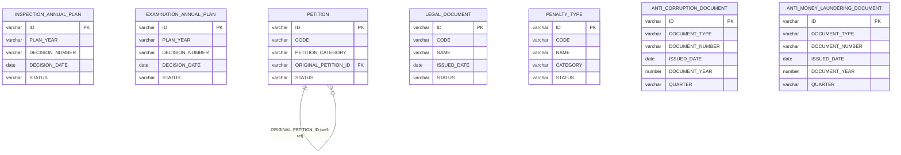

# THANHTRA HLD — Tier 1

**Source system:** THANHTRA (Hệ thống Thanh tra, Kiểm tra và Xử phạt vi phạm hành chính — UBCKNN)
**Tier 1:** Entity độc lập, không FK đến bảng nghiệp vụ nào khác trong scope (hoặc chỉ FK đến system_user ngoài scope).

---

## 6a. Bảng tổng quan BCV Concept

| BCV Core Object | BCV Concept | Category | Source Table | Source Table Change Mode | Mô tả bảng nguồn | Atomic Entity | Table Type | BCV Term |
|---|---|---|---|---|---|---|---|---|
| Business Direction | [Business Direction] Business Plan | Regulatory Planning | INSPECTION_ANNUAL_PLAN | Update | Kế hoạch thanh tra hàng năm: 1 kế hoạch / 1 năm, được phê duyệt bằng quyết định, STATUS DRAFT→APPROVED | Inspection Annual Plan | Fundamental | (1) Business Plan — BCV: "a Business Direction that is an approach used to attain one or more objectives; can combine proposed activities, timeframe, assigned responsibilities". (2) Bảng có PLAN_YEAR (unique/năm), NAME, DECISION_NUMBER, DECISION_DATE, STATUS(DRAFT/APPROVED), NOTE — kế hoạch nghiệp vụ chính thức có năm kế hoạch, quyết định phê duyệt, trạng thái lifecycle. (3) Business Plan khớp hoàn toàn. Không có BCV term chuyên biệt hơn cho "regulatory inspection plan" trong BCV. |
| Business Direction | [Business Direction] Business Plan | Regulatory Planning | EXAMINATION_ANNUAL_PLAN | Update | Kế hoạch kiểm tra hàng năm: cấu trúc tương tự INSPECTION_ANNUAL_PLAN nhưng dành cho đoàn kiểm tra | Examination Annual Plan | Fundamental | (1) Business Plan — BCV: cùng mô tả như trên. (2) Bảng có cấu trúc cột hoàn toàn đồng nhất với INSPECTION_ANNUAL_PLAN (PLAN_YEAR, NAME, DECISION_NUMBER, DECISION_DATE, STATUS, NOTE). (3) Business Plan khớp. Thanh tra (Inspection) và Kiểm tra (Examination) là 2 hoạt động tương tự nhưng khác thẩm quyền/phương thức — tạo 2 entity riêng với cùng BCV Concept, prefix phân biệt. |
| Communication | [Communication] Feedback | Petition Management | PETITION | Update | Đơn thư của công dân/tổ chức gửi đến UBCKNN: gồm phản ánh kiến nghị, khiếu nại, tố cáo; có self-ref để nhận diện đơn trùng | Petition | Fundamental | (1) Feedback — BCV: "a Communication whose purpose is to offer a compliment or a complaint". Complaint — BCV sub-type: "a Feedback to indicate dissatisfaction". (2) Bảng có PETITION_CATEGORY(FEEDBACK_SUGGESTION/COMPLAINT/DENUNCIATION), SENDER_NAME/ADDRESS, STATUS(RECEIVED/PROCESSED), self-ref ORIGINAL_PETITION_ID cho đơn trùng. (3) Dùng Feedback (parent) vì PETITION_CATEGORY=FEEDBACK_SUGGESTION không phải "dissatisfaction" — Feedback bao hàm cả 3 loại. Self-ref không thay đổi concept. |
| Business Direction | [Business Direction] Law | Legal Reference | LEGAL_DOCUMENT | Update | Danh mục văn bản pháp luật (nghị định, thông tư, quyết định) làm căn cứ pháp lý xử phạt vi phạm | Legal Document | Fundamental | (1) Law — BCV: "a Business Direction that defines binding rules legally enforceable within a jurisdiction. Failure to comply may result in penalty or prosecution". (2) Bảng có CODE(VBPL-XXXX), NAME, ISSUED_DATE, STATUS(ACTIVE/INACTIVE) — lưu tham chiếu văn bản pháp luật với lifecycle. (3) Law khớp — bảng lưu các văn bản có hiệu lực thi hành làm căn cứ xử phạt. Có ISSUED_DATE và STATUS lifecycle → Fundamental entity, không phải Classification Value thuần túy. |
| Business Direction | [Business Direction] Law | Regulatory Catalog | PENALTY_TYPE | Update | Danh mục hình thức xử phạt hành chính: phân loại PRIMARY_PENALTY / SUPPLEMENTARY_PENALTY / REMEDIAL_MEASURE, có LEGAL_BASIS và STATUS lifecycle | Classification THANHTRA Penalty Type | Classification | (1) Law — BCV: "a Business Direction that defines binding rules legally enforceable". (2) Bảng có CODE(UNIQUE), NAME, CATEGORY(PRIMARY_PENALTY/SUPPLEMENTARY_PENALTY/REMEDIAL_MEASURE), DESCRIPTION, STATUS(ACTIVE/INACTIVE), NOTE, LEGAL_BASIS. (3) Danh mục hình thức xử phạt do pháp luật quy định — Table Type = Classification (load từ nguồn làm reference data). |
| Documentation | [Documentation] Documentation Item | Anti-Corruption Management | ANTI_CORRUPTION_DOCUMENT | Update | Văn bản phòng chống tham nhũng (PCTN) đi/đến: DOCUMENT_TYPE(SENT/RECEIVED), DOCUMENT_NUMBER, ISSUED_DATE, SUMMARY, DOCUMENT_YEAR, QUARTER, RECEIVING_UNIT, NOTE | Anti Corruption Document | Relative | (1) Documentation Item — BCV: "a Documentation Item identifies a piece of documentation". Form Document (sub-type: tài liệu theo mẫu chuẩn) không khớp vì bảng không có cấu trúc biểu mẫu. (2) Bảng có DOCUMENT_TYPE(SENT/RECEIVED), DOCUMENT_NUMBER, ISSUED_DATE, SUMMARY(CLOB), DOCUMENT_YEAR, QUARTER, RECEIVING_UNIT, NOTE — sổ văn bản PCTN, 1 dòng = 1 văn bản, không FK đến bảng nghiệp vụ nào, không có file đính kèm trong bảng. (3) Documentation Item (general) vì cùng bảng chứa cả văn bản đi lẫn văn bản đến — cùng lý do với Violation Case Received Document. Table Type = Relative theo quyết định Data Modeler (văn bản là thông tin bổ sung/hồ sơ lưu trữ theo kỳ, không có lifecycle độc lập; ETL SCD2). Lưu ý: hiện chưa có FK Atomic nào → xem T1-05. DELETED (soft-delete) chỉ dùng lọc ETL, không lên Atomic. |
| Documentation | [Documentation] Documentation Item | Anti-Money Laundering Management | ANTI_MONEY_LAUNDERING_DOCUMENT | Update | Văn bản phòng chống rửa tiền (PCRT) đi/đến: cấu trúc đồng nhất ANTI_CORRUPTION_DOCUMENT; cột DOSSIER_ID không map lên Atomic | Anti Money Laundering Document | Relative | (1) Documentation Item — BCV: cùng mô tả. (2) Bảng có 8 cột nghiệp vụ trùng hệt ANTI_CORRUPTION_DOCUMENT (DOCUMENT_TYPE, DOCUMENT_NUMBER, ISSUED_DATE, SUMMARY, DOCUMENT_YEAR, QUARTER, RECEIVING_UNIT, NOTE) và thêm DOSSIER_ID (fk_src: inferred, nullable). (3) Tách entity riêng vì PCTN/PCRT là 2 lĩnh vực khác thẩm quyền; không gộp bằng Classification Value để giữ nguồn ETL 1-1. Theo quyết định Data Modeler: không map DOSSIER_ID, bảng ANTI_MONEY_LAUNDERING_DOSSIER giữ ngoài scope. Table Type = Relative theo quyết định Data Modeler (cùng lý do ANTI_CORRUPTION_DOCUMENT), xem T1-05. |

---

## 6b. Diagram Source (Mermaid)

---

## 6c. Diagram Atomic (Mermaid)

```mermaid
erDiagram
    Inspection_Annual_Plan {
        bigint ds_inspection_annual_plan_id PK
        varchar inspection_annual_plan_code
        varchar plan_year
        varchar annual_plan_status_code
    }

    Examination_Annual_Plan {
        bigint ds_examination_annual_plan_id PK
        varchar examination_annual_plan_code
        varchar plan_year
        varchar annual_plan_status_code
    }

    Petition {
        bigint ds_petition_id PK
        varchar petition_code
        varchar petition_category_code
        bigint original_petition_id FK
        bigint ds_original_petition_id FK
    }

    Petition ||--o{ Petition : "ds_original_petition_id"

    Legal_Document {
        bigint ds_legal_document_id PK
        varchar legal_document_code
        varchar legal_document_name
        date issued_date
        varchar legal_document_status_code
    }

    Penalty_Type {
        bigint ds_penalty_type_id PK
        varchar penalty_type_code
        varchar penalty_type_name
        varchar penalty_type_category_code
        varchar penalty_type_status_code
    }

    Anti_Corruption_Document {
        bigint ds_anti_corruption_document_id PK
        varchar anti_document_type_code
        varchar document_number
        date issued_date
        int document_year
        varchar document_quarter_code
        varchar receiving_unit
    }

    Anti_Money_Laundering_Document {
        bigint ds_anti_money_laundering_document_id PK
        varchar anti_document_type_code
        varchar document_number
        date issued_date
        int document_year
        varchar document_quarter_code
        varchar receiving_unit
    }
```

---

## 6d. Mục Danh mục & Tham chiếu (Reference Data)

| Source Field / Bảng | Mô tả | Scheme Code | source_type | Ghi chú |
|---|---|---|---|---|
| INSPECTION_ANNUAL_PLAN.STATUS / EXAMINATION_ANNUAL_PLAN.STATUS | Trạng thái kế hoạch: DRAFT, APPROVED | `TT_ANNUAL_PLAN_STATUS` | source_table | Dùng chung cho cả 2 bảng kế hoạch — cùng enum values |
| PETITION.PETITION_CATEGORY | Loại đơn thư: FEEDBACK_SUGGESTION, COMPLAINT, DENUNCIATION | `TT_PETITION_CATEGORY` | source_table | |
| PETITION.STATUS | Trạng thái xử lý đơn: RECEIVED, PROCESSED | `TT_PETITION_STATUS` | source_table | |
| PETITION.DUPLICATE_TYPE | Phân loại gốc/trùng: ORIGINAL, DUPLICATE | `TT_PETITION_DUPLICATE_TYPE` | source_table | |
| LEGAL_DOCUMENT.STATUS | Trạng thái văn bản pháp luật: ACTIVE, INACTIVE | `TT_LEGAL_DOCUMENT_STATUS` | source_table | |
| PENALTY_TYPE.CATEGORY | Phân loại hình phạt: PRIMARY_PENALTY, SUPPLEMENTARY_PENALTY, REMEDIAL_MEASURE | `TT_PENALTY_TYPE_CATEGORY` | source_table | |
| PENALTY_TYPE.STATUS | Trạng thái hình thức xử phạt: ACTIVE, INACTIVE | `TT_PENALTY_TYPE_STATUS` | source_table | |
| ANTI_CORRUPTION_DOCUMENT.DOCUMENT_TYPE / ANTI_MONEY_LAUNDERING_DOCUMENT.DOCUMENT_TYPE | Chiều văn bản PCTN/PCRT: SENT (văn bản đi), RECEIVED (văn bản đến) | `TT_ANTI_DOCUMENT_TYPE` | source_table | Dùng chung cho cả 2 bảng — cùng enum values (theo mô tả cột BRD) |
| ANTI_CORRUPTION_DOCUMENT.QUARTER / ANTI_MONEY_LAUNDERING_DOCUMENT.QUARTER | Quý ban hành: QUARTER_1, QUARTER_2, QUARTER_3, QUARTER_4 | `TT_DOCUMENT_QUARTER` | source_table | Dùng chung cho cả 2 bảng |

---

## 6e. Bảng chờ thiết kế

*(Để trống — tất cả entity Tier 1 đã có đủ thông tin cột)*

---

## 6f. Điểm cần xác nhận

| # | Câu hỏi | Kết quả |
|---|---|---|
| T1-02 | PENALTY_TYPE có STATUS lifecycle (ACTIVE/INACTIVE) → thiết kế Fundamental. Nếu thực tế chỉ đọc, không cập nhật lifecycle → cân nhắc chuyển table_type thành Classification. | Chờ xác nhận team ETL về tần suất cập nhật PENALTY_TYPE. |
| T1-03 | ANTI_MONEY_LAUNDERING_DOCUMENT.DOSSIER_ID (FK suy luận → ANTI_MONEY_LAUNDERING_DOSSIER) không map lên Atomic; DOSSIER giữ ngoài scope. | Quyết định Data Modeler. Liên kết văn bản ↔ bộ hồ sơ không có trên Atomic; xem lại nếu có yêu cầu khai thác. |
| T1-05 | Anti Corruption Document / Anti Money Laundering Document đặt Table Type = Relative (quyết định Data Modeler) nhưng chưa có FK đến Fundamental nào trên Atomic (theo Bước 1b, Relative = có FK đến Fundamental). | Chấp nhận tạm; nếu không bổ sung FK/parent entity thì cân nhắc lại Fundamental. |
| T1-04 | 2 bảng *_DOCUMENT không có cột người nhận/đơn vị ban hành dạng FK — RECEIVING_UNIT là text tự do (VARCHAR2 2000). Document Type SENT/RECEIVED nhưng RECEIVING_UNIT chỉ có nghĩa với văn bản đi? | Chờ xác nhận BA; hiện giữ nguyên là thuộc tính text, không tách Involved Party. |
