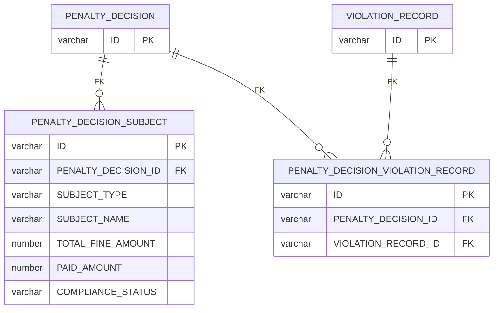
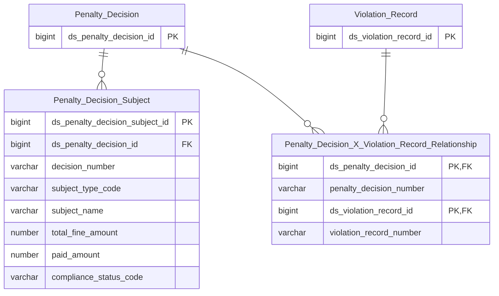

# THANHTRA HLD — Tier 5

**Source system:** THANHTRA (Hệ thống Thanh tra, Kiểm tra và Xử phạt vi phạm hành chính — UBCKNN)
**Tier 5:** Entity có FK đến Tier 4. Gồm 2 entity: đối tượng bị xử phạt trong quyết định (→T4 Penalty Decision), liên kết quyết định↔biên bản vi phạm (→T4 Penalty Decision + T3 Violation Record).

---

## 6a. Bảng tổng quan BCV Concept

| BCV Core Object | BCV Concept | Category | Source Table | Source Table Change Mode | Mô tả bảng nguồn | Atomic Entity | Table Type | BCV Term |
|---|---|---|---|---|---|---|---|---|
| Event | [Event] Event | Penalty Subject | PENALTY_DECISION_SUBJECT | Update | Đối tượng bị xử phạt trong quyết định: SUBJECT_TYPE, embedded identity (SUBJECT_NAME, SUBJECT_ID_NUMBER), TOTAL_FINE_AMOUNT, PAID_AMOUNT, COERCED_AMOUNT, COMPLIANCE_STATUS(4 trạng thái), PAYMENT_PROOF_URL | Penalty Decision Subject | Fundamental | (1) Involved Party — BCV: "an Entity that is involved in one or more ways in the Financial Institution's business". (2) Bảng có FK→PENALTY_DECISION, SUBJECT_TYPE, SUBJECT_NAME, SUBJECT_ID_NUMBER, TOTAL_FINE_AMOUNT, PAID_AMOUNT, COERCED_AMOUNT, COMPLIANCE_STATUS(PENDING/PARTIAL/COMPLETED/COERCED), PAYMENT_PROOF_URL — đối tượng cụ thể bị áp dụng quyết định xử phạt, kèm thông tin thanh toán. (3) Involved Party phù hợp — 1 quyết định có thể xử phạt nhiều đối tượng; mỗi đối tượng là Involved Party trong bối cảnh xử phạt. Relative của TT Penalty Decision → tên chứa "TT Penalty Decision" ✓. |
| Event | [Event] Event | Penalty Decision Violation Link | PENALTY_DECISION_VIOLATION_RECORD | Update | Liên kết quyết định xử phạt với biên bản vi phạm liên quan: FK→PENALTY_DECISION, FK→VIOLATION_RECORD, không có business attribute nào khác ngoài audit fields chuẩn (CREATED_AT/BY, LAST_MODIFIED_AT/BY, VERSION, DELETED) | Penalty Decision X Violation Record Relationship | Relative | (1) Event — BCV Concept kế thừa từ Penalty Decision (entity neo của quan hệ), nhưng entity này KHÔNG dùng domain prefix "Penalty Decision" của nhóm — Domain Prefix = rỗng vì đây là entity link/relationship thuần bắc cầu 2 domain khác nhau (Penalty Decision T4 + Violation Record T3), không thuộc riêng nhóm nào. (2) Bảng: chỉ 2 FK nghiệp vụ (PENALTY_DECISION_ID, VIOLATION_RECORD_ID) + audit fields chuẩn — cấu trúc pure junction về business attribute, nhưng có VERSION + DELETED (soft-delete) cho thấy bản thân liên kết có vòng đời riêng (gắn/gỡ biên bản khỏi quyết định qua thời gian, cần audit trail độc lập, không chỉ là quan hệ tĩnh suy ra được). (3) Quyết định Data Modeler: giữ làm entity Relative riêng, đặt tên theo pattern junction-entity đã dùng trong dự án (`{A} X {B} Relationship`, xem `Fund Distribution Agent X Investment Fund Relationship`). Theo cơ chế bảng link đã chuẩn hóa trong dự án (SKILL.md `atomic-lld-design` mục 3e): entity KHÔNG có cặp Id/Code riêng — PK là composite trên 2 FK Id (Penalty Decision Id + Violation Record Id). Table Type = Relative vì FK đến 2 Fundamental (Penalty Decision T4, Violation Record T3). Quan hệ chi tiết hơn (biên bản nào gắn với hành vi/đối tượng cụ thể nào) đã có sẵn qua FK `PENALTY_DECISION_SUBJECT_BEHAVIOR.VIOLATION_RECORD_ID` (T6) — entity này chỉ phản ánh liên kết tổng quát ở mức header quyết định↔biên bản. |

---

## 6b. Diagram Source (Mermaid)

---

## 6c. Diagram Atomic (Mermaid)

---

## 6d. Mục Danh mục & Tham chiếu (Reference Data)

| Source Field / Bảng | Mô tả | Scheme Code | source_type | Ghi chú |
|---|---|---|---|---|
| PENALTY_DECISION_SUBJECT.SUBJECT_TYPE | Loại đối tượng bị xử phạt (cần profile — cần xác nhận values từ data) | `TT_PENALTY_SUBJECT_TYPE` | modeler_defined | |
| PENALTY_DECISION_SUBJECT.COMPLIANCE_STATUS | Trạng thái tuân thủ nộp phạt: PENDING, PARTIAL, COMPLETED, COERCED (4 values) | `TT_PENALTY_COMPLIANCE_STATUS` | source_table | |

---

## 6e. Bảng chờ thiết kế

*(Để trống)*

---

## 6f. Điểm cần xác nhận

| # | Câu hỏi | Kết quả |
|---|---|---|
| T5-03 | Review LLD: PENALTY_DECISION_SUBJECT.SUBJECT_ADDRESS và SUBJECT_TAX_CODE có nên tách shared entity không? | Không tách (theo LLD) — snapshot tại thời điểm xử phạt, không phải hồ sơ Involved Party độc lập. SUBJECT_ADDRESS, SUBJECT_TAX_CODE, SUBJECT_ID_NUMBER giữ denormalized trên Penalty Decision Subject. |
