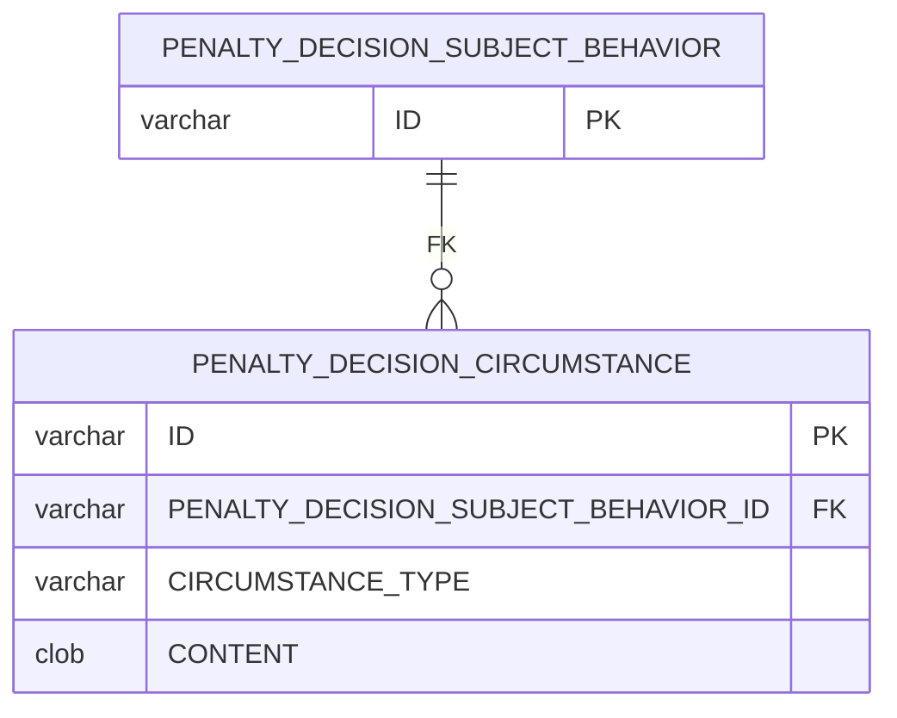
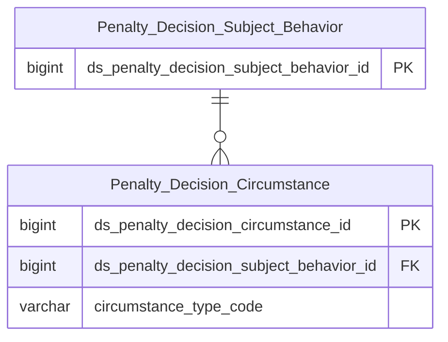

# THANHTRA HLD — Tier 7

**Source system:** THANHTRA (Hệ thống Thanh tra, Kiểm tra và Xử phạt vi phạm hành chính — UBCKNN)
**Tier 7:** Entity có FK đến Tier 6. Bao gồm: tình tiết tăng nặng/giảm nhẹ của từng hành vi vi phạm trong quyết định xử phạt (→T6 Penalty Decision Subject Behavior). Đây là Tier cuối trong THANHTRA source.

---

## 6a. Bảng tổng quan BCV Concept

| BCV Core Object | BCV Concept | Category | Source Table | Source Table Change Mode | Mô tả bảng nguồn | Atomic Entity | Table Type | BCV Term |
|---|---|---|---|---|---|---|---|---|
| Event | [Event] Event | Circumstance | PENALTY_DECISION_CIRCUMSTANCE | Update | Tình tiết tăng nặng/giảm nhẹ áp dụng cho từng hành vi vi phạm trong quyết định: FK→PENALTY_DECISION_SUBJECT_BEHAVIOR, CIRCUMSTANCE_TYPE(AGGRAVATING/MITIGATING), CONTENT — entity nhỏ nhưng cần thiết cho tính toán mức phạt | Penalty Decision Circumstance | Fundamental | (1) Event — BCV: "a happening about which the Financial Institution wishes to keep information". Đồng concept với chuỗi parent Penalty Decision. (2) Bảng: FK→PENALTY_DECISION_SUBJECT_BEHAVIOR, CIRCUMSTANCE_TYPE(AGGRAVATING/MITIGATING), CONTENT(CLOB) — ghi nhận từng tình tiết tăng nặng/giảm nhẹ ảnh hưởng mức phạt. (3) `[Event] Event` theo LLD. Tên entity theo LLD: "Penalty Decision Circumstance" (prefix "Penalty Decision" của nhóm). |

---

## 6b. Diagram Source (Mermaid)

---

## 6c. Diagram Atomic (Mermaid)

---

## 6d. Mục Danh mục & Tham chiếu (Reference Data)

| Source Field / Bảng | Mô tả | Scheme Code | source_type | Ghi chú |
|---|---|---|---|---|
| PENALTY_DECISION_CIRCUMSTANCE.CIRCUMSTANCE_TYPE | Loại tình tiết: AGGRAVATING (Tăng nặng), MITIGATING (Giảm nhẹ) | `TT_CIRCUMSTANCE_TYPE` | source_table | |

---

## 6e. Bảng chờ thiết kế

*(Để trống — đây là Tier cuối)*

---

## 6f. Điểm cần xác nhận

| # | Câu hỏi | Kết quả |
|---|---|---|
| T7-01 | Đây là Tier cuối (T7) — không có entity nào phụ thuộc vào PENALTY_DECISION_CIRCUMSTANCE trong scope THANHTRA. | Xác nhận qua review toàn bộ BRD — không có bảng nào FK đến PENALTY_DECISION_CIRCUMSTANCE. |
