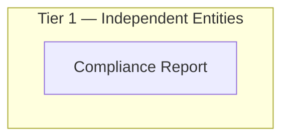

# TMS — HLD Overview: Toàn cảnh thiết kế Atomic Layer

> **Nguồn:** Hệ thống TMS (schema UAT_TMS) — phân hệ giám sát giao dịch bất thường và quản lý hồ sơ vụ việc (Oracle). Tài liệu trước đây đặt tên "GSGD".
>
> **Trạng thái:** Theo quyết định Data Modeler 2026-10-21, **LLD là chuẩn** ("LLD đã đủ cho dự án, HLD có mà LLD chưa làm là sai"). TMS **không có LLD** (không có thư mục `lld/TMS/`, không có trong `manifest.yaml`), nên toàn bộ 12 Atomic entity từng thiết kế ở HLD đã gỡ; 14 bảng nguồn thuộc phạm vi cũ chuyển vào mục 7f nhóm `Chưa có LLD`. Các bảng TMS khác (ANALYSIS_*, SUSPICIOUS_ACCOUNT*, REPORT_TEMPLATE*, ANALYSIS_WORKFLOW*, ABNORMAL_REPORT*, COMPLIANCE_REPORT*, CATEGORY_ITEM, TRANSACTION_REVIEW*, hệ thống/cấu hình...) chưa được đánh giá scope.
>
> **[CẬP NHẬT 2026-10-28]** Thiết kế bổ sung 1 entity mới theo yêu cầu Data Modeler: `COMPLIANCE_REPORT_MASTER` → `Compliance Report` (Tier 1). LLD chưa làm — xem [TMS_HLD_Tier1.md](TMS_HLD_Tier1.md) mục 6f T1-05.
>
> **File chi tiết theo tầng:** [TMS_HLD_Tier1.md](TMS_HLD_Tier1.md) (1 entity), [TMS_HLD_Tier2.md](TMS_HLD_Tier2.md), [TMS_HLD_Tier3.md](TMS_HLD_Tier3.md) — Tier 2, 3 không có entity Atomic trong scope.

---

#### 7a. Bảng tổng quan Atomic entities

| Tier | BCV Core Object | BCV Concept | Category | Source Table | Source Table Change Mode | Mô tả bảng nguồn | Atomic Entity | Table Type | BCV Term |
|---|---|---|---|---|---|---|---|---|---|
| T1 | Documentation | [Documentation] Regulatory Report | Compliance Report Management | COMPLIANCE_REPORT_MASTER | Update | Báo cáo tuân thủ đã nộp theo kỳ: PERIOD_TYPE/VALUE/YEAR, người nộp, kiểm tra tự động (AUTO_CHECK_*), phê duyệt/từ chối (APPROVAL_*), cho phép nộp lại (RESUBMIT_*), TEMPLATE_ID (map 1:1 cột thường, không FK) | Compliance Report | Relative | (1) Regulatory Report — BCV: "Regulatory Information which is a report on regulations". (2) Bảng: 1 dòng = 1 báo cáo tuân thủ của 1 kỳ, có vòng nộp → kiểm tra tự động → duyệt/từ chối → nộp lại. (3) Regulatory Report khớp báo cáo định kỳ nộp cho cơ quan quản lý; Table Type = Relative theo quyết định Data Modeler dù chưa có FK Atomic (TEMPLATE_ID map 1:1 cột thường, xem 7e #1). Chi tiết xem TMS_HLD_Tier1.md. |

**Tổng: 1 Atomic entity** (T1: 1)

---

#### 7b. Diagram Atomic tổng (Mermaid)

---

#### 7c. Bảng Classification Value

| Source Table | Mô tả | BCV Term | Xử lý Atomic |
|---|---|---|---|
| INVESTOR_ACCOUNT.APPROVAL_STATUS / COMPANY_EVENT.APPROVAL_STATUS / ACCOUNT_GROUP.APPROVAL_STATUS | Trạng thái phê duyệt | Classification Value | Scheme: `GSGD_APPROVAL_STATUS` (dùng chung 3 bảng, cần profile riêng nếu value set khác nhau). |
| INVESTOR_ACCOUNT.INVESTOR_TYPE | Loại hình nhà đầu tư (1=Cá nhân, 2=Tổ chức) | Classification Value | Scheme: `GSGD_INVESTOR_TYPE`. |
| INVESTOR_ACCOUNT.ACCOUNT_STATUS | Trạng thái tài khoản (0=Đóng, 1=Mở) | Classification Value | Scheme: `GSGD_INVESTOR_ACCOUNT_STATUS` (khác `GSGD_ACCOUNT_STATUS` — scheme đó dùng cho ACCOUNT_GROUP_MEMBER.STATUS, ý nghĩa khác). |
| INVESTOR_ACCOUNT.DOMESTIC_FOREIGN_FLAG | Trong nước/Nước ngoài (0=Trong nước, 1=Nước ngoài) | Classification Value | Scheme: `GSGD_DOMESTIC_FOREIGN_FLAG`. Cân nhắc Data Domain Indicator thay vì Classification Value — quyết định tại LLD. |
| COMPANY_EVENT.EVENT_TYPE | Loại sự kiện tổ chức niêm yết | Classification Value | Scheme: `GSGD_COMPANY_EVENT_TYPE`. |
| SECURITIES_GROUP.GROUP_TYPE | Loại nhóm chứng khoán | Classification Value | Scheme: `GSGD_SECURITIES_GROUP_TYPE`. |
| SECURITIES_GROUP.STATUS | Trạng thái nhóm chứng khoán | Classification Value | Scheme: `GSGD_GROUP_STATUS`. Cần profile giá trị thực tế. |
| CASE_FILE.CASE_FILE_TYPE / CASE_FILE_WORKFLOW.WORKFLOW_TYPE | Loại vụ việc / loại quy trình | Classification Value | Scheme: `GSGD_CASE_TYPE` (dùng chung — cùng bộ giá trị Sơ bộ/Thao túng/Nội gián/Liên thị trường). |
| CASE_FILE.INFORMATION_SOURCE | Nguồn thông tin vụ việc | Classification Value | Scheme: `GSGD_INFORMATION_SOURCE`. |
| CASE_FILE.CASE_FILE_STATUS | Trạng thái vụ việc | Classification Value | Scheme: `GSGD_CASE_STATUS`. |
| ACCOUNT_FINANCIAL_SERVICE.SERVICE_TYPE | Loại dịch vụ tài chính | Classification Value | Scheme: `GSGD_FINANCIAL_SERVICE_TYPE`. |
| ACCOUNT_GROUP.GROUP_TYPE | Loại nhóm tài khoản | Classification Value | Scheme: `GSGD_ACCOUNT_GROUP_TYPE`. |
| ACCOUNT_GROUP.RELATION_TYPE_ID / ACCOUNT_RELATIONSHIP.CATEGORY_ITEM_ID | Loại quan hệ (Danh tính/IP/MAC/Tiền) | Classification Value | Scheme: `GSGD_ACCOUNT_RELATION_TYPE` (dùng chung 2 bảng). FK suy luận → CATEGORY_ITEM, ngoài phạm vi task. |
| CASE_ATTACH_FILE.FILE_TYPE | Loại file đính kèm | Classification Value | Scheme: `GSGD_FILE_TYPE`. |
| CASE_ATTACH_FILE.FILE_GROUP | Nhóm file đính kèm | Classification Value | Scheme: `GSGD_FILE_GROUP`. |
| CASE_APPROVAL_STEP.STEP_CODE / NEXT_STEP_CODE | Mã bước duyệt | Classification Value | Scheme: `GSGD_APPROVAL_STEP_CODE`. |
| CASE_APPROVAL_STEP.STATUS / CASE_FILE_WORKFLOW.STATUS | Trạng thái bước duyệt/quy trình | Classification Value | Scheme: `GSGD_APPROVAL_STEP_STATUS` (dùng chung — value set có thể khác nhau, cần profile riêng). |
| ACCOUNT_GROUP_MEMBER.STATUS | Trạng thái tài khoản trong nhóm | Classification Value | Scheme: `GSGD_ACCOUNT_STATUS`. |
| COMPLIANCE_REPORT_MASTER.PERIOD_TYPE | Kỳ báo cáo tuân thủ: DAILY/WEEKLY/MONTHLY/YEARLY | Classification Value | Scheme: `TMS_REPORT_PERIOD_TYPE`. |
| COMPLIANCE_REPORT_MASTER.AUTO_CHECK_STATUS | Kết quả kiểm tra tự động (0=Không đạt, 1=Đạt, NULL=Chưa kiểm tra) | Classification Value | Scheme: `TMS_AUTO_CHECK_STATUS`. |
| COMPLIANCE_REPORT_MASTER.APPROVAL_STATUS | Trạng thái phê duyệt báo cáo (0=Chờ duyệt, 1=Đã duyệt, 2=Bị từ chối) | Classification Value | Scheme: `TMS_COMPLIANCE_APPROVAL_STATUS`. |
| COMPLIANCE_REPORT_MASTER.SUBMITTER_TYPE | Loại người nộp báo cáo (chưa có mô tả nguồn) | Classification Value | Scheme: `TMS_SUBMITTER_TYPE` (modeler_defined — cần profile). |

---

#### 7d. Junction Tables

Không có junction table.

---

#### 7e. Điểm cần xác nhận

| # | Tier | Câu hỏi | Ảnh hưởng |
|---|---|---|---|
| 1 | T1 | `COMPLIANCE_REPORT_MASTER.TEMPLATE_ID` (FK curated đến `COMPLIANCE_REPORT_TEMPLATE`) map 1:1 thành cột thường `Report Template Source Id`, không tạo FK theo quyết định Data Modeler (xem Tier1 T1-01) | Mất ràng buộc tới template trên Atomic; đổi sang FK Id + Code nếu sau này đưa template vào scope |
| 2 | T1 | Bộ audit bảng nguồn chỉ có 7/9 cột chuẩn (thiếu `STATUS`, `VERSION`) — chưa tự loại trừ (Tier1 T1-02) | Xác nhận khi làm LLD |
| 3 | T1 | Bảng con `COMPLIANCE_REPORT_FORM`/`COMPLIANCE_REPORT_DATA` chưa đánh giá scope (Tier1 T1-04) | Chờ quyết định |
| 4 | T1 | Chưa có LLD cho TMS — entity mới mới ở mức HLD (Tier1 T1-05) | Cần `/atomic-lld-design` |

---

#### 7f. Bảng ngoài scope

| Nhóm | Source Table | Mô tả bảng nguồn | Lý do ngoài scope |
|---|---|---|---|
| Khảo sát sai | ACCOUNT_AUTHORIZATION | Thông tin ủy quyền giao dịch trên tài khoản (theo khảo sát cũ) | Không tồn tại trong DDL UAT thực tế (schema UAT_TMS) — dữ liệu khảo sát nguồn lỗi thời/sai sót, đã reconcile 2026-07-23. Nghiệp vụ ủy quyền đã nằm sẵn trên INVESTOR_ACCOUNT.AUTHORIZED_PERSON_NAME/AUTHORIZATION_DATE. |
| Chưa có LLD | INVESTOR_ACCOUNT | Thông tin tài khoản nhà đầu tư (từ VSDC) | Không có LLD trong dự án — HLD gỡ theo quyết định Data Modeler 2026-10-21 |
| Chưa có LLD | INVESTOR_ACCOUNT_EXTENDED_INFO | Thông tin mở rộng tài khoản (liên hệ/ngân hàng) | Không có LLD trong dự án — HLD gỡ theo quyết định Data Modeler 2026-10-21 |
| Chưa có LLD | COMPANY_EVENT | Sự kiện tổ chức niêm yết ảnh hưởng giá tham chiếu | Không có LLD trong dự án — HLD gỡ theo quyết định Data Modeler 2026-10-21 |
| Chưa có LLD | SECURITIES_GROUP | Nhóm chứng khoán do Ban GSTT tự quản lý | Không có LLD trong dự án — HLD gỡ theo quyết định Data Modeler 2026-10-21 |
| Chưa có LLD | SECURITIES_GROUP_MEMBER | Thành viên nhóm chứng khoán (GROUP_ID + SECURITIES_CODE) | Không có LLD trong dự án — HLD gỡ theo quyết định Data Modeler 2026-10-21 |
| Chưa có LLD | CASE_FILE | Vụ việc giám sát giao dịch chứng khoán bất thường | Không có LLD trong dự án — HLD gỡ theo quyết định Data Modeler 2026-10-21 |
| Chưa có LLD | ACCOUNT_FINANCIAL_SERVICE | Dịch vụ tài chính đăng ký trên tài khoản | Không có LLD trong dự án — HLD gỡ theo quyết định Data Modeler 2026-10-21 |
| Chưa có LLD | ACCOUNT_GROUP | Nhóm tài khoản do nghiệp vụ giám sát xác định | Không có LLD trong dự án — HLD gỡ theo quyết định Data Modeler 2026-10-21 |
| Chưa có LLD | CASE_ATTACH_FILE | File đính kèm vụ việc | Không có LLD trong dự án — HLD gỡ theo quyết định Data Modeler 2026-10-21 |
| Chưa có LLD | CASE_FILE_WORKFLOW | Từng bước quy trình xử lý vụ việc | Không có LLD trong dự án — HLD gỡ theo quyết định Data Modeler 2026-10-21 |
| Chưa có LLD | CASE_APPROVAL_STEP | Nhật ký duyệt từng bước xử lý vụ việc | Không có LLD trong dự án — HLD gỡ theo quyết định Data Modeler 2026-10-21 |
| Chưa có LLD | CASE_FILE_SECURITIES_CODE | Mã chứng khoán liên quan tới vụ việc (N-N) | Không có LLD trong dự án — HLD gỡ theo quyết định Data Modeler 2026-10-21 |
| Chưa có LLD | ACCOUNT_GROUP_MEMBER | Quan hệ thành viên giữa tài khoản và nhóm giám sát | Không có LLD trong dự án — HLD gỡ theo quyết định Data Modeler 2026-10-21 |
| Chưa có LLD | ACCOUNT_RELATIONSHIP | Mối quan hệ giữa 2 tài khoản NĐT trong giám sát | Không có LLD trong dự án — HLD gỡ theo quyết định Data Modeler 2026-10-21 |

*(Các bảng TMS khác ngoài 15 bảng phạm vi cũ — ANALYSIS_*, SUSPICIOUS_ACCOUNT*, REPORT_TEMPLATE*, ANALYSIS_WORKFLOW*, ABNORMAL_REPORT*, COMPLIANCE_REPORT* (trừ COMPLIANCE_REPORT_MASTER — đã vào scope 2026-10-28), CATEGORY_ITEM, TRANSACTION_REVIEW*, hệ thống/cấu hình... — chưa được đánh giá scope.)*

---

## Entities

> Single source of truth cho metadata entity. `aggregate_atomic.py` parse section này để sinh `atomic_entities.yaml`.
> Format bắt buộc: heading `### N.` + dòng `**Description:**` trong 500 ký tự đầu tiên sau heading.

### 1. Compliance Report
**Tier:** 1 | **Source:** `COMPLIANCE_REPORT_MASTER` | **BCV Concept:** [Documentation] Regulatory Report | **BCO:** Documentation | **Table Type:** Relative
**Domain Prefix:** (none)
**Description:** Báo cáo tuân thủ đã nộp theo từng kỳ (ngày/tuần/tháng/năm), ghi nhận người nộp, kết quả kiểm tra tự động, vòng phê duyệt hoặc từ chối và khoảng thời gian được phép nộp lại.
