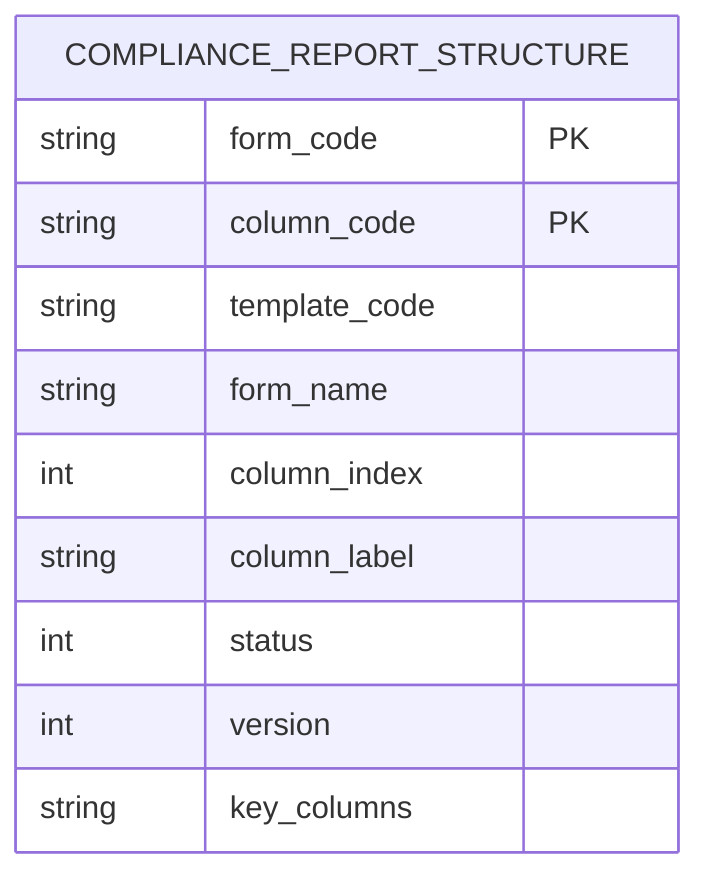
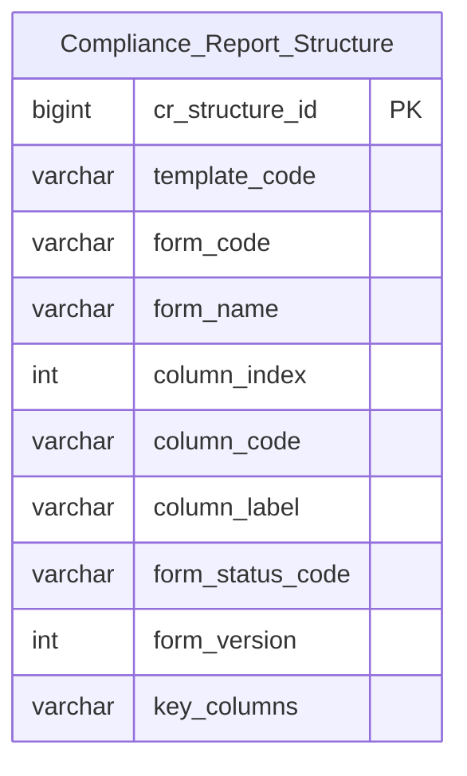

# TMS — HLD Tier 1

> **Tier 1:** Entity độc lập, không FK đến bảng nghiệp vụ nào khác trong scope. Hiện có 1 entity: cấu trúc chỉ tiêu biểu mẫu báo cáo tuân thủ lấy từ tầng ODS, không có BRD (`COMPLIANCE_REPORT_STRUCTURE` — thêm 2026-11-15, nguồn `TMS.xlsx`). Các entity Tier 1 từng thiết kế trước đây (Account Investor, Listed Company Corporate Event, Securities Watchlist Group, Market Surveillance Case) đã gỡ theo quyết định Data Modeler 2026-10-21 (LLD là chuẩn) — xem [TMS_HLD_Overview.md](TMS_HLD_Overview.md) mục 7f (nhóm `Chưa có LLD`).

---

## 6a. Bảng tổng quan BCV Concept

| BCV Core Object | BCV Concept | Category | Source Table | Source Table Change Mode | Mô tả bảng nguồn | Atomic Entity | Table Type | BCV Term |
|---|---|---|---|---|---|---|---|---|
| Documentation | [Documentation] Form Document | Compliance Report Management | COMPLIANCE_REPORT_STRUCTURE | N/A | Bảng ODS (`ods_tms_report`) — không có BRD: 1 dòng = 1 cột (chỉ tiêu) của 1 biểu mẫu báo cáo tuân thủ. Cột mang lên Atomic (`Map? = có` trong `TMS.xlsx`): `template_code`, `form_code`, `form_name`, `column_index`, `column_code`, `column_label`, `status`, `version`, `key_columns`; thông tin biểu mẫu lặp ở mọi dòng cột | Compliance Report Structure | Relative | (1) Form Document — BCV: "Documentation Item presented in a standard template layout which requires additional information to be supplied". Regulatory Report được cân nhắc nhưng không chọn: bảng ODS này không chứa dữ liệu nộp mà chỉ mô tả khung biểu mẫu. (2) Bảng nguồn có mã/tên biểu mẫu (`form_code` = `FORM_CODE`, ví dụ `PL01_W_F01`; `form_name`), mã phụ lục `template_code`, trạng thái + phiên bản, `key_columns` và danh sách cột (header đầu tiên của layout JSON: `column_index`, `column_code` dạng `COL_xx`, `column_label`) — là định nghĩa khung biểu mẫu, không phải instance nộp. (3) Chọn Form Document, cùng cách xử lý `Dynamic Report Structure` (FMS ITEM_LIST). Table Type = Relative theo `TMS.xlsx`; chưa có FK đến Fundamental nào, xem T1-08. Physical name `cr_structure` (Domain Prefix `Compliance Report` → `cr`). Hash_id = hash(`form_code`, `column_code`) — Data Modeler chốt 2026-11-16, xem T1-09. |

---

## 6b. Diagram Source (Mermaid)

**Nguồn ODS, không có BRD — `COMPLIANCE_REPORT_STRUCTURE`** (chỉ các cột `Map? = có` trong `TMS.xlsx`; bảng con `COMPLIANCE_REPORT_VALUE` xem [TMS_HLD_Tier2.md](TMS_HLD_Tier2.md) mục 6b):

> Khóa ODS theo note là (`form_template_id`, `column_code`); `form_template_id` có `Map? = không` nên khóa Atomic = `form_code` ‖ `column_code` (Data Modeler chốt 2026-11-16, T1-09). Cột ODS `Map? = không`: `form_template_id`, `template_id`, `form_description`, `is_mandatory`, `display_order`, `aggregation_mode`, `require_signature`, `approval_type`.

---

## 6c. Diagram Atomic (Mermaid)

> **Compliance_Report_Structure:** chưa có FK trên Atomic (grain = 1 cột của 1 biểu mẫu; ODS không mang `form_template_id`/`template_id` nên không có FK sang entity nào). `cr_structure_id` = Surrogate Key = hash(`form_code`, `column_code`) — Data Modeler chốt 2026-11-16. `form_status_code` ← `status` (Classification Value, chỉ cột Code, không cặp Id + Code). Các cột ODS `Map? = không` (xem 6b) không đưa lên Atomic; cột kỹ thuật ODS (`created_at`, `updated_at`, `_source_system`, `ds_etl_pcs_tms`, không có trong `TMS.xlsx`) cũng bỏ.

---

## 6d. Mục Danh mục & Tham chiếu (Reference Data)

| Source Field / Bảng | Mô tả | Scheme Code | source_type | Ghi chú |
|---|---|---|---|---|
| COMPLIANCE_REPORT_STRUCTURE.STATUS | Trạng thái biểu mẫu: 0 = Không hoạt động, 1 = Hoạt động (mô tả lấy từ BRD `COMPLIANCE_REPORT_FORM_TEMPLATE.STATUS`, bảng gốc của ODS) | `TMS_REPORT_FORM_STATUS` | source_table | Cân nhắc Data Domain Indicator thay Classification Value — quyết định tại LLD |

---

## 6e. Bảng chờ thiết kế

Không có.

---

## 6f. Điểm cần xác nhận

| # | Câu hỏi | Kết quả |
|---|---|---|
| T1-06 | Nguồn gọi là `TMS_ODS` nhưng source system đăng ký trong `Source/source_systems.csv` và BRD là `TMS` (schema UAT_TMS). | HLD dùng source `TMS`. Xác nhận `TMS_ODS` chỉ là tên schema/DB ODS của cùng phân hệ. |
| T1-08 | **[MỚI 2026-11-15]** `Compliance Report Structure` (ODS `COMPLIANCE_REPORT_STRUCTURE`) đặt Table Type = Relative theo `TMS.xlsx` nhưng chưa có FK đến Fundamental nào ; ODS không mang `form_template_id`/`template_id` (`Map? = không`) nên không có FK sang entity nào. | Chấp nhận tạm. Theo Bước 1b, entity không phụ thuộc Fundamental nào sẽ là Fundamental — Data Modeler xác nhận giữ Relative hay đổi. |
| T1-09 | **Hash_id = hash(`form_code`, `column_code`)** — Data Modeler chốt 2026-11-16 (không gồm `template_code`; `form_template_id` có `Map? = không`). `template_code` giữ làm thuộc tính. | Cần profile: `form_code` phải duy nhất trên toàn bộ biểu mẫu (không trùng giữa các `template_code`; BRD không khai UNIQUE) và `column_code` không lặp trong header đầu tiên của layout. Nếu không đảm bảo thì phải thêm `template_code` vào hash. |
| T1-10 | Grain = 1 cột nên thông tin biểu mẫu (`template_code`, `form_code`, `form_name`, `status`, `version`, `key_columns`) lặp lại ở mọi dòng cột của cùng biểu mẫu (denormalized). | Giữ 1 entity theo `TMS.xlsx`. Nếu muốn chuẩn hóa: tách `Compliance Report Form` (1 dòng/biểu mẫu) + `Compliance Report Structure` (cột, FK → Form). Chờ quyết định. |
| T1-11 | Bảng đích `compliance_report` trong `TMS.xlsx` được đặt thành entity `Compliance Report Structure` / `Compliance Report Value` (Data Modeler chốt 2026-11-16): physical `cr_structure` / `cr_value`; Domain Prefix `Compliance Report` viết tắt `cr` (đã thêm `Compliance Report,cr` vào `rule_domain_prefix_abbreviations.csv`). Entity `Compliance Report` cũ (nguồn `COMPLIANCE_REPORT_MASTER`) đã xóa 2026-11-16 theo yêu cầu Data Modeler vì bảng này đã được dùng để xây 2 bảng ODS trên, nên không còn xung đột tên. | Đã chốt. |
| T1-12 | Tên bảng nguồn `COMPLIANCE_REPORT_STRUCTURE` (Data Modeler đổi từ `COMPLIANCE_REPORT` trong `TMS.xlsx`, 2026-11-16) và `COMPLIANCE_REPORT_VALUE`; tên ODS thực theo note là `ods_tms_report`, `ods_tms_report_value` (tiền lệ FMS: bỏ tiền tố `ods_fms_`). Tên cột trong `TMS.xlsx` (`form_code`, `column_code`, `column_label`…) khác note ODS (`report_code`, `indicator_code`, `indicator_label`…) — HLD dùng tên theo `TMS.xlsx`. Source Table Change Mode = N/A vì ODS không khai `data_change_mode`; thực tế ODS truncate + insert toàn bộ theo `etl_date`, Atomic tự quyết SCD/upsert theo hash_id. Không thiết kế `ds_*` và bỏ cột kỹ thuật ODS (theo tiền lệ ODS-origin của FMS 2026-11-07). | Xác nhận tên nguồn, Change Mode và việc bỏ `ds_*` cho entity ODS-origin của TMS. |
