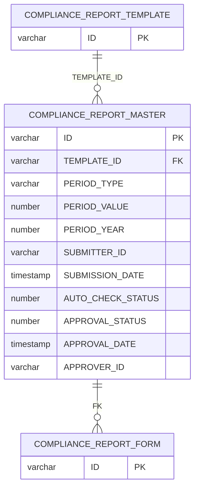
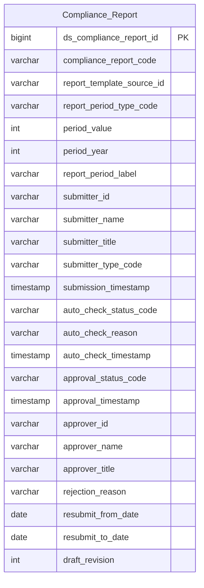

# TMS — HLD Tier 1

> **Tier 1:** Entity độc lập, không FK đến bảng nghiệp vụ nào khác trong scope. Hiện có 1 entity: báo cáo tuân thủ đã nộp (`COMPLIANCE_REPORT_MASTER`). Các entity Tier 1 từng thiết kế trước đây (Account Investor, Listed Company Corporate Event, Securities Watchlist Group, Market Surveillance Case) đã gỡ theo quyết định Data Modeler 2026-10-21 (LLD là chuẩn) — xem [TMS_HLD_Overview.md](TMS_HLD_Overview.md) mục 7f (nhóm `Chưa có LLD`).

---

## 6a. Bảng tổng quan BCV Concept

| BCV Core Object | BCV Concept | Category | Source Table | Source Table Change Mode | Mô tả bảng nguồn | Atomic Entity | Table Type | BCV Term |
|---|---|---|---|---|---|---|---|---|
| Documentation | [Documentation] Regulatory Report | Compliance Report Management | COMPLIANCE_REPORT_MASTER | Update | Báo cáo tuân thủ đã nộp theo kỳ: PERIOD_TYPE(DAILY/WEEKLY/MONTHLY/YEARLY), PERIOD_VALUE, PERIOD_YEAR, thông tin người nộp, kết quả kiểm tra tự động (AUTO_CHECK_*), vòng phê duyệt (APPROVAL_*, REJECTION_REASON), khoảng thời gian cho phép nộp lại (RESUBMIT_*), TEMPLATE_ID (map 1:1 dạng cột thường, không tạo FK) | Compliance Report | Relative | (1) Regulatory Report — BCV: "Regulatory Information which is a report on regulations; related aspects of any aspect of the financial institution's operations". Status Document (Documentation Item — xác minh trạng thái hiện tại) và Documentation Item (general) được cân nhắc nhưng quá chung. (2) Bảng có TEMPLATE_ID (mẫu báo cáo), PERIOD_TYPE/PERIOD_VALUE/PERIOD_YEAR/REPORT_PERIOD_LABEL (kỳ báo cáo), SUBMITTER_ID/NAME/TITLE/TYPE + SUBMISSION_DATE (nộp báo cáo), AUTO_CHECK_STATUS/REASON/DATE (kiểm tra tự động), APPROVAL_STATUS/DATE + APPROVER_ID/NAME/TITLE + REJECTION_REASON (phê duyệt/từ chối), RESUBMIT_FROM_DATE/TO_DATE (cho phép nộp lại), DRAFT_REVISION — 1 dòng = 1 báo cáo tuân thủ của 1 kỳ do đơn vị nộp lên cơ quan giám sát và được duyệt. (3) Regulatory Report khớp: báo cáo định kỳ nộp cho cơ quan quản lý về tuân thủ quy định. Có vòng đời nộp → kiểm tra → duyệt/từ chối → nộp lại, độc lập; không có FK Atomic nào (TEMPLATE_ID map 1:1 dạng cột thường theo quyết định Data Modeler, xem T1-01). Table Type = Relative theo quyết định Data Modeler (báo cáo là hồ sơ nộp theo kỳ, ETL SCD2); lưu ý chưa có FK đến Fundamental nào, xem T1-07. |

---

## 6b. Diagram Source (Mermaid)

> `COMPLIANCE_REPORT_TEMPLATE` và `COMPLIANCE_REPORT_FORM` chỉ là node tham chiếu ngoài scope (chưa đánh giá).

---

## 6c. Diagram Atomic (Mermaid)

> Chưa có FK trên Atomic. `report_template_source_id` ← `TEMPLATE_ID` map 1:1 (Text, không phải Surrogate Key, không cặp Id + Code). `submitter_id`/`approver_id` giữ dạng mã nguồn denormalized (grain = 1 báo cáo, không phải Involved Party).

---

## 6d. Mục Danh mục & Tham chiếu (Reference Data)

| Source Field / Bảng | Mô tả | Scheme Code | source_type | Ghi chú |
|---|---|---|---|---|
| COMPLIANCE_REPORT_MASTER.PERIOD_TYPE | Kỳ báo cáo: DAILY, WEEKLY, MONTHLY, YEARLY | `TMS_REPORT_PERIOD_TYPE` | source_table | |
| COMPLIANCE_REPORT_MASTER.AUTO_CHECK_STATUS | Kết quả kiểm tra tự động: 0 = Không đạt, 1 = Đạt, NULL = Chưa kiểm tra | `TMS_AUTO_CHECK_STATUS` | source_table | Nguồn NUMBER(1,0) có mã nghiệp vụ → Classification Value (không dùng Boolean) |
| COMPLIANCE_REPORT_MASTER.APPROVAL_STATUS | Trạng thái phê duyệt: 0 = Chờ duyệt, 1 = Đã duyệt, 2 = Bị từ chối | `TMS_COMPLIANCE_APPROVAL_STATUS` | source_table | Khác scheme `GSGD_APPROVAL_STATUS` ở Overview 7c (scheme cũ của INVESTOR_ACCOUNT/COMPANY_EVENT/ACCOUNT_GROUP), value set khác |
| COMPLIANCE_REPORT_MASTER.SUBMITTER_TYPE | Loại người nộp (BRD không có mô tả) | `TMS_SUBMITTER_TYPE` | modeler_defined | Cần profile giá trị thực tế |

---

## 6e. Bảng chờ thiết kế

*(Để trống — `COMPLIANCE_REPORT_MASTER` đã có đủ thông tin cột.)*

---

## 6f. Điểm cần xác nhận

| # | Câu hỏi | Kết quả |
|---|---|---|
| T1-01 | `TEMPLATE_ID` là FK curated (`fk_src: db`) đến `COMPLIANCE_REPORT_TEMPLATE` (mẫu phụ lục báo cáo tuân thủ; bảng chưa đánh giá scope). | Quyết định Data Modeler: map 1:1 thành cột thường `Report Template Source Id` (Text), không tạo FK, `COMPLIANCE_REPORT_TEMPLATE` giữ ngoài scope; entity giữ Tier 1. Nếu sau này đưa template vào scope thì đổi sang cặp FK Id + Code và chuyển Tier 2. |
| T1-07 | Compliance Report đặt Table Type = Relative (quyết định Data Modeler) nhưng chưa có FK đến Fundamental nào trên Atomic (theo Bước 1b, Relative = có FK đến Fundamental). | Chấp nhận tạm; Relative đúng nghĩa khi template vào scope (T1-01). |
| T1-02 | Bộ audit/system của bảng nguồn chỉ có 7/9 cột chuẩn (có `CREATED_AT, UPDATED_AT, CREATED_BY_ID, CREATED_BY_NAME, UPDATED_BY_ID, UPDATED_BY_NAME, DELETED`; thiếu `STATUS`, `VERSION`) — theo Bước 2c LLD không tự loại trừ. | Xác nhận có coi đây là audit bundle không đầy đủ (loại trừ như phần còn lại của phân hệ) không. Lưu ý: bảng không có cột `STATUS` — trạng thái nghiệp vụ nằm ở `APPROVAL_STATUS`/`AUTO_CHECK_STATUS`. |
| T1-03 | `SUBMITTER_ID`/`APPROVER_ID` (ID người dùng hệ thống) + `*_NAME`/`*_TITLE` là thông tin người dùng denormalized; grain = 1 báo cáo nên không tách Involved Party. | Giữ denormalized dạng mã nguồn + text. Nếu sau này có entity người dùng (IAM.USERS) thì cân nhắc thêm FK crosswalk. |
| T1-04 | Bảng con `COMPLIANCE_REPORT_FORM` (file biểu mẫu đã upload, 1-N) và `COMPLIANCE_REPORT_DATA` chưa đánh giá scope; HLD hiện chỉ thiết kế bảng master theo yêu cầu. | Chờ quyết định có đưa vào scope không; nếu có sẽ ở Tier 2+ (FK → Compliance Report). |
| T1-05 | Chưa có LLD cho TMS (xem Overview): entity mới vừa ở mức HLD; theo quyết định Data Modeler 2026-10-21, HLD phải đi cùng LLD. | Cần làm LLD (`/atomic-lld-design`) cho `COMPLIANCE_REPORT_MASTER` để giữ nhất quán. |
| T1-06 | Nguồn gọi là `TMS_ODS` nhưng source system đăng ký trong `Source/source_systems.csv` và BRD là `TMS` (schema UAT_TMS). | HLD dùng source `TMS`. Xác nhận `TMS_ODS` chỉ là tên schema/DB ODS của cùng phân hệ. |
