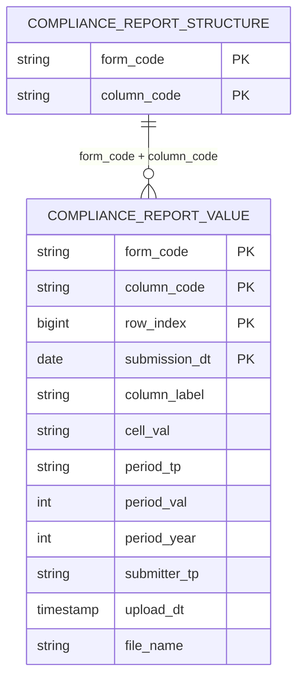
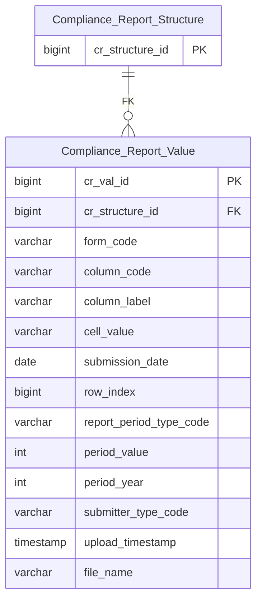

# TMS — HLD Tier 2

> **Tier 2:** Entity có FK đến Tier 1. Hiện có 1 entity: giá trị từng ô của biểu mẫu báo cáo tuân thủ đã nộp, lấy từ tầng ODS, không có bảng nguồn BRD (`COMPLIANCE_REPORT_VALUE` — thêm 2026-11-15, cập nhật 2026-11-16 theo `TMS.xlsx` bản mới + `note_logic_ods_tms_report_cho_atomic_20261111.md`). Các entity Tier 2 từng thiết kế trước đây đã gỡ theo quyết định Data Modeler 2026-10-21 (LLD là chuẩn) — xem [TMS_HLD_Overview.md](TMS_HLD_Overview.md) mục 7f (nhóm `Chưa có LLD`).

---

## 6a. Bảng tổng quan BCV Concept

| BCV Core Object | BCV Concept | Category | Source Table | Source Table Change Mode | Mô tả bảng nguồn | Atomic Entity | Table Type | BCV Term |
|---|---|---|---|---|---|---|---|---|
| Documentation | [Documentation] Regulatory Information | Compliance Report Management | COMPLIANCE_REPORT_VALUE | N/A | Bảng ODS (`ods_tms_report_value`) — không có BRD: 1 dòng = 1 giá trị của 1 cột (ô) trong 1 dòng dữ liệu của 1 lần nộp biểu mẫu (bung từ JSON `ROW_DATA`). Cột mang lên Atomic (`Map? = có` trong `TMS.xlsx`): `form_code`, `column_code`, `column_label`, `cell_val`, `submission_dt`, `row_index`, `period_tp`, `period_val`, `period_year`, `submitter_tp`, `upload_dt`, `file_name` | Compliance Report Value | Classification | (1) Regulatory Information — BCV: "Reported Information that is required to be filed with regulatory bodies". Regulatory Report được cân nhắc nhưng không chọn: 1 dòng của bảng này là 1 ô giá trị, không phải 1 báo cáo hoàn chỉnh. (2) Bảng có `cell_val` (giá trị text đã nộp), `column_code` + `row_index` (vị trí ô), `form_code`, kỳ báo cáo + loại người nộp, `upload_dt`, `file_name` — dữ liệu khai báo gửi cơ quan quản lý, bung theo từng ô. (3) Chọn Regulatory Information, cùng BCV với `Dynamic Report Value` (FMS ITEM_VALUE). Table Type = Classification theo `TMS.xlsx` (ETL Upsert theo hash_id, không append), xem T2-02. Physical name `cr_value` (Domain Prefix `Compliance Report` → `cr`). Hash_id = hash(`form_code`, `column_code`, `row_index`, `period_tp`, `period_val`, `period_year`) — Data Modeler chốt 2026-11-17 (thay `submission_dt` của quyết định 2026-11-16 bằng 3 trường kỳ báo cáo), xem T2-01. FK → `Compliance Report Structure` (T1) theo `form_code` + `column_code`, xem T2-03. |

---

## 6b. Diagram Source (Mermaid)

> Cả 2 bảng là bảng ODS, không có BRD; chỉ vẽ cột `Map? = có`. `COMPLIANCE_REPORT_STRUCTURE` là node tham chiếu từ Tier 1 (chỉ hiện khóa; cột đầy đủ xem [TMS_HLD_Tier1.md](TMS_HLD_Tier1.md) mục 6b). Quan hệ là logic theo mã (ODS không khai FK vật lý). Dữ liệu ODS được dựng từ `COMPLIANCE_REPORT_DATA` ⨝ `COMPLIANCE_REPORT_FORM` ⨝ `COMPLIANCE_REPORT_MASTER` ⨝ `COMPLIANCE_REPORT_FORM_TEMPLATE` (các bảng BRD này chưa đánh giá scope).

---

## 6c. Diagram Atomic (Mermaid)

> `Compliance_Report_Structure` là node tham chiếu từ Tier 1 (chỉ tên + khóa). `cr_val_id` = Surrogate Key = hash(`form_code`, `column_code`, `row_index`, `submission_date`). FK theo pattern Id + Code: `cr_structure_id` (= hash(`form_code`, `column_code`), cùng công thức với PK của Structure nên tính trực tiếp được) + `form_code`, `column_code` (mã nghiệp vụ, lưu dư thừa); FK cho phép NULL (xem T2-03). `report_period_type_code` ← `period_tp` và `submitter_type_code` ← `submitter_tp` là Classification Value (chỉ cột Code, không cặp Id + Code). `submission_date` ← `submission_dt` (Date); `upload_timestamp` ← `upload_dt` (Timestamp). Tên cột vật lý áp quy tắc đặt tên ở LLD (ví dụ `cell_val`, `period_val`). Các cột ODS `Map? = không` (`submission_id`, `form_id` và 2 cột cuối bảng chưa có tên) không đưa lên Atomic.

---

## 6d. Mục Danh mục & Tham chiếu (Reference Data)

| Source Field / Bảng | Mô tả | Scheme Code | source_type | Ghi chú |
|---|---|---|---|---|
| COMPLIANCE_REPORT_VALUE.PERIOD_TP | Kỳ báo cáo: DAILY, WEEKLY, MONTHLY, YEARLY | `TMS_REPORT_PERIOD_TYPE` | source_table | Giá trị kỳ theo BRD `COMPLIANCE_REPORT_MASTER.PERIOD_TYPE` (bảng nguồn gốc của ODS) |
| COMPLIANCE_REPORT_VALUE.SUBMITTER_TP | Loại người nộp (BRD không có mô tả) | `TMS_SUBMITTER_TYPE` | modeler_defined | Cần profile giá trị thực tế |

---

## 6e. Bảng chờ thiết kế

Không có.

---

## 6f. Điểm cần xác nhận

| # | Câu hỏi | Kết quả |
|---|---|---|
| T2-01 | **Hash_id = hash(`form_code`, `column_code`, `row_index`, `period_tp`, `period_val`, `period_year`)** — Data Modeler chốt 2026-11-17 (thay `submission_dt` của quyết định 2026-11-16 bằng 3 trường kỳ báo cáo); `submission_id` và `form_id` có `Map? = không` nên không đưa lên Atomic. Cả 3 trường kỳ chuyển `nullable: false` (thành phần BK). Còn lại: khóa không chứa đơn vị nộp (ODS không có `SUBMITTER_ID`), và `row_index` bắt đầu từ 1 trong mỗi lần nộp. | Hai đơn vị nộp cùng biểu mẫu cùng kỳ vẫn trùng hash, upsert chỉ giữ 1 dòng — cần xác nhận không xảy ra trong ODS, hoặc thêm định danh đơn vị nộp nếu ODS bổ sung. Nộp lại cùng kỳ sẽ ghi đè (không còn giữ dòng của lần nộp trước, khác phương án `submission_dt`). Cần profile: `period_val` có NULL với kỳ YEARLY không (nếu có thì phải COALESCE hoặc đổi nullable). |
| T2-02 | Table Type = Classification theo `TMS.xlsx` cho bảng chứa dữ liệu instance (giá trị từng ô, `row_index`) — theo Bước 4 dữ liệu instance là entity chứ không phải reference data set. Tuy nhiên `Dynamic Report Value` (FMS ITEM_VALUE, cùng BCV) đã dùng Classification với ETL Upsert. | Giữ theo `TMS.xlsx` và tiền lệ FMS (chỉ đổi ETL pattern sang Upsert, không đổi tên entity). Nếu cần giữ lịch sử giá trị theo lần nộp thì đổi sang Fact Snapshot/Fact Append. Xác nhận. |
| T2-03 | FK → `Compliance Report Structure` theo `form_code` + `column_code`. Layout của từng lần nộp có thể dùng dynamic block (cột `COL_xx` không nằm trong header đầu tiên của biểu mẫu) nên cột có thể không có dòng tương ứng trong Structure — ODS chỉ dùng Structure làm fallback nhãn. | FK nullable (không bắt buộc resolve). Id = hash(`form_code`, `column_code`), Code = `form_code` ‖ `column_code`. Cần profile tỷ lệ cột không khớp. |
| T2-04 | ODS đẩy `period_tp`/`period_val`/`period_year`, `submitter_tp`, `upload_dt`, `file_name` (thuộc FORM/MASTER) xuống từng ô nên các thuộc tính kỳ/người nộp lặp ở mọi dòng giá trị. Không có Atomic entity cho báo cáo đã nộp (entity `Compliance Report` nguồn MASTER đã xóa 2026-11-16) và `form_id`/`submission_id` không map nên không có FK sang lần nộp. | Giữ denormalized theo `TMS.xlsx`. |
| T2-05 | Cột ODS không đưa lên Atomic: `submission_id`, `form_id` và 2 dòng cuối chưa có tên cột (`Map? = không`; theo note ODS có thể là `row_date_key`, `indicator_business_key`); `ds_etl_pcs_tms`, `_source_system` (kỹ thuật ODS, không có trong `TMS.xlsx`). `cell_val` giữ dạng text (note ODS: đã bỏ cột số theo BA 2026-11-11, Atomic tự cast khi cần). Tên cột trong `TMS.xlsx` (`form_code`, `column_code`, `cell_val`, `period_tp`, `upload_dt`…) khác note ODS (`report_code`, `indicator_code`, `indicator_value`, `period_type`, `upload_date`…) — HLD dùng tên theo `TMS.xlsx`. | Xác nhận tên cột ODS thực khi viết ETL. Không thiết kế `ds_*` theo tiền lệ ODS-origin của FMS — xem Tier1 T1-12. |
