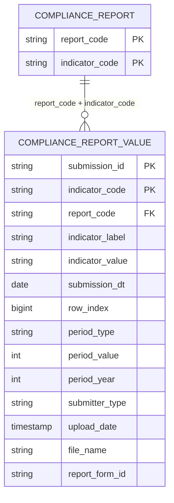
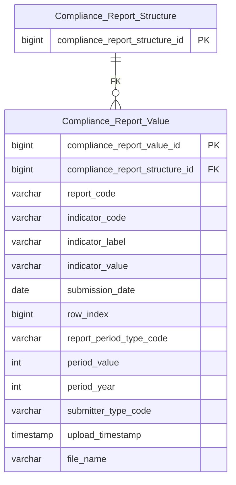

# TMS — HLD Tier 2

> **Tier 2:** Entity có FK đến Tier 1. Hiện có 1 entity: giá trị chỉ tiêu đã nộp của biểu mẫu báo cáo tuân thủ, lấy từ tầng ODS, không có bảng nguồn BRD (`COMPLIANCE_REPORT_VALUE` — thêm 2026-11-15, nguồn `TMS.xlsx` + `note_logic_ods_tms_report_cho_atomic_20261111.md`). Các entity Tier 2 từng thiết kế trước đây đã gỡ theo quyết định Data Modeler 2026-10-21 (LLD là chuẩn) — xem [TMS_HLD_Overview.md](TMS_HLD_Overview.md) mục 7f (nhóm `Chưa có LLD`).

---

## 6a. Bảng tổng quan BCV Concept

| BCV Core Object | BCV Concept | Category | Source Table | Source Table Change Mode | Mô tả bảng nguồn | Atomic Entity | Table Type | BCV Term |
|---|---|---|---|---|---|---|---|---|
| Documentation | [Documentation] Regulatory Information | Compliance Report Management | COMPLIANCE_REPORT_VALUE | N/A | **[MỚI 2026-11-15]** Bảng ODS (`ods_tms_report_value`) — không có BRD: 1 dòng = 1 giá trị của 1 chỉ tiêu (1 ô) trong 1 dòng dữ liệu của 1 lần nộp biểu mẫu (bung từ JSON `ROW_DATA`). Cột mang lên Atomic: `report_code`, `indicator_code`/`indicator_label`/`indicator_value`, `submission_dt`, `row_index`, kỳ báo cáo (`period_type`/`period_value`/`period_year`), `submitter_type`, `upload_date`, `file_name` | Compliance Report Value | Classification | (1) Regulatory Information — BCV: "Reported Information that is required to be filed with regulatory bodies". Regulatory Report được cân nhắc nhưng không chọn: 1 dòng của bảng này là 1 ô giá trị, không phải 1 báo cáo hoàn chỉnh (báo cáo hoàn chỉnh = `Compliance Report`). (2) Bảng có `indicator_value` (giá trị text đã nộp), `indicator_code` + `row_index` (vị trí ô), `report_code`, kỳ báo cáo + loại người nộp, `upload_date`, `file_name` — dữ liệu khai báo gửi cơ quan quản lý, bung theo từng ô. (3) Chọn Regulatory Information, cùng BCV với `Dynamic Report Value` (FMS ITEM_VALUE). Table Type = Classification theo `TMS.xlsx` (ETL Upsert theo BK, không append), xem T2-02. FK → `Compliance Report Structure` (T1) theo `report_code` + `indicator_code`, xem T2-03. BK đề xuất = `submission_id` ‖ `indicator_code`, xem T2-01. |

---

## 6b. Diagram Source (Mermaid)

> Cả 2 bảng là bảng ODS, không có BRD. `COMPLIANCE_REPORT` là node tham chiếu từ Tier 1 (chỉ hiện khóa; cột đầy đủ xem [TMS_HLD_Tier1.md](TMS_HLD_Tier1.md) mục 6b). Quan hệ là logic theo mã (ODS không khai FK vật lý). `submission_id` và `report_form_id` có `Map? = không` trong `TMS.xlsx` nhưng vẫn vẽ vì `submission_id` là khóa ODS — xem T2-01. Dữ liệu ODS được dựng từ `COMPLIANCE_REPORT_DATA` ⨝ `COMPLIANCE_REPORT_FORM` ⨝ `COMPLIANCE_REPORT_MASTER` ⨝ `COMPLIANCE_REPORT_FORM_TEMPLATE` (các bảng BRD này chưa đánh giá scope).

---

## 6c. Diagram Atomic (Mermaid)

> `Compliance_Report_Structure` là node tham chiếu từ Tier 1 (chỉ tên + khóa). FK theo pattern Id + Code: `compliance_report_structure_id` (Surrogate Key, dùng join) + `report_code`, `indicator_code` (mã nghiệp vụ, lưu dư thừa); FK cho phép NULL (xem T2-03). `report_period_type_code` ← `period_type` và `submitter_type_code` ← `submitter_type` là Classification Value (chỉ cột Code, không cặp Id + Code). `submission_date` ← `submission_dt` (ngày nộp, Date); `upload_timestamp` ← `upload_date` (Timestamp). Tên cột Surrogate Key và cột kỹ thuật chốt ở LLD. Các cột ODS `Map? = không` (`submission_id`, `report_form_id`, `row_date_key`, `indicator_business_key`) chưa đưa lên Atomic — xem T2-01.

---

## 6d. Mục Danh mục & Tham chiếu (Reference Data)

| Source Field / Bảng | Mô tả | Scheme Code | source_type | Ghi chú |
|---|---|---|---|---|
| COMPLIANCE_REPORT_VALUE.PERIOD_TYPE | Kỳ báo cáo: DAILY, WEEKLY, MONTHLY, YEARLY | `TMS_REPORT_PERIOD_TYPE` | source_table | Dùng lại scheme đã đăng ký cho `Compliance Report` (cùng tập giá trị kỳ) |
| COMPLIANCE_REPORT_VALUE.SUBMITTER_TYPE | Loại người nộp (BRD không có mô tả) | `TMS_SUBMITTER_TYPE` | modeler_defined | Dùng lại scheme đã đăng ký cho `Compliance Report`; cần profile giá trị thực tế |

---

## 6e. Bảng chờ thiết kế

Không có.

---

## 6f. Điểm cần xác nhận

| # | Câu hỏi | Kết quả |
|---|---|---|
| T2-01 | Khóa ODS của bảng là (`submission_id`, `indicator_code`), nhưng `submission_id` (= id dòng dữ liệu gốc `COMPLIANCE_REPORT_DATA.ID`) và `report_form_id` (id lần nộp) có `Map? = không` trong `TMS.xlsx`, và bảng cũng không mang `SUBMITTER_ID` (chỉ có `submitter_type`). Nếu bỏ 2 cột này, các cột còn lại (`report_code`, `period_*`, `submitter_type`, `row_index`, `indicator_code`) không phân biệt được 2 đơn vị nộp cùng loại cùng nộp 1 biểu mẫu trong 1 kỳ — BK trùng, upsert sẽ ghi đè dữ liệu. | Đề xuất đổi `submission_id` sang `Map? = có` (map thành cột Text `submission_source_id`, thành phần BK). Nên giữ cả `report_form_id` để sau này FK sang `Compliance Report` qua FORM → MASTER (T2-04). **Chờ Data Modeler quyết định.** |
| T2-02 | Table Type = Classification theo `TMS.xlsx` cho bảng chứa dữ liệu instance (giá trị từng ô, `row_index`) — theo Bước 4 dữ liệu instance là entity chứ không phải reference data set. Tuy nhiên `Dynamic Report Value` (FMS ITEM_VALUE, cùng BCV) đã dùng Classification với ETL Upsert. | Giữ theo `TMS.xlsx` và tiền lệ FMS (chỉ đổi ETL pattern sang Upsert, không đổi tên entity). Nếu cần giữ lịch sử giá trị theo lần nộp thì đổi sang Fact Snapshot/Fact Append. Xác nhận. |
| T2-03 | FK → `Compliance Report Structure` theo `report_code` + `indicator_code`. Layout của từng lần nộp có thể dùng dynamic block (cột `COL_xx` không nằm trong header đầu tiên của biểu mẫu) nên chỉ tiêu có thể không có dòng tương ứng trong Structure — ODS chỉ dùng Structure làm fallback nhãn. | FK nullable (không bắt buộc resolve). Id = Surrogate Key của Structure, Code = `report_code` ‖ `indicator_code`. Cần profile tỷ lệ chỉ tiêu không khớp. |
| T2-04 | Chồng lấn với `Compliance Report` (nguồn MASTER): ODS đẩy `period_type`/`period_value`/`period_year`, `submitter_type`, `upload_date`, `file_name` (thuộc FORM/MASTER) xuống từng ô; `Compliance Report` đã có `report_period_type_code`, `period_value`, `period_year`, `submitter_type_code`. Chưa FK sang `Compliance Report` được vì thiếu `report_form_id`/`report_master_id` (T2-01). | Giữ denormalized theo `TMS.xlsx`. Khi có FK sang `Compliance Report` thì cân nhắc bỏ các cột lặp. |
| T2-05 | Cột ODS không đưa lên Atomic: `row_date_key`, `indicator_business_key`, `submission_id`, `report_form_id` (`Map? = không`); `ds_etl_pcs_tms`, `_source_system` (kỹ thuật ODS, không có trong `TMS.xlsx`). `indicator_value` giữ dạng text (note ODS: đã bỏ `indicator_value_number` theo BA 2026-11-11, Atomic tự cast khi cần). `TMS.xlsx` đặt tên `submission_dt` trong khi note ODS ghi `data_date` — tên cột ODS thực cần xác nhận khi viết ETL. | Xác nhận. Không thiết kế `ds_*` theo tiền lệ ODS-origin của FMS (T1-07 FMS) — xem Tier1 T1-12. |
