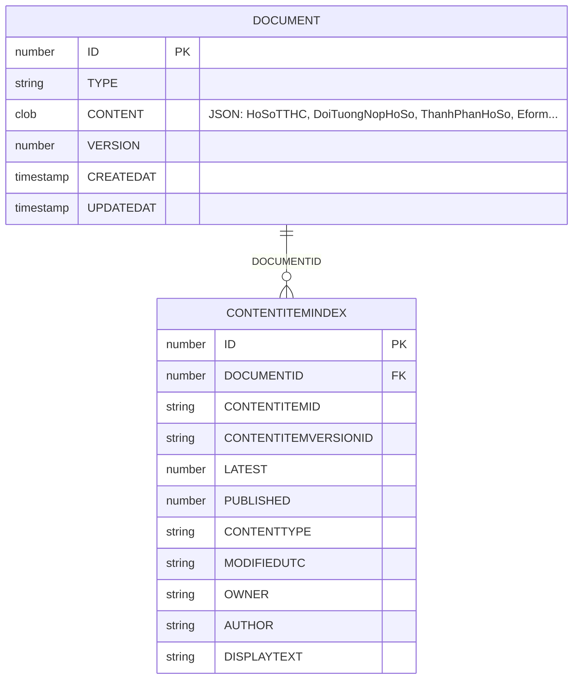
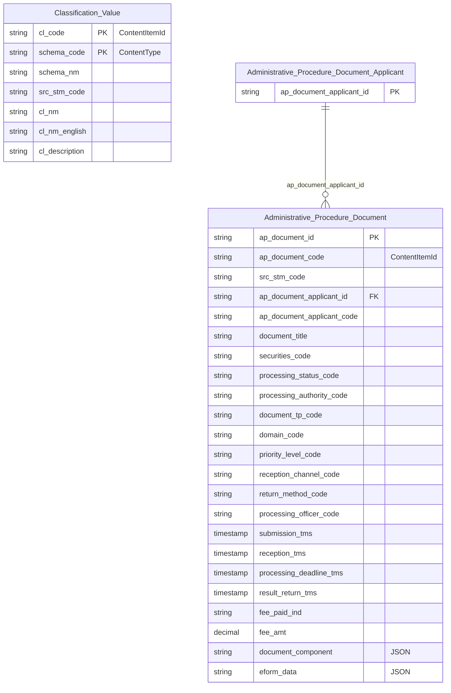

# TTHC HLD — Tier 1

**Source system:** TTHC (Thủ tục hành chính — Hệ thống tiếp nhận/xử lý hồ sơ trên nền Orchard Core CMS)
**Tier 1:** Gồm 2 entity theo LLD: `Classification Value` (shared — danh mục dùng chung TTHC) và `Administrative Procedure Document` (hồ sơ TTHC). Entity `Administrative Procedure Document Applicant` (đối tượng nộp) ở Tier 2 theo LLD — xem `TTHC_HLD_Tier2.md`. Mã điểm xác nhận (T1-xx/T2-xx) giữ nguyên số gốc.

> **Cập nhật 2026-09-30 — luồng STG → parse → ODS → ATM** (nguồn: `ODS_TTHC_DESCRIPTION.md`): toàn bộ entity TTHC **không map 1:1 từ staging** mà đi qua 3 bảng ODS dựng từ 2 bảng staging `DOCUMENT` + `CONTENTITEMINDEX`. Cột "Source Table" ghi bảng staging gốc (để truy vết và đánh scope) kèm bảng ODS mà LLD thực sự map `source_columns`. Thiết kế cũ (2026-08-21: `Administrative Procedure Document` generic mọi ContentType ở Tier 1 + `Administrative Procedure Content Item Index` ở Tier 2) **bị thay thế** — xem D-07 Overview.

**Domain Prefix:** `Administrative Procedure` (abbr `ap`) cho nhóm hồ sơ TTHC; `Classification Value` là shared entity dùng chung dự án (Domain Prefix rỗng, physical `cl_value`).

---

## 6a. Bảng tổng quan BCV Concept

| BCV Core Object | BCV Concept | Category | Source Table | Source Table Change Mode | Mô tả bảng nguồn | Atomic Entity | Table Type | BCV Term |
|---|---|---|---|---|---|---|---|---|
| Common | [Classification] Common | Classification | CONTENTITEMINDEX (qua ODS `CLASSIFICATION_VALUE` / `ods_tthc_classification_value`) | Update (qua ODS — cơ chế nạp ODS chưa xác nhận, xem T1-03) | Danh mục phân loại dùng chung TTHC — mỗi content item Orchard thuộc ContentType danh mục (TrangThaiHoSo, LoaiHoSo, LinhVucTTHC, MucDoTTHC, KenhTiepNhan, CoQuanXuLy, LoaiDoiTuongNop, DichVuChuyenPhat, TinhThanh, QuanHuyen) là 1 giá trị | Classification Value | Relative | (1) Term candidate: shared entity `Classification Value` (`cl_value`) đã có trong dự án (MRMS, NHNCK...) — bảng danh mục Code + Name theo scheme. (2) ODS `CLASSIFICATION_VALUE` = `UNION ALL` nhiều nhánh, mỗi nhánh lọc 1 `CONTENTTYPE` từ `CONTENTITEMINDEX`, **không parse JSON**: `ContentItemId` → `cl_code` (BK), `ContentType` → `schema_code`, `DisplayText` → `cl_nm`. Chỉ có mã + tên + nhóm, không có instance data. (3) Đúng bản chất reference data set → không tạo entity TTHC riêng; bổ sung `TTHC.CLASSIFICATION_VALUE` vào `source_table` của shared entity. BK = `schema_code ‖ cl_code`. |
| Documentation | [Documentation] Documentation | Documentation | DOCUMENT (qua ODS `AP_DOCUMENT` / `ods_tthc_ap_document`) | Update (qua ODS — cơ chế nạp ODS chưa xác nhận, xem T1-03) | Nội dung JSON gốc của content item — nguồn parse các trường nghiệp vụ hồ sơ (`Content->'HoSoTTHC'`, `ThanhPhanHoSo`, `Eform`) | Administrative Procedure Document | Fundamental | (1) Term candidate: **Documentation** (id 9446) — "Identifies an item or a set of Documentation... for example a web page or economic report". (2) ODS `AP_DOCUMENT` = `DOCUMENT ⋈ CONTENTITEMINDEX` (`Document.Id = ContentItemIndex.DocumentId`, ContentType = `HoSoTTHC`), parse JSON: mã chứng khoán, trạng thái/cơ quan xử lý, loại hồ sơ, lĩnh vực, mức độ, kênh tiếp nhận, hình thức trả kết quả, cán bộ xử lý, các mốc thời gian (gửi/tiếp nhận/hạn xử lý/trả kết quả), lệ phí; `ThanhPhanHoSo` và `Eform` giữ nguyên JSON. Grain = 1 hồ sơ TTHC (BK `ContentItemId`). (3) Giữ `[Documentation] Documentation` (đã khóa trong LLD approved): hồ sơ là bộ tài liệu nộp cho cơ quan quản lý kèm metadata xử lý. Term `[Business Activity] Case` từng được nhắc trong comment LLD (PK) nhưng không được chọn làm concept — xem T2-02. Khác thiết kế cũ: không còn generic mọi ContentType, chỉ `HoSoTTHC`. |
| Documentation | [Documentation] Documentation | Documentation | CONTENTITEMINDEX (qua ODS `AP_DOCUMENT`) | Update | Index/metadata content item — cung cấp ContentItemId (BK) + DisplayText (tiêu đề hồ sơ), lọc ContentType `HoSoTTHC` | Administrative Procedure Document | Fundamental | Cùng entity với DOCUMENT — `CONTENTITEMINDEX` cung cấp định danh (`ContentItemId` → `ap_document_code`) và tiêu đề (`DisplayText` → `document_title`), đồng thời là điều kiện lọc loại nội dung. |

---

## 6b. Diagram Source (Mermaid)

> **Ghi chú 6b — luồng ODS (2026-09-30):** entity Tier 1 không map trực tiếp từ 2 bảng staging trên mà qua ODS: `CONTENTITEMINDEX` (lọc ContentType danh mục, UNION ALL) → ODS `CLASSIFICATION_VALUE`; `DOCUMENT ⋈ CONTENTITEMINDEX` + parse `Content->'DoiTuongNopHoSo'` → ODS `AP_DOCUMENT_APPLICANT`. Chi tiết: ghi chú cuối mục 7a của `TTHC_HLD_Overview.md`.

---

## 6c. Diagram Atomic (Mermaid)

> `Classification Value` được `Administrative Procedure Document` tham chiếu qua các cột `*_code` (Classification Value — không vẽ quan hệ theo quy ước). `Administrative_Procedure_Document_Applicant` là entity Tier 2 — hiện dạng node tham chiếu (chỉ PK).

---

## 6d. Mục Danh mục & Tham chiếu (Reference Data)

Giá trị các scheme do chính ODS `CLASSIFICATION_VALUE` cung cấp (`schema_code` = ContentType Orchard). Scheme Code Atomic dùng đúng mã đã khai trong LLD `lld_TTHC_AP_DOCUMENT.yaml`.

| Source Field / Bảng | Mô tả | Scheme Code | source_type | Ghi chú |
|---|---|---|---|---|
| CONTENTITEMINDEX (ContentType `TrangThaiHoSo`) | Trạng thái xử lý hồ sơ | `TTHC.PROCESSING_STATUS` | source_table | Dùng tại `ap_document.processing_status_code` |
| CONTENTITEMINDEX (ContentType `CoQuanXuLy`) | Cơ quan xử lý hồ sơ | `TTHC.PROCESSING_AUTHORITY` | source_table | Dùng tại `ap_document.processing_authority_code` |
| CONTENTITEMINDEX (ContentType `LoaiHoSo`) | Loại hồ sơ TTHC | `TTHC.DOCUMENT_TYPE` | source_table | Dùng tại `ap_document.document_tp_code` |
| CONTENTITEMINDEX (ContentType `LinhVucTTHC`) | Lĩnh vực thủ tục hành chính | `TTHC.DOMAIN` | source_table | Dùng tại `ap_document.domain_code` |
| CONTENTITEMINDEX (ContentType `MucDoTTHC`) | Mức độ dịch vụ công | `TTHC.PRIORITY_LEVEL` | source_table | Dùng tại `ap_document.priority_level_code` |
| CONTENTITEMINDEX (ContentType `KenhTiepNhan`) | Kênh tiếp nhận hồ sơ | `TTHC.RECEPTION_CHANNEL` | source_table | Dùng tại `ap_document.reception_channel_code` |
| CONTENTITEMINDEX (ContentType `LoaiDoiTuongNop`, `DichVuChuyenPhat`, `TinhThanh`, `QuanHuyen`) | 4 nhóm danh mục còn lại có trong ODS | *(chưa đăng ký)* | — | Chưa có cột Atomic nào tiêu thụ sau khi bỏ `ap_document_postal_receipt` — xem T1-04 |
| ODS `AP_DOCUMENT.RETURN_METHOD_CODE` (`HoSoTTHC.ThongTinHinhThucTraHoSo`) | Hình thức trả kết quả (0/1/2 — 2 = bưu chính) | *(chưa đăng ký)* | — | LLD để Data Domain `Text`, chưa gán scheme — xem T2-04 |

---

## 6e. Bảng chờ thiết kế

*(Để trống — không có)*

---

## 6f. Điểm cần xác nhận

| # | Câu hỏi | Kết quả |
|---|---|---|
| T1-01 | ODS `CLASSIFICATION_VALUE`: `ODS_TTHC_DESCRIPTION.md` ghi "không cần parse JSON — chỉ map trực tiếp từ `contentitemindex`", nhưng LLD `lld_TTHC_CLASSIFICATION_VALUE.yaml` ghi ODS JOIN `DOCUMENT` và lấy `cl_description` từ `Document.Content->{ContentType}->'MoTa'->'Text'`. | Chưa xác nhận. Nếu đúng theo tài liệu ODS → `cl_description` sẽ luôn NULL, cần sửa comment LLD. HLD ghi nhận source staging = `CONTENTITEMINDEX` theo tài liệu ODS. |
| T1-03 | Cơ chế nạp 3 bảng ODS TTHC (ghi đè toàn bộ hay incremental theo `MODIFIEDUTC`) chưa có trong `ODS_TTHC_DESCRIPTION.md`. | Tạm ghi `Update`. Ảnh hưởng ETL pattern SCD4A/Upsert trên Atomic. |
| T1-04 | ODS `CLASSIFICATION_VALUE` còn 4 scheme `LoaiDoiTuongNop`, `DichVuChuyenPhat`, `TinhThanh`, `QuanHuyen` — trước đây phục vụ `ap_document_postal_receipt` (đã bỏ khỏi ODS). `TinhThanh`/`QuanHuyen` là danh mục địa lý → theo quy tắc ngoại lệ Geographic Area phải là [Location] Geographic Area (đã chuẩn hóa tại ECAT), không phải Classification Value. | Chưa xác nhận: giữ 4 scheme trong ODS hay loại bỏ; nếu cần địa lý → map sang Geographic Area ECAT. |
| T2-01 | `AP_DOCUMENT` chỉ giữ **1** đối tượng nộp (`DoiTuongNopHoSo->ContentItemIds[0]`), trong khi LLD Applicant ghi "quan hệ 1-N với hồ sơ" và "PK ghép (AP_DOCUMENT_ID, AP_DOCUMENT_APPLICANT_ID)" — nhưng thuộc tính LLD Applicant không có `ap_document_id`, và ODS "lấy thông tin mới nhất của người nộp" (grain = 1 đối tượng). | Chưa xác nhận. HLD theo FK thực tế trong LLD: Document (T1) → Applicant (T2), 1 hồ sơ – 1 người nộp chính. Nếu 1 hồ sơ có nhiều người nộp → cần bảng quan hệ hoặc `ARRAY<Text>` mã người nộp trên Document. Cần sửa notes LLD Applicant cho khớp. |
| T2-02 | Comment PK LLD Document ghi BCV `[Business Activity] Case` và description trong `atomic_entities.yaml` bắt đầu bằng "Business Activity Case", trong khi `bcv_concept` = `[Documentation] Documentation`. | HLD giữ `[Documentation] Documentation` (khớp metadata LLD approved); description `atomic_entities.yaml` đã chỉnh cho khớp. Comment PK trong LLD cần sửa ở lượt LLD. |
| T2-03 | Bảng `AP_DOCUMENT_POSTAL_RECEIPT` (entity `Administrative Procedure Document Postal Receipt`) không có trong `ODS_TTHC_DESCRIPTION.md` (chỉ 3 bảng ODS); LLD đã được chuyển sang `DataModel/working/Backup/` nhưng `manifest.yaml` và `atomic_entities.yaml` vẫn còn dòng entity này. | Chờ Data Modeler xác nhận bỏ hẳn → dọn `manifest.yaml`, `atomic_entities.yaml`, `atomic_attributes.yaml`, `dm_manifest.yaml`, `DataModel/Atomic/Documentation/dm_atm_ap_document_postal_receipt-*.yaml` cùng lượt. Thông tin bưu chính (khi `return_method_code = 2`) hiện không còn lên Atomic. |
| T2-04 | `return_method_code` là mã phân loại (0/1/2) nhưng LLD để Data Domain `Text`, không gán scheme. | Đề xuất đổi sang Classification Value, scheme `TTHC_RETURN_METHOD` (etl_derived) ở lượt LLD. |
| T2-05 | `AP_DOCUMENT` (T1) FK → `AP_DOCUMENT_APPLICANT` (T2): Tier theo LLD/manifest ngược chiều dependency FK (Document → Applicant). | **Đã đồng bộ HLD theo LLD (2026-10-21, quyết định Data Modeler):** `Administrative Procedure Document` = T1, `Administrative Procedure Document Applicant` = T2. Ghi nhận: nếu muốn Tier đúng thứ tự dependency thì phải đổi `group` trong LLD/manifest (Applicant T1, Document T2) — chưa quyết định. |
