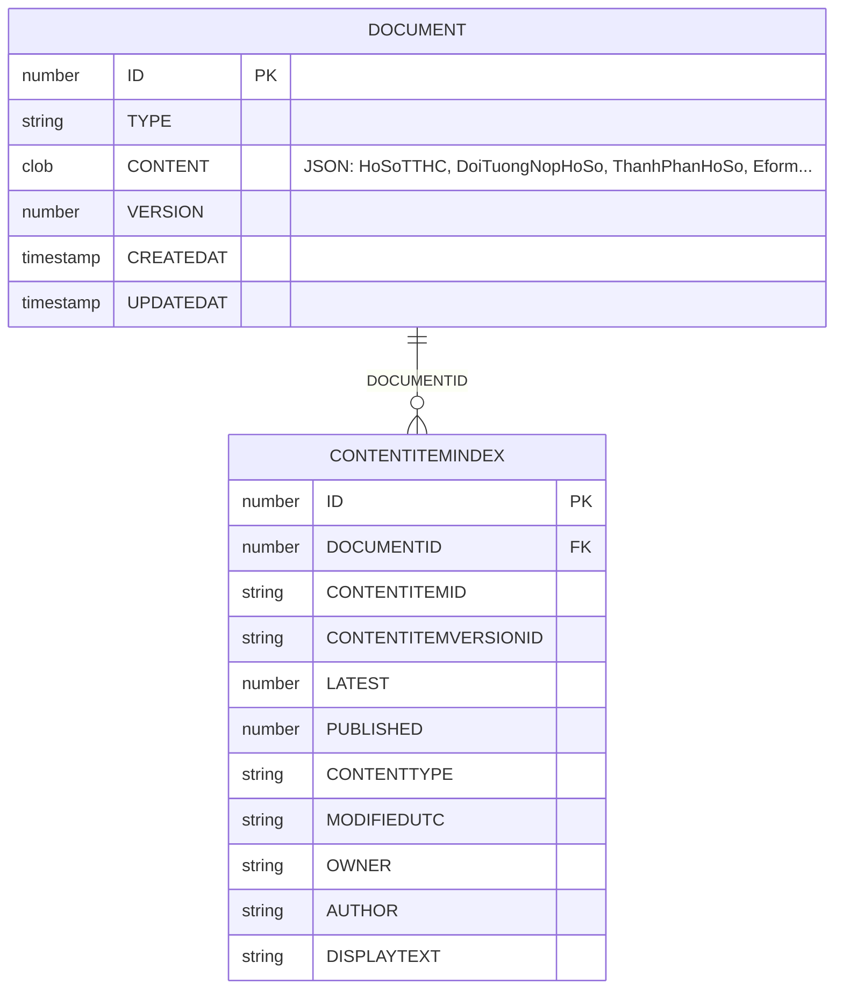
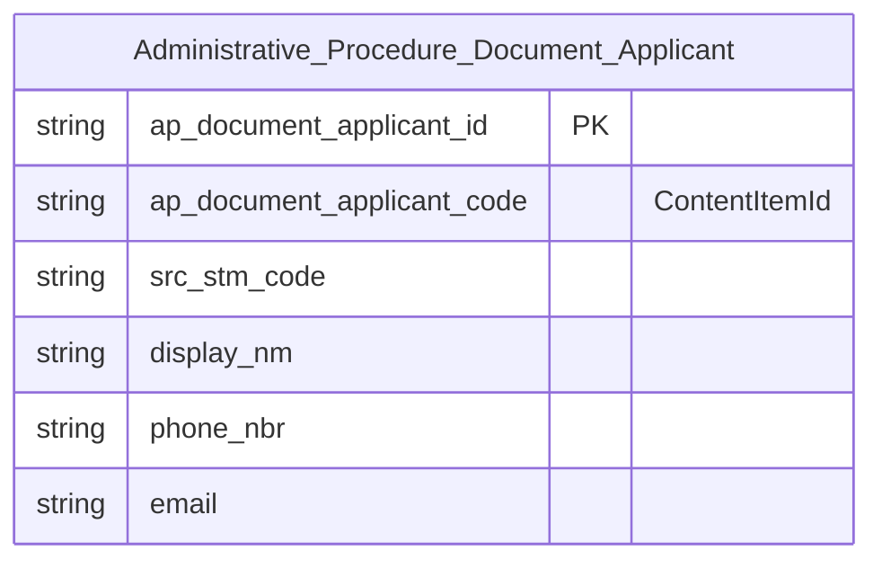

# TTHC HLD — Tier 2

**Source system:** TTHC (Thủ tục hành chính — Hệ thống tiếp nhận/xử lý hồ sơ trên nền Orchard Core CMS)
**Tier 2:** `Administrative Procedure Document Applicant` (đối tượng nộp hồ sơ) theo LLD; được `Administrative Procedure Document` (Tier 1) tham chiếu FK. Mã điểm xác nhận (T1-xx/T2-xx) giữ nguyên số gốc.

> **Cập nhật 2026-09-30 — luồng STG → parse → ODS → ATM** (nguồn: `ODS_TTHC_DESCRIPTION.md`): toàn bộ entity TTHC **không map 1:1 từ staging** mà đi qua 3 bảng ODS dựng từ 2 bảng staging `DOCUMENT` + `CONTENTITEMINDEX`. Cột "Source Table" ghi bảng staging gốc (để truy vết và đánh scope) kèm bảng ODS mà LLD thực sự map `source_columns`. Thiết kế cũ (2026-08-21: `Administrative Procedure Document` generic mọi ContentType ở Tier 1 + `Administrative Procedure Content Item Index` ở Tier 2) **bị thay thế** — xem D-07 Overview.

**Domain Prefix:** `Administrative Procedure` (abbr `ap`) cho nhóm hồ sơ TTHC; `Classification Value` là shared entity dùng chung dự án (Domain Prefix rỗng, physical `cl_value`).

---

## 6a. Bảng tổng quan BCV Concept

| BCV Core Object | BCV Concept | Category | Source Table | Source Table Change Mode | Mô tả bảng nguồn | Atomic Entity | Table Type | BCV Term |
|---|---|---|---|---|---|---|---|---|
| Involved Party | [Involved Party] Involved Party | Involved Party | DOCUMENT (qua ODS `AP_DOCUMENT_APPLICANT` / `ods_tthc_ap_document_applicant`) | Update (qua ODS — lấy thông tin mới nhất của người nộp) | Nội dung JSON gốc của content item — nguồn parse thông tin đối tượng nộp hồ sơ (`Content->'DoiTuongNopHoSo'`) | Administrative Procedure Document Applicant | Fundamental | (1) Term candidate: **Involved Party** (id 10817) — "all participants that may have contact with the Financial Institution or that are of interest to the Financial Institution". (2) ODS `AP_DOCUMENT_APPLICANT` = `DOCUMENT ⋈ CONTENTITEMINDEX`, trích đối tượng nộp từ JSON, lookup lại `CONTENTITEMINDEX` lấy tên hiển thị, **giữ bản ghi mới nhất** mỗi đối tượng: ap_document_applicant_code (= ContentItemId, ContentType `DoiTuongNopHoSo`), display_nm, phone_nbr, email. Người nộp có thể là cá nhân hoặc tổ chức. (3) Không tách Individual/Organization vì nguồn không phân biệt ổn định (loại đối tượng nằm ở scheme `LoaiDoiTuongNop`) → dùng base term `Involved Party`. Grain = 1 đối tượng nộp (BK `ContentItemId`). Hai phiên bản schema JSON (ranh giới 07/02/2025–30/05/2025): cũ = bag nhúng đầy đủ tại root; mới = chỉ còn `ContentItemIds` tham chiếu — xem LLD notes. |
| Involved Party | [Involved Party] Involved Party | Involved Party | CONTENTITEMINDEX (qua ODS `AP_DOCUMENT_APPLICANT`) | Update | Index/metadata content item — cung cấp ContentItemId + DisplayText của đối tượng nộp (ContentType `DoiTuongNopHoSo`) | Administrative Procedure Document Applicant | Fundamental | Cùng entity với DOCUMENT — `CONTENTITEMINDEX` cung cấp định danh (`ContentItemId` = BK) và tên hiển thị (`DisplayText`). |

---

## 6b. Diagram Source (Mermaid)

> **Ghi chú 6b — luồng ODS (2026-09-30):** entity Tier 1 không map trực tiếp từ 2 bảng staging trên mà qua ODS: `CONTENTITEMINDEX` (lọc ContentType danh mục, UNION ALL) → ODS `CLASSIFICATION_VALUE`; `DOCUMENT ⋈ CONTENTITEMINDEX` + parse `Content->'DoiTuongNopHoSo'` → ODS `AP_DOCUMENT_APPLICANT`. Chi tiết: ghi chú cuối mục 7a của `TTHC_HLD_Overview.md`.

---

## 6c. Diagram Atomic (Mermaid)

---

## 6d. Mục Danh mục & Tham chiếu (Reference Data)

*(Không có)*

---

## 6e. Bảng chờ thiết kế

*(Để trống — không có)*

---

## 6f. Điểm cần xác nhận

| # | Câu hỏi | Kết quả |
|---|---|---|
| T1-02 | `Administrative Procedure Document Applicant` có grain = 1 Involved Party và có `phone_nbr`, `email` (schema cũ còn địa chỉ trong bag nhúng) — theo Bước 5 thuộc diện **bắt buộc tách** IP Electronic Address (và IP Postal Address nếu ODS có địa chỉ). LLD đã duyệt đang giữ denormalize. | Chờ Data Modeler chốt: tách shared entity hay chấp nhận ngoại lệ (ODS chỉ giữ bản mới nhất, dữ liệu liên lạc lấy từ hồ sơ chứ không phải hồ sơ Involved Party chuẩn). |
| T1-05 | Người nộp là cá nhân hay tổ chức — ODS không có cột loại đối tượng (`LoaiDoiTuongNop`). | Nếu cần phân tích theo loại → bổ sung `applicant_tp_code` (scheme `LoaiDoiTuongNop`) ở LLD. |
