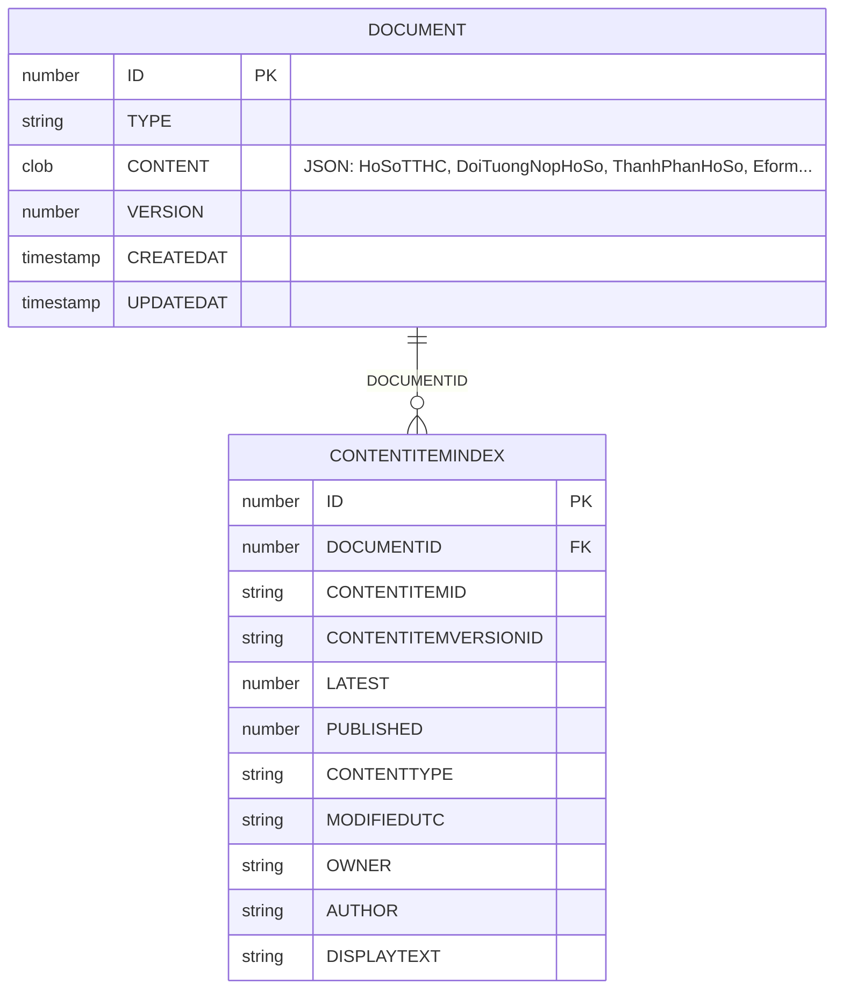
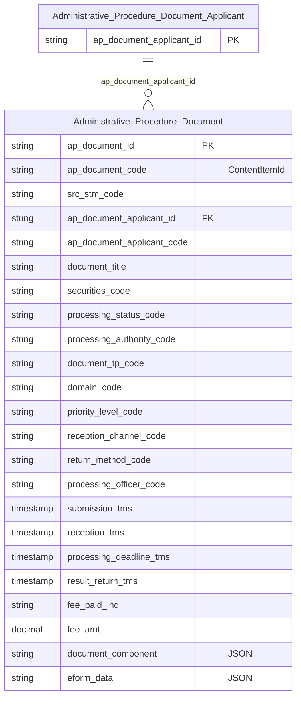

# TTHC HLD — Tier 2

**Source system:** TTHC (Thủ tục hành chính — Hệ thống tiếp nhận/xử lý hồ sơ trên nền Orchard Core CMS)
**Tier 2:** `Administrative Procedure Document` (hồ sơ TTHC) theo LLD; FK đến `Administrative Procedure Document Applicant` (Tier 1) và tham chiếu `Classification Value` (Tier 1). Mã điểm xác nhận (T1-xx/T2-xx) đã đánh lại theo file Tier mới.

> **Cập nhật 2026-09-30 — luồng STG → parse → ODS → ATM** (nguồn: `ODS_TTHC_DESCRIPTION.md`): toàn bộ entity TTHC **không map 1:1 từ staging** mà đi qua 3 bảng ODS dựng từ 2 bảng staging `DOCUMENT` + `CONTENTITEMINDEX`. Cột "Source Table" ghi bảng staging gốc (để truy vết và đánh scope) kèm bảng ODS mà LLD thực sự map `source_columns`. Thiết kế cũ (2026-08-21: `Administrative Procedure Document` generic mọi ContentType ở Tier 1 + `Administrative Procedure Content Item Index` ở Tier 2) **bị thay thế** — xem D-07 Overview.

> **Ghi chú nguồn:** `DOCUMENT` và `CONTENTITEMINDEX` là bảng staging (stg); `AP_DOCUMENT`, `AP_DOCUMENT_APPLICANT`, `CLASSIFICATION_VALUE` là bảng ODS — LLD map theo tên ODS. **Tier (2026-10-21, quyết định Data Modeler):** `Administrative Procedure Document Applicant` = Tier 1, `Administrative Procedure Document` = Tier 2 (Document FK → Applicant); khớp `group` trong LLD/manifest.

**Domain Prefix:** `Administrative Procedure` (abbr `ap`) cho nhóm hồ sơ TTHC; `Classification Value` là shared entity dùng chung dự án (Domain Prefix rỗng, physical `cl_value`).

---

## 6a. Bảng tổng quan BCV Concept

| BCV Core Object | BCV Concept | Category | Source Table | Source Table Change Mode | Mô tả bảng nguồn | Atomic Entity | Table Type | BCV Term |
|---|---|---|---|---|---|---|---|---|
| Documentation | [Documentation] Documentation | Documentation | DOCUMENT (qua ODS `AP_DOCUMENT` / `ods_tthc_ap_document`) | Update (qua ODS — cơ chế nạp ODS chưa xác nhận, xem T1-02) | Nội dung JSON gốc của content item — nguồn parse các trường nghiệp vụ hồ sơ (`Content->'HoSoTTHC'`, `ThanhPhanHoSo`, `Eform`) | Administrative Procedure Document | Fundamental | (1) Term candidate: **Documentation** (id 9446) — "Identifies an item or a set of Documentation... for example a web page or economic report". (2) ODS `AP_DOCUMENT` = `DOCUMENT ⋈ CONTENTITEMINDEX` (`Document.Id = ContentItemIndex.DocumentId`, ContentType = `HoSoTTHC`), parse JSON: mã chứng khoán, trạng thái/cơ quan xử lý, loại hồ sơ, lĩnh vực, mức độ, kênh tiếp nhận, hình thức trả kết quả, cán bộ xử lý, các mốc thời gian (gửi/tiếp nhận/hạn xử lý/trả kết quả), lệ phí; `ThanhPhanHoSo` và `Eform` giữ nguyên JSON. Grain = 1 hồ sơ TTHC (BK `ContentItemId`). (3) Giữ `[Documentation] Documentation` (đã khóa trong LLD approved): hồ sơ là bộ tài liệu nộp cho cơ quan quản lý kèm metadata xử lý. Term `[Business Activity] Case` từng được nhắc trong comment LLD (PK) nhưng không được chọn làm concept — xem T2-02. Khác thiết kế cũ: không còn generic mọi ContentType, chỉ `HoSoTTHC`. |
| Documentation | [Documentation] Documentation | Documentation | CONTENTITEMINDEX (qua ODS `AP_DOCUMENT`) | Update | Index/metadata content item — cung cấp ContentItemId (BK) + DisplayText (tiêu đề hồ sơ), lọc ContentType `HoSoTTHC` | Administrative Procedure Document | Fundamental | Cùng entity với DOCUMENT — `CONTENTITEMINDEX` cung cấp định danh (`ContentItemId` → `ap_document_code`) và tiêu đề (`DisplayText` → `document_title`), đồng thời là điều kiện lọc loại nội dung. |

---

## 6b. Diagram Source (Mermaid)

> **Ghi chú 6b — luồng ODS (2026-09-30):** entity TTHC không map trực tiếp từ 2 bảng staging trên mà qua ODS: `CONTENTITEMINDEX` (lọc ContentType danh mục, UNION ALL) → ODS `CLASSIFICATION_VALUE`; `DOCUMENT ⋈ CONTENTITEMINDEX` + parse `Content->'DoiTuongNopHoSo'` → ODS `AP_DOCUMENT_APPLICANT`. Chi tiết: ghi chú cuối mục 7a của `TTHC_HLD_Overview.md`.

---

## 6c. Diagram Atomic (Mermaid)

> `Classification Value` (Tier 1) được tham chiếu qua các cột `*_code` (không vẽ quan hệ theo quy ước). `Administrative_Procedure_Document_Applicant` là entity Tier 1 — hiện dạng node tham chiếu (chỉ PK).

---

## 6d. Mục Danh mục & Tham chiếu (Reference Data)

Các scheme Classification Value dùng tại entity này do Tier 1 cung cấp (xem `TTHC_HLD_Tier1.md` 6d).

| Source Field / Bảng | Mô tả | Scheme Code | source_type | Ghi chú |
|---|---|---|---|---|
| ODS `AP_DOCUMENT.RETURN_METHOD_CODE` (`HoSoTTHC.ThongTinHinhThucTraHoSo`) | Hình thức trả kết quả (0/1/2 — 2 = bưu chính) | *(chưa đăng ký)* | — | LLD để Data Domain `Text`, chưa gán scheme — xem T2-04 |

---

## 6e. Bảng chờ thiết kế

*(Để trống — không có)*

---

## 6f. Điểm cần xác nhận

| # | Câu hỏi | Kết quả |
|---|---|---|
| T2-01 | Quan hệ Document ↔ Applicant và PK ghép của Applicant trong notes LLD. | **[ĐÃ CHỐT 2026-10-21]** Khai thác đứng từ `AP_DOCUMENT` join sang `AP_DOCUMENT_APPLICANT` để lấy người nộp; comment "PK ghép (AP_DOCUMENT_ID, AP_DOCUMENT_APPLICANT_ID)" trong LLD phản ánh dữ liệu ở nguồn, không phải thiết kế Atomic — Applicant không cần cột `ap_document_id`. Document (T2) FK → Applicant (T1) theo LLD. |
| T2-02 | Comment PK LLD Document ghi BCV `[Business Activity] Case` và description trong `atomic_entities.yaml` bắt đầu bằng "Business Activity Case", trong khi `bcv_concept` = `[Documentation] Documentation`. | HLD giữ `[Documentation] Documentation` (khớp metadata LLD approved); description `atomic_entities.yaml` đã chỉnh cho khớp. Comment PK trong LLD cần sửa ở lượt LLD. |
| T2-03 | Bảng `AP_DOCUMENT_POSTAL_RECEIPT` (entity `Administrative Procedure Document Postal Receipt`) không có trong `ODS_TTHC_DESCRIPTION.md` (chỉ 3 bảng ODS); LLD đã được chuyển sang `DataModel/working/Backup/` nhưng `manifest.yaml` và `atomic_entities.yaml` vẫn còn dòng entity này. | Chờ Data Modeler xác nhận bỏ hẳn → dọn `manifest.yaml`, `atomic_entities.yaml`, `atomic_attributes.yaml`, `dm_manifest.yaml`, `DataModel/Atomic/Documentation/dm_atm_ap_document_postal_receipt-*.yaml` cùng lượt. Thông tin bưu chính (khi `return_method_code = 2`) hiện không còn lên Atomic. |
| T2-04 | `return_method_code` là mã phân loại (0/1/2) nhưng LLD để Data Domain `Text`, không gán scheme. | Đề xuất đổi sang Classification Value, scheme `TTHC_RETURN_METHOD` (etl_derived) ở lượt LLD. |
